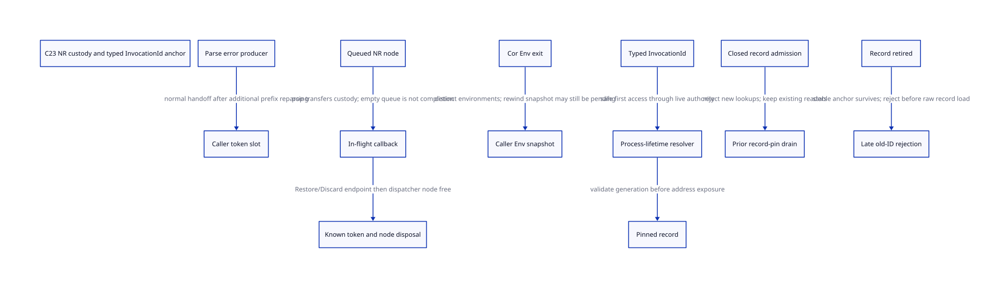

#+TITLE: C23 indirect snapshot producers, NR custody and InvocationId query anchors
#+SETUPFILE: ../../modeling/org/setup.org
#+LANGUAGE: en
#+PROPERTY: header-args :eval never
#+STARTUP: overview

* RESEARCH Decisions and evidence scope
:PROPERTIES:
:AUTHORITY: GambitNrAnchorRetirement
:STATUS: source-bound producer; conditional model; native abnormal/anchor/product unresolved
:CUSTOM_ID: nr-anchor-retirement
:END:

Refine [[file:saved-result-retirement-design.org][saved-result retirement]] with the actual missing producer and NR dispatch
handoff. Queue removal is a responsibility transfer, not token completion.
A completion record is accessed through a live typed-ID resolver, not by validating
a generation inside possibly dead memory. In this design the resolver is
process-owned; record retirement does not imply resolver retirement.

[[file:models/sysml/nr-anchor-retirement.sysml][Native SysML]] supplies source/consumer/issuer/obligation/action routes and gains.
[[file:nr-anchor-retirement-matrix.org][Org matrix]] and  are generated projections. [[file:../../../evidence/research/future-frame-commit/nr-anchor-retirement/][Evidence]] records exact inputs,
formal checks and the immutable missing-source capture. No runtime implementation,
compiler/preprocessor invocation, native test or performance experiment.

Local captured files and cache copies did not contain TclSubstParse's definition.
This study added only [[file:../../../evidence/research/source-references/tcl/cbf86d62348d6b052e1961b4df995960fb21545f/generic/tclParse.c][tclParse.c]] from the same immutable Tcl commit already used
by this research. The GitHub connector fetched the commit-specific file and Git
tree entry. Its reproduced Git blob SHA-1 equals
0b9ecddf8b53b30c15c0da3b6f6c43c4fa09282c; byte count is 75538. The
[[file:../../../evidence/research/future-frame-commit/nr-anchor-retirement/parse-source-capture.json][capture receipt]] also binds SHA-256 and tree metadata. This is not a branch update
or proof of the Darwin loaded library. Older evidence that lacked this source
remains historical; its unresolved producer edge is narrowed here.

* TclSubstParse: actual indirect producer
The caller TclSubstCompile initializes =state = NULL= and passes =&state= into
TclSubstParse. That callee initializes the Tcl_Parse and invokes ParseTokens.
Only a parse error executes =*statePtr = Tcl_SaveInterpState(interp,TCL_ERROR)=.
The successful branch does not write the output slot. Thus initialization is a
real caller precondition, not an invented all-path token allocation.

After publishing the error snapshot, the callee repeatedly reparses a valid
prefix and adjusts tokens around the unmatched opener before returning. The
snapshot and parse-token buffer have different ownership: the caller must consume
the saved state with Restore/Discard and separately call Tcl_FreeParse. A freed
parse-token array is not evidence that the error-state snapshot was consumed.

On ordinary return the compiler caller sees the nonnull state, resets the current
result, emits code for the valid prefix, calls Tcl_FreeParse, then conditionally
RestoreInterpState and emits a syntax error. This closes the normal producer ->
out-slot -> private caller -> Restore chain at source level. It does not prove
all parser panics or foreign nonlocal exits return normally.

The write into the output slot precedes the remaining parser work. If control is
lost after that write, neither 'callee never returned' nor 'caller saw an error'
automatically identifies a stable native owner. A managed interface needs a
pre-established stable receiving slot/escrow and a handoff receipt. A pointer to
an abandoned C local is not such escrow. The model below admits a private-token
lane but does not implement allocation failure, setjmp-local rules or arbitrary
parser callback effects.

* NR snapshot handoff: queued and in-flight are distinct
TclNRAddCallback allocates a node, writes procPtr and data[0..3], links nextPtr,
then publishes TOP_CB. RewindCoroutine and Tcl_NRExprObj place the snapshot token
in data[0]. TclNRRunCallbacks performs this exact order:

1. capture callbackPtr and procPtr from TOP_CB;
2. set TOP_CB to callbackPtr->nextPtr;
3. invoke procPtr(callbackPtr->data,...);
4. free callbackPtr only after normal return.

The snapshot therefore remains held by an in-flight callback/node after it is
absent from the chain. If the callback consumes the snapshot but escapes before
the dispatcher frees its node, token consumption and node cleanup also differ.
An ordinary expression callback restores state on TCL_OK and discards on error;
the selected endpoint is real, but generic node free does not consume arbitrary
data[0] by itself. Raw node free is not a snapshot destructor.

A managed abnormal-exit adapter must establish independent in-flight custody
before calling procPtr. On unknown completion keep opaque token/node OperationIds,
owner Env/interpreter identity and dependent resources. It must not assume the
token is still safe to dereference if it may have been consumed. Re-executing the
callback or Restore/Discard can double consume; do not replay it blindly.
Normal completion may reuse existing node/data ownership without duplicating
all Tcl object snapshots. The stable guard is needed for admitted abnormal
lifetimes; the current C callback local alone does not supply that service.

* Coroutine deletion: distinguish owner environments
| Actual path | Snapshot/cleanup owner | Proven source ordering and remaining boundary |
|-------------+------------------------+----------------------------------------------|
| suspended DeleteCoroutine | current caller Env receives rewind snapshot callback | calls RewindCoroutine then NRRunCallbacks to saved root |
| RewindCoroutine | SaveInterpState token -> RewindCoroutineCallback data[0] | asserts coroutine Env suspended and different from current; sets rewind and posts callback before activation |
| command deleted while running | NRCoroutineCallerCallback detects deletion after context handling | invokes RewindCoroutine; not unconditional immediate state free |
| NRCoroutineExitCallback | coroutine Env and command resources | runs on return/wind-down, not yield; disables delete hook, deletes command/Env, restores caller |
| RewindCoroutineCallback | caller-side saved state | RestoreInterpState consumes snapshot after returning to that callback |
| TclDeleteExecEnv | specified Env's stacks/constants and callback-chain guard | panics on pending callbacks/coroutine outside process-exit mode; does not drain arbitrary callback payloads |

It is legitimate for a coroutine Env to be deleted while a snapshot callback in
a distinct caller Env remains pending. Do not impose a false global rule that
all callbacks must complete before any Env can die. The model's eeLive names the
snapshot callback's owner Env, not every Env touched during coroutine exit.

Nor is an empty TOP_CB sufficient by itself for owner-Env reclamation: popped
callbacks may be running. Real caller/exit assertions, current execEnv switching,
C stack-use markers and the final node last-use must be refined together. The
model enforces a conservative owner-scope condition, not a proof that the existing
source has a supported-use UAF. Its normal exit/panic checks have exceptions for
process exit; those paths are not reusable interpreter retirement receipts.

* Stable InvocationId lookup architecture
Use a process-owned resolver/service with opaque
=(service identity, VM identity, invocation generation, invocation serial)=
keys. These are semantic fields, not a promised C layout. The resolver lifetime
and initial service handle must be established by the embedding contract before
any VM/record load. External raw record/anchor pointers are not an admitted route.

A request first borrows the live resolver, then validates key/generation and
record admission under the same authority that pins the record. Only after a
successful pin may it expose/read a record address. Closing record lookup stops
new record pins; existing record pins remain until last access. A resolver reader
that has not obtained a record pin need not block reclaiming that record after
its admission is closed, but it must not observe an incoherent mapping.

Retiring the heavy record leaves the resolver alive. Late typed envelopes can
return =retired-or-unknown= without dereferencing the old record. Slot reuse in
this conservative model waits for resolver readers to drain, changes generation,
then publishes the new mapping. It cannot recreate the old identity. The model
rejects a generation-one ACK while generation two is current. Native width/no-wrap,
service-id reuse and safe dictionary removal remain obligations; integer identity
is not magic protection for an unsafe first load.

This is a deliberate API choice: =retired-or-unknown= is not a false claim that
the old invocation succeeded, nor a promise to preserve all historical results.
If callers need the exact outcome indefinitely, store a separately retained
compact outcome or keep the record. Historical lookup rights and completed
records have real storage cost. Existing Gambit exposes no InvocationId resolver;
this is a proposed managed service, not source behaviour already available.

* ACK producers, raw routes and resolver lifetime
Record retirement requires known token/node completion, result/source detachment,
closed and drained ACK producers, no record pins, closed record admission and
proof that no raw access route survives. The =closeSenders= and =closeRawRoutes=
model actions denote authoritative native receipts, not algorithms that infer
closure from a done bit. Message queues, callback payloads, continuation references
and unknown sender completion need independent accounting before issuing them.

A legitimate typed late message can be rejected at the live resolver. A delayed
raw pointer message cannot be made safe by reading the freed record's generation.
It must have held a lease, been drained, or be excluded from the managed profile.
Unknown delivery retains its sender/record duty; do not sign closure to shrink
the ledger. This study does not prove the full transport/refinement product.

The model intentionally has no resolver-destruction action. It chooses a
process-lifetime authority instead of adding an unproved second reclamation
protocol. That leaves a real long-lived service cost. A bounded pool of reusable
slots can use generations without permanent per-InvocationId payloads only with
safe old-key rejection and a no-wrap/refusal policy; it does not prove bounded
state for unlimited VMs, identities or forever-retained outcomes. Destroying the
service before process exit would need separately closed entry routes, all anchor
borrows and messages drained, and proof that no foreign code holds its address.
Process termination is not a reusable-service retirement proof.

* C23 ordering and unknown custody
Resolver publication precedes acquire of a service lease. Mapping validation and
record pinning must linearize against close/reclaim; separate load-then-increment
on a potentially dead record is insufficient. Record close and final pin release
must order last payload/code accesses before reclaim, while mapping readers see
consistent generation/pointer state. Slot reuse waits the relevant resolver grace.
The abstract scalar model does not choose hazard pointers, RCU or a lock-free map;
a modern C owner mutex may satisfy the contract where effects and reentry permit.

Token-to-callback publication and queue-pop-to-in-flight transfer need no unowned
gap. Every native callout that may collect, reenter or abandon must already have
source/root and stable custody established. Known consumption, node free and done
publication are different effects. A non-abandoning completion tail or exact-operation
receipts are still needed; atomics cannot roll back arbitrary destructors.
If unknown, keep the original owner/escrow and deny Env/record retirement. Do not
rescan potentially freed token memory or use a lost C frame as the custodian.

Gambit's SFUN/run marker, RC root and descriptor obligations remain in addition to
Tcl NR custody. Restoring a Tcl error-state object does not restore a native C
activation or grant a new Scheme call. The retained [[file:../../../evidence/research/source-references/feeley-sfp/8bb2fae8ae4b54d3a86206596f90e9cf73da39846af0f39244a476074cf81ed4.txt][Feeley continuations/C paper]]
grounds those lifetime distinctions, not the new service implementation.

* Actual model and refinement scope
[[file:models/quint/nr_anchor_retirement.qnt][QNT]] has twelve scalar fields and twenty-two actions. Token locations distinguish
absent, privately produced, queued, popped/in-flight, known consumed, settled and
unknown; queue/node duties are explicit. A no-token successful parse lane needs
no Restore/Discard. The callback Env can leave only after normal ownership
settlement in this conservative slice. It does not model deleting a different
coroutine Env as deleting the snapshot's caller Env.

Resolver and record borrows are separate. Record retirement may proceed with an
anchor-only reader if record lookup is closed and no record pin exists. Reusing
the slot requires zero anchor borrows. Sender/raw-route closure are explicit
premises. The process resolver remains alive even when recordLive becomes zero.

[[file:models/lean/NrAnchorRetirementAst.lean][Typed-IR projection]] binds QNT actions to [[file:models/lean/NrAnchorRetirement.lean][Lean]]. Per-action preservation and reachable
induction prove abstract safety. popKeepsNode and oldGenerationCannotAck expose
important non-implications. The actual previous SavedResultRetirementAst record
retirement transition is joined only through a completion/result/observer mirror;
that mirror and native closure are independent obligations, not full product
simulation or proof of the actual Tcl callback loop.

Six histories cover private parse-error consumption, successful parse without a
token, normal NR return, escaped popped callback, prior record reader after close,
and rejection of an old ACK after reuse. Nine negative controls reject owner-Env
exit after pop or unknown completion, replaying a popped unknown callback,
confusing known token consumption with node completion, record access without
anchor authority, early retirement with pins/raw routes, late lookup and old ACK
acceptance. ASCENT matches exact source/action/compiled-lemma, six consumer classes
and five issuers. Native gaps block admission; synthetic complete receipts test
only the DSL wiring.

* Benefits, costs and migration gates
The missing parse producer's normal chain is now source-closed without allocating
a fictional token on every successful parse. Normal NR nodes/data already carry
the token; reuse that ownership rather than clone snapshots. For I admitted
in-flight/unknown scopes, additional independent custody can require O(I) records.
Exact bytes, allocator traffic and native performance remain unmeasured.

A live typed-ID resolver can retire large completed payload records while keeping
only required identity/mapping/outcome state. It adds permanent service and
lookup/pin costs; retaining unknown operations or permanent outcome rights can
still grow without bound. This is a conditional net-benefit mechanism, not a
measured speedup or a claim all completed history becomes O(1).

Retire raw managed record entry only after all pointer/message aliases are mediated
or excluded. Retire node-local abnormal custody assumptions only after pop and
last-use hooks have actual issuers. Reuse current ordinary Restore/Discard and
normal callback dispatch; do not invent cleanup endpoints where callback escape
bypasses them. Full coroutine/NR exit product, loaded Tcl ABI and C23 machine
refinement remain open. No runtime path retires from these formal checks alone.
