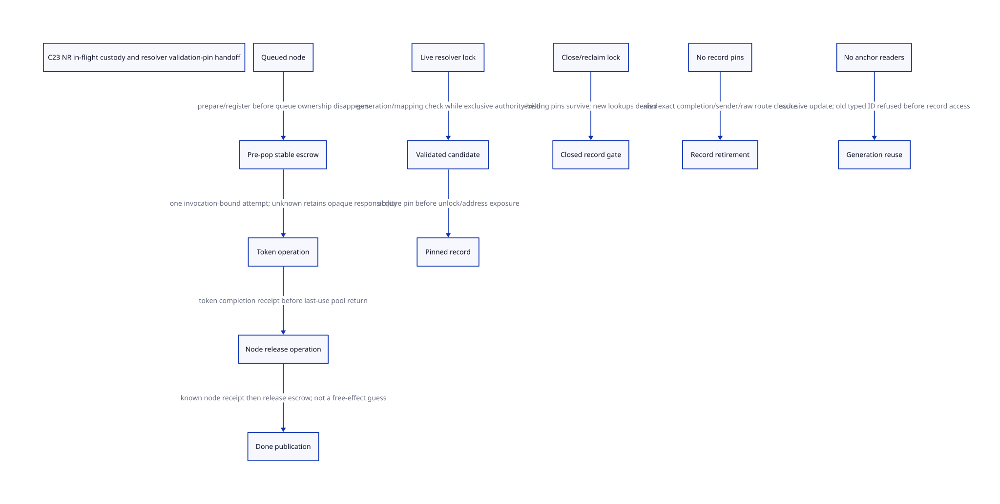

#+TITLE: C23 NR in-flight custody, split completion receipts and resolver pin handoff
#+SETUPFILE: ../../modeling/org/setup.org
#+LANGUAGE: en
#+PROPERTY: header-args :eval never
#+STARTUP: overview

* RESEARCH Refinement decision
:PROPERTIES:
:AUTHORITY: GambitNrInflightHandoff
:STATUS: conditional-model; native adapter / resolver / generation closure unresolved
:CUSTOM_ID: nr-inflight-handoff
:END:

Refine the previous [[file:nr-anchor-retirement-design.org][NR/anchor model]], whose finishLanding collapsed node
release and done. The native path has multiple irreversible effects: snapshot
consumption, callback return, node pool/free, and completion publication. Give
each an independent obligation/receipt; do not infer receipts from ghost effect
flags or retry unknown destructive work. The stable record precedes dequeue.

[[file:models/sysml/nr-inflight-handoff.sysml][Native SysML]] owns source/consumer/issuer/obligation/action routes and gains.
[[file:nr-inflight-handoff-matrix.org][Org matrix]] and  are projections. [[file:../../../evidence/research/future-frame-commit/nr-inflight-handoff/][Evidence]] binds current source and
formal inputs. No runtime implementation, C compiler/preprocessor, native test or
performance experiment. C23 remains the refactoring baseline.

* Exact native path and last uses
The fixed local Tcl source follows this chain for an expression snapshot:
Tcl_NRExprObj SaveInterpState -> callback data[0]/data[1] -> TclNRRunCallbacks
captures callbackPtr/procPtr -> pops TOP_CB -> ExprObjCallback -> conditional
RestoreInterpState or DiscardInterpState -> callback return -> TCLNR_FREE.
RewindCoroutineCallback is a second actual consumer, restoring data[0].

| Window | Live responsibility and actual source | Required completion evidence |
|--------+---------------------------------------+------------------------------|
| before pop | node is still on TOP_CB; callback data owns token | stable escrow prepared and linked while queue/source remain valid |
| popped, before proc | local callbackPtr/procPtr; data points inside node | transfer queue duty to exact in-flight invocation |
| callback before token consumer | expression may duplicate object result before Restore; rewind directly Restore | callback-specific effects and source/result ownership |
| Restore/Discard in progress | Restore already mutates interp fields; Discard decrements several objects before ckfree(statePtr) | exact token operation known complete, not an inferred result code |
| token consumed, callback not returned | caller may still use result/activation; node data still needed by callback | callback return/last-use closes all node data borrows |
| node release in progress | TCLNR_FREE selects pool/free branch | matching allocator/native-thread completion and no remaining node access |
| release done, before publication | token/node can already be gone | independent record publishes done; lost ACK retains identity, not freed pointers |

RestoreInterpState updates error/control state and object result before its final
DiscardInterpState. Discard decrements errorInfo/errorCode/returnOpts/errorStack/
objResult and then frees the token. An escaped operation may have applied some
or all effects. Re-running it is not a valid generic rollback or completion probe.
The refcount macro has a TclFreeObj slow path for internal representations; the
current captured caller/macros do not close every custom destructor or allocator
hook. Do not classify all decrements as nonreentrant/nonabandoning.

TclNRRunCallbacks converts a nonempty legacy string result through GetObjResult
before it starts the callback loop. That pre-loop conversion can itself dispose
native string storage. An adapter cannot assume all callouts begin only after
pop. It must acquire its dispatcher/source authority before entering this prefix;
individual per-node escrow preparation is then done while that queued node is valid.

* Stable in-flight record before dequeue
The proposed DispatchEscrow is independent of both the reclaimable callback node
and any replayable Scheme frame. It binds InvocationId/attempt, callback kind,
node storage generation, snapshot/result identities, owner Env/interpreter,
native thread/allocator, source/code/provider holds and operation status. Do not
place the only persistent status inside the node that will be returned to a pool.

prepareEscrow completes before pop. It must use a qualified pre-reserved record or
leave the node queued if preparation fails; allocation/hook escape must not create
an unowned interval. While queued, the existing node remains the payload owner;
the preparation record does not authorize a second snapshot consumption. Pop
commits the one transfer into the in-flight record under dispatcher authority.
Current Tcl has no such managed record hook: adding it means modifying or adapting
common dispatch and token-specific endpoints, not asserting that callbackPtr's C
local already survives longjmp.

Independent custody does not require a deep copy of every Tcl object graph.
Reuse ordinary node/token storage and existing references where its lifetime is
known. On unknown completion, retain opaque storage/operation identity and
provider/source duties without dereferencing possibly freed token/node memory.
A native pointer remaining in a record is not automatically a valid GC root slot.
Gambit marker/RC root and descriptor lifetime remain separate obligations if the
callback reenters Scheme or propagates a continuation across the boundary.

* Exactly one attempt and authoritative completion
A controller moves through prepared -> popped -> token operation in flight ->
token known -> node release in flight -> node known -> done -> escrow released.
Unknown token and unknown node return are different retained states.

The model's tokenApplied/nodeApplied flags describe physical-effect ghost facts.
They are deliberately not backend receipts or readable runtime completion tests.
Even if an effect happened, no confirm transition is admitted until the original
operation's authoritative receipt exists. Unknown destructive operations cannot
re-enter beginToken/beginNodeRelease. A stale completion from another invocation
must be rejected through exact identity admission; this single-operation slice
assumes validated receipts rather than proving transport routing for all IDs.

A generic wrapper cannot make arbitrary destructor/pool effects plus stable ACK
atomic. Native support must qualify a non-abandoning effect-to-record tail or
provide same-operation recovery evidence. If neither exists, keep UNKNOWN and
refuse retirement. An 'only one owner' bit can prevent duplicate attempts, but
cannot tell whether an abandoned attempt already freed memory. The protocol
therefore supplies safety/refusal, not a general exactly-once executor or liveness.

The former finishLanding abstraction is decomposed here. The known token receipt
precedes the modeled node-release begin; actual native completion also requires
callback return and last access to node data. The model includes that last-use
fact in beginNodeRelease's native premise, not an invented claim that consuming
the snapshot alone proves the callback returned. Other callback kinds with
retained data require their own endpoint specification or refusal.

* Node allocator and native owner are part of the contract
TCLNR_FREE selects TclSmallFreeEx when NRE_USE_SMALL_ALLOC is enabled, otherwise
ckfree. The small allocator explicitly forbids crossing thread boundaries.
Its branches include object-storage pool return, thread-cache service, PURIFY
free and debug-object teardown. In the thread-cache branch, returning storage
writes the free-chain pointer and can make the node address reusable immediately.
The code after pool return must not read callback data through that pointer.
The effective Tcl configuration/loaded ABI is not qualified here.

Thus a collector worker or arbitrary Gerbil task may coordinate an escrow record
without becoming authorized to perform the original Tcl pool release. Keep the
owner-native-thread affinity, or prove a real allocator/domain migration. This
also matters for the selected interp allocCache passed to TCLNR_FREE after a
callback can switch execEnv: interpreter/native owner and coroutine Env are not
interchangeable. The earlier study's caller-versus-coroutine distinction remains.

* Resolver: validation-to-pin is one protected handoff
The process-lifetime typed-ID resolver remains the first-access authority.
For a modern-C mutex-based candidate, define a mapping authority shared by lookup,
close/reclaim and slot reuse:

1. Borrow the live resolver before any record address is read; acquire mapping lock.
2. Validate service/VM/invocation key, generation, record admission and mapping.
   The validated candidate still confers no address-use right outside the lock.
3. Install the record pin before unlocking or exposing the address. Validation
   and pin publication may be fused into one critical section.
4. Read/use the record with that pin; after the last use, return pin and resolver
   borrow through the qualified authority.
5. Close obtains the same mapping lock, closes new record admission, then unlocks
   before waiting for old readers. Existing pins survive close.
6. Reclaim only after old pins, dispatch escrow, exact completion, senders/deliveries
   and raw access routes have drained. Reacquire exclusive authority for removal.
7. Reuse waits for relevant resolver readers as well, advances generation and
   publishes the new mapping under exclusive authority. Overflow refuses reuse.

This is an ordinary-owner/mutex candidate, not a claim a lock-free map or new
universal hazard-pointer system is necessary. It can eliminate a separate
validation reservation/retry protocol if every mapping access obeys the same
lock. The record pin still lasts beyond the lock and cannot be removed simply
because lookup returned. Pin counter access itself needs the chosen coherent
mutex/atomic discipline; this study does not install a native field layout.

If a lookup is abandoned while holding the map lock or after pin registration,
retain the stable operation/lease. Do not clear lock or count based on missing
ACK. Arbitrary cancellation/longjmp must either be excluded during this bounded
section or handled by a qualified native cleanup landing. A robust mutex, error
code or generation test alone does not prove mapping consistency restoration.
No wait is allowed while holding a lock needed for final pin return. The model
can close then unlock/reacquire; it proves safety, not fairness of every scheduler.

Late typed messages are rejected by live resolver identity before record access.
Raw late pointers require leases or sender/alias closure. The process-owned
resolver is not retired in this model. Machine-width wrap, service/VM identity
reuse, dictionary lifecycle and exact historical-outcome policy remain separate
native obligations. This is not a proof that all completed history is bounded.

* C23 refinement conditions
Map publication and immutable identity fields must be observed through the chosen
acquire authority; close and pin installation have one linearization order.
Final pin release orders the reader's last payload/code use before reclamation.
The chosen atomic object type, alignment, lock implementation and error semantics
must be real C23-compatible storage operations, not casts of legacy plain fields.

Node publication/dequeue and escrow commit must preserve one custodian. Token
and node effects preserve different allocator, descriptor and root dependencies.
Sender closure includes in-flight delivery and any raw alias; closeSenders and
closeRawRoutes are native receipt inputs, not consequences of a scalar done bit.
Generation reuse is exclusive and refuses overflow; old typed IDs never validate
through a new mapping. These are necessary refinement premises, not current
Darwin/native qualification.

* Actual formal chain and limits
[[file:models/quint/nr_inflight_handoff.qnt][QNT]] contains sixteen fields and thirty-one actions. It models a queued node,
independent escrow, separate token/node effect and receipt flags, a ten-stage
completion path, lookup/close/reuse lock ownership, validated candidate, pins,
record lifetime and two generations. Physical-effect actions are environment
ghosts. Same-operation identity, actual callout last-use and native receipt
issuance remain premises. Nonmatching generation validation is rejected.

[[file:models/lean/NrInflightHandoffAst.lean][Binding-aware typed IR]] supplies the AST used by [[file:models/lean/NrInflightHandoff.lean][Lean]]. Per-action safety and reachable
induction are checked. Explicit lemmas show token effect does not publish a
receipt, node effect does not publish done, and validated lookup excludes close
under the common lock. The retirement join uses the actual NrAnchorRetirementAst
transition under an explicit mirror. It does not prove the full dispatcher,
resolver, result/GC or coroutine product.

Six histories cover normal completion, separate unknown token/node returns,
a reader admitted before close, close before lookup, and generation reuse.
Twelve reachable negative controls reject pop without escrow, effect-as-receipt,
repeating unknown token/node release, node release before token known, done from
unknown node effect, close between validation and pin, exposing a mere candidate,
pin after close, reclaim with old pin, reuse with anchor reader and old-key
validation after reuse. Four poisoned typed-IR controls and ASCENT route/issuer/
consumer checks prevent treating file presence as evidence. Synthetic all-receipt
success checks wiring only; current native gaps block admission.

This safety model deliberately denies retirement on unqualified unknown results.
It does not prove those operations always reconcile or that an escaped C callback
continues usefully. It also does not claim each Restore/Discard field update is
transactional or every pooled node callback has the same payload destructor.

* Benefit / added-cost boundary
For I concurrent admitted in-flight/unknown callbacks, independent records need
O(I) storage while ordinary snapshot/node payload can be reused. A normal path
may use one qualified non-abandoning completion chain; otherwise token and node
require distinct operation evidence. The extra stable record/handshake cost is
real. Unknown effects can retain storage/provider/owner services indefinitely.

For Q lookups, common-lock generation validation and pin installation can use
one mapping critical section per lookup rather than an additional validation
reservation protocol. This is a structural opportunity, not measured lock traffic
or speedup. Close/reuse still need exclusive mapping access, old-pin grace and
sender/alias closure. A contended global lock could erase the benefit; sharding
requires a separate ownership/refinement proof.

Reuse selected owner-thread Tcl pools and ordinary token cleanup. Do not move
actual node freeing across workers merely because escrow metadata is shared.
Retire direct managed dispatch only after pre-pop escrow and exact endpoint
issuance cover real callback kinds. Retire duplicate validation reservation only
after common authority and lock-abandonment conditions are qualified. No legacy
runtime path retires from this research, and no native performance result follows.

Feeley's retained [[file:../../../evidence/research/source-references/feeley-sfp/8bb2fae8ae4b54d3a86206596f90e9cf73da39846af0f39244a476074cf81ed4.txt][continuations/C paper]] motivates keeping persistent store/native
activation custody distinct from replayable Scheme control. It does not prove
these new escrow/receipt/resolver mechanisms; current source plus explicit model
premises provide the conditional evidence here.
