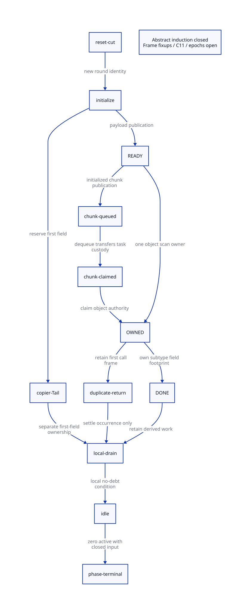

#+TITLE: Object Scan Authority, Task Custody and Phase Termination
#+SETUPFILE: ../../modeling/org/setup.org
#+LANGUAGE: en
#+PROPERTY: header-args :eval never
#+OPTIONS: toc:3

* RESEARCH Decision and source boundary
:PROPERTIES:
:CUSTOM_ID: object-scan-custody
:AUTHORITY: GambitObjectScanCustody
:MAINLINE: modern-c
:STATUS: abstract-induction-closed; source-c11-and-epoch-open
:END:

Keep three identities separate: copied-object identity, queue/frontier task
occurrence, and active native carrier/call frame. READY/OWNED/DONE authorizes
object-field scanning. It neither owns a chunk nor replaces the copier's Tail,
derived-work custody or collective termination protocol. A duplicate occurrence
may return without scanning fields while the first scanner remains active.

This study extends [[file:root-producer-closure-design.org][physical-root and producer closure]]. The running repository
already contains the scan-state trailer, state CAS and unified pair scanner;
these are working-tree runtime changes made outside this study. This study changes
only research documents, models and formal tooling. Source hashes and predecessor
identity are retained separately from formal acceptance. No native, compiler,
preprocessor, performance or runtime implementation work is authorized here.

* RESEARCH Real source order and responsibility
:PROPERTIES:
:CUSTOM_ID: authority-source-order
:END:

** Initialization and readiness

=mark_array= wins the fromspace header forwarding CAS before copying payload.
It then copies all payload words and calls =publish_object_scan= on the destination
header. That function changes UNPUBLISHED to READY. Only subsequently may it end
and publish the chunk; the first-field =goto again= can still follow publication.
Alignment fillers also receive readiness publication. The separate captured-frame
copy path calls the same publisher after its frame payload/link initialization.
All publisher call sites, including fillers and frames, are included in the source
receipt inventory; one ordinary-object example cannot close that inventory alone.

Forwarding is an address-discovery event. A source-header release before payload
writes cannot publish those later writes. READY must carry initialized payload
visibility to successful scan acquisition, or a qualifying queue synchronization
must establish the same happens-before relation. The current source's legacy
atomic macro spelling is not an ISO C11 proof for all backends/configurations.

** Object authority and duplicate task return

=change_object_scan_state= maps a destination header to two bits in a packed
trailer word, reads that word with CAS(0,0), then retries a masked whole-word CAS.
READY to OWNED has one successful transition per object per round if initialization,
reset, coordinates and storage lifetime are valid. A competing scan that observes
OWNED or DONE returns the object's word count and does not mutate its fields.
It does not cancel, complete or transfer the original scanner's authority.

The model owner is a ghost identity naming the active native scan frame; the
current packed bitmap contains no native owner id or recoverable continuation.
Consequently it provides no worker-death recovery or helping protocol.

The first scanner remains an ordinary synchronous =scan= invocation below its
chunk scanner and =mark_reachable_from_marked=. It changes OWNED to DONE only
after the subtype-specific body scan returns. A returned duplicate task is not
evidence that that outer invocation returned. Same-carrier nested duplicate
invocations require a call-stack relation; our two-occurrence model uses distinct
workers and does not claim that general stack refinement.

** DONE, Tail, descendants and chunks

For ordinary movable low subtypes including PAIR, =scan= skips the first payload
field because the winning copier owns its Tail processing. The unified pair path
now goes through this same object authority. Higher subtypes have their own scan
footprints. DONE certifies the scanner's footprint only. A copied child's object
may still require chunk scanning even after the parent's =mark_array= returns;
Tail and derived work must remain covered independently.

Queue removal under the chunk lock transfers responsibility to the active call
stack before unlock. Private incomplete chunks and still lists remain local work.
Each worker drains local/stolen work before its mutex-protected active-count
decrement. The final zero decision can be sound without a separate publisher
counter only if every producer is already covered by a still-active carrier and
no detached callback, worker migration or external root producer bypasses it.
Neither an empty FIFO nor all observed objects being DONE proves that premise.
Weak processing and foreign cleanup are subsequent, separately governed phases.
The trailer is reset at GC setup, not independently between strong and weak
scanning. Therefore a later observation of DONE is a duplicate only if its
required field footprint is already covered or explicit weak consumers discharge
the difference. =process_wills= and the changed =traverse_weak_refs= mode must be
proved together; suppressing a required new phase traversal is not a saving.
This cross-phase footprint refinement remains open.

* RESEARCH Frame initialization is a separate open footprint obligation
:PROPERTIES:
:CUSTOM_ID: frame-post-ready-footprint
:END:

The captured-frame copier publishes READY for a completed frame and sets =ptr=
to that frame's chain-link location. In a subsequent iteration, =*ptr = forw=
can update the preceding frame's link after its READY publication. The frame
scanner also temporarily rewrites/restores its link slot around =mark_frame=.
The copy path holds =MISC_MEM_LOCK=, whereas the object's READY/OWNED bitmap
alone does not authorize that copier's later writes or prove mutual exclusion
with the scanner.

This is an observed post-READY write order, not a proved reachable native race.
A race additionally requires a completed chunk containing the preceding frame to
be published/stolen before the copier finishes the chain fixup. Capacity boundaries,
the private =scan_ptr= publication exclusion, frame coordinates and the frame
scanner's own lock acquisitions must be composed to establish or rule out that
schedule. Neither a convenient capacity assumption nor the bitmap's existence
discharges it. The finite model explicitly excludes this additional writer.

Required design choice after that proof: delay scan admission until all overlapping
frame fixups settle, or give fixups an explicit synchronized footprint protocol.
No choice is implemented here. Ordinary Tail exclusion cannot stand in for frame
link exclusion. The same analysis must cover both descriptor forms and multi-frame
copy chains before a source-level initialization receipt can be issued.

* RESEARCH Actual QNT to Lean bridge and conditional proof
:PROPERTIES:
:CUSTOM_ID: object-custody-formal-bridge
:END:

[[file:models/quint/object_scan_custody.qnt][QNT]] models one copied object, two task occurrences, two synchronous workers
and one scan phase within a GC round. Worker zero is the copier. Worker one can claim and finish the
object while worker zero still owns Tail. Each task has absent/queued/dequeued/
owning/returned states. Object authority has a distinct owner. DONE preserves
child-work debt; local idle requires the responsible carrier's debt to be clear.
The terminal action checks only closed input and zero active workers, not an
omniscient global pending-work predicate.

[[file:../../modeling/tools/object-scan-custody-projection.py][The restricted projection]] reads actual Quint typed IR and checks scalar field
schema, variable reference identities, action guard/update forms, initial record,
invariant, and the complete step roster including stutter. It emits
[[file:models/lean/ObjectScanAst.lean][the Lean definitions]] consumed directly by [[file:models/lean/ObjectScanCustody.lean][the maintained proofs]]. Each of the
20 actions has a preservation theorem; step preservation and reachability induction
compose those theorems. Thus the proof is not a manually chosen fixed assignment
or a lemma-name-only bridge. JSON parsing, expression emission, Quint semantics
and their correspondence with Lean still form an explicit trusted boundary.

The first preservation pass exposed a missing invariant premise: initialized
payload must imply forwarding has occurred. That premise was added to the actual
QNT invariant, not hidden in a Lean-only assumption. The strengthened invariant
is checked again by QNT histories and sampling. Atomic-step induction is a safety
result and does not prove fairness, condition-variable progress or native C11.
The child flags are opaque aggregate debt bits. =drain0/drain1= denote completion
of the corresponding work, rather than implementing descendant traversal or
proving that a real queue is empty. Refining those events requires all recursive
producers and their last uses; the induction alone cannot discharge that premise.

The admitted proof premises are: closed input prevents later task injection;
every live task/frame/child debt retains its worker; object fields are stable or
have nonoverlapping/synchronized mutator footprints; transitions are atomic;
the scan-state cell belongs to this round; workers do not disappear mid-scan.
Arbitrary graph multiplicity, same-thread recursive call stacks, bitmap reuse and
frame fixups remain source/extension obligations.

* RESEARCH C11 refinement obligations
:PROPERTIES:
:CUSTOM_ID: object-scan-c11
:END:

| Event | Required abstract/C11 relation | Current qualification boundary |
|---+---+---|
| READY publication | Payload writes before release publication | All copy/filler/frame writers and post-READY fixups need closure |
| READY to OWNED | Successful acquire CAS plus unique object identity | Packed word must have consistent atomic access type and valid lifetime |
| Packed CAS retry | Preserve other objects' bits after failure; reload expected word | Adjacent objects share one CAS word and can contend |
| OWNED loser | May return without acquiring authority; cannot retire original call frame | Duplicate frame/source roster not fully refined |
| OWNED to DONE | All authorized field accesses before completion publication | DONE does not cover Tail/descendant work |
| Chunk head/tail | Initialized bytes visible before dequeue; ownership transfers under lock | Audit lockless prechecks, barriers and selected native macros |
| Last idle | Last uses and derived publications before decrement in one synchronization domain | Finite model assumes the real local no-work cut |
| Trailer memset | Every prior reader/owner/task drained before non-atomic reset | Epoch reuse/ABA and late old tasks are outside this model |

The =__sync_val_compare_and_swap= branch is documented by GCC as part of the
legacy atomic builtin family, with broad barrier semantics. That is evidence for
that compiler extension, not a certificate that Darwin selected that branch or
that ordinary payload/queue reads form a valid ISO C11 program. Other branches
include emulated and sequential synchronization. C11 modernization must specify
atomic storage, alignment, failure ordering and lock operations explicitly.

For a packed atomic word, independent object transitions must use masked atomic
read-modify-write on the same word. READY acquire/release semantics must survive
intervening transitions of neighboring objects; release-sequence and reset rules
need a separate C11 proof. A plain load substituted for CAS(0,0) would require
its own acquire/read contract, not merely a cheaper spelling.

* RESEARCH Net benefit and equally correct alternatives
:PROPERTIES:
:CUSTOM_ID: object-scan-net-benefit
:END:

Let U be distinct scanned movable objects and D duplicate scan attempts. With no
CAS retries, the three state changes per object make six CAS API calls and three
=find_msection= calls; each duplicate adds one observation CAS call and lookup.
These are source-level operation counts, not successful RMW counts, hardware
instructions, latency measurements or throughput estimates. Contention adds retry
calls, including false sharing from unrelated headers in one packed word.

For section size n words and B word bits, trailer storage is
=ceil((n/2)/(B/2))= words for the source's even sections. Its asymptotic ratio to
the full payload is =1/B=: 1.5625% for 64-bit words and 3.125% for 32-bit words.
Relative to the active half, those ratios double. The trailer is cleared per
section each setup round. Section metadata, allocator rounding and cache costs
are additional. This does not change Scheme object headers or frame coordinates.

Ignoring correctness for the purpose of work accounting only, avoided duplicate
field work must exceed unique-object authorization, duplicate lookup, reset,
lost fast-path and contention costs. A runtime allowing concurrent duplicate
field mutation is not an acceptable faster baseline. The proper alternative is
a separately proved structural uniqueness protocol for queue/frontier tasks.
If that alternative guarantees the same safety with less total work, this bitmap
has no demonstrated performance advantage. If legitimate independent consumers
must converge on the same object, shared object authority may simplify ownership
and prevent redundant mutation. Native benefit remains unresolved.

** Concrete modern C candidates, without implementation
+
+Two candidates can reduce support work without changing Scheme object layouts.
+First, expose an explicit atomic observation operation for the packed state word
+instead of CAS(0,0). On a no-retry path this changes six CAS API calls per unique
+object to three observation loads plus three transition CAS calls; a duplicate
+needs an observation load. The atomic storage/ordering and success/failure
+contracts must be redesigned explicitly. Globally rewriting the legacy CAS macro
+would be incorrect because other callers require its compare-and-write behavior.
+No hardware speedup follows merely from this operation count.
+
+Second, let the allocator and chunk scanner supply a validated section/epoch/header
+coordinate to the state service. This can remove the repeated =3U+D= section
+lookups only if range, header identity, trailer offset and section lifetime are
+proved at the producing seam and preserved through queue transfer. It adds a
+coordinate contract and invalidation obligation. Retaining raw pointers while
+skipping validation is not an admitted optimization. Neither candidate requires
+Zig; both need a further C11/source refinement before implementation.
+
+Modern C can express both architectures. No Zig-specific reduction in these
semantic or support obligations has been established. Existing resize roots and
global partitions remain reusable; this protocol does not retire them or justify
a universal root manifest.

* RESEARCH Architecture routing and closure
:PROPERTIES:
:CUSTOM_ID: object-scan-routing
:END:

[[file:models/sysml/object-scan-custody.sysml][SysML]] owns source seams, real module references, contracts, proof bindings and
gain rows. Native queries generate [[file:object-scan-custody-matrix.org][the matrix]] and . The
[[file:../../modeling/ascent/object-scan-custody.rules.scm][ASCENT DSL]] requires exact path/digest/scope receipts, every actual projected
action and preservation lemma, composition lemmas, and source observations.
Restricted projection evidence cannot satisfy native source/C11 requirements.
The real candidate remains blocked while those receipts are absent; synthetic
all-evidence scenarios serve only to check the rule's behavior.

| Area | Closed | Open |
|---+---+---|
| Atomic model | Full 20-action safety preservation and reachable-state induction | Arbitrary task counts and epoch reuse |
| Duplicate return | Original owner and child debt retained in the model | Same-carrier nested frame refinement |
| DONE boundary | Concrete modeled history has DONE with Tail and child debt | Full subtype and post-READY writer footprints |
| Phase termination | Zero active implies no modeled debt under closed roster | Actual queue/wait/producer closure and liveness |
| Typed IR | Complete restricted expression/step projection and rejection controls | Verified parser/emitter and full language semantics |
| C11 | Explicit publication/last-use/reset obligations | Effective configuration and source simulation |
| Strong to weak | Shared state lifetime identified in source | Specialized weak consumers discharge any changed scan footprint |

* References

- [[file:../../../vendor/gambit/lib/mem.c][Current collector source]] and [[file:../../../vendor/gambit/include/gambit.h.in][runtime definitions]]; source hashes and verified
  anchor lines are recorded in this study's evidence.
- [[https://gcc.gnu.org/onlinedocs/gcc/_005f_005fsync-Builtins.html][GCC legacy synchronization builtin documentation]].
- [[https://www.open-std.org/jtc1/sc22/wg14/www/docs/n1570.pdf][C11 committee draft N1570]], 5.1.2.4 and 7.17: synchronization,
  data races, atomic ordering and release sequences.
- [[https://www.cs.utexas.edu/~EWD/transcriptions/EWD06xx/EWD687.html][Dijkstra and Scholten, Termination detection for diffusing computations]]:
  useful debt/accounting basis; its algorithm is not a proof of Gambit's wait loop.
