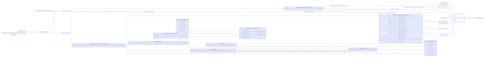

#+TITLE: Native owner cleanup effects and still-generation custody
#+SETUPFILE: ../../modeling/org/setup.org
#+CATEGORY: modern-c
#+PROPERTY: header-args :eval never

* A real writer-closure cut, with explicit limits :gc:ffi:smp:
:PROPERTIES:
:CUSTOM_ID: owner-cleanup-effects
:AUTHORITY: GambitRootWorkerExit::ownerEffects
:STATUS: SOURCE-REPLACED; NATIVE-QUALIFICATION-PENDING
:END:

This change refines the W-collector/R-owner architecture using actual FOREIGN
release callers. The previous sweep mutated the public context still-chain head
while invoking arbitrary native release functions. A callback-created object
could be overwritten by that sweep cursor, and unconditional deferred-counter
reset could hide its allocation. Neither a physical restored-stack receipt nor
thread affinity alone resolves this producer race.

The new owner service has a distinct =OWNER_CLEANUP= phase. It detaches the
frozen old generation into a fixed VM record, keeps survivors in that record, and leaves the public still
head available for the native owner's fresh allocation generation. After all
callbacks return normally, it links old survivors to the fresh chain and recounts
actual lengths. All actual objects, including nondeferred large allocations,
enter canonical context accounting before the public capacity computation.

This permits only noncollecting still construction on the actual owner with
fully initialized payloads and valid native roots. It does not admit raw movable
Scheme pointers, arbitrary RC/payload writers or managed reentry. Such writers
still require the existing registration/permit/epoch design and its source
adapters. The canonical [[file:models/sysml/root-worker-exit.sysml][SysML native-boundary inventory]] keeps those cases open;
[[file:root-worker-exit.org::#root-phase-realization][generated Org]] and  derive from that source.

** Source producer/consumer matrix

| Path | Actual change | Completion / failure boundary |
|------+---------------+-------------------------------|
| collection-round.inc::cleanup_root_domain | Enter OWNER_CLEANUP under the unique host task claim, then return to ROOTS_FROZEN on known completion | No new execution authority or task completion on unknown/nonlocal return |
| still-sweep.inc::free_unmarked_still_objs | Detach old list; release only frozen unreachable objects; keep old survivors private | Fresh objects never enter the old sweep cursor or get discarded by its tail |
| Fresh generation merge | Attach callback-created head after old survivor tail, recount physical object lengths | No inference from only deferred counters; account all actual allocations |
| object-allocation.inc::alloc_scmobj_still | If allocation requires GC while participant is not RUNNING, return failure before calling GC or publishing an object | Existing allocator error contract; no heap expansion to make cleanup succeed |
| setup.c::garbage_collect | Non-RUNNING participants reject before on_all_processors | No nested collective can wait on its own stopped owners |
| setup.c::call/run | Reject a non-RUNNING entry before that endpoint's GVM/marker effects | A physical restore receipt alone never authorizes Scheme execution |
| Existing FOREIGN release wrapper | Callback consumes only opaque native pointer; wrapper invalidates its release slot before invocation | Unknown/error outcome cannot justify automatic callback replay |

** A real public native ABI defect

The first runtime attempt to exercise =___run= refusal crashed at
=___run+60=, before a meaningful phase result. The baseline source explains why:
its public declaration omitted =___PSD=, while the definition, function table
and both internal callers included that conditional PSTATE parameter. In the
current Darwin mode, the public caller's thunk was interpreted as a PSTATE.
Changing the test to match the wrong declaration therefore exposed a real ABI
mismatch, rather than resolving the problem.

The canonical =___run_function= type in =runtime_forwards.h.in=
contains =___PSD=. Public import, function-table field and implementation forward
now consume that same C function type. The compiler checks the actual definition
against its typed forward. Three independently handwritten parameter lists are
retired, rather than leaving only a repaired public declaration that can drift
again. Independent C
=_Generic= assertions bind both =&___run= and the exported function-table entry
to the same configured function-pointer type. The real callback uses that ABI
and verifies no GVM register, fp/hp, catcher, setup state, sync initialization or
origin incarnation changes when entry/shutdown/slot setup is refused.

[[file:../../../evidence/research/worker-role-handoff/native-run-abi-lineage.json][Baseline source lineage]] retains exact Git blob identities and declaration,
function-table and definition excerpts. [[file:../../../evidence/research/worker-role-handoff/native-run-abi-failure.json][The actual crash and predecessor source]]
are preserved independently of the eventual fixed result. This is why native
compiler/caller evidence is a distinct obligation from QNT scheduling and Lean
refinement algebra. Current native qualification covers the original Darwin
profile; it is not universal target-ABI acceptance. The passing
=owner-native-contract= predecessor repaired the explicit PSD declarations.
The later canonical function-type candidate stopped at the existing 90-second
configure limit in =native-run-signature=. The current responsibility-name
change therefore remains pending exact-source compilation and execution;
neither predecessor receipt admits this candidate.

The still prefix constants also moved, byte-for-byte, from the memory fragment
to the private shared =_gambit/memory_state.h.in= contract. Runtime and observation
consumers now use the same definition. [[file:../../../evidence/research/worker-role-handoff/owner-still-layout-move.json][The 308-byte definition block witness]]
proves the source move is lossless; actual native compilation and behavior are
separate evidence.

** Conditional custody argument

1. The current native owner exclusively controls the domain chain, and the W
   collector descendants have already drained. No unregistered concurrent raw
   writer is admitted by this statement.
2. Detaching the frozen generation before the first callback prevents a fresh
   public head from aliasing the sweep's survivor cursor. A zero-refcount fresh
   object is also deferred to the next GC, rather than recursively swept now.
3. Collecting allocation failure leaves the fresh chain unchanged. Successful
   still allocation retains its own initialization/refcount obligations; native
   code must complete payload initialization before the next collecting action.
4. The fresh-generation recount includes both deferred and immediately accounted
   allocations. The later all-R capacity pass recomputes canonical live words.
5. The host task may finish only after callbacks return, old unreachable objects
   are disposed, and both generations are merged/accounted. Physical restores,
   native completion and actual Scheme resume remain separate facts.

If a callback uses =propagate_error= or an unrelated native nonlocal exit, the
source task has not supplied completion. This turn does not add a catch-and-ignore
path, speculative refund, second destructor invocation or fake no-write receipt.
Recovering such an exit needs a pre-reserved root/native-resource escrow and known
physical writer stop, which remain open.

** Detached generation storage is VM-owned

The =___gc_cleanup_escrow= embedded in each participant records pending old
nodes, survivors, the in-flight foreign base, opaque native payload and release
function identity. Records are issued before callbacks and cleared only by the
known normal-return path. Empty-escrow checks precede slot setup. Exclusive fresh
VM setup initializes this fixed storage before native users exist.

A nonlocal exit can therefore leave inspectable VM custody instead of losing the
only chain pointer with its C activation. That is not a recovery protocol. A
pending address may be at an interrupted free/publication cut; no helper may
blindly dereference or replay it without actual stop/result evidence. A release
function's normal error return still follows the legacy result policy and is not
new evidence of native resource disposition. Both cases remain in the unresolved
native-exit boundary.

The same-carrier public cleanup endpoint refuses a request while this service is
non-RUNNING, before changing setup state or destroying interrupts/locks. Its
legacy void return is not a new typed shutdown receipt. Cross-VM/direct teardown
still needs independent lifetime and native-user closure.

** Concrete counterexamples and refusal boundary

| Counterexample | Why the old assumption fails | Current disposition |
|----------------+------------------------------+---------------------|
| Destructor prepends a still object while sweep's last points at context head | The next survivor assignment or final zero store overwrites the new head | Old and fresh generations use different heads, then merge |
| Destructor creates a large nondeferred still object | Resetting deferred words cannot describe every new object | Recount actual fresh object lengths |
| Destructor requests GC | It is itself one of the owners the nested collective waits for | Failure before collective entry |
| Destructor invokes low-level Scheme call or run | Physical stack copy may be complete while GVM pointers/limits are not executable | Reject before endpoint-local effects |
| Raw generated SFUN conversion writes before call | A low-level call gate cannot undo preceding SFUN_ARG/marker/conversion effects | Unresolved; not admitted by this owner-service slice |
| Raw RC or arbitrary payload writer from another native thread | Owner phase is not a writer permit or a scanner stop receipt | Unresolved; full native-writer condition stays open |
| Native release throws or its result is unknown | Native resource side effects may already have occurred | Retain incomplete responsibility; no automatic replay/recovery claim |
| Teardown calls free_still_objs after synchronization destruction | GC sweep lifetime does not cover VM/PSTATE cleanup order | Separate teardown producer remains unresolved |

* Whole-copy capacity remains an independent prerequisite :capacity:

The existing [[file:round-capacity.org][physical capacity contract]] and its QNT/Lean models still own the
pre-flip planning problem. The implemented =R+W= initial grants and private
per-copy reservation/refund do not discharge the full request envelope.

In particular, a forwarding CAS loser cancels its unpublished interval, but a
previous =end_heap_chunk -> refill_worker_arena= transition has already published
old chunk state and consumed a physical section. Cancellation does not return
that section or its terminal waste. Repeating such contention while alternating
large and small requests prevents deriving a section bound from committed copied
words alone. The current native-capacity theorem's exhausted-section charge and
producer-envelope premises remain genuine source obligations.

A correct future planner must choose one explicit policy: avoid duplicate
reservations by canonical copy authority before allocation, include and bound
failed-attempt fragmentation, or preassign unique physical source/copy placements.
Each policy must cover captured-frame expansion, 32-bit alignment, marker links,
all loaded/native producers, R restoration grants and actual free-section identity.
A source census, selected generator maximum or successful fixture is insufficient.
No new duplicate QNT/Lean model is added here, and no capacity-ready fact is emitted.

* Capacity source-refinement inventory

[[file:models/sysml/root-worker-exit.sysml][SysML]] now enumerates six actual capacity premises rather than treating
physical-packing as one opaque flag. The native query must keep five unresolved:

| Premise | Actual source gap | Existing model responsibility |
|---------+-------------------+-------------------------------|
| copy-charge | words_movable_objs/source_words does not supply an injective producer census | QNT producer/epoch histories; Lean source/span refinement premises |
| request-envelope | Actual maximum includes every loaded/native constructor and effective RETI frame | QNT opaque/late producer cases; Lean ABI-conditional frame bounds |
| attempt-fragmentation | Refill before a losing forwarding CAS consumes nonrefundable section waste | QNT grant/cancel histories; Lean exhausted-section charge premise |
| physical-source-pool | A count is not a known disjoint physical/parity placement excluding retained grants | QNT placement/unknown outcomes; Lean coverage/publication premises |
| known-refusal | Current initial-section failure is fatal after root publication, not a preserved common refusal | QNT collective rejection histories; Lean rejection/flip implication |
| restore-fudge | Current pre-flip W selection and disjoint R restoration grants have selected source/native controls | Current C adapter; existing interval inequalities, not whole packing |

These are distinct from the native writer boundary. The model pipeline must keep
both groups visible and refuse global retirement. No new QNT/Lean transition
system, duplicate theorem or assumption-as-result is added.

* Benefits and added work :matrix:

| Dimension | Concrete benefit | Necessary added/retained work | Claim limit |
|-----------+------------------+------------------------------+-------------|
| Still-list integrity | Eliminate lost callback-created heads and their hidden accounting | Five fixed pointer-sized escrow fields and fresh-generation recount O(new still objects) | No skipped root/GC work or pause speed claim |
| Native reentry | Explicit known refusal before nested collective/managed entry | Constant-time phase checks at real entry endpoints | Generated pre-call effects and raw writers still unresolved |
| Ownership | Preserve original pthread/PSTATE and unique host task | OWNER_CLEANUP enum state and fixed per-participant escrow; no dynamic metadata allocation | A phase value alone does not freeze unmanaged threads |
| Allocation | Noncollecting native creation remains possible under existing limits | Real children/native payloads stay live until next release | Retention is actual memory, not a zero-cost benefit |
| GC progress | Known rejected requests cannot self-wait on this round | Unknown/nonlocal release can still block safe completion | No general unknown-native-exit recovery |
| Capacity | Do not manufacture a proof from canceled words | Physical pre-flip planner and producer closure still needed | No whole-round capacity or peak-memory reduction claimed |
| Model reuse | Existing producer and custody obligations reused | New C/native adapter evidence and exact boundary inventory | No new theorem result or C-memory-model proof |

* Five commit gates

The selected owner-cleanup cut requires the current C/native controls and actual
SysML/ASCENT correspondence. Full architecture commit admission additionally
requires physical-packing and native-writer-closure, including raw/generated
pre-entry writers, nonlocal outcomes and teardown production. Those obligations
cannot be removed merely because the focused owner test passes.
