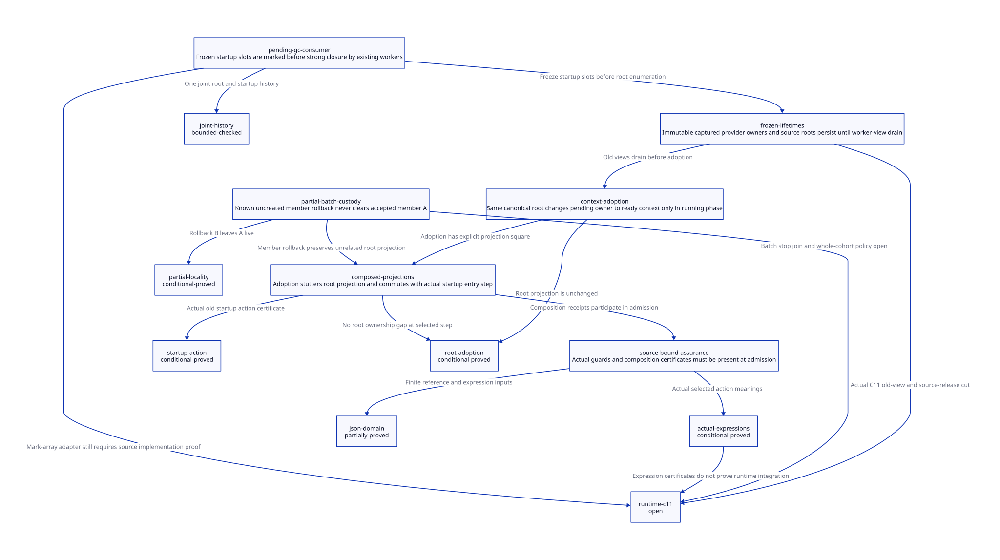

#+TITLE: Pending-Start GC Consumer, Context Adoption and Partial-Batch Composition
#+SETUPFILE: ../../modeling/org/setup.org
#+LANGUAGE: en
#+PROPERTY: header-args :eval never
#+OPTIONS: toc:3 num:t

* RESEARCH Authority and advancement
:PROPERTIES:
:CUSTOM_ID: pending-start-composition
:ARCHITECTURE_SOURCE: models/sysml/pending-start-composition.sysml
:EVIDENCE: ../../../evidence/research/pending-start-composition/checks.json
:STATUS: selected-composition-proved; runtime-C11-bridge-open
:END:

Modern generated C remains the required direction. This study advances the
[[file:thread-thunk-frozen-roots-design.org][frozen-root/startup study]] by modeling both lifecycles in a single state,
with two batch members and actual source-expression certificates for the prior
startup entry action. It does not implement the proposed runtime service. SysML
owns components, source routes, contracts, composition obligations and gains;
native SysML queries drive [[file:pending-start-composition-matrix.org][Org matrix]],  and actual ASCENT admission.
Python orchestrates formal tools and JSON extraction, not runtime semantics.

* Real consumer and required adapter
:PROPERTIES:
:CUSTOM_ID: pending-start-consumer
:END:

Current mem.c garbage_collect_mark_strong_phase invokes mark_global_variables,
mark_execution_roots(work, participant), then mark_reachable_from_marked(work).
mark_execution_roots requires GC_ROOTS_FROZEN and scans the participant context's
continuation, r/saved/cache arrays, processor object and RC list. mark_rc feeds
&h->data into mark_array(work,...), which can update an admitted Scheme root slot.
The copying worker and the root slot owner are separate roles in current source.

The proposed pending-start adapter must enumerate frozen StartupRootRecord slots
and call the same root-marking machinery BEFORE strong-reachability closure. It
must not create a fake PSTATE/context merely to invoke the existing scanner, nor
add an OS-pending thread to the collector worker count. A provider descriptor
contains canonical slot identity, map/type, VM/root generation, stable storage
lease, ownership class and assigned scanner. Marking a slot reuses the collector;
preparing a second independent moving tracer would duplicate semantics needlessly.
The adapter is part of each existing worker's root-production phase: a worker
cannot declare itself idle until its assigned slots and derived chunk publications
are settled. A new asynchronous producer after strong closure would require an
additional protocol and is not authorized by this design. Chunk termination and
all-root-producer closure are not modeled by the present joint control state.

The new manifest freezes the union of existing context providers and active pending
providers at the same root-admission cut. Snapshot publication must precede any
worker consuming the union. Old directory/map/slot storage stays alive through the
entire round, including weak/cleanup work and the final worker-view drain, not
just until the first strong scan completes. Staged arrivals retain admitted source
roots and wait for running-phase admission. A late raw Scheme value cannot be
rescued by queueing it after freeze.

Current code publishes participant->context, freezes its phase and uses BARRIER;
it later resets GC_RUNNING and executes the annotated barrier prohibiting retained
stopped root views. These are real integration anchors. No pending-start directory
or this adapter is established by the observed source. All proposed calls remain
design responsibilities, not hidden runtime changes in this research.

** Assignment and root identity

For P pending records with A root slots, an initial adapter can assign each frozen
slot index i to i mod W among W already-authorized workers, with W positive and
closed for that round. Exact enumeration, stable indices and unique RootSlotId
must establish complete/disjoint slot coverage. Modulo assignment alone does not
prove source slot uniqueness, object-copy termination or load balance. A serial
coordinator scan is a simpler alternative but may add a serial scan tail; no timing
benefit is claimed for either option.

The selected adoption design retains the same physical VM-owned root slot while
changing its owner from pending-start to an admitted execution context. The context
stores a handle to that slot/provider, not an untracked second movable value. Its
scanner adapter resolves the same canonical root identity in subsequent manifests.
If a future implementation copies into an embedded context slot instead, it needs
the earlier overlapping-registration protocol and a different refinement proof.
Two workers may not independently update the same physical root slot merely
because forwarding the pointed-to object is protected.

* Adoption, source release and frozen views
:PROPERTIES:
:CUSTOM_ID: pending-start-adoption
:END:

| Step | Required conditions | Preserved obligation |
|------+---------------------+----------------------|
| register pending root | running phase, protected source, complete slot/map publication | source stays until exact persistent registration receipt |
| child OS acceptance | native startup record and VM/code leases remain | acceptance does not prove context or collective readiness |
| context ready | authenticated initialized-context, membership and sync-completion receipt | pending root remains owner until adoption commit |
| adopt canonical slot | running phase, old scan leases drained, exact ready member and registration receipt | pending owner becomes context owner atomically; root coverage unchanged |
| release creator source | running phase, target pending OR context provider persists, receipt known | does not free startup native record or executable return paths |
| rollback uncreated member | known no child, failure delivery settled, running phase and no captured views | only that member's pending record may retire |

If freeze wins before adoption, the old manifest still owns the pending descriptor
and adoption waits. If adoption wins, freeze sees the context descriptor. Neither
path permits zero providers or duplicate writable ownership of the canonical slot.
A creator source captured in an old manifest also remains registered until view
drain; having a second target is not permission to invalidate the captured source.

Registration, readiness, adoption and failure-delivery receipts bind BatchId,
StartupId, VM/context/root generation, RootSlotId/RootSpec, manifest owner and
settled outcome. Queue acceptance is not persistent scan coverage. A lost reply
requires querying the same transaction; no repeat OS launch, Scheme initialization
or cleanup side effect is authorized by replay. Generation reuse and late receipt
observers retain the predecessor nonwrap and stable-directory obligations.

The joint model treats adoption as a reference atomic step. A concrete implementation
may use an immutable descriptor replacement plus a root-domain admission lock or
qualified atomic snapshot protocol. It must preserve old borrowed views and cannot
expose independent pending=false/context=false stores to scanners. Running phase
alone is not mutual exclusion: freeze and adoption must share the same decision.

* Batch failure from the real creation loop
:PROPERTIES:
:CUSTOM_ID: pending-start-batch
:END:

setup.c prepares PSTATEs, publishes OP_SET_PROCESSOR_COUNT, then loops through
thread_create. Its create-error branch is fatal. The earlier setup failure loop
and shrink path are separate; shrink ignores thread_join errors. Thus the current
source is not evidence of a complete partial-batch cancellation/rollback service.
This study preserves that evidence and designs member-local custody explicitly.

| Member outcome | Root/native custody | Allowed next action |
|----------------+---------------------+---------------------|
| A created and ready, B rejected | A retains startup/context roots and code; B keeps pending root until its failure result is settled | adopt A if policy permits, or request qualified cancellation; retire B independently after scan drain |
| A created, B reply unknown | creator and stable batch owner retain B source/pending/native records | resolve B identity; do not relaunch or label it uncreated |
| B definitely uncreated during frozen round | its descriptor may still be in a borrowed root manifest | record failure, wait outside exclusion lock, then rollback after restore |
| batch reports failure | status does not dispose accepted members | keep per-member receipts and cleanup owner until every live/unknown member settles |
| cancellation requested for A | request alone is not physical stop or continuation closure | wait for independently qualified completion/stop/join and scan/code drain |

Per-member records must outlive aggregate reporting. A global batch-failed flag
cannot release all roots or reset a published barrier roster while accepted members
still participate. The reference joint model permits A to remain live after B fails;
it does not prove that this is the chosen public batch-success policy. All-or-nothing
execution would additionally require cancellation, effect rollback semantics and
termination proof for accepted A. Neither policy follows from GC safety alone.

The present processor_count-first barrier scheme cannot simply be reused for a
ready-only cohort without redesign. Pending root providers are data; cohort membership
requires its own prepare/accept/commit and failure rules. Root adoption readiness
is an authenticated environment premise in the model, not synthesized from pthread
success. Full cancellation/join, arbitrary batch sizes and eventual drain remain open.

* Actual two-model composition evidence
:PROPERTIES:
:CUSTOM_ID: pending-start-refinement
:END:

pending_start_composition.qnt contains the frozen manifest, source/pending/context
ownership and two member startup/failure states in ONE state space. Guards therefore
observe the same phase, readiness and ownership values. The prior startup model is
also checked as an explicit second input, not accepted through a filename link.

For member A define RootProjection = (phase, sourceA, pendingA OR contextA).
StartupProjection maps sourceA to parent, pendingA OR contextA to registered/future,
launchA/startA to OS/start observation, readyA to syncDone and contextA to entered.
It fixes unknown/aborted/rawUsed false and validity stamps to zero: this projection
covers the selected known-A control step, NOT moving-value epochs or member B's
unknown branch. Those cases are exercised in the joint finite model without a
claimed full predecessor simulation.

| Composition obligation | Maintained Lean result | Actual expression anchor |
|------------------------+------------------------+--------------------------|
| adoption preserves roots | adoptionRootStutters under adoptA guard | generated adoptANextMeaning from joint typed IR |
| adoption enables prior entry | adoptionImpliesStartupGuard | enterFromHandleGuardMeaning from actual prior startup typed IR |
| selected commuting square | adoptionStartupCommutes | enterFromHandleNextMeaning plus adoptANextMeaning |
| B rollback does not erase A | rollbackLeavesA | generated rollbackBNextMeaning |

The restricted projector separately consumes both Quint JSON inputs, checks the
state declaration reference and exact admitted field schema, and emits checked Lean
meaning theorems. The prior enterFromHandle guard/update are not merely manually
assumed in the square. Dedicated startup JSON/AST hashes and source identity are
retained. The separate 91-row map reference witness and finite-domain environment
remain a third input, not confused with the startup or joint control IR.

ASCENT consumes SysML composition requirements alongside source-bound endorsements,
actual QNT/Lean bindings and exact path/digest/scope receipts. Missing the composition
lemma or the prior startup expression certificate independently blocks admission.
Other synthetic prerequisites are supplied when checking each negative case so a
missing unrelated receipt cannot mask a broken composition gate. Synthetic-all is
an admission fixture, not runtime evidence. Parser/projector correctness, all-action
forward/backward simulation and root-map extraction remain explicit gaps.

* C11 proof obligations
:PROPERTIES:
:CUSTOM_ID: pending-start-c11
:END:

The concrete C design must establish these relations before it can inherit the
reference-model results:

1. Initialize startup slots, root maps and immutable descriptors before release
   publication; matching acquire precedes scanner use. Storage leases protect the
   descriptor/slot independently of its pointer's visibility.
2. Root admission, freeze capture, context adoption and retirement use one
   linearization protocol. No held admission lock may span allocation, OS create,
   Scheme callbacks, GC participation or waiting for its own scan lease.
3. Snapshot ownership assigns each physical root slot one authorized scanner;
   relocation writes happen before restored-phase publication and resumed loads.
   Current BARRIER source calls do not constitute a verified C11 lowering.
4. Old worker last-use, scan-lease drain and old context-map retirement precede
   source release/adoption. Final decrement cannot be followed by an unleased read
   or custody update to the freed record.
5. Batch status and member receipts are separate synchronized records. Terminal B
   delivery precedes B retirement; A and unknown members retain their own roots,
   VM/code leases and outcome custodian. Receipt publication is not physical stop.

[[https://www9.open-std.org/JTC1/SC22/WG14/www/docs/n1570.pdf][N1570]] 5.1.2.4 and 7.17.3 provides the publication/data-race framework.
Local Lean event-order lemmas require a supplied HB/SC embedding and do not define
the C11 allowed executions. No runtime source refinement or effective Darwin
barrier expansion is established. The selected commuting square proves a concrete
piece of composition while leaving the full C11 and all-action obligations visible.

* Net benefit and retirement
:PROPERTIES:
:CUSTOM_ID: pending-start-benefit
:END:

| Mechanism | Removed work/retention if qualified | Added cost / condition |
|-----------+------------------------------------+------------------------|
| canonical slot adoption | second root copy and duplicate scan solely for owner change | descriptor owner update, receipt and old-view leases; physical slot must remain stable |
| reuse mark_array consumer | duplicate startup moving tracer | provider adapter and complete frozen enumeration before strong closure |
| member-local rollback | retaining uncreated B solely because A still runs | per-member launch/failure/delivery accounting; no early free during old scan |
| pending provider partition | adding one worker merely to keep a pending thunk alive | O(P*A) slot visits over W existing workers; assignment proof and imbalance remain |
| modern C service | scattered implicit root and batch ownership decisions | typed generated requests, manifests and composition proof maintenance |

A canonical owner change adds no second physical Scheme root slot in this chosen
layout. The alternative copied-slot design may briefly require two views and a
copy; it is not covered by that claim. Pending enumeration remains O(P*A), with
reachable-object traversal additional. Independent rollback can remove B's record
once B is settled and old scan leases drain, while A remains owned. Unknown members
can retain storage indefinitely; no universal bound, throughput or elapsed-time
percentage is claimed. These contracts establish no additional Zig net benefit.

Retire ad hoc pending roots only after the shared provider consumer covers every
current/future round. Retire copied startup thunk transport and context-private
root guesses only after canonical handle consumers and relocation reloads qualify.
Replace the current fatal partial-create policy only after the public batch policy,
member custody and actual cohort protocol are qualified. Do not remove existing
barriers or ignore failed join based on model success.

* TODO Closure status
:PROPERTIES:
:CUSTOM_ID: pending-start-open
:END:

- [X] Locate the actual mark_array/strong-closure consumer and worker-view drain seams.
- [X] Put two batch members and frozen-root ownership in one QNT state.
- [X] Prove selected root stutter/startup commuting square against actual startup IR.
- [X] Prove rollback locality and check partial-failure/frozen-adoption counterexamples.
- [ ] Prove complete canonical provider enumeration and actual context readiness receipts.
- [ ] Prove all-action composition including relocation epochs, unknown B and arbitrary batches.
- [ ] Close cancellation/join, batch-effect policy and multi-shot continuation retirement.
- [ ] Verify C11/backend, parser/projector and full source-to-model extraction.

No runtime implementation, native test, preprocessing or performance experiment is
part of this study. Local formal checks must not be promoted into native acceptance.

* CHECKED Local receipt
:PROPERTIES:
:CUSTOM_ID: pending-start-local-receipt
:STATUS: selected-composition-and-local-models-only
:END:

Local checks cover 14 QNT histories including seven negative controls, 500 sampled
runs of up to 200 steps per model, 13 maintained Lean theorems, eight joint-expression
certificate theorems and two predecessor startup-expression certificate theorems.
Four SysML composition requirements are checked by ASCENT with 16 scenarios,
including missing composition lemma and missing startup certificate. Three strict
JSON-row projection controls and one altered-guard Lean rejection are retained.
The old startup certificate has its own SysML ModelNeed and exact input digest,
not only a name in a dependency list. Native SysML validates all current DEV inputs.
Source/C11/full simulation and native acceptance remain unqualified.
