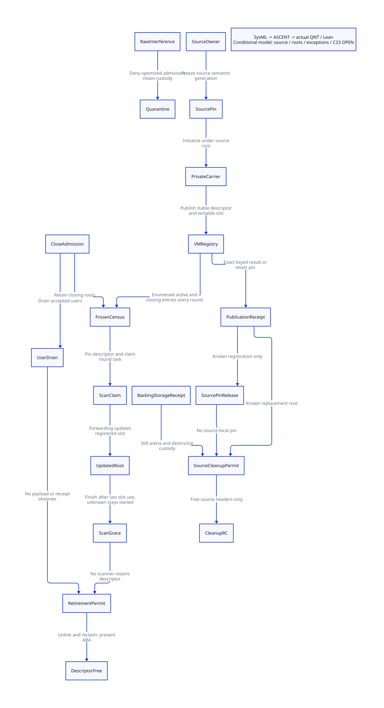

#+TITLE: Persistent Carrier Coverage — Collector Census and Retirement
#+SETUPFILE: ../../modeling/org/setup.org
#+LANGUAGE: en
#+PROPERTY: header-args :eval never
#+OPTIONS: toc:3

* RESEARCH Decision and authority
:PROPERTIES:
:CUSTOM_ID: persistent-carrier-coverage
:BASELINE: C23; modern C is mandatory; Zig remains optional
:STATUS: conditional-model; native-integration-open
:AUTHORITY: GambitPersistentCarrierCoverage
:END:

Persistent registration must make a carrier part of every collector round until
retirement, independently of the processor that created it. Closing admission
is not root removal. A live payload borrower, a scanner, an unknown scan result,
and a receipt observer each independently prevent descriptor reclamation.

The architecture authority is [[file:models/sysml/persistent-carrier-coverage.sysml][SysML]]. Python invokes the native
SysML validator and expression evaluator; it does not parse SysML. The resulting
source obligations, component owners, action/lemma bindings and issuer rows drive
[[file:../../modeling/ascent/persistent-carrier-coverage.rules.scm][ASCENT]], [[file:models/quint/persistent_carrier_coverage.qnt][QNT]], the [[file:models/lean/CarrierCoverage.lean][transition induction]],
the [[file:models/lean/PersistentCensus.lean][generic census lemmas]], and the [[file:models/lean/CarrierCoverageBridge.lean][parent bridge]].
The [[file:persistent-carrier-coverage-matrix.org][projected matrix]] and  are derived views.
No runtime implementation, native tests, or performance measurements are part of this study.

* EVIDENCE Current root producers and real consumers
:PROPERTIES:
:EVIDENCE_SCOPE: exact source snapshot; not effective preprocessed Darwin ABI
:END:

** VM roots already have a useful persistent-slot precedent

[[file:../../../vendor/gambit/lib/memory/root-origins.inc][root-origins.inc]] scans the VM object, resize thunk, and every
=resize_requests[i].thunk= slot up to =___MAX_PROCESSORS=. The code explicitly
keeps retained request slots independent of =participant_count= and failed or
absent origins. This is a real VM-lifetime root path; it does not register arbitrary
carrier descriptors. Symbol/keyword and global-variable roots remain separate domains.

The same file's =mark_execution_roots= reaches continuation roots, registers,
=saved= slots, type cache, startup thunk, entry marker, processor object and RC
chain through the frozen origin's context. =___GC_ROOT_CONTROL(work)= has no
code or storage by default. Its existence is not evidence of carrier coverage.

[[file:../../../vendor/gambit/lib/memory/heap-sections.inc][heap-sections.inc]] increments the collector epoch with an exhaustion check,
then freezes origins and publishes root tasks for current participants.
[[file:../../../vendor/gambit/lib/memory/collection-round.inc][collection-round.inc]] claims tasks by epoch and owner, scans execution
roots, finishes the owned task, thaws the origin and reaches the final barrier
whose comment prohibits retaining a stopped root view past that cut.
These are partial real round signers. Their context roster is not a complete
manifest for a future VM carrier registry.

** The public writer boundary remains open

[[file:../../../vendor/gambit/lib/memory/rc-allocation.inc][rc-allocation.inc]] directly assigns =h->data = val=, returns =h->data=,
updates RC links and refcounts, and bulk-frees the RC list in =cleanup_rc=.
[[file:../../../vendor/gambit/lib/setup.c][setup.c]] exports register, setter, addref and release function pointers
through GSTATE. Function-pointer copies, direct header aliases, dynamically
loaded extensions and external clients are not closed by a textual call search.
The retained literal inventory includes comments/declarations and is deliberately
not called an authority proof.

[[file:../../../vendor/gambit/examples/tcltk/tcltk.scm][Tcl]] installs a still vector using =set_data_rc=, reads it through
=data_rc= in command dispatch, and releases the Scheme object then RC storage
in command deletion. [[file:../../../vendor/gambit/lib/os_dyn.c][C closures]] install a procedure payload and release their
RC wrapper through architecture-conditional paths. Their presence is evidence
of semantic users, not proof that these branches are active on Darwin arm64.
Native RC string/TLS users also exist; an RC allocation is not automatically a
Scheme-bearing root source.

** Cleanup destroys more than a logical registration

[[file:../../../vendor/gambit/lib/memory/rc-roots.inc][mark_rc]] updates each linked =h->data= slot in place. It requires the
list storage and traversal links to remain valid. Keeping a copied value in an
unregistered C local neither retains this slot nor makes it GC-updatable.

[[file:../../../vendor/gambit/lib/memory/memory-lifecycle.inc][cleanup_mem_pstate]] calls =free_still_objs= before =cleanup_rc=. Thus a
carrier root alone cannot authorize processor cleanup: an old still payload may
lose its allocation arena before RC headers are freed. Current
[[file:../../../vendor/gambit/lib/memory/capacity-resize.inc][processor retirement]] refuses nonempty RC chains without a freeze receipt;
known join transfers still storage before cleanup, whereas unknown join retains
custody. Whole-VM resize-request checks do not establish a generic carrier census.

* DESIGN Complete enumeration contract
:PROPERTIES:
:MODEL: authoritative registry -> frozen census -> writable slots
:END:

** Identity and slot specification

A carrier descriptor contains VM identity, stable CarrierId, descriptor generation,
source owner/generation, bound semantic payload generation, writable rooted slot
address, scan kind, slot count, backing-storage owner, close state and outstanding
borrow/observer/task ownership. Module-provided scan code also carries a module
handle and ABI/layout identity. Descriptor generations, semantic payload generations,
collector rounds and relocation addresses are distinct quantities. Every embedded Scheme
value in the descriptor must itself appear in the writable root-slot specification;
metadata must not hide an unregistered SCMOBJ. A native module handle retains scan
code/layout and cannot be substituted by a copied raw function pointer.

Enumeration is over all ACTIVE and CLOSING descriptors, not a processor's RC list.
The native contract must identify every root-bearing source category, map it into
this domain or an explicitly retained legacy root path, and canonicalize duplicate
slot addresses without conflating distinct writable slots containing equal values.
The small QNT model has two descriptors and Boolean users, not arbitrary concurrent
borrow counts. The Boolean user/observer actions describe fixed identities, not
multiplicity, ABA-safe reused lease IDs, or delayed releases of distinct incarnations;
those require a separate native-to-model injectivity and generation obligation. Generic Lean list lemmas establish census membership for arbitrary
finite lists, conditional on an authoritative complete registry. They do not prove
native pointer bijection, deduplication, or concurrent product refinement.

** Registration and repeated GC

1. The source owner accepts a pin without allocating or exposing an unrooted value.
2. Reserve descriptor and target slot storage; allocation failure leaves the source
   root and ownership unchanged. Descriptor storage itself must not move while published.
3. Reload the source's GC-updated slot, initialize the target, and publish registry
   membership in one collector-excluded segment. It performs no allocation, Scheme
   callback, continuation capture or blocking operation. A design allowing GC inside
   this segment instead needs an independently registered private slot; a source pin
   alone does not update a copied private pointer.
4. Publication produces an identity-keyed result. Lost acknowledgement retains the
   source pin and descriptor; an exact query can acknowledge an already committed entry.
   Retrying must not create a second logical registration.
5. Only a known committed target permits source-pin return. Each later round freezes
   registry membership, claims every retained slot, updates it during forwarding, and
   completes scans before releasing the frozen view. Borrowers reload slots after GC;
   they cannot keep raw movable addresses across safepoints.

The QNT model expresses collector exclusion for initialized private state and
tracks semantic payload identity plus last scanned round. It abstracts actual
relocation, instruction-level rooting, callback stacks and generated root maps.
A scan's result becoming unknown preserves its ownership and prevents round finish.
Resolving it is an explicit trusted owner operation, not a timeout-based inference.

* DESIGN Revocation, descriptors and storage
:PROPERTIES:
:SAFETY: admission close != census removal != storage reclamation
:END:

** Closing cut and accepted users

The registry owner linearizes ACTIVE -> CLOSING against new borrow admission.
Operations accepted before the cut remain owned and must finish or enter a retained
unknown state. Late callers must validate stable identity/generation before touching
the descriptor. A registry-owned lookup guard must protect that validation itself;
calling addref on an already freed raw client_data pointer cannot create the guard.
The closing entry still enters every frozen census. It cannot be
removed merely because its creating processor exited, its source payload changed,
or one GC scan completed.

Retirement requires all of: admission closed; no payload user; no independent
receipt/lookup observer; no source pin; no active/unknown scan; no frozen view that
can contain the descriptor; backing/module references settled; no unmediated writer.
Remove registry reachability under the same exclusion protocol, then apply the
reader grace condition before physical storage or generation reuse. A stopped
collector grace cut alone does not drain unrelated native receipt observers.

** Old payload and cleanup receipt

A managed setter may install a newer source payload after source pins drain. Existing
carriers continue binding the older semantic generation; collector writes to the old
slot are relocation updates, not a source semantic setter. Header and payload-storage
ownership therefore require separate receipts.

=cleanupSource= in the model requires committed target membership, source closure,
no source pin, collector exclusion, and =backing1=. That backing receipt is an explicit
premise: it must be signed by the real still-arena/foreign-resource owner after known
join and actual storage transfer. The model does not implement or invent this signer.
Foreign destructors retain thread affinity, derived work and partial-failure obligations.
Whole-VM cleanup additionally needs a closed global registry manifest and no outstanding
borrow, scan, observer, storage handoff or unresolved operation in any VM root domain.
An unresolved retained carrier prevents VM teardown; a stable owner outside the
retiring processor must retain the registry, descriptor and backing-storage obligations.
If no resolver can settle the result, this protocol preserves safety by retention
and does not establish shutdown progress or a bounded memory-retention guarantee.

** Unknown result responsibility

| Unknown event | Owner retaining custody | Forbidden inference |
|---+---+---|
| Registry publication reply lost | Source pin owner plus registry commit owner | Reply loss means entry absent |
| Scan completion reply lost | Claimed task owner and frozen census owner | Timeout means scan released descriptor |
| Old storage handoff unknown | Source arena owner and proposed recipient | Root registration means storage moved |
| Last observer exit unknown | Stable registry/grace owner | Processor join proves unrelated observer absent |
| Unmediated setter discovered | Legacy source domain; optimized admission quarantined | Audit event repairs arbitrary unsafe writes |

* DESIGN C23 publication and public ABI migration
:PROPERTIES:
:REFINEMENT_STATUS: instruction-level C23 proof open
:END:

Publish initialized metadata with release semantics and acquire it before readers
use slot/layout fields. Serialize native slot mutation with the collector root-freeze
protocol: changing a pointer to atomic does not by itself protect the referent or
make an unsynchronized GC write legal. Claim and last-use completion publish through
the owned task protocol; retiring readers acquire the completion chain before free.
If reference counts replace the abstract Boolean users, close/admit/last-decrement
must share a proven gate/counter protocol with checked finite capacity and overflow.
Do not assume a separately loaded zero count establishes quiescence.

Use a conservative locked or stopped-world control path as the reference protocol.
Any lock-free handler path needs a separately qualified signal-safe/lock-free primitive
and a progress proof. Neither is established by this study. Effective Darwin headers,
conditional compilation, generated artifacts and supported atomics still need binding.

Replace exported root-bearing setters with a source-handle operation requiring a
managed write token, rooted candidate, source generation and collector exclusion.
Route all in-tree direct, GSTATE-indirect and wrapper callers through that owner.
Reject optimized admission for unknown extension aliases; keep the legacy root domain
alive rather than claiming compatibility by silent bypass. Removing an old export
requires an explicit ABI policy, rebuilt clients and evidence that no retained
function pointer or raw header alias can write it. No export retires today.

* PROOF Conditions, counterexamples and refinement

| Statement | Current evidence | Required bridge |
|---+---+---|
| ACTIVE/CLOSING enter each frozen round | QNT Safe; Lean step induction | Native registry-to-slot completeness |
| Close preserves arbitrary finite census IDs | Generic Lean list induction | Native canonical slot identity and snapshot fidelity |
| Receipt observers prevent free | Lean action/derived theorems; negative mutant rejected | Actual callback/FFI observer lifecycle |
| Source cleanup preserves old logical binding | Model plus explicit backing receipt | Real arena transfer and destructor settlement |
| Previous persistent-coverage premise can be admitted | Explicit parent precondition theorem | Temporal native execution refinement remains open |
| C23 publication prevents use-after-free | Contract only | Native memory-model and allocator proof |

Counterexamples retained by design: enumerate only current processors; remove a
CLOSING root; free a descriptor while a receipt observer survives; assume a lost reply
is failed publication; let source cleanup free a still arena retained by a carrier;
carry an initialized unregistered raw pointer through GC; classify a public setter
by known textual callers only. The raw-interference model action records detection
and disables admission; it is not a proof of arbitrary memory corruption safety.

The restricted typed-IR projector checks binding identities, field kinds, action
roster and supported expressions. The JSON parser/projector, native source correspondence,
generic census-to-two-descriptor composition, and unbounded multi-user refinement
remain explicit trusted boundaries. ASCENT accepts only scoped actual receipts;
its synthetic-all scenario is a diagnostic control, not evidence of implementation.

* EVIDENCE Language and reclamation foundations

The [[https://www.open-std.org/jtc1/sc22/wg14/www/docs/n3096.pdf][C23 working draft N3096]], sections 5.1.2.4 and 7.17,
provides the release/acquire synchronization and data-race rules used as the
language baseline. It is a public working draft, not a receipt for a particular
Darwin compiler configuration. Publication ordering does not establish object
lifetime or complete root enumeration.

[[https://www.cs.utoronto.ca/~tabrown/debra/fullpaper.pdf][Brown, Reclaiming Memory for Lock-Free Data Structures: There has to be a Better Way]],
sections 1 and 2, distinguishes retiring a record from safely reclaiming it and
explains how a delayed participant can retain unreclaimed storage. We apply that
distinction to carrier descriptors and independent receipt readers; this is our
architecture inference, not the paper proving Gambit's collector. We do not adopt
its signaling algorithm, progress bounds or performance results for Gambit.

* ANALYSIS Net benefit and retirement gates

Let C be persistent carriers, K collector rounds during their lifetime, H the cost
of a full repeated handoff, E the per-descriptor enumeration/claim cost, U the required
slot-update cost, P additional persistent registration/reclamation cost beyond one initial handoff,
and R unknown-retention
and module/arena ownership cost. Compared with an actually repeated-handoff design,
the positive condition is =C*(K-1)*H > C*P + K*C*E + R= after matching required U on both sides.
Current source does not establish that every legacy user pays H every round, so this
is a conditional architectural threshold, not measured savings from current Gambit.

Relative to scanning all RC nodes, let V = N_RC - N_payload be avoided slot visits per
round. The condition is =K*V*visit_cost > classify + index + grace + unknown_retention=.
If the registry only adds a duplicate scan to existing RC scanning, V is zero and the
proposed optimization can be negative. During migration each slot has one authoritative
update domain or a proven duplicate-update protocol; plain duplicate traversal is not
assumed harmless under concurrent mutation.

The mandatory modern-C payoff is decoupling source lifetime from processor lifetime
and making roots/scans/storage ownership explicit. Zig cannot remove the same root,
write mediation, arena and quiescence obligations. Its extra net benefit is unresolved
until concrete support actually disappears; no runtime language change is required
for this architecture.

Retire old paths only in this dependency order: mediate all writer/borrower authority;
register complete stable descriptors; prove every-round census and moving-slot update;
prove scan/observer grace; transfer old payload backing and foreign cleanup; integrate
all processor/VM cleanup callers; finally remove superseded RC root/list/export paths.
Current native retirement count is zero.

* EVIDENCE Reproduction and closure

Use [[file:../../modeling/tools/persistent-carrier-coverage-study.py][the Python study driver]] with the repository virtual environment. It runs
native SysML queries, source snapshot checks, ASCENT controls, QNT histories/sampling,
Lean induction, typed-IR rejection controls, Org/link checks and D2 rendering only.
[[file:../../../evidence/research/persistent-carrier-coverage/checks.json][Checks]] and [[file:../../../evidence/research/persistent-carrier-coverage/input.json][bound inputs]] distinguish conditionally established model properties
from six unresolved native source/execution/root/writer/platform/storage obligations.
The full-DEV native query reached its 60-second bound; its failure receipt is
retained. Current native qualification covers the self-contained carrier package,
not validation of every concurrent DEV model.
No throughput, pause-time percentage, root-map provenance or native GC correctness
claim follows from these receipts.

** Current scoped receipts

| Evidence lane | Result | Boundary |
|---+---+---|
| Source snapshots | 14 files, 38 anchors; 513-file literal inventory, 85 hits | Indirect/out-of-tree writer closure remains open |
| QNT | 31 actions; 12 histories; 500 samples, max 100 steps, seed argument 409 | Sampling is not exhaustive; two descriptors and fixed user identities |
| Lean | 53 theorems including all-step induction, finite-list census and parent boundary | Native slot mapping, C23 refinement and arbitrary user product remain open |
| Rejection controls | 4 typed-IR corruptions; 2 unsafe proof mutants; 11 ASCENT scenarios | Synthetic-all is not an implementation receipt |
| Org and D2 | Native Org/link audit and rendered architecture view | Derived from the native SysML projection |
| Native retirement | 0 old paths retired; actual candidate denied | Six source/execution/roots/writers/platform/storage blockers |

The complete invocation logs, source snapshots, retained proof failure, bounded
whole-DEV query timeout record and input hashes accompany the scoped receipts.
