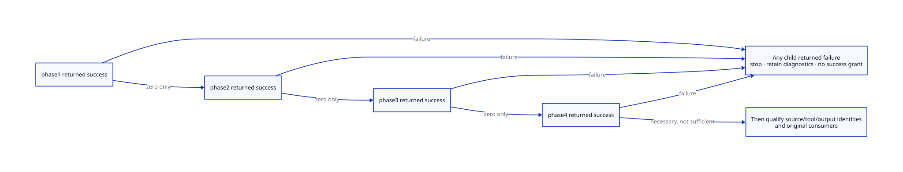

#+TITLE: Published phase-result responsibility and independent source admission
#+SETUPFILE: ../../modeling/org/setup.org
#+LANGUAGE: en
#+PROPERTY: header-args :eval never

* PUBLISHED 12.1 Phase-result ownership :rev:build:audit:
:PROPERTIES:
:CUSTOM_ID: BUILD-PHASE-RESULTS-RESULT
:REVISION: 86fdffccc600336770eb449939083105e9cbd3fc
:PARENT: ae19f98624ad19820040e5afbe08219206bfd0a1
:SOURCE_TREE: 73b5e1d5f7a2772e4cf7a738f21eae6dcdf23b3d
:AUDIT_NUMBER: 12.1
:AUTHORITY: GambitPhaseResults
:END:

One source file,one added/one removed line. Five ASCENT gates/21 rejection controls closed before the local commit. No push or remote CI claim. [[file:phase-results.org::#BUILD-PHASE-RESULTS][Frozen argument]], [[file:models/sysml/phase-results.sysml][model]], [[file:../../../evidence/research/retained/modern-c/phase-results/receipt.json][source/native receipt]] and [[file:../../../evidence/research/retained/modern-c/phase-results/publication.json][publication packet]] retain actual tests, benefits, costs, process and open boundaries. No configured-tool cleanup or scheduler fix was included.

** Delivered result and cost matrix

| Mechanism | Verified benefit | Added cost / boundary |
|-----------+------------------+-----------------------|
| Parent phases result | Early failures cannot be overwritten by phase4 success | One shell status branch per phase; GNU Make failure class, not exact child exit number |
|32 real configured-Make histories | Predecessor false successes7/16; candidate0/16 | Returned-status classes only; not arbitrary compiler/output validity |
| Controlled failing work | Child launches64→30 across16 histories |34 later launches avoided in that controlled workload; no successful-build speedup claim |
| Complete source producer |187.461s phase1--4 passes +32.639s stock core | Same SDK/profile, unchanged600s cap |
| Actual original inventories | Recheck GSI408/40872.535s and remaining Make98.343s/120s | First thread_interrupt failure retained; SMP GSI family withheld |
| Existing implementation PBT |322 actions, two real predecessor13→1/current replays, GC/multi-shot | No new SCM/framework or runtime change |
| Runtime/source identity |3 identical executables,15 identical generated products,27 identical archive members; only root Make source changed | Feasible unit timing race is source analysis; observed scheduler cause unresolved |

** External ROOT-VIEWS source closure

[[file:external-views.org][3.4.3]] separately closes source admission for the exact1778-file Gerbil/default-build cohort. All185 bootstrap module keys match source selection; zero active raw readers and two explicitly excluded TODO heap functions. Six stale-source/disposition/load rejection controls and actual owned-getter/GC probe pass. This adds zero runtime code and does not qualify full Gerbil execution, custom loads or unknown installed artifacts. Changed inputs require new census/migration.

ROOTS now has4 scoped-closed groups /2 remaining:3.5 complete writers/borrows and3.6 source/lifetime union. Stage12.1 does not close all build-graph work.134 unique pending paths remain after retiring only makefile.in; [[file:pending-cuts.org][each retains its review owner/tests/blocker]].

** Independent SMP12 and retained failure

The first original GSI inventory failed thread_interrupt line41 with Thread is not active on the byte-identical ae19f986 interpreter/runtime payload and unchanged unit. The full recheck passed; it does not resolve that retained failure. Typed AcceptanceHold/ASCENT veto prevents a later green observation from silently closing this family. Only bootstrap is qualified on this source/profile:1 qualified/11 open. This is an evidence hold, not a new runtime regression claim or transferred repair-line progress.

| No. | Family | Current-source state |
|-----+--------+----------------------|
| 1 | bootstrap | CURRENT_PROFILE_PASS |
| 2 | gsi | OPEN_RETAINED_FAILURE |
| 3 | gsc | OPEN |
| 4 | pr-gsi | OPEN |
| 5 | pr-gsc | OPEN |
| 6 | stress-gsi | OPEN |
| 7 | stress-gsc | OPEN |
| 8 | registry | OPEN |
| 9 | lifecycle | OPEN |
| 10 | gc-ffi | OPEN |
| 11 | gerbil | OPEN |
| 12 | release | OPEN |

** Primary13-item audit

| No. | Lane | Responsibility | State |
|-----+------+----------------+-------|
| 1 | runtime | Bind pending changes and responsibility owners | REVIEWED_PLAN_ONLY |
| 2 | runtime | Startup preparation and member publication | PUBLISHED_SCOPED |
| 3 | runtime | Close the complete frozen root population | NEXT_SOURCE_CLOSURE |
| 4 | runtime | Worker arenas, unique copy work and context restoration | PLANNED |
| 5 | runtime | Request ownership, wait state and service activation | DEFERRED_FOR_FOUNDATION |
| 6 | runtime | Generated entry and acquired-effect exit custody | PLANNED_BOUNDED_CALLERS |
| 7 | runtime | Participant removal and resource-specific retirement | PLANNED |
| 8 | runtime | Generational allocation and remembered roots | RESEARCH_AFTER_FOUNDATION |
| 9 | runtime | Same-source whole-runtime acceptance | BLOCKED |
| 10 | engineering | Public headers and explicit layout contracts | PARTIAL_EVIDENCE |
| 11 | engineering | C23 and Darwin toolchain/configuration refinement | PARTIAL_EVIDENCE |
| 12 | engineering | Incremental build and generated-artifact ownership | PARTIAL_EVIDENCE |
| 13 | engineering | CI, model/evidence and per-REV audit chain | PARTIAL_EVIDENCE |

The next code cut returns to3.5 actual root writers/borrow admission. Do not add a scheduler patch, whole CFFI migration or capacity/worker rewrite to that REV. Existing QNT/Lean files remain unchanged; model/source/native evidence retain their distinct duties.

#+CAPTION: Child failure stops the producer before product admission.

