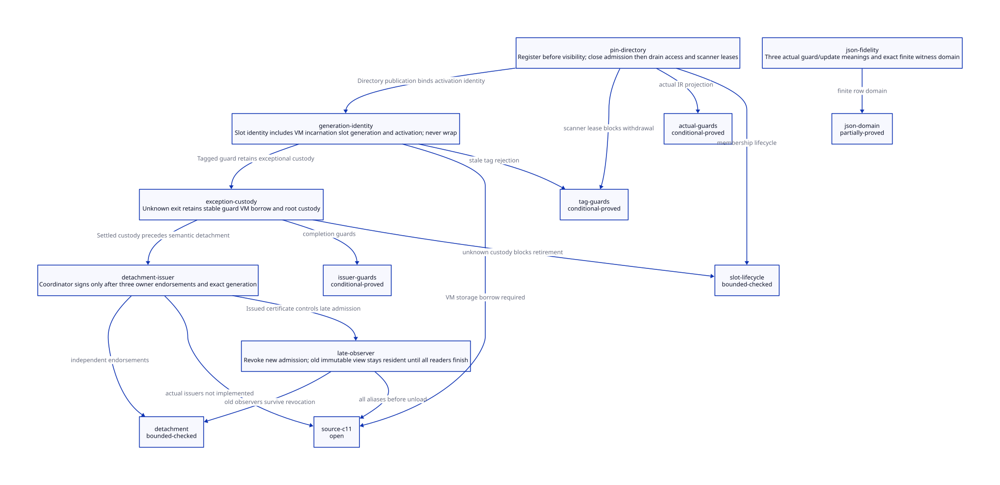

#+TITLE: Registered Pin Lifetimes and Semantic Detachment
#+SETUPFILE: ../../modeling/org/setup.org
#+LANGUAGE: en
#+PROPERTY: header-args :eval never
#+OPTIONS: toc:3 num:t

* RESEARCH Scope and authority
:PROPERTIES:
:CUSTOM_ID: pin-roster-detachment
:ARCHITECTURE_SOURCE: models/sysml/pin-roster-detachment.sysml
:EVIDENCE: ../../../../evidence/research/pin-roster-detachment/checks.json
:STATUS: conditional-models; source-and-C11-refinement-open
:END:

Modern generated C is the required runtime direction. This study closes selected
model gaps in the predecessor snapshot study; it does not implement a runtime
pin directory, certify current Gambit reclamation, or require Zig. Native
write-authority scopes already exist in this checkout and are credited as source
inputs, not changes made by this study. Architecture contracts, accountable
components, formal admission needs, dependencies and matrix rows originate in
SysML. Python invokes the native SysML tool and projects its queried values into
Org and D2; ASCENT evaluates scoped evidence and real action/lemma links.

[[file:pin-roster-detachment-matrix.org][Native SysML matrix]] ·
 ·
[[file:snapshot-observer-refinement-design.org][Predecessor and open SC premises]]

* Source-grounded lifecycle
:PROPERTIES:
:CUSTOM_ID: pin-roster-source
:END:

** Existing authority is useful but incomplete

[[file:../../../vendor/gambit/lib/write_authority.h][write_authority.h]] defines eight
roles, four control and four data. The owner receives one of each. The gate
stores CLOSED, live and spent-role bits, actor and generation in one word. A
released role remains spent within that generation: an old release cannot clear
a reissued same-role permit. Candidate preparation precedes handoff; replay is
observation, not permission to repeat initialization. Exhaustion rejects the next
generation instead of wrapping. All operations require a pre-existing live VM /
storage borrow. Actor IDs are exclusive activation identities, not processor IDs.

[[file:../../../vendor/gambit/lib/write_authority.c][write_authority.c]] implements
conditional CAS handoff with the owner's two roles already live, so loss of the
handoff response cannot leave an open unaccounted writer. Release explicitly
requires the producer's last actual write/borrow; a failed join or catcher
observation is not release authority. Quiescence covers registered permits only;
it is neither a physical stop certificate nor a root/VM-free certificate. Existing
backend RMW/CAS operations and the sequential fallback must not be silently
relabeled as a complete portable C11 reclamation protocol.

The bounded lib/gsc/include source inventory searches the operational APIs
try_handoff/try_acquire/release/close/quiescent. Its raw result and scope are
retained with this study. A definition-only result means no integration was
established in these production directories; it says nothing about other tests.
VM setup does invoke write_authority_init_vmstate before VM publication.

** Real registration and cleanup cuts

| Source | Existing behavior | Required refactoring contract |
|--------+-------------------+-------------------------------|
| setup.c setup_vmstate | initializes scope records before publication | resident directory with VM incarnation before first activation |
| setup.c setup_pstate / start_processor_execution | initializes registers, catcher, sync state, then binds thread | fully initialized slot enters roster before any borrowed access |
| setup.c vm_resize_pstate | removed processor calls cleanup_pstate then thread_exit | close admission; keep slot/scanner/root custody until qualified completion |
| setup.c shrink join | calls thread_join and ignores its error | failure/unknown retains custody; successful join alone still does not close escaped aliases |
| os_thread.c thread_join | returns an error when platform join fails | preserve exact result; timeout or missing acknowledgement is not stop evidence |
| mem.c cleanup_mem_pstate | frees still objects then cleanup_rc | transferred root/arena custody must precede either free |
| mem.c register_rc | splices current PSTATE list | not a VM-wide atomic pin registration primitive |
| mem.c markstrong | mark_rc called for processor zero | do not infer nonzero-processor RC coverage from native scope registration |

Slot registration belongs to a proposed resident NativeLifetimeCoordinator and
PinDirectory owner, accountable to native/roots components. No existing Gambit
function currently signs the proposed directory or detachment certificates.
The directory must itself be protected before dereferencing any embedded slot.
A tag check through an already freed VM pointer cannot repair use-after-free.

* Slot identity, publication and withdrawal
:PROPERTIES:
:CUSTOM_ID: pin-roster-protocol
:END:

The identity is (VM incarnation, directory generation, slot index, slot generation,
activation identity). OS thread identity, PSTATE index and marker processor ID are
insufficient. A fixed roster may be preallocated; extensible rosters need a
separate immutable membership generation. Nested callbacks require distinct
activation guards, not silent reuse of their parent's spent role.

1. Prepare a stable slot/guard and parent VM-storage borrow before any fallible
   allocation or publication. Private setup failure has no public slot to revoke.
2. Register the initialized slot under the directory's membership protocol.
   Acquire admission, publish a pin, revalidate the exact target generation, then
   dereference. A pointer load alone grants no access.
3. After the last native dereference, clear the pin. Closing external admission
   does not revoke existing readers and does not forbid authorized GC maintenance
   scans of a still registered slot.
4. Close admission and obtain independent last-use/stop evidence. Drain all scan
   borrows. Resolve the exact custody/receipt state; an unknown join is retained.
5. Withdraw only when no access, pin or scan remains, stop and successful completion
   are known, and no custody outcome is unknown. Then retire storage. Reuse advances
   generation without wrap; exhaustion quarantines/refuses the slot.

This sequence is a reference SC protocol, not an already proved C11 lowering.
A baseline future C design may use seq_cst publication/revalidation/scan operations
plus a separately serialized roster cut. Mere acquire/release on unrelated atomics
cannot establish the cross-object observation order. The roster storage lifetime,
scan admission and withdrawal must share one qualified cut; replacing that cut by
several atomic fields needs its own proof. Existing write_authority full-barrier
operations do not by themselves prove this composition. GC-visible Scheme slots
need collector synchronization and moving-root updates in addition to native pins.

** Conditional safety arguments and counterexamples

- With a stable registered slot, matching generation and no early clear, a reader
  cannot lawfully lose its pin before last use. The predecessor SC ordering lemma
  remains conditional; this study models the previously missing membership cuts.
- Withdraw cannot occur while an active access, scanner or unknown outcome exists.
  Lean proves these guard exclusions. Bounded histories exercise normal exit,
  exceptional custody, scans after external close and stale activation release.
- Clearing during access, withdrawing during scan, treating failed join as stop,
  accepting an unregistered raw pointer and accepting a stale generation are
  retained negative histories. They violate the stated safety predicate.
- Two generations test one reuse boundary, not arbitrary ABA freedom. The arithmetic
  nonwrap lemma and source exhaustion check are separate from a whole-history
  refinement theorem and safe VM incarnation allocation.

* Exceptional exits and continuation custody
:PROPERTIES:
:CUSTOM_ID: pin-roster-exception
:END:

[[file:../../../vendor/gambit/lib/c_intf.c][c_intf.c]] marker allocation contains
an explicit TODO that proc_or_false may move during allocation before protection.
A native pin cannot replace that Scheme root. The marker's procedure field and
processor ID are also not a complete generation identity.

[[file:../../../vendor/gambit/lib/setup.c][setup.c]] ___run kills the marker after
___call on its direct path. TRY/END_TRY restore the catcher; SFUN normal epilogues
kill markers. These observations do not establish that every nonlocal exit runs
a stable pin completion action. They also do not alone prove a leak: the complete
catcher/unwind path remains a required refinement obligation.

A resident completion guard must be registered before fallible root/marker work,
retain the exact slot tag, and survive C-stack unwinding. Known normal last use can
release its role. Unknown exit retains the pin, VM borrow, Scheme-root domain and
pending delivery under a resident custodian. The custodian may clear only with
qualified no-further-access evidence, root/scan closure and exact activation
identity. Its own exceptional exit transfers responsibility to another stable
custodian, never to an unrecorded stack local. No timeout grants that authority.

Multi-shot continuation restoration must either enter a fresh admitted activation
or fail before native dereference. Replaying an old completion may observe the old
result but cannot clear a newer slot. Stronger cancellation/exception recovery,
all restoring frame aliases and root transfers remain source-level open work.

* Detachment: issuer, endorsement and invalidation
:PROPERTIES:
:CUSTOM_ID: pin-roster-detachment-issuer
:END:

** Who may sign

The proposed NativeLifetimeCoordinator is the final issuer, using independently
scoped endorsements, not three flags that arbitrary callers may set:

| Endorser | Required evidence | Refusal example |
|----------+-------------------+-----------------|
| Scheme frame/root owner | no payload closure, continuation, denv, Scheme root/borrow or future old-code return; restoration closure complete | marker false while captured continuation survives |
| FFI/resource owner | all callback/raw pointer ingress closed; in-flight uses drained; cleanup entry points remain resident | Tcl delete notification while a nested callback is in flight |
| resident query/codec owner | terminal immutable copied native bytes; decoder, error and destructor paths independent of retiring code/OFD | receipt contains a release function pointer into old module |

The certificate binds task/input identity, VM/cohort/slot generation, immutable
payload and layout/codec digest, permitted effect schema, query entry/ABI, endorser
scope and evidence/tool identities. Signing must publish the tuple and endorsements
atomically under the same canonical owner. exec=0, role quiescence, marker invalidity,
and successful join are individually insufficient.

The real Tcl command example stores a Scheme procedure in an RC payload, invokes it
through scheme_call_cmd, and releases both Scheme object and RC in scheme_delete_cmd.
Tcl results also carry a release_string function pointer. That record cannot receive
a data-only certificate while those capabilities remain. SCMOBJ_to_FUNCTION can
expose a static host pointer or dynamic C closure; untracked raw aliases require
refusal, not an assumed revocation facility.

** When authority ends

Close new observer admission before advancing the certificate generation. Changes
to payload/layout/codec/query entry/ABI/effect schema, source evidence, owner
incarnation, callback closure or root/return closure require fresh endorsements.
Unknown custody invalidates new admission. A matching code/layout epoch is required.
The finite model checks layout advancement; code/source epoch changes and concrete
manifest invalidation remain explicit refinement obligations.

Revocation prevents new admissions. It cannot invalidate an already borrowed
immutable view: old payload, resident codec and directory stay alive until every
admitted observer drains. Publish a new record rather than mutate an old view.
After code has been released, restoring an old callback is not a recoverable
certificate update; it must have been excluded before release. Code release and
receipt-storage retirement therefore remain distinct permissions.

The model's qualify action is only a history fixture supplying all endorsements.
It is excluded from step. Production endorsements must arise from actual evidence;
the model does not prove that such evidence can be obtained for every FFI user.

* Mathematical and evidence chain
:PROPERTIES:
:CUSTOM_ID: pin-roster-evidence
:END:

SysML identifies accountable runtime components separately from the assurance
planner, declares two QNT needs, maintained Lean induction, actual expression
certificates, source and C11 obligations, and the predecessor source dependency.
ASCENT requires exact path/digest/scope receipts and actual action/lemma/guard/update
links. Current source/C11/predecessor closure stays blocked. Synthetic-all is an
admission control only, never actual proof evidence.

The pin model has one activation, one scanner and two generations. The detachment
model has one observer and two layout generations. Random finite histories do not
prove all interleavings or liveness. Lean proves local exclusion/tag/bound arithmetic
and endorsement guards, not whole-protocol induction or C11 execution correctness.

The restricted projector consumes actual Quint typed IR for register, publishPin
and withdraw, validates the referenced state declaration, and emits guard/update
meaning theorems against maintained Lean definitions. A changed guard must fail
its certificate. Separately, the pinned map typed IR supplies 91 reference rows:
independent witness validation, exact ordered emission, checked Lean environment
and no-fabrication/exact-domain theorems are composed. Dropped, redirected and
reordered rows are retained negative controls (reordering is strict manifest
mismatch, not necessarily a semantic counterexample). Authentic parser/emitter
correctness, field-coordinate fidelity and all-action/history simulation remain
unproved. Hash equality records identity, not semantic truth.

* Benefit and new overhead
:PROPERTIES:
:CUSTOM_ID: pin-roster-benefit
:END:

The generated matrix is authoritative for component gains. Useful quantities are
work/storage bounds, not invented timing percentages:

| Mechanism | Potentially removed work/storage | Added work/storage | Positive boundary |
|-----------+----------------------------------+--------------------+-------------------|
| stable pin directory | mandatory global lock on each admitted query, if replaced by qualified pin protocol | O(P) slot scan; publish/revalidate/clear per borrow; retained retired list | saved lock serialization exceeds added publication and scan work |
| data-only detachment | C bytes of old code retained solely for terminal observers | B copied bytes, E endorsement/directory/codec bytes, observer leases | C > B + E and all old-code aliases excluded |
| existing native scope reuse | per-role same-generation replay duplication | one gate word per scope, capacity and exhaustion refusal | eight spent roles cover the activation; external journal still required |
| exception custody | unsafe forced frees and repeated ambiguous cleanup | R bytes retained for unknown holders and root/VM leases | correctness gain; no finite R bound under permanently stalled holder |
| modern C vs Zig | no second-language ABI/toolchain burden needed here | same semantic registration/root/alias proofs in either language | Zig requires an additional demonstrated benefit; none established by these obligations |

Default 64 existing scope records occupy 64*sizeof(WORD) gate storage before other
VM fields, not 64 complete GC-root slots. The existing layout has max generation
2^(WORD_WIDTH-26)-1: mathematically 63 at 32 bits and 274877906943 at 64 bits. These
are proved arithmetic examples, not attestation of effective Darwin binaries.
No old RC, marker, queue or cleanup path is retired by this design-only study.
Retirement requires complete real caller replacement, root/scan/exception closure,
qualified memory ordering and unchanged admitted semantics.

* Learning and remaining proof obligations
:PROPERTIES:
:CUSTOM_ID: pin-roster-open
:END:

[[https://www.cs.toronto.edu/~tabrown/debra/fullpaper.pdf][Brown, Reclaiming Memory for Lock-Free Data Structures]]
separates removal from safe reclamation and explains why a slow participant can
block ordinary epoch reclamation. Its neutralization mechanisms require additional
assumptions. We adopt the separation and refuse to infer physical quiescence from
elapsed time; its measured performance and crash bounds are not Gambit results.

- [X] Trace existing generation/spent-role semantics and explicit VM-borrow limits.
- [X] Identify ignored join result, PSTATE RC cleanup, processor-zero scan and marker root window.
- [X] Specify three independent detachment endorsements and old-observer survival.
- [ ] Close all production callers, raw aliases, multi-shot restores and moving-root domains.
- [ ] Refine roster/pin/scan protocol to C11 and each effective target backend.
- [ ] Prove all-action preservation, unbounded generations/actors and appropriate progress.
- [ ] Verify JSON parser/projector and source-to-model extraction.
- [ ] Establish bounded retention or a separately qualified stalled-holder policy.

There is no runtime implementation, native test, preprocessing run or performance
measurement in this study. Formal receipts qualify only their exact local scope.

* CHECKED Local formal receipt
:PROPERTIES:
:CUSTOM_ID: pin-roster-local-receipt
:STATUS: exact-input-local-checks-only
:END:

The local receipt records 16 QNT histories, including nine negative controls;
500 sampled runs of at most 200 steps per model; 14 maintained Lean theorems and
eight generated certificate theorems; 13 ASCENT scenarios; three strict row
projection refusals and one Lean guard-mutation rejection. No finite sample count
is presented as exhaustive verification. Native SysML validates the whole DEV
input set, including the new package, without hand-maintained load exclusions.
The source/C11/predecessor gates remain blocked, and the source implementation
was not modified. See the retained checks/input/artifact receipts for exact hashes.
