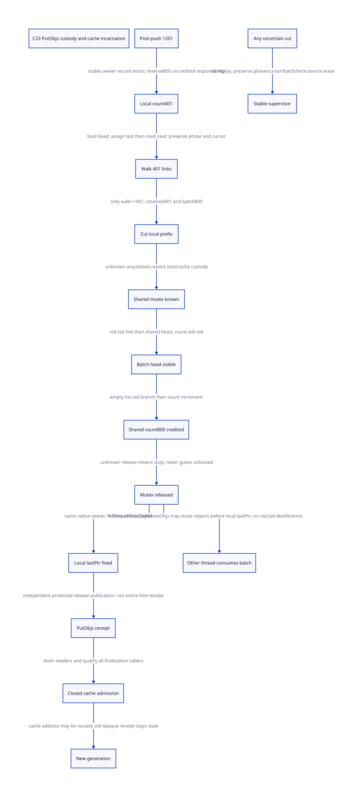

#+TITLE: C23 PutObjs split, shared publication and cache-incarnation custody
#+SETUPFILE: ../../modeling/org/setup.org
#+LANGUAGE: en
#+PROPERTY: header-args :eval never
#+STARTUP: overview

* RESEARCH Architecture and authority
:PROPERTIES:
:AUTHORITY: GambitPutObjsCustody
:STATUS: source-bound order; conditional scalar proof; native refinement unresolved
:CUSTOM_ID: putobjs-custody
:END:

Refine [[file:thread-cache-tail-design.org][thread-cache return]] beyond its coarse helperFlush800 action. The chosen
real caller is TclThreadFreeObj with entry count1200, which pushes to1201 then
calls PutObjs(cachePtr,800). Model its local count change, cursor walk, chain cut,
locked splice/count, unlock and final lastPtr separately. Preserve the C23 mainline;
no runtime implementation, native compilation/preprocessing, native test or timing.

[[file:models/sysml/putobjs-custody.sysml][Native SysML]] owns the source/issuer/consumer/obligation routes, benefits and
edges; [[file:putobjs-custody-matrix.org][Org matrix]] and  are its projections. [[file:models/quint/putobjs_custody.qnt][Actual QNT]] has
separate actions for physical source cuts and proposed service operations. Its
restricted typed IR produces [[file:models/lean/PutObjsCustodyAst.lean][Lean AST]] checked by [[file:models/lean/PutObjsCustody.lean][preservation proofs]].
[[file:../../modeling/ascent/putobjs-custody.rules.scm][ASCENT DSL]] joins exact source witnesses, action names, lemma names and
issuer/consumer contracts; it does not turn a synthetic qualified row into native
evidence. [[file:../../../evidence/research/future-frame-commit/putobjs-custody/][Study receipts]] retain failures, poison controls and current bindings.

* What the fixed source actually executes
:PROPERTIES:
:SOURCE_COMMIT: cbf86d62348d6b052e1961b4df995960fb21545f
:LOADED_BINARY_QUALIFIED: no
:END:

The matching local tclThreadAlloc.c is bound by SHA256, fixed Git blob and capture
ledger from the previous study. Source needles identify each store/call, avoiding
an assumption that source line numbers or a loaded Tcl binary match another tree.

| Cut | Physical operation | Outstanding responsibility |
|-----+--------------------+----------------------------|
| entry | keep=1201-800=401; lastPtr initially NULL | original native owner/cache, whole valid chain |
| local count | fromPtr->numObjects=401 | physical chain still1201; 800-object transfer not committed |
| cursor | firstPtr=head; lastPtr=firstPtr; firstPtr=next; decrement keep | preserve actual cursor, last and remaining iteration count |
| local cut | last retained object's next=NULL | retained401 and detached800; source lastPtr still old tail |
| lock | Tcl_MutexLock(objLockPtr) | distinguish known held, not entered, and unknown acquisition |
| old tail link | old local tail next=old shared head | batch now points to shared suffix; shared head unchanged |
| shared head | sharedPtr->firstObjPtr=batch first | reachability changed; shared count and possibly tail still old |
| shared tail | if shared count0, shared tail=old local tail | branch must observe count under the acquired lock |
| shared count | sharedPtr->numObjects+=800 | shared topology/accounting complete under lock |
| unlock | Tcl_MutexUnlock(objLockPtr) | shared consumers may proceed; local lastPtr still stale |
| local tail | fromPtr->lastPtr=last retained object | PutObjs local representation complete on normal path |
| proposed receipt | publish to preexisting independent operation record | exact PutObjs endpoint; outer free completion is separate |

The selected loop has 401 next-link reads, 401 last-pointer assignments and 401
loop-condition evaluations. It does not traverse all800 transferred objects.
These are source-level operation counts, not machine instruction counts or a
speedup. Native shared numObjects is an int: adding800 also requires a proved
upper bound below overflow. Relative delta800 does not establish that global bound. The pointer ordinal model assumes a valid acyclic1201-object chain with
correct old tail; it does not prove that native representation premise.

Shared-list emptiness is selected in the model at the locked branch, after head
publication and before count mutation. It is not sampled before the callback or
before locking. Other native threads may change shared contents before acquisition;
the model abstracts the locked outcome and does not freeze a pre-lock snapshot.

* Custody before the first irreversible write
The proposed owner-visible record must exist before the count write. Bind its
NativeThreadDomain, cache storage identity/incarnation, operation/attempt identity,
source count, numMove, original head/tail, current firstPtr/lastPtr/keep, split
status, shared-lock operation and publication/return phase. Payload/code/root
leases from the outer guard stay independent; copying raw addresses into a record
does not register Scheme GC roots or keep descriptors alive.

Current PutObjs keeps the walk cursor in C locals; it has no persistent phase or
same-operation recovery API. Registering a supervisor after a possible exit is
too late. The proposed model assumes stable registration from the parent escrow
contract, without claiming current Tcl implements it. Before lock, original owner
holds both local fragments. During a known lock interval it additionally owes the
shared lock and any partial shared update. Unknown lock/unlock outcomes retain
that duty conservatively; they do not permit another worker to unlock the mutex.

** Mid-operation exits
- Before the cut, count and physical list can disagree. No allocator reentry,
  thread-cache cleanup or restart-from-entry may consume that partial state.
- After the cut and before shared publication, the detached suffix remains the
  original operation's responsibility; source numObjects alone cannot find it.
- After old-tail linking or shared-head publication, absence of an ACK is not
  evidence no splice occurred. Replaying can make cycles or double-count800.
- After shared count but before known unlock, retain lock ownership/uncertainty.
- After known unlock but before local lastPtr, retain owner exclusion over the
  local cache. Shared publication alone cannot permit its reuse/finalization.
  TclThreadAllocObj takes objLockPtr then calls MoveObjs; it can consume and reuse
  the newly published batch after unlock but before local lastPtr. The original
  owner must only overwrite its local lastPtr, never dereference the old tail.
  A stable record may retain opaque batch identities, not an unrestricted pointer
  lease over objects already released to another allocator owner.
- After lastPtr but before receipt publication, effects may be complete but the
  result remains unknown. Do not replay; a backend-authoritative reconciliation
  or a qualified non-abandonable publication tail is still required.

A supervisor preserves responsibility, not progress. It cannot resurrect the
abandoned C stack, resume an arbitrary captured continuation at a native cursor,
unlock from the wrong thread, or reconstruct the effect from potentially reused
node addresses. Partial publication while a mutex remains held can block other
allocator threads indefinitely. Unknown outcomes are retained, not automatically
recoverable. Finalization or a process-wide abort policy is a distinct design
choice and cannot masquerade as successful same-operation completion.

* Completion receipt and C23 synchronization
The candidate PutObjs issuer is the native allocator owner observing known final
lastPtr completion, with the exact cache/operation incarnation and all intended
stores accounted. A persistent record outside the reusable node/cache carries
completion. A known normal return from PutObjs is an endpoint; it does not make
a later potentially abandoning receipt store safe by itself.

A proposed fused final store/receipt tail must exclude reentry, Scheme LONGJMP,
foreign unwinding, unsupported signal jumps and restored cancellation. POSIX
cancellation masking alone is insufficient. Any lock API interruption needs the
actual provider's effects, not a guessed held bit. The model's lockUnknown and
unlockUnknown are deliberately opaque retained states; they grant no progress.

For qualified C23 integration, keep native cache fields owner-exclusive and shared
fields under the actual shared mutex. Establish the mutex provider's synchronization
and lifetime contract before mapping its operations to abstract lock steps. Publish
a preinitialized independent receipt with release; a reader acquires the same
publication and retains the record's lifetime authority. Receipt acquire does not
repair native data races, confer cache/node lifetime, prove a particular reads-from
edge or make the group of ordinary stores atomic. Instrumentation/statistics and
all complete outer macro effects remain separately qualified.

The new receipt is PutObjsCompletion, not NodeFreeCompletion or SlotReusable.
TclThreadFreeObj must still return, and TclSmallFreeEx may update statistics before
the dispatcher can certify the whole node release. Cancel restoration, result
ownership and slot detachment from the previous studies remain outstanding duties.

* Cache address reuse and real finalization callers
TclFreeAllocCache first flushes bucket lists, calls PutObjs with all numObjects,
unlinks the cache under listLockPtr and calls TclpSysFree(cachePtr).
TclFinalizeThreadAllocThread obtains the thread cache and delegates to
TclpFreeAllocCache; platform TLS/deallocation semantics are not established by that
call alone. TclFinalizeThreadAlloc separately destroys shared allocator mutexes.
These are real additional lifetime dependencies, not proof that they run while
PutObjs is in flight in a legal unmodified program.

The finalizer's all-object PutObjs case has keep=0: it clears firstObjPtr and uses
lastPtr=NULL. This is not the selected401-prefix path. No finalization permit may
be issued from the high-water proof alone; bucket flushing, keep=0, cache registry,
interpreter allocCache aliases, TLS, platform cleanup and shared-lock retirement
need complete caller closure. The model marks that requirement attestFinalization;
its ability to set a bit is an external evidence premise, not implemented evidence.

Define CacheKey from a stable owner/storage service and incarnation, never merely
the raw cache address. Before physical reuse: close all borrower admission, drain
in-flight readers/operations, settle unknown outcomes, qualify finalization and
resolve any raw aliases. A new allocation at the same address gets a fresh identity.
Late opaque receipt readers may query an independent retained record, but cannot
dereference the old cache. The bounded witness uses generation1 then2; old stamp1
fails identity equality. It does not prove nonwrapping counters, arbitrary ABA,
process-wide identity allocation or the absence of all raw native aliases.

* Mathematical model and refinement obligations
The scalar model preserves the selected operation's accounting:

#+begin_example
localCount + uncredited + newlySharedCredited = 1201
#+end_example

uncredited is transfer responsibility, not an extra physical copy. After shared
head publication it can remain800 while exposed=800 until the shared count is
updated. Both delta and exposed retain historical effect facts even if another
thread has already consumed the batch; they are not current shared occupancy or
permission to dereference any transferred object. Thus the equation does not
double-count physical objects. The model tracks
401 cursor advances, split state, conditional shared tail, lock uncertainty,
lastPtr completion, independent receipt, admission/readers and a new incarnation.

Lean proves initial safety, all28 action-preservation lemmas, reachable-state
induction, partial-publication/unknown-custody and stale-receipt properties. QNT
histories execute the full401-iteration source walk for normal/late cuts. Random
sampling remains bounded at80 steps and cannot itself cover that full walk;
full-walk histories and the inductive proof are separate evidence dimensions.
Seven late-cut controls reject publication at the shared head/unlock, progress after
unknown unlock, publication after abandonment, stale-address acceptance and reuse
before reader detachment; an additional history permits consumption after an
unknown unlock while retaining the old owner duty. Early reachable-prefix Lean negatives are independent.
Typed-IR poison controls check binding identity, field type, action roster and
unsupported expression rejection; they do not verify the parser implementation.

The actual parent ThreadCacheTailAst helperFlush800 action is joined only at a
protected endpoint: the pre-state mirror supplies count1201/shared0, and the known
new completion boundary supplies the coarse effect count401/shared800. This is a
real parent Guard/Step and endpoint-credit lemma, not full trace equivalence.
Intermediate native writes are visible in this finer model. Hiding them from the
parent observation requires owner exclusion and matched mutex discipline for all
consumers; pointer-graph refinement, raw aliases and a full product simulation
remain unresolved. The parent helperKnownReturn action is not proved by this join.

The retained [[file:../../../evidence/research/source-references/feeley-sfp/8bb2fae8ae4b54d3a86206596f90e9cf73da39846af0f39244a476074cf81ed4.txt][Feeley continuation/interoperability paper]] informs the separation of Scheme
control state from native C activation lifetime. Its C-thread approach retains
native activation contexts for interoperability; metadata survival is not that
mechanism. Resuming a native context still needs its live stack/return domain. It does not prescribe this Tcl lock/allocator
protocol or prove C23 publication. Fixed Tcl source establishes the actual order;
the service records, mathematical abstractions and proposed retirement rules are
our explicitly conditional architecture. No external runtime success is copied
as evidence for Gambit.

* Gains, costs and retirement
The [[file:putobjs-custody-matrix.org][SysML-projected matrix]] is authoritative for detailed gain/cost/status rows.
This refinement removes an unsound coarse completion assumption; it does not
remove the original401 link reads, shared lock or800-object transfer. A qualified
receipt could remove generic reconciliation only on its known normal path, at the
cost of persistent operation identity and at least one publication store plus
lifetime bookkeeping. Unknown locks can retain an entire cache/batch and delay
shutdown indefinitely; no memory or latency bound follows without a recovery policy.

Modern C23 and Zig both require the same semantic ownership, native-thread affinity,
mutex qualification, pointer graph and retirement work. No Zig-specific gain or
elapsed-time ratio has been proved here. Old paths retired now: zero. First retire
only a qualified coarse high-water handling branch after the finer native trace,
all observers, outer completion and lifetime contracts are proved. Keep empty,
keep=0 finalization, debug and alternate allocator paths until separately admitted.
