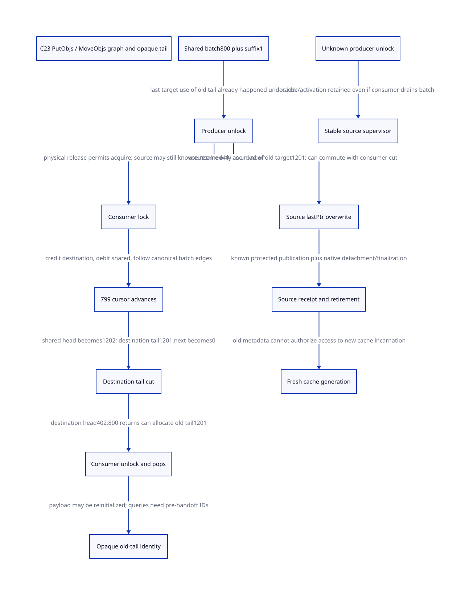

#+TITLE: C23 PutObjs / MoveObjs interleaving, pointer graph and opaque tail identity
#+SETUPFILE: ../../modeling/org/setup.org
#+LANGUAGE: en
#+PROPERTY: header-args :eval never
#+STARTUP: overview

* RESEARCH Scope and architectural decision
:PROPERTIES:
:AUTHORITY: GambitPutObjsMoveGraph
:STATUS: canonical graph and conditional scalar closure; native refinement open
:CUSTOM_ID: putobjs-move-graph
:END:

Refine [[file:putobjs-custody-design.org][PutObjs custody]] at its real unlock/MoveObjs overlap. Old native pointer
values are not leases. Keep source-cache metadata and the retained prefix alive
until its lastPtr overwrite; do not retain or inspect already transferred object
payloads through that old tail. Unknown source return status stays unknown even
when another native thread has successfully consumed the shared batch.

[[file:models/sysml/putobjs-move-graph.sysml][SysML]] owns source, issuer/consumer, action/lemma, graph-refinement,
obligation, benefit and edge rows. [[file:putobjs-move-graph-matrix.org][Org matrix]] and  are projections.
[[file:models/quint/putobjs_move_graph.qnt][QNT]] contains the actual interleaving; its typed IR generates [[file:models/lean/PutObjsMoveGraphAst.lean][Lean AST]].
[[file:models/lean/PutObjsMoveGraph.lean][Lean]] checks action induction and the graph/edge lemmas. [[file:../../modeling/ascent/putobjs-move-graph.rules.scm][ASCENT DSL]] now
also checks exact graph-lemma/source/premise rows, not only file/action links.
[[file:../../../evidence/research/future-frame-commit/putobjs-move-graph/][Evidence]] binds the fixed local source and all formal inputs. No runtime source
implementation, native compiler/preprocessor, native test or performance test.

* Selected real caller chain
The pinned tclThreadAlloc.c and tclInt.h are the same fixed commit as the previous
study, cbf86d62348d6b052e1961b4df995960fb21545f. Their hashes, source needles and
Git blob capture ledger are checked; a loaded Tcl configuration is not qualified.

1. TclThreadFreeObj pushes into a count1200 local cache, then calls PutObjs with800.
2. PutObjs retains401 objects, appends the800-object suffix to shared storage,
   updates shared count under objLockPtr, unlocks, then overwrites local lastPtr.
3. Another TclThreadAllocObj with an empty destination cache locks objLockPtr,
   selects min(sharedCount,800), and calls MoveObjs while holding that lock.
4. MoveObjs credits destination count, debits source count, traverses numMove-1
   links, advances the shared head, sets destination lastPtr, cuts its tail to the
   prior destination head (NULL), and publishes destination head. Its caller unlocks.
5. TclThreadAllocObj pops one object. Consecutive calls can drain this local cache
   without another shared refill until all800 have returned. TclNewObj calls the
   allocation path then initializes refCount, bytes, length and typePtr.

A legal source-level schedule therefore lets the consumer return and initialize
the old tail before the producer executes its final lastPtr overwrite. This is a
conditional schedule of independent native threads, not a demonstrated native
execution or proof that hooks/loaded configuration admit every step.

* Concrete graph family and the last physical target read
Use logical IDs only: retained K=[1..401], transferred B=[402..1201], previous
shared suffix S=[1202], and destination initially empty. IDs do not encode native
pointer bits, addresses, GC roots or allocation generations.

| Cut | Producer cache tail | Shared head/count | Destination | Boundary link1201 |
|-----+---------------------+-------------------+-------------+-------------------|
| before producer unlock | 1201, stale for local K | 402 / 801 | empty | 1202 |
| MoveObjs count writes | 1201 | 402 / 1, transient under lock | credited800, head not yet published | 1202 |
| MoveObjs traversal/detach | 1201 | 1202 / 1 | tail1201, head pending | 1202 |
| MoveObjs cut/publish | 1201 | 1202 / 1 | 402..1201 / 800 | 0 |
| consumer800 returns | 1201 | 1202 / 1 | empty | no free-link authority |
| producer final store | 401 | unchanged by this store | independent of producer | no target read |

PutObjs' last target access through the old tail is its locked shared-link store
(and, on an empty shared list, reading that pointer value for shared lastPtr).
Its post-unlock statement overwrites fromPtr->lastPtr using the retained local
lastPtr; it does not read/dereference the previous target. MoveObjs may therefore
rewrite1201.next while the producer overwrites its separate cache field. This is
safe only if the cache metadata and node payload are genuinely disjoint native
locations and both native-thread ownership contracts hold.

The graph deliberately keeps a nonempty old shared suffix, avoiding MoveObjs'
empty-source stale-lastPtr case. Additional producers, different list shapes,
allocator profiles, and finalization's keep=0 case need separate refinement.

* Ownership changes before initialization, not after a crash
The old producer loses general target-read authority at shared ownership handoff;
it must close that authority before the unlock can expose the batch. A future
consumer need not wait for the producer's cache field to stop containing1201.
The source owner may retain its source cache metadata and retained401 pointer.
It has no right to log, scan, refcount, reconstruct or inspect the transferred
Tcl object through the old tail without a separately authorized lease.

Opaque identity means a stable NodeId/OperationId/CacheKey recorded before handoff.
It does not mean converting or comparing a stale pointer after a native storage
lifetime has ended. The actual lastPtr field can remain untouched until its
store-only replacement; do not introduce a generated setter, debug hook or
recovery scanner that first dereferences/releases its old target. A cache-field
write and a node-payload write are different runtime roles in the modern C schema.

TclNewObj's payload initialization is a real role change from cached storage to
an allocated Tcl object. It is not evidence of native free, C storage lifetime
termination, generation increment in Tcl, or a specific overwrite of internalRep.
The model's tailReused flag marks this semantic role change; it does not invent
one of those physical operations. Permission is already gone before that flag.

* Unknown unlock and the real custodian
Separate source knowledge from physical mutex state:

| Source observation | Possible physical state | Other thread | Remaining custodian |
|--------------------+-------------------------+--------------+---------------------|
| known normal unlock return | released | can acquire | original live source owner completes lastPtr and receipt |
| unknown, physically released | released | can consume all800 and reinitialize tail | stable source supervisor retains source cache/activation/operation |
| unknown, still held | held by original operation | cannot acquire | supervisor retains lock-resolution duty; no arbitrary-worker unlock |

The model makes both unknown branches explicit. Both retain the same unknown
knowledge. A consumer acquire can constrain physical lock history; it cannot prove
that the original C activation returned normally, restore its catcher/cancel state,
or authorize its abandoned continuation to resume at the final store.

After shared publication, responsibility for the batch is the shared/destination
allocator's. A source supervisor retains operation/phase evidence and uncertainty,
not an exclusive payload lease on those800 objects. Do not quarantine returned
objects by merely retaining their raw IDs, and do not release the source cache
because the batch was independently drained. Unknown can block source retirement
or shared-provider shutdown indefinitely; no liveness/recovery theorem is claimed.

The [[file:../../../evidence/research/source-references/feeley-sfp/8bb2fae8ae4b54d3a86206596f90e9cf73da39846af0f39244a476074cf81ed4.txt][Feeley C-interoperability paper]] motivates keeping native activation lifetime
separate from Scheme control state. Its C-thread approach retains activation
contexts; a metadata supervisor alone does not implement that mechanism. Source
facts, paper mechanism and our proposed C23 service protocol remain distinct.

* Pointer graph to QNT and Lean
** Explicit representation relation
The expanded canonical graph uses ordinary next=n+1 edges except retained-end401
(next0) and transferred-tail1201 (next=tailNext). Encodes requires both boundary
edges, all other canonical edges and exact shared/destination/source-tail headers.
encodingUnique proves that any graph satisfying this relation has exactly the
expanded edge function; expandedEncodes supplies the canonical witness.

physicalWalk proves that an admitted MoveObjs cursor load reads edge(cursor)=
cursor+1. physicalDetach proves that its final shared-head assignment reads the
old tail's actual boundary edge. physicalCut proves that the destination tail
store changes only1201's boundary edge to0. These are mathematical graph-to-state
lemmas, not a name-only correspondence or proof about native pointer bytes.
Count/header interpretation is phase-indexed: destination credit precedes source
debit, and source debit precedes physical head detach. Do not sum transient
counters as a physical census or require each intermediate head/count pair to
represent a complete free list. The native shared lock must hide those partial
representations from other admitted consumers.

producerFixPreservesEdges proves the source-cache overwrite changes no node edge.
fixAndCutCommute and the two guard-preservation lemmas show those independent
updates can be ordered either way in this model. Physical disjointness of their
native locations is still a required encoding premise. This does not declare all
MoveObjs/PutObjs actions commutative.

** Permissions and finite scope
rawNext is a mathematical expansion/snapshot, not permission to access memory.
After allocation, rawNext retains only a mathematical snapshot of internal
edges; reinitialized payload bytes are unconstrained. Only an admitted freeLink
view can be interpreted as a native free-link target. freeLink excludes nodes
already returned by allocation, and allocatedTailNoLink
proves that after800 returns there is no free-link view of1201. opaqueCannotBorrow
rejects the producer's old-tail borrow after unlock. Unknown source knowledge
preserves source cache custody and rejects cache retirement even when pops=800.

The native interpretation still needs an injective logical-node-to-storage map,
valid field bounds/alignment and nonaliasing, complete writer/reader closure,
actual Tcl mutex synchronization, and source CFG/exception cut correspondence.
After source finalization is attested, graph fields are historical evidence;
retirement does not assert that this old topology remains the live heap graph.
No arbitrary-heap, cyclic-list, address-reuse or native memory-safety proof follows
from the fixed canonical family.

QNT models the799 individual MoveObjs next-link reads and the head/debit/return
steps of800 allocations. Deterministic histories exercise old-tail initialization
before source lastPtr, source lastPtr first, and source lastPtr during the consumer
critical section. Random sampling at80 steps is only bounded protocol sampling;
it does not replace these full histories or Lean induction. Two representation negatives reject a wrong boundary edge or shared head.
Early reachable-prefix and late-guard controls reject borrowing, replay progress and premature retirement.

A scoped join targets the actual prior PutObjsCustodyAst.takePublishedBatch action
at destination-head publication. Its mirror supplies the parent event guard. Full
trace/product simulation, preserving all external observations and raw callers,
consumer mid-operation abandonment and all caches/providers remain open.

The original single-file Lean attempt exceeded the unchanged60-second process
bound. Its failure is retained. Action proofs are split into four source-bound
modules imported by the graph/composition proof; no timeout or heartbeat limit
is widened and splitting does not change the mathematical transition relation.

* Source-cache retirement is separate from node reuse and mutex retirement
Known source lastPtr completion is necessary before its receipt, but not sufficient
for cache free. Close source admission, detach native readers, preserve descriptors
and root/source leases, finish every bucket plus keep=0 object flush, unlink from
cache registry, settle platform TLS and native free. TclFreeAllocCache is the real
flush/unlink/free consumer; it does not supply this new stable retirement receipt.

The finite model permits finalization attestation only after the selected consumer
has left its shared critical section. That is a scope restriction to avoid hiding
a finalizer that prepends retained401 before this consumer selects its batch. It
is not a proposed universal requirement to wait for all destination allocations.
The source cache may retire while transferred objects are still in destination
use once actual native disjointness and caller closure are proved.

A source CacheKey has its own fresh incarnation after reuse. A transferred Tcl
object's allocation identity, the stable receipt record lifetime, native return
domain and shared mutex/provider lifetime are independent. Source cache completion
cannot retire objLockPtr; TclFinalizeThreadAlloc has separate mutex destruction
and all participants must be closed/drained. Unknown unlock must prevent the
respective provider from disappearing while its outcome is unresolved.

* Gains and added overhead
See the [[file:putobjs-move-graph-matrix.org][SysML-projected matrix]]. The selected full history performs401 PutObjs
prefix reads,799 MoveObjs loop reads,1 shared-head advancement link read and800
allocation-pop link reads:2001
source-level next-link reads in total. None is eliminated by this research.
A stable opaque record could avoid pinning/re-reading transferred payloads for
late queries, and disjoint source-tail overwrite need not wait for destination
allocation. Both gains are conditional on complete native caller/alias closure.

Added work includes stable operation/node/storage identities, source-only lifetime
holds, native return-domain custody, admission and detachment, and at least one
independent receipt publication. Unknown outcomes can retain source resources
without a finite bound. No speedup, memory percentage, person-day estimate or
Zig-specific benefit is derived. Old paths retired now0; native implementation,
loaded configuration and performance admission remain unqualified.
