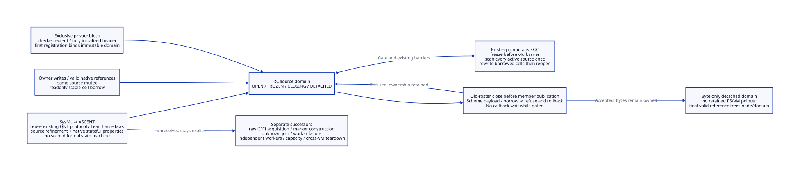

#+TITLE: Published RC source ownership REV
#+SETUPFILE: ../../modeling/org/setup.org
#+LANGUAGE: en
#+PROPERTY: header-args :eval never

* PUBLISHED RC source ownership :rev:publication:
:PROPERTIES:
:CUSTOM_ID: RC-OWNERSHIP-PUBLISHED
:REVISION: 94b14f2483268e367e02846c782439bfcd377535
:PARENT: 43db0e3fc8eb139e28409cad18c6824095512140
:TREE: b593b6586009c5c1b65b6456cab70a64610cb817
:STATUS: Local commit; not pushed; no new remote CI observation
:END:

[[file:rc-ownership.org::#REV-RC-OWNERSHIP][The frozen audit/checklist]], [[file:models/sysml/rc-ownership.sysml][native SysML component and dependency edges]],
[[file:../../../evidence/research/retained/modern-c/rc-ownership/receipt.json][source-bound native evidence]] and  define this bounded REV.
All five shared ASCENT gates were ready;21 missing/stale/audit controls were
refused. The actual Git commit body contains the nine required report fields
and source/profile/manifest/checklist/audit hashes. It selects12 files,
572 insertions and138 deletions. No public name, workflow, configure input,
Scheme generator or parallel configuration/execution layer was changed.

| Responsibility / gain | Observed result | Cost / boundary |
|------------------------+-----------------+-----------------|
| Registered sources now own roots | Source1 moving-root bits2 ->3; source0 remains3 | All active sources must actually scan; extra correctness work is not a speedup |
| Reference/borrow lifetime |720 generated legal actions, explicit borrow-last GC/reload and native reference handoff PASS | Source mutex; readonly borrows and valid-reference-before-header contract |
| Retirement |Real resize refuses a live payload and preserves roots; byte handle releases after owner exit | Conservative refusal retains resources; native domain outlives carrier |
| Source construction |Fixed slots initialized; attached-source overwrite and closed registration refused |144-byte domain; native metadata OOM/general partial-creation recovery unqualified |
| Continuation/frame consumers |Existing map multi-shot/root and exit tests PASS;290 assertions retained | Existing collector/trampoline/frame protocol, no independent-worker credit |
| Native producer / original GSI |Bootstrap184.122s, core34.905s; GSI408/408 in72.801s | Same workspace/profile and600/120/300s limits; no heap/wait increase |
| Module layout |Held predecessor body loads on base, rejects twice on new runtime; flags1->1->1 |Configured header comparison only; old private-layout modules need recompilation |
| Metadata |Header32->48; carrier920->896; VM80040->78504; domain144 |Structural delta144D+16N-1536 bytes; not process peak or allocator-inclusive RAM |
| PBT |Native Scheme/Make action generator and independent observable oracle |Automatic shrinking and controlled schedules OPEN; particular GC-step overlap not proved |
| Known official failure |test8 still exits70 in setup_mem_pstate;6/6 sections,1/12 members,max_heap0 |Full original check remains FAIL; capacity endpoints unchanged |

Existing RC/slot QNT files supply18 explicit regression runs. Lean frame laws
remain unchanged; no second RC protocol was written. Native model tests are
not exhaustive C memory-model checking. Ambient LLM review remains source
review, not an extra proof engine.

The commit preserves unrelated staged/working research. The new owned
=lib/rc.h= working/index entry was aligned with the published blob after
publication; all previously existing staged entries remain unchanged. The
working directory still contains unqualified successor prototypes, so native
validation belongs to the exact submitted tree and its persistent SDK.

* Next responsibility boundaries :roadmap:open:

1. RootTask publication/claim/completion must acquire an explicit domain scan
   lease before relaxing the present synchronous roster. Claim count changes
   alone do not admit independent workers or W<R.
2. Membership construction/rollback must account for every prepared source.
   The existing growth rollback uses =ps= while decrementing =i=; metadata OOM,
   partial thread creation, unknown join and global reclamation remain separate
   obligations, not inherited success from this RC REV.
3. Native activation/CFFI must cover raw lookup before header access, marker
   allocation roots, dynamic C-closure TLS, Tcl reentrancy and destructor/provider
   lifetime. Current RC snapshots are not GC roots across allocating calls.
4. PBT should gain dependency-preserving shrink/replay and controlled schedules
   through the existing test path. Keep one protocol authority and distinct
   model-versus-implementation obligations.

No patch-line8/12 or9/12 milestone transfers to this branch.
