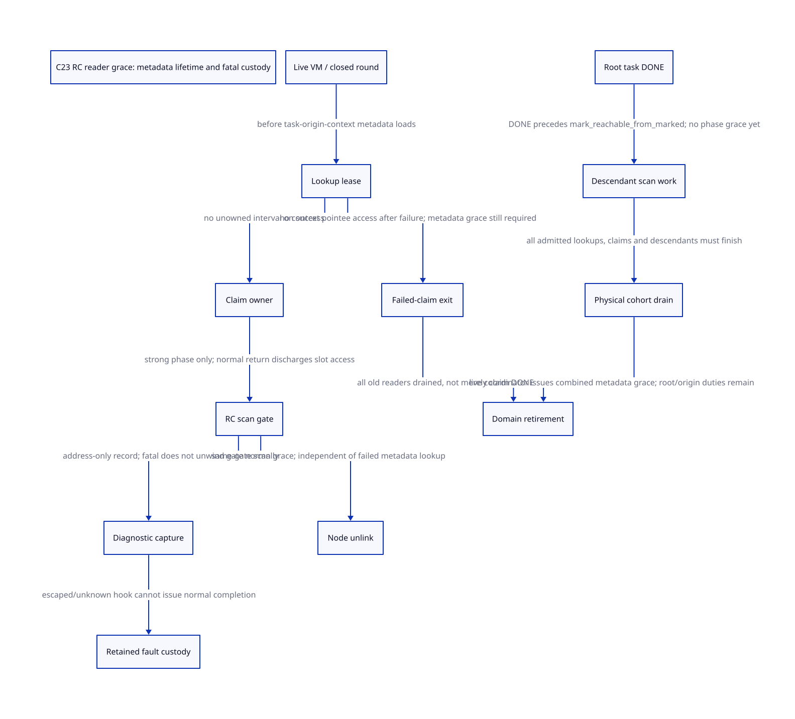

#+TITLE: C23 RC reader grace — diagnostic addresses, pre-claim users and domain retirement
#+SETUPFILE: ../../modeling/org/setup.org
#+LANGUAGE: en
#+PROPERTY: header-args :eval never
#+STARTUP: overview

* RESEARCH Decision and authority
:PROPERTIES:
:CUSTOM_ID: rc-reader-grace
:AUTHORITY: GambitRcReaderGrace
:STATUS: conditional-model; native closure unresolved
:END:

Refine [[file:rc-root-release-design.org][RC storage retirement]] by separating three lifetimes: source RC
slots, execution-context/gate resources, and task/origin/VM metadata. A failed
claim is not a root-slot borrower, but the attempt has already read metadata.
The current closed GC collective is a candidate for metadata grace; a second
per-task reader-counter implementation is not automatically necessary.

[[file:models/sysml/rc-reader-grace.sysml][Native SysML]] owns source, consumer, issuer, obligation, action/lemma route,
benefit and edge records. [[file:rc-reader-grace-matrix.org][Org matrix]] and  are projections.
[[file:../../../evidence/research/future-frame-commit/rc-reader-grace/][Evidence]] binds exact source and formal inputs. C23 is the redesign baseline;
this is not an assertion that a loaded Darwin build implements this protocol.
There is no runtime edit, compiler/preprocessor invocation or native test here.

* Diagnostic address producer and actual named users
** Complete bounded named inventory
Searching the entire fixed =vendor/gambit= tree for
=invalid_copy_cell/body/worker= finds ten lines in three files:

| Field | Declaration | Address/sentinel write | Other named use |
|-------+-------------+------------------------+-----------------|
| cell | runtime_roles.h.in | copy-reservations.inc saves cell; heap-sections.inc sets zero | no named read/dereference found |
| body | runtime_roles.h.in | copy-reservations.inc saves body; heap-sections.inc sets zero | no named read/dereference found |
| worker | runtime_roles.h.in | copy-reservations.inc saves worker id; heap-sections.inc sets -1 | first-writer test under MISC_MEM_LOCK |

The Python driver retains and checks the exact lexical use classes and hashes;
it does not infer whole-program alias closure. This narrows the previous open
question: the current named C code does not require keeping every retired RC
node pinned merely because the VM contains a saved pointer field. It does not
license dereferencing that field after its referent dies.

=require_fromspace_copy_source= is called from =mark_array=. Its =cell= may be an
original root slot or a later destination payload slot. It records cell/body
only after the fromspace-source validation fails. Thus an RC address capture is
conditional on this path originating from an RC root; this study has not shown a
legal Scheme program that reaches that diagnostic with a bad RC source. Neither
an observed supported-use UAF nor a complete legal-input exclusion is established.

The diagnostic lock protects first-writer selection and tuple installation.
There is no named consumer that obtains an acquire snapshot of cell/body under
that lock. A future diagnostic consumer must choose explicitly between opaque
address/identity reporting and a live, admitted dereference lease. Address value
logging alone does not grant slot access or preserve a Scheme object root.

** Fatal return is not scanner return
=___fatal_error= calls =setup_params.fatal_error(msgs)= if installed, otherwise
it displays messages, and then calls =___exit_process=. That function calls C
=exit(status)=. A returning custom hook therefore still terminates; it does not
return normally to =mark_array= or unlock =rc_gate_= in =mark_rc=.
The default setup initializer sets the hook to zero, but that is not a proof
that every embedding or loaded consumer uses the default.

The hook receives messages, not these three diagnostic fields. A native client
could nevertheless possess a VM alias, use pointer arithmetic, install a custom
fatal hook, or expose a debugger observer. None is excluded by a named-use scan.
Exit callbacks/library interposition are also outside this local alias proof.

If the process terminates, there is no subsequent in-process reuse to certify.
If a hook instead escapes nonlocally, reenters, or has unknown completion, no
normal scanner completion receipt exists. The enclosing VM/round owner must
retain the domain, gate, scan responsibility and dependent root storage. The
model intentionally supplies no fault recovery action. Retention can be
indefinite; it is not a progress guarantee or an implemented recovery facility.

Clearing the diagnostic fields in next-round setup is not such a recovery
receipt. The source reset is at the exclusive collective setup cut, together
with frame-gate reset, epoch advancement and frozen-origin publication; an
unknown old scanner must prevent reaching that cut. Overwriting a pointer does
not prove that external readers or the old lock holder have disappeared.

* Pre-claim lookup: exact access and lifetime boundaries
** Worker dispatch and failed claim
=collect_root_tasks= obtains a task from the VM array and loads
=task->origin->context= before calling =gc_root_task_claim=. The helper reads
origin incarnation/state before its claim CAS. If claim fails, =continue= skips
the entire switch: the preloaded context pointer is not subsequently used to
access context fields on that branch.

Accordingly, protect VM/task/origin metadata before the first load. Do not call
this branch a retained RC slot address, nor assume moving the context assignment
after CAS solves metadata lifetime: the claim helper itself reads origin.
The source context/origin/task arrays are embedded in the VM, rather than
individually malloc/free objects. Context resources and =rc_gate_= can still be
cleaned/reset while their enclosing bytes remain allocated; physical VM lifetime
and safe incarnation reuse are separate obligations.

** Successful claim and concrete consumers
- PREPARE invokes =setup_still_objs_to_scan= and folds deferred still accounting
  into the context's current count.
- STRONG invokes =mark_execution_roots=: continuation, r/saved/type-cache arrays,
  startup thunk, entry marker, processor object and =mark_rc=. The strong helper
  reloads =task->origin->context= under successful claim authority.
- WEAK invokes =process_wills(work,context)= and its context will-list logic.
- CLEANUP is rejected in worker dispatch. =cleanup_root_domain= separately compares
  =task->origin->context= with the stopped host context and checks restored state
  before claiming; it runs owner-affine still cleanup, not worker-authorized cleanup.

Successful claim transfers lookup responsibility to the task owner without a
zero-reader interval. Failed claim discharges its lookup only after its last
metadata access/attempt has returned. Owner completion does not erase another
worker that loaded the same task/origin just before the completion CAS.

** Advance, thaw, reuse and teardown
=advance_root_tasks= is called by the sole coordinator after a phase barrier;
its helper expressly requires old readers to have drained beyond DONE. The final
round barrier precedes reopening RC writers and forbids retaining stopped root
views. Every stopped host participates in host cleanup, including nonworkers.
The concrete BARRIER macro is erased for SINGLE_THREADED_VMS; otherwise it
calls barrier_sync_noop, which submits OP_NOOP to barrier_sync_op. Despite its
name, that function performs a processor_count tree collective. SYNC_SEND and
SYNC_RECEIVE publish/read/ACK slots under recipient wait synchronization. These
are actual reuse candidates, not evidence for external observer enrollment or
for an effective backend memory-order proof.

This supports an existing-cohort grace strategy if all readers and descendants
are proven contained in those synchronous scopes.

Setup increments origin incarnation before rebinding an embedded context. That
identity check cannot protect an origin load which has already raced teardown or
unsafe slot reuse. The VM setup initializer clears arrays before processors can
borrow them. VM cleanup has resize/request guards, but those guards alone are not
a new diagnostic/pre-claim grace certificate. External readers and abnormal exits
must be excluded, enrolled, or left as unresolved retirement blockers.

* Proposed contract and real issuers
:PROPERTIES:
:CUSTOM_ID: issuers
:END:

| Permission | Existing source cut | Additional issuance condition |
|------------+---------------------+-------------------------------|
| live metadata lookup | worker/host dispatch inside frozen round | live VM/roster authority before any task or origin load |
| successful claim | claim CAS after metadata validation | lookup coverage transfers to the claim owner without a gap |
| normal RC slot grace | mark_rc normal unlock and same-gate unlink | no escaped dereference lease; external owners already settled |
| phase/metadata grace | coordinator after physical phase barrier | all old lookup attempts, claim owners and descendants ended |
| diagnostic observation | no current named cell/body reader | opaque copied identity, or separately admitted live observer lease |
| domain retirement | cleanup_rc destroys the gate | combine metadata grace with root/storage/origin obligations |
| abnormal scan custody | fatal boundary while scan may hold gate | process exit or continued retention; no invented landing receipt |

These are jointly signed contracts for a refactoring, not new capabilities
already returned by the current functions. A failed or unknown issuer keeps its
obligation with the existing stable VM/round owner. Transferring a raw address
or an ACK is not transferring ownership. Origin/allocation holds from the prior
study remain required and are not replaced by metadata grace.

* C23 handoff and failure conditions
1. A lookup permit must be obtained through a stable enclosing authority before
   reading reclaimable task/origin memory. A counter inside already retired memory
   cannot make the first load safe. Use the live closed VM/round where justified;
   only exported asynchronous readers require separate enrollment machinery.
2. Publish task/origin/context descriptors before an acquire observation by the
   entering cohort. Source atomics and barriers need effective-backend refinement;
   no compiler execution or reads-from proof is supplied by this study.
3. Admission closure and existing readers' completion are different cuts. Close
   stops future attempts; final drain must also cover already acquired lookup,
   claimed work, descendants and observer leases. DONE is only owner completion.
4. Reader discharge and domain retirement need a common ordering authority.
   A late attempt must inspect a still-live admission anchor and be refused there;
   it cannot touch a dead origin to discover that its generation is obsolete.
5. Diagnostics saved during failed scanning do not relax gate ownership. If an
   abnormal callback can escape, retain scanner and VM/domain custody. Full
   recovery would require evidence that no lock, root or callback still refers to
   the old view, and remains unresolved.

* Actual formal model and composition limits
[[file:models/quint/rc_reader_grace.qnt][QNT]] contains sixteen Boolean-as-integer fields and seventeen actions. Its
=lookup/claimed= fields are ghost obligations, not a proposal to add an atomic
increment for each dispatch. The closing collective may discharge them if its
native scope is complete. A second lookup can coexist with a claim; completing
that claim leaves the lookup outstanding. Node unlink may coexist with a failed
metadata lookup because it is not an RC slot dereference.

The model also separates root-task DONE from descendant drain and a physical
cohort-drain receipt. A claimed producer may create a descendant before completing;
that descendant can outlive DONE. =confirmCohortDrain= requires admission closure,
zero lookups/claims/descendants and normal scanner completion. Its native issuer
is still a refinement premise, not a counter-based replacement for the barrier.
The source calls =mark_reachable_from_marked= after =collect_root_tasks=, so this
is a necessary distinction rather than a hypothetical scheduling concern.

The model assumes prior root owners/borrows are already settled before
=unlinkNode=. Its guarded domain join retains the previous model's independent
owner, borrow, scanner, alias, native-operation and domain preconditions. It does
not subsume those mechanisms or declare all them discharged by a phase barrier.

=saveDiagnostic= captures the branch where a root scanner reaches the fatal
boundary. =borrowDiagnostic= represents a hypothetical explicitly admitted
external observer, not an existing named C consumer. =fault= retains scanner,
claim, registration, domain and escrow; no action clears it. This safely refuses
unsupported recovery, but does not prove that refusal can be implemented after
an arbitrary longjmp or that a faulted runtime continues usefully.

[[file:models/lean/RcReaderGraceAst.lean][Binding-aware typed-IR extraction]] and [[file:models/lean/RcReaderGrace.lean][Lean]] establish action preservation and
reachable-state induction. =graceSuppliesPriorGuard= and =guardedPriorRetirement=
use the actual previous =RcRootReleaseAst.retireDomain= guard and transition.
The reader mirror expresses zero iff both metadata lookup and claim are absent;
it is a zero/nonzero abstraction, not a count-preserving full product simulation.
The proof does not establish native cohort closure, descriptor lifetime or C23
machine execution.

Five explicit histories include a late failed claim after DONE, closure before
an already admitted claim, node unlink before metadata drain, and retained fatal
observer custody. Ten reachable negative controls deny claim without lookup,
late admission, premature domain retirement, normal completion/unlink after fault,
and treating DONE as reader drain. A separate positive history demonstrates that
node unlink need not wait for unrelated metadata lookup.

ASCENT checks actual source hashes, seventeen action/compiled-lemma routes, twelve
consumer records and five issuer records. Removing a lemma, changing an issuer,
or turning the failed-claim branch into an RC payload reader must break the chain.
Current unresolved native obligations block admission. Synthetic all-receipts
success is solely a wiring control, not native evidence.

* Gambit research and the modernization boundary
The retained [[file:../../../evidence/research/source-references/feeley-sfp/8bb2fae8ae4b54d3a86206596f90e9cf73da39846af0f39244a476074cf81ed4.txt][Feeley continuations/C paper]] explains why C activation lifetime and Scheme
continuation lifetime cannot simply be identified, and why restoring copied C
frames can overwrite local mutation. It motivates retaining abnormal scan custody
outside a disappearing activation. It does not establish the new reader/observer
contracts. Current call sites and the explicit model supply those conditional
arguments; no OCaml/Erlang mechanism is assigned as an unmodified Gambit guarantee.

* Benefit and refactoring gates
For N closed-cohort task attempts, ghost-reader coverage can require zero added
per-attempt reader RMWs if existing physical barriers and live VM authority cover
all users. Existing barriers, gate serialization and task CAS still cost work.
For A exported asynchronous observers, separately tracked state is O(A); for F
unresolved escaped scanners, retained custody can be O(F) and indefinite. These
are structural bounds, not measured speedups or byte-layout estimates.

The next native refinement must close VM-entry/teardown scope, abnormal hook
admission and asynchronous observers before issuing domain retirement. No legacy
runtime path retires merely because this study compiles its models. Retain the
current synchronous scan gate; do not add a universal hazard/epoch scheme for
addresses with no real dereferencing consumer. Add such support only at proven
export boundaries, while retaining root references and origin-family obligations.
