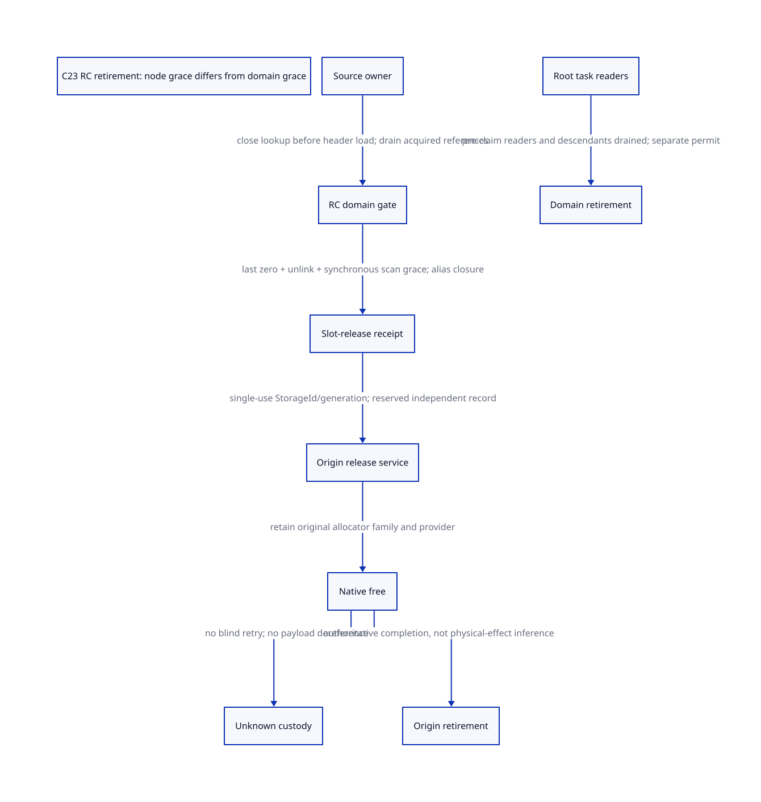

#+TITLE: C23 RC storage retirement: scan grace, origin custody and native free
#+SETUPFILE: ../../modeling/org/setup.org
#+LANGUAGE: en
#+PROPERTY: header-args :eval never
#+STARTUP: overview

* RESEARCH Architectural decision
:PROPERTIES:
:CUSTOM_ID: rc-storage-retirement
:AUTHORITY: GambitRcRootRelease
:STATUS: conditional-model; native refinement unresolved
:END:

RC root retirement is a composition of three permissions: exclusion from future
root scans, completion of already admitted storage users, and origin-matched
native deallocation. A fourth, stronger permission retires the domain/gate itself.
The modern C23 design reuses the existing same-gate node fast path; it does not
introduce a whole-GC grace period per release. It does not make Zig a prerequisite.
No runtime source, compiler, native test or performance experiment is part of this study.

The authority is [[file:models/sysml/rc-root-release.sysml][native SysML]]. It binds source witnesses,
actual QNT action/Lean lemma routes, unresolved obligations, gains and diagram edges.
[[file:rc-root-release-matrix.org][The generated matrix]] and  must be regenerated from that authority.
[[file:../../../evidence/research/future-frame-commit/rc-root-release/][Validation evidence]] records hashes and formal limits.

* Source-grounded normal path
** Scan grace is already serialized for one node
=mark_rc= locks =context->mem.rc_gate_= before loading the list head and keeps it
through =next= loads, =mark_array(&h->data,1)= and payload-root scans. Normal
=release_rc_locked= decrements under that same gate and unlinks only at zero;
=release_rc= and =return_rc_root= unlock before =FREE_MEM=.

For a scanner S and zero/unlink operation U on the same live gate there are two
cases: S acquires first and completes all source-slot accesses before U; or U
acquires first and the later scanner cannot find that unlinked node. This is a
mutex-order argument, not an epoch inference from an idle bit. GC may continue
scanning copied Scheme objects after S without retaining the source RC cell.

The normal =mark_array= path initially uses the source =cell=, updates it
synchronously, then uses destination =alloc= for Tail; queued copy headers refer
to destination heap objects. This conditional no-escape argument does not cover
arbitrary overrides of =GC_COPY_CONTROL= or =GC_ROOT_CONTROL=.

** Exceptional source addresses prevent unconditional closure
=require_fromspace_copy_source= records =invalid_copy_cell= before its fatal
boundary. The retained address is a real escape. A diagnostic value is not
necessarily a dereferencing capability, but all diagnostic readers and fatal-hook
behaviour must be classified before a no-escape certificate is issued. Nonlocal
exit while the gate is held cannot be treated as a successful scanner unlock.
The QNT =endScan= action means normal completed source access, not arbitrary
exception completion. A failed/unknown scanner retains its obligation and may
block progress; this study proves safety, not recovery or fairness.

** Reference balance and real callers
=borrow_rc_root= increments both the node refcount and domain aggregate borrow
count; =return_rc_root= decrements both. For one node, the refcount already includes
borrow ownership. Its last borrow return frees only if it is also the last reference.
The ordinary SFUN bank starts with refcount 1, reaches 2 at borrow, returns to 1
at =return_rc_root=, then reaches zero at the following =release_rc= in
=___end_sfun=. If the owner was released earlier, the borrow return can instead
be the final zero/unlink operation. The model has histories for both orders.

Tcl =scheme_delete_cmd= releases the Scheme payload and then RC storage. The
source command owner must prevent new raw =ClientData= acquisition and cover
callbacks already dispatched before deletion. =addref_rc= reads the header/domain
before locking; it is not a safe resurrection operation for a stale pointer.
The new source gate is that external acquisition boundary, distinct from
=rc_closed_=, which controls RC writers during GC and must not wait for borrowers.

Native string conversion actually calls registered =alloc_rc= in the inspected
=c_intf.c= path. Do not generalize it to domain-zero allocation. Conversely,
=alloc_rc_no_register= genuinely returns a private domain-zero block: release
requires private ownership, not a fictitious GC grace receipt. Register failure
leaves a private allocation and =alloc_rc= frees it directly. That direct rollback
and bulk =cleanup_rc= are separate deallocator paths requiring future origin integration.

* Receipt issuers and irreversible boundaries
** Node release receipt
A proposed =RootStorageReclamationReceipt= binds StorageId, generation, physical
allocation/header range, retired root-slot set, source acquisition closure, balanced
node reference census, completed scanner/alias obligations, and reserved OperationId.
Its issuers jointly are:

1. The source owner closes lookup before a caller loads the header and drains
   already admitted acquisitions. A gate inside an already freed header is too late.
2. The live RC domain coordinator performs the final reference change and unlink
   under the same gate as scanning. The current Boolean return is only a local
   reclaim decision; it is not an implemented persistent receipt.
3. The scan/alias authority attests no retained source-slot dereference. Exported
   slot leases must be counted; raw aliases without a source lifetime are denied.
4. The stable release service takes the pre-reserved record and allocation-origin
   hold before the releasing C frame can disappear. Issuance must not allocate
   after unlink. No Scheme error callback or allocating recovery belongs under the gate.

The future adapter may fuse zero, unlink and record publication in one locked
transition if pre-reserved storage is available. The current source does not
implement that record. Model =unlinkAndPermit= abstracts this indivisible cut;
=dropOwner/returnBorrow= expose accounting orders, not extra executable C instructions.

** Origin hold and unknown free
A node receipt authorizes the guarded join to the existing
[[file:models/quint/darwin_target_lease.qnt][TargetLease beginOriginFree]] transition. That old transition alone does not prove
root-storage retirement. [[file:models/lean/RcRootRelease.lean][originHandoff]] proves the actual guarded transition and
root exclusion; it is not a complete two-model product simulation.

Invocation leases end before an allocation-origin hold. Native free must use the
original compatible allocator family and live provider, even after another provider
becomes current. After unlink, the stable record must live independently of the RC
allocation. If free's effect/return is unknown, retain OperationId, opaque StorageId,
origin/provider hold and reconciliation responsibility. Do not dereference, scan or
retry the possibly freed allocation. Physical application of free is not an
observable backend receipt. Known completion can release the origin hold; unresolved
completion may retain memory/provider indefinitely. Standard free offers no general
transactional query API: a non-abandoning admitted wrapper or an authoritative
same-operation service is an additional premise, not a C23 feature or proven facility.

** Domain retirement is not node retirement
=cleanup_rc= closes and detaches the whole list, requires zero aggregate borrows,
walks/frees nodes and finally destroys the gate. It does not check every node's
ordinary external references. This is not a supported-use bug claim: legacy teardown
may assume those lifetimes have ended. The modernization contract must state that
assumption or enforce census/handoff before permitting teardown.

=collect_root_tasks= loads =task->origin->context= before successful claim. Claim DONE
therefore cannot by itself certify that metadata readers have drained. Domain/gate
retirement needs prior-reader admission closure, origin/roster task grace and any
descendant work closure in addition to node unlink. The scalar =reader= models one
such outstanding read; it does not enumerate the full task system. Conservative
=retireDomain= additionally waits for the release operation to settle. Earlier domain
retirement after independent escrow is a possible optimization requiring a separate
proof, not granted here.

=prepare_rc_cleanup → free_still_objs → cleanup_rc= also orders Scheme payload
retirement. A native allocator pin does not keep a Scheme still payload alive.
Remaining live payloads must have independent rooted custody before source root
retirement. Bulk partial free needs a stable cleanup cursor/list escrow; losing the
local =h/next= chain cannot be repaired by replaying a per-node receipt.

* C23 refinement obligations
:PROPERTIES:
:CUSTOM_ID: c23-refinement
:END:

- Qualify the effective spinlock implementation for the selected build. A real
  acquire lock/release unlock must order list, refcount, updated root cells and
  unlink accesses. Single-thread/no-op and concurrent cohorts are distinct.
- Publish a stable release record before a consumer can execute free: release
  publication and an acquire observation of that publication, plus exclusive
  ownership transfer. CAS failure's expected update is not a successful acquisition.
- Gate storage remains live until all lock attempts and pre-claim readers finish.
  No atomic cast makes an already freed domain safe. Address reuse needs a checked
  storage generation; counter/generation wrap requires refusal, not silent ABA.
- No issuer may wait for a borrow while preventing the GC needed by that borrower.
  Closing GC writers is not closing all reader/source acquisition.
- Memory ordering neither prevents longjmp/cancellation nor supplies native free
  completion. Non-abandoning cuts, source roots and descriptor/provider lifetimes
  remain separate obligations.

The inspected ticketlock already uses =WORD_FETCH_ADD_RELAXED= to obtain a
ticket, =WORD_LOAD_ACQUIRE= while awaiting ownership and =WORD_FETCH_ADD_RELEASE=
at unlock. The modular =activity_log.h.in= maps these to GCC/Clang =__atomic=
builtins in one branch and provides a different fallback. This is concrete
reusable ordering structure, not a reason to assume all selected backends have
been qualified as C23 atomic objects. =gvm_operations.h.in= also contains no-thread
and mutex alternatives. The study binds both modular files without preprocessing.

These are required refinements to the C23 baseline, not a claim that the current
Darwin configured source was compiled in C23 mode or that its loaded targets were
qualified. The preceding [[file:darwin-target-lease-design.org][Darwin study]] remains the binding/cohort authority.

* Formal chain, counterexamples and limits
[[file:models/quint/rc_root_release.qnt][QNT]] has 12 scalar fields, 16 actions and five explicit histories. It separates
normal scanner ownership, source admission, ordinary owner, borrow, escaped alias,
registered root storage, one-use permit, native operation state, origin hold and
pre-claim reader. The domain's complete owner/task census remains a refinement
premise; one-bit counters are a bounded instance, not machine-width bounds.

The typed QNT IR is projected using the existing binding-aware scalar extractor to
[[file:models/lean/RcRootReleaseAst.lean][Lean AST]]. Kernel-checked preservation for each action and reachable-state induction
are stronger than random histories, but only establish this abstract protocol.
The guarded join uses the actual prior TargetLease AST. It does not verify the
native implementation or prove progress for a stuck scanner/unknown free.

Retained negative controls must reject: unlink during active scan, unlink before
last borrow, unlink with escaped alias, domain retirement with a pre-claim reader,
and free retry/settlement after unknown effect without a receipt. ASCENT binds
source hashes, each actual action/compiled lemma and its obligation. Current
unresolved native obligations must block admission; a synthetic all-receipts case
checks DSL wiring only. Mutated hashes and missing lemmas must also block.

* Learning from Gambit rather than inventing paper guarantees
Feeley's retained [[file:../../../evidence/research/source-references/feeley-sfp/8bb2fae8ae4b54d3a86206596f90e9cf73da39846af0f39244a476074cf81ed4.txt][continuations/C paper]] explains interleaved C/Scheme frames and
why arbitrary copying/restoration of C frames can overwrite local mutation and
invalidate assumptions about pointers to C locals. That is the reason release
custody must outlive a disappearing C activation and why multi-shot Scheme
continuations cannot replay native free. The paper does not specify this proposed
receipt protocol, C23 memory orders or current RC-gate semantics. Those claims
come from current local source and the explicit conditional model above.

* Migration and retirement gates
1. Preserve current synchronous same-gate scanning while enumerating external
   acquisitions and exceptional address exports. No global epoch added by default.
2. Introduce one modern-C typed release contract shared by normal release, last
   borrow return, private rollback and bulk cleanup, with distinct preconditions.
3. Establish pre-reserved independent operation records and origin-family binding;
   keep non-admitted callers on explicit non-reusable legacy lifetime contracts.
4. Replace raw post-release lookups only after source owner coverage and descriptor
   grace are demonstrated. Replace direct FREE_MEM sites only when equivalent
   rollback, normal return and unknown-effect custody are independently covered.
5. Retire legacy domain teardown assumptions only after complete owner/root-task/
   still-payload closure; none retire as a consequence of these formal checks alone.

The benefit is less unnecessary synchronization and a checkable lifetime ABI shared
by GC and FFI, enabling future compiler-session concurrency without weakening Scheme
continuations. It is not yet a measured build-speed or SMP scaling improvement.

* Net-benefit boundary
Let E be admitted releases, K unresolved operations and A exported slot leases.
The design requires zero additional whole-GC barriers for the same-gate normal
case, not zero existing synchronization. Persistent metadata is O(K) for unresolved
operations and O(A) for separately enrolled aliases, plus any bounded pool reserved
for in-flight releases. No byte size or speed ratio is inferred without a concrete
record layout and workload. Relative to an alternative that adds E global barriers,
the avoided cost is their actual latency/traffic; the added cost is record handoff,
source closure and reconciliation. Positive net benefit requires the avoided work
and useful concurrent progress to exceed those costs. Relative to today's synchronous
release alone, this is a stronger correctness/lifetime contract and can add overhead;
it is not a demonstrated runtime speedup. A large K, an escaping-slot fast path, or
persistent provider retention is a concrete countercondition.
