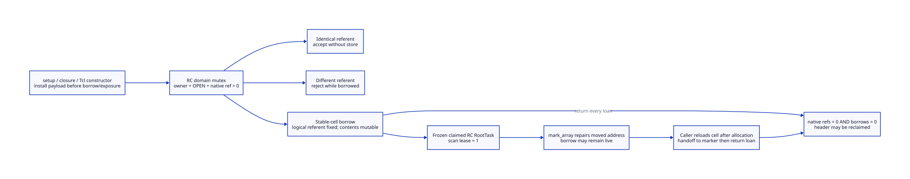

#+TITLE: RC borrowed-slot authority publication and audit
#+SETUPFILE: ../../modeling/org/setup.org
#+LANGUAGE: en
#+PROPERTY: header-args :eval never

* PUBLISHED 3.5.1 :refactoring:roots:audit:
:PROPERTIES:
:CUSTOM_ID: ROOT-RC-SLOT-WRITES-PUBLISHED
:REV: 8ee204fc3a38071e078b61d81a3a239c7d89210a
:PARENT: 86fdffccc600336770eb449939083105e9cbd3fc
:SOURCE_TREE: 2bb00424281e71f99734c57bce4eab59c054bd65
:AUDIT_NUMBER: 3.5.1
:AUTHORITY: GambitRcSlotWrites; GambitModernCDeliveryPlan
:END:

The [[file:../../../evidence/research/retained/modern-c/rc-slot-writes/publication.json][actual publication packet]] freezes the five-file tree, native identities, SysML,
ASCENT, five gates/21 controls and nine commit audit fields. It is a local Git
commit, not push or remote CI. The frozen [[file:rc-slot-writes.org][pre-commit study]] remains QUALIFYING as
historical evidence; this result records actual publication separately.

The existing setter now owns logical mutation admission against every outstanding
stable-cell loan. Different referents are refused; identical values perform no
store. Frozen claimed RootTask scanning can still repair moving addresses, and
borrowers reload them. This separates mutator/collector authority without an
address pin table or new namespace. It does not identify a historic test8 or
Repair9 failure cause. Source-backed responsibility retirement is bounded.

** Tests, benefits and added costs

| Evidence / contract | Actual result / benefit | Cost / boundary |
|---------------------+-------------------------+-----------------|
| Complete C23 source bootstrap | Two phase1--4 passes152.909s; stock core48.892s | Existing Bazel profile, same persistent SDK,600s unchanged |
| Current official consumers | GSI408/40862.433s; remaining Make93.262s | Includes test8/test9,290 assertions, map multi-shot/GC; not full SMP |
| Existing root-task target |67.531s; root families, continuation and moving bank/globals | Adds one existing-fixture invocation; no new SCM/framework |
| RC writer PBT |400 actions,12 seed1729 histories plus mandatory chain,3 explicit GCs | Finite histories, no concurrent schedule exhaustion |
| Exact old C calibration |13→1 compound request, deletion-one-minimal, old failure/current pass replayed | Name-only predecessor copy in tests; no production legacy fallback |
| Processor0/1 RC ownership |2.868s, borrow-last and native references pass | No arbitrary foreign owner-death admission |
| Logical slot authority | Conflicting borrowed-rebind permission retired; identical physical stores omitted | Predicate/comparison under existing mutex |
| Runtime storage and peak |0 added fields/bytes/locks/allocation sites/namespaces |0 measured peak reduction; existing loans retain roots |
| Source/model admission |20 native SysML inputs;8 actual source/effect controls;5 commit gates/21 controls | Existing QNT/Lean unchanged, not rerun; no duplicate proof |

** Where this leaves the programme

The full thirteen-item ledger and the independent twelve-family SMP ledger are
[[file:delivery-plan.org][SysML-derived]]. This REV is item3 / child3.5.1, not all3.5.

| ROOTS group | Current state | Remaining obligation |
|-------------+---------------+----------------------|
|3.1 Named origins/tasks | SCOPED_CLOSED | Full composition remains3.6 |
|3.2 Shared globals prefix | SCOPED_CLOSED | Arbitrary value writers remain3.5 |
|3.3 Canonical symkey publication | SCOPED_CLOSED | Remaining debug/foreign effects remain3.5 |
|3.4 Views/aliases | SCOPED_CLOSED | Exact declared source/load boundary only |
|3.5 Writers/borrows | OPEN;3.5.1 published | Allocating snapshots, globals/primitive/FFI/debug writers and participation |
|3.6 Complete source/lifetime union | OPEN | Compose all roots, writers, loans, exceptional exits and frozen scan |

Thus4 root groups are scoped closed and2 remain. No top-level ROOTS completion
or percentage follows from the number of commits. Later capacity/worker,
restoration, resource retirement, request-service and generations keep their own
dependencies and acceptance. No scheduler patch is included.

SMP12 has only bootstrap qualified and11 families open. The old
=thread_interrupt.scm:41= failure is retained in the predecessor evidence. Its
obligation is explicitly carried to this source; the RC runtime is changed, so
no byte-identity argument is claimed. Scheduler source/unit are unchanged, and
the current green run cannot settle the old cause. GSI-family credit remains
vetoed by the modeled hold rather than silently following a successful retry.

** Pending changes and reproducibility

134 unique pending paths remain:132 net HEAD differences and2 index/working-only
paths, in ten responsibility review cuts. These are file containers, not134
future commits. No unqualified code was included to reduce a UI count.

Three working prototype conflicts remain untouched. The selected tested SDK tree
is the commit authority. The pre-existing fixture deletion is retained. After
publication, only two index entries verified equal to the parent with no staged
edits were rebased to their identical committed working content; this avoids
manufacturing reverse changes. [[file:../../../evidence/research/retained/modern-c/rc-slot-writes/index-reconciliation.json][The reconciliation receipt]] proves all other index
entries are preserved. Build/review the committed tree, not the entire dirty
prototype cohort. No extra source copy, increased heap/wait or new executor.

The [[file:../../../evidence/research/retained/modern-c/rc-slot-writes/source.json][source census]], exact predecessor C, two structured traces and rendered
 are repository evidence, not transient directory references. The
publication freezes the audit's historical model bytes; current shared-plan
updates intentionally have new hashes. No native result is inferred from them.
