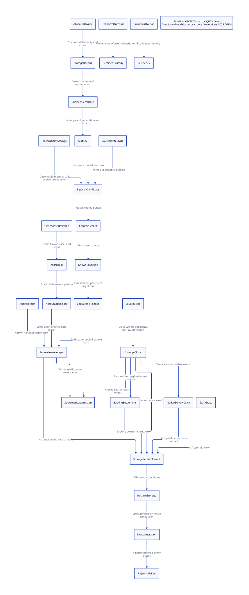

#+TITLE: VM Registry and SlotKey Issuance — Storage Identity and Source Binding
#+SETUPFILE: ../../modeling/org/setup.org
#+LANGUAGE: en
#+PROPERTY: header-args :eval never
#+OPTIONS: toc:3

* RESEARCH Decision and authority
:PROPERTIES:
:CUSTOM_ID: registry-slot-issuance
:BASELINE: C23; mandatory modern C
:AUTHORITY: GambitRegistrySlotIssuance
:STATUS: conditional-formal; native-issuer-and-product-open
:END:

A VM registry must not manufacture canonical storage identity from an address,
RC refcount or context-list membership. It needs a live allocation authority,
validated schema coordinates, explicit generation and a complete root/owner commit.
An alias of an old payload keeps its source semantic-write lease until all alias
users are gone. A copied-root carrier may return that lease earlier only after its
independent, persistent target root is known. Neither path transfers a still arena
or foreign destructor merely by registering a root.

[[file:models/sysml/registry-slot-issuance.sysml][SysML]] owns the module/source/issuer/contract/model/proof/cost rows. Python drives
native SysML validation and queries, then [[file:../../modeling/ascent/registry-slot-issuance.rules.scm][ASCENT]], [[file:models/quint/registry_slot_issuance.qnt][QNT]] and [[file:models/lean/SlotIssuance.lean][Lean induction]].
[[file:models/lean/StorageIntervals.lean][Generic interval/generation lemmas]] and [[file:models/lean/SlotIssuanceBridge.lean][parent boundaries]] retain their explicit
native premises. [[file:registry-slot-issuance-matrix.org][The cost/closure matrix]] and  are projected views.
This extends [[file:carrier-slot-mapping-design.org][physical-slot mapping]]; it does not rewrite its historical snapshots.
No runtime implementation, native test, preprocessing, bootstrap or performance
experiment is authorized or performed by this study.

* EVIDENCE Modular source boundaries and callers
:PROPERTIES:
:EVIDENCE_SCOPE: current fragment bytes and lexical call sites
:END:

** Follow the actual modules

The current [[file:../../../vendor/gambit/include/gambit.h.in][umbrella]] names =_gambit= fragments. [[file:../../../vendor/gambit/include/makefile.in][include/makefile.in]] lists
ordered =HEADER_TEMPLATES= and =HEADER_CONFIG=, and runs config.status to produce
=gambit.h=. [[file:../../../vendor/gambit/lib/mem.c][mem.c]] now includes implementation fragments from =_mem=.
The study follows these current paths; old =lib/memory= and monolithic-header
anchors remain historical observations only. Physical source coordinates and old
=#line= diagnostic coordinates are not interchangeable.

#+NAME: issuance-module-boundaries
| Current module | Actual responsibility | Proposed architectural responsibility |
|---+---+---|
| [[file:../../../vendor/gambit/include/_gambit/memory_state.h.in][memory_state]] | RC header and context memory | Allocation/field schema; no storage issuer currently |
| [[file:../../../vendor/gambit/include/_gambit/runtime_roles.h.in][runtime_roles]] | Execution, origin, root task and worker types | Typed separation of context, scan authority and storage ownership |
| [[file:../../../vendor/gambit/include/_gambit/vm_state.h.in][vm_state]] | VM arrays and root-task helpers | Registry/round API seam; generic registry still absent |
| [[file:../../../vendor/gambit/include/_gambit/activity_log.h.in][activity_log]] | Includes current CAS alternatives | Synchronization ownership must follow definitions, not filename |
| [[file:../../../vendor/gambit/include/_gambit/global_state.h.in][global_state]] | Public function-pointer table | Managed allocation/setter entry points and capability closure |
| [[file:../../../vendor/gambit/include/_gambit/runtime_protocols.h.in][runtime_protocols]] | Exported ABI declarations | Generated typed registration and lease protocol |
| [[file:../../../vendor/gambit/lib/_mem/rc-allocation.inc][rc-allocation]] | Allocate, link, read/set, retain and free | Stable storage authority plus compatibility policy |
| [[file:../../../vendor/gambit/lib/_mem/memory-lifecycle.inc][memory-lifecycle]] | Still cleanup before RC cleanup | Separate root-cell, Scheme backing and foreign-resource settlement |

Module extraction improves the ability to bind evidence and assign responsibilities.
It does not itself establish a new ownership protocol. In particular CAS definitions
currently occur in activity_log; do not infer their location or semantics from a
fragment named synchronization. Generated header/configuration/architecture
correspondence remains unqualified; this study does not run the generator.

** Allocation and RC registration are not identity issuance

=alloc_rc_no_register(bytes)= allocates =bytes + sizeof(___rc_header)=, initializes
refcount/data and returns =h+1=. The full allocation includes header, padding and
native payload. =register_rc= derives h from the public pointer and links it into
the current context's list. Neither operation records VM allocation identity,
validated extent, storage generation, alias authority or an atomic registry receipt.
=addref_rc= dereferences the header; it cannot safely retain already-freed storage.
The setter directly assigns =h->data= and cleanup frees the chain independently
of the proposed leases. The absence of a local checked-size receipt is an issuance
gap, not a demonstrated exploitable allocation overflow in every caller.

The canonical Scheme root coordinate is the schema field =&h->data=, not the
public payload pointer h+1. A zero-byte RC allocation still has this root cell.
Use generated field coordinates and checked full-allocation extent rather than
assuming a constant byte offset or treating a zero payload as no storage.

** Actual caller families

| Caller | Real path | Required mediation / limit |
|---+---+---|
| [[file:../../../vendor/gambit/examples/tcltk/tcltk.scm][Tcl command installation]] | alloc_rc(0), still vector, set_data_rc, CreateCommand | Register header root and backing; failed creation/unknown delivery retains owner |
| Tcl callback/deletion | data_rc -> Scheme call; release_scmobj then release_rc | Borrow/lookup admission; deletion drains accepted users before backing/free |
| [[file:../../../vendor/gambit/lib/os_dyn.c][C closure]] | alloc_rc(code bytes), set_data_rc(proc), closure release | Architecture-conditional code ownership, module lifetime and source binding |
| [[file:../../../vendor/gambit/lib/c_intf.c][Function API]] | is_a_c_closure -> RC addref/release | Indirect wrapper must join the same storage/lease authority |
| C strings/string lists | RC allocation/conversion and string release | Native buffer extent/resource ownership; not automatically a Scheme payload |
| [[file:../../../vendor/gambit/lib/os_io.c][OS resources]] / [[file:../../../vendor/gambit/lib/os_files.c][directory buffers]] | Same RC allocator family | Preserve platform/resource-specific cleanup and thread ownership |
| [[file:../../../vendor/gambit/lib/setup.c][GSTATE exports]] | Allocator, register, setter and refcount function pointers | Copied pointers/out-of-tree aliases remain an unclosed authority boundary |

Current public register declarations spell a pointer return while implementation
spells void. No native compatibility conclusion follows without matching generated
headers and effective configuration. A future ABI migration must update declarations,
GSTATE, generated consumers and all real callers together. Text inventory includes
declarations/comments and all header templates; it is not semantic closure of FFI.

* DESIGN Issuance records and ordering
:PROPERTIES:
:CONTRACT: allocator provenance -> canonical SlotKey -> rooted registry commit
:END:

#+NAME: issuance-data-model
| Record | Required immutable identity/data | Issuer |
|---+---+---|
| StorageRecord | VM; StorageId; generation; allocator/arena; base object; checked full extent; alignment; resource kind | Stable allocator/storage owner |
| StorageView | Parent identity/generation; byte/word span; schema; provenance; policy | Parent storage owner plus layout generator |
| SlotKey | Canonical parent identity/generation plus in-bounds schema word offset | Storage authority; never raw pointer holder |
| RegistryEntry | EntryId/generation; complete SlotUseSpec; bound semantic payload generation; backing/code handles; admission state | VM registry commit owner |
| SourceWriteLease | SourceId/generation; LeaseId; alias/copy policy; exact completion operation | Managed source owner |
| CommitResult | OperationId; committed bundle identity; publication state; query outcome | Stable registry result owner |

The source root, allocation storage generation, semantic payload generation, GC
round and registry entry generation are different domains. Storage reuse is not a
minor/major GC generation change. Moving the payload during GC does not change its
semantic binding generation or the identity of its nonmoving native root cell.

1. At the allocator boundary, reserve and initialize an authoritative allocation
   record before exposing managed handles. Bound size arithmetic, extent, alignment,
   maximum offset and resource classification. An allocator result supplies ownership;
   a pointer imported from arbitrary native code does not.
2. Validate a view against a live parent generation and provenance, then derive all
   keys from that parent. Exact ownership checks and record pins precede pointer use.
3. Acquire a source pin/write lease and root the payload before any allocation or
   suspension that could collect it. Allocate candidate metadata privately.
4. Commit the full rooted entry, canonical runs, backing/code references and result
   record at one owned publication cut. Do not publish metadata and its root lifetime
   in separate transactions. Initialization-to-publication has the prior study's
   collector-exclusion or registered-private-root obligation.
5. Only the exact stable commit owner may acknowledge publication. Lost response does
   not mean absence; query the same entry/operation identity, without duplicate commit.
6. Copy release requires a known independent target root with actual ongoing GC
   coverage; alias release requires final alias retirement/drain. Unknown results
   retain the old source owner and its storage.

Source identifiers and lease/result records must survive Scheme continuation replay,
foreign callbacks and processor exit. A copied stack-local token is not such an owner.
No native issuer for this complete protocol has been identified in current callers.

* DESIGN Extent overlap and portable coordinates
:PROPERTIES:
:ADMISSION: provenance first; half-open intervals; no arbitrary native-pointer oracle
:END:

| Case | Issuance decision | Necessary evidence |
|---+---+---|
| Proven subview inside a live allocation | Reuse parent StorageId/generation and checked offsets | Parent ownership, valid extent/type/root policy and pin |
| Independent allocator-owned disjoint allocation | Mint a distinct storage identity | Authoritative allocator result; complete live-allocation domain |
| Adjacent half-open spans | May be disjoint; never merge their allocation identities | Valid nonempty extents and provenance |
| Partially overlapping claim with unknown parent | Refuse managed issuance pending reconciliation | No second conflicting live identity |
| Exact same interval but missing ownership certificate | Refuse a new identity | Address equality alone does not authenticate parent |
| Stale generation or unknown external interior pointer | Reject managed key use | Stable index validation before pointer dereference |

The model's numeric spans [0,8), [2,4), [8,12) and [6,10) are abstract storage
coordinates, not measured native addresses or Scheme object sizes. Generic Lean
lemmas use arbitrary integer spans and prove half-open separation/containment facts.
They do not prove all native allocations appear in the authority or that pointer
arithmetic computes those coordinates faithfully.

The [[https://www.open-std.org/jtc1/sc22/wg14/www/docs/n3096.pdf][C23 working draft N3096]], sections 6.5.6 and 6.5.8, constrains pointer
subtraction and relational comparisons to specified object/array relationships.
A portable implementation cannot sort arbitrary external pointers with ordinary
pointer relational operators and call that an ownership proof. Our design therefore
uses allocator-issued object/arena coordinates and validated views. Platform-specific
integer-address indexing needs a separate implementation contract. Unknown imports
stay outside optimized admission unless their provenance and isolation are proved;
a conservative legacy path is not permission to race unmanaged writes with managed
root scans.

** Concurrent issuance and cross-VM ownership

Overlap validation must include live records, pending reservations and retired
records whose readers still retain storage. Checking an index and later publishing
without revalidation admits a TOCTOU race between two issuers. The reference C23
contract serializes reserve/check/publish under one storage-owner transaction or
mutex. A snapshot/CAS alternative must reserve the interval and revalidate the exact
index generation; a failed or unknown publication retains the private allocation
and source roots until the same owner resolves it. No duplicate owner may be minted
because another candidate has not yet committed. The current QNT model has a single
request slot and models this as an atomic issuer step; it does not prove a multi-issuer
native index implementation.

VM namespacing alone cannot make the same physical storage two independent objects.
A process/allocator-domain ownership index must identify its owning VM; an arbitrary
second VM cannot register the same raw block under a new local StorageId. Foreign
ownership requires an explicit transfer/import protocol, and Scheme-bearing roots
cannot be silently shared across independent collectors. Known subviews preserve
the original owner. Unqualified raw/cross-VM imports remain outside managed issuance.
The model's authenticated subview/disjoint-request actions assume those issuer
premises; they do not authenticate arbitrary caller-provided pointers or certificates.

* DESIGN Generation retirement and reuse

Source close can occur while an alias lease still lives; it is not ordered after
lease return. Closing denies new source writers and borrows while accepted users
drain. Lease return grants write eligibility only if the source remains open. The
D2 reclaim permit requires closed admission, no source lease, native-user drain,
collector grace and backing settlement together.

Close old storage admission atomically with acceptance accounting. Drain native
borrows, registry references, frozen scan views, pending writes, lookups, callbacks,
continuation capabilities and unknown results that can still dereference the old
allocation. Settle root-cell backing, Scheme still arena and code/foreign owners
separately. Descriptor retirement alone does not free storage.

After the allocator owner has a real reclaim permit, it can retire the old record
and publish a strictly newer generation before admitting new handles. Late stale
handles resolve through a stable index/tombstone, never by first reading recycled
allocation memory. Generation exhaustion refuses or quarantines reuse; unsigned
wrapping is not acceptable merely because C arithmetic defines it.

Current setup_pstate increments a checked origin incarnation, and GC setup increments
a checked collector epoch. These are useful finite-counter precedents, not generic
StorageId generation issuers. The model bounds storage to two incarnations and
proves the advance/exhaustion guards. It does not prove a native finite-width registry,
all allocation IDs, lock-free ABA, crash recovery or arbitrary descriptor reuse.

* DESIGN Source write lease release
:PROPERTIES:
:LIFETIME_RULE: semantic binding lease is separate from root/backing lifetime
:END:

** Aliased old payload

An alias of =&h->data= promises a fixed old payload only while every semantic writer
is excluded. A GC relocation update remains allowed under the collector protocol.
A future setter may not replace h->data until all aliases depending on that binding
retire. A LiveLocation observer has a different contract and cannot silently be
substituted for a BoundPayload carrier.

The release signer must establish: alias admission closed; publication outcome
known; no accepted payload borrower; no pending/unknown lookup; no scan or frozen
view; no retained callback/continuation capability or metadata/code reader requiring
the binding. The modeled old lease return and writer re-admission are atomic actions;
actual native implementations need one stable, generation-keyed completion ledger.
A decrement followed by a separately recorded completion is not an exact-once proof.
If the outcome is unknown, custody remains with the old stable completion owner;
never replay an unkeyed decrement that could settle a later lease.

** Independent registered copy

Copying to an independent cell can break source binding coupling, provided the
copied cell is actually rooted every GC and its backing remains owned. Known target
coverage lets source writes resume even while the old payload's target borrower
continues. Waiting for that target borrower to finish would reintroduce unnecessary
source coupling. The copy still pays for its own root and descriptor lifecycle.

In this reference model copy source-lease return precedes copy-entry retirement;
alias source-lease return follows final alias retirement. Unknown publication prevents
retirement rather than discarding the queryable commit state. A richer tombstone
protocol could relax that order, but must separately preserve late result lookup
and distinguish live coverage from historical publication. It is not proved here.

A known candidate abort with no publication releases its source reservation. An
uncertain commit cannot use the abort path. The action guard/source refinement must
prove that distinction; the model does not infer real native commit status from a
caller claim. C23 metadata ordering alone cannot supply the missing semantic fact.

** Storage and cleanup remain independent

The old still payload can outlive the source root header. =cleanup_mem_pstate=
frees still objects before cleanup_rc, so independent target root registration is
not a still arena transfer. Existing retirement refuses nonempty RC without a freeze
receipt and refuses unqualified foreign/borrow effects. The proposed backing receipt
is an explicit external premise, not an implemented new cleanup function.
Whole-VM cleanup needs the complete registry and resource closure, including retained
unknown results. Without a resolver, retention can be unbounded; safety is not a
shutdown-progress proof.

* PROOF Model and refinement obligations

[[file:models/quint/registry_slot_issuance.qnt][QNT]] contains 38 actions for proven subviews, disjoint allocation, rejected overlap,
source binding, publication outcomes, alias/copy lease return, storage close/reclaim
and checked reuse. It has one target registry entry, fixed lease/lookup/borrow
identities and two storage incarnations. Copy materialization additionally requires an issued, valid target interval disjoint
from the source; the release theorem depends on that same record. This closes the
bounded model link between extent issuance and copied-root independence. It does
not establish native pointer/allocator fidelity. Numeric payload observations express
semantic binding, not tagged SCMOBJ relocation addresses.

[[file:models/lean/SlotIssuance.lean][Lean]] proves action and reachable-state preservation. Generic interval lemmas prove
adjacency, overlap refusal, contained offsets and generation-separated keys. The
bridge preserves the parent's alias backing restriction and shows copy lease return
does not logically require target borrower drain. It does not compose the full native
root census, private initialization, C23 instructions and payload backing product.

| Obligation | Conditional evidence | Still required |
|---+---+---|
| Canonical parent/extent | QNT cases; generic interval algebra | Complete native allocator/provenance census |
| Storage generation advance | Lean next-state theorem and exhaustion guard | Native width, stable index, all old-user drains |
| Aliased bound payload stable | All-step invariant excludes source setter while lease lives | Every public/direct/indirect writer and native alias mediated |
| Copy can decouple source writes | Model permits later source write with old boundPayload | Every-round target root, private-root and arena/code fidelity |
| Unknown result retains lease | Model guard and negative acknowledgement control | Real commit/result signer and retained query record |
| Exactly once old LeaseId return | Architectural contract; fixed modeled identity | Arbitrary LeaseId ledger, continuation replay and native atomic refinement |

Counterexamples: mint a new StorageId for an unknown overlapping span; reuse an
address without advancing generation; return an alias lease while its registry entry
or unknown lookup survives; treat a lost publication response as absence; infer
still arena transfer from root copy; compare unrelated native pointers to infer
portable extent ownership. Native unsafe paths are not made safe by model refusal.

ASCENT checks actual source hashes, action/lemma roster, component owner, scoped
proof needs, source-to-action routes and issuer observations. Only conditional formal
receipts are supplied. Source, execution, roots, writers, platform and storage
qualification remain unresolved. Synthetic all-receipt acceptance is a control,
not implementation evidence.

* ANALYSIS Net return and retirement

| Choice | Potential work removed | Necessary new cost | Positive condition |
|---+---+---+---|
| Canonical storage authority | Duplicate identities/root visits and repeated ownership discovery | Extent/provenance index, pins and grace | Authority complete; avoided work exceeds indexing/retention |
| Aliased root | Target cell allocation and K target scans | Source-write stalls and retained header/arena | Saved cell cost exceeds long-lived source coupling |
| Independent copied root | Source-write stalls and source-only lifetime retention | One extra root cell, K scans and backing transfer | Actual independent target coverage; storage owners settled |
| Explicit generation/leases | Lifetime guessing and whole-context retention | Stable index, tombstones, finite counters and exact result records | All accepted old users drain; no unresolved foreign dependency |
| Optional Zig | Concrete C support genuinely retired | Second toolchain, interop and equivalent ownership protocols | Additional net return still unproved |

For M logical references and S canonical cells across K rounds, =K*(M-S)= is a
conditional avoided-visit count, not observed current duplication. Source-copy
tradeoffs must include retained RC header/arena bytes and setter stall time, not
only the extra cell. Unknown custody can dominate both. No person-day estimate or
unmeasured speedup is used as a decision criterion.

The cost tables are a vector of work, live bytes over time and blocked duration,
not an unweighted sum of unlike units. Require Pareto improvement or declare
workload-specific weights before a scalar break-even calculation. One copied root
cell costs one SCMOBJ word plus separately accounted metadata/backing; native byte
sizes remain configuration-dependent and are not guessed here.

In the inspected Tcl and C-closure installation bodies, the semantic setter is used
to install the initial binding. Those bodies do not demonstrate repeated replacement
or existing source-write stalls. Therefore copy release's writer-concurrency benefit
can be zero for these callers; its other possible benefit is removing independently
settled source lifetime coupling. Tcl still holds raw client_data, so freeing its
header additionally requires replacing the callback/delete adapter with a guarded
stable handle. A copied Scheme root by itself cannot retire that native pointer.

Retire old paths only after allocator/importer authority is complete, schema keys
are canonical, every writer/borrower is mediated, registry/root publication is
atomic, generation/native grace is proven, and still/foreign/code cleanup is
settled. Public raw RC APIs and context-list root scans cannot retire merely because
the header is now modular. Current native retirement count is zero.

* EVIDENCE Reproduction

[[file:../../modeling/tools/registry-slot-issuance-study.py][Python study driver]] invokes native SysML, QNT, Lean, ASCENT, Org and D2 only.
[[file:../../../evidence/research/registry-slot-issuance/checks.json][Checks]] and [[file:../../../evidence/research/registry-slot-issuance/input.json][input hashes]] preserve source/formal/native boundaries. Source graphs
are lexical evidence; no configuration generation or compiler execution occurs.

** Current scoped receipts

| Lane | Result | Limit |
|---+---+---|
| Current modular source | 22 snapshots, 57 anchors; 41 configured header and 25 memory fragments in lexical composition | No preprocessing or generated artifact qualification |
| Source call inventory | 556 files, 150 literal hits including header templates | Direct/indirect/out-of-tree semantic closure remains open |
| QNT | 38 actions, 14 histories, 500 samples up to 100 steps, seed argument 457 | Fixed identities and two storage incarnations; not exhaustive native testing |
| Lean | 62 theorems including all-step induction, interval/key-generation algebra and explicit parent premises | Native allocation census and root/payload/C23 product remain open |
| Rejection controls | Four typed-IR corruptions; four concrete unsafe transitions | Preconditions checked; false postcondition rejected; not a native test |
| ASCENT | Eleven scenarios; actual candidate denied | Six source/execution/roots/writers/platform/storage gaps |
| Runtime retirement | Zero paths retired | No implementation, native test or performance claim |

The full-mutant proof timeout and earlier proof/elaboration failures are retained.
The successful focused negative controls prove each concrete before-state satisfies
Safe and the mutated guard, prove the negation of the desired postcondition,
then reject the unsafe postcondition (or nonadvancing
generation). They do not relabel a timeout as successful rejection. The positive
all-step theorem remains separately kernel-checked against the unmodified model.
