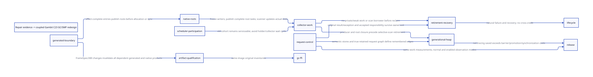

#+TITLE: Repair 9–12 as evidence for a coupled Gambit GC / SMP reconstruction
#+SETUPFILE: ../../modeling/org/setup.org
#+LANGUAGE: en
#+OPTIONS: toc:3 num:nil
#+PROPERTY: header-args :eval never
#+TODO: RESEARCH DECIDED | ADOPTED RETIRED

* DECIDED Reconstruct the mechanism that produces repeated repair obligations
:PROPERTIES:
:CUSTOM_ID: repair-driven-gc-smp
:AUTHORITY: GambitRepairDrivenRefactor
:BASELINE: C23; Scheme owns semantics; Gambit C portability remains core
:STATUS: source-bound research; whole-source and native closure open
:EVIDENCE_CUT: retained c38e review, 2026-10-26; not a live repair monitor
:END:

Repair 9–12 supplies a failure corpus and behavioral constraints for the modern-C
runtime reconstruction. Its patch structure is not the target architecture.
The next DEV task is to replace the coupling that repeatedly requires new root,
wait, return and cleanup exceptions. Do not carry every repair wrapper forward
and add another owner beside it. Retirement of the old authority is part of the
result, while the original behavioral tests remain constraints.

This study reconnects [[file:modernization-target.org][the existing whole-runtime target]] and
[[file:runtime-blueprint.org][canonical blueprint]] to actual repair records. It changes no runtime,
fixture, native budget, qualifier, source lock, checkpoint or repair-owner task.
It claims neither ninth-gate completion nor a newly executed native experiment.
The observed retained milestone is 8/12, not an ordinal assignment of each issue.

The single new research authority is [[file:models/sysml/repair-driven-gc-smp.sysml][GambitRepairDrivenRefactor]].
Each of eight cuts references an existing typed canonical module and interface,
an existing QNT action, an existing Lean lemma, a source-bound observation, a
concrete missing refinement and an old responsibility to retire. It does not
create another set of GC/SMP components. [[file:repair-driven-gc-smp-matrix.org][The full matrix]] and
 derive from native SysML queries. The
[[file:../../modeling/ascent/repair-driven-gc-smp.rules.scm][ASCENT DSL]] checks these relationships and rejects cross-scope promotion.
The [[file:../../../src/gambit_smp/scientific_repair_driven_gc_smp_study.py][Python driver]] binds source hashes, recorded receipt edges and model symbols;
it does not substitute for a semantic refinement or rerun existing proofs.

* DECIDED Repair9 informs the reconstruction; delivery follows the whole plan
:PROPERTIES:
:CUSTOM_ID: repair9-architectural-priority
:REVIEW_DATE: 2026-10-28
:BRANCH_SOURCE: modern-c 29f09a81cc4cba2b96c9ee677d7b5074fb88f81f
:STATUS: evidence review and scope correction; no new runtime or model acceptance
:END:

The programme is the whole modern-C reconstruction, organized by
[[file:delivery-plan.org][the current SysML-derived delivery plan]]. repair9 supplies difficult failure
and cost evidence alongside startup, GC/SMP, control, FFI and build evidence;
it does not own the execution queue. Current priority is startup preparation /
member publication and unchanged test8 acceptance before another wait/service
optimization. Its patch sequence is not a migration plan.
The later "Repair 19" entry is a documentary
label inside that same work item. It records the e782 producer and remains at
8/12. [[file:../../../docs/current-repair-research.md][The retained Repair 19 problem statement]] supersedes any inference that the older
c38e short sample represents the latest original-load result. The repair task
is read as evidence here; this decision does not resume or modify that producer.

The original first file failed with =Thread is not active=, loader exit1 and
timeout=false; the second original file was not launched. The loader displayed
3232.7 seconds and the framework span was3349.209361 seconds. These scopes must
not be converted into an inner target lifetime. The corresponding120000-request
control completed with499270256 allocated bytes,115 collections,7.935726 seconds
wall and5.573344 seconds GC wall. It demonstrates substantial cost and unstable
timing, not a measured attribution of all allocation to continuation capture.

Focused reply/root/exception controls can pass while that original workload
fails. Source-level observations point toward captured-continuation materialization
and collective waiting, but do not yet separate excess capture, retention,
copying and intermittent contention. The earlier TFIB invalid-header read is a
separate retained fault until an actual causal witness connects it to delivery.

| Coupled responsibility | Required replacement | Benefit condition | New cost / open obligation |
|------------------------+----------------------+-------------------+----------------------------|
| Request publication and claim | One authoritative request owner through queue, mapped invocation and result/abandonment; notification carries no completion authority | Remove rerouting/duplicate membership without replaying arbitrary thunks | Target-lock contention and migration handoff; prove every suspension caller |
| Execution/control boundary | One semantically complete normal/exception/nonlocal-exit protocol, with explicit GC maps and original exception presence | Eliminate redundant private capture/cleanup work while retaining multi-shot Scheme continuation semantics | Dynamic capture/allocation attribution and exceptional suffix equivalence remain open |
| GC participation and worker custody | Freeze actual root slots independently of carrier; preserve claimed/private copy and Tail obligations through execution exit | GC need not reconstruct ownership from processor identity or empty queues | Complete producer census, relocation reload and worker restoration remain open |
| Park, service and retirement | Durable runnable publication, typed wait outcomes and per-resource last-consumer closure | Accepted work stays serviceable; wake and retention cannot masquerade as completion | Backend return guarantees, fairness and unknown-owner disposition require native evidence |

The committed branch still has the split running/nonrunning request routes in
=lib/_thread.scm:##thread-intr-propagate!=, processor queue publication/withdrawal
in =lib/setup.c:___raise_high_level_interrupt_pstate= and
=___get_next_high_level_interrupt_pstate=, and ignored abort-write outcomes in
=lib/os_io.c:___device_select_abort=. This is direct inspection of29f09a81,
not an assertion that a repair overlay or dirty prototype has already replaced
those authorities. RootTask entry REVs do not by themselves retire this chain.

Official =test8= startup must pass on the refactored branch and its reservation /
membership defect must be resolved under the existing resource policy. That is
a foundation gate, not the definition of the whole SMP reconstruction. Likewise,
the common globals-round snapshot is a root correctness obligation, not evidence
of adequate request delivery capacity. Each bounded REV names the coupled row
it advances and the actual old authority it retires; no single REV must claim
all four rows or inherit repair-line8/12.

Reuse the existing =scheduler-participation=, =request-control=, =collector-work=
and =retirement-recovery= SysML cuts and their ASCENT routes. QNT owns competing
histories; existing Lean laws own their distinct conditional induction duties.
Neither proves native service time. Closure additionally needs real producer-bound
PBT replay/shrink and the unchanged original workload with per-target outcomes,
generated root maps and failure custody. This review adds no duplicate model,
new test framework, runtime patch, heap increase or timeout increase.

* REVIEW Current modern-C qualification and the Repair9 reconstruction chain
:PROPERTIES:
:CUSTOM_ID: modern-mainline-repair-audit
:AUTHORITY: GambitSharedHeapSmpDelivery::independentAxis; GambitSharedHeapSmpQualificationSources::mainlineThirdFamilyAudit; GambitSharedHeapSmpQualificationSources::repair19CapacityBoundary
:SOURCE_REVISION: 32028f5d5efdef5b901de84aaeba43fe3ba939e3
:PUBLICATION_TREE: a76175eeceed53698f3bcaf1435b624fb937ee4e
:STATUS: SOURCE-AND-RETAINED-EVIDENCE-AUDIT; NO-NEW-NATIVE-QUALIFICATION
:END:

This review supersedes the earlier execution priority only as a current
organizational observation; the dated Repair19/c38e/e782 evidence remains
historical. The runtime conversation owns code and native campaigns. The DEV
conversation owns this audit, the unified handoff and its falsifiable premises.

| Axis | Current meaning | Admission boundary |
|---+---+---|
| Modern-C independent SMP | Recorded4/12;8 families remain; current model revalidation is STALE | 32028f5d publication and its canonical65a4a2e2 source-input equivalence; no current dirty-successor credit |
| Modern-C family4 | =pr-gsi=: the complete additional PR-regression interpreted population | Not original stress test4, Repair9, or the fourth foundation delivery; prior validation retained, current commit-gates model digest rejected |
| Repair line | Current9/12 by user report | Repair19's retained e782/8/12 is an older cut; it neither rolls back that report nor proves a newer native9/12 packet |
| Foundation and architecture | Four earlier foundation deliveries,13 programme responsibilities and5 joint gates have different units | No arithmetic transfers from local source/model checks or repair passes |

** What the first-three audit establishes

The [[file:../../../evidence/research/retained/modern-c/frozen-568e0276-smp/submission/source-manifest.json][published source manifest]] contains56 selected paths:8 handwritten and48 generated.
Reading the actual Git publication tree reproduces every recorded SHA and byte
length. The retained qualification reports two full bootstrap passes, stock core,
408 GSI cases and408 GSC cases; its17 obligations and50 recorded rejection
controls are scoped to that source/profile/producer. This review does not rerun
those native campaigns or treat recorded =complete=true= alone as verification.

Two mutable Org inputs now differ from their old admission hashes. Their
[[file:../../../evidence/research/retained/modern-c/frozen-568e0276-smp/submission/reviewed-org-inputs.json][immutable reviewed text snapshots]] hash exactly to both recorded input digests.
Thus the old review is independently inspectable; it is not a review of the
current edited Org. Other six bound artifact bytes match this inspection.

The working successor differs on =gsc/_t-c-1.scm=,
=include/_gambit/stack_operations.h.in= and
=gsc/_t-cpu-abstract-machine.c=. These are not documentation-only paths.
Freeze the candidate and actual generated/compiler/runtime cohort before
reusing3/12 evidence. Source equivalence or affected-family reruns must justify
each reuse; neither identical branch name nor a retained GSI executable does so.

The issue_216 change replaces relative-sleep target liveness with ready/release/
join and adds the explicit three-interrupt order assertion. This is a declared
fixture precondition and assertion change, not evidence that the scheduler's
original stress or Repair19 target termination was fixed. Preserve other
original assertions and retain the failed predecessor evidence.

** Benefit/cost claims admitted by this audit

| Population / mechanism | Evidence or predicted saving | Added cost and limit |
|---+---+---|
| Retained shared assertion runner-chain CPU | 67.96 ->35.46 CPU-s including one provider build, observed -47.82%;15 distinct fixtures and30 process executions per arm in stock/shared/shared/stock | One retained comparison, not a population theorem. Provider build1.6011s is charged; every fixture still owns its independent state/load/exit. Paired wall outcomes are mixed |
| Generated host planning / setup | Published source replaces repeated physical-host expansion with one logical point plan and shared dispatch; two-pass source bootstrap and original consumers are qualified | Maintain producer, opaque-C barriers, label/setup states and exact generated cohort. Whole application runtime and peak are unmeasured |
| Frozen root/query handoff | Conditional shorter source-lock residency and fewer inferred carrier dependencies; full-GC root work remains | New admission/pin/ACK guards and deferred node/referent retention; no throughput/peak claim until five-gate native/cost closure |
| Repair9 request/wait/service reconstruction | Candidate reduction of demonstrated redundant internal control work while retaining valid user captures | Must measure actual capture/materialization and service work. The499MB historical allocation total is not a removable-byte forecast; capacity and peak remain open |

The retained source of the measured CPU row is
[[file:../../../evidence/research/retained/modern-c/frozen-568e0276-smp/submission/qualification.json][the qualification metrics]] and the bound comparison, not an estimate from source
line count. No source/model test or historical +2.93% result becomes a current
SMP speedup. Scientific admission includes unfavorable outcomes and distinguishes
work eliminated from bookkeeping merely moved to another layer.

** Family4 scientific admission, without broadening its scope

| Required decision | Evidence another conversation must produce | Reject as insufficient |
|---+---+---|
| Exact population | Frozen additional PR manifest tied to branch/PR provenance, per-case assertions and declared topology/limits; reconcile additions/removals explicitly | Selected root/FFI cases, a newly shortened list, or confusing original408 with additional regressions |
| One producer | Candidate source/config/tool identities, actual generated C/header/module products, compiler/runtime and cwd; publication equivalence | A newly generated source paired with an old executable or unrelated repair image |
| Complete execution | Every mandatory interpreted case, natural process-group exit, required markers/assertions and preserved failures under the original effective budgets | Exit0 without coverage, timeout reset per retry, spliced successes, larger heap/wait or hidden skips |
| Inherited3/12 | Same qualified input identity or explicit affected-family requalification for changed generator/stack/runtime code | Branch equality, source location, unit-framework count or old green CI |
| Causal changes | Same-condition predecessor controls and one complete owner replacement; distinguish fixture lifetime from scheduler behavior | Catching Thread-is-not-active, extra sleeps, copied patches or a guard that discards accepted work |
| Reporting | One complete family result, evidence references, five REV gates and scoped benefit/new-cost matrix; exact-head remote CI separately | Claiming4/12 while still in progress, or declaring overall SMP/throughput solved |

The earlier3/12 publication packet alone provided no family4 verdict. The
later =pr-gsi/qualified-native.json= previously passed existing =accepted_smp_status=
and =require_pr_smp_evidence=:8 exact fixtures at each p1/p2 topology, actual
processor probes, complete exits and one300/295-second whole/inner deadline.
The campaign reports7.197081792 seconds. The one private request-constructor
projection is producer-bound and retains original assertions. Current admission
is4/12 on canonical65a4a2e2 / published32028f5d equivalence, not the dirty
working tree. Eight families and remote CI retain their own evidence gates.
The latest refresh rejects current PR revalidation because commit-gates.sysml
differs from the bound model digest. It retains the historical4/12 result and
both hashes without rewriting the old receipt or granting current acceptance.

** Repair19: the root difficulty and what the evidence does not prove

The primary problem statement is [[file:../../../docs/current-repair-research.md::4656][the retained Repair19 record]]. Fourteen focused controls can pass while the
unchanged first original stress file fails with =Thread is not active=,
loader exit1 and timeout=false; the second original file is unstarted. The
3232.7-second loader display and3349.209361-second framework span are different
scopes, not callback latency or a watchdog-expiry diagnosis. The episode had
diagnostics and is not an unperturbed performance sample.

Its successful120000-request p11/default-heap control reports499270256 allocated
bytes and115 collections. That is4160.59 aggregate reported bytes/request,
not a measured continuation-only cost. Reported7.935726-second wall and5.573344-
second GC wall are one control, not a stable release speedup. Nonatomic cleanup
samples and large stderr do not independently prove a permanent leak.

This establishes that local safety/short completion is insufficient; it does
not prove every conceivable patch is impossible or identify the native first
cause of every later failure. Reconstruction must remove demonstrated coupled
authorities and then pass the original load. A parallel copying or generational
collector alone cannot make an orphaned request serviceable or repair a wrong
target-lifetime outcome.

The [[file:request-service-reconstruction.org][current-source request/wait/service/GC/exit reconstruction]] now traces
existing Modern C mechanisms, conditional safety and retention arguments,
original closed-loop workload bounds and its target-deadline capacity condition.
It replaces any reading of this roadmap as a request to reimplement already
committed request identities or THREAD_PARK. Full Repair9 native closure remains
open; no FIFO guard or root-only result substitutes for it.

** Dependent whole replacements, not one all-SMP REV

| Complete responsibility | Old authority to retire | Semantic/implementation gate and benefit condition |
|---+---+---|
| Frozen root/install/ACK/query/retirement | Current carrier as root source; scan-long source lock; zero counters as physical cleanup; discarded settlement witness | The [[file:shared-heap-smp-design.org::#frozen-view-ack-pin-layout][unified root implementation packet]] covers all writers, borrowed inputs, actual scans and exits. Preserves multi-shot aliases, canonical moving slots and queryable results; charges pins, deferred nodes/graphs and guards. Does not claim request throughput |
| Request mailbox and wait/service activation | Running/nonrunning routes as competing owners; wake as completion; repeated private waiting-state reconstruction where it is actually present | One accepted->claimed->mapped invocation->result/abandon owner chain; wait state and service activation have separate roots. Every suspension, migration, error and nested/multi-shot path is refined. No pooling/coalescing arbitrary thunks, swallowed exceptions or one-shot restriction |
| Collector/restore/exit composition | W=R=carrier inference; empty public queue as private-drain proof; join status as last-use permission | W workers consume R frozen sources with unique copy/frontier/Tail custody, physical grants and restored roots. Close strong/weak and owner-affine effects separately; UNKNOWN retains custody without pretending shared raw access is stopped |
| Original load and end-to-end qualification | Focused PASS, repaired-line counts and small cost samples as whole-product evidence | Complete interpreted/compiled stress, registry/lifecycle/GC-FFI and downstream/release families on one source/profile. Retain original populations and budgets; classify first failures and capacity separately |

For retained requests require accepted = completed + abandoned + outstanding
at a qualified observation cut; distinguish claim, invocation, normal value,
exception presence/value and terminal reply. At-most-once is not eventual service.
Measured service capacity must exceed the admitted sustained arrival rate under
stated scheduling and workload assumptions; unbounded arrivals or intentionally
retained user continuations forbid universal constant-space/deadline promises.
Do not obtain a gain by dropping accepted callbacks or changing shared identity.

Preserve all relevant safe-point/frame maps, =dynamic-wind= and arbitrary
exception values including false. Attribute captures, materialization, copied/
scanned bytes, per-target outstanding work and simultaneous physical peak to the
same request/GC epochs before claiming avoided work. QNT owns existing adverse
interleavings; Lean owns distinct root/slot/interval/accounting assumptions.
Neither proves native service rate, fairness or a wall-clock bound.

The five implementation gates remain source freeze, alias/slot repair,
control/native boundary, whole native/PBT acceptance and matched cost/peak.
Historical +2.93% identification is independent and must not block them.

* FACT Three source identities must remain separate
:PROPERTIES:
:CUSTOM_ID: source-identities
:END:

1. Pinned upstream Gambit and the historical original campaigns establish the
   old behavior and accepted/failed inventories. They do not describe every
   subsequent cumulative overlay.
2. Frozen repair images such as 2fe7, 60b3, 048b and c38e each bind their own
   Scheme, generated C, header, object, binary UUID and test conditions. A
   success or first exception on one is not automatically a result on another.
3. The current working vendor tree is now modular: =mem.c= includes =_mem/*.inc=
   in a fixed order. Its =mark_rc(work, context)= requires a closed context
   domain; collection uses =collector_worker= and root-task claims; VM resize
   request thunks are scanned independently of a surviving origin. These are
   real source observations, not evidence that this tree produced c38e or that
   all composed replacement paths have native admission.

The driver records the current inclusion order and fragment hashes. Fragment
physical lines and preserved =#line= logical mem.c coordinates are different
coordinates; neither supplies the source identity of an older crash. Old
monolithic links remain historical evidence rather than silently becoming current
fragment references. Module extraction is useful organization, but is not by
itself an ownership, memory-order or progress proof.

* FACT What the recent failures actually establish
:PROPERTIES:
:CUSTOM_ID: evidence-corpus
:EVIDENCE_CLASS: source-bound retained observations; no reruns
:END:

** A real GC-capable entry gap, not a claim that SMP is fake
The e574 crash report was bound to startup collective GC. The generated startup
bridge lacked demonstrated RA/register materialization around a helper that can
service GC. The subsequent 60b3 generated path added the explicit store, W_ALL,
call, R_ALL and fetch sequence. This is a real source boundary to generalize into
FrameSpec and effect-complete call generation. The historical crash's exact first
bad instruction and a witness of GC selected inside that exact corrected bridge
were not closed merely by later successful smoke runs.

Gambit already has concurrent processors, copying collection and work stealing.
The evidence does not support calling all SMP fake. The modernization defect
class is incomplete composition of real parallel mechanisms: native calls can
collect, suspended roots can move, participants can change and raw return tails
can remain alive. Correctness, useful parallel progress and scaling are separate.

** Waiting is a semantic result, not a generic EINTR loop
A real internal self-pipe wake was consumed and returned as EINTR, then retried
inside the native wait until the same deadline. The scheduler therefore did not
necessarily see its own wake promptly. The 048b short sample improved from about
5.698 s to 1.385 s for 120000 requests, approximately 4.1x. Allocation remained
roughly 599 MB. The later c38e integrated EOF as EIO, atomic probe publication and
a runnable decision under P, with its own 2.370086 s sample.

This supports typed private wake reasons and a durable runnable/park decision.
It does not prove every wait backend or fault path correct. c38e's first GC-pair
control timed out at 45 s; two later exits of zero do not explain it. Flags set
before actual blocking did not prove the intended repark overlap. Public errno
behavior and true-signal retry against the original absolute deadline remain
separate from an internal scheduling event.

** A target can expire while the system is making progress
The focused 2fe7 test2 diagnostic found an inactive-thread exception after a
normally terminated target reached only 3155998 increments, below 10000000.
Cleanup refusal followed the first exception. The original test creates six
independent targets at p11, ten senders per target and a 1000-second target sleep.
The broader six tests request 360 million synchronous interruptions.

Thus an eventual-progress proof and a high aggregate completion count are not
sufficient. Each target needs timely useful service without changing supported
sleep semantics. Conversely, the outer join error from 048b does not identify
that same first exception: its child innermost reason was not captured.

** More processors can amplify coordination without increasing useful work
On the retained 60b3 fixed 120000-call sample, p1 took about 0.519 s and p11 about
5.698 s. This is approximately elevenfold amplification of elapsed time in that
sample, not a universal scaling theorem. Co-location subsequently failed to
improve it. There are concrete hot-path review targets: request/pass/hint
allocation, multiple catcher/wind paths and disabled-observer global atomics.
Their exact dynamic contributions are not all attributed.

The negative p1 allocation field is invalid, not zero. Plain per-processor
counters lost increments. Generated 1088-byte source expressions are not a dynamic
allocation histogram and do not explain every roughly 5000-byte/request sample.
GC wall, aggregate CPU and wait samples overlap; summing them as disjoint wall
buckets or claiming GC elimination alone gives a particular speedup is invalid.

** Short success did not close original pressure
The 048b original episode used one cumulative 3600-second deadline. The first
file exited 70; the second started with about 783 seconds remaining and had no
completion before the cutoff. Overall result remains DENY/TIMEOUT. c38e's retained
record says no original workload started on that image. Later repair-owner work
may supersede this cut, but must supply a new source-bound observation.

* RESEARCH One composed architecture; eight replacement cuts
:PROPERTIES:
:CUSTOM_ID: coupled-replacements
:OWNER: existing GambitRuntimeComposition modules
:END:

** Contract compiler: hidden GC capability becomes a generated obligation
Scheme normalization/GVM completes effects, root maps, return origins, allocation
bounds and frame identity. Every potentially collecting native call declares that
capability transitively. The generator emits its writeback/reload, RA, exceptional
landing and descriptor lifetime contract. Startup, resize, FFI and wait helpers
are all consumers; manually adding W_ALL at the latest crash site is insufficient.

This amplifies Feeley's PVM separation: semantic knowledge reaches the native
backend instead of being rediscovered by C macros. A multi-shot continuation
retains frame/descriptor identity across repeated restore; it does not authorize
resuming a dead native C activation. No one-shot effect-handler restriction is
silently imposed on Gambit to simplify the redesign.

** Scheduler and participation: wait return has a precise consumer
Keep execution ownership, rooted blocking state and GC participation distinct.
Native WaitResult must distinguish confirmed internal wake, IO-ready set, true
signal interruption, timeout and hard backend failure. Return service happens
outside held scheduler locks, then roots/owner are reacquired and reloaded before
a P-protected runnable check. The park commitment must be synchronized with the
producer's durable runnable publication; elapsed delay is not that witness.

Existing source contracts determine where nonblocking service may run. A global
collector priority policy can starve cleanup; an arbitrary cleanup callback inside
the collector can deadlock on its own participant. The design needs a composed
progress argument for service windows and root/custody handoff, not independent
claims that each queue eventually drains. Native result delivery remains
synchronous where Scheme requires it; actor-style asynchronous substitution or
coalescing arbitrary interrupt thunks changes observable semantics.

** Collector work: current typed separation must earn complete replacement
VM owns collection epoch, participant membership, root-task population and shared
capacity. ExecutionContext owns Scheme registers, stack and dynamic state.
GCParticipant publishes a frozen root cut. CollectorWorkContext owns copying,
private cursors, Tail, claimed chunks and descendants independently of the carrier.
A worker/OS-thread identity does not prove task ownership or root closure.

The current vendor split is a useful candidate base. Required closure covers
reserve/init/READY/publication/acquire/scan/DONE, incomplete forwarded copies,
captured-frame link backfill, weak-phase work, shared testators and resize.
A last-idle decrement is legal only after private obligations are discharged.
Strong closure cannot be inferred from weak closure or vice versa. Termination
must exclude all admitted producers, not only currently visible queues.

** Native roots and outcomes: one root slot has an actual custodian
The root domain includes registers, saved state, stack/captured frames, denv,
RC payload and extended slots, still-object users, VM globals, startup/resize
requests and native return/cleanup records. Distinct slot aliases are canonicalized
under storage lifetime, not merely by equal values. Freeze closes writers;
scanner relocation updates actual slots; execution reload is mandatory afterwards.

Failure or unknown join preserves registration and descriptor interpretation for
the next GC. Processor removal does not remove retained VM request roots. A new
registry layer that still requires every old manual list and separate semantic
scanner decision is not yet a successful replacement.

** Request representation: remove redundant support without losing control
Generate a request/control record from semantic needs rather than composing
independent mutex, pass, hint, catcher and diagnostic objects by convention.
Separate production ownership from optional observation. Private/local fast paths
may avoid shared work only when publication and migration cannot yet occur.
Normal success and exception/continuation escape must share a single defined
completion suffix, rather than duplicate cleanup decisions.

Pooling is conditional: no queued consumer, GC slot borrower, callback, retained
receipt or multi-shot continuation may still name the old incarnation. Distinct
operations cannot be coalesced merely because this fixture increments a counter.
The first measurement obligation is a real dynamic allocation/control inventory;
this study does not approve deleting catchers from a static byte estimate.

** Heap generations: change the unit of work, not just the heap setting
The research target is context-local young allocation, explicit mature-to-young
stores, bounded noncollecting remembered logging, parallel stopped-mutator minor
collection, promotion reserve and a complete major route. Copying does not imply
age selection, and parallel STW is not concurrent mutation.

Continuation/frame/denv mutations, deserialization and FFI setters determine
whether mature graphs can be skipped. Roots stay mandatory in every minor cut.
Log overflow must preserve a sound fallback without secretly collecting inside
an unchecked C store. After forwarding is visible, failure must preserve copy
custody and root interpretation; it cannot roll back as if no observer existed.

The observed high allocation and small live samples motivate this investigation;
they do not quantify generations' benefit. Root scanning, copying young survivors,
promotion, barrier traffic and major work may dominate. Do not increase heap or
change stress parameters to substitute for architectural evidence.

** Retirement and recovery: error, pending and reclaimed are different states
Preserve the original result/exception and charge acquired effects exactly once.
Separate request/body completion, caller last use, native return origin, GC scan
grace, OS join, callback/resource descendants and storage release. A zero public
counter is not proof that all pre-admission senders or diagnostic aliases are gone.
Unknown outcome has stable custody, not blind non-idempotent retry.

The target is forward-only handoff of live duties to a legal owner, then a
collective/last-user decision. It must not wait on its own callback/root pin or
reinitialize over retained resources. Actual joinable OS failure followed by
runtime recovery is an independent lifecycle acceptance requirement; an injected
pre-join flag or wrapper self-join does not earn it.

** ABI and artifact closure: the runtime under test must be the one designed
ModuleSpec/FrameSpec ABI changes affect generated entry stubs, frame descriptors,
headers, C objects, archives and both interpreted/compiled consumers. Incremental
reuse requires the full relevant input cut; neither old mtime nor a recently
relinked GSI alone establishes mismatch or validity. Normal dependency rebuilding
or an equivalent authenticated closure is required, not a destructive clean build.
The build tool does not own root semantics or infer a native PASS from compile exit.

* RESEARCH Semantic bridges and actual model reuse
:PROPERTIES:
:CUSTOM_ID: refinement-obligations
:MODEL_POLICY: extend only a source-selected uncovered interaction
:END:

The SysML matrix names actual QNT actions and Lean lemmas. ASCENT verifies source
identity, exact owner/interface, action/lemma and scope associations. Existing
model symbols are not re-proved or copied into a new eight-state dashboard.

For each cut, the next proof must establish all of the following:

- A concrete/abstract relation over image, ABI, VM/context incarnation, epoch,
  root slots, work ownership and observable result. Bind actual preconditions;
  a receipt from a different source generation does not satisfy them.
- Every applicable source transition simulates the named action, a justified
  stutter or an explicitly richer transition. A CAS failure is not success, a
  forwarding publication is not complete initialization, and an OS wait return
  is not automatically runnable dispatch.
- Safety reflection: abstract no-lost-root/no-double-completion and closed-work
  properties imply the actual consumer property. A theorem whose premise is
  complete producer lifetime does not discover an omitted producer.
- Progress composition: state which scheduler, native return and participant
  assumptions allow discharge. Weak fairness establishes no numeric latency
  bound against target sleep or a 3600-second campaign deadline.
- C23 refinement: actual atomic object, reads-from edge, payload publication,
  phase/ABA identity, lock order and last use. A fence after a plain shared load
  is not an acquire protocol. Preserve native failure behavior and unsupported
  escape boundaries explicitly.

The main repair now publishes a source-hash-bound wait refinement receipt (local locator: =../../../.cache/research/legacy-evidence/evidence/model-results/research/delivery-wait-refinement/receipt.json=; unavailable in a clean checkout) for
[[file:../../../models/gambit/delivery_service_roots.qnt][delivery_service_roots.qnt]]. It already models =readInternalWake=,
=retryAfterInternalWake=, =ordinarySignal= and =reparkQueued=, with reachable
counterexamples for =noRewaitAfterInternalWake=, =noReparkKnownRunnable= and
=realDeadlinePreserved=. Reuse these actual checks and keep their bounded,
non-source-refinement scope. The declaration-error DENY and corrected reuse
remain the repair owner's history; this study does not rerun TLC or award native
credit. Its finite return/fairness assumptions still require a concrete witness.

Two immediate source-composition gaps are selected by real evidence: typed wait
reason plus runnable/park/SYNC handoff; generated startup/root publication plus
collector root task and resize participation. A later composed refinement should
reuse these fragments and original negative controls. Its proof scope must name
the whole interaction rather than inherit unrelated prior finite PASS labels.

* RESEARCH Migration dependency and rejection conditions
:PROPERTIES:
:CUSTOM_ID: migration
:END:

The diagram orders prerequisites, not independent implementation projects:

1. Bind the repair corpus and exact generated/native ABI; retain all failures,
   original tests and currently useful partial mechanisms.
2. Close GC-capable entry/root contracts and wait/participation semantics together.
   Freeze, scan, reload and actual scheduler handoff are one composed cut.
3. Qualify current context/worker/root-task separation and its producer census;
   replace the remaining old aliases and implicit lifetime authorities.
4. Change request representation using measured necessary control/allocation work;
   preserve synchronous outcomes and multi-shot/unwind semantics.
5. Introduce age-selective collection only with complete writer, root, promotion,
   capacity and failure composition; keep a sound major/fallback path.
6. Close resource/descriptor retirement and authenticate all affected consumers;
   original lifecycle, GC/FFI, Gerbil and release contracts then remain separate
   native gates. No architecture milestone substitutes for them.

Reject a candidate if it merely moves historical coupling into new structs,
keeps both old and new semantic authorities, removes GC participants to hide a
stall, suppresses supported errors, discards unresolved cleanup duties, or wins
only after changing workload/topology/deadline. Reusing a correctness control
requires it to form the intended path: exit zero is insufficient.

* RESEARCH Net benefit must be useful work and eliminated responsibilities
:PROPERTIES:
:CUSTOM_ID: economics
:MEASURES: no person-day estimates; no borrowed paper speedup
:END:

Track per-useful-request allocations and bytes by true producer; shared atomics,
lock acquisitions, native wait returns, context saves, root publications and GC
work; then target completion/fairness, latency distribution, throughput, CPU,
retained bytes and whole-campaign completion. Disabled-observer overhead must be
reported separately from enabled diagnostic fidelity and from production safety.

The generational work condition is that mature tracing avoided over minor cycles
exceeds extra barrier/logging, young survivor/promotion, coordination and major
work on the actual population. The control redesign condition is that eliminated
support allocations/saves/shared synchronization exceed the new record validation,
generation and fallback cost. Event counts need calibrated costs before becoming
a time claim. GC wall and CPU are not disjoint components to sum.

Memory accounting includes young/mature live regions, copy/promotion reserve,
context restore space, roots/frames/descriptors and retained native duties.
Overlapping intervals count once. A faster minor cycle that increases peak
retention or starves a target is not automatically a better runtime.

For test2 each target needs 10000000 calls before its own 1000-second sleep ends.
Six concurrent targets also require balanced progress; an aggregate rate can hide
one starving target. The isolated c38e sample extrapolates to about 1185 seconds
for 60 million calls, but is not a deadline prediction or a reason to extend the
test. The actual workload has additional semantics and scheduling variation.

Modern C is the selected implementation language for these mechanisms. Zig adds
no collector, root or progress proof automatically. Its optional future role must
remove further necessary work beyond this same C23 architecture; maintaining both
native realizations without that evidence adds cost.

* RESEARCH Literature: mechanism learning, not invented precedent
:PROPERTIES:
:CUSTOM_ID: learning
:END:

The existing [[file:modernization-target.org][Feeley PVM and first-class-control analysis]] supplies the semantic/native
separation and C interoperability requirements. This study amplifies them through
one effect/frame/root contract and independently owned collector work; it does
not claim Feeley's old paper already specifies this C23 architecture.

The retained [[file:../../architecture/runtime/gc/modern-c-generational-design.org::#evidence][OCaml parallelism, Chez and generational collector ledger]] supplies
mechanism tradeoffs: coordinated minor collection, C interface consequences,
remembered mutation and explicit participation. The useful lesson is a coupled
runtime redesign. No OCaml fiber restriction, Chez heap layout, Erlang isolation
semantics or published speedup becomes a Gambit theorem by analogy. No additional
external paper was fetched in this source/corpus pass. New algorithm choices need
their own primary-source reading and Gambit-specific falsifiers.

* RESEARCH Continuous intake before and after the present repair
:PROPERTIES:
:CUSTOM_ID: evidence-intake
:OWNER: existing repair evidence and DEV canonical module owners
:END:

This cut contains selected anchors, not a complete inventory of every historical
repair. The repository discovery read reported four unavailable provenance views;
that discovery gap is not evidence that the missing histories contain no relevant
failures. The current repair owner retains its own live progress and task lease.

Reuse the registered clue/factor and existing evidence relations. For every new
failure or correction, preserve the actual run/producer/image/configuration,
original test and budget, first confirmed failure frontier, capture limitations,
competing hypotheses, causal discriminator and unchanged negative controls.
Associate it with a canonical cut and an existing shared contract; use an unknown
association when the mechanism is not established. Do not invent a new ordinal
native gate or route every exception to GC by default.

A before/after claim needs the relevant same-work and same-environment comparison,
a source transition explaining the difference and an intact contradictory record.
A successfully repaired symptom can support a replacement requirement without
proving the whole replacement. Conversely, a later failure must reopen only the
assumptions it actually contradicts, not erase unrelated successes or every model.

The next research deliverables are source-to-model relations for two composed
interactions already selected above, a dynamic request allocation/control census,
and qualification of the current typed context/worker/root-task replacement.
Each must name its concrete consumers, a reachable discriminating counterexample,
what the existing QNT/Lean fragment proves, and the remaining progress/C23/native
obligation. Extend an existing behavioral model only when that source interaction
is demonstrably missing. The number of model files or passing lemmas is not the
modernization metric.

Original pre-9–12 failures, the present GC-pair stall and later embedding/resize/
continuation failures all enter this same process. Add a new architecture cut
only if the existing canonical ownership boundary cannot express the mechanism.
Keep one semantic implementation owner and require explicit retirement of the
old authority when a replacement qualifies.

* RESEARCH Closure boundary
:PROPERTIES:
:CUSTOM_ID: closure
:NATIVE_PATHS_RETIRED: 0
:END:

Closed here: source-bound evidence-to-canonical-owner mapping, exact existing
model-symbol associations, historical-generation separation, conditional operation
arithmetic and executable ASCENT anti-promotion checks. Open: whole-source
simulation, full C23 memory-order proof, complete roots/producers, explained
GC-pair stall, original-pressure success and all four remaining native contracts.
The recorded raw witness availability and hashes are in the research receipt;
missing local material is not silently replaced by a documentary assertion.
