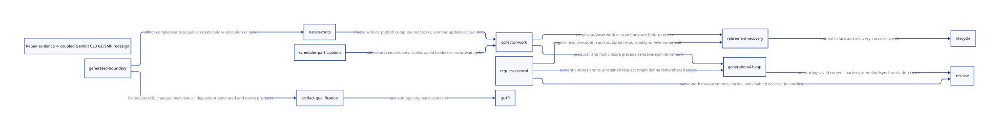

#+TITLE: Repair 9–12 as evidence for a coupled Gambit GC / SMP reconstruction
#+SETUPFILE: ../../modeling/org/setup.org
#+LANGUAGE: en
#+OPTIONS: toc:3 num:nil
#+PROPERTY: header-args :eval never
#+TODO: RESEARCH DECIDED | ADOPTED RETIRED

* DECIDED Reconstruct the mechanism that produces repeated repair obligations
:PROPERTIES:
:CUSTOM_ID: repair-driven-gc-smp
:AUTHORITY: GambitRepairDrivenRefactor
:BASELINE: C23; Scheme owns semantics; Gambit C portability remains core
:STATUS: source-bound research; whole-source and native closure open
:EVIDENCE_CUT: retained c38e review, 2026-10-26; not a live repair monitor
:END:

Repair 9–12 supplies a failure corpus and behavioral constraints for the modern-C
runtime reconstruction. Its patch structure is not the target architecture.
The next DEV task is to replace the coupling that repeatedly requires new root,
wait, return and cleanup exceptions. Do not carry every repair wrapper forward
and add another owner beside it. Retirement of the old authority is part of the
result, while the original behavioral tests remain constraints.

This study reconnects [[file:modernization-target.org][the existing whole-runtime target]] and
[[file:runtime-blueprint.org][canonical blueprint]] to actual repair records. It changes no runtime,
fixture, native budget, qualifier, source lock, checkpoint or repair-owner task.
It claims neither ninth-gate completion nor a newly executed native experiment.
The observed retained milestone is 8/12, not an ordinal assignment of each issue.

The single new research authority is [[file:models/sysml/repair-driven-gc-smp.sysml][GambitRepairDrivenRefactor]].
Each of eight cuts references an existing typed canonical module and interface,
an existing QNT action, an existing Lean lemma, a source-bound observation, a
concrete missing refinement and an old responsibility to retire. It does not
create another set of GC/SMP components. [[file:repair-driven-gc-smp-matrix.org][The full matrix]] and
 derive from native SysML queries. The
[[file:../../modeling/ascent/repair-driven-gc-smp.rules.scm][ASCENT DSL]] checks these relationships and rejects cross-scope promotion.
The [[file:../../modeling/tools/repair-driven-gc-smp-study.py][Python driver]] binds source hashes, recorded receipt edges and model symbols;
it does not substitute for a semantic refinement or rerun existing proofs.

* FACT Three source identities must remain separate
:PROPERTIES:
:CUSTOM_ID: source-identities
:END:

1. Pinned upstream Gambit and the historical original campaigns establish the
   old behavior and accepted/failed inventories. They do not describe every
   subsequent cumulative overlay.
2. Frozen repair images such as 2fe7, 60b3, 048b and c38e each bind their own
   Scheme, generated C, header, object, binary UUID and test conditions. A
   success or first exception on one is not automatically a result on another.
3. The current working vendor tree is now modular: =mem.c= includes =_mem/*.inc=
   in a fixed order. Its =mark_rc(work, context)= requires a closed context
   domain; collection uses =collector_worker= and root-task claims; VM resize
   request thunks are scanned independently of a surviving origin. These are
   real source observations, not evidence that this tree produced c38e or that
   all composed replacement paths have native admission.

The driver records the current inclusion order and fragment hashes. Fragment
physical lines and preserved =#line= logical mem.c coordinates are different
coordinates; neither supplies the source identity of an older crash. Old
monolithic links remain historical evidence rather than silently becoming current
fragment references. Module extraction is useful organization, but is not by
itself an ownership, memory-order or progress proof.

* FACT What the recent failures actually establish
:PROPERTIES:
:CUSTOM_ID: evidence-corpus
:EVIDENCE_CLASS: source-bound retained observations; no reruns
:END:

** A real GC-capable entry gap, not a claim that SMP is fake
The e574 crash report was bound to startup collective GC. The generated startup
bridge lacked demonstrated RA/register materialization around a helper that can
service GC. The subsequent 60b3 generated path added the explicit store, W_ALL,
call, R_ALL and fetch sequence. This is a real source boundary to generalize into
FrameSpec and effect-complete call generation. The historical crash's exact first
bad instruction and a witness of GC selected inside that exact corrected bridge
were not closed merely by later successful smoke runs.

Gambit already has concurrent processors, copying collection and work stealing.
The evidence does not support calling all SMP fake. The modernization defect
class is incomplete composition of real parallel mechanisms: native calls can
collect, suspended roots can move, participants can change and raw return tails
can remain alive. Correctness, useful parallel progress and scaling are separate.

** Waiting is a semantic result, not a generic EINTR loop
A real internal self-pipe wake was consumed and returned as EINTR, then retried
inside the native wait until the same deadline. The scheduler therefore did not
necessarily see its own wake promptly. The 048b short sample improved from about
5.698 s to 1.385 s for 120000 requests, approximately 4.1x. Allocation remained
roughly 599 MB. The later c38e integrated EOF as EIO, atomic probe publication and
a runnable decision under P, with its own 2.370086 s sample.

This supports typed private wake reasons and a durable runnable/park decision.
It does not prove every wait backend or fault path correct. c38e's first GC-pair
control timed out at 45 s; two later exits of zero do not explain it. Flags set
before actual blocking did not prove the intended repark overlap. Public errno
behavior and true-signal retry against the original absolute deadline remain
separate from an internal scheduling event.

** A target can expire while the system is making progress
The focused 2fe7 test2 diagnostic found an inactive-thread exception after a
normally terminated target reached only 3155998 increments, below 10000000.
Cleanup refusal followed the first exception. The original test creates six
independent targets at p11, ten senders per target and a 1000-second target sleep.
The broader six tests request 360 million synchronous interruptions.

Thus an eventual-progress proof and a high aggregate completion count are not
sufficient. Each target needs timely useful service without changing supported
sleep semantics. Conversely, the outer join error from 048b does not identify
that same first exception: its child innermost reason was not captured.

** More processors can amplify coordination without increasing useful work
On the retained 60b3 fixed 120000-call sample, p1 took about 0.519 s and p11 about
5.698 s. This is approximately elevenfold amplification of elapsed time in that
sample, not a universal scaling theorem. Co-location subsequently failed to
improve it. There are concrete hot-path review targets: request/pass/hint
allocation, multiple catcher/wind paths and disabled-observer global atomics.
Their exact dynamic contributions are not all attributed.

The negative p1 allocation field is invalid, not zero. Plain per-processor
counters lost increments. Generated 1088-byte source expressions are not a dynamic
allocation histogram and do not explain every roughly 5000-byte/request sample.
GC wall, aggregate CPU and wait samples overlap; summing them as disjoint wall
buckets or claiming GC elimination alone gives a particular speedup is invalid.

** Short success did not close original pressure
The 048b original episode used one cumulative 3600-second deadline. The first
file exited 70; the second started with about 783 seconds remaining and had no
completion before the cutoff. Overall result remains DENY/TIMEOUT. c38e's retained
record says no original workload started on that image. Later repair-owner work
may supersede this cut, but must supply a new source-bound observation.

* RESEARCH One composed architecture; eight replacement cuts
:PROPERTIES:
:CUSTOM_ID: coupled-replacements
:OWNER: existing GambitRuntimeComposition modules
:END:

** Contract compiler: hidden GC capability becomes a generated obligation
Scheme normalization/GVM completes effects, root maps, return origins, allocation
bounds and frame identity. Every potentially collecting native call declares that
capability transitively. The generator emits its writeback/reload, RA, exceptional
landing and descriptor lifetime contract. Startup, resize, FFI and wait helpers
are all consumers; manually adding W_ALL at the latest crash site is insufficient.

This amplifies Feeley's PVM separation: semantic knowledge reaches the native
backend instead of being rediscovered by C macros. A multi-shot continuation
retains frame/descriptor identity across repeated restore; it does not authorize
resuming a dead native C activation. No one-shot effect-handler restriction is
silently imposed on Gambit to simplify the redesign.

** Scheduler and participation: wait return has a precise consumer
Keep execution ownership, rooted blocking state and GC participation distinct.
Native WaitResult must distinguish confirmed internal wake, IO-ready set, true
signal interruption, timeout and hard backend failure. Return service happens
outside held scheduler locks, then roots/owner are reacquired and reloaded before
a P-protected runnable check. The park commitment must be synchronized with the
producer's durable runnable publication; elapsed delay is not that witness.

Existing source contracts determine where nonblocking service may run. A global
collector priority policy can starve cleanup; an arbitrary cleanup callback inside
the collector can deadlock on its own participant. The design needs a composed
progress argument for service windows and root/custody handoff, not independent
claims that each queue eventually drains. Native result delivery remains
synchronous where Scheme requires it; actor-style asynchronous substitution or
coalescing arbitrary interrupt thunks changes observable semantics.

** Collector work: current typed separation must earn complete replacement
VM owns collection epoch, participant membership, root-task population and shared
capacity. ExecutionContext owns Scheme registers, stack and dynamic state.
GCParticipant publishes a frozen root cut. CollectorWorkContext owns copying,
private cursors, Tail, claimed chunks and descendants independently of the carrier.
A worker/OS-thread identity does not prove task ownership or root closure.

The current vendor split is a useful candidate base. Required closure covers
reserve/init/READY/publication/acquire/scan/DONE, incomplete forwarded copies,
captured-frame link backfill, weak-phase work, shared testators and resize.
A last-idle decrement is legal only after private obligations are discharged.
Strong closure cannot be inferred from weak closure or vice versa. Termination
must exclude all admitted producers, not only currently visible queues.

** Native roots and outcomes: one root slot has an actual custodian
The root domain includes registers, saved state, stack/captured frames, denv,
RC payload and extended slots, still-object users, VM globals, startup/resize
requests and native return/cleanup records. Distinct slot aliases are canonicalized
under storage lifetime, not merely by equal values. Freeze closes writers;
scanner relocation updates actual slots; execution reload is mandatory afterwards.

Failure or unknown join preserves registration and descriptor interpretation for
the next GC. Processor removal does not remove retained VM request roots. A new
registry layer that still requires every old manual list and separate semantic
scanner decision is not yet a successful replacement.

** Request representation: remove redundant support without losing control
Generate a request/control record from semantic needs rather than composing
independent mutex, pass, hint, catcher and diagnostic objects by convention.
Separate production ownership from optional observation. Private/local fast paths
may avoid shared work only when publication and migration cannot yet occur.
Normal success and exception/continuation escape must share a single defined
completion suffix, rather than duplicate cleanup decisions.

Pooling is conditional: no queued consumer, GC slot borrower, callback, retained
receipt or multi-shot continuation may still name the old incarnation. Distinct
operations cannot be coalesced merely because this fixture increments a counter.
The first measurement obligation is a real dynamic allocation/control inventory;
this study does not approve deleting catchers from a static byte estimate.

** Heap generations: change the unit of work, not just the heap setting
The research target is context-local young allocation, explicit mature-to-young
stores, bounded noncollecting remembered logging, parallel stopped-mutator minor
collection, promotion reserve and a complete major route. Copying does not imply
age selection, and parallel STW is not concurrent mutation.

Continuation/frame/denv mutations, deserialization and FFI setters determine
whether mature graphs can be skipped. Roots stay mandatory in every minor cut.
Log overflow must preserve a sound fallback without secretly collecting inside
an unchecked C store. After forwarding is visible, failure must preserve copy
custody and root interpretation; it cannot roll back as if no observer existed.

The observed high allocation and small live samples motivate this investigation;
they do not quantify generations' benefit. Root scanning, copying young survivors,
promotion, barrier traffic and major work may dominate. Do not increase heap or
change stress parameters to substitute for architectural evidence.

** Retirement and recovery: error, pending and reclaimed are different states
Preserve the original result/exception and charge acquired effects exactly once.
Separate request/body completion, caller last use, native return origin, GC scan
grace, OS join, callback/resource descendants and storage release. A zero public
counter is not proof that all pre-admission senders or diagnostic aliases are gone.
Unknown outcome has stable custody, not blind non-idempotent retry.

The target is forward-only handoff of live duties to a legal owner, then a
collective/last-user decision. It must not wait on its own callback/root pin or
reinitialize over retained resources. Actual joinable OS failure followed by
runtime recovery is an independent lifecycle acceptance requirement; an injected
pre-join flag or wrapper self-join does not earn it.

** ABI and artifact closure: the runtime under test must be the one designed
ModuleSpec/FrameSpec ABI changes affect generated entry stubs, frame descriptors,
headers, C objects, archives and both interpreted/compiled consumers. Incremental
reuse requires the full relevant input cut; neither old mtime nor a recently
relinked GSI alone establishes mismatch or validity. Normal dependency rebuilding
or an equivalent authenticated closure is required, not a destructive clean build.
The build tool does not own root semantics or infer a native PASS from compile exit.

* RESEARCH Semantic bridges and actual model reuse
:PROPERTIES:
:CUSTOM_ID: refinement-obligations
:MODEL_POLICY: extend only a source-selected uncovered interaction
:END:

The SysML matrix names actual QNT actions and Lean lemmas. ASCENT verifies source
identity, exact owner/interface, action/lemma and scope associations. Existing
model symbols are not re-proved or copied into a new eight-state dashboard.

For each cut, the next proof must establish all of the following:

- A concrete/abstract relation over image, ABI, VM/context incarnation, epoch,
  root slots, work ownership and observable result. Bind actual preconditions;
  a receipt from a different source generation does not satisfy them.
- Every applicable source transition simulates the named action, a justified
  stutter or an explicitly richer transition. A CAS failure is not success, a
  forwarding publication is not complete initialization, and an OS wait return
  is not automatically runnable dispatch.
- Safety reflection: abstract no-lost-root/no-double-completion and closed-work
  properties imply the actual consumer property. A theorem whose premise is
  complete producer lifetime does not discover an omitted producer.
- Progress composition: state which scheduler, native return and participant
  assumptions allow discharge. Weak fairness establishes no numeric latency
  bound against target sleep or a 3600-second campaign deadline.
- C23 refinement: actual atomic object, reads-from edge, payload publication,
  phase/ABA identity, lock order and last use. A fence after a plain shared load
  is not an acquire protocol. Preserve native failure behavior and unsupported
  escape boundaries explicitly.

The main repair now publishes [[file:../../../evidence/model-results/research/delivery-wait-refinement/receipt.json][a source-hash-bound wait refinement receipt]] for
[[file:../../../models/gambit/delivery_service_roots.qnt][delivery_service_roots.qnt]]. It already models =readInternalWake=,
=retryAfterInternalWake=, =ordinarySignal= and =reparkQueued=, with reachable
counterexamples for =noRewaitAfterInternalWake=, =noReparkKnownRunnable= and
=realDeadlinePreserved=. Reuse these actual checks and keep their bounded,
non-source-refinement scope. The declaration-error DENY and corrected reuse
remain the repair owner's history; this study does not rerun TLC or award native
credit. Its finite return/fairness assumptions still require a concrete witness.

Two immediate source-composition gaps are selected by real evidence: typed wait
reason plus runnable/park/SYNC handoff; generated startup/root publication plus
collector root task and resize participation. A later composed refinement should
reuse these fragments and original negative controls. Its proof scope must name
the whole interaction rather than inherit unrelated prior finite PASS labels.

* RESEARCH Migration dependency and rejection conditions
:PROPERTIES:
:CUSTOM_ID: migration
:END:

The diagram orders prerequisites, not independent implementation projects:

1. Bind the repair corpus and exact generated/native ABI; retain all failures,
   original tests and currently useful partial mechanisms.
2. Close GC-capable entry/root contracts and wait/participation semantics together.
   Freeze, scan, reload and actual scheduler handoff are one composed cut.
3. Qualify current context/worker/root-task separation and its producer census;
   replace the remaining old aliases and implicit lifetime authorities.
4. Change request representation using measured necessary control/allocation work;
   preserve synchronous outcomes and multi-shot/unwind semantics.
5. Introduce age-selective collection only with complete writer, root, promotion,
   capacity and failure composition; keep a sound major/fallback path.
6. Close resource/descriptor retirement and authenticate all affected consumers;
   original lifecycle, GC/FFI, Gerbil and release contracts then remain separate
   native gates. No architecture milestone substitutes for them.

Reject a candidate if it merely moves historical coupling into new structs,
keeps both old and new semantic authorities, removes GC participants to hide a
stall, suppresses supported errors, discards unresolved cleanup duties, or wins
only after changing workload/topology/deadline. Reusing a correctness control
requires it to form the intended path: exit zero is insufficient.

* RESEARCH Net benefit must be useful work and eliminated responsibilities
:PROPERTIES:
:CUSTOM_ID: economics
:MEASURES: no person-day estimates; no borrowed paper speedup
:END:

Track per-useful-request allocations and bytes by true producer; shared atomics,
lock acquisitions, native wait returns, context saves, root publications and GC
work; then target completion/fairness, latency distribution, throughput, CPU,
retained bytes and whole-campaign completion. Disabled-observer overhead must be
reported separately from enabled diagnostic fidelity and from production safety.

The generational work condition is that mature tracing avoided over minor cycles
exceeds extra barrier/logging, young survivor/promotion, coordination and major
work on the actual population. The control redesign condition is that eliminated
support allocations/saves/shared synchronization exceed the new record validation,
generation and fallback cost. Event counts need calibrated costs before becoming
a time claim. GC wall and CPU are not disjoint components to sum.

Memory accounting includes young/mature live regions, copy/promotion reserve,
context restore space, roots/frames/descriptors and retained native duties.
Overlapping intervals count once. A faster minor cycle that increases peak
retention or starves a target is not automatically a better runtime.

For test2 each target needs 10000000 calls before its own 1000-second sleep ends.
Six concurrent targets also require balanced progress; an aggregate rate can hide
one starving target. The isolated c38e sample extrapolates to about 1185 seconds
for 60 million calls, but is not a deadline prediction or a reason to extend the
test. The actual workload has additional semantics and scheduling variation.

Modern C is the selected implementation language for these mechanisms. Zig adds
no collector, root or progress proof automatically. Its optional future role must
remove further necessary work beyond this same C23 architecture; maintaining both
native realizations without that evidence adds cost.

* RESEARCH Literature: mechanism learning, not invented precedent
:PROPERTIES:
:CUSTOM_ID: learning
:END:

The existing [[file:modernization-target.org][Feeley PVM and first-class-control analysis]] supplies the semantic/native
separation and C interoperability requirements. This study amplifies them through
one effect/frame/root contract and independently owned collector work; it does
not claim Feeley's old paper already specifies this C23 architecture.

The retained [[file:../../architecture/runtime/gc/modern-c-generational-design.org::#evidence][OCaml parallelism, Chez and generational collector ledger]] supplies
mechanism tradeoffs: coordinated minor collection, C interface consequences,
remembered mutation and explicit participation. The useful lesson is a coupled
runtime redesign. No OCaml fiber restriction, Chez heap layout, Erlang isolation
semantics or published speedup becomes a Gambit theorem by analogy. No additional
external paper was fetched in this source/corpus pass. New algorithm choices need
their own primary-source reading and Gambit-specific falsifiers.

* RESEARCH Continuous intake before and after the present repair
:PROPERTIES:
:CUSTOM_ID: evidence-intake
:OWNER: existing repair evidence and DEV canonical module owners
:END:

This cut contains selected anchors, not a complete inventory of every historical
repair. The repository discovery read reported four unavailable provenance views;
that discovery gap is not evidence that the missing histories contain no relevant
failures. The current repair owner retains its own live progress and task lease.

Reuse the registered clue/factor and existing evidence relations. For every new
failure or correction, preserve the actual run/producer/image/configuration,
original test and budget, first confirmed failure frontier, capture limitations,
competing hypotheses, causal discriminator and unchanged negative controls.
Associate it with a canonical cut and an existing shared contract; use an unknown
association when the mechanism is not established. Do not invent a new ordinal
native gate or route every exception to GC by default.

A before/after claim needs the relevant same-work and same-environment comparison,
a source transition explaining the difference and an intact contradictory record.
A successfully repaired symptom can support a replacement requirement without
proving the whole replacement. Conversely, a later failure must reopen only the
assumptions it actually contradicts, not erase unrelated successes or every model.

The next research deliverables are source-to-model relations for two composed
interactions already selected above, a dynamic request allocation/control census,
and qualification of the current typed context/worker/root-task replacement.
Each must name its concrete consumers, a reachable discriminating counterexample,
what the existing QNT/Lean fragment proves, and the remaining progress/C23/native
obligation. Extend an existing behavioral model only when that source interaction
is demonstrably missing. The number of model files or passing lemmas is not the
modernization metric.

Original pre-9–12 failures, the present GC-pair stall and later embedding/resize/
continuation failures all enter this same process. Add a new architecture cut
only if the existing canonical ownership boundary cannot express the mechanism.
Keep one semantic implementation owner and require explicit retirement of the
old authority when a replacement qualifies.

* RESEARCH Closure boundary
:PROPERTIES:
:CUSTOM_ID: closure
:NATIVE_PATHS_RETIRED: 0
:END:

Closed here: source-bound evidence-to-canonical-owner mapping, exact existing
model-symbol associations, historical-generation separation, conditional operation
arithmetic and executable ASCENT anti-promotion checks. Open: whole-source
simulation, full C23 memory-order proof, complete roots/producers, explained
GC-pair stall, original-pressure success and all four remaining native contracts.
The recorded raw witness availability and hashes are in the research receipt;
missing local material is not silently replaced by a documentary assertion.
