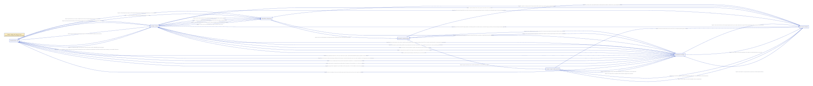

#+TITLE: Modern C request, reusable wait, service, GC and exit reconstruction
#+SETUPFILE: ../../modeling/org/setup.org
#+LANGUAGE: en
#+OPTIONS: toc:3 num:t
#+PROPERTY: header-args :eval never
#+TODO: RESEARCH REVIEW | QUALIFIED

* REVIEW Decision, evidence epochs and the exact claim
:PROPERTIES:
:CUSTOM_ID: modern-request-service
:AUTHORITY: GambitSharedHeapSmpRequestServiceSources
:RUNTIME_PUBLICATION: 32028f5d5efdef5b901de84aaeba43fe3ba939e3
:STATUS: CONDITIONAL-SOURCE-ARGUMENT; REPAIR9-NATIVE-CLOSURE-OPEN
:END:

The design starts with Modern C as it exists, not the paused repair overlay.
The published runtime already has a six-slot request, completion-guarded service,
reusable logical waits, THREAD_PARK and separate context/collector source roles.
These are implemented mechanisms to refine and qualify, not new proposals to
reimplement. Remaining physical queue, generated-frame, wake, lifetime and
capacity seams determine whether this architecture solves the original load.

The [[file:repair-driven-gc-smp-design.org::#modern-mainline-repair-audit][earlier audit]] preserves published3/12. The preceding Python
=accepted_smp_status= and =require_pr_smp_evidence= review revalidated4/12 on its
canonical65a4a2e2 / published32028f5d source equivalence. Eight complete PR/control
fixtures run at each p1/p2 topology, with actual processor probes, one original
300-second whole /295-second inner deadline and no spliced success. The retained
whole campaign is7.197081792 seconds. The latest refresh keeps that historical
result but current PR revalidation is STALE: commit-gates.sysml no longer has
the model digest bound by the PR receipt. The original validator rejects it;
the evidence retains expected/current digests. The SysML design projection and
its D2 generation completed before that separate rejection. This turn does not
rerun native tests, qualify the dirty working tree, or admit later stress.

The [[file:../../../docs/current-repair-research.md::4656][Repair19 failure]] remains a historical e782/8/12 cut; current repair9/12 is
user-reported and separate. Fourteen focused positives did not establish original
capacity. We do not infer that every possible patch is impossible, or that all
failures share one root cause. Historical +2.93% attribution is a separate open
question and is not a prerequisite for this delivery.

* Framework-revalidated fourth-family population

This historical table was regenerated from the model-bound manifest after
=require_pr_smp_evidence= succeeded in the preceding review; it is not renewed
when the current validator rejects a changed model. Five additional regressions and three
original controls execute at both p1/p2; a zero per-file cap means the shared
whole deadline applies, not unlimited execution. The private ended-thread
constructor projection changes only its declared internal-record construction
and required imports, retaining original assertions and source provenance.

#+NAME: request-service-pr-population
| Target | Kind | Original source SHA prefix | Executed SHA prefix | Extra file cap |
|---+---+---+---+---|
| 12-os/process_spawn.scm | additional | eba139d1aa99 | eba139d1aa99 | shared whole deadline |
| 06-thread/thread_interrupt_ended.scm | additional | 5034a9937f3a | 2527b6d07f62 | 20s |
| 09-io/pipe_concurrent.scm | additional | 760513881622 | 760513881622 | shared whole deadline |
| 10-tables/serialization.scm | additional | ef42cdb7b317 | ef42cdb7b317 | shared whole deadline |
| 10-tables/serialization_gc.scm | additional | 6d1e709df3fd | 6d1e709df3fd | 60s |
| 06-thread/thread_interrupt.scm | original-control | 08cc673b8766 | 08cc673b8766 | shared whole deadline |
| 09-io/write_shared.scm | original-control | 8890f435a997 | 8890f435a997 | shared whole deadline |
| 10-tables/table-search.scm | original-control | f6b99bea276e | f6b99bea276e | shared whole deadline |

* DECIDED Retire authorities already split, then close their composition

| Responsibility | Already present in Modern C | Remaining whole replacement / retirement |
|---+---+---|
| Request identity and terminal result | Immutable target/thunk/completion; completion mutex guards queued/running/returned/abandoned and initial dispatch | Retire any remaining inference that physical queue location, wake or stale continuation owns execution/completion. Cover constructor/refusal, both transports, every dispatch and target end |
| Waiting control versus service | join/sleep/mutex reusable wait plus resume thunk; thread-resume-execution drains interrupts separately | Prove all legal suspension variants, current denv, nested service and per-shot suffixes; retire repeated private wait reconstruction only at qualified native sites |
| Physical root and collection | Exact frame decoding, RootTask sources and independent worker custody | Close full root publication/reload and all private/claimed work; no moving local may survive solely as an untraced C address |
| Exit and consumption | Target-owned completion abandonment and existing native activation/RC cleanup | Close normal result consumption, abandoned/escaped/unknown outcomes and physical last use separately. Root-transfer ACK is not request reply, query closure or native join |

Keep the existing two physical queue stages if their handoff is complete; one
semantic owner does not require an arbitrary one-queue rewrite. A detached node
can be rerouted only with mapped root custody. Do not duplicate existing request
records or introduce a global already-executed table. Stable Scheme identity is
preserved across GC; a raw address is not a request key.

* RESEARCH Conditional correctness argument and falsifiers
:PROPERTIES:
:CUSTOM_ID: service-conditional-proof
:PROOF_CLASS: DESIGN-ARGUMENT; C-REFINEMENT-AND-NATIVE-PREMISES-OPEN
:END:

Let a request's abstract state distinguish private construction, accepted
publication, one queued transport, one mapped service claim, terminal outcome
and consumer-retained result. The source state symbol =queued= before publication
is not itself evidence of acceptance. Count pre-accept refusal separately.
For a qualified observation cut require
created = preaccept-refused + accepted, and
accepted = terminal + outstanding, with each obligation owned once.

| Premise / inductive step | Existing source mechanism | Required refinement / defeating counterexample |
|---+---+---|
| Exclusive custody | Private constructor, thread queue, processor queue and dequeue clearing slot0 | Each transfer retains a mapped root; never expose one intrusive node in two containers or call a detached unrooted value. Missing/unknown take observation retains prior custody |
| At-most-one dispatch and terminal publication | Completion lock claims queued->running; commits result before returned/unlock; completed suffix does not republish | Every writer uses that guard and same key. Distinguish initial thunk invocation from valid repeated user effects after multi-shot restore; do not impose one-shot semantics to satisfy a counter |
| Complete wait/service state | Logical wait root, resume closure, physical Thread.cont and current denv | All operation-specific registration and return suffixes preserve BTQ/TOQ, timeout and dynamic-wind. A preexisting continuation is not authority to mutate an unrelated thread's completion mutex |
| Moving-root preservation | Generated end-of-block checks, THREAD_PARK publications, canonical root slots and frame decoder | Before every allocating check all inputs are mapped; collector repairs canonical aliases; after restore reload them. A live object elsewhere cannot conceal a stale local or omitted slot |
| Resource last use | Terminal request, logical activation exit, result-consumer close and physical source/reader drain | Retain captured user suffixes and unknown native users. ACK plus lost reply cannot allow IDLE while a consumer still owns the key. A join flag or zero refcount alone is insufficient |

The concrete-to-abstract projection alpha is partial and source-owned:

| Concrete state / protected cut | Abstract meaning | Undefined or unsafe observation |
|---+---+---|
| Six-slot request plus completion lock; target owner and acquired publication right | One logical request and its normal/abandoned/pending outcome | The private queued symbol is not an accepted-publication receipt; false value is not absence of exception |
| Slot0 under its physical T or P queue owner, followed by a mapped claim root | Exactly one custody location, or a controlled transfer between locations | A null or busy observation does not establish another queue empty or work completed; mixed snapshots are not a global cut |
| Internal wait frame, current effective denv, resume closure and original timeout | One wait episode; service calls use a separate mapped activation | Pointer equality or one frame alive does not prove complete suffix/alias coverage; a timeout refreshed on repark changes semantics |
| Frozen RootOrigin/Task and complete FrameSpec, repaired canonical slots, worker work receipts | Moving-root and private-work obligations of the current epoch | Scan DONE alone is not strong/weak/restore closure; user-held aliases and raw native debt stay represented |
| Accepted result-consumer right, metadata reader pin, native write/return and resource cleanup state | Separate future use, actual use and physical retirement permissions | Logical Thread end, ACK or join alone cannot erase a remaining consumer |

Every C/Scheme step must preserve this relation or be an explicit user-visible
normal/exception/control event; user continuation restoration is not discarded
as a stuttering step. If a needed observation is unqualified, alpha cannot be
used to sign completion. This is the C refinement task for existing models,
not a second implementation model or an assertion that lexical coverage proves
simulation. The non-atomic Repair19 cleanup counters cannot instantiate it.

Base case has no published debt. Each qualified constructor/publication step
adds one owned obligation; queue movement preserves it; the guarded claim
transfers rather than copies service authority; terminal publication consumes it
once and retains any consumer-owned result. Existing root/slot and last-user
premises prevent GC or exit from erasing that owner. Thus these premises exclude
orphan publication, duplicate dispatcher invocation/reply and unowned root/free
for this protocol. This is a case argument with explicit C adapter premises,
not a completed mechanized proof or evidence that every native branch satisfies
it. Existing QNT owns concurrent histories; Lean owns the distinct slot/interval/
representation implications. No second schedule or duplicate induction is added.

Eventual service additionally assumes admitted callbacks finish or have a legal
terminal outcome, enabled dispatch progresses and each park has an effective
wake or qualified independent return. Arbitrary live continuation escape or raw
C unwind is not silently treated as success. Supported multi-shot restoration
must preserve user effects while preventing a second protocol publication.
The original inc! callback has no user capture, but general Scheme still does.

* RESEARCH Work elimination and a bounded-retention argument
:PROPERTIES:
:CUSTOM_ID: service-work-and-retention
:END:

The native THREAD_PARK prefix has fixed root/control assignments and no allocator
or frame-payload copy. The emitter performs checks before that prefix; those
checks may collect. Unsupported arities/backends use the portable path, which
copies a continuation wrapper. Consequently source inspection establishes a
narrow zero-copy prefix, not a zero-allocation repark or zero GC cost.

The current THREAD_SAVE prefix is also fixed-size and nonallocating. The
architectural difference is which frame it retains: current FP/break versus the
explicit logical wait frame. CONTINUATION_CAPTURE initially constructs a stack
wrapper; continuation-copy allocates a shallow heap wrapper, not a deep frame
copy on every call. Later root reachability and GC decide frame materialization.
Do not infer a growing historical service chain from these definitions alone.
If the old selected path already drops the service suffix, its retired F_i is
zero and this change may add cost. Trace actual frame/root identities to decide.

For E wait episodes and M actual wait restarts, the selected native path reuses
one logical wait capture per episode. M is not the number N of requests: one
dispatcher drain can serve many requests before resuming the wait. The source
comparison below finds no explicit capture/copy in the old dispatcher loop or
the old three wait-retry bodies. Thus an expanding per-request private chain is
not an established old cost. Only observed extra restart/materialization work
can enter the retired-work term. Existing user captures U remain U; initial
captures, required service frames, request/completion allocation, root scans,
copying and fallback work remain costs. The exclusive-time inequality below is
an accounting target, not a measured saving.

For the original no-user-capture inc! action, require each completed service's
private suffix to leave all authoritative roots, except a bounded last physical
checkpoint per thread. Logical waits retain their fixed base suffix; the next
park resets the physical context to that base rather than linking the previous
service frame. Under precise liveness/cleanup and bounded nesting, live internal
control storage is bounded by live waits/senders/targets and nesting depth,
not total completed requests. A stale mapped slot, resume closure or cached
continuation retaining the old service chain defeats this argument. Validate
retention across repeated full GC, not merely process exit or total allocation.
User-retained continuations are excluded from this fixture-specific bound, never
from the language. Total allocated bytes may grow with calls while peak live
storage stays bounded; those are different metrics.

* RESEARCH Actual generated park, complete roots and service-tail retirement
:PROPERTIES:
:CUSTOM_ID: generated-park-tail-retirement
:AUTHORITY: GambitSharedHeapSmpRequestServiceSources
:PROOF_CLASS: CONDITIONAL-SOURCE-REFINEMENT; NATIVE-PREMISES-OPEN
:END:

** Generated selection and cohort boundary

At published32028f5d, the current =lib/_thread.c=, =gsc/_t-c-2.scm= and
=include/_gambit/gvm_operations.h.in= bytes each equal that commit's bytes.
The retained evidence records their full digests. This binds the inspected
generated selection to a published cohort; it does not reproduce generation,
qualify a dirty successor or establish which branch a native run exercised.
The primitive declaration is in =gsc/_prims.scm=; the emitter accepts arities2..5,
runs end-of-block checks, adjusts the stack and declares FP/register effects.
The larger eleven-file inspection cohort is deliberately not labeled wholly
published: =stack_operations.h.in= and =collection-round.inc= have parallel
working changes, retained by digest in the evidence. The two FP coordinate
macro definitions agree with the publication, but that is not compiled-cohort
equivalence. Current phase consumers remain source-adapter premises for the
runtime owner; none of those files is modified by this research.

| Actual generated site | Logical source and retained closure | Entry / return coverage required |
|---+---+---|
| _thread.c:16961, PARK5 | thread-join-wait!: self resume, target, original timeout, wait | Initial CAPTURE3, closure4 and CHECK_HEAP; install wait before join-register; ended-target race, BTQ/TOQ registration and wait-return |
| _thread.c:17343, PARK4 | thread-sleep-wait!: self resume, original timeout, wait | Initial CAPTURE2, closure3 and CHECK_HEAP; sleep-register and original absolute deadline; service repark and timeout return |
| _thread.c:24152, PARK2 | mutex-wait!: mutex, new-owner, self resume, timeout, wait | Initial CAPTURE4, closure5 and CHECK_HEAP; resume(false) parks, but resume(current-thread) directly calls wait-register5; both must be observed |

These are three static emitted sites, not three passing tests. No PARK3 call is
emitted in this file, although the header supports it. Generic arities/backends
still require their own qualified selection/fallback boundary. The self edge in
each resume closure is a bounded recursive closure, not evidence of a chain of
historical service frames. Wait capture precedes later service invocations;
any already-present outer user/service suffix remains part of that wait's
ancestry and cannot be erased by naming it an internal wait.

** Physical frame coordinates and consumers

Use =module_generation.h.in='s descriptor decoder and ordinary-root cursor,
=stack_operations.h.in='s FP_STK/FP_ADJFP coordinates, and
=continuation-roots.inc='s actual scanner together. RETN and RETI cannot share
a naive stored-size interpretation: RETI expands through RETI_CFS_TO_FS.
The following two RETN frames can be resolved without that ambiguity.

| Frame at suspended call | Descriptor | Ordinary traced payload | Separate structural/control coverage |
|---+---+---+---|
| thread-intr-service! while invoking user thunk | RETN(fs5, link1, bitmap0x7), _thread.c:30418 | Physical slots1/3: request and completion; returned FP coordinates STK(-7)/STK(-5) | Slot2 is the structural link, returned STK(-6); bitmap bit2 does not make it an ordinary object root |
| thread-resume-execution! while invoking dispatcher | RETN(fs5, link0, bitmap0x3), _thread.c:30689 | Physical slot2: saved resume thunk, returned STK(-6) | Slot1 is the structural return link, returned STK(-7); return pops8 words before the service loop |

Both reserve FRAME_SPACE(5)=round(5+3,4)=8 words. This is not eight live object
roots and not the total cost of a captured chain. Active scanning walks from
context.fp to context.stack_break, then the captured break chain. Heap FRAME
scanning handles the same ordinary slots and the structural link separately;
captured materialization copies the payload even when some words are not traced.
Raw pointer-looking words in dead payload are not a reachability oracle.

The three initial closure CHECK_HEAP return labels are also emitted: join and
sleep use RETI(stored_fs1,link4,bitmap0x3f1); mutex uses
RETI(stored_fs2,link4,bitmap0x3f3). With the declared five GVM registers, each
decodes to fs13 and FRAME_SPACE(13)=16 words. Ordinary slots are1,6..10 for
join/sleep,1,2,6..10 for mutex; slot5 is the separate structural link. These
describe the collecting slow-return extension, not the whole logical wait's
captured caller chain. The latter follows the captured frame pointer and its
successive descriptors; it must be observed rather than assigned a constant
size from the resume closure or this one RETI descriptor.

On service return the callback value first lives in R1. The emitted suffix spills
it into STK(-4), which is NOT an ordinary root in the service return descriptor,
then publishes request.result before request.state=returned. The visible suffix
contains no explicit collecting check between that spill and publication.
Selected lock/store macro expansion and legal safe-point rules must establish
the no-hidden-GC interval. A newly introduced check would need a new valid root
map/placement; injecting GC at an unmapped instruction is not a faithful test of
the current runtime. While a collecting callback runs, its own call/root maps
and saved service link cover the live callback state. Do not invent a fourth
service-frame root for the eventual result.

Normal service return and the slow mutex-unlock tail remove the active service
frame with ADJFP(-8). Dispatcher return restores the saved resume thunk and
return link, then removes its own8-word frame. An empty queue tail-calls resume.
THREAD_PARK then changes FP to stack_break, writes break.next and Thread.cont's
frame from the selected wait, and resets R0. THREAD_RESTORE later transfers that
continuation edge back to the break chain while clearing Thread.cont's frame.
That clearing is root transfer, not reclamation. The internal wait's denv=#f
does not clear the current effective Thread.denv or any user continuation denv.

** Complete root and exit handoff ledger

| Source / actual consumer | Required custody through the cut | Remaining adapter / native evidence |
|---+---+---|
| Active frame and break chain / mark_continuation, mark_frame | Before every legal GC check a complete descriptor covers live inputs; after park the wait chain is installed before an independent scan; repaired slots are reloaded | Native generated-site cuts, including both mutex branches; no mixed publication snapshot |
| Resume closure / procedure free-field scanner and dispatcher slot2 | Keep wait, timeout and operation arguments through service; wait-return replaces Thread.resume-thunk with void only when restoring the waiting call | Prove closure ancestry and timeout/registration lifetime; source frame identities across repeated repark |
| Context r[], saved, type_cache, processor Scheme fields / root-origins.inc | These are also traced roots; stale but scanned register/cache references can retain an otherwise detached suffix | Full traced-root inventory at legal cuts, rather than FP-only or raw stack dumps; do not clear a live value merely to reduce retention |
| User captures, denv, returned closure/result and aliases / continuation and object scanners | Multi-shot captures intentionally retain their service ancestry; restoring them preserves dynamic-wind and supported affinity | Positive retained-user-capture test and negative omitted-slot test with an independent alias still keeping the referent alive |
| RC/still/FFI and frozen RootTask / root publication and retained source leases | Moving values remain in a canonical scanned slot or successor rooted owner; detach after freeze may remain live for that round | R3/W2 delayed source scan, result/ACK lost, frozen-reader drain and next eligible epoch; UNKNOWN retains custody |
| Worker-private copying/frontier and final thread exit / collector and thread-end consumers | Finish or transfer private work; thread end publishes outcome/abandonment and clears only fields with settled last use | Normal return, target exception, nested/nonlocal escape and unknown native stop have separate dispositions; Thread end or physical join alone is insufficient |

The runtime thread must qualify this as one composition, without adding another
root registry or request execution table. Publication uses the existing source
freeze/task and T/P/completion synchronization owners. Ordinary FP/field stores
inside the noncollecting park prefix do not by themselves constitute release/
acquire publication to arbitrary concurrent workers. The complete stable source
must precede task availability; scan/repair completion must precede mutator
reentry. Actual selected C atomic/lock backend evidence remains required.

** When the service tail is genuinely no longer retained

Let S be one service activation and Roots(e) the complete traced root snapshot
for epoch e, including frozen and private-work custody, not merely active FP.
The service return or park gives only an active-edge removal. S is no longer
retained by that snapshot precisely when S is absent from Reach(Roots(e)) under
the qualified ordinary-slot, structural-link and closure/denv interpretation.
This graph predicate is conditional on complete source adapters; finding source
locations does not prove it for an execution.

The retirement sequence is: (1) remove/transfer active wait/service edges at a
legal complete-root cut; (2) settle every remaining internal alias and writer,
while preserving intentional user captures/results; (3) exhaust any earlier
frozen or worker-private readers; (4) in an eligible completed full GC show no
mark/recopy of S; (5) release its storage only under the physical allocator's
last-use rules. If an old snapshot already marked S, the present round may
retain it legitimately. UNKNOWN readers can prevent eligibility indefinitely.
Reusable section space and OS/RSS release are distinct; neither follows from
an FP store or a zero protocol counter.

For the original noncapturing inc! fixture, bounded nesting, fixed wait ancestry
and complete root cleanup can bound internal retained control by current waits,
outstanding requests, nesting and bounded stale snapshots, independent of total
completed requests. User captures or unbounded UNKNOWN debt invalidate those
premises. In particular, park cannot guarantee reclamation of service S if a
nested wait captured S before repark, or if the callback returns a closure that
captures S. Those are semantic obligations, not reasons to discard multi-shot.

** One native campaign, five existing gates, no extra proof owner

| Existing gate | Whole acceptance / defeating control | Status |
|---+---+---|
| SH-CUT-S | Same source cohort, all three emitted sites and direct mutex registration; precheck roots, freeze publication, repaired reload and no hidden collecting suffix. Delay one R source with W<R | Source selection and two frame maps resolved; complete C/native cut refinement OPEN |
| SH-ALIAS-S | Independently observe exact ordinary slots/links, registers, denv and closures. Omit one slot while its referent remains reachable elsewhere; keep a valid multi-shot user alias as a positive retention control | Complete-root/alias oracle and live frame-depth evidence OPEN |
| SH-BOUNDARY-S | Normal/slow-unlock return, timeout, false exception, nested capture/restore, target end, lost reply, RC frozen lease and unknown native exit preserve a rooted successor and last use | Source handoff ledger supplied; exceptional/native adapter closure OPEN |
| SH-EXEC-N | Existing map two restores/PBT at R3/W2 with full GC, plus unchanged original stress populations/repetitions and actual target arm/end/remaining-work witness | Existing smoke4/12 is independent; original Repair9 stress not admitted |
| SH-COST-N | Same work/budget/toolchain cohort: useful requests/s, legal cut timings, copied frame payload, traced slots, allocation, GC CPU/pause, simultaneous live/committed peak, fallback and metadata cost | Whole-work native capacity and net benefit UNMEASURED |

Use existing map/PBT replay and shrink at actual legal C cuts: before initial
capture/check; after closure setup/check; complete park publication; service
result formation/publication; fast and slow return; delayed frozen-source scan;
normal/nonlocal exit and reentry. Shrinking must preserve the synchronization
and independent-alias witness that makes the failure meaningful. Complete
original stress is never replaced by its smaller reproducer. Observation inside
noncollecting/locked prefixes must use bounded preallocated records without
allocation, I/O or wait. Missing hooks or overflow make the diagnostic
INCOMPLETE, not passing. This is a test prescription, not executed evidence.

| Net-benefit axis | Eliminable work / positive condition | Added or unavoidable cost / falsifier |
|---+---+---|
| Wait/service control | Reuse one wait and detach completed internal suffixes; actual old retained/copy work F_i exceeds new park/registration B_i | Initial capture, recursive closure, request/completion and service frame remain; old path already detached implies F_i=0 |
| GC work | Fewer reachable service frames means less actual tracing/materialization over repeated collections | Full-GC census and conservative whole-round capacity unchanged here; zero retained growth alone does not prove fewer collections or smaller reservations |
| Peak | Reduce measured simultaneous live frame payload after complete root/reader closure | Eight-word frame alignment, captured copies, aliases, pending consumers and worker arenas remain; fixed heap/RSS reduction not established |
| Original capacity | Per-target and whole-file necessary rates plus real completion margin hold for every unchanged subtest | Metadata/lock/cache costs or callback/user work can dominate; at-most60 outstanding does not imply360 million requests fit the budget |

The architecture removes conflated request authority, wait/service control and
root/last-use responsibility. This supplies falsifiable reasons it can solve
the ownership and retention classes exposed by Repair9. It is not yet a proof
that this runtime meets the original capacity or that the recorded failure was
caused by retained frames. If those frames were already absent, or unchanged
capacity still fails, this particular optimization cannot establish Repair9
closure; retain the counterexample and identify the dominant remaining work.

* RESEARCH Writer closure, real old work and the whole-load benefit threshold
:PROPERTIES:
:CUSTOM_ID: service-root-writers-and-net-benefit
:AUTHORITY: GambitSharedHeapSmpRequestServiceSources
:STATUS: SOURCE-REFINEMENT; ALIAS-AND-NATIVE-COST-PREMISES-OPEN
:END:

** Writes are edges, not merely names in a root inventory

| Root family / real producers and consumers | Publication, last use and exit | Eliminable work and required counterexample |
|---+---+---|
| Register locals/homes: gvm_registers.h.in PSRn, SET_Rn, R_Rn/W_Rn; emitter _t-c-2.scm targ-wr-reg; generated procedure PW_ALL | With local registers enabled, SET_Rn alone updates a host local. Kernel sync-op-interrupt!, os-condvar-select! and allocation bridges save RA and W_ALL before native participation, then R_ALL/repaired RA before reuse | Dead home roots are a candidate only after generator-proven last use. RootOrigins scans all r[]; a fixed number of registers can pin an unbounded graph. Keep live R0/code, R4/closure, arguments and exceptional return roots; never infer deadness from an FP change |
| Temporary homes: temporary_roots.h.in GC_SAVE1/2/3 and GC_RESTORE1/2/3; kernel make-frame is an actual paired caller | RESTORE already reloads relocated values AND fills used saved[] cells with VOID | No new saving for balanced pairs. Inject exception/unknown return before restore to test transfer or retained debt, rather than clearing a possibly needed root |
| Wait closures: thread-join-register!, thread-sleep-register!, mutex-wait-register!; dispatcher caches resume-thunk in a mapped slot | Register installs the self-recursive closure; wait-return, mutex success/timeout and scheduler signal/timeout paths replace it with semantic outcome actions. Thread init installs its startup closure; do not treat that as a wait | Attribute a suffix to the closure's actual free fields and ancestry. Removing Thread.resume-thunk alone is insufficient while the dispatcher/local/user alias retains it |
| RC primary/span: register_rc, store_rc_root, borrow/return, mark_rc; marker setup, begin_sfun/SFUN_ARG and Tcl command create/callback/delete are actual callers | Owner/PSTATE/domain gate and RC mutex guard managed writes. A borrowed primary cannot be rebound to a different object. mark_rc scans every linked primary and span; release physically unlinks only when refcount and root_borrows both reach zero | A zero refcount with a live borrow can still retain a frame. data_rc is a snapshot, not a moving-root loan. Pure Scheme inc! does not thereby acquire an RC bank; no per-request RC saving is established |
| User control: call/cc's reify-continuation closure; kernel make-continuation, continuation-copy, frame/denv setters, continuation-set!, continuation-next!; native capture/restore | Copy is shallow shared ancestry. Reflection writes either heap or stack coordinates; next! advances one wrapper and denv. Current effective denv and captured user denv have separate owners | All legitimate captured service ancestors/results remain live across multiple restores. Clear one wrapper and another alias still keeps the frame alive; reflection/serialization/raw FFI writers need adapters, not assumed immutability |

At a legal GC cut, prove both halves: every logically live edge is represented
and repaired, and every edge counted as eliminated has actually left every
authoritative traced source. The two independent negative controls differ:
omit one live slot while an independent alias keeps its referent alive (tests
relocation/coverage), and retain an otherwise dead service suffix through one
register/closure/RC alias (tests the non-retention claim). Neither a weak
liveness check nor a total allocation counter substitutes for these controls.

The scoped writer census is27 resume-thunk store forms in _thread.scm:17 in
the SMP arm and10 in the non-SMP arm. _thread#.scm adds one init store in each
arm. They are classified below; these counts are textual scope checks, not
whole-program alias closure, primitive execution counts or native passes.

| SMP store owner | Forms | Last-use / semantic disposition to preserve |
|---+---+---|
| thread-wait-return! | 1 | Replace with void before restoring the completed wait |
| thread-join-register!, thread-sleep-register! | 1 each | Install original wait closure only when physically registering |
| thread-yield!, thread-reschedule!, thread-migrate-to! | 1 each | Void action, but preserve operation-specific ownership/queue handoff |
| thread-check-timeouts! | 1 | Timeout action must remain until its target consumes it |
| mutex-wait-register! | 3 | Success/timeout clear to void; blocked case installs resume |
| mutex-unlock-out-of-line! | 3 | Locked/abandoned outcome action, not the old wait closure |
| mutex-signal-no-reschedule! | 1 | Locked versus abandoned action remains observable |
| mutex-signal-and-condvar-wait!, wait-for-io! | 1 each | Interrupted-wait action; not interchangeable with mutex retry |
| condvar-signal-no-reschedule! | 1 | Signaled action until consumption |

The actual thread-end-locked! body clears cont, denv and all three denv caches,
but does not itself overwrite resume-thunk. A still-reachable ended Thread can
therefore retain its last wait/startup closure through this field, if not
overwritten by another path. That is a concrete retention candidate, not proof
that it occurs at every termination, that it dominates Repair9, or that storage
grows per completed request. Retiring this edge requires no remaining legal
resume, inspection, native loan or supported control restoration to need it;
captured user continuations retain their own necessary roots. Add no broad
thread-end clearing until that contract is qualified.

For SFUN, allocation-only failure, accepted bank borrow, live marker and extent
exit are distinct. begin_sfun initializes and roots the bank before marker
allocation; its admitted zero-argument PERM fast path needs no bank. end_sfun
clears the live marker and delegates to lifecycle_marker_abort in
_setup/vm-registry.inc, which returns the accepted bank borrow and releases its
owner before IDLE. make_sfun_stack_marker's temporary procedure loan has its
own return/release. Tcl's command ownership and in-flight addref are another
native owner; deleting the command does not close its callback extent. Lost or
nonlocal exit must query/settle these existing scopes or retain UNKNOWN, never
invent zero debt. No claim of complete catcher/raw-extension coverage is made.

SFUN argument installation is another real write boundary: call_sfun copies the
accepted rooted span into PSSTK(FRAME_SPACE(2)+i+1) under the RC source lock,
then invokes call. Its partial-prefix interval is explicitly noncollecting;
the bank remains the root owner through that native extent. Do not mistake
this staging prefix for an already-published complete Scheme frame, or inject
a collecting probe there without a valid adapter.

Resume-closure mutation also has a concrete route beyond construction:
kernel's closure-set! intrinsic lowers through _t-c-2.scm's CLOSURESET into
module_generation.h.in's SET_CLO; ADD_CLO_ELEM installs free fields initially.
Consequently a frozen-view contract cannot assume those free fields immutable
merely because letrec constructed the closure once. Keep generated setup,
reflective writes and any supported raw native alias in the same ownership
coverage. General Scheme stores can expose user aliases through arbitrary
objects; the complete graph oracle must follow them, not just these named
internal fields. No source inventory enumerates every input-dependent graph.

The first implementation package therefore keeps existing all-register scanning
and RC owners. Where source liveness actually proves a dead register, the
generator may neutralize that value at an already-qualified complete-root cut,
then publish homes; no parallel root registry or new ABI mask is required by
this proposal. Already-cleared temporary roots are reused. Wait/startup/outcome
closures retain their exact semantic lifetime. Unknown aliases, live user
captures and in-flight native scopes remain roots. Any stronger precision or
new safe point must be separately qualified against all resume consumers.

** Old source comparison limits the savings claim

The repair research names lock-main baseline
=7c490c3ab5b5a4238b26f4a59d8cd9fd4b085882=. Its Git object is available and
the retained comparison records full blob/region digests. Its SMP
thread-resume-execution! calls the selected callback, returns, then tail-loops;
the join/sleep/mutex retry bodies each have one thread-save site and no explicit
continuation-capture or continuation-copy call. Sleep/mutex retry on the void
interruption result. THREAD_SAVE's fixed publication is not a deep heap copy.
The retry callback may lift arguments rather than allocate a fresh closure;
compiler/selected-branch evidence is needed before charging allocation.

This disproves the proposed *source inference* that every completed request
necessarily captures or copies a growing service suffix. It does not prove the
absence of GC materialization under interruption/nesting, nor identify the cost
of the patched e782 producer. That e782 identity is a build/content identity,
not a Git revision. The old baseline's checked-in generated C is also not an
accepted SMP comparison cohort: its resume body has a direct procedure call,
where the SMP Scheme body has procedure/mutex alternatives. Do not splice that
generated frame layout into the repaired native run. The earlier frozen native
source audit and Repair19's120000-request sample each retain their own epoch.

| Claimed old work | Current source verdict | Benefit accounting rule |
|---+---+---|
| Deep continuation copy once per request | Not established; old dispatcher/retry source lacks such calls | Credit zero until an actual matched trace identifies that work |
| Re-enter wait retry and re-save current control | Explicit old retry/save sites; new path selects a reusable wait | Count actual restarts M, not requests N; include new initial capture/closure and registration cost |
| Recopy service ancestry during GC | Possible if a traced edge really retains it; not shown by the old loop alone | Match frame identity, logical ancestry and each copying epoch; distinguish required user retention |
| Stale register or ended-thread resume retention | Actual tracing/store/clear rules expose candidates | Measure last-use and graph absence; dead-register and dead-Thread hypotheses can fail independently |
| Balanced saved[] or closed SFUN roots | Already have cleanup/return/release paths | Reuse, credit no invented cleanup saving; qualify exceptional gaps |

** Capacity and exclusive-cost acceptance

Let N=360000000 requested calls in the unchanged p11 file; C the actually
completed calls; E logical waits; M actual wait restarts; and G the collection
epochs. Attribute time to disjoint exclusive buckets, with identical scope in
baseline and candidate. A necessary positive-work condition is

#+BEGIN_QUOTE
M * saved-retry-cost + sum_G(saved-exclusive-GC-work)
> E * added-initial-wait-cost + N * added-per-request-cost
  + added-exclusive-sync/native/metadata-work.
#+END_QUOTE

Each term is a measured difference on matching paths, with sign retained.
Do not charge a copied frame both as saved retry time and saved GC time, or add
inclusive callback wall time to its included GC pause. Logical operations,
summed CPU, critical-path wall time, pauses and peak memory are separate axes.
If a drain batch serves many requests, M/N can be small. If saved GC work is
zero, a claimed per-request benefit cannot rescue a negative measured result.
Equal completion C=N and all original semantics/budgets are prior conditions;
rejected/dropped requests do not improve useful throughput.

The following is exact unit accounting over N, not a benchmark or projected
speedup. Parallelism and waiting determine the actual wall-time effect.

| Additional exclusive CPU per request | Summed CPU work for the file |
|---+---|
| 10 ns | 3.6 seconds |
| 100 ns | 36 seconds |
| 1 microsecond | 360 seconds |
| 10 microseconds | 3600 seconds |

Likewise8 additional allocated bytes/request totals2.88 billion bytes over the
file; that is cumulative allocation, not simultaneous live peak or RSS.
Neither table authorizes adding capacity. With an unchanged3600-second whole
file budget the necessary useful rate is100000/s before overhead; the actual
recipe may have less usable time. Per-target actual arm/remaining-work windows
must separately satisfy the original1000-second cases. Bounded live roots or
positive total CPU alone do not guarantee those latency/throughput conditions.

The five gates now require one joined witness: SH-CUT-S ties writers to actual
spilled/frozen/reloaded homes; SH-ALIAS-S distinguishes missing-slot repair from
intentional versus stale retention; SH-BOUNDARY-S settles wait/outcome/RC/native
last use; SH-EXEC-N preserves map multi-shot R3/W2 diagnostics AND original
stress populations; SH-COST-N records N/C/E/M, exclusive work, target deadlines
and simultaneous peak. All five remain OPEN. Existing QNT history obligations
and Lean slot/representation obligations are referenced, not reimplemented.

* RESEARCH One cost chain from completion wait to final root retirement
:PROPERTIES:
:CUSTOM_ID: service-whole-cost-chain
:AUTHORITY: GambitSharedHeapSmpRequestServiceSources
:STATUS: SOURCE-REFINED; ORIGINAL-CAPACITY-AND-NET-BENEFIT-OPEN
:COST_SCOPE: six original subtests; sender + target + harness; full GC unchanged
:END:

The scoped [[file:sender-completion-design.org::#sender-completion-goal][sender-completion Goal]] turns this ledger into one generated-C
path audit and proposed frame-backed replacement, including fast lease fusion,
static resume, multi-shot/GC/exit ownership and the unchanged full-load gates.
It grants no new native acceptance and does not move historical PR invalidation
into this candidate's runtime obligations.

** The source workload selects several different paths

Each subtest requests60 million calls at p11; their sum is360 million. The
shared completion path is thread-intr!: create request/completion, publish,
then mutex-lock-anonymously! completion. If service completed first this can
avoid a logical blocking episode. Otherwise the sender enters mutex-wait!,
captures its own wait and constructs a five-free-variable resume closure.
Thus new wait setup is not restricted to the six target Threads. Under the
original single-outstanding/noncapturing-action premises, sender lock episodes
can approach N; their contended fraction must be observed, not assumed zero.
A racing lock state may still permit setup followed by immediate success, so
episode entry, physical registration and actual suspension are separate counts.

For the emitted five-free-variable mutex resume closure, ALLOC_CLO(5) charges
5+CLO_FREEVARS body words plus its header, where
CLO_FREEVARS=1+CLO_LOWLEVEL_TRAMPOLINE_SIZE. With the asserted one-word header,
that is7+T words per setup, before any allocator padding. Under an explicitly
selected T=0, eight-byte-word ABI this is56 bytes; at E_sender=alpha*N it totals
20.16 billion*alpha allocated bytes. Alpha, T and the ABI must be bound by the
actual producer. This is a source-derived *candidate cost*, not an observed
alpha, an old/new allocation difference or a peak/RSS prediction. Initial
continuation capture is a stack wrapper; its later heap materialization is
charged only by the GC ledger, not automatically at each episode.

| Original subtest | Target operation / possible restart | Sender and end costs that cannot be omitted |
|---+---+---|
| test1 | Yield loop; thread-yield! still uses THREAD_SAVE, not the selected wait PARK sites | Completion mutex waits in every sender; target stops only after flood clears loop?; yield installs void action |
| test2 | One sleep1000; reusable sleep wait can repark after service | Sender waits; successful flood then externally terminates the still-sleeping target. Timeout naturally replaces the resume thunk; terminate-while-parked can have a different last writer |
| test3 | One untimed mutex lock; reusable mutex wait | Sender waits; flood then unlocks target mutex. Unlock writes a locked/abandoned outcome action before target resumes and ends |
| test4 | One mutex1000; same reusable mutex wait | Sender waits; timely unlock and premature timeout must be distinguished. Timeout replaces resume with timeout-action |
| test5 | Untimed mutex/condvar loop; condvar wait uses THREAD_SAVE and interrupted-wait action, not interchangeable PARK | Sender waits plus target reacquisition/registration; final signal/unlock ends the loop. An interrupt may cause a real new loop iteration |
| test6 | Timed mutex/condvar loop | Same costs plus legitimate new1000-second condvar waits per iteration; this is not one permanent1000-second target lifetime |

Do not claim every normal ended Thread retains its wait closure. Actual timeout
delivery, mutex unlock/signal and wait-return replace resume-thunk with fixed
semantic actions. Those procedures do not directly capture the old wait.
thread-end-locked! itself leaves resume-thunk untouched, so a termination while
parked or an unconsumed startup closure is a conditional retention candidate.
The last *actual* writer/value category decides; Thread.cont=#t alone does not.
Other user, result, register or native aliases may of course remain in either
case. Retiring a legitimate outcome or a supported continuation is not a gain.

** Causal chain and disjoint work ledger

| Stage / source cut | Count and identity | Work / custody interpretation |
|---+---+---|
| Completion publication and sender attempt / thread-intr! | Request target/completion, N requested and C terminally consumed; fast attempt versus E_sender episode entry | Request/completion and guarded publication remain necessary. A fast completion cannot be charged a blocking capture that never occurred |
| Wait setup, register and service drain / mutex-wait!, sleep-wait!, resume-execution! | E_sender, E_target, E_harness; physical register count P and actual suspension count S; M restarts split by role | Capturing the reusable base and closure setup occurs per logical episode, not once per target. K drain batches and their sizes separate N from M; batch count is not automatically the same as restarts |
| Stable root cut / generated maps, W_ALL, RootTask | Epoch, source context/domain, root slot and selected wait/service ancestry | Roots exist before collection/exit; a live callback retains its service frame legitimately. An old frozen cut can retain a suffix after active detach |
| Census / mark_captured_continuation -> census_capture | Planning visits/claims and physical source interval | Planning is a separate path, not a committed destination copy. Existing census and physical budget remain enabled and unchanged |
| First stack-frame materialization / mark_captured_continuation_locked | Epoch + physical source frame; decoded fs/link and destination grant | Under frame-access ownership, first visit reserves, fills, installs forwarding, publishes scan and commits. With asserted header/extra-slot sizes, initialized destination is fs+2 words |
| Another root to an already-forwarded stack frame | Separate repaired-link count L_forward | Repairs the root to the forwarding address without another payload fill. frame_links_ increments here AND on first copy; it is not a unique-copy counter |
| Existing heap FRAME / object scanner and normal moving copy | Distinct heap-copy and descriptor-root scan counts | Repeated GC may copy an already-heap frame; active stack scan may trace without materializing it. Ordinary live slots, structural edge and payload bytes are different quantities |
| Final wait outcome, Thread end and last alias release | Last resume writer/category, ended Thread reachability, frozen/private/native last user | Removal of one edge is not graph absence. Only an eligible later full GC can demonstrate nonmark/noncopy; physical reuse and OS release remain separate |

For service's fs5 return frame, first materialization fills7 heap words under
the asserted layout, while its source stack reservation is8 aligned words.
These are different representations of the same control obligation, not two
independent savings to add. Arena padding, chunks, whole-round reservations,
user referents and simultaneous peak require their own physical accounting.
Do not turn seven initialized words into a claimed seven-word peak reduction.

Unique-copy accounting is per physical source and epoch, not just return label,
call count or logical continuation name. Multiple roots can share one frame;
multi-shot restore can also create distinct physical incarnations with the same
label. Old addresses can be reused in later epochs. Controlled diagnostics must
relate frozen source section/offset to actual forwarding/commit and distinguish
incarnations; they do not require a permanent runtime identity table. A missing
commit/unknown result remains owned debt, not a fabricated zero or duplicate
successful copy. Native probes must not collect inside noncollecting prefixes.

** What a real retirement can and cannot buy

| Replacement / retirement | Creditable saving | Necessary cost / defeating observation |
|---+---+---|
| Old wait return/retry/re-save -> selected reusable base/repark | Matched exclusive old retry/control work actually absent on that path | The registration lock, timeout check and queue work often remain. New sender and target captures/closures must be included; no deep-copy-per-request credit |
| Generator-proven dead register or settled wait alias -> neutral root | Actual later trace/copy of that otherwise dead ancestry avoided | Preserve live code/closure/arguments; another root or user alias defeats graph absence. Balanced GC_RESTORE is already cleanup |
| Ended Thread's truly dead wait/startup closure -> settled last-use value | Rooted ended-Thread graph and eligible later GC work actually disappear | Outcome action may already have replaced the closure; removing it saves no wait ancestry. A still-live native/user obligation forbids removal |
| Detached service tail -> no complete-root reachability | Actual first materializations/heap recopy and traced roots absent over subsequent epochs | Old path may already detach; frozen cuts can retain current-round work. Full census, reservations and heap budget are not retired here |
| Per-request admission/metadata overhead | No saving assumed merely from cleaner ownership | Across360 million calls even small added work matters; fixed fast completion and contended sender paths need separate paired costs |

For a complete successful p11 file, static fixture construction creates360
sender Threads,36 targets and36 test-group Threads:432 explicitly created
Threads. It invokes426 explicit joins (360 sender,30 target,36 group). Runtime
housekeeping/control tasks are additional; these are not measured live counts.
This distinguishes an ended-Thread field candidate from an N-fold population
of fresh Threads. A finite number of stale fields can still pin a large graph,
so it is not a byte bound. N counts flood inc! requests; test2 termination and
other control work remain separate obligations/cost, not discarded work.

A bound on live internal frames is a correctness/space property, not evidence
of a positive timing difference. Retention after a group's flood cannot explain
that group's earlier deadline miss. It may still burden *other* unfinished
groups sharing the VM if their GC overlaps that retention window. Charge such
GC work once globally and record which target deadline windows overlap it;
do not charge the entire pause independently to each group and sum it as CPU.
If no eligible GC occurs while the ended object remains rooted, the proposed
clear has no demonstrated copy saving in that interval.

** Joined capacity and net-benefit decision

Refine E=E_sender+E_target+E_harness and M likewise. The earlier inequality must
use role-specific path differences, including fast completions. In particular,
count added initial sender-wait cost against E_sender, not against six targets,
and never force M=N. Record each subtest/group separately and aggregate the
unchanged complete file. Carry allocation, census, scan, copy, synchronization,
mutator body and exit/cleanup as exclusive buckets; overlap/idle and critical
wall time remain separate from summed CPU work.

For alpha=E_sender/N, divide the exclusive-work comparison by N: measured
sum_role((M_role/N)*saved_retry_role) + saved_GC/N must exceed
alpha*added_sender_setup + (E_target/N)*added_target_setup +
(E_harness/N)*added_harness_setup + added_request + added_other/N.
This is the break-even condition, with every path difference signed and actual
M retained. Alpha and M can affect each other; they cannot be varied
independently to manufacture a favourable threshold. Under an illustrative
usable3600-second file budget, B/N is10 microseconds of aggregate wall budget
per useful request; it is not a per-thread latency or CPU allowance. Positive
exclusive-work savings still need the separate deadline/wall acceptance below.

One whole native comparison must establish all of the following together:

1. C=N with original counts, outcomes, controls and unchanged whole/inner,
   processor and heap limits; no rejection, dropped request or restarted
   timeout used as a shortcut. Complete both original files when the frozen
   family requires them, not only this360-million-call file.
2. Each test2/test4 target's actual remaining work completes within its original
   armed lifetime; test1 program order and test5/test6 loop semantics remain
   intact. The illustrative3600-second file rate100000/s is only a necessary
   bound; preparation, later files and harness reduce usable time.
3. Same-cohort N/C/E/P/S/M/K counts explain the paired work difference. First
   materializations, forwarding repairs, heap copies/scans and census reconcile
   to their own source counters and exclusive timing, without double counting.
4. User multi-shot and independent-alias positives still retain required
   frames. Deliberately omitted slots and delayed last readers distinguish
   pointer repair from actual graph absence. Actual ended-Thread last writers
   discriminate the candidate from already-replaced outcome actions.
5. Whole-file wall/capacity and exclusive work show a positive benefit with
   paired variability reported; simultaneous physical peak stays within the
   unchanged budget. Lower frame payload alone is not lower reserved peak.

The same existing PBT/native campaign must retain three discriminating negative
cost controls. A large drain batch with few restarts defeats N-fold retry
savings; a final fixed timeout/locked action defeats a claim that clearing
resume-thunk removed that wait closure; several frozen aliases to one physical
frame distinguish first payload copy from later forwarding-link repairs. Count
that chosen frame separately from its ancestors and other copies in the round.
These are acceptance prescriptions and source-derived counterexamples, not new
native results or a duplicate QNT schedule.

This is one complete implementation/acceptance handoff: selected waiting
control, complete-root publication/reload, epoch copy/scan custody, last resume
writer and terminal last use must agree on the same identities and run. It
removes implicit authorities rather than adding timeout/heap guards. But if
M/N is small, sender setup dominates, old roots already detach or ended thunks
already hold fixed actions, this route's claimed performance gain is defeated.
Then preserve the result and identify the remaining original-load bottleneck;
do not declare Repair9 solved by architecture names or a model pass.

| Existing gate | Joined evidence required | Current boundary |
|---+---+---|
| SH-CUT-S | Generated episode/registration and safe root publication; census versus actual copy/commit cuts matched to exact C cohort | Source operations identified; full native adapter refinement OPEN |
| SH-ALIAS-S | Frozen root graph plus distinct physical incarnations; register, resume, RC and user alias positive/negative controls | No independent full-run graph/relocation witness; OPEN |
| SH-BOUNDARY-S | Last resume writer and terminal value, borrowed/frozen/private users and unknown exits settled once | Timeout/unlock replacement and end-without-clear distinguished; prevalence/last-use qualification OPEN |
| SH-EXEC-N | Existing R3/W2 map/PBT plus unchanged complete original stress populations/repetitions, all six subtests and consumers | No new native execution; OPEN |
| SH-COST-N | Per-role N/C/E/P/S/M/K, epoch copy/scan/census ledger, target windows, whole-file useful throughput and simultaneous peak | Net benefit/capacity UNMEASURED; OPEN |

Existing QNT owns histories and unknown-outcome/last-user interleavings. Existing
Lean owns frame slots, representation and physical-interval implications.
This cost observation/refinement ledger adds neither a duplicate schedule model
nor a second representation proof. Historical PR model-binding rejection stays
in its separate evidence-status field; it neither refutes these source facts
nor supplies native closure for them.

* RESEARCH Original flood capacity includes a target-lifetime requirement
:PROPERTIES:
:CUSTOM_ID: repair9-original-capacity
:END:

In thread_interrupt2_stress, each of ten sender threads synchronously completes
one thread-interrupt! before issuing another. The inc! action only increments
the target's specific vector. With G=floor((p+1)/2) groups, these premises bound
created nonterminal requests by10G; nested/async applications need their own
bound. At p11 G=6: at most60 such requests, but60 million calls per subtest.
A bound on in-flight requests therefore does not bound cumulative CPU/GC work.

Some targets sleep or wait on a mutex with a1000-second timeout. For target i,
observe its actual deadline arm D_i, R_i uncompleted calls then, and usable
remaining lifetime delta_i including pauses and scheduling. A necessary
completion condition is service of R_i within delta_i before normal target end.
If all ten million calls remain at an exactly1000-second arm, the necessary
per-target rate is above10000 calls/s with scheduling margin. Calls completed
before arm change R_i; multiple groups compete for capacity. Never refresh an
absolute timeout on repark merely to make the fixture pass.

All six subtests call flood. Thus total fixture work is6*10*G*iterations;
at p11 it is360 million requests, apart from startup/join/target work. For a
frozen whole-fixture budget B, the necessary aggregate rate is at least
360000000/B. If B=3600 seconds as in the retained Repair19 stage, that is100000
calls/s before other work; if the budget also includes another file, the usable
time is smaller. This does not introduce a new3600-second allowance: the native
owner must use its actual unchanged recipe. Work grows with G as p changes,
so raw p1/p11 wall comparisons are not equal-work speedup measurements.

The historical six-target120000-call sample gives about15121.49 aggregate
calls/s from its7.935726-second interval. Under an explicit equal-rate, equal-work,
all-remaining-at-arm hypothetical, six ten-million-call targets would need at
least60000 aggregate calls/s over a common1000-second usable interval, about3.968
times that sample. This additionally assumes those six remaining-work windows
overlap that interval; actual staggered arms need their own interval accounting.
That target-only comparison is not sufficient for the whole six-subtest budget
(the illustrative100000-call/s bound would instead be about6.613 times the same
short sample). These are conditional admission thresholds, not forecasts or
proofs of the Repair19 failure cause.
The original loader duration does not locate a target's arm or exit. A real
causal witness needs target ID, arm/expiry, remaining calls, normal/abnormal end
and the first failing request on the same run. No existing sample establishes
that complete relation.

The first original failure must select among different falsifiable cases:

| Same-run witness | Interpretation and required reconstruction evidence |
|---+---|
| Target normally reaches its armed timeout with calls unfinished | A real capacity/lifetime failure. Preserve the timeout and improve measured service work; a wider outer watchdog or suppressed inactive exception cannot solve it |
| Target abnormally ends before its deadline | Trace original exception presence/value and the preceding service/root/native state. Root repair and exit ownership are relevant, but aggregate allocation does not identify a bad frame |
| Target is live but an inactive check observes inconsistent state | Trace the exact target identity and T/P publication/acquire history; test state/ownership refinement rather than changing the fixture |
| Failure has an unrelated invalid-header/TFIB PC | Keep it separate until an actual request/frame/GC causal chain connects it; do not use this protocol argument as a blanket SIGSEGV explanation |

* DECIDED One whole implementation/native acceptance package

The runtime owner should complete and qualify the existing mechanisms together:
request/transport claim and completion; all wait registration/return variants;
selected park emitter/root maps; root freeze, scan/reload and retained exit;
and wake/target-lifetime disposition. No individual setter, null guard, extra
yield, swallowed exception or copied repair patch is a deliverable.

| Campaign | Native observation and negative control |
|---+---|
| Existing map/PBT | Keep real R3/W2, multi-shot two restores, dynamic-wind, exact roots and full GC. Missing-hook/overflow/setup failure is INCOMPLETE; a fixture-state replay is not a real C cut |
| Request and transport | Delay publish/claim, reroute, drop a committed reply, terminate before/after action entry and nest callbacks. Count initial invocation/result/abandon separately; never replay an opaque action to manufacture completion |
| Wait and service control | Capture/restore a user continuation inside service multiple times; exercise supported cross-logical-thread restoration and effect/resource affinity. Preserve parameter/denv changes, false-valued exceptions, timeout identity and each operation-specific return |
| Frame/GC/retention | Observe emitted park before/after root installation, force GC before checks and after result formation, keep an independent alias alive while hiding one slot, and measure chain depth/live requests after full GC at increasing work sizes |
| Exit/unknown | Last admitted pin, lost ACK, result-consumer close, target end and physical cleanup race on exact identities. UNKNOWN retains custody; metadata retention cannot certify a stopped raw writer |
| Original stress | Run complete unchanged interpreted and compiled populations and repetitions with original processors/heap/deadlines. Per-target counters, arm/expiry/end and residual debt distinguish safety, lifetime and capacity failures |
| Equal-work cost | No-probe body/CPU, per-epoch GC/park/service cost, useful completed requests and simultaneous peak; include initial capture, request/mutex allocations and fallback. Diagnostics are a separate cohort |

Repair9 closure is conditional on all relevant source refinements and those
native/capacity results, not on this document or PR smoke tests. Generational
GC may later avoid certified mature scans, but is not assumed to solve request
serviceability. Current root-handoff's five gates remain separate from the full
later stress/release admission; the original SMP families advance only through
their actual source-bound complete populations.

* SysML-derived source contracts and existing-component flow
#+NAME: request-service-source-contracts
| Source / current mechanism | Required refinement | Open boundary |
|---+---+---|
| modernRequestAuthority / vendor/gambit/lib/_thread.scm:1356 / Published32028f5d already creates one immutable target/thunk/completion request, claims queued->running under the completion mutex, and commits result/returned before unlock. A completed multi-shot suffix cannot republish. The running/nonrunning routes are transports, not two semantic request identities. | Refine private construction, published acceptance, claim, initial thunk invocation, terminal outcome and consumer closure separately. Reuse this owner; do not build another request registry. Keep normal result, abandonment, exception presence/value and unsupported live escape distinct. At-most-one initial dispatch/terminal publication does not forbid legitimate repeated user effects after continuation restore. | Actual interleaving/memory-order and all exceptional suffix evidence remain open; existing state checks alone do not prove liveness or original-load capacity. |
| modernWaitFrameBoundary / vendor/gambit/lib/_thread.scm:4895,8424 / SMP join/sleep/mutex wait entries capture a reusable logical wait and clear only that internal wait denv; native C can lower thread-park directly, while the portable fallback copies a continuation wrapper and grafts. thread-resume-execution drains service then invokes the saved wait resume thunk. | Prove the full wait suffix, current effective denv, user captures, timeout identity, BTQ/TOQ registration and nested resumes survive every park/service/repark. Count actual inline versus fallback paths and initial captures separately. User continuations remain multi-shot; old internal wait state is not generic authority to execute a request. | Neither all wait transitions nor denv/cross-logical-thread continuation suffixes are qualified by one map replay. Do not report zero total capture/GC work from the native park prefix. |
| modernParkPublication / vendor/gambit/include/_gambit/gvm_operations.h.in:2498 / THREAD_PARK reinstalls the wait frame in stack-break and Thread.cont, changes FP and R0, and performs no allocator or frame-payload copy inside that prefix. The emitter supports arities2..5 after end-of-block checks; those checks may still collect before the prefix. | Map complete roots/FrameSpec before entry and at the registration callback; no unpublished moving C local may cross collection. Preserve logical continuation frame sharing and current denv. Certify root publication before queue locks and distinguish zero payload copy in this prefix from initial capture, collector materialization and user restores. | Published _thread.c selects PARK5/4/2 in join/sleep/mutex respectively. That establishes emitted selection only: all legal collecting cuts, register roots, frame maps and whole-repark allocation still require native qualification. |
| modernTransportCustody / vendor/gambit/lib/setup.c:292 / Processor enqueue writes intrusive slot0 under PRIMLOCK; dequeue transfers the head and clears slot0 before returning. Thread routing also uses slot0. Current ticket-grant polling uses ordered acquire and release unlock, unlike the historical volatile-only finding. | Maintain exclusive membership: private, one physical queue, mapped claimed invocation or retained terminal consumer. A popped node needs a live mapped root before reroute/GC; publication and detach transfer custody once. Preserve the selected GCC/C23 acquire/release backend and every T/P/V lock edge. Two audited transport queues may remain; neither owns semantic completion. | Do not reapply the old lock patch or infer native weak-memory correctness from a macro name. Complete source/runtime cohort and concurrent publish/take/GC evidence remain open. |
| modernWakeDisposition / vendor/gambit/lib/os_io.c:1537 / The current native abort transport still ignores POSIX write and Win32 SetEvent outcomes. Durable pending state and transport return are distinct from completed Scheme request service. | Before a park can be indefinite, prove either effective wake/coalescing or an independently qualified backend return path; preserve original absolute deadlines. Recheck durable runnable/control state on every normal native return. Classify EINTR/EAGAIN/hard failure and retain a live custodian without inventing success; source adapters remain platform-specific. | No universal wait-return bound or safe arbitrary C unwind follows. This is a remaining implementation seam, not evidence that a failed write caused Repair19. |
| modernServiceExitRoots / vendor/gambit/lib/_thread.scm:1621 / Thread end records exception presence separately, clears thread control/environment fields, abandons owned blocked queues and wakes joiners. Continuation scanning separately decodes actual context frames; retained native/root metadata has different owners. | Before clearing any service/wait/request root, provide its last use or successor rooted owner, including captured user suffixes. Normal reply, target abandonment, escaped-live invocation and unknown native stop have distinct custody. Root-transfer ACK/result-consumer/query-pin retirement does not substitute for the request reply or physical thread join. | Complete native/nonlocal/catcher closure is not proven. UNKNOWN raw writers may block their affected shared collection cut; metadata-only retention must not masquerade as raw quiescence. |
| repair9ClosedLoopBound / vendor/gambit/tests/unit-tests/06-thread/thread_interrupt2_stress.scm:7 / The original fixture has ten synchronous senders per target, G=floor((p+1)/2) independent groups and one million iterations per sender. At p11 this gives at most60 created nonterminal requests under the single-outstanding/no-nested-action premises and60 million requested calls per subtest. Some targets have a1000-second sleep/mutex timeout. | Conditional bound: created=preaccept refusal+accepted and accepted=terminal+retained outstanding; after scope settlement outstanding<=10G for this fixture. For an armed target with R_i remaining calls and delta_i usable lifetime, completion requires service of R_i within delta_i, not merely at-most-once safety. If all10 million remain at1000-second arm, the necessary rate exceeds10000 calls/s per target plus scheduling margin. All six subtests call flood, giving360 million requested calls at p11. For original whole-fixture budget B the aggregate necessary rate is360000000/B; the historical3600-second example implies100000/s before other work, without changing the actual native recipe. Measure actual arm, remaining work, subtest and target exit reason. | The whole-loader3232.7-second time cannot locate a target deadline or prove its expiry. Pre-arm service and scheduling affect R_i. The120000-request sample is not an extrapolated deadline proof; the bound is fixture-specific, not universal constant memory. |
| modernParkEmitter / vendor/gambit/gsc/_t-c-2.scm:4264 / The C emitter performs end-of-block checks, stack adjustment and THREAD_PARK emission for the supported arities, declaring FP/register effects. Published GSC and current dirty generators are different evidence subjects. | Bind every actual generated park site and liveness map to the same generator/header/runtime cohort; retain fallback and portable C behavior for unsupported paths. Native C cuts must observe publication/repaired roots at the actual emitted sites, not a substituted fixture. | Source selection and a successful old GSI do not qualify a changed dirty emitter or stack header; current PR qualification is source-period bound. |
| modernCaptureMaterialization / vendor/gambit/include/_gambit/gvm_operations.h.in:2769 / CONTINUATION_CAPTURE constructs a stack continuation wrapper referencing the current frame and denv. THREAD_SAVE is itself a fixed nonallocating root/control prefix; kernel continuation-copy allocates a shallow wrapper. They do not prove a deep heap copy per callback. | The candidate benefit is explicit frame selection and bounded live internal suffixes, not merely fewer macro calls. Retired work F_i must be measured on the actual old path; if it already drops service frames F_i may be zero. Preserve live user suffixes and exact root maps through lazy materialization and repeated GC. | No historical-growing-chain or continuation-only allocation claim follows from static definitions; per-epoch frame/slot identities and live-space comparisons remain native obligations. |
| modernGeneratedParkSites / vendor/gambit/lib/_thread.c:16961 / Published32028 _thread.c has exactly three emitted park sites: join PARK5, sleep PARK4 and mutex PARK2. Their resume closures retain wait plus operation-specific values; initial capture/closure allocation and CHECK_HEAP precede repark. Mutex's supplied-current-thread branch instead calls wait-register5 directly. | Qualify both mutex branches, each initial capture/closure check and the physical registration/return consumers. Bind generated bytes, emitter, primitive declaration, frame decoder and selected native backend to one cohort. Static site count is not execution coverage. | No native park-site trace or complete regeneration equality is supplied by byte equality with the published generated file. Changed generator/header cohorts require fresh acceptance. |
| modernServiceReturnSlots / vendor/gambit/lib/_thread.c:30418 / Service return RETN(fs5,link1,gcmap0x7) has ordinary slots1/3=request/completion and structural slot2; eight-word aligned frame space is not eight object roots. Callback result initially lives in R1; temporary returned-STK(-4) is not a marked ordinary slot. Normal and slow-unlock exits pop the active service frame. | Prove selected lock/store suffix has no hidden collection between result spill and rooted publication, or supply a changed safe-point/root map. Never add an illegal injected GC and call it an existing failure. Popping FP removes an active edge, not captured aliases or all register/cache roots. | Result liveness at every legal native safe point, complete alias closure and absence of hidden collecting macro behavior remain native/source adapter premises. |
| modernDispatcherReturnSlots / vendor/gambit/lib/_thread.c:21010 / Dispatcher saves return label and resume thunk before dispatch; RETN(fs5,link0,gcmap0x3) excludes structural slot1 and traces resume thunk in ordinary slot2. Return restores them and pops8 words before the loop; empty queue tail-calls resume. A self-recursive wait closure is legitimate bounded state, not a growing service history. | Track structural ancestry separately from closure free variables and Thread.resume-thunk. Tail retention ends only after every traced path is gone; valid user capture or result alias must continue to retain its suffix. Normal queue drain, timeout completion and nonlocal exit need distinct observations. | Actual old/new frame-depth, copied-byte and complete-root oracle evidence is missing; a recursive closure or raw stack word alone is not a leak witness. |
| modernParkRootConsumer / vendor/gambit/lib/_mem/continuation-roots.inc:209 / Context scan decodes active frames to stack_break, marks ordinary root runs and follows the captured break chain. Captured materialization copies frame payload, while object scanning traces ordinary slots and structural link separately. RootTask uses source context rather than executor identity. | Publish a complete stable context before independent worker scan and reload repaired roots before reuse; preserve unique copy and private frontier custody. Distinguish frame payload copying from tracing dead words. A root frozen before detach may legitimately retain the frame for that round. | W<R publication, all legal cut roots and last frozen-reader release need native witnesses; source traversal does not establish unreachability or physical reuse. |
| modernParkOtherRootPaths / vendor/gambit/lib/_mem/root-origins.inc:2 / RootOrigins also scan context registers, saved values, type cache and processor Scheme object. Thread control/environment fields, closures, user captures, request results, RC/still roots and private collector work can retain a detached suffix independently of FP. | Complete traced-graph absence is the frame-retirement predicate. After writers/aliases and frozen/private last users settle, an eligible completed full collection can demonstrate non-copy and reusable space; OS RSS release is separate. UNKNOWN retains its affected roots and is not zero debt. | No source-only whole-root absence or fixed-one-GC reclamation theorem is claimed; retained native aliases and earlier frozen views must be qualified or remain open. |
| serviceRegisterWriters / vendor/gambit/include/_gambit/gvm_registers.h.in:65 / SET_Rn writes a host local or context home according to MAX_LOCAL_GVM_REGS; R_Rn/W_Rn reload/spill. Generated procedure resource masks select R_ALL/W_ALL. Kernel sync-op, native select and allocating paths publish RA plus W_ALL, then reload R_ALL. RootOrigins scans every context register, not a per-frame register liveness subset. | Follow generated writes through selected spills to scanned homes and repaired reload. Only generator-proven dead values may become VOID at a legal complete-root publication; preserve live R0/code, R4/closure and pending arguments. Bounded register count does not bound the graph pinned by a stale value. | No native last-use/dead-register witness or eliminated byte count exists. A SET_Rn in a host local does not prove the scanned home changed; leave unknown writes rooted. |
| serviceTemporaryRootWriters / vendor/gambit/include/_gambit/temporary_roots.h.in:6 / GC_SAVE1/2/3 publish saved[]; GC_RESTORE1/2/3 reload relocated values and already overwrite the used cells with VOID. Kernel make-frame is one actual SAVE1/RESTORE1 consumer. Paired temporary roots are existing cleanup, not newly eliminated retention. | Normal and exceptional consumers must restore or transfer root custody once. Keep scanner updates distinct from logical rebinding; never clear a value still borrowed or needed on exceptional return. | Complete exceptional SAVE/RESTORE coverage is not inferred from macro definitions; zero claimed saving for already-balanced pairs. |
| serviceResumeWriterLifecycle / vendor/gambit/lib/_thread.scm:1808 / Scoped source census finds17 SMP and10 non-SMP resume-thunk store forms, plus both thread-init macro arms. SMP join/sleep/mutex registration install the wait closure; completion/timeout/unlock/signal replace it with semantic actions. Thread-end clears cont/denv/caches but does not itself clear resume-thunk. | Retain per-operation BTQ/TOQ and outcome semantics, startup closure and dispatcher-cached thunk. A reachable ended Thread may retain its last resume closure; retire that edge only after no legal resume/observer/borrow needs it. This is per-Thread conditional retention, not a proved per-request growing chain. | Store census is not reflection/FFI closure. Non-SMP and startup arms cannot be credited as SMP execution. Alias/exception/continuation last-use proof and native retention evidence remain open. |
| serviceRcWriterLifecycle / vendor/gambit/lib/_mem/rc-allocation.inc:286 / Register/store/borrow use owner-domain gating and RC mutex; primary rebinding is constrained by borrows and argument spans require an SFUN activation. mark_rc traces every linked node primary cell and typed span, without filtering refcount. Release unlinks only when refcount and root_borrows are both zero. | Follow actual marker setup, SFUN span and Tcl command construction/pin/delete consumers. A data_rc snapshot or RC refcount is not a movable-root borrow. Clearing a still-borrowed cell or losing a failed/unknown native scope cannot establish graph absence; retain custody through actual settlement. | No evidence that ordinary inc! calls allocate one RC bank each. Raw extension writes, partial native exits and frozen source last users remain adapter obligations, not eliminated work. |
| serviceSfunRootConsumers / vendor/gambit/lib/_c_intf/sfun-entry.inc:4 / begin_sfun allocates/borrows an initialized RC span except the admitted no-argument PERM fast path; generated SFUN_ARG stores typed arguments. end_sfun clears the marker then lifecycle_marker_abort returns the bank borrow and releases its owner before IDLE. Failure before accepted borrow uses a distinct release path. | Map native extent exit and nested/nonlocal return to this same owner before root retirement. Preserve parent pre-registration roots and the difference between accepted borrow and allocation-only failure; unknown outcome retains the scope. | Definitions do not qualify every generated bridge/catcher or prove no raw alias. Ordinary Scheme interrupt service is not SFUN and must not inherit per-request bank costs. |
| serviceUserContinuationWriters / vendor/gambit/lib/_kernel.scm:3500 / call/cc reifies cont in a returned Scheme closure; make-continuation/copy install or share frame/denv. Reflection setters write heap or stack frame slots; continuation-next! changes wrapper frame/denv. A shallow wrapper copy retains shared ancestry, and changing one wrapper cannot clear every alias. | Preserve multi-shot, dynamic-wind, denv, frame identity and rooted user results. Close actual reflection/serialization/FFI mutation adapters before any graph-absence or mature-scan skip claim; do not delete legitimate user captures for the original noncapturing fixture's bound. | User graph reachability is input-dependent. No independent alias oracle or writer coverage proof is supplied by locating these setters; existing Lean slot laws and QNT histories retain their separate owners. |
| serviceCompletionWaitCosts / vendor/gambit/lib/_thread.scm:1345 / Every synchronous thread-intr waits for its completion mutex after publication. All six original subtests therefore have sender-side lock fast/slow paths, not just target wait costs. A contended mutex-wait captures once and allocates a five-free-variable resume closure before its CHECK_HEAP. | Split E/M into sender, target and harness episodes/restarts; count unblocked fast completions separately. Under the original no-nested-user-action premises sender logical episodes can approach N, while target episodes need not. Charge real closure setup and GC exposure even if no frame is materialized. | No measured contended fraction or episode/restart histogram exists. New initial wait cost cannot be assumed constant per target or omitted from the360 million request comparison. |
| serviceMaterializationLedger / vendor/gambit/lib/_mem/continuation-roots.inc:73 / Under frame-access ownership, an already-forwarded stack frame repairs another root without payload copy; first materialization reserves, fills fs+2 words under the asserted one-word header/extra slot layout, installs forwarding, publishes scanning and commits. frame_links_ increments on BOTH branches. Census mode instead dispatches to census_capture. | Distinguish source claims, alias repair links, committed first materializations, existing heap-frame copies/scans and census. Attribute by round plus physical source identity; multi-shot incarnations and address reuse are distinct. Complete publication/commit or retained UNKNOWN, never infer unique copies from frame_links_. | No per-epoch exclusive native frame/census ledger exists. fs+2 describes initialized destination words, not full arena padding/reservation, peak or all GC work; census and heap budget remain unchanged. |
| serviceTerminalThunkDisposition / vendor/gambit/lib/_thread.scm:2586,6285 / Timeout delivery replaces resume-thunk with timeout-action; mutex unlock/signal installs locked/abandoned actions; wait-return uses void. End itself leaves resume-thunk unchanged. Thus normal timeout/unlock does not imply an ended Thread still holds a wait closure; a terminate-while-parked path may retain one if no intervening writer replaced it. | Record the last writer and actual value category at exit: startup closure, reusable wait, outcome action or user alias. Link any residual graph to a rooted ended Thread and later eligible GC. Separate post-flood termination retention from in-flood repeated materialization; never credit post-completion savings to earlier deadlines. | Source paths provide conditional candidates, not observed prevalence or bytes. Outcome functions do not directly capture the wait chain, but other fields/registers/results may still retain it. |
| serviceOriginalScenarioCosts / vendor/gambit/tests/unit-tests/06-thread/thread_interrupt2_stress.scm:111 / Original tests1..6 cover yield, sleep1000, untimed mutex, mutex1000, untimed condvar loop and timed condvar loop. At p11 each contributes60 million calls. Sleep/mutex wait operations use selected parks; yield and condition waits retain distinct THREAD_SAVE/interrupted-wait behavior. Mutex acquisition/reacquisition inside condition loops can also take the mutex park path. Senders use completion waiting in all six. | Keep all six populations and target lifetime semantics. Tests2/4 have single timed target waits; test6 can legitimately rearm a new condvar wait in its loop. Include sender/harness join/lock costs and classify the first inactive target by subtest rather than assigning every failure to one1000-second lifetime. | No original full-load arm/restart/GC/exit matched witness exists. Short map/PBT and one wait subtype cannot close the full file or original stress family. |
| senderCompletionFastLease / vendor/gambit/lib/_thread.c:15570 / After propagate returns at L4, synchronous completion acquires M and checks not-abandoned. The immediate branch sets not-owned, unlocks, then L8 locks M again for request.state/result and unlock/handoff. It reaches neither CAPTURE4 nor ALLOC_CLO5. L15 calls anonymous out-of-line locking and returns at L5 to the same consumer. | Candidate private completion operation fuses successful anonymous acquisition with guarded result observation and the existing acquired-lock unlock/handoff. Keep complete roots, physical mutex state, terminal outcome and error behavior; returned state alone cannot replace mutex acquisition. General public mutex operations remain. | One lock-pair elimination is a source-level candidate, not measured saving or a qualified atomic contraction. Abandoned owner and slow unlock/other admitted observers must refine the original contract. |
| senderCompletionSlowEntry / vendor/gambit/lib/_thread.c:23928 / Anonymous wrapper tail-calls the general helper with new-owner false. Completion timeout false becomes true/no-timeout without timeout conversion. Helper structurally has available/abandoned immediate branches. For this exact no-timeout/no-owner path M stays held from L4 through wrapper/helper: cooperative writes cannot make unavailable become normally available there; abandoned immediate remains. The real completion race begins after releasing M before mutex-wait capture; re-registration may then finish without suspension. | Partition fast no-setup, abandoned helper-immediate, setup-race and ever-registered episodes; count repeated registrations separately. Preserve ownership/abandonment and no lost wake; do not equate slow helper entry with capture, registration or suspension. Native probe sites are actual labels and selected descriptors, not primitive-name counts. | No occurrence fractions or paired costs measured. Retrying or spinning until completion would change the scheduler/wait contract and is not this proposal. |
| senderCompletionClosureOperands / vendor/gambit/lib/_thread.c:24093 / Mutex-wait emits CAPTURE4, clears only internal wait denv, ALLOC_CLO5 and five setup stores, then CHECK_HEAP. Free operands are mutex, new-owner, self resume, timeout and wait. Self-call optional current-thread selects direct register5 or PARK2. This is once per logical episode, not per service action or each repark. | For a proven internal completion wait specialize timeout/no-owner and replace dynamic resume closure with static entry plus precise frame operands. Dynamic wait/request data must still be rooted. Do not claim defunctionalization removes allocation if the replacement is another per-episode heap environment. | No current static frame-resume backend exists. FrameSpec lowering, descriptor access and complete canonical-root binding must be implemented/qualified before any closure byte saving; generic fallback remains for unqualified cases. |
| senderCompletionFrameBinding / vendor/gambit/include/_gambit/gvm_operations.h.in:2557 / RESTORE moves Thread.cont.frame to the break chain and clears that wrapper field before service resume. Consequently a static callback cannot recover its state by blindly rereading Thread.cont or a cached C stack pointer. Existing THREAD_PARK needs an explicit rooted continuation operand. | Proposed generated completion wait uses immutable/logically versioned frame operands and static PointId, with a movable canonical root binding for each active physical wait. Bind before service exposure; scan/repair through existing root ownership and reload after GC. Retain initial capture until direct-frame rooting is independently qualified; no one-shot continuation restriction or one reusable payload slot shared by all shots. | Root binding lookup, nested/cross-context incarnation, module descriptor lifetime, nonlocal exit and metadata reuse remain implementation prerequisites. No O(1) lookup or zero capture follows from current headers. |
| senderCompletionBatchAccounting / vendor/gambit/lib/_thread.c:21010 / Resume host saves its resume thunk, dispatches one queue node, pops its eight-word return frame, loops and only tail-invokes resume when the queue is empty. Many request services can occur before one resume/repark; M is not N. A competing target owns request execution, while sender wait only observes completion. | Keep existing queue/service policy and at-most-one initial dispatch. Count drain lengths, empty observations and per-role resume/registration outcomes. Static wait design removes only the internal callable environment/indirection it replaces, not requested user actions or essential queue work. | No batch/restart histogram exists for the original360 million calls. A large batch is a counterexample to N-fold repark savings, not permission to delay callers with a new batching policy. |
| completionSharedAlias / vendor/gambit/lib/_kernel.scm:3604 / copy shares frame/denv; next! changes one wrapper; continuation-set! writes heap or stack cells directly. A closure's captured completion value is distinct from the caller's later-reflectively-mutable completion slot. Logical semantic mutation is not a GC address change. | Snapshot lexical operands into a precise private wait frame rather than reread mutable caller slots as a free environment. Preserve shared mutations for aliases to the same cell; restored active copies and new physical registrations are distinct incarnations, not independent rewrites of all shared data. | Current reflection lacks an optimized-frame/callable projection protocol. No immutable snapshot or alias-law proof follows from shallow wrapper copy; generic representation remains for unqualified exposure. |
| completionSaveCorridor / vendor/gambit/include/_gambit/gvm_operations.h.in:2430 / SAVE uses current frame and creates a break when R0 differs from handler_break; otherwise it reuses break.next without adding a break. SAVE2 passes current Thread plus an explicit operand to a static registration procedure. RESTORE transfers saved frame into break.next and clears Thread.cont.frame. | Proposed private wait frame S is structurally rooted by existing Thread.cont/break/captured ancestry. Static retry requires FP==stack_break, R0==handler_break and next-frame descriptor S; decode its captured completion without collecting, then reuse the SAVE fast corridor. Preserve original register/outcome producers. | No existing generated S landing/decoder/admission exists. Ambient Thread lookup, retaining a raw frame pointer or unconditional SAVE after restoring S can change semantics or grow breaks; no zero-copy claim without this corridor. |
| completionBreakRestore / vendor/gambit/lib/_kernel.scm:1260 / Break handling can copy heap frame payload to active stack, patch its structural return to handler_break and advance break.next to the parent. Stack overflow-undo and stack-copy paths differ. A restored active frame is not the same physical cell as the retained heap source. | Static service retry reads S while it is still the next structural frame, before break handling consumes that edge. Fixed grant/abandon or ordinary return follows its original protocol; final landing restoration and extra S copies remain costs. Captured dispatcher ancestry must carry the correct S across repeated restoration. | Actual multi-shot, nested dispatch and cross-context corridor traces are absent. Reject an optimization admission that cannot preserve the structural S association; do not reject the Scheme program or invent a current-thread environment. |
| completionCallableExposure / vendor/gambit/include/_gambit/module_generation.h.in:185 / CLOSUREREF/SET directly access free fields; kernel also exposes closure length/code and procedure->continuation uses a free-field convention. Thread.resume-thunk and dispatcher's saved thunk can expose captured callable identity/operands. No current interception implements lazy reification. | Use static resume only for a proven supported use set or after all exposure adapters preserve callable identity, sharing, field mutation and invocation. Otherwise retain the original closure, including future possible exposure not just already-observed reads. No generic stateless proc substituted for an extracted closure. | Whole open-world escape proof and all exposure adapters are unavailable; eligible count may be zero. A hypothetical lazy constructor is not a completed compatibility mechanism or allocation saving. |
| completionStructuralRoots / vendor/gambit/lib/_mem/continuation-roots.inc:283 / ROOT_STACK scans task.origin.source.stack, then active and captured break ancestry; captured stack references use dedicated frame handling, not ordinary fixnum tracing. Census dispatch, frame forwarding and ordinary/structural slots already have separate paths. | S must always lie in a qualified existing structural root path before publication and while dispatch is exposed. No untyped extra fixnum root or side registry. Stack S becomes heap FRAME and canonical incoming links are repaired; decode afresh after each legal GC. W<R uses source context, never carrier identity. | Generated complete-frame reserve/publication, all ingress/egress structural paths and source exit remain native premises. Collector frame_gate does not itself freeze mutator/reflective writers. |
| completionLandingSpec / vendor/gambit/gsc/_t-c-3.scm:489 / FrameSpec validates kind, stored/actual size, link and bitmap after semantic liveness; normal/internal frame sizes differ. Existing caller operands need not have the same alias lifetime as a lexical resume environment. | Scheme owns a private wait-frame snapshot completion cell, structural caller link, retry/return PointIds and live result/checkpoint maps; C owns physical size/reserve and decode. No hardcoded slot reuse, new fixed pool, one-shot conversion or zero extra frame-size assumption. | S FrameSpec/HostGraph lowering is proposed, not emitted. Extra frame footprint/restoration and retained user graphs can outweigh saved closure/capture work; preserve census and original budgets. |
| completionDebugExposure / vendor/gambit/lib/_repl.scm:881 / REPL hidden-continuation? returns false when show-all is enabled; variable lookup reads continuation-ref by debug slot descriptors. Hidden-frame filtering is not root invisibility or a closed callable/slot use set. | Adapt logical debug slots/parents or retain generic frames for supported exposure. Debug settings cannot be a covert performance admission toggle or a reason to erase live Scheme values. | No S logical-debug projection exists. Suppressing display or naming a frame private does not preserve inspection/mutation semantics. |
| completionSerializedExposure / vendor/gambit/lib/_io.scm:11715 / Frame explode consults fs/live slots; implode makes a frame and writes cells. Closure explode reads free fields/code; implode recreates a closure and resolves field fixups. sys.scm's serializer also follows continuation descriptors/structural links and shares object identities. | Preserve graph sharing, module/PointId metadata and logical captured payload through serialization/rebuild, or leave affected cohorts generic. Never serialize ephemeral scheduler membership/query pins as authority; validate rebuilt frames before execution. | No serializer/debugger round-trip or callable projection is supplied by existing frame construction. Rebuilt metadata/aliases and all failure paths need native validation. |
| completionFrontProducer / vendor/gambit/gsc/_front.scm:3729 / current-frame/context->frame freeze current slots/regs/closed with supplied live set. gen-call chooses specialized/inlinable procedure handling; gen-return-label adjoins result-var and attaches that frame to generated return labels/jumps. | Recognize only admitted completion semantics in gen-call/role lowering, preserve argument evaluation/reason/tail/result behavior, and make future static decode/exposure real semantic uses before current-frame is attached. A hidden runtime use or metadata annotation alone cannot keep M0 live. | No S frontend role/effect lowering exists. Generic helper fallback, ordinary Scheme return values and proper tail behavior cannot be inferred from a backend bitmap edit. |
| completionGvmLiveness / vendor/gambit/gsc/_gvm.scm:85 / GVM frame stores size/slots/regs/closed/live. frame-live? keeps closure-env-var when any closed variable is live. Target instruction scanning takes entry/exit frames from attached GVM metadata; merely deleting a C closure allocation does not recompute that semantic state. | Introduce S lexical snapshot, caller link, return/retry roles and all snapshot temporaries before semantic liveness freezes; propagate them through actual GVM frames and then physical FrameSpec. Preserve alias semantics and control behavior, not old numeric slots. | No S semantic lowering exists; inherited closure-env liveness, saved-register maps and raw exposure may still require original roots. No register-deadness claim follows from a minimal frame bitmap. |
| completionReturnDescriptors / vendor/gambit/gsc/_t-c-2.scm:825 / Normal return derives fs, ret-var link and live-slot map. Internal check return extends aligned slots with saved GVM registers and marks all saved registers live. Debug-info-add! has a separate queued side effect later consumed by debug-info-generate; its ignored helper parameter does not prove debug data lost. | Separate S saved layout, check RETI extension and final return/result maps. Maintain exact slot/ret-var/debug-label correspondence for every generated point; no constant fs guess or bitmap-only root proof. | Proposed S/check/final-return frames and debug logical projection are not generated or round-trip-qualified; declaration validation is not liveness completeness. |
| completionSaveEmission / vendor/gambit/gsc/_t-c-2.scm:4235 / SAVE inlining performs end-of-block checks, stack adjustment and resource effects before the macro. A normal Scheme helper or extra check can invalidate FP=break/R0=handler assumptions. POLL/HEAP checks produce internal-return control and may enter runtime handlers. | Typed generator corridor must preserve selected operand evaluation order: immutable S permits check then decode; mutable supported capture needs value selection into mapped roots before check and repaired reload after. Revalidate structural S after checks; no new poll/adjust/call after final decode and before SAVE fast prefix unless its state transform is proven. | There is no emitted typed decode/corridor today. Do not silently disable required polling or hide effects in opaque C to make an invariant appear true. |
| completionHostPlacement / vendor/gambit/gsc/_t-c-1.scm:1314 / Compilation-unit host placement follows semantic scanning; opaque C prevents the procedure planner. Return/CFG splitting are constrained prototypes, not a default optimization guarantee. Physical host/slot feeds DEF_LBL_RET_AT while logical label cells are numbered separately. | Preserve all local edges/fallthroughs and keep no-GC decode/save corridor intact; attach complete read/write/control effects. Proposed PointId is module-artifact/procedure/logical-point identity, not a current host slot or an already-implemented cross-build stable ID. | No S HostGraph effect node, metadata association or placement validation is implemented. No experimental host-layout switch is enabled by this design. |
| completionPhysicalSpec / vendor/gambit/gsc/_t-c-3.scm:489 / FrameSpec validates kind, stored/actual fs, link and bitmap bounds; internal size expansion differs from normal. Inline versus out-of-line metadata and gcmap chunks are emitted from this one spec. | Compute S reserve, ordinary/structural slots and every checkpoint from one semantic plan. Size validity, code/module lifetime, field schema and stale native-module admission are distinct requirements. No minimal two-slot or zero reserve overhead assumption. | S descriptors, admission record and old-metadata rejection are proposed; source byte equality does not supply a regenerated GCC/C23 producer. |
| completionRuntimeRepair / vendor/gambit/lib/_mem/collection-round.inc:298 / Current round barriers precede roster begin/freeze/publish; RootTask/worker assignment then publishes. Frame scanners use source context, rewrite canonical links/slots and separate census/materialization. Ordinary emitter labels/checks are not this synchronization edge. | S and operand temporaries must be complete before source freeze, remain owned through planning/refusal/unknown scan and reload only after actual repair/restore authorization. Decode fresh stack/heap coordinates and keep all non-frame homes/native aliases accounted for. | Selected atomic backend, every emitter ingress/egress, W<R source repair and source exit need native evidence; RootTask DONE alone is not whole-round or resource closure. |
| completionGenericRegistration / vendor/gambit/lib/_thread.scm:3834 / Capture and self-resume closure precede thread-park and registration; registration uses physical current Thread but captured logical owner remains independent. | Generic selection before publication or settled same-registration representation transfer; no restarting mutex-wait after committed registration. | No S-to-generic conversion or same-registration late exposure settlement is implemented. |
| completionGenericPark / vendor/gambit/lib/_thread.scm:4895,8424 / Portable fallback copies wait, sets current denv, grafts without winding, saves and applies registration callback. | Preserve same selected logical wait and denv; complete root publication before any collecting call and reload repaired operands. | Existing portable fallback is not an adapter from S; old helper invocation can duplicate registration/control work. |
| completionReflectiveMutation / vendor/gambit/lib/_kernel.scm:3427 / Raw heap frame store uses decoded return metadata and fs-i+1; no S revocation or logical cell conversion is performed. | Preserve captured-cell alias and selected-value order through typed projection/write admission or use generic before unsupported exposure. | Raw frame and closure access bypasses proposed logical S projection; collector gate alone is not mutator exclusion. |
| completionSerializeGraph / vendor/gambit/lib/_system.scm:3549 / Closure/frame/continuation serialization uses subprocedure metadata, live slots, denv, links and alloc/share graph identity; Thread/tgroup/mutex/condvar structures are rejected. Preserve existing cannot-serialize outcomes as well as successful graphs. | Qualified logical projection preserves code/cell/graph identity; no live registration is serialized as a reusable queue claim. | No S logical graph and late conversion encoding exists; alpha cannot be inferred from benchmark absence of serialization. |
| completionRebuildGraph / vendor/gambit/lib/_system.scm:4220 / Deserialization allocates frame by subprocedure, registers identity, then fills live slots with decoded values and dead slots with zero. | Publish executable state only after full reconstruction, root repair and descriptor validation; restored shot must not recreate an old registration. | Partial graph fixups and S reconstruction admission are unqualified; current frame reconstruction has disabled validation checks. New S validation is not inherited, and malformed metadata is not repaired by generic fallback. |
| completionExplodeGraph / vendor/gambit/lib/_io.scm:11715 / Explode/implode expose frame return point and physical slots; implode uses make-frame and frame-set; closure explode exposes code/environment. | Integrate both IO and system graph consumers into one alias/code/slot contract; generic before unsupported exposure or qualified conversion. | Neither physical consumer implements S logical projection or escaped alias redirection. |
| settlementParkEmission / vendor/gambit/gsc/_t-c-2.scm:4264 / Park/restore lowering runs end-of-block checks and adjusts stack before emitted root macros. | Make all selected source/destination/conversion operands semantically live before checks, reload repaired roots and preserve exact normal/RETI maps. | No typed post-registration conversion/query lowering exists. |
| settlementGeneratedResume / vendor/gambit/lib/_thread.c:24149 / Generated wait allocates five-field closure, checks heap and selects register versus PARK2 from closure fields. | Measure original allocation and late replacement independently of first registration/repark; regenerate same-cohort C for implementation acceptance. | Checked generated text is not a new producer/native receipt. |
| settlementRootPark / vendor/gambit/include/_gambit/gvm_operations.h.in:2498 / Park writes break.next and Thread.cont.frame then invokes callback; neither root store is wait-registration commit. | Retain complete source/destination roots through real source freeze; publish executable conversion only after roots and same-wait authority. | No same-wait receipt/query is supplied by existing macro stores. |
| settlementRootRestore / vendor/gambit/include/_gambit/gvm_operations.h.in:2557 / Restore transfers Thread.cont.frame to break.next then clears original frame field. | ACK target must bind repaired active/break/captured ancestry and survive next roster, not depend on the cleared wrapper. | No conversion ACK or last-user proof follows from restore macro. |
| settlementWakeOutcome / vendor/gambit/lib/_thread.scm:3887 / Wake removes queues, sets actual ownership or abandonment and fixed resume outcome, then publishes runnable Thread. | Conversion revalidates same physical wait and selected outcome under existing locks; no replay/overwriting grant with stale retry. | Current registration fields have no atomic conversion receipt/query. |
| settlementCachedAction / vendor/gambit/lib/_thread.scm:2829,6419 / Dispatcher caches resume-thunk before draining arbitrary interrupts and invokes cached local afterward. | Cover the cached action as actual rooted last user and preserve invocation/outcome semantics through conversion, reflection and GC. | Changing Thread.resume-thunk alone does not revoke local alias or prove old graph retirement. |
| settlementStackSource / vendor/gambit/lib/_mem/continuation-roots.inc:283 / Stack task scans task.origin.source.stack active/break/captured ancestry under its scan lease. | After ACK owner exit target binding must survive every next W<R source roster and canonical repair; scanner completion is not resume/retirement permit. | No native end-to-end conversion/next-round source coverage exists. |
| settlementRcSource / vendor/gambit/lib/_mem/rc-roots.inc:2 / Frozen RC scan visits h.data and all root_count payload words under source gate/lease. | If native conversion/query needs root handles, actually register writer/freeze/exit-safe canonical homes; a raw SCM metadata field is not a root. | A lifetime pin protects record storage, not moving pointer stability or write permission. |
| settlementThreadExit / vendor/gambit/lib/_thread.scm:1564,6718 / Thread end removes queues, clears continuation/denv/cache, and does not establish death of user-captured frames or cached action. | Retain unresolved source/destination and query records with existing VM/source custody until actual last users/writers drain; fresh user shot needs fresh physical authority. | No current conversion exit/reader retirement implementation is qualified. |
| settlementNativeBridge / dev/refactoring/modern-c/tests/completion-wait-transfer.scm:87 / DEV overlay on verified cached GCC/C23 producer passes one real blocked wait/interrupted callback, actual RC roots across two GC calls, lost committed/ACK response queries and last-reader-controlled release. Eight stateful histories compare all phases and shrink omitted-reader negative to commit/ACK/retire. | Keep test-owned record separate from production S/registration conversion; native snapshots and exact producer/flags/stdout are bound in completion-wait-transfer-native.json. | No S emitter, production queue conversion, same-transferred-continuation multi-shot or original-load alpha/cost evidence; cached-action hold is conservative through actual worker join, not a new production stop receipt. |
| settlementNativeRecord / dev/refactoring/modern-c/tests/completion-wait-transfer.h:62 / Native test record uses actual alloc_rc/try_set_data_rc/release_rc source and target, generation-checked query and idempotent ACK/retire; calls run on controller outside GC while ordinary Thread/callback can stay alive. | Validate native controlled graph/record behavior without promoting serial test calls to C concurrent authority proof. Generation bound matches int API. | Test-owned state/reader hold does not implement all actual root writers, source-freeze admission, lost partial-store recovery or scheduler grant arbitration. |
| settlementActualRestore / dev/refactoring/modern-c/tests/completion-wait-restore.scm:59 / On verified cached GCC/C23 collector, control and converted roots each restore the same captured wait/service continuation twice after its original worker exits; explicit escape lands before old physical registration, with exact winding and one worker completion. | Production integration must bind S and each physical shot to the same logical ancestry, preserve fresh physical authority and all supported exposures; controlled restore is not queue-conversion proof. | No actual S emitter or production resume/registration replacement; cross-shot landing is deliberately controlled and all arbitrary user/native exits remain open. |
| settlementReflectiveFrame / dev/refactoring/modern-c/tests/completion-wait-restore.scm:31 / Real live-slot traversal finds tagged lexical cell; frame-set! replaces the captured heap slot, GC preserves the escaped frame/value identities, old alias remains7 and restores observe9 then11. | Preserve captured-slot versus old-value alias distinction and fresh coordinate reload; reflectively exposed continuations cannot silently qualify immutable-S assumptions. | Serializer, arbitrary setters, FFI aliases and all generated writer coverage remain unqualified. |
| settlementMeasuredFrameCost / dev/refactoring/modern-c/tests/completion-wait-restore.scm:42 / Native diagnostic counts unique materialized frames, ordinary live slots and actual header/body words before/after shots. Control observes7/8/45 and converted5/7/35; record40B, RC header56B, peak direct root slots1 versus2 then1. | Distinguish whole captured chain variability from incremental S cost; report real RC overlap56B plus1 slot, native allocator overhead unknown, static entries/eliminated closures0 and original alpha unmeasured. | No causal allocation/peak/speedup claim from different frame chains or diagnostic counters; actual S frame, exclusive scan counts and original workload cost still absent. |
| settlementActualSerdes / dev/refactoring/modern-c/tests/completion-wait-serdes.scm:28 / Native control/converted cases preserve default error-exception refusal; explicit existing transform reconstructs actual wait k with repeated k/cell sharing and original mutex identity. Same-VM8-resource scope and named block-compiled code are required. | Keep default rejection separate from opt-in same-VM reconstruction; no queue claim/resource creation or portable Thread serialization; resolver must remain rooted and identity-bound. | Cross-VM/expired resolver, malformed metadata, arbitrary resource graphs and actual S emission remain open. |
| settlementSerdeException / dev/refactoring/modern-c/tests/completion-wait-serdes.scm:7 / Encoder/decoder failures retain original state; post-setup exception is matched across roles; ACK then original worker abnormal exit preserves target; rebuilt normal and raised shots use captured handler/winding and explicit escape before old queue path. | Preserve dynamic handler environment, source/destination roots and reader lifetime under every collecting/exception edge, without re-enqueue or pretending Scheme unwind proves native writer death. | Test-owned serial record does not implement production concurrent query/ACK or arbitrary native partial-store recovery. |
| settlementSerdeCounterexample / dev/refactoring/modern-c/tests/completion-wait-serdes.scm:16 / Actual repeated-mutex alias control rejected a large-fixnum token codec at exit70: large exact-int serialization uses share/alloc and shared-ref skips transform. Final direct-byte [-128,-1] tokens pass both collision orders and exact aliases. | Bind token admissibility to real serializer encoding, collision/capacity refusal and same-VM resolver; retain failed source diff/stdout rather than infer all fixnums bypass sharing. | No universal custom-transform identity theorem; byte-format change invalidates codec/source qualification. |
| resolverAcceptedLifetime / dev/refactoring/modern-c/tests/completion-wait-serdes.scm:110 / Native transform closes admission during accepted decode and GC; two late requests reject, accepted result query does not decode twice, ACK closes payload right and clears registry bindings. | Separate new admission, accepted result/query rights and live executable-result code scope; explicit pending is not absence or resume permission. | Test-owned Scheme tickets do not implement concurrent C service or physical module unload. |
| resolverCodeIdentity / dev/refactoring/modern-c/tests/completion-wait-serdes.scm:19 / Actual version and six named return-point/id/fs/link rows bound; mismatched/revoked admission and native serialized version mismatch reject; rebuilt shots survive registry close/owner exit. | No image release from ticket ACK alone; source/captured/native/global module references have independent owners. | Static image remains loaded; all physical code owners/layout migration are unqualified. |
| resolverCostValidity / dev/refactoring/modern-c/tests/completion-wait-serdes.scm:28 / Native frame/root observations pass but control allocation delta is negative; raw values retained and no allocation comparison admitted. | Reject nonmonotone measurement and keep original-load alpha/S cost/peak unmeasured, not substitute a source/model pass. | Counter cause unresolved; no performance or original-workload acceptance. |
| settlementPhysicalRegistration / vendor/gambit/lib/_thread.scm:3849 / Current helper has three physical outcomes: immediate acquisition, immediate timeout, or queue insertion with resume publication and scheduling; the general caller still captures and builds recursive resume. | Separate admission before first registration from recovery of an existing registration; late fallback preserves the selected grant/timeout/abandon outcome. After proven service withdrawal, an unsatisfied durable wait may rearm through the helper under a fresh physical arm of the same logical wait; unknown completion cannot authorize blind reinsertion. | No production typed same-wait conversion/recovery landing is emitted. Source helper existence is not capture elimination. |
| settlementOverlayEscape / dev/refactoring/modern-c/tests/completion-wait-restore.scm:91 / Restored captured callback exits through a fresh escape before the old physical queue path. Two-shot graph/winding/alias checks are real but do not execute production wait conversion. | Retain this graph control and separately exercise generated normal wait completion, timeout, abandonment and post-registration fallback without the escape landing before claiming production closure. | Original workload, production static entry and independent final result oracle remain unexecuted/unimplemented. |
| pr988GcPhase / vendor/gambit/lib/_mem/collection-round.inc:2,155,192 / Current source anchor reviewed independently of PR988 patch ancestry. | Root publication before scanning; phase barrier does not prove writer closure, Tail custody or capacity. | Current-producer native failure and cost acceptance remains open; reuse existing models and tests in pr988-refactoring-validation.org. |
| pr988Rehash / vendor/gambit/lib/_mem/weak-tables.inc:2 / Current source anchor reviewed independently of PR988 patch ancestry. | Hash strategy and layout ownership; private C copy does not justify published Scheme resize. | Current-producer native failure and cost acceptance remains open; reuse existing models and tests in pr988-refactoring-validation.org. |
| pr988TableTransaction / vendor/gambit/lib/_system.scm:2221,2687 / Current source anchor reviewed independently of PR988 patch ancestry. | Probe and allocating predicates outside commit; validate revision, reload moved operands, settle all exceptions. | Current-producer native failure and cost acceptance remains open; reuse existing models and tests in pr988-refactoring-validation.org. |
| pr988SymbolIdentity / vendor/gambit/lib/_mem/symbols.inc:132,232,428 / Current source anchor reviewed independently of PR988 patch ancestry. | Shared identity publication under writer admission and root freeze; lock name alone is not ownership. | Current-producer native failure and cost acceptance remains open; reuse existing models and tests in pr988-refactoring-validation.org. |
| pr988ProcessWait / vendor/gambit/lib/os_io.c:9162,9332,9334,9334,9335,9363,9364,9368,9370,9374 / Current source anchor reviewed independently of PR988 patch ancestry. | Checked nonblocking setup, GC participation and fd/child cleanup; historical PR ignores fcntl failures. | Current-producer native failure and cost acceptance remains open; reuse existing models and tests in pr988-refactoring-validation.org. |
| pr988StartupReadiness / vendor/gambit/lib/_thread.scm:3286,6978 / Current source anchor reviewed independently of PR988 patch ancestry. | Initialized member/root/capacity publication, partial failure and unknown join custody; not a ready boolean. | Current-producer native failure and cost acceptance remains open; reuse existing models and tests in pr988-refactoring-validation.org. |
| pr988WaitCost / vendor/gambit/gsc/_t-c-2.scm:4264 / Current source anchor reviewed independently of PR988 patch ancestry. | Exact wait frames, static retry and general multi-shot fallback; phase repairs do not eliminate per-request capture. | Current-producer native failure and cost acceptance remains open; reuse existing models and tests in pr988-refactoring-validation.org. |
| acceptWaitWithdrawal / vendor/gambit/lib/_thread.scm:754 / Interrupt propagation removes existing BTQ and TOQ membership before making the target runnable; a service wake is not a terminal mutex grant. | Bind each known withdrawal and next arm to the same logical wait/shot; prove no live old arm before rearm and preserve original deadline. | No production arm receipt or independent canonical queue membership probe is qualified. |
| acceptWaitTimeout / vendor/gambit/lib/_thread.scm:3725 / Slow entry computes timeout with locks released, rechecks ownership, and only then captures for a real wait. | Cover both public fast bypass and the second immediate branch after wait entry; keep evaluated absolute deadline through service and fallback. | Public immediate mutex tests alone do not execute the generated wait corridor. |
| acceptWaitCaptureRoute / vendor/gambit/lib/_thread.scm:1461,6614 / Thread continuation capture interrupts the target and captures in a service lambda; it is not an inert view of the untouched blocked wait. | Classify service/capture observer effects and arm withdrawal explicitly; use no capture/reflection hook in the eligible no-escape cost cohort. | Existing callback-k tests cannot establish normal production wait reentry or eligible alpha. |
| acceptWaitPbtScope / dev/refactoring/modern-c/tests/completion-wait-transfer.scm:87 / Current eight histories exercise a serial DEV RC record via overridden trial; they do not interleave production queue conversion. | Reuse trial/signature/shrink with typed production observations; add service-withdraw/rearm and terminal-result scenarios and preserve same failure signature. | Production adapter, topology-preserving replay ingress and branch-complete native oracle are absent. |
| acceptWaitMarginalCost / vendor/gambit/lib/_thread.scm:3834 / Checked Scheme captures and creates recursive resume once on real wait entry; subsequent resume calls reuse wait via THREAD_PARK. This is source behavior, not a matched native allocation count. | Separate slow entries, eligible eliminated captures/closures, service rearms and GC materialization/scans. Compare to current modern-C, not repeated capture assumed from an older repair path. | Current-producer native subpopulation counts, valid allocation deltas and original-load net-benefit/peak remain absent; N_rearm cannot multiply capture savings. |
| waitNormalOverlay / dev/refactoring/modern-c/tests/completion-wait-restore.scm:177 / DEV fixture uses actual mutex wait/grant, completed interrupt service and full GC, then natural worker join; RC transfer/query/ACK and held-reader retirement remain test-owned. | Bind actual native output to cached compiler/archive/mem identities; distinguish public post-service waiting witness from canonical whole-queue proof and production conversion. | No emitted S/late general landing, production arm/query receipt or complete canonical BTQ/TOQ observer is implemented. |
| waitNormalReplay / dev/refactoring/modern-c/tests/completion-wait-restore.scm:347 / Existing in-process trial/signature/shrink is reused for real-worker histories; topology is inherited from map R=3/W=2 rather than the generic p1 child. | Require pass for all positive histories, explicit invalid guards, same-signature shrink of actual early RC retirement, and preserved natural-result/winding/GC assertions. | Controlled schedules and serial fixture record do not prove arbitrary C concurrency, latest vendor cohort or all nine candidate branches. |
| exitRootClose / vendor/gambit/lib/_mem/rc-allocation.inc:50 / Existing cleanup refuses non-FAL primary/array roots, root borrows, joined rounds and scan leases; byte-only RC owners may detach after closure. | Target installation and actual source-owner clear must precede PSTATE cleanup; a borrowed or nonempty source refuses, rather than silently losing its scanner. | No production S/intent transfer receipt is signed by these cleanup predicates. |
| exitStillTransfer / vendor/gambit/lib/_mem/still-sweep.inc:145 / The current handoff concatenates still chains and accounting. It does not move an RC registration to another domain. | Keep source/target RC homes separate; install target, scan overlap, ACK/clear by the real source writer, then close/join and drain byte owner. | Still-only native payload control is not a moving-frame/denv or arbitrary root-transfer proof. |
| exitVmClose / vendor/gambit/lib/_setup/vm-lifecycle.inc:48 / VM cleanup requires current owner, single remaining processor and quiet resize; nonempty or borrowed RC roots refuse before destruction. | Retain source VM on unknown/unqualified root export; healthy VM roots remain owned independently. Cross-VM moving SCM pointer export requires a separate admitted domain contract. | No arbitrary shared moving graph may be transplanted into another VM by copying a root pointer. |
| exitOverlayConsumers / dev/refactoring/modern-c/tests/completion-wait-exit.h:51 / DEV adapter observes real resize join/data-close fields and detached byte-domain state; separate VM helper uses public setup/cleanup and actual RC roots. | Bind native outcomes to exact cached profile and source versions; preserve failed controller-placement precondition; current producer and production query/ACK remain separate. | Controlled still-payload/VM refusal and reclamation checks do not implement static fallback, concurrent intent settlement or unknown-join recovery. |

* REVIEW Joint implementation boundary: same wait, exact frames and late fallback
:PROPERTIES:
:CUSTOM_ID: same-wait-implementation-boundary
:AUTHORITY: GambitSharedHeapSmpCompletionSettlement::sameWaitImplementation
:STATUS: IMPLEMENTATION-HANDOFF; FIVE-GATES-OPEN
:END:

** Scope, present mechanism and retirement

One delivery covers the existing mutex wait from semantic lowering through
normal result, timeout/abandonment, GC repair, late general landing and exit.
Do not broaden this into a new scheduler or all CFFI. Preserve Scheme names,
shared mutable state, dynamic-wind and unrestricted multi-shot user continuations.

Current =##mutex-wait!= captures a wait, clears only its internal denv, builds
recursive =resume= and invokes =##mutex-wait-register!= through park. The helper
selects immediate acquisition, immediate timeout or actual queue insertion.
The existence of the helper does not eliminate capture or closure allocation.
The dispatcher caches resume before arbitrary interrupt actions: changing the
Thread field does not invalidate that live local reference.

The replacement may retire internal per-wait capture/resume construction only
for a generated eligible path. The generic path remains required for unsupported
exposure and general control. It retires no public continuation operation.
The old register helper cannot be called again merely to recover a lost return.
A known service withdrawal may authorize a fresh physical arm of the same
logical wait when its durable predicate remains unsatisfied; cumulative
registrations are not constrained to one.
No production duty is retired by this DEV design alone.

** Rooted payload and lookup identity

| Logical field | Representation/authority requirement | Failure or exposure rule |
|---------------+-------------------------------------+--------------------------|
| Lookup key | VM incarnation, admitted activation/shot and wait revision known before entry; existing scoped record/slot generation, no raw moving address | Lost entry response is queryable without receiving a new ID. No unbounded global identity map; wrap refuses reuse while stale users exist. Exact existing-layout adapter remains to implement. |
| Selected wait operands | Mutex, timeout/deadline semantics, logical new-owner, caller link, retry/return role and required dynamic state in authoritative Scheme roots | Preserve original evaluation order and values. Internal denv elision is not permission to omit user-capture denv. |
| Frame and code identity | One semantic operand plan feeds GVM liveness, physical FrameSpec, PointId/module admission, normal/RETI maps and exposure materialization | A numeric host label or frame bitmap alone is insufficient. Invalid code/layout identity is rejected, not decoded using an unsafe generic fallback. |
| Physical registration and selected result | Current live Thread/queue registration plus current grant, timeout or abandonment authority | Within-shot recovery preserves it; a new user shot gets fresh physical authority and retains logical sharing. |
| Conversion status and target | Complete installed target root plus immutable status/receipt, protected by actual writer/freeze and metadata access rules | A storage pin is not a root or write permit. C atomics alone do not make Scheme payload reads safe during moving GC. |
| Last users | Cached dispatcher local, reflected/escaped frames, result consumers, code/resource scope and query pins | ACK releases transfer custody only; exit/join/scan-DONE do not prove final-user absence. |

Metadata reserve must precede the first irreversible registration. Size it from
admitted active/nested activations and actual layout, not a new arbitrary pool
constant. Pre-entry reserve failure chooses the unchanged generic path once.
After registration, reserve failure or UNKNOWN preserves existing roots and
selected physical state until qualified settlement; it cannot blindly restart or create a second live arm.

** Ordered generator/runtime handoff

| Step | Real producer/consumer | Required implementation and ordering | Acceptance witness |
|------+------------------------+--------------------------------------+--------------------|
| Semantic plan | _front.scm / _gvm.scm | Make caller, selected operands, links, retry/result and exposure uses live before frame attachment; no C-only closure deletion | Independent operand/root oracle detects omitted environment and saved registers |
| Physical plan | _t-c-3.scm / _t-c-1.scm | One FrameSpec defines reserve, root bitmap, structural links and admitted logical code identity; host placement preserves edges | Check normal and RETI maps, code/layout refusal and logical identity across host placement |
| Check and publish caller | _t-c-2.scm / THREAD_PARK | Complete roots before collecting checks; reload repaired homes before final decode; no unplanned collecting call/adjust after raw decode | GC immediately before decode repairs every selected operand |
| First registration | ##mutex-wait-register! | Preserve existing acquisition/timeout/queue branch and lock order; one activation owns actual insertion and resume publication | Branch-specific result and at most one simultaneous physical arm; separate first insert, known withdrawal and authorized rearm, not merely wakes |
| Late conversion | Existing wait/outcome owner and root admission | Install complete destination roots before publishing replacement execution authority; revalidate selected outcome under existing authority; no hooks/allocation in bounded commit | Grant or timeout wins race without overwritten result; close-GC refusal retains source |
| Query and ACK | Preknown key / existing source custody | Publish status with release and read with acquire only where the actual C backend/lock protocol permits; acquire rooted payload separately, reload after GC | Drop each response; query performs no resume, resolver, service or registration; duplicate ACK consumes no second hold |
| General landing | Same-shot late fallback / new user restore | Late fallback resumes the selected outcome using the same wait; if service withdrew an unsatisfied durable wait, authorize one next arm; fresh user invocation follows general multi-shot rules with new physical ownership | Reflection/serialization between prepare and commit; two user shots and both normal/exception winding |
| Exit and retirement | Thread end / cached alias / root task next round | Transfer unresolved custody to an admitted owner; drain actual writers and last users before reuse; target survives next W<R roster | Owner exits after ACK; cached reference still blocks retirement; next-round GC repairs target |

The release/acquire requirement above is a design obligation. A concrete patch
must identify the chosen C23 backend and all conflicting accesses; unsynchronized
non-atomic payload races cannot be justified by an atomic status word. Do not
invent a second global lock or reverse mutex/thread/processor/source lock order.

** Branch-complete acceptance and existing proof owners

| Population / race | Required outcome | Existing owner and evidence boundary |
|-------------------+------------------+--------------------------------------|
| Before first registration: unqualified frame/reserve | Generic path once, unchanged evaluated operands | Existing generator/fallback source cases; no production emitter yet |
| After registration: lost install/commit/query/ACK result | Same-key settlement; no blind insertion or request-action replay; separately authorize any known-withdrawal rearm | Existing root handoff protocol and interrupt_request_lifecycle; C memory refinement still required |
| Immediate grant, timeout, abandonment, ordinary queued completion | Preserve actual public result and error; grant is not retry | Existing official mutex/thread tests, supplemented only where generated adapter adds a new edge |
| Cached resume interrupted during conversion | Old local alias stays rooted and valid until last use; never invoke both actions | Existing DEV cached-action overlay; production conversion/normal landing missing |
| Reflection or native serializer refusal / explicit admitted rebuild | Materialize correct logical frame or preserve refusal; no unqualified raw decode | Existing reflective/serde controls; same-VM resolver is not portable Thread serialization |
| Two user shots across GC after original owner ends | Preserve shared cell identity, new physical authority, captured winding/handlers | Existing double-restore graph control; it escapes before old queue path, so it does NOT qualify production wait reentry |
| GC close, W<R, unknown owner exit, no new write next round | Retain every unfinished source/target and repair the actual next-round homes | Existing shared_heap_cut and root-task/PBT owners; no new temporal model |
| Original 360-million-request workload | Original useful completions and limits; report actual work saved and peak | Independent native/workload gate; archived short DEV replay cannot substitute |

QNT alone owns waitControlSafe/requestSafe and interleaving/UNKNOWN histories.
Lean alone owns authoritative slot/alias/relocation and physical interval laws.
The implementation supplies source relations and concrete C publication premises;
PBT and native controls challenge those adapters. No duplicated QNT/Lean proof
is added, and a source location does not discharge either owner's premises.

** Net benefit and stop conditions

Measure first registration, service interruption, same-shot restart, query retry,
general fallback and fresh user shot as distinct populations. Count eliminated
captures/closures, materialized frames, scanned slots, root overlap, retries and
useful completions on the same producer. alpha_elim counts only actual eliminated
work. The current DEV overlays emit zero static entries and eliminate zero
production closures; their alpha is not the original workload's alpha.

Replacing a closure with a frame does not prove a byte saving: the five captured
values may still be needed, with links, code identity, admission and root holds
added. Retained user graphs must not be excluded from peak. Require eliminated
work to exceed added per-request frame/root/admission plus fallback/epoch work;
measure wall time and contention separately. Keep negative allocation-counter
observations INVALID until a valid measurement method is established.

All five joint gates remain OPEN. Implementation can begin within the boundary
above; production retirement and benefit claims wait for complete source adapter,
qualified cohort, normal-path native/PBT and original-load cost/peak acceptance.

* REVIEW Production wait acceptance: generated path, normal return and custody
:PROPERTIES:
:CUSTOM_ID: production-wait-acceptance-design
:AUTHORITY: GambitSharedHeapSmpWaitNativeAcceptance
:STATUS: DESIGN-READY; PRODUCTION-NATIVE-BLOCKED
:END:

Retained [[file:../../../evidence/research/retained/modern-c/shared-heap-smp-design/wait-native-acceptance-handoff.json][source-bound acceptance handoff and cost matrix]] records the three source cases,
nine blocked native variants, proof owners, exact inputs and framework results.
It grants no native admission.

** Correct the cardinality premise before implementing

The previous handoff's phrase "one physical registration" was too broad for a
whole logical wait. Real =##thread-intr-propagate!= calls
=##thread-lock-remove-btq-toq!=: that helper removes timeout and blocked/run queue
membership before service dispatch. After service, an unsatisfied durable mutex
wait may legitimately call its registration helper again. Existing QNT already
models this in =waitServiceEntry= (registrations=0), =waitServiceCollect= and
=waitRepark= (registrations=0 or 1). =waitControlSafe= constrains simultaneous
cardinality, not the cumulative number of inserts. No QNT rewrite is needed.

Distinguish logical wait W, user shot U and physical arm A. Query/ACK settles the
same operation key and never initiates rearm. A separate authorized decision may
create A+1 only after known withdrawal of A, repaired source roots and recheck
of the original predicate/deadline. A selected grant/timeout/abandon outcome is
consumed, not overwritten by retry. UNKNOWN is neither absence nor withdrawal.
Fresh user invocation creates a new U; it does not revive the original request's
completion right. Keep legitimate continuation effects separate from at-most-one
request claim/result commit.

** Bind observations to the actual generator corridor

| Semantic or physical cut | Actual current path | Required candidate evidence / independent oracle |
|--------------------------+---------------------+-------------------------------------------------|
| Selected operands | _front.scm gen-return-label / _gvm.scm frame live fields | Test-selected distinct values in arguments, environment, registers and slots form an independent expected-root set; do not derive the oracle from the candidate bitmap |
| Return and check metadata | _t-c-2.scm targ-gen-label-return* / _t-c-3.scm targ-make-frame-spec | Identify normal versus internal/RETI descriptor, logical code point, actual size/link and saved registers; declaration validity alone does not prove complete liveness |
| Before collecting check / final decode | _t-c-2.scm ##thread-park! and ##thread-restore! inlining | Force legal pre-decode GC, then compare repaired canonical operands; preserve check/adjust ordering and no collecting decode-to-save gap |
| Installed suspended root | THREAD_PARK writes break.next and Thread.cont.frame | Observe both homes under their admitted scan/access protocol; record source epoch and structural ancestry, not an unrooted C address |
| Restored active root | THREAD_RESTORE moves cont.frame to break.next and clears Thread.cont.frame | Observe the repaired active/break ancestry and next-round root source, not only the cleared wrapper |
| Ordinary result and exception | ##thread-locked-mutex-action! returns #t; ##thread-timeout-action! returns #f; abandoned action raises | Public result, actual mutex ownership, return-site marker and naturally joined worker agree; a native "resume" event is not completion |
| Service withdrawal and rearm | ##thread-lock-remove-btq-toq! -> dispatcher cached resume -> ##mutex-wait-register! | Canonical queue observer verifies zero old membership before one next live arm; compare unchanged deadline and live current Thread |
| Last users | Cached resume local, RC/root tasks, captured frames and Thread end | Writer closure, current roots, pending consumers and next-round repair witnessed separately; ACK, scan-DONE and join cannot substitute |

The eligible normal-path probe must not capture/reflect/serialize the target
continuation merely to observe it. That changes liveness, can force fallback and
may retain the graph whose elimination is being measured. Use bounded, declared
observation cuts with scalar IDs and pre-reserved storage; matched control has
the same probes. =##thread-continuation-capture= explicitly interrupts and
captures inside a service callback; it is an exposure test, not passive access
to an unchanged waiting frame.

** One complete native scenario matrix, not a second test framework

Reuse official mutex_lock, mutex_unlock_plain, mutex_race, thread_interrupt and
thread_join tests for existing public behavior. Extend the existing DEV
completion-wait/map fixtures only for new generated adapter edges. Do not copy
those official tests into a parallel suite. Each case below requires a bound
current compiler, generated C, linked runtime, input and output identity.

| Case | Controlled legal history | Required independent result | Coverage still missing |
|------+--------------------------+-----------------------------+------------------------|
| Normal queued grant, no escape | Controller owns mutex; worker enters actual target wait; controller releases after stable target membership; worker returns through production wait and its wrapper | #t, expected owner, post-wait marker exactly once, correct unlock and natural join; no continuation escape before that marker | Current archived double-restore uses an escape before old queue path; no candidate generated normal-landing receipt |
| Immediate branch after slow admission | Release owner between caller's slow check and the helper's locked recheck | Helper/restore branch reached, #t and correct owner, zero live queue arms | Ordinary immediate public fast-path test is a separate control and cannot credit this branch |
| Timeout / abandonment | Keep owner while original deadline expires, or legally terminate the owning Thread | #f or supported abandoned exception, no false grant, queues settled and correct natural exit/winding | Native branch witnesses and candidate normal/exception return maps |
| Service then rearm | Remove target arm for a real service; collect while servicing; predicate remains false | Old arm proven absent; one new live arm, same W/U, original deadline; eventual public result after later real release | Production A-generation/withdrawal receipt and canonical BTQ/TOQ observer |
| Release during service / grant wins conversion | Real owner releases while target is withdrawn or target gets a grant before conversion commit | Predicate recheck acquires or preserved grant is consumed; no double acquire or stale retry; all result/lock duties settle | Candidate outcome arbitration; a service notification is never credited as mutex grant |
| Post-registration general landing | Reflection/approved exposure or reserve failure after a known arm exists; lose commit return | Preknown-key query settles conversion; terminal outcome returns normally, or known withdrawal permits one authorized rearm; no second live arm | Actual late landing absent; existing ##thread-park! general implementation is not automatically that landing |
| ACK then exit | Hold actual cached/query user through ACK; original owner returns or raises; run next full GC at W<R | Early retirement refused; target roots repaired after owner exit; final user drains before one release/reuse | Production cached-local drain, next-round source probe and supported native writer stop proof |
| Multi-shot exposure | Capture at an admitted user site, force GC, perform two restorations; each shot completes its actual wait before any controller transfer | Shared cell identity, exact winding/handlers, fresh physical authority and expected logical effects; original request result does not recommit | Existing escape control remains useful graph coverage but cannot qualify this no-early-escape campaign |
| Metadata/observation exhaustion | Exhaust the existing reserved test/metadata budget without increasing it | Known pre-entry rejection takes generic once; post-entry UNKNOWN retains roots/arm debt; incomplete observation is INVALID, never a pass | Concrete reserve and overflow/last-user implementation; do not add an arbitrary fixed pool |

For the multi-shot scenario, continuation capture inside an interrupt callback
must be labeled as service exposure and include the retained service suffix.
A separate user-side capture before a wait exercises new logical invocation.
Do not conflate these two capture sites or assume a Thread has died merely
because control has moved. A controller transfer after the post-wait marker is
allowed; one before that marker cannot satisfy normal-return acceptance.

** Reuse PBT replay/shrink with production observations

The current =transfer-trial= overrides the root-task replay driver and invokes a
serial C RC record on its controller. Its eight histories / 56 actions and
7-to-3 shrink witness are real but do not interleave production queue mutation.
Keep them as the record-control tier. The next adapter tier must:

- Carry symbolic W/U/A identity, operation identity, expected topology and
  code/descriptor cohort in the existing serialized Scheme history envelope.
  Never persist moving object addresses as keys.
- Reuse =trial=, =signature= and =shrink= with production actions for service
  withdrawal, GC, selected outcome, exposure, query, ACK, exit and last-user
  release. Every action checks legal guards against an independent oracle.
- Distinguish first-insert count, rearm count, simultaneously live membership,
  request claims, request result commits, user-shot effects and caller returns.
  Total inserts >1 is not itself a bug. Two live arms are a bug.
- Preserve the same named failure signature through replay and deletion-based
  shrinking. A deletion that violates a necessary guard is INVALID history,
  not success, and must not be repaired by silently changing the schedule.
  Malformed output, crash, timeout and observation overflow are separate results.
- Bind canonical membership observations to the admitted queue/root lock or
  frozen cut; container flags alone do not prove tree/list ownership. Keep GC
  roots for observed Scheme values; acquire consistent scalar snapshots without
  allocating or dispatching inside the queue critical section.
- Pin actual R=3, W=2 and the selected profile in every replay. The generic
  root-task =trial-file= currently starts its child with =-:p1=; that path cannot
  substantiate a three-context/two-worker claim. The production replay ingress
  must preserve the declared topology before it is admitted; do not add a new
  runner or count the serial overridden trial as concurrent scheduling coverage.

Negative controls must distinguish blind reinsert after lost commit from legal
known-withdrawal rearm; consume-grant-as-retry; reset-deadline; early ACK free
with cached reader; omit a saved-register root while the object remains live
through another legitimate home; and lose next-round target coverage after
owner exit. The model supplies legal temporal histories, not native C ordering.
No new QNT/Lean model is introduced by these implementation tests.

** Five-gate and benefit frontier

| Existing gate | This delivery specifies | Required before closure |
|---------------+-------------------------+-------------------------|
| SH-CUT-S | Actual semantic/check/park/restore/registration cuts and W/U/A ordering | Production static entry plus complete canonical maps, physical arm arbitration and concrete C memory/lock refinement |
| SH-ALIAS-S | Separate eligible no-observer path, service capture and user multi-shot populations | Exposure/materialization/serde adapters and two real normal-return shots, not only graph escape controls |
| SH-BOUNDARY-S | Query/ACK holds, cached users, supported exception exit and next-round homes | Real native/RC borrow, stop/last-user evidence and owner-exit/next-round implementation |
| SH-EXEC-N | Branch-complete ordinary result, rearm/fallback, GC/exit and PBT oracle design | Same-cohort actual execution at R=3 W=2, independent observations, replay/shrink negatives and original workload |
| SH-COST-N | Separate capture/closure elimination from arm/rearm, probe effects and fallback | Valid allocation/scan/peak method and matched original-load throughput; negative allocation deltas remain INVALID |

All five remain OPEN. The native implementation tier is BLOCKED on absent
production static/late-landing/observation adapters, not reported as skipped or
passed. No native program ran in this DEV design delivery and no independent SMP
family counter advances.

The checked Scheme path constructs its continuation and recursive resume once
per =##mutex-wait!= entry. Later services invoke that existing resume and park
the captured wait; the source does not explicitly recapture per rearm. A matched
generated/native producer is still needed to confirm physical allocation and
GC frame materialization counts. Do not use the older repair path's repeated
capture cost as a benefit already available on current modern-C.

Let N_slow be actual slow wait entries, N_rearm the authorized physical rearms,
and N_elim the measured eligible entries whose capture/closure really vanish.
N_elim <= N_slow; N_rearm does not multiply capture savings. Completion requests
that finish before blocking are not automatically members of N_slow. Count the
original 360-million-request population and these subpopulations separately.
A necessary work-benefit condition is:

#+BEGIN_EXAMPLE
N_elim * (C_capture + C_closure) + measured_scan_work_removed
  > extra_frame_root_work + admission_query_work + exposure_materialization_work
#+END_EXAMPLE

No term is assigned an invented number. The selected cohort, work counts,
physical peak and matched elapsed time must establish all positive claims.

The cost matrix must report C_capture, C_closure, C_materialize, scanned slots,
physical arms, extra root overlap, query/admission work and useful completions
separately. Legal rearm need not allocate a new capture/closure, which is a real
candidate benefit; reducing the arm count itself is not a semantic shortcut.
Use the original 360-million-request population for net benefit, with unchanged
census/heap/time limits. Keep eligible no-exposure and deliberately exposed
fallback cohorts separate; a capture-heavy observer must not be used to infer
the eligible fraction or a speedup. Absence of an observer in a benchmark does
not prove a closed use set: static admission still requires the compiler/exposure
contract for all permitted future uses. Do not introduce a hidden debug or
benchmark switch that changes supported Scheme behavior.

* REVIEW Native DEV ordinary wait, rearm and post-ACK Thread exit
:PROPERTIES:
:CUSTOM_ID: wait-normal-native-overlay
:AUTHORITY: GambitSharedHeapSmpWaitNativeAcceptance::waitNormalOverlay
:STATUS: SCOPED-NATIVE-PASS; PRODUCTION-ADAPTER-OPEN
:END:

Retained [[file:../../../evidence/research/retained/modern-c/shared-heap-smp-design/wait-normal-native.json][native receipt, complete inputs and nine-case matrix]] and
[[file:../../../evidence/research/retained/modern-c/shared-heap-smp-design/wait-normal-native.log][raw native output]] bind this experiment. The existing
=completion-wait-restore.scm= was extended; it still includes the existing
transfer, map/GC and root-task replay/shrink controls. No new runner, runtime
patch, profile, heap/census limit or workspace was introduced.

The native program uses the exact cached GCC/C23 producer and preserved mem.o,
not current vendor HEAD. The cached _thread.scm has the registration/withdrawal
paths; its bytes differ from current vendor. Archive _thread.o bytes match the
cached object. These bindings identify the executed cohort; co-presence of
source/object does not by itself establish a new source-to-object producer proof.
The original profile reference is unavailable, so qualification is limited to
the retained effective configuration and verified producer/artifact identities.

Eight serialized/read-back histories passed, with 107 controlled actions and
11 service callbacks in the positive population. Services range from zero to
two per history. The worker actually locks the held mutex, returns #t, owns it,
passes a post-wait marker, unlocks, executes exact before/after winding once
and naturally joins. No escape continuation replaces that normal-return path.
Each service performs full GC; the controller then observes the same target
mutex as the worker's wait. Every explicit positive-history GC checks actual
participants=3 and worker_count=2. This witnesses lawful rearm, not a complete
independent traversal/count proof of BTQ/TOQ structure.

The DEV RC record loses commit and ACK returns deliberately and queries the
same preknown generation. After ACK the waiting Scheme Thread returns and ends;
GC repairs the retained target while a real Scheme reader keeps that graph.
The record refuses retirement until the explicit test-owned reader hold ends,
then native source/target RC storage is released once. That reader guard is not
a production concurrent query-pin implementation. The registering controller RC
domain stays alive: PSTATE/VM destruction, unknown OS join and actual VM root
transfer are NOT tested by this result.

A mutant of the existing DEV record ignores its reader guard and actually
releases target RC storage early. The same native trial/shrinker reduces the
witness to =(commit ack owner-return retire)=, verifies deletion-1-minimality,
reproduces the same named failure and passes the corrected control. Missing
predecessors return INVALID rather than a false pass. This is a consumer-custody
negative, not a claimed bug in the core release_rc API.

| Existing nine-case design | Evidence from this run | Remaining candidate obligation |
|---------------------------+------------------------+--------------------------------|
| Normal queued grant | Fixed-cohort ordinary wait returned naturally in all eight histories | Generated S and its normal/RETI maps remain absent |
| Slow-entry immediate branch | Not exercised | Controlled branch cut and real restore witness |
| Timeout / abandonment | Not exercised by the new normal histories | Candidate normal/exception branches and original deadline/ownership assertions |
| Service then rearm | Eleven callbacks, post-service target-wait witness, actual 3/2 GC checks | Canonical queue membership/arm settlement oracle and production conversion |
| Release during service | Not exercised: controller intentionally holds the mutex through services | Race outcome arbitration without stale retry |
| Post-registration general landing | BLOCKED: no implementation | Typed S, late landing, preknown arm identity, atomic query/ACK and exposure materialization |
| ACK then exit | Ordinary waiter Thread ends; retained DEV RC graph survives GC; final-reader guard and one release pass | Production cached-user/concurrent pin drain and registering source/PSTATE exit/VM custody |
| Multi-shot normal wait return | Not exercised; older escaped graph controls still pass separately | Two generated real wait returns with qualified exposure and fresh physical authority |
| Metadata exhaustion | BLOCKED: no implementation | Bounded reserve, pre-entry generic choice and post-entry UNKNOWN custody |

No case is relabeled as production conversion acceptance. The prior design-only
receipt stays historical. This experiment supplies scoped baseline/DEV evidence
for three rows, not 3/9 overall SMP progress and not closure of any joint gate.

| Benefit / added cost | Current observation | Claim boundary |
|----------------------+---------------------+----------------|
| Real ordinary wait plus service rearm | Native result/owner/winding/join assertions pass | Feasibility/control evidence, not capture elimination |
| Replay and shrink | Eight positive histories; 107 actions; four-command negative | Controlled schedules, not exhaustive C concurrency |
| Extra root/record holds | Source, target and retained Scheme reader are intentional | Overall incremental peak not measured |
| Allocation counter | Negative values recur in inherited serializer cost diagnostics | INVALID; do not turn one positive sample into a repaired measurement |
| Capture/closure/scan work and throughput | No production optimization activated | UNMEASURED; no net-speedup claim |

All five gates remain OPEN. SH-CUT-S still needs the generator/C publication and
arm adapters; SH-ALIAS-S needs production exposure plus no-early-escape multi-shot;
SH-BOUNDARY-S needs actual native/source-exit custody; SH-EXEC-N needs a current
qualified candidate and remaining native branches/original load; SH-COST-N needs
valid paired work/peak/elapsed measurements. Preserve the original 360-million
request campaign and all its budgets for that subsequent qualification.

* REVIEW Post-registration static/general landing and exit implementation package
:PROPERTIES:
:CUSTOM_ID: post-registration-landing-exit
:AUTHORITY: GambitSharedHeapSmpWaitNativeAcceptance::postRegistrationLanding
:STATUS: IMPLEMENTATION-SPECIFIED; SCOPED-EXIT-FOUNDATIONS-PASS; FIVE-GATES-OPEN
:END:

The [[file:../../../evidence/research/retained/modern-c/shared-heap-smp-design/wait-exit-native.json][joint exit receipt and implementation matrix]] binds this delivery. It uses
existing root-freeze handoff receipts, source APIs and map/PBT; it defines no
parallel temporal or representation proof and changes no runtime file.

** One logical layout, not another runtime namespace

| Contract part | Logical parameters / representation | Actual implementation boundary |
|---------------+-------------------------------------+--------------------------------|
| Recovery key | VM incarnation, admitted origin/activation scope, W/U/A and bounded operation/revision; known before fallible work | Map to existing fixed activation/source records, not a raw address or new unbounded identity table. Current DEV stages are not a production lookup service. |
| Static wait snapshot | Evaluated mutex/deadline/logical owner, caller link, dynamic state, retry/return PointIds and exposure revision | Scheme semantic lowering precedes GVM liveness. FrameSpec owns physical layout, normal/RETI roots and structural links; existing macros do not emit this S layout. |
| Rooted intent | Source and target root handles, installation revision, selected outcome and source access/borrow status | Managed payloads remain in authoritative slots, not unscanned native fields. Source/target registration overlap until matching installedRoot ACK. |
| Query result | Existing committed / known-refused / unknown outcome plus scoped installedRoot/originObservation facts | Pin/validate identity before copying a consistent observation; return Scheme data through rooted handles and repair after GC. Query executes no wait, landing or service. |
| ACK | Matching key, target installation revision and protection owner | Release only the transfer hold once. Last cached/query/code/root users remain separate; duplicate ACK observes status only. |
| Retirement | Closed writers, known physical owner stop, settled accepted results and drained final pins | Source RC payloads must be FAL before current cleanup; byte-only owners may outlive PSTATE. VM destruction additionally requires admitted data/export and registry closure. |

These are proposed parameters mapped to existing roles, not newly exported C
functions. Width, alignment and overflow follow the selected C23 profile and
actual generated layout. Generation exhaustion refuses slot reuse while old
users exist; do not wrap, allocate a growing tombstone table or invent a fixed
pool constant to hide the obligation.

** Static entry, general landing and query/ACK sequence

1. Establish the preknown key and source root loan before allocation/registration.
   Form semantic operand uses, caller/debug/serialization roles and live maps
   before current-frame attachment. Ineligible code takes generic before the
   first irreversible wait publication; stale code/layout metadata is rejected
   before decoding, not treated as safe generic data.
2. Perform collecting checks/stack adjustment while operands are canonical roots.
   Reload repaired homes, validate S/PointId association and enter the bounded
   decode corridor. A bare runtime lookup of current Thread is not a replacement
   for the captured logical environment.
3. Select from actual physical state: a committed grant/timeout/abandon goes to
   its normal/exception result; an admitted pending wait may rearm only after
   known old-arm withdrawal and original predicate/deadline recheck. Unknown
   publication or owner state retains custody and cannot authorize reinsert.
4. If reflection/serialization/control exposure requires general representation
   after registration, prepare/materialize that representation from the same
   snapshot under complete root maps before publishing it. Preserve aliases,
   dynamic-wind and mutable field revisions. The existing generic THREAD_PARK
   fallback alone is not a post-registration deoptimization landing: its callback
   can otherwise create another arm without settlement.
5. Install the protected target home before publishing committed status. A
   release/acquire status edge orders metadata only after the concrete backend,
   source locks and non-atomic payload accesses have been refined. The root gate,
   source freeze and queue/outcome authority remain necessary; an atomic flag
   does not make moving Scheme payload reads safe.
6. On a lost return, query the preknown key, keeping the original source/target
   protection and storage pins. Distinguish known refusal from UNKNOWN. Only a
   matching installedRoot fact permits source-owner ACK/clear. Query must not
   invoke the old resume closure or a new generic registration as a retry.
7. Actual source writer closure, known native join and last-user drain permit
   old storage retirement; ACK alone permits none of them. Keep an immutable
   consumed status while its scoped observers remain, then permit bounded slot
   reuse. A fresh user continuation shot obtains fresh physical authority while
   preserving its logical sharing and admitted code lifetime.

Production S lowering, late materialization/landing, bounded resident intent,
concurrent lookup/pin/ACK and their C memory/lock refinements remain absent.
These steps are one runtime-owned delivery, not small independent setter patches.
Use existing QNT for partial/unknown histories and live-arm cardinality, and
existing Lean for slot/alias/relocation/interval laws; neither proves those C
adapters merely because its interface can be named.

** Actual PSTATE retirement and VM refusal/reclamation foundations

The existing DEV serializer fixture now includes a small modular C test helper.
It reuses actual allocation, RC, resize, join, lifecycle and cleanup APIs; no
ownership field, live count, GC state or join result is fabricated.

| Native sequence | Observed outcome | Scope limitation |
|-----------------+------------------+------------------|
| Register RC-only still vector on processor 2; request shrink before transfer | Removal refused, R stays 3; healthy R=3/W=2 GC succeeds | Failure refusal, not an unknown platform join test |
| Install target RC root on processor 0, collect overlap, ACK/clear on actual source 2 | Target and source agree before clear; target survives | Controlled sequential DEV install/ACK, not production intent lookup/ABA/concurrency |
| Shrink 3 -> 2; inspect actual join/data-closed and detached RC domain; release byte owner | Known native join, source domain detached, old byte owner safely released | Still payload and ordinary RC roots only; no moving frame/denv transfer proof |
| Collect at surviving R=2; restore original R=3 and collect again | Target vector survives retirement and source reuse; actual final R=3/W=2 | Original maximum capacity restored, never enlarged; no overall peak measurement |
| Separate VM owns FOREIGN payload and RC borrow/root | Cleanup refuses borrow and nonempty root; primary full GC continues | No Scheme execution or GC inside the secondary VM; no SCM pointer exported across VMs |
| Clear/release secondary root, cleanup VM, retry cleanup | Reclamation succeeds, destructor once, duplicate cleanup refused; primary target survives next GC | Independent-VM isolation control, not same-object cross-VM migration |

Current =lifecycle_handoff= moves the still chain and capacity accounting; it does
NOT reregister source RC headers to the target. =rc_can_close= refuses any live
Scheme payload/borrow. The test consequently installs a distinct target root
before source-owner clear; only byte-only RC state detaches. Same-VM shared
identity survives without copying the payload. A moving object/frame case still
requires canonical slot/update and alias evidence.

For VM-wide exit, direct export of a moving Scheme graph to another VM is not
admitted. Keep that source VM retained until an explicitly supported graph,
serialization or capability boundary is established. Refusal and healthy-VM GC
are useful correctness evidence; they do not constitute such an export protocol.

The first native attempt failed before these sequences at the controller
placement assertion. Affinity plus yield did not move an already-running Thread
to processor 0. The corrected fixture uses existing explicit thread migration.
Both failure and corrected source delta/output are retained. No test assertion,
time/heap limit or runtime path was relaxed to pass.

** Joint acceptance and benefit boundary

The map/full-GC, eight actual normal-wait/PBT histories, four-command reader
negative and prior graph/serde controls remain in the same executable. The new
PSTATE/VM sequences are deterministic native foundation controls, not an
adversarial exit PBT implementation. Production query/ACK/lost-response/unknown
join and post-registration generated landing still require that next adapter.

All five gates remain OPEN: generated complete roots/C publication (SH-CUT-S),
exposure and moving multi-shot frames (SH-ALIAS-S), production native/source-exit
custody (SH-BOUNDARY-S), current producer/remaining candidate paths and original
load (SH-EXEC-N), and valid matched work/peak/throughput (SH-COST-N).

| Gain or cost | Evidence | Current claim |
|--------------+----------+---------------|
| Source cleanup safety | Live root refusal and real PSTATE join after target installation | Scoped native foundation PASS |
| Independent VM retirement | Refusal with roots/borrow, destructor once, healthy primary GC | Scoped native foundation PASS |
| Root transfer cost | Overlapping two RC homes, target still payload, native byte-owner drain | Incremental peak and execution overhead UNMEASURED |
| Physical capacity | 3 -> 2 -> 3 members, unchanged profile/census/heap limits | No larger heap or above-original member count |
| Static capture/closure savings | No production optimization enabled | UNMEASURED; do not claim benefit from manually installed DEV roots |
| Cross-VM moving graph or unknown join | No qualified implementation/campaign | OPEN, not pass |

One extra VM is created using the existing per-VM configuration for the VM
lifecycle control; no heap-size setting is increased. Its extra test memory is
real and is not presented as a peak-memory optimization. The original
360-million-request work/capacity campaign remains the net-benefit gate.
