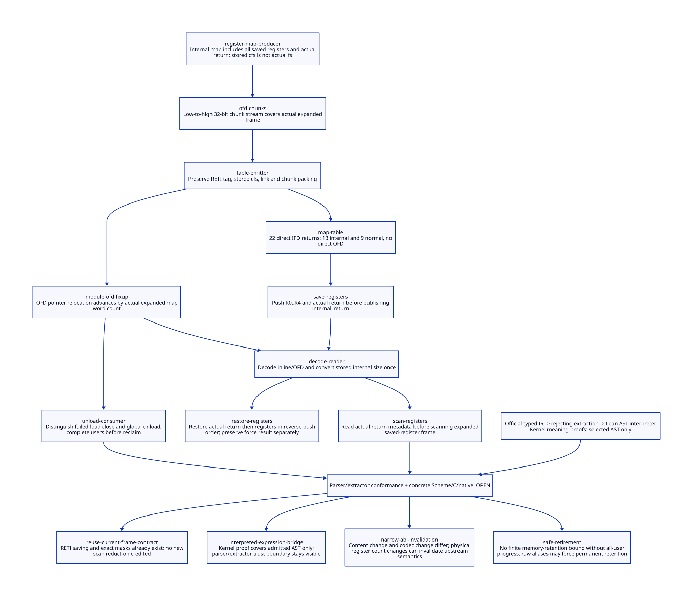

#+TITLE: map RETI Roots, Restricted Expression Semantics and Cohort Retirement
#+SETUPFILE: ../../modeling/org/setup.org
#+LANGUAGE: en
#+OPTIONS: toc:3 num:nil
#+PROPERTY: header-args :eval never
#+TODO: RESEARCH DECIDED | ADOPTED RETIRED

* RESEARCH Scope and evidence layers
:PROPERTIES:
:CUSTOM_ID: reti-ofd-semantics
:AUTHORITY: GambitRetiOfdSemantics; GambitRuntimeComposition
:STATUS: restricted-AST-proved; extraction-and-concrete-source-open
:MAINLINE: Scheme semantic ownership and modern C
:END:

This extends the [[file:map-frame-abi-design.org][real map FrameSpec chain]] without changing its historical
receipts. [[file:models/sysml/reti-ofd-semantics.sysml][Native SysML]] owns ten source routes, nine unique stored shapes,
eight bridge scopes, eight retirement-user classes and the benefit/gap rows.
[[file:reti-ofd-semantics-matrix.org][The matrix]] and  are derived views. [[file:../../modeling/ascent/reti-ofd-semantics.rules.scm][ASCENT]] must refuse scope promotion
from interpreted AST or retirement models into parser/source/native qualification.
No runtime implementation, native test or performance experiment is performed.

* RESEARCH Real map internal returns and saved-register roots
:PROPERTIES:
:CUSTOM_ID: reti-real-map
:END:

The current stored _std.c map table has 22 return descriptors: 13 RETI and nine
RETN, all IFD. There is NO direct OFD in that table. POLL(1), POLL(3), CHECK_HEAP(5)
and later internal points in the real body connect internal-return labels to
runtime handlers. They do not establish current producer/configuration-to-object
provenance. A transitive callback may require OFD, but that path is not closed by
this source slice and has not been generated or executed.

_t-c-2.scm:targ-gen-label-return* constructs internal vars from aligned caller
slots, saved GVM registers and an actual-return temporary. Its liveness predicate
marks all saved registers and that return temporary. Current _kernel.scm heap,
stack and force handlers obtain stored cfs, align the caller slots, PUSH_REGS,
push the actual return address, then set R0 to internal_return. For the explicit
NB_GVM_REGS=5 branch, PUSH_REGS saves R0,R1,R2,R3,R4; POP_REGS reverses that order.
The actual return label is a separate sixth marked slot, not a sixth GVM register.

With align=4, reserve=3, FRAME_SPACE(6)=12:

| Stored cfs | Aligned caller slots | Actual fs | Saved R0..R4 logical slots | Actual return slot | Heap actual-return index |
|---+---+---+---+---+---|
| 8 | 8 | 17 | 9..13 | 14 | 4 |
| 1 | 4 | 13 | 5..9 | 10 | 4 |
| 3 | 4 | 13 | 5..9 | 10 | 4 |

actual fs = roundUp(cfs,4)+12-3. RETI_RA=-6; FRAME_RETI_RA=1-3-(-6)=4.
The fs=8 masks 0x3f07/0x3f03/0x3f01 all mark slots 9..14, while fs=1/3 masks
0x3f1/0x3f7 mark slots 5..10. Their low caller-slot bits differ and must remain
precise. Link may lie in the saved-register area (link=8 or 4); it cannot be
validated against stored cfs alone. The generated matrix preserves all nine
unique normal/internal shapes and their counts; no union mask replaces them.

GC mark_continuation and captured ___sFRAME scanning discriminate internal_return,
read actual_ra, decode the expanded descriptor and scan the selected slots.
The break handler copies the expanded frame. Internal return first saves the force
result in temp2, adjusts to the actual return, pops it and all registers, decodes
stored cfs, removes alignment padding and jumps to that actual label. The chain
through temp2 and force-out-of-line remains an explicit root/value-lifetime proof
obligation; saved-bit arithmetic alone does not close it. Current/saved registers,
denvironments, reflection and native roots must all retain their actual values.

* RESEARCH OFD packing: shared source path, conditional example
:PROPERTIES:
:CUSTOM_ID: reti-ofd-packing
:END:

_t-c-3.scm emits low-to-high 32-bit chunks using remainder/quotient. _t-c-1.scm
emits DEF_OFD(kind,stored_fs,link) followed by those chunks. Header GCMAP2 retains
two words on a 32-bit target and combines low/high into one 64-bit word otherwise.
setup_module_fixup replaces each placeholder label descriptor with its actual OFD
table pointer and advances by 1+ceil(actual_fs/WORD_WIDTH). For RETI, stored size
is expanded before that word count. The central decoder obtains actual size and
first/next bitmap words; mark_frame advances words at WORD_WIDTH boundaries.

A deliberately synthetic stored-cfs=25 example has actual-fs=37. Mask 0x3f0000001
splits to low=0xf0000001, high=3. Lean proves reconstruction n mod 2^32 +
2^32*(n/2^32)=n. This is NOT a discovered map OFD, a platform endian/alignment test,
or proof of signed C right-shift behavior. Actual word width, tag widths, pointer
relocation, native target configuration and all transitive callback OFDs remain open.

* PROOF From actual typed IR to an interpreted AST
:PROPERTIES:
:CUSTOM_ID: reti-expression-bridge
:END:

The source subject is the frozen [[file:models/quint/map_frame_abi.qnt][map_frame_abi QNT]], not a newly rewritten model.
The official installed Quint typechecker produces typed IR. A rejecting Python
projection reads that IR, not a handwritten replacement action list. It admits
exactly the current twenty-field Int/Bool record, field reads, integer addition,
comparisons/equality, Boolean connectives, pure conjunctions, unique-field record
updates, one terminal state assignment per action, and twelve-way step choice.
It rejects missing/dynamic fields, wrong types, duplicate updates, extra assignments
and unsupported expressions. then/run/assert histories, lambdas, arbitrary imports,
sets, nondeterministic picks and extra state variables are outside this admission.

[[file:models/lean/RetiOfdSemantics.lean][The maintained Lean interpreter]] gives these expression constructors mathematical
Int/Bool/predicate meaning. All update RHS expressions read immutable OLD state;
only the result accumulator changes. A separate theorem demonstrates why a second
field cannot accidentally read the first newly updated field. Disabled guarded
actions have no successor. Choice denotes the set of enabled successors, not the
Quint randomized sampling probability, scheduling fairness or error behavior.

[[file:models/lean/MapExpressionAst.lean][The generated AST and certificates]] contain the actual selected initial record,
safe expression, eleven named actions and stutter, extracted from typed IR. Lean
proves each action's interpreted meaning equals prior qStep, step choice equals
existence of a mirrored Event, invariant reflection, initial-state equality,
composition to nested lStep, and safety preservation. These are symbolic proofs
for arbitrary selected QState inputs, not equivalence inferred from samples.
All twenty initialized fields and all step alternatives are checked by projection;
unknown IR is rejected. A guard-mutated AST is required to fail its Lean certificate.

The remaining trust boundary is precise: source text -> official parser/typechecker
IR -> Python AST extraction is NOT kernel-verified. Hashes, rejection controls,
installed builtins.js/builder.js source witnesses and regeneration determinism
support provenance but do not prove that translation. The installed Quint sources
show pure field/with evaluation, next-variable assignment and all/any snapshot
rollback; the relational interpreter abstracts their selected error-free fragment.
No theorem here verifies the Quint implementation. Thus the prior semantic gap is
split into a now-proved selected AST interpretation bridge and an OPEN extraction/
tool-conformance bridge; full QNT-to-Lean qualification is still false.

* DESIGN Old code and descriptor retirement are joint obligations
:PROPERTIES:
:CUSTOM_ID: reti-retirement
:END:

The eight native user rows distinguish saved continuations, running activations,
GC maintenance, FFI entry, inspection, loader fixup, OS unload and build artifacts.
A captured return label pins executable code AND its inline/OFD interpretation;
active scans and diagnostic borrows may outlive the last captured-frame reference.
An artifact-cache eviction does not revoke an installed cohort. Removing descriptor
storage while code remains callable is just as invalid as unloading code with
saved return addresses. Raw imported native pointers may make revocation impossible.

External entry closure is not maintenance closure. While old rooted captured/native
users survive, the collector must still be able to obtain old-cohort scan grants.
Denying every scan after close can deadlock the GC that is needed to retire those
roots. Close new external calls first; drain or transfer rooted computation; then
close the remaining maintenance producers, wait for exact scan/reader final use,
and only then reclaim code/descriptor storage. Parent/child scan work and late
inspection/native users require complete accounting and C11 publication/last-use
proof. A check-open followed by a separate count increment is not sufficient.

[[file:models/quint/reti_ofd_retirement.qnt][The new finite retirement model]] separates code/capture, descriptor, scanner,
native and inspection debts plus unknown outcome. Maintenance scan admission is
allowed after external close while another old user keeps the cohort alive;
retirement requires closed admission, every debt zero and no unknown. It does not
simulate the actual reachability collector or discover complete grace. Exact exit
and all-user inventory remain source premises. Unknown cannot be cleared by a
timeout or caller return. No liveness or finite retained-space bound is claimed.

os_dyn.c distinguishes failed unpublished dlopen/dlsym cleanup from the global
cleanup_dynamic_load list. Global cleanup may call dlclose unless DONT_UNLOAD_DYN_CODE
is selected; the gcov-related policy comment is real platform-lifetime evidence.
os_setup cleanup calls this global consumer. These sites are not an existing
per-module semantic-grace service, and their presence does not by itself prove a
reachable use-after-free. Effective flags and whole shutdown ordering remain open.

* RESEARCH Benefit and retirement matrix
:PROPERTIES:
:CUSTOM_ID: reti-benefits
:END:

| Mechanism | Potential removed work | Necessary cost / countercondition |
|---+---+---|
| Reuse existing RETI register and decoder design | Retire duplicate frame interpretation after actual consumers migrate | Existing saving/masks already work; no new scan saving is credited |
| Interpreted selected AST | Replace manual guard/update equivalence assumptions with kernel-checked meaning | Restricted extractor and interpreter maintenance; parser/extractor remains trusted |
| Narrow invalidation | Reuse valid semantic/native products when consumed projections do not change | Schema/register/word changes may invalidate earlier semantics and every reader |
| Stable old cohort | Build candidates without destroying saved continuation interpretation | Code/OFD/codec/reader pins and potentially unbounded unknown retention |
| Two closure phases | Avoid blocking necessary GC maintenance behind external entry closure | Producer census, scan/reader drain, parent-child custody and C11 protocol |

No runtime responsibility retires by this study. Positive net return still requires
actual removed duplicate work to exceed validation, barriers, copies, coordination
and retained-space costs. QNT finite histories, mathematical RETI/OFD facts and
selected AST proofs are separate from concrete GC/root values, native correctness
and measured end-to-end build or execution improvement.
