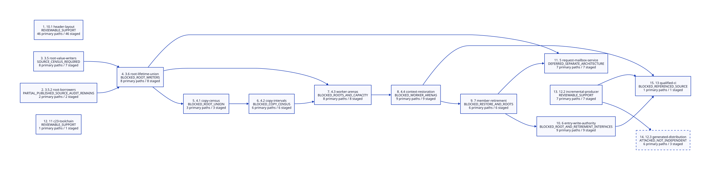

#+TITLE: Modern C remaining REV delivery queue
#+SETUPFILE: ../../modeling/org/setup.org
#+LANGUAGE: en
#+TODO: SOURCE_AUDIT BLOCKED REVIEWABLE | PUBLISHED
#+PROPERTY: header-args :eval never :exports code
#+COLUMNS: %42ITEM(Delivery) %AUDIT_NUMBER(Audit) %STATUS(State) %PRIMARY_PATHS(Paths)

* Current source-bound delivery plan :refactoring:audit:
:PROPERTIES:
:CUSTOM_ID: MODERN-C-REV-QUEUE
:AUTHORITY: GambitPendingCuts
:SOURCE: models/sysml/pending-cuts.sysml
:BASE: 043a9341168645caa1fc8f13cb586ef63a352dcc
:END:

HEAD043a9341 publishes only the four-file3.5.2.4 callback cut. Rebase selected index paths against that HEAD, preserving all unrelated index entries and working bytes. Three previously clean candidate paths retire;123 staged/11 unstaged/0 untracked/127 unique paths remain,125 net plus2 index-only. The unrelated Make target-removal prototype remains visible/unqualified. Staging evidence and reconstructible prior source/index versions retain custody; no bulk index approval.

The15 units below turn review ownership into a dependency-ordered delivery plan. They are responsibility targets, not a promise of15 commits or evidence that a unit is already implemented. Split further only at an independently complete contract, with the same tests/cost/audit obligations. Each path has one primary review unit; transitively necessary hunks/tests may accompany another unit with explicit attribution. Counts never authorize whole-file staging. Test-target and build glue travels with the first actual consumer; it is not delayed merely because its primary file owner is later.

** Why123 staged paths remain

Earlier REVs froze qualified SDK trees into alternate submission indexes and preserved the real prototype index. Thus staged is not the approved-next-REV set. Current counts are123 staged,11 unstaged and0 untracked,127 unique paths;125 net HEAD paths plus2 index/working-only paths. Exact staged status counts are in the path receipt. No files were reset, deleted, unstaged or committed in this planning review.

The invalid staged RC fixture deletion is cancelled; its conflicting historical working version stays unstaged. Three old =native_scope= deletions remain prototypes. The tests/makefile.in prototype removes qualified root targets and is explicitly deferred; it cannot enter a future REV unnoticed. Namespace retirement must include real callers/builds; a staged deletion does not prove it. =gsc/_t-cpu-abstract-machine.scm= and =tests/frame-spec.scm= have index-only versions with working content equal to HEAD, and require an explicit disposition.

[[file:../../../evidence/research/retained/modern-c/revision-queue/paths.json][The exact path/index/working census]] binds all127 paths and all123 staged dispositions. Old generated C is attached to a complete producer, never a separate handwritten repair.

** Published batches and next review order

Published3.5.2.4 REV043a9341 after all five gates21 controls, existing Tcl PBT294+300, calibrated13-to1 replay, complete producer/binding and full same-context baseline/candidate408-unit pair. Explicit13-field baseline classification and38 rejection controls retain earlier GSI failures and whole-family veto. Subsequent native borrower/value-writer/lifetime union precedes capacity/arenas/restoration; C10.1/D12.2 support follows its own source gates.15 remaining review units,127 unique paths are not fifteen admitted commits.

A published generated cohort supersedes only producer-derived outputs. Preserve prior HEAD/index/working blob identities as evidence; never merge handwritten edits into generated C. Remaining Scheme generators retain their unqualified source responsibility and must regenerate their own cohort after closure. A selected handwritten path retires only when every residual hunk/version has an explicit disposition.

** Next3.5.2 source evidence

tcl-callback/publication.json043a9341 closes3.5.2.4 normal-return same-owner callback identity/ownership; baseline-boundary.json proves the exact local-versus-family disposition without hiding failures. Continue one real remaining native-entry/value writer before3.6 union; nonlocal Tcl exits, cross-owner lifetime and dynamic closure ABI remain separate. Preserve all original manifests, source/profile identity and rejection controls; no repair-line credit.

[[file:../../../evidence/research/retained/modern-c/revision-queue/borrower-source.json][Historical exact8ee204fc source selectors]] remain historical; marker input3.5.2.2 is now published separately, while callback/native entry and dynamic-closure lifetimes remain open. This queue projection itself runs no runtime test.

** Dependency-ordered delivery units

#+NAME: modern-c-revision-delivery
#+BEGIN: sysml-view :source models/sysml/pending-cuts.sysml :query GambitPendingCuts::Delivery
| Order / audit | Unit | Primary paths / staged | State | Scope | Required validation |
|---------------+------+------------------------+-------+-------+---------------------|
| 1 / 10.1 | header-layout | 46 / 46 | REVIEWABLE_SUPPORT | Lossless gambit.h composition and its actual include/build consumers; exclude semantic context/worker/FFI field additions from the mechanical extraction | Recomposition equality, all290 assertions, official bootstrap/consumers, old-module refusal; MSVC constant-expression qualification on actual CI |
| 2 / 3.5.2 | root-borrowers | 2 / 2 | PARTIAL_PUBLISHED_SOURCE_AUDIT_REMAINS | Remaining actual RC/native-entry borrowers and exceptional release after published Tcl construction, explicit marker input and permanent identity callback snapshot3.5.2.3. Callback3.5.2.4 is published043a9341 under explicit scoped baseline classification; nonlocal/cross-owner duties remain. Audit false C-closure identity/ABI, callback read/delete/drain and conversion-bank/nonlocal paths; avoid redundant roots for permanent/already-rooted values | Existing RC/root-task PBT extended only for the selected real caller; moving GC, nested entry/error/last release; same source producer and official consumers |
| 3 / 3.5 | root-value-writers | 8 / 7 | SOURCE_CENSUS_REQUIRED | Remaining globals/primitive/denv/frame/FFI value stores; select one source-freeze/write-admission family per complete cut | Actual producer and writer census, source freeze race, GC relocation, continuation aliases/reflection and real replay/shrink for each chosen family |
| 4 / 3.6 | root-lifetime-union | 8 / 8 | BLOCKED_ROOT_WRITERS | Compose all six root kinds, writer/borrow closure, frozen view lifetime, task publication/claim/scan/exit | Complete real caller union, processor0/nonzero, source detach/failure, map multi-shot/GC and implementation replay/shrink; unchanged existing QNT/Lean duties |
| 5 / 4.1 | copy-census | 3 / 3 | BLOCKED_ROOT_UNION | Complete source object/frame physical bounds before copying, allocation checks and restoration obligations | Actual rest/structure/frame constructors, sparse layout/endpoints, overflow/refusal, exact byte census and fixed-heap official cases |
| 6 / 4.2 | copy-intervals | 6 / 6 | BLOCKED_COPY_CENSUS | Source-section unique copy right, contiguous interval packing, CAS-loss refund and first restoration reservation | Copy before publication, real CAS-loss/refund, partial/unknown result, no aliasing interval and whole-round peak accounting |
| 7 / 4.3 | worker-arenas | 8 / 8 | BLOCKED_ROOTS_AND_CAPACITY | Worker-owned copy/scan arenas and task acquisition; W independent of R without changing counters alone | W<R/W=R, unique scan, private frontier/Tail/batch histories, worker exit and real implementation replay/shrink |
| 8 / 4.4 | context-restoration | 9 / 9 | BLOCKED_WORKER_ARENAS | R context restore/root domains serviced by W workers, thread-affine cleanup and whole-round resume seal | W<R roots, map multi-shot/dynamic-wind, recovery interval identity, delayed cleanup and finite admitted restore tasks |
| 9 / 7 | member-retirement | 6 / 6 | BLOCKED_RESTORE_AND_ROOTS | Setup/member publication, partial creation, exit and per-resource retirement with unknown join isolation | Actual partial-create/join-failed/unknown histories, source ACK, roots transferred, healthy VM continues GC |
| 10 / 6 | entry-write-authority | 9 / 9 | BLOCKED_ROOT_AND_RETIREMENT_INTERFACES | Generated SFUN/CFUN/catcher and marker entry/exit share write/borrow authority and acquired-effect cleanup; remove superseded native_scope names directly | Real generator/catcher callers, nested callback/nonlocal exit, marker allocation failure and exact writer/loan drain |
| 11 / 5 | request-mailbox-service | 7 / 7 | DEFERRED_SEPARATE_ARCHITECTURE | Separate wait state from service activation, FIFO/lock handoff and shared mailbox root publication | Original ordered shared values, thread interrupt failure retained, real stateful replay/shrink and Repair9 at its unchanged population |
| 12 / 11 | c23-toolchain | 1 / 1 | REVIEWABLE_SUPPORT | Existing configure/Bazel C23 parameter and platform contract; only configuration hunks necessary for the selected source | Existing profile/configure equivalence, GCC/Clang/MSVC supported cells and complete official producer |
| 13 / 12.2 | incremental-producer | 7 / 7 | REVIEWABLE_SUPPORT | Existing Make producer dependency/currentness and same-workspace exact artifact reuse; necessary source/test build glue accompanies each actual consumer | Two same-cache builds, C-only edit, Scheme/macro invalidation, exact source/tool/cwd/product receipts and unchanged watchdog |
| 14 / 12.3 | generated-distribution | 6 / 3 | ATTACHED_NOT_INDEPENDENT | All checked-in generated C follows one qualified Scheme producer/features/tool cohort | Reproduce complete cohort, stage counts, exact output hashes, distribution bootstrap and actual consumers |
| 15 / 13 | qualified-ci | 1 / 1 | BLOCKED_REFERENCED_SOURCE | Vendor GitHub workflow only references already qualified official or necessary architecture test entrypoints | Actual remote jobs on exact revision; complete local manifests; preserve official names and limits |
#+END:

Support review order is not a requirement to implement headers before3.5.2. The dependency arrows below determine prerequisites. The immediate runtime source audit remains3.5.2; independent support can qualify separately only with its own complete gates. Fifteen targets are not fifteen promised commits: broad remaining writer families require independent complete cuts, and generated products attach to their actual producer.

** Responsibility retirement and benefit/cost matrix

| Unit | Old responsibility retired | Expected structural benefit | New cost / gate |
|------+----------------------------+-----------------------------+-----------------|
| header-layout | Monolithic ownership only, with byte/token/ABI identity; never bundle pending semantic layouts to claim losslessness | One owner per header concern and smaller audit surface | Include/dependency maintenance; zero unproved runtime performance gain; Exact pre/post representation and official names; local versus MSVC remote status separate |
| root-borrowers | Unowned payload/address use across actual allocation/reentry; do not introduce a root handle for a read already after the last GC-capable call | Explicit source-to-marker/callback root custody and reload | Measure any extra root record/borrow/lock; no speculative benefit for redundant pinning; Identify actual GC/reentry interval and native lifetime owner; address borrowing and logical referent ownership differ. Construction3.5.2.1 is published920cf0c7 and marker input3.5.2.2 is publishede6a80bcb; permanent native callback3.5.2.3 is published4b9d8656; cross-owner/foreign lifetime, deletion/nonlocal exit and callback gaps still block complete3.5.2 |
| root-value-writers | Raw stores outside the owning source protocol and implicit allocation/safepoint effects | Complete writer authority becomes a concrete root-scan premise | Store/barrier/permit cost and additional retained roots must be recorded; No omitted raw generator/FFI store; reject affected unknown writer rather than assuming coverage |
| root-lifetime-union | Carrier-index lookup and unclaimed/implicitly lived root sources | Root lifetime independent of executing carrier | Explicit root/task lease metadata and synchronization; Every live source/writer/loan has one custodian; unknown exits retain custody |
| copy-census | Late capacity guesses based only on participant count | Capacity refusal precedes irreversible copy publication | Census work/metadata and conservative peak bound; Real writers/layouts bounded; no extra heap or timeout to manufacture a pass |
| copy-intervals | Overlapping/insufficient reservations and refund without physical custody | One physical capacity decision shared by copying and restore | Reservation records, fragmentation and retained unknown intervals; Every charged byte maps to a real interval and exactly one owner |
| worker-arenas | PSTATE/carrier identity as collector storage or root-task ownership | Collector concurrency chosen independently from execution contexts | Arena/queue coordination, bounded private state and task claims; No unfinished private copy/Tail loses custody on transfer or unknown exit |
| context-restoration | One worker implicitly restores only its matching processor | All contexts resume once without requiring matching collector carriers | Restore tasks/seal, affinity delivery and conservative unknown-state retention; GC completion includes all restoration/cleanup obligations, not merely an empty mark queue |
| member-retirement | Global reclamation permission inferred from one VM/thread outcome | Unknown owner debt scoped to affected resources | Quarantine retention/receipts and explicit close protocol; No timeout proves thread death; global resources reclaim only with complete resource-specific evidence |
| entry-write-authority | Implicit PSTATE lifetime and parallel legacy/new scope namespaces | One owner for entry effects and exceptional cleanup | Activation/permit records and affinity/exit bookkeeping; No extra compatibility alias; all acquired effects have exception/unknown-result custodian |
| request-mailbox-service | Repeated scheduler continuation materialization for immediate outcomes and implicit request ownership | Avoid unnecessary capture/GC work where control semantics permit | Queue/activation bookkeeping, actual latency/backlog/peak must be measured; Not a root REV or relocated repair patch; preserve arbitrary user multi-shot continuation |
| c23-toolchain | Unqualified implicit tool/feature assumptions | One effective toolchain identity | Platform matrix maintenance; no new profile/executor; Retain official names/commands and fixed limits; unsupported cells remain explicit |
| incremental-producer | Regenerating unaffected Scheme products for C-only edits and losing an admitted producer on failure | Avoid actual unnecessary generation/configuration/compile work | Dependency/currentness metadata checks; no second scheduler; Measure each skipped phase; no invented cache-hit percentage or frontend optimization detour |
| generated-distribution | Partial stale generated products and handwritten generated C fixes | Reproducible source distribution and bootstrap seed | Producer work/output storage; generated diffs are audited as products; Attached to its producing source cut; never a standalone handwritten code REV |
| qualified-ci | Workflow names/targets/manifests drifting from actually published source | Repeatable cross-platform audit of published responsibilities | CI compile/execution budget; queued/local pass is not remote green; No speculative tests, wholesale workflow redesign or scheduler workaround |

** Current admission and audit controls

Native SysML validates17 model inputs; actual ASCENT checks all127 primary owners,15 units and15 dependency edges. 13 negative controls reject missing/duplicate/unknown ownership, missing tests/admission, dependency errors, staged or partial/stale-source promotion, unclosed worker prerequisites, absent staged disposition and standalone generated-C submission. Current submit-ready units:0. This is a checked plan, not a completed runtime test or five-gate admission.

Existing QNT owns competing runtime histories; Lean owns distinct conditional laws. Neither file changed or reran. This static delivery graph does not introduce another runtime state machine. LLM source review does not supply missing native evidence.

** Per-REV exit and residual-hunk protocol

After every actual REV compare the new HEAD against index and working bytes again. Retire a path from the queue only when no unqualified hunk/version remains. A five-file REV need not eliminate five dirty files. Bind the actual changed paths, source/profile, tests, gates, benefits/costs and residual hunks; update this model's projections and both ledgers. Never declare a batch complete from a planned count, staged flag, native timeout or repair-line evidence.

1. Freeze the selected responsibility against current HEAD, profile and actual caller closure. Record HEAD/index/working/selected blob identities.
2. Select only those hunks and necessary test/build consumers in the existing submission framework. Preserve other staged and working versions; no wholesale real-index commit.
3. Reuse the same Modern C cache and existing Bazel/configure/Make producer. Run applicable official tests and real implementation replay/shrink with unchanged limits.
4. Close tests, learning/benefits/costs, process, models and questions. Put all nine audit fields in the commit body; otherwise retain the failed evidence and do not publish.
5. Publish immediately after closure. Reconcile a selected index/working entry only when it equals the old base or the new admitted bytes, or after a proven lossless merge. A conflict remains visible and queued.
6. Recompute both source and staging differences. Remove only residual-free paths from the primary queue; update13-item architecture and independent SMP12 evidence, never a test-count percentage.

** Exact path-to-primary-delivery map

| Path | Unit | Index | Working differs | Disposition |
|------+------+-------+-----------------+-------------|
| .github/workflows/smp.yml | qualified-ci | A | False | REBASE_SELECTED_HUNKS_AGAINST_HEAD |
| bin/makefile.in | incremental-producer | M | False | REBASE_SELECTED_HUNKS_AGAINST_HEAD |
| configure.ac | c23-toolchain | M | False | REBASE_SELECTED_HUNKS_AGAINST_HEAD |
| gsc/_t-cpu-abstract-machine.c | generated-distribution | M | False | ATTACH_EXACT_PRODUCER_NO_HANDWRITTEN_REV |
| gsc/_t-cpu-abstract-machine.scm | incremental-producer | M | True | INDEX_ONLY_VERSION_REVIEW_NOT_AUTOMATIC_REVERT |
| gsc/igsc.scm | incremental-producer | M | False | REBASE_SELECTED_HUNKS_AGAINST_HEAD |
| gsc/makefile.in | incremental-producer | M | False | REBASE_SELECTED_HUNKS_AGAINST_HEAD |
| gsi/makefile.in | incremental-producer | M | False | REBASE_SELECTED_HUNKS_AGAINST_HEAD |
| include/_gambit/activity_log.h.in | header-layout | A | False | REBASE_SELECTED_HUNKS_AGAINST_HEAD |
| include/_gambit/code_generation.h.in | header-layout | A | False | REBASE_SELECTED_HUNKS_AGAINST_HEAD |
| include/_gambit/compiler.h.in | header-layout | A | False | REBASE_SELECTED_HUNKS_AGAINST_HEAD |
| include/_gambit/configuration.h.in | header-layout | A | False | REBASE_SELECTED_HUNKS_AGAINST_HEAD |
| include/_gambit/declarations_begin.h.in | header-layout | A | False | REBASE_SELECTED_HUNKS_AGAINST_HEAD |
| include/_gambit/declarations_end.h.in | header-layout | A | False | REBASE_SELECTED_HUNKS_AGAINST_HEAD |
| include/_gambit/foreign_abi.h.in | header-layout | A | False | REBASE_SELECTED_HUNKS_AGAINST_HEAD |
| include/_gambit/foreign_conversion.h.in | header-layout | A | False | REBASE_SELECTED_HUNKS_AGAINST_HEAD |
| include/_gambit/global_state.h.in | header-layout | A | False | REBASE_SELECTED_HUNKS_AGAINST_HEAD |
| include/_gambit/gvm_operations.h.in | header-layout | A | False | REBASE_SELECTED_HUNKS_AGAINST_HEAD |
| include/_gambit/gvm_registers.h.in | header-layout | A | False | REBASE_SELECTED_HUNKS_AGAINST_HEAD |
| include/_gambit/header_begin.h.in | header-layout | A | False | REBASE_SELECTED_HUNKS_AGAINST_HEAD |
| include/_gambit/header_end.h.in | header-layout | A | False | REBASE_SELECTED_HUNKS_AGAINST_HEAD |
| include/_gambit/integer_representation.h.in | header-layout | A | False | REBASE_SELECTED_HUNKS_AGAINST_HEAD |
| include/_gambit/label_types.h.in | header-layout | A | False | REBASE_SELECTED_HUNKS_AGAINST_HEAD |
| include/_gambit/labels.h.in | header-layout | A | False | REBASE_SELECTED_HUNKS_AGAINST_HEAD |
| include/_gambit/language.h.in | header-layout | A | False | REBASE_SELECTED_HUNKS_AGAINST_HEAD |
| include/_gambit/math.h.in | header-layout | A | False | REBASE_SELECTED_HUNKS_AGAINST_HEAD |
| include/_gambit/memory_state.h.in | header-layout | A | False | REBASE_SELECTED_HUNKS_AGAINST_HEAD |
| include/_gambit/module_generation.h.in | header-layout | A | False | REBASE_SELECTED_HUNKS_AGAINST_HEAD |
| include/_gambit/module_state.h.in | header-layout | A | False | REBASE_SELECTED_HUNKS_AGAINST_HEAD |
| include/_gambit/native_platform.h.in | header-layout | A | False | REBASE_SELECTED_HUNKS_AGAINST_HEAD |
| include/_gambit/native_types.h.in | header-layout | A | False | REBASE_SELECTED_HUNKS_AGAINST_HEAD |
| include/_gambit/object_access.h.in | header-layout | A | False | REBASE_SELECTED_HUNKS_AGAINST_HEAD |
| include/_gambit/object_tags.h.in | header-layout | A | False | REBASE_SELECTED_HUNKS_AGAINST_HEAD |
| include/_gambit/platform.h.in | header-layout | A | False | REBASE_SELECTED_HUNKS_AGAINST_HEAD |
| include/_gambit/processor_os.h.in | header-layout | A | False | REBASE_SELECTED_HUNKS_AGAINST_HEAD |
| include/_gambit/processor_state.h.in | header-layout | A | True | REBASE_SELECTED_HUNKS_AGAINST_HEAD |
| include/_gambit/runtime_forwards.h.in | header-layout | A | False | REBASE_SELECTED_HUNKS_AGAINST_HEAD |
| include/_gambit/runtime_protocols.h.in | header-layout | A | False | REBASE_SELECTED_HUNKS_AGAINST_HEAD |
| include/_gambit/runtime_roles.h.in | header-layout | A | False | REBASE_SELECTED_HUNKS_AGAINST_HEAD |
| include/_gambit/setup_parameters.h.in | header-layout | A | False | REBASE_SELECTED_HUNKS_AGAINST_HEAD |
| include/_gambit/signals.h.in | header-layout | A | False | REBASE_SELECTED_HUNKS_AGAINST_HEAD |
| include/_gambit/stack_operations.h.in | header-layout | A | False | REBASE_SELECTED_HUNKS_AGAINST_HEAD |
| include/_gambit/synchronization.h.in | header-layout | A | False | REBASE_SELECTED_HUNKS_AGAINST_HEAD |
| include/_gambit/temporary_roots.h.in | header-layout | A | False | REBASE_SELECTED_HUNKS_AGAINST_HEAD |
| include/_gambit/utilities.h.in | header-layout | A | False | REBASE_SELECTED_HUNKS_AGAINST_HEAD |
| include/_gambit/value_types.h.in | header-layout | A | False | REBASE_SELECTED_HUNKS_AGAINST_HEAD |
| include/_gambit/visibility.h.in | header-layout | A | False | REBASE_SELECTED_HUNKS_AGAINST_HEAD |
| include/_gambit/vm_state.h.in | header-layout | A | False | REBASE_SELECTED_HUNKS_AGAINST_HEAD |
| include/_gambit/write_authority.h.in | header-layout | A | False | REBASE_SELECTED_HUNKS_AGAINST_HEAD |
| include/config.h.in | header-layout | M | False | REBASE_SELECTED_HUNKS_AGAINST_HEAD |
| include/gambit.h.in | header-layout | M | False | REBASE_SELECTED_HUNKS_AGAINST_HEAD |
| include/makefile.in | header-layout | M | False | REBASE_SELECTED_HUNKS_AGAINST_HEAD |
| lib/_fifo#.scm | request-mailbox-service | M | False | REBASE_SELECTED_HUNKS_AGAINST_HEAD |
| lib/_io.c | generated-distribution | M | False | ATTACH_EXACT_PRODUCER_NO_HANDWRITTEN_REV |
| lib/_io.scm | request-mailbox-service | M | False | REBASE_SELECTED_HUNKS_AGAINST_HEAD |
| lib/_kernel.scm | root-value-writers | M | False | REBASE_SELECTED_HUNKS_AGAINST_HEAD |
| lib/_mem/aligned-allocation.inc | copy-intervals | M | False | REBASE_SELECTED_HUNKS_AGAINST_HEAD |
| lib/_mem/allocation-limits.inc | copy-census | M | False | REBASE_SELECTED_HUNKS_AGAINST_HEAD |
| lib/_mem/allocation-statistics.inc | copy-census | M | False | REBASE_SELECTED_HUNKS_AGAINST_HEAD |
| lib/_mem/capacity-resize.inc | copy-intervals | M | False | REBASE_SELECTED_HUNKS_AGAINST_HEAD |
| lib/_mem/collection-round.inc | context-restoration | M | False | REBASE_SELECTED_HUNKS_AGAINST_HEAD |
| lib/_mem/configuration.inc | worker-arenas | M | False | REBASE_SELECTED_HUNKS_AGAINST_HEAD |
| lib/_mem/continuation-roots.inc | root-lifetime-union | M | False | REBASE_SELECTED_HUNKS_AGAINST_HEAD |
| lib/_mem/copy-reservations.inc | copy-intervals | M | False | REBASE_SELECTED_HUNKS_AGAINST_HEAD |
| lib/_mem/diagnostics.inc | context-restoration | M | False | REBASE_SELECTED_HUNKS_AGAINST_HEAD |
| lib/_mem/global-bindings.inc | root-value-writers | M | False | REBASE_SELECTED_HUNKS_AGAINST_HEAD |
| lib/_mem/hash-table-api.inc | root-value-writers | M | False | REBASE_SELECTED_HUNKS_AGAINST_HEAD |
| lib/_mem/heap-sections.inc | copy-intervals | M | False | REBASE_SELECTED_HUNKS_AGAINST_HEAD |
| lib/_mem/memory-lifecycle.inc | worker-arenas | M | False | REBASE_SELECTED_HUNKS_AGAINST_HEAD |
| lib/_mem/movable-sections.inc | copy-intervals | M | False | REBASE_SELECTED_HUNKS_AGAINST_HEAD |
| lib/_mem/object-allocation.inc | copy-census | M | False | REBASE_SELECTED_HUNKS_AGAINST_HEAD |
| lib/_mem/object-scanning.inc | context-restoration | M | False | REBASE_SELECTED_HUNKS_AGAINST_HEAD |
| lib/_mem/permanent-allocation.inc | copy-intervals | M | False | REBASE_SELECTED_HUNKS_AGAINST_HEAD |
| lib/_mem/rc-allocation.inc | root-value-writers | M | False | REBASE_SELECTED_HUNKS_AGAINST_HEAD |
| lib/_mem/rc-roots.inc | root-lifetime-union | M | False | REBASE_SELECTED_HUNKS_AGAINST_HEAD |
| lib/_mem/root-origins.inc | root-lifetime-union | M | False | REBASE_SELECTED_HUNKS_AGAINST_HEAD |
| lib/_mem/root-tasks.inc | root-lifetime-union | M | True | REBASE_SELECTED_HUNKS_AGAINST_HEAD |
| lib/_mem/still-refcount.inc | context-restoration | M | False | REBASE_SELECTED_HUNKS_AGAINST_HEAD |
| lib/_mem/still-sweep.inc | context-restoration | M | False | REBASE_SELECTED_HUNKS_AGAINST_HEAD |
| lib/_mem/symbols.inc | root-value-writers | M | False | REBASE_SELECTED_HUNKS_AGAINST_HEAD |
| lib/_mem/weak-tables.inc | context-restoration | M | False | REBASE_SELECTED_HUNKS_AGAINST_HEAD |
| lib/_mem/wills.inc | context-restoration | M | False | REBASE_SELECTED_HUNKS_AGAINST_HEAD |
| lib/_module.c | generated-distribution | - | True | ATTACH_EXACT_PRODUCER_NO_HANDWRITTEN_REV |
| lib/_nonstd.c | generated-distribution | - | True | ATTACH_EXACT_PRODUCER_NO_HANDWRITTEN_REV |
| lib/_num.c | generated-distribution | M | True | ATTACH_EXACT_PRODUCER_NO_HANDWRITTEN_REV |
| lib/_num.scm | root-value-writers | M | False | REBASE_SELECTED_HUNKS_AGAINST_HEAD |
| lib/_setup/vm-lifecycle.inc | member-retirement | A | False | REBASE_SELECTED_HUNKS_AGAINST_HEAD |
| lib/_setup/vm-registry.inc | member-retirement | A | False | REBASE_SELECTED_HUNKS_AGAINST_HEAD |
| lib/_system.c | generated-distribution | - | True | ATTACH_EXACT_PRODUCER_NO_HANDWRITTEN_REV |
| lib/_system.scm | root-value-writers | M | False | REBASE_SELECTED_HUNKS_AGAINST_HEAD |
| lib/_thread.scm | request-mailbox-service | M | False | REBASE_SELECTED_HUNKS_AGAINST_HEAD |
| lib/c_intf.c | root-borrowers | M | False | REBASE_SELECTED_HUNKS_AGAINST_HEAD |
| lib/c_intf.h | entry-write-authority | M | False | REBASE_SELECTED_HUNKS_AGAINST_HEAD |
| lib/makefile.in | incremental-producer | M | False | REBASE_SELECTED_HUNKS_AGAINST_HEAD |
| lib/mem.c | worker-arenas | M | False | REBASE_SELECTED_HUNKS_AGAINST_HEAD |
| lib/mem.h | worker-arenas | M | False | REBASE_SELECTED_HUNKS_AGAINST_HEAD |
| lib/native_scope.c | entry-write-authority | D | False | REMOVAL_REQUIRES_ALL_REAL_CALLERS_RETIRED |
| lib/native_scope.h | entry-write-authority | D | False | REMOVAL_REQUIRES_ALL_REAL_CALLERS_RETIRED |
| lib/os_dyn.c | root-borrowers | M | False | REBASE_SELECTED_HUNKS_AGAINST_HEAD |
| lib/os_setup.c | entry-write-authority | M | False | REBASE_SELECTED_HUNKS_AGAINST_HEAD |
| lib/os_thread.c | request-mailbox-service | M | False | REBASE_SELECTED_HUNKS_AGAINST_HEAD |
| lib/root.h | root-lifetime-union | M | True | REBASE_SELECTED_HUNKS_AGAINST_HEAD |
| lib/setup.c | member-retirement | M | True | REBASE_SELECTED_HUNKS_AGAINST_HEAD |
| lib/write_authority.c | entry-write-authority | A | False | REBASE_SELECTED_HUNKS_AGAINST_HEAD |
| lib/write_authority.h | entry-write-authority | A | False | REBASE_SELECTED_HUNKS_AGAINST_HEAD |
| tests/frame-continuation-roots.scm | root-lifetime-union | M | False | REBASE_SELECTED_HUNKS_AGAINST_HEAD |
| tests/frame-continuation.scm | root-lifetime-union | M | False | REBASE_SELECTED_HUNKS_AGAINST_HEAD |
| tests/frame-contract.c | header-layout | M | False | REBASE_SELECTED_HUNKS_AGAINST_HEAD |
| tests/frame-spec.scm | header-layout | M | True | INDEX_ONLY_VERSION_REVIEW_NOT_AUTOMATIC_REVERT |
| tests/gc-root-task.c | root-lifetime-union | A | False | REBASE_SELECTED_HUNKS_AGAINST_HEAD |
| tests/makefile.in | context-restoration | M | False | REBASE_SELECTED_HUNKS_AGAINST_HEAD |
| tests/native-scope.c | entry-write-authority | D | False | REMOVAL_REQUIRES_ALL_REAL_CALLERS_RETIRED |
| tests/ordered-sync.c | request-mailbox-service | A | False | REBASE_SELECTED_HUNKS_AGAINST_HEAD |
| tests/rc-root-origin.scm | root-value-writers | - | True | REBASE_SELECTED_HUNKS_AGAINST_HEAD |
| tests/run-unit-tests.scm | incremental-producer | M | False | REBASE_SELECTED_HUNKS_AGAINST_HEAD |
| tests/runtime-roles.c | worker-arenas | M | False | REBASE_SELECTED_HUNKS_AGAINST_HEAD |
| tests/sfun-exit.scm | entry-write-authority | A | False | REBASE_SELECTED_HUNKS_AGAINST_HEAD |
| tests/smp/gc/native-fault-adapter.c | worker-arenas | A | False | REBASE_SELECTED_HUNKS_AGAINST_HEAD |
| tests/smp/gc/native-fault-calibration.c | worker-arenas | A | False | REBASE_SELECTED_HUNKS_AGAINST_HEAD |
| tests/smp/gc/unknown-join-worker-domains.scm | member-retirement | A | False | REBASE_SELECTED_HUNKS_AGAINST_HEAD |
| tests/smp/gc/vm-lifecycle-host.scm | member-retirement | A | False | REBASE_SELECTED_HUNKS_AGAINST_HEAD |
| tests/smp/gc/vm-lifecycle.scm | member-retirement | A | False | REBASE_SELECTED_HUNKS_AGAINST_HEAD |
| tests/smp/gc/worker-arena.scm | worker-arenas | A | False | REBASE_SELECTED_HUNKS_AGAINST_HEAD |
| tests/smp/gc/worker-root-domains.scm | context-restoration | A | False | REBASE_SELECTED_HUNKS_AGAINST_HEAD |
| tests/smp/scheduler/mailbox-permit-roots.scm | request-mailbox-service | A | False | REBASE_SELECTED_HUNKS_AGAINST_HEAD |
| tests/smp/scheduler/mailbox-publication.scm | request-mailbox-service | A | False | REBASE_SELECTED_HUNKS_AGAINST_HEAD |
| tests/write-authority.c | entry-write-authority | A | False | REBASE_SELECTED_HUNKS_AGAINST_HEAD |

[[file:diagrams/revision-queue.d2][SysML-derived D2]]; . Current13-item programme remains at item3; ROOTS4 scoped-closed/2 open. SMP independently1 qualified/11 open; retained thread-interrupt uncertainty remains. Two published support REVs are independently source/native admitted; this planning projection creates no extra runtime REV or SMP/Repair9 credit. Push and exact-head CI are separate observations.
