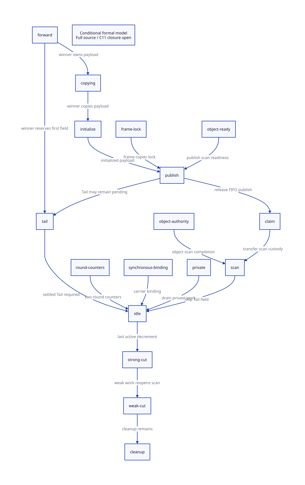

#+TITLE: Physical Root Slots and Producer Closure in the Modern C Runtime
#+SETUPFILE: ../../modeling/org/setup.org
#+LANGUAGE: en
#+PROPERTY: header-args :eval never
#+OPTIONS: toc:3

* RESEARCH Decision and evidence boundary
:PROPERTIES:
:CUSTOM_ID: root-producer-closure
:AUTHORITY: GambitRootProducerClosure
:MAINLINE: modern-c
:STATUS: source-inventory-and-conditional-models; native-refinement-open
:END:

Modern C remains the required runtime direction. Preserve Gambit's Scheme
semantics, descriptor-based frames and collective collector while separating
execution-context root storage from collector work ownership. A generic manifest
is an optional provider composition mechanism, not the starting assumption.
The current source already contains context/worker separation and resize roots;
these are concurrent working-tree changes, not implementations delivered by this study.

The scope is the current =mem.c= setup/strong/weak/cleanup collector and its
=gambit.h.in= frame consumers. The matrix enumerates all direct strong-entry
families plus externally referenced still seeds and phase-local roots found in
this bounded traversal. It is not an exhaustive certificate for arbitrary native
extensions, every supported configuration, or all runtime writers.
[[file:manifest-scan-qualification-design.org][The predecessor]] assumed canonical slots and scalar derived debt;
this study replaces those assumptions with concrete source obligations and a
more detailed finite custody model. It does not retroactively qualify that model.

* RESEARCH Root identity, aliasing and worker ownership
:PROPERTIES:
:CUSTOM_ID: physical-slot-contract
:END:

** Storage is different from the object stored in it

Use =RootSlotId(storageGeneration, providerIdentity, offset)= only when the
provider proves that it denotes one live updateable location for the entire scan.
An address alone is insufficient after retirement/reuse. Two descriptors for the
same physical cell may share one canonical visit; two cells containing the same
object must both be rewritten. Forwarding CAS deduplicates object copying, not
root-cell writes. Canonicalization must retain occurrence-to-cell coverage and
reject incompatible descriptors (layout, phase, write permission or generation).
Interior ranges must be checked for overlap, not merely compared by base address.

The finite example =[slot0, slot1, slot0]= has three descriptors and two cells.
Deduplicating descriptors saves one visit. If both cells contain the same movable
object, value deduplication leaves one old pointer: this is a rejected control.
The Lean coverage theorem proves the implication from canonical-cell updates to
all admitted occurrences. Its physical-identity interpretation remains a premise.

** Existing allocation is structured, not one global work list

Worker zero handles the VM body, resize thunk and intern tables. Global roots
already use floor partitions: =[floor(i*N/W), floor((i+1)*N/W))=; SINGLE_VM uses
sublists, so equal sublist counts do not imply equal root counts. Each participant's
frozen context supplies registers, saved registers, caches, startup/marker cells,
processor body, RC data and continuation frames. Positive-refcount still objects
seed a local scan list during setup; they cannot be represented merely by adding
another fake Scheme root slot.

Current =garbage_collect_pstate= rejects a worker whose context or native carrier
differs from the invoking PSTATE. Setup initializes both strong and weak active
counts to the closed participant count. This is synchronous collective worker
assignment, not an independent-worker scheduler. Removing that binding check
requires replacing every remaining carrier-sensitive access and proving equivalent
root and allocation ownership; a manifest alone cannot authorize it.

The frame cursor starts at slot 1, advances monotonically through =fs= and emits
nonoverlapping set-bit runs. =mark_frame= converts each run to its physical
=FP_STK= interval. This establishes a local enumeration mechanism, conditional on
valid descriptors, coordinate mapping and live code/OFD. It does not prove that
two contexts cannot expose the same stack range. The captured-frame copier has
its own memory-lock/forwarding protocol and must not be merged with the ordinary
object CAS proof.

With the template default of five GVM registers, the fixed context visits are
=5+3+2+2+22=34=. VM body plus request thunk and two intern roots gives
=20+1+2=23=. For W participants, initial visits are
=34*W + 23 + G + RC + F + W_break_links=, where G is global-cell count,
RC is total RC nodes, F is descriptor-selected stack slots and the last term is
one break-continuation link per context. These are slot visits, not distinct
heap objects. Positive-refcount still seeds and derived graph work are additional.
=NB_GVM_REGS= is overrideable: this is a template census, not qualification of
the effective Darwin generated header.

Continuation =denv= and thread =denv= are graph fields reached through the
continuation and processor/current-thread objects. Adding them again to a flat
manifest is neither required nor proof that mutations are frozen. Graph traversal
also includes closure free variables, frame roots, symbol names, weak hash fields
and will fields under their subtype-specific rules.

** Qualification needed before redistributing roots

1. Freeze a complete participant roster; validate unique context membership and
   provider lifetimes. No RC mutation or foreign borrowed-cell write may race scanning.
2. Establish exact physical cell/range identity, including overlap and generation.
3. Keep existing provider partitions until workload evidence justifies redistribution.
   A context scanner's use of carrier PSTATE must be audited before assigning it
   arbitrarily to another worker.
4. Require every rewritten location to remain visible to its eventual consumer;
   release captured views only after the worker-drain barrier.

* RESEARCH Forwarding to termination: conditional custody proof
:PROPERTIES:
:CUSTOM_ID: producer-custody
:END:

** Source order and abstract steps

| Source event | Abstract step | Responsibility after the event |
|---+---+---|
| Winner publishes source-header forwarding CAS | forward | Active winner owns payload initialization and first-field Tail |
| Payload loop completes | initializeCopy | Winner owns private chunk and pending Tail |
| FIFO link/content/tail publication under lock | publish | Queue owns remaining fields; winner still owns Tail |
| Head advances under FIFO lock | claim | Active scanner owns dequeued chunk before unlock |
| Generic movable scan (including PAIR) skips first payload field | scanChunk | Scanner settles remaining fields and recursive work |
| Winner takes goto again | finishTail | First-field obligation settles only after its recursive derivations |
| Local still/incomplete chunk and stolen work settle | idleProducer / idleConsumer | Only then may the relevant carrier decrement active count |
| Last active decrement under termination mutex | terminate | Strong-round closure only under the complete producer premises |

Forwarding visibility is not payload publication. Release semantics on the source
header cannot publish payload stores performed later. Queue publication must carry
the initialized contents to a scanner. A loser observes the forwarding address and
rewrites its own cell; this does not authorize speculative target scanning.
The current generic movable scan deliberately skips the first field. During this
study the working source retired the direct PAIR fast macro in favor of that
shared scanner, adding per-object scan authorization. The source-drift receipt
retains the earlier identity; the final anchors refer to the refreshed source. Publication before Tail
completion is therefore legal if the active winner retains that obligation. An
empty FIFO can coexist with an unfinished copy, private chunk, Tail or dequeued
scanner. Each is a distinct counterexample to premature termination.

The refreshed source has a separate object scan-state protocol:
=UNPUBLISHED -> READY -> OWNED -> DONE=. =publish_object_scan= follows the payload
copy; scan entry claims READY and scan completion changes OWNED to DONE. This
adds section lookup and CAS-loop work for each transition and makes object scan
authority distinct from chunk queue ownership. These are concurrent runtime edits,
not this study's changes. The present finite model assumes one chunk consumer; it
does not yet refine duplicate object tasks or the scan-state bitmap and cannot
qualify the new source protocol. The cost matrix records both the intended avoided
field mutations and the additional atomic/state work without inventing a speedup.

The finite model tracks one successful copy and one completed chunk, with an
active producer and active consumer. It separates forwarding, initialization,
private storage, publication, dequeue, scan and Tail completion. It intentionally
does not model arbitrary descendant counts, still-list chains or frame-copy locks.
Its guards are design requirements; they are not a claim that every source path
has already been translated. The three Lean transition lemmas are manual mirrors
of selected QNT transitions. Actual typed IR is retained for the future extraction
proof; the bridge remains unresolved rather than passing by matching names.

** When an independent publisher count is unnecessary

Every publication must be synchronous work of an already counted carrier. That
carrier must remain active through its last payload store, Tail execution, queue
publication and private-work drain; dequeued work remains covered by its scanner.
No native callback, asynchronous worker migration, late root provider or external
producer may bypass this roster. Under these premises publication does not need
a second reserve/commit counter. Introducing detached producers invalidates that
fusion and requires separately admitted/retained responsibility.

The source steal loop precedes the idle decrement. A full proof must show a final
active carrier cannot retire while a previously missed victim queue still holds
work, including weak-memory visibility and wake/recheck schedules. Condition-variable
signals are not persistent work credits. No liveness or lost-wakeup conclusion is
claimed from the finite model, which abstracts the wait mechanism entirely.

** C11 refinement obligation, not a silent source rewrite

The design requires ordinary payload writes to happen-before scan reads via
release/acquire FIFO publication (or correctly specified lock synchronization).
Head removal and custody transfer must be one protected abstract step. The active
count's last decrement and terminal decision need the same mutex/atomic protocol;
all producer last uses precede their decrement. Raw =volatile= and a generic
=SHARED_MEMORY_BARRIER= spelling do not establish ISO C11 data-race freedom.
Effective Darwin macro expansion, lock semantics and all lockless prechecks remain
separate platform obligations. No preprocessing, compiler run or native test was done.

** Strong closure does not permit whole-VM reclamation

=process_wills= produces weak-phase work followed by a second scan closure;
=move_continuation= follows it. Cleanup processes GC hash tables and frees unmarked
still objects, including foreign release callbacks. These have additional thread,
resource and derived-work obligations. The final root-view barrier is required
before context/root storage can be resumed or retired. A strong closure receipt
does not grant processor destruction, known OS-thread join or VM cleanup authority.

* RESEARCH Reuse, replacement and economic conditions
:PROPERTIES:
:CUSTOM_ID: manifest-worth
:END:

Keep the current VM request thunk, per-context startup/entry-marker roots, parked
entry gate and post-sync startup reload. Unknown joins retain native records;
abort isolation is not physical thread death. Generalizing the provider directory
must preserve current resize/GC phase admission rather than admitting more schedules
without proof. None of these working paths retires merely because a manifest exists.

For D descriptors and C distinct physical cells, canonicalization can save at most
D-C root visits per round, not D minus distinct object values. It adds identity
validation, range-overlap handling, snapshot storage, pins and retirement. With no
duplicate descriptors its scan saving is zero. A provider-native range adapter
often costs less than materializing all C descriptors.

Let R be reuse rounds, S saved repeated discovery/coordination per round, F freeze
cost, I indexing cost, L lease/retirement cost and E extra indirection/visits.
The manifest has positive runtime benefit only if =R*S > setup + R*(F+I+L+E)=.
Existing global partitioning and existing resize roots contribute zero new saving.
With uniform independent root costs the ideal root-only lower bound is
=ceil(C/W)= visits per worker; graph skew, frame locking, copying, memory bandwidth
and barriers remain. This is not a throughput prediction. Measure those terms only
after source/formal admission; no invented speedup or person-day estimate is used.

Retirement candidates are duplicate *adapters/protocols* for independently necessary
providers, after exact coverage and consumer equivalence. The object scanner,
frame decoder, weak-phase processing, RC writer admission, resize native records and
module lifetime rules remain necessary. A generic manifest earns inclusion through
shared provider requirements, not through the existence of Zig or LLVM.

* RESEARCH Model routing, closure matrix and next proof cut
:PROPERTIES:
:CUSTOM_ID: model-routing
:END:

[[file:models/sysml/root-producer-closure.sysml][SysML]] owns root families, source anchors, worker ownership, producer handoffs,
requirements and gains. Native queries generate the [[file:root-producer-closure-matrix.org][matrix]] and
. [[file:../../modeling/ascent/root-producer-closure.rules.scm][ASCENT]] requires exact path/digest/scope receipts,
actual action/lemma bindings, source witnesses and an independent expression bridge.
Formal receipts cannot satisfy source or bridge requirements. Synthetic admission
is only a negative-control fixture and never an actual qualification.

| Evidence | Closed in this study | Remaining obligation |
|---+---+---|
| Source inventory | Bounded root families and refreshed producer anchors | Full configuration/writer/alias closure; new object scan authority |
| QNT | Explicit custody histories, injected counterexamples, sampled invariant | Arbitrary graph/worker count, fairness, real source simulation |
| Lean | Slot coverage and three guarded preservation lemmas | All-step induction, actual QNT extraction and C11 refinement |
| ASCENT | Missing/stale evidence blocks candidate | Source and bridge receipts intentionally absent |
| Resize | Existing specialized roots identified for reuse | General manifest positive benefit not established for this transaction |

Next prove the concrete frame/RC/still providers' disjoint cell enumeration and
last-use ordering, then compose recursive copy obligations with both scan rounds.
Do not generalize the active-counter proof to asynchronous GC workers until their
admission, transfer and failure custody are explicitly modeled.

* References

- [[file:../../../vendor/gambit/lib/mem.c][Current collector source]] is recorded by exact source hash and per-anchor line receipts.
  The generated matrix and evidence JSON contain repository-root paths and verified lines.
- [[https://www.open-std.org/jtc1/sc22/wg14/www/docs/n1570.pdf][ISO C committee draft N1570]], sections 5.1.2.4 and 7.17, defines the
  memory-model terminology used for the future C11 refinement obligation.
