#+TITLE: Gambit Multicore Runtime Refactoring Blueprint in Modern C
#+SETUPFILE: ../../modeling/org/setup.org
#+CATEGORY: modern-c
#+OPTIONS: toc:3 num:t
#+PROPERTY: header-args :eval never

* DECIDED Whole SMP architecture and next complete delivery :architecture:ownership:
:PROPERTIES:
:CUSTOM_ID: modern-smp-whole-delivery
:AUTHORITY: GambitRuntimeComposition; GambitSharedHeapSmp
:STATUS: DESIGN-SELECTED; SOURCE-REFINEMENT-AND-NATIVE-ACCEPTANCE-OPEN
:PROGRESS_DELTA: 0
:END:

This is the architectural entry point. The canonical module inventory remains
[[file:../../architecture/runtime/blueprint-map.org][runtime composition]]; the native-SDK-derived
[[file:shared-heap-smp-design.org::#shared-heap-smp-contracts][responsibility, retirement, dependency and closure matrix]] owns the current
composition details. The long root-freeze study is an adapter to this design,
not a competing runtime plan. Python connects the existing OpenSysML SDK,
ASCENT query and Org/D2 projections; it does not supply a second component list
or turn framework test counts into runtime progress.

The [[file:shared-heap-smp-design.org::#gambit-amplification-delivery][complete Gambit amplification handoff]] joins paper mechanisms, the real map
two-restore path, source responsibilities, retirement conditions and work/pause/
space acceptance. SysML owns its =gambitAmplificationDelivery= source argument
and the existing five-gate =joint-delivery= workstream. Historical +2.93%
attribution remains an open research question outside this implementation gate.

The [[file:shared-heap-smp-design.org::#gambit-amplification-implementation-packet][implementation packet]] resolves the five gates into selected generator,
SFUN/RC, root-task, frame/wind and exit consumers, with a native manifest and
cost decision. Current full-GC handoff acceptance and subsequent generational
exclusion have separate scopes; fixture-state PBT is explicitly distinguished
from faults driven through actual C cuts. The runtime conversation owns edits,
source attestations and native admission for the complete chain.

The [[file:repair-driven-gc-smp-design.org::#modern-mainline-repair-audit][current4/12 scientific audit and Repair9 reconstruction chain]]
separates published evidence, the dirty successor and repair history. The
[[file:shared-heap-smp-design.org::#frozen-view-ack-pin-layout][complete frozen-view/ACK/query-retirement packet]] is the next bounded root
responsibility, not a claim that the request-capacity problem is already solved.

The [[file:request-service-reconstruction.org][current-source request/service reconstruction]] gives the conditional
correctness, bounded-retention and original target-lifetime capacity argument,
and distinguishes already implemented mechanisms from unresolved C/native seams.

** Systematic contract engineering across SMP
:PROPERTIES:
:CUSTOM_ID: smp-contract-engineering
:AUTHORITY: GambitRuntimeComposition::BlueprintInterface; GambitRuntimeInterfaces::InterfaceContract
:STATUS: COMMON-MODEL-CHECKED; SOURCE-AND-NATIVE-INSTANTIATION-OPEN
:END:

The canonical module/interface inventory owns this contract system. Each
=BlueprintInterface= carries one typed =InterfaceContract= from the existing
cross-module interface model. The generated [[file:../../architecture/runtime/blueprint-map.org][contract map]] projects that same
model. Family-specific work orders specialize these interfaces and retain
their source/native scope. The active Family 6 ledger is 5/12.

The interface set covers semantic planning, generated checkpoints, physical
allocation grants, root publication, control roots, execution participation,
collector work closure, release drain, outcome lifetime and product lineage.
=AllocationGrant= makes the allocator-to-generated-code boundary explicit.
Execution continues to own scheduling and request activation. Existing module
owners supply their internal queue, callback and failure-path census.

*** One contract vocabulary

| Contract field | Engineering obligation |
|-
| Identity scope | Identify the source/product, owner and applicable incarnations. Keep region generation, GC/root revision, cursor revision and activation/attempt distinct where required. |
| Caller requires | State what a legal caller must supply before invocation. Valid resource shortage is an outcome handled by the supplier. |
| Supplier ensures | Define the normal or alternative outcome and the custody it transfers. |
| Frame condition | Inventory the fields, slots, regions and effects that may change and what must be preserved. |
| Environment assumption | State permitted interference from other workers, callbacks, GC and lifecycle owners. |
| Interference guarantee | State what this owner preserves for those peers. |
| Invalidation | Identify the events that require revalidation, reload or a new authority. |
| Failure custody | Account for refusal, partial effects, pending work, unknown outcome, exception and abandonment at their actual cuts. |
| Progress obligation | Identify useful work, a wait's enabling event and any fairness/resource premises. Track the original budget of the consuming workload. |
| Synchronization | Relate actual locks, atomics and publication/acquire order to the assumed transition. |
| Source/model/native obligations | Bind each property to real producers/consumers, the relevant model and a scoped native oracle. |
| Status | Track the interface's evidence explicitly. A model check supplies conditional support. |

This follows the caller/supplier discipline in
[[https://se.inf.ethz.ch/~meyer/publications/computer/contract.pdf][Meyer's Applying Design by Contract]].
The existing source obligations add the alias, moving-root, interference,
effect and lifecycle information needed at Gambit's C/Scheme boundaries.

*** Mathematical and temporal composition

The =Contracts= namespace in [[file:models/lean/RuntimeOwnership.lean][RuntimeOwnership.lean]] proves four
parametric laws. Sequential composition requires the first guarantee to
establish the second precondition. Substitution preserves callers that meet
the original contract. Frame composition requires an explicit preservation
premise. Interference closure requires an initial invariant and preservation
by both local and peer transitions. These premises avoid circular reliance
on an unproved peer guarantee.

The =runtime_contract_boundary= module in [[file:models/quint/runtime_ownership.qnt][runtime_ownership.qnt]]
checks legal invocation, accepted work surviving admission close, pending
root/lease custody, result-user lifetime, refusal, generation reuse, replay
and outside-footprint writes. Its small state domain supplies shared local
controls. The original runtime ownership module continues to cover concrete
root/work/control interactions. Per-interface instantiation supplies actual
C effects, geometry, memory order, supported exception and continuation paths.

The [[file:../../../evidence/fixtures/dev-runtime-contracts/contracts.recipe.json][shared kernel recipe]] uses existing QNT/Lean/Evidence capabilities.
Native qualification follows each affected interface's actual consuming
workload. Forward progress and the full cost envelope have independent
obligations beyond memory safety.

The retained =runtime-contract-kernels-2= execution checked all 22 named QNT
tests and compiled the four Lean composition laws. Its normal =research --read=
returned =PASS= with =CURRENT= identity and evidence bindings. The recipe's
150-second model budget is independent of the original native 295/300 limits.
Both =runtimeAdmitted= and =sourceRefinementAdmitted= remain false.

Read the complete retained run through the normal dispatcher, without
reexecuting the recipe.

#+begin_src sh
.venv/bin/gambit-smp --task modern-c-frame-contract --process audit research --read .cache/tasks/modern-c-frame-contract/processes/audit/runs/runtime-contract-kernels-2
#+end_src

The strict native SysML check covers the existing 63-source closure. The
structural projection contains nine module owners, ten complete interface
contracts and five primary Family 6 references. Its retained observation is
=.cache/tasks/modern-c-frame-contract/processes/audit/runs/runtime-contract-architecture-3/contracts.json=.
The existing Org and paired D2/SVG diagram project those same module/interface
declarations.

*** Family 6 is the current specialization

| Family 6 local contract | Canonical interface | Immediate source duty |
|-
| Physical authority | AllocationGrant | Allocator-owned interval, full demand, old spill backing and actual first write |
| Write-group demand | PlanAbi, AllocationGrant | Complete GVM/macro effect inventory and prospective demand origin |
| Backed service entry | GeneratedCheckpoint | Incoming root/frame view, backed preparation and handler demand read |
| Repaired return | RootCut, ControlRoots, GeneratedCheckpoint | Actual saved/unwound/write cursors, moved-root reload and current authority |
| Unique settlement | GeneratedCheckpoint, WorkClosure at the collection boundary | One attempt's effects and the separate whole-collection completion conditions |

The five local SysML contracts now reference their primary canonical
interfaces. The [[file:family6-engineering.org][six engineering domains]] and checklist 4-12 retain
their focused QNT/Lean/native correspondence. Whole-collection closure and
one generated group's settlement retain their separate meanings.

*** Source coverage and change propagation

For each interface, enumerate all entrypoints, direct/indirect consumers,
macros, callbacks, reentry, cancellation and teardown paths. Bind each
operation's pre/post/frame and invalidation facts to its current source and
product identity. Mark an unmapped bypass or unknown writer as a coverage
gap. Complete C coverage additionally requires the operation census and
indirect-writer correspondence.

A changed precondition, guarantee, frame or interference rule requires review
of the affected producer, its direct consumers and any dependent assumption.
Use the canonical edges to identify that impact. A caller-preserving
implementation substitution can retain independent source obligations and
dependency-valid products. The existing source and Make lineage controls
decide their actual reuse. ASCENT relates model counterexamples and native
observations to these obligations, retaining alternative repair hypotheses.

Cycles in runtime interaction require a justified joint invariant, supported
initialization and actual interference preservation. They are permitted
interactions with explicit proof duties. Repair experiment selection remains
evidence-driven. Later SMP native campaigns keep their own execution scope.
Family 6 debugging proceeds against its current source dependencies.

The implementation sequence is to bind one failing operation to its canonical
contract, repair its source owner, validate the local regression and affected
consumers, then qualify the claimed production scope. The current scope ends
with complete same-image Family A and original p2/jobs=3 then p1/jobs=4 under
the shared 295/300 limits. Later SMP work reuses this contract structure and
establishes its own source, progress and native evidence.

*** Grok implementation handoff

| Work product | Responsible boundary | Required engineering result |
|-
| Operation census | Existing module owners | Enumerate actual exported operations, indirect calls, macros, callbacks and teardown writers under the ten canonical edges. Record missing coverage explicitly. |
| First failing contract | PlanAbi and GeneratedCheckpoint initially | Pair the same formal-prelude input across the retained hosts. Locate the earliest violated call, binding, object or frame guarantee with source and product identities. Keep distinct failure sites separate. |
| Allocation and handler realization | AllocationGrant and GeneratedCheckpoint | Map every affected write group, old-frame spill backing, handler-saved fp, unwound fp and first-write fp to the same linked image. Include refusal and repaired return. |
| GC and concurrency realization | RootCut, ControlRoots, Participation and WorkClosure | Identify each root writer, invalidation/reload, pin interval, publication order and completion owner. Instantiate the relevant QNT transitions and Lean premises against actual source cuts. |
| Result and teardown realization | ReleaseDrain and OutcomeLifetime | Show who retains accepted work, pending results and resources until their real last users finish, including exceptional and unknown outcomes. |
| Product and regression custody | ArtifactClosure | Reuse the existing source/Make lineage and single-module entrypoints. Preserve failed observations, checked dependencies and the native consuming workload's original budget. |

These are reusable responsibilities and work products. Choose the next local
experiment from the current failure evidence and the affected contract edges.
The initial native scope remains checklist 4-12 of Family 6. Completing the
operation census for every later SMP family is independent follow-on work.

ASCENT joins source-bound observations and model counterexamples to the
identified operation and violated clause. A proposed repair remains a
hypothesis until the local distinguishing regression and affected consumer
checks support it. Retain the dependency identity and unresolved premises in
that conclusion. Source changes invalidate affected correspondence without
discarding independent model facts or historical failures.

The whole architecture source projection currently reports an invalid retained
descriptor anchor, =vendor/gambit/lib/mem.c:3658-3808=. The model-only contract
projection and the conditional kernels have their own checks. Grok must locate
the descriptor's current operation and update its source correspondence before
claiming whole-architecture source qualification.

** One shared-heap runtime, six cooperating responsibilities

The design preserves shared mutable Scheme objects, proper tail calls, precise
frames, multi-shot continuations and portable C interfaces. It separates the
authorities currently easy to conflate: execution context E, root source R,
collector worker W, carrier T and VM heap epoch H. Neither E=R=W=T nor one
OS-thread lifetime per logical computation is a design requirement.

1. ExecutionContext owns Scheme registers, denv and restore point. A carrier
   acquires permission to execute; VM membership does not itself grant execution.
2. RootOrigin owns authoritative slots and their lifetime. RootTask receives
   epoch-bound scan/update authority after writer and borrow closure. Task DONE
   is not the source's resume or reclamation permit.
3. CollectorWorker owns private cursors, dequeued work and Tail; WorkerArena
   owns physical copy capacity. VM round coordination owns root/work/weak closure
   and separate context restore reservations. Fewer workers than roots is legal
   only when every source can observe completion without impersonating a worker.
4. Scheduler owns runnable/waiting and queue transitions. Request service
   activation owns its execution state separately from the waiter's captured
   continuation. Priority policy remains unchanged; all queue writers participate
   in the ownership protocol, including reordering and exceptional exit.
5. Retirement closes future admission, settles accepted work and retains roots,
   native resources and control records until their actual last users drain.
   Unknown join is local unresolved custody, never evidence of physical death.
6. Generational collection builds on that root/work/retirement cut: local young
   allocation, coordinated VM-wide minor collection, remembered writes, promotion
   capacity and complete major/weak/will processing. Object age is not a still
   tag. Concurrent major and inter-VM Actor isolation remain separate decisions.

The generator and continuation layer crosses all six: Scheme supplies FrameSpec,
PointId, allocation/checkpoint semantics and dynamic-wind; modern C realizes
layout and synchronization. GC relocation changes physical addresses, not
logical frame revision or shared Scheme identity. Each continuation restoration
acquires fresh execution/root authority while preserving repeated use.

** Dependency order and old-owner retirement

This is a migration order, not a new progress denominator. Existing historical
foundation4/4 is consumed, not reopened. Independent modern-c SMP remains the
separate reported1/12 source-period ledger; patch-line9/12 supplies failure
constraints without transferring passes. See [[file:post-delivery.org][the post-delivery ledger]].

- First close the root handoff/reentry adapter across execution, collector and
  retirement. Existing scoped implementation is input; complete writer and
  lifetime coverage is still a proof and acceptance requirement.
- Then independently qualify affected SMP families and the binding/request
  hot path. A correct ownership design can still lose performance; measured
  regressions remain counterevidence, not a reason to erase exclusion checks.
- Introduce generation-based scan exclusion only after continuation aliases,
  semantic stores, FFI writers, residual edges and physical promotion capacity
  are closed. Keep the sound full-scan route for uncovered classes within the
  same collector, not a permanently duplicated semantic implementation.
- Extend Actor isolation only through explicit message/control/resource policy.
  Build/Darwin invalidation and cold-build acceleration have their own acceptance
  unit; neither is silently added to every runtime delivery.

The precise retirement conditions and costs belong to the SysML-derived matrix.
Retirement requires producers, consumers, bypasses and failure paths together;
neither a renamed struct, a setter REV nor a scanner-only change retires a role.

** Next complete delivery: root protection through resumed execution
:PROPERTIES:
:CUSTOM_ID: next-whole-root-handoff
:IMPLEMENTATION_OWNER: vendor/gambit modern-c runtime thread
:DESIGN_OWNER: SMP/dev
:STATUS: OPEN; NO-RUNTIME-EDIT-OR-NATIVE-TEST-IN-THIS-RESEARCH
:END:

The implementation unit is one joint handoff: generated caller protection,
resize request root, child startup root, marker target installation, parent ACK,
frozen RootTask publication/claim/completion, source-side reentry/reload and exit
drain. The existing [[file:shared-heap-smp-design.org::#root-freeze-unified-handoff][unified adapter]] supplies detailed source obligations.
There is no proposal to add seven new runtime receipt allocations merely because
the specification distinguishes seven facts.

The [[file:shared-heap-smp-design.org::#five-obligation-joint-delivery][five-obligation joint packet]] binds root-cut, continuation alias and domain
source refinement to actual execution and net-cost acceptance. Its SysML
=joint-delivery= depends on existing primary owners; ASCENT must keep the whole
unit blocked while any member remains open. The [[file:shared-heap-smp-design.org::#joint-proof-refinement-mechanism][proof/refinement correspondence]]
uses the existing QNT and Lean kernels, with a latest-release LeanPoo typed
adapter interface. It supplies no fabricated C implementation certificate.

The [[file:shared-heap-smp-design.org::#concrete-c-cut-refinement][concrete C state/action relation]] separates direct-root DRAINING from whole
completion and marks refusal/unknown paths outside the currently checked local
simulation. The [[file:shared-heap-smp-design.org::#concrete-root-slot-refinement][canonical-cell refinement]] reduces the existing Lean rewriting
premise to correct per-slot repair, complete coverage and injective live targets;
early forwarding retains payload/Tail debt rather than proving initialization.

In the actual resize example, requester RC Rq belongs to the requesting domain;
child startup RC Ri belongs to coordinator0, not child i. Launch descriptor Di
uses VM incarnation, resize generation and slot identity. Marker Mi is a strong
still object allocated by child i; activation Ai references it but is not by
itself a replacement GC root. RootTask Ti covers a source/round, not one RC node.
Changing carriers, task executors or object addresses cannot substitute these
identities. See the [[file:shared-heap-smp-design.org::#root-freeze-source-refinement][source-case and unknown-custody review]].

One important last-use boundary is visible in
[[file:../../../vendor/gambit/lib/setup.c::836][start_processor_execution]]: the child reads launch->vm and vm->lifecycle,
then takes r->gate before checking RUN/generation. The data_closed store also
precedes unlocking that gate. Rejection before PSTATE acquisition therefore
does not prove that VM/lifecycle/gate can be freed. An unknown join must retain
their required control lifetime; the exact last-use adapter remains OPEN.

Whole acceptance must establish all of the following on one implementation
subject, rather than award progress for each local point:

- Target installation precedes source ACK; unknown installation keeps source
  protection and permits identity-bound observation, never blind reinitialization.
- Complete frames and native roots precede any allocating marker/conversion;
  parking closes borrowed writes, and reentry reloads canonical relocated slots.
- Strong still producers and root domains are sealed against concurrent setup,
  publication and cleanup; W<R source queries do not forge executor authority.
- Exceptional/late returns retain exactly the acquired responsibilities; physical
  control users and accepted callbacks drain before reclaim. Unknown join does
  not veto an unrelated healthy VM's collection.
- Real implementation PBT replay/shrink, affected complete official/native
  families, downstream consumer and matched cost/peak evidence retain original
  limits. Baseline failures are attributed at the same source/profile boundary.

These conditions define a proposed implementation handoff, not a completed REV.
The five submission gates still require tests, architectural benefit, current
process, model obligations and answered Gambit semantic questions. This research
does not alter the concurrent runtime tree or claim a test8/repair9 resolution.

** Net benefit and falsification

The [[file:../../knowledge/systems/shared-heap-smp.org::#shared-heap-smp-learning][paper-to-architecture study]] connects PVM semantic/frame information,
coordinated minor collection and block-work termination to this design. Its
[[file:../../knowledge/systems/shared-heap-smp.org::#useful-parallelism-budget][work/span/bandwidth and peak-budget matrix]] separates useful parallelism from
worker count, and source closure from performance. These are mechanism choices
with falsifiers, not transferred benchmark results or another progress ledger.

The [[file:../../knowledge/systems/shared-heap-smp.org::#concrete-work-chain][whole chunk/publication/termination chain]] maps those mechanisms to actual
root sources, private frontier/Tail, object/chunk claims, phase counts and exit.
It distinguishes Scheme request scheduling from collector work scheduling and
keeps the existing work QNT/Lean owner and all five joint acceptance gates.
Its [[file:../../knowledge/systems/shared-heap-smp.org::#publication-idle-exit][last-publication / idle / phase / exit refinement]] now joins the two OPEN C
factors, including captured-frame publishers, backend ordering, missed-notification
limits, weak production and physical synchronization retirement. The existing QNT
now permits local idle while another counted owner retains queued work;
private/published coverage supplies the zero-count premise. Total C layout,
backend and last-user refinement remains OPEN, with no SMP credit.
The [[file:../../knowledge/systems/shared-heap-smp.org::#queue-three-outcome-contract][typed queue observation contract]] connects acquired/confirmed-empty/unobserved
to local drain and phase admission. Lost committed-claim delivery is unsettled
operation custody, not a fourth queue result or permission to retry/reclaim.
The [[file:../../knowledge/systems/shared-heap-smp.org::#c-queue-caller-adapter][complete C caller adapter]] now fixes both caller policies, early private-claim
registration, still/movable fixed-point refresh and the enclosing worker storage
last users as one responsibility replacement. Its operation-count matrix is a
design budget; no runtime speedup or source/native closure is inferred.
Its [[file:../../knowledge/systems/shared-heap-smp.org::#claim-fragment-settlement][interruption/settlement cut]] separates physical claim/unlink effects from
lagging progress publication, commit from gate-use closure, and delivery from
retirement. Query requires a pinned fixed-slot identity; owner uncertainty grants
no replacement writer. The existing fatal hook inside a gate-held error path
is an explicit source/exit obligation in the same adapter.
The [[file:../../knowledge/systems/shared-heap-smp.org::#take-slot-layout-publication][fixed-slot layout/publication cut]] makes query pin-before-key, preserved
borrowers on close, post-pin writer-generation validation and terminal-plus-grace
retirement explicit. Slot-write closure does not release native VM postludes or
grant physical heap reclamation.
The [[file:../../knowledge/systems/shared-heap-smp.org::#take-slot-atomic-service-map][atomic provider map]] now binds concrete order/failure semantics, checked
count/generation successors and post-pin stale-writer rejection. Its sequential
scratch/context and native/legacy compiler combinations remain explicit source
qualification boundaries; no extra wrapper or profile is introduced.

The expected work reduction is structural: source enumeration instead of carrier
rediscovery; no repeated waiter capture for service work; no repeated identity
resolution where admission can safely cache it; and, later, no mature interior
scan when remembered/root coverage proves it unnecessary. Added work includes
publication barriers, grants/pins, scan leases, queue synchronization, card/log
maintenance and copy/restore reserve. No speedup percentage is established here.

Evaluate CPU work, critical-path pause and peak physical memory separately:
net work saved = eliminated scanning/capture/lookup - new synchronization,
barrier, metadata and recovery work. Retained unknown resources count toward
peak memory; post-GC refunds do not reduce an earlier peak. If sources remain
carrier-bound, task completion cannot authorize safe reentry, retained work can
block healthy VMs, or the complete workload costs more without compensating
benefit, the architectural claim has not yet been established.

QNT owns temporal schedules and handoff/closure races. Lean owns relocation,
frame coordinates and root coverage algebra. Actual C correspondence and native
costs remain separate obligations. Reuse the existing artifacts and semantic
keys; do not restate the same obligation in both proof tools.

* Whole modernization target governs candidate primitives
:PROPERTIES:
:CUSTOM_ID: whole-modernization-target-runtime-blueprint
:STATUS: TARGET-RESEARCH; COMPLETE-SOURCE-COMPOSITION-OPEN
:END:

[[file:modernization-target.org][The whole modernization target]] learns from the OCaml parallelism/effects papers
and Gambit's PVM design, and binds six coupled replacements to canonical module
owners and nine existing shared interfaces. Existing repairs are behavioral
constraints; their patch shape does not define the new runtime. The actual
MC-SCOPE source commit is an inactive candidate, not architectural adoption or
8/12 advancement. Twelve whole-composition QNT/Lean scopes remain open alongside
the source/C/native obligations. ASCENT separates compilation from proof and
rejects promotion of isolated gate receipts into these scopes.

* RESEARCH Repair evidence now governs replacement and retirement
:PROPERTIES:
:AUTHORITY: GambitRepairDrivenRefactor
:END:

[[file:repair-driven-gc-smp-design.org][The repair-driven GC/SMP study]] maps the retained c38e-era 9–12 evidence cut
to eight coupled replacement cuts and existing canonical module/interface owners.
It keeps the observed short-work gain, original-pressure failure, startup root
bridge, unexplained GC-pair stall and working vendor refactor distinct.
[[file:repair-driven-gc-smp-matrix.org][Its native-SysML matrix]] records model actions/lemmas, concrete refinement gaps,
work avoided, new costs and exact old-authority retirement conditions. No new
runtime or native acceptance is asserted.

* RESEARCH A composed runtime with one Scheme semantic owner :modern_c:runtime:
:PROPERTIES:
:ID: c8a59cae-9035-4b51-b96c-c2498f2b7bea
:CUSTOM_ID: modern-c-runtime-blueprint
:OWNER: Gambit modern-C refactoring
:AUTHORITY: GambitRuntimeComposition; GambitRefactoring; GambitToolchain
:STATUS: design-only-composition-open
:EVIDENCE_CLASS: source-bound-architecture-and-conditional-benefit
:DEPENDS_ON: ROOT-HANDOFF; CONTROL-ORIGIN; RETIRE-WINDOW; GC-WORK-CLOSURE
:END:

This blueprint composes [[file:../pressure-map.org][the eight selected refactoring pressures]] into one
modern-C architecture. It uses Scheme-owned semantic contracts to amplify proper
tail calls, reusable continuations, C generation, C ABI, FFI and multicore
embedding, with semantic preservation as the foundation. Modern C is mandatory;
Zig remains a separately justified replacement candidate. Neither a second
runtime nor a foreign implementation language is required to realize this
architecture. LLVM/MLIR can consume a completed semantic contract through a
service interface without becoming the owner of Scheme or collector semantics.

There are three canonical model owners: [[file:../../architecture/runtime/models/sysml/composition.sysml][runtime composition]] owns module and
shared-interface relationships; [[file:../models/sysml/adoption.sysml][refactoring]] owns migration and benefit cases;
[[file:../../architecture/toolchain/models/sysml/architecture.sysml][toolchain]] owns incremental and parallel build contracts. Org owns arguments
and decisions. D2 and matrices derive from these models; there is no second
layout/configuration inventory. Existing QNT/Lean sources remain under models/.

** Read the architecture as responsibilities and prerequisites
:PROPERTIES:
:CUSTOM_ID: blueprint-navigation
:END:

- [[file:../../architecture/runtime/blueprint-map.org][Nine responsibilities, nine shared interfaces and source evidence]]
- 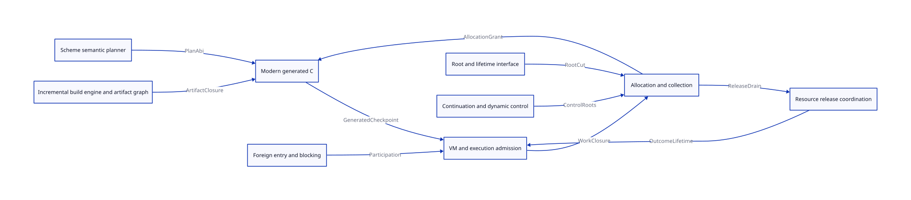 and [[file:../../architecture/runtime/diagrams/blueprint.d2][D2 source]]
- [[file:blueprint-matrix.org][Eight benefit cases and eleven migration nodes]]
- 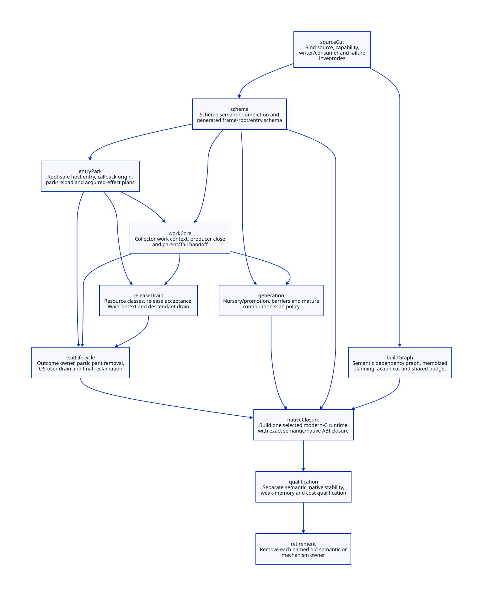 and [[file:diagrams/migration.d2][D2 source]]
- [[file:../../architecture/toolchain/incremental-build-design.org][Incremental and parallel build redesign]]
- [[file:../../architecture/toolchain/gerbil-macro-chain-design.org][gxi/gxc phase-aware module service refactoring]] and [[file:../../knowledge/systems/build-modernization.org][Chez/OCaml/Dune mechanism learning]]: immutable producer products, isolated frontend sessions, readiness-specific consumers, and one admitted executor; this is a compiler/service boundary change rather than a command-runner configuration.
- [[file:../../modeling/proof-obligations.org][Single closure ledger and new open composition obligations]]

Separate responsibility IDs do not imply separate processes, OS threads or
heap allocations. Combining storage is allowed when its consumers and lifetime
coincide. The runtime diagram shows contract producer/consumer relationships,
not every native call. The migration graph shows prerequisite deliveries;
runtime request cycles must not be mistaken for migration cycles.

** Selected direction and deliberately open decisions
:PROPERTIES:
:CUSTOM_ID: selected-direction
:END:

[[file:delivery-plan.org][The current delivery plan]] connects this whole target to actual pending source,
prerequisites and acceptance. repair9 is one evidence corpus; it does not replace
this blueprint. Startup preparation/member publication and current-source test8
closure precede another wait/service optimization. Design lanes may be reviewed
in parallel, while implementation REVs stay bounded and independently qualified.

#+NAME: blueprint-decision-status
| Area | Selected architectural direction | Still requires evidence |
|---+---+---|
| Semantic ownership | Scheme completes semantics and generates native contracts; C mechanically realizes them | Complete primitive, FFI, frame and runtime-role coverage |
| Runtime identity | Distinguish VM, execution, participation, work custody and external-resource lifetime | Actual supported-host population and every transition |
| GC organization | Explicit work contexts and phases; private/claimed/queued/descendant custody survives owner transitions | Exact copy subframes, producer closure, resize/capacity and weak-memory refinement |
| Generation goal | Context-local young allocation, remembered mature-to-young edges and parallel stopped-mutator minor collection | All writers, promotion capacity/failure, mature continuation mutation and measurable net gain |
| Major collector | Preserve moving-root/control semantics behind the phase contract while evaluating its evolution | No unconditional selection of concurrent major collection or OCaml's major algorithm |
| Foreign support | Explicit root-safe entry, legal owner, park/reload and acquired-effect cleanup | Complete real callers and native-unwind boundaries; preserve existing supported C capability |
| Build system | Scheme-owned semantic units; dependency-aware planning, content-based rebuild decisions and bounded execution | Complete input cut, bootstrap lineage, output transaction and all nested schedulers |

These are design selections, not native admission. A sound full-scan route
remains necessary wherever mutation closure has not justified generation-based
scan exclusion. That route belongs to the same collector contract and is not
permission to keep two manually synchronized semantic implementations forever.

** Architectural commitment: redesign the coupled runtime
:PROPERTIES:
:CUSTOM_ID: coupled-runtime-redesign
:STATUS: selected-research-direction
:END:

The research decision is to design one coherent modern-C runtime reconstruction,
not to preserve historical coupling by accumulating local repairs. Cost and
proof analysis select mechanisms and expose failure conditions; they are not
an argument against a substantial refactoring. Runtime admission remains a
later, separate evidence decision.

OCaml's relevant lesson is that parallel execution, heap organization, native
roots and synchronization must evolve together. Its paper explicitly examines
the C-interface consequences of read barriers and the alternative coordinated
minor collector. Gambit's proper tail calls, multi-shot continuations,
stack/heap frames, still objects and embedding need their own composition.
Neither OCaml's fiber semantics nor a particular major algorithm is imported
as Gambit semantics. See the primary-source ledger in
[[file:../../architecture/runtime/gc/modern-c-generational-design.org::#evidence][the generational redesign]].

#+NAME: coupled-runtime-modernization
| Architectural change | Historical coupling to remove | Necessary shared contract |
|---+---+---|
| Execution context / VM / collector worker separation | PSTATE simultaneously supplies roots, allocation and collection participation | Explicit root-domain enrollment and safe-point acknowledgement; independent work grants and phase/capacity custody |
| Generational heap and semantic stores | Whole movable-heap copying plus unchecked pointer writes | Young allocation, promotion, remembered source slots/cards, bounded noncollecting barriers and complete major collection |
| Continuation and native root integration | Implicit macro/frame knowledge and unmediated raw references | FrameSpec, PointId, capture/restore/mutation coverage; parked raw borrows and rooted reload |
| Resource release coordination | Arbitrary foreign cleanup inside GC/teardown and unclear last users | Preaccepted custody, legal owner dispatch, no waits on one's own pin/callback, shutdown descendant drain |
| Generated native contracts and incremental builds | Repeated semantic/layout inference and coarse invalidation | Scheme-owned ModuleSpec/FrameSpec; typed modern-C consumers; explicit input/action/output identities |

The [[file:../../architecture/runtime/gc/modern-c-generational-design.org][modern-C generational design]] now provides the concrete collector policy,
store categories, theoretical work equation and retirement dependencies.
[[file:../../architecture/runtime/ffi/rc-freeze-publication.org][Native freeze and publication]] provides the associated C/FFI contract.
These extend existing SysML component owners and root-level QNT/Lean models.
No second runtime, renamed copied model or C++ migration is selected. LLVM/MLIR
remain consumers of completed semantic contracts; Zig still requires a distinct
incremental benefit beyond this modern-C reconstruction.

* RESEARCH The boundary between Scheme and modern C
:PROPERTIES:
:CUSTOM_ID: semantic-native-boundary
:END:

The [[file:../../../vendor/gambit/gsc/_front.scm::225][current front end]] builds a compilation context, environment and C interface
before normalization. [[file:../../../vendor/gambit/gsc/_t-c-1.scm::880][The C target linker]] also consumes module demand/supply,
ordered flags and metadata. The semantic export must include these obligations;
it cannot be reconstructed reliably from generated C or a filename alone.

The proposed completed plan contains the following logical records. This is
contract notation, not an implemented data schema or compiler pass:

#+NAME: completed-native-plan
#+BEGIN_EXAMPLE
SemanticUnit = producer identity + ordered source/phase closure + module identity
CompletedPlan = normalized/GVM operations + effects + primitive/FFI contracts
FrameSpec = slot interpretation + return/control edges + exact scan/reload rules
PointId = plan-scoped identity of entry/checkpoint/return/exception obligation
LayoutContract = target projection + object/frame/root ABI identity
ModuleContract = ordered supply/demand/init/foreign text + semantic-link metadata
#+END_EXAMPLE

Scheme owns evaluation order, closure semantics, nonlocal control legality,
tail positions, root liveness and checkpoint placement. Generated C owns the
mechanical realization: object accesses, frame/root maps, entry stubs, polling,
dispatch/trampoline edges and native declarations. Runtime C owns admitted
allocation, synchronization, OS and resource mechanisms. A C macro may remain a
mechanical access primitive; it must not become a second owner of semantic
frame, root or control decisions.

The current wait wrapper already orders return-address store, W_ALL, wait,
R_ALL and return-address reload. Reuse that contract. Retirement means removing
duplicated decisions after every generator and runtime consumer migrates; it
does not mean deleting a correct wrapper before its replacement qualifies.

* RESEARCH Runtime modules compose through epoch-bound contracts
:PROPERTIES:
:CUSTOM_ID: runtime-composition
:END:

** Execution, roots and control
:PROPERTIES:
:CUSTOM_ID: execution-roots-control
:END:

Execution grants name a live VM/context incarnation and exclusive legal owner.
Participation separately names the collection epoch and rendezvous state. Root
slots name their actual custodian and frame/ABI interpretation. Collector work
names a task and grant; none of these identities substitutes for another.
Existing CollectionScope and ResourceScope definitions remain the common
identity vocabulary rather than being copied into every subsystem.

At a GC-capable checkpoint, generated code materializes all required roots and
control metadata, acknowledges the cut and stops forbidden mutation. A scanner
must observe the published values and can update moving slots. Reentry must
reacquire ownership and reload the relocated values before managed execution.
Release/acquire ordering, slot lifetime and incarnation checks are proof
obligations; observing a Boolean rootsPublished is not their proof.

Control owns current, saved and captured frame origins, denv, frame mutation,
serialization reconstruction and restoration. Generated FrameSpec and PointId
connect those paths to the scanner. An effect-handler interface may be layered
over supported control, but the architecture must not silently reduce Gambit
continuations to one-shot resumptions or allow jumping through an unqualified
native frame. Unsupported new crossing modes need explicit admission policy;
existing supported Scheme/C behavior must remain represented.

** Collector work, allocation and generations
:PROPERTIES:
:CUSTOM_ID: collector-generation
:END:

PSTATE currently selects many collector lists and cursors. The new logical
CollectorWorkContext carries phase/grant identity, scan frontier, private copy
state, queue/claim custody, pending parent continuation, Tail responsibilities
and capacity grants. Logical worker roles may initially run on existing
participants; creating independent OS workers is an additional admitted mode.
No caller may assume worker ID, processor ID and execution owner are identical.

For the forwarding winner, visible forwarding is not a completed initializer.
The context must preserve the immutable incoming slot, source/destination
regions, initialized prefix, pending decrement, payload end, publication state
and parent advance at every admitted cut. Tail preparation is accounted before
it becomes executable. A rejected transfer restores the exact initializer
state; an unknown outcome freezes source execution and retains counted custody
and region pins. The existing [[file:../../architecture/runtime/interfaces/pair-resume-design.org][PAIR resume study]] is supporting work, not a
complete copy-subframe adapter. Byte-level native cuts remain unqualified.

The selected generation goal uses fast context-owned young allocation under
an exclusive execution grant, shared mature storage and remembered slots for
mature-to-young edges. At minor collection, mutators stop at qualified root
cuts; workers process complete roots and remembered edges, reserve promotion
capacity and relocate survivors. Allocation checks and common capacity results
must refer to the same collection epoch; one context cannot spend a stale grant
after another request resizes or consumes it. Failure must have a declared
retry/major-collection/resource-error route while roots and initialized state
remain owned. No partly initialized object is scanned as complete.

Reserve capacity before making a copy's forwarding/initialization obligation
externally visible. Once visible, an abort cannot simply forget the destination
or restart the parent scan. A capacity-failure route must finish or retain that
exact initialization responsibility before admitting another collection; its
failure semantics and any reserved emergency space remain explicit obligations.

The remembered set needs every relevant write: generated mutation, runtime
helpers, root updates, frame/denv changes, deserialization and FFI. New objects
also need an initialization-to-publication rule. If mature continuations cannot
change except through covered writers, minor GC can scan their dirty/logged
edges instead of the entire mature graph. An opaque C borrow needs tracked
stores, an explicitly sound conservative scope, or a full-scan route. Merely
assuming no mutation is not admissible. After major relocation, all remaining
slot locations and log ownership must be refreshed or rebuilt before another
minor cycle; raw remembered addresses cannot outlive moved containers.

Full heap scanning does not repair an unknown C root or an escaped raw pointer
that cannot be updated after movement. Such boundaries need a valid handle,
pinned representation or enforced borrow lifetime before the moving/worker mode
can be admitted. A sound fallback covers known roots and untracked reachable
heap mutations; it cannot manufacture missing native pointer ownership.

The first modern-C realization can retain an explicit stopped-mutator major
tracing/moving phase. Concurrent major collection is a separate algorithmic
decision requiring its own deletion/insertion barrier, root and termination
arguments. Thus the blueprint studies OCaml's generational benefits while
preserving Gambit's object/control and still/foreign-object choices.

** FFI, release and shutdown are one lifecycle composition
:PROPERTIES:
:CUSTOM_ID: foreign-release-exit
:END:

Before an allocating marker or callback entry, protect the incoming Scheme
values and establish the exact VM/processor owner. Record only actually acquired
effects. Nested callbacks stack origin/grant state; return or exception restores
the matching origin and disposes each acquired effect once. A blocked host ends
its managed borrow, publishes a qualified root cut and follows the participation
handshake. It cannot continue touching movable Scheme values while parked.

Foreign release is classified by actual resource effects: collector-safe local
cleanup, blocking native work, owner-thread work, and callbacks requiring Scheme
admission. The latter classes require the appropriate explicit route; arbitrary
existing C finalizers cannot be moved to a worker by assumption. For an eligible
deferred task, acceptance transfers payload/root and cleanup responsibility
before source storage is dismantled. Failed acceptance leaves responsibility
with the source; accepted failure has a retained result and final owner.

WaitContext tests and sleeps under the same synchronization protocol that
publishes completion, with the condition rechecked after wake. Cancelling a
waiter does not cancel accepted cleanup responsibility. A task that creates
descendants transfers or increments their accounting before dropping its own
credit. Closing external producers does not prohibit already accepted tasks
from producing accounted descendants. This is necessary for both no-lost-wakeup
and shutdown termination arguments; the blueprint does not prove OS fairness.

Shutdown seals external entry and error admission while receivers remain live,
drains or explicitly transfers accepted callbacks/work/resources, settles
outcomes and legal OS users, then removes participation and reclaims each target
after its own last consumers. Transfer can create new collector/release work,
so completion needs a recheck under the membership/request synchronization
boundary. A drained queue alone is insufficient. Descriptor storage can outlive
execution but must have a bounded, generation-safe reclamation policy.

* RESEARCH Learn mechanisms, retain Gambit's choices
:PROPERTIES:
:CUSTOM_ID: ocaml-learning
:END:

The [[https://ocaml.org/manual/5.3/parallelism.html][OCaml 5.3 manual]] describes domain-local young allocation, parallel
stopped-world minor evacuation and a concurrent major heap. These are distinct
choices. Gambit's candidate can adopt explicit generational edge coverage and
parallel minor work without selecting that major collector or domain ABI.

The local learning source is pinned at OCaml commit
46e1c324fb9e9f21f52c9cc3399020f7ef8b9b91, not inferred from a release name.
[[file:../../../vendor/ocaml/runtime/domain.c::2262][Domain termination]] finishes work, orphans resource-related work, rechecks new
mark/sweep work and serializes removal from the participant set. This motivates
Gambit's producer-close/transfer/recheck contract, not a literal domain port.
[[file:../../../vendor/ocaml/runtime/minor_gc.c::533][Minor collection]] explicitly partitions remembered-set work; [[file:../../../vendor/ocaml/runtime/memory.c::176][the write barrier]]
combines collector-specific obligations. Those ranges are hashed in the derived
map. Their memory-order details cannot serve as a generic Gambit C proof.

[[https://arxiv.org/abs/2104.00250][The effect-handler research]] demonstrates that control implementation and
stack-tool compatibility belong in the design. Gambit already has richer
nonlocal control; the lesson is to preserve and expose its invariants. No
OCaml benchmark number or proof transfers to this runtime.

* OPEN Benefit, migration and retirement are independently gated
:PROPERTIES:
:CUSTOM_ID: blueprint-benefit-and-retirement
:STATUS: theory-and-refinement-open
:END:

[[file:blueprint-matrix.org][The model-derived matrix]] has exactly one case per original pain ID. Each
names eliminated work, unavoidable added cost, a positive condition, refutation
and an open obligation. Examples include fewer mature-graph visits versus
barrier/log/promotion work; less rendezvous delay versus work-context traffic;
and fewer generation/compile actions versus planning/hash/storage work.

No single percentage summarizes these different dimensions. Use matched
capabilities and separately account executed work, critical path, peak/retained
memory, supported failure behavior and ownership decisions still duplicated.
A deferred destructor reduces a GC pause only if its queue/retention/drain cost
is acceptable; it does not eliminate the destructor's total work. A new worker
mode is useful only if work balance/progress gains exceed its synchronization
and metadata costs. AI implementation assistance does not remove these costs.

The migration DAG permits buildGraph to advance alongside semantic schema work.
entryPark precedes workCore; generation and releaseDrain consume those common
contracts; exitLifecycle composes accepted work/resources/outcomes. Exact native
closure and separate qualification precede per-route retirement. Shared support
gets one owner and is charged once across its users, not separately credited as
a benefit for every subsystem or for Zig.

Retirement preserves a supported capability while replacing its implementation
owner. Remove duplicated frame decisions after all consumers agree; remove
PSTATE collector dependence after every relevant producer/consumer migrates;
remove inline release only for eligible classes; remove coarse build envelopes
only after dependency and failure-publication equivalence. Correct mechanical
C accessors, sound full scans, required bootstrap stages and C ABI surfaces may
remain. Their mere existence does not count as failed retirement.

Eight new composition obligations extend the existing ledger. Existing partial
source facts and historical QNT/Lean results retain their scope. No runtime
contract is compositionally closed, no old runtime path is retired, and no new
native or performance result is asserted by this blueprint.

** Refinement ownership and missing composition
:PROPERTIES:
:CUSTOM_ID: blueprint-formal-frontier
:END:

#+NAME: blueprint-formal-correspondence
| Boundary | Existing unique formal owner | What the blueprint still needs |
|---+---+---|
| Root/park/reentry | ROOT-HANDOFF binding and its existing host_root_participation QNT / HostRootParticipation Lean | Complete legal producers and slot values, nested acquired effects, weak-memory publication and native restoration |
| Continuation origins | CONTROL-ORIGIN binding and existing saved-origin model/Lean companion | Mutation/serialization writers, generation barriers, physical frame/slot identity and all supported restores |
| Work/copy/phase | GC-WORK-CLOSURE and gc_work_closure QNT with its current Lean bindings | Exact partial-copy subframes, phase producer closure, capacity/resize and worker termination refinement |
| Exit/resource lifetime | RETIRE-WINDOW plus the existing release/retirement research under its owners | Compose accepted descendants, WaitContext, outcomes and legal OS users; earlier lifetime support is not a whole shutdown proof |
| Incremental/parallel build | Toolchain SysML, the new incremental_build QNT / IncrementalBuild Lean set, BF-BUILD-CUT / BF-BUILD-BUDGET | Bounded action protocol and conditional algebra exist; dynamic cut completeness, actual producer/step refinement, token progress and transactional publication remain open |

Reuse the exact existing binding sources and inventories from the derived
ledger. Do not copy a finite model into DEV or promote a companion theorem to
an unbound source. A valid composition must relate concrete steps and identity
domains, preserve invariants through failures, and supply liveness assumptions;
matching names or connecting model boxes cannot discharge those obligations.

[[file:../../architecture/toolchain/source-chain-design.org][The GSC source case]] and [[file:../../modeling/component-model-map.org][SysML-derived component/model matrix]] now instantiate the build side. Model-source identity, parsed specification, kernel-checked conditional theorem and native qualification remain separate.

** RESEARCH T0 GC/SMP foundation and concrete frame interface
[[file:t0-foundation-design.org][The T0 target refactoring design]] separates existing root model evidence from the new execution/participation/collector-work architecture. [[file:../../architecture/runtime/models/sysml/composition.sysml][Seven target lanes and exact baseline reuse]] and 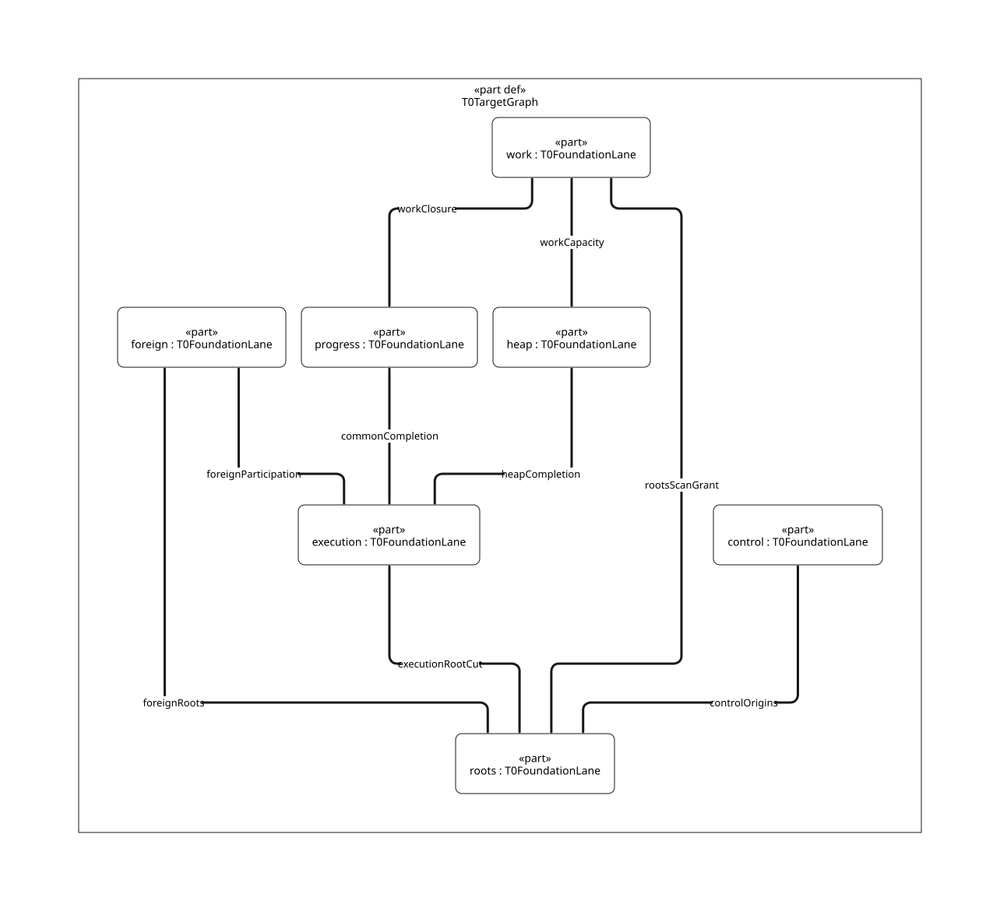 derive from the existing runtime-composition owner. [[file:../../architecture/runtime/interfaces/frame-contract-design.org][FrameSpec coordinate/root laws]] are one shared interface; they do not substitute for a redesigned collector, scheduler or progress proof.

** RESEARCH Amplification through generated store contracts
[[file:../../architecture/runtime/gc/generational-barrier-design.org::#amplification][The barrier design]] makes Scheme's source-age/value/escape and safepoint
knowledge an input to native optimization. [[file:../../architecture/runtime/gc/generational-barrier-matrix.org::#barrier-amplification-matrix][The native-derived matrix]] records
proved generational barrier elimination, mature multi-shot frame reuse,
predictable C entry and parallel copy custody as capability goals. Every gain
has work units, added costs and a falsifier; preservation is the foundation.

* Physical promotion and epoch publication
:PROPERTIES:
:CUSTOM_ID: promotion-residual-blueprint
:END:
[[file:../../architecture/runtime/gc/promotion-residual-design.org][The promotion/residual study]] makes an architectural replacement explicit:
Scheme-generated FrameSpec/layout costs feed unique claims and physical reserve
receipts, while root/FFI domains settle before a staged remembered-set epoch is
published. Existing C forwarding and parallel assets are credited. The mandatory
modern-C path can remove repeated mature continuation work only after complete
alias/weak/writer closure; its simultaneous destination, recovery and two-bank
metadata costs are charged in [[file:../../architecture/runtime/gc/promotion-residual-matrix.org][the native-derived benefit matrix]].

* Explicit native interval and reader lifetimes
:PROPERTIES:
:CUSTOM_ID: interval-retirement-blueprint
:END:
[[file:../../architecture/runtime/gc/promotion-interval-handoff-design.org][The physical-interval refinement]] replaces PSTATE-only ownership assumptions
with allocator-issued extent receipts, immutable copied-prefix/suffix layouts,
idempotent worker-to-context ownership commit and finite reader tokens. All six
prepare_mem_pstate calls, root/FFI borrows, queue stealing, resize and destruction
must adopt these contracts before their implicit ownership paths can retire.
Existing same-PSTATE tail reuse is credited; late refunds cannot be counted as
reducing an earlier GC peak. [[file:../../architecture/runtime/gc/promotion-interval-handoff-matrix.org][The matrix]] charges placement, lifetime and peak
costs explicitly; no new Zig runtime or native implementation is introduced.

* Guaranteed future allocation roles in the pre-forward plan
:PROPERTIES:
:CUSTOM_ID: guaranteed-tail-blueprint
:END:
[[file:../../architecture/runtime/gc/guaranteed-tail-placement-design.org][The guaranteed-placement refinement]] binds Scheme-emitted ordered allocation
bounds and first resume PointIds to actual copy fences and future context
intervals. A heap allowance, span guard, stack grant, pending GC-completion
capacity and failure reserve are separate roles. Unknown commit cannot activate
a context, and actual surplus found after copying remains a late refund.
[[file:../../architecture/runtime/gc/guaranteed-tail-placement-matrix.org][The matrix]] compares every acquisition/copy/restore/failure phase against an
explicit baseline. Existing same-PSTATE tail reuse is credited; a separated
worker/context design gains space only when it avoids real fresh backing without
compensating arena/metadata growth or another dominant phase.

* Real rest constructor as a joint-capacity migration cut
[[file:../../architecture/runtime/gc/rest-gc-resume-envelope-design.org][The structure/rest chain]] requires Scheme argument-shape/PointId/FrameSpec and
C-backed noncollecting completion before framed GC. Restore heap0 is separate
from stack2, repeated frame8 growth and the following small/still allocator.
Retire implicit global-reserve sufficiency and unconditional post-GC grants only
after every caller and actual backing consumer is migrated. Existing pair/vector
semantics, roots and continuation lifetimes remain authoritative until then.
This amplifies precise portable-C generation and safe GC placement; Zig adds no
established incremental semantic or peak benefit here.

* Structure slow-path modernization cut
[[file:../../architecture/runtime/gc/structure-poll-still-envelope-design.org::#structure-migration][The POLL/frame/still replacement order]] adds PollEffectSpec, typed frame-growth
and noncollecting StillInitSpec to the Scheme-to-modern-C contract. Arbitrary
interrupts, exceptions and multi-shot captures remain language capabilities;
unknown effects refuse finite peak qualification, not execution. C owns actual
container/assignment/pin accounting, initialized-root publication and safe-point
acknowledgement. Unifying these removes hidden duplicated reasoning only after
all consumers migrate; no runtime path or existing reuse is newly claimed saved.

* Still initialization as an explicit modern C runtime boundary
[[file:../../architecture/runtime/gc/still-init-safepoint-design.org][The root/init/participation design]] assigns semantic InitSpec and PointId to
Scheme, physical fill/root records and request-generation leases to modern C.
Refcount, interrupt masks and pending flags no longer substitute for scan-ready
publication. Nested callbacks retain parent activation roots; unknown service
results retain full backing and the original initializer. Mature-object
initialization joins remembered-set coverage before minor collection.
Retire fixed scratch and implicit no-GC intervals only after all constructor,
SAVE/RESTORE, callback, exception and native-exit consumers migrate. This enables
context/collector separation without weakening continuation or FFI semantics;
no Zig-specific additional benefit or native retirement is established here.

* Recoverable initialization and result ownership
[[file:../../architecture/runtime/gc/still-init-recovery-design.org][The partial/result design]] gives modern C an operation record, generation-bound
initializer and atomic recipient-root/receipt boundary. Scheme supplies typed
InitSpec, cursor and invocation identity; multi-shot continuation calls remain
distinct semantic invocations. Readback never replays constructors or native I/O.
A synchronous fast path can keep one final cut. Per-field atomics, a copied input
image or a second runtime are not implicit requirements. Root/input/dedup
lifetimes and source memory order must close before old ownership paths retire.

* Native isolation before failure and exact retirement
[[file:../../architecture/runtime/gc/still-owner-retirement-design.org][The owner/root/receipt boundary]] separates native helpers from GC participants
only after independent roots, opaque handles, reserved buffers and collector
resources are established. Stop confirms an executor; full writer/borrower
closure authorizes only private effect-free replay. Managed materialization keeps
its own no-reentry and result-root gate. Complete reply records can shrink after
ACK/close/child drain, while late-retry generation fences persist. These changes
replace PSTATE-coupled ownership and ignored join outcomes in admitted services;
ordinary synchronous C remains the efficient constructor path. No native path is
retired or Zig-specific net benefit established by the model.

** RESEARCH Managed heap materialization and owner-loss custody
:PROPERTIES:
:CUSTOM_ID: managed-materialization-custody
:AUTHORITY: GambitStillMaterializationCustody
:STATUS: conditional-models-native-refinement-open
:END:
[[file:../../architecture/runtime/gc/still-materialization-custody-design.org][The modern C materialization study]] separates scan-valid shell enrollment,
write-lease closure, physical backing and result-root handoff. Its six needs
(MC-H/I/SHELL/WRITE/ROOT/RECOVER) are native SysML projections, evaluated by
the existing ASCENT DSL; SP-STILL depends on MC-ROOT and MC-RECOVER.
QNT checks22 named histories plus bounded positive/negative simulations. Lean
checks16 named statements including root Step/Trace preservation. These local
checks do not establish native writer closure, C atomics or allocator recovery.
Unknown-live heap writers cannot detach from a moving collector merely because
slots are valid. Stop/borrower closure permits abort and scanning without replay.
The current graph has118 needs,362 direct edges,58 source routes and8 shared
contracts;44 local model slices,61 source gaps and13 platform gaps; zero complete
or native-qualified components. Earlier study sections remain historical scopes.
The receipt and native-derived work/peak matrix are linked from the study.

** RESEARCH Heap authority closure and canonical still-domain handoff
:PROPERTIES:
:CUSTOM_ID: still-authority-handoff
:AUTHORITY: GambitStillAuthorityHandoff
:STATUS: conditional-models-native-source-refinement-open
:END:
[[file:../../architecture/runtime/gc/still-authority-handoff-design.org][The modern C authority/handoff study]] separates closing grant ingress from
settling pending writers/borrowers, native stop evidence from operation closure,
and physical StillDomain custody from old PSTATE cleanup. Current resize cleans
up before it joins; target ownership must be transferred before destructive
cleanup. A canonical domain retains one chain/charge and remains enumerable by
GC after processor retirement. Unknown raw writers/allocator mutation still
block; unknown commit replies retain aliases and query the canonical decision.
SysML owns AH-H/I/CLOSE/STOP/CHAIN/ADMIT and their dependencies. Root QNT
checks34 named histories; Lean checks22 named conditional statements including
Gate Step/Trace debt/no-reopen kernels. Current projection:124 needs,389 edges,
62 source routes,8 shared contracts;46 local model slices,65 source gaps and
13 platform gaps, zero complete/native-qualified components. Earlier sections
retain their historical scopes; no runtime or raw ABI path retires here.

** RESEARCH Canonical still inventory and snapshot-consistent capacity
:PROPERTIES:
:CUSTOM_ID: still-ledger-snapshot
:AUTHORITY: GambitStillLedgerSnapshot
:STATUS: conditional-models-native-refinement-open
:END:
[[file:../../architecture/runtime/gc/still-ledger-snapshot-design.org][The modern C ledger/snapshot study]] separates published/private/retired
backing from unbacked grants, phase counters and allocator request bytes. A
post-GC cut can still contain unbacked caller requests. Owner commit must share
revision/epoch admission with sweep and accounting publication. Metadata pins
are not raw payload capabilities. Unknown allocator/free results retain custody.
SysML owns LS-H/I/INVENTORY/INTENT/SNAPSHOT/RECLAIM. Root QNT checks30
histories and Lean checks16 named propositions, including a refund Step/Trace
kernel. Native projection:130 needs,415 edges,66 source routes,8 contracts;
48 local model slices,69 source gaps,13 platform gaps, zero complete/native-
qualified components. Prior sections retain historical scopes. No runtime
implementation, native test, measured saving or old-path retirement is claimed.

* RESEARCH Allocation receipts and atomic snapshot admission :modern_c:gc:
:PROPERTIES:
:CUSTOM_ID: still-receipt-admission
:AUTHORITY: GambitStillReceiptAdmission
:STATUS: conditional-extension-source-refinement-open
:END:
[[file:../../architecture/runtime/gc/still-receipt-admission-design.org][The receipt/admission study]] separates raw effects, immutable outcome
publication, exactly-once logical settlement and caller delivery. One domain
gate excludes sweep/accounting mutations from owner handoff. Raw pre-publication
loss remains unknown; no wrapper can infer a malloc/free result from stop alone.
The direct Darwin executable-path malloc/free path also bypasses allocation macros.
SysML drives a separate explicit 11-need,16-edge ASCENT extension: six new needs
and five imported open source premises. Current exact receipts qualify only
RA-H/RA-I; nine source obligations remain open, zero components qualify.
QNT checks19 named histories plus100 bounded sampled histories; Lean checks10
conditional declarations. The all-scoped-positive control is synthetic.
The historical130-need/415-edge global receipt is not recomputed or superseded
by this extension. No runtime implementation, native test, measured improvement
or executed old-path retirement is claimed. Gate contention, retained liability
and metadata bounds remain admission costs; modern C is the mandatory path.

* RESEARCH Native completion, exceptional exit and receipt lifetime :modern_c:gc:
:PROPERTIES:
:CUSTOM_ID: still-completion-lifetime
:AUTHORITY: GambitStillCompletionLifetime
:STATUS: conditional-extension-source-platform-open
:END:
[[file:../../architecture/runtime/gc/still-completion-lifetime-design.org][The completion/lifetime study]] refines no-escape raw-call publication,
expected versus partial gate exits, stable result/VM binding and receipt reuse.
Existing signal-mask primitives and reverse restoration are reusable, but their
void wrappers discard status. Scheme interrupt deferral is not pthread-cancel
control. Known published outcomes can be recovered after qualified stop outside
the gate; raw gaps, escaped destructors and dead-held gates refuse handoff.
ID-only handles, monotone retirement floors and raw-pin drain permit record-slot
reuse; ACK alone cannot reclaim a pinned record. Pool pages remain reserved.
SysML drives12 needs and19 edges: six new needs and six imported open source
premises. QNT29 named histories and100 bounded sampled traces plus Lean16
conditional declarations qualify NC-H/NC-I only; ten source obligations remain
open and zero components qualify. All-scoped controls are synthetic.
Historical global and predecessor receipts are preserved, not requalified.
No runtime implementation, native test, measured saving or path retirement.

* RESEARCH Native root views, participation and reentry :modern_c:gc:ffi:
:PROPERTIES:
:CUSTOM_ID: native-root-reentry
:AUTHORITY: GambitNativeRootReentry
:STATUS: conditional-extension-source-platform-open
:END:
[[file:../../architecture/runtime/gc/native-root-reentry-design.org][The native root/reentry study]] freezes canonical locations and ordinary writer
permissions while allowing exclusive collector relocation writes. Phase-gated
publication transfers active acknowledgement to frozen-root duty. Reentry must
grant active participation before reload and before Tcl's first RC payload
read; callback procedure roots precede marker allocation. Activation banks and
fresh parent revisions preserve nested callbacks. Already-enlisted pending root\nscans remain owed after a return request; later round admission is arbitrated. Unknown native outcome can
coexist with a valid scan view; unknown writer/binding or a dead-held gate
cannot authorize transfer. For N contexts/K released: active ack targets N-K,
root duties N, scan work O(R); no measured speedup or peak reduction.
Native SysML:16 needs,31 edges,7 source routes,12 caller families,8 cost rows.
QNT31 histories plus100 bounded sampled traces and Lean22 conditional
declarations qualify NR-H/NR-I only. Thirteen source needs plus one native
memory-order need remain open; zero components are admitted. Five ASCENT
cases check exact digest/method/scope and lossless transport; the all-scoped
control is synthetic. Historical reports are preserved, not requalified.
No runtime implementation, native test, benchmark or runtime path retirement.

* RESEARCH Admitted root scans and whole-round reentry :modern_c:gc:ffi:
:PROPERTIES:
:CUSTOM_ID: root-scan-arbitration
:AUTHORITY: GambitRootScanArbitration
:STATUS: conditional-extension-source-order-progress-open
:END:
[[file:../../architecture/runtime/gc/root-scan-arbitration-design.org][The root-scan arbitration study]] traces direct strong root calls, real local/remote
chunk claims, private copy state, idle termination and resize/exit callers.
A return ticket retains already-enlisted pending work. Pending/Owned/Ready/
Quarantined/ACK states conserve responsibility; unknown claim replies query
the same attempt. Only complete stopped checkpoints and known target acceptance
permit cooperative migration. Partial-copy ambiguity or unknown joins retain
debt. RootAck does not authorize return: weak continuation movement, cleanup,
capacity/context preparation and request-result delivery precede ResumeSeal.
Foreign cleanup waiting on an owner callback can cycle with return; qualified
collector-safe or deferred release custody is required, otherwise refuse the
released profile. Task/checkpoint pools and retained foreign/root backing are
new peak costs; no scan or whole-round peak reduction is established.
Native SysML exports18 needs,37 edges,7 source routes,10 caller families and8
cost rows. QNT27 histories/100 bounded sampled traces and Lean22 declarations
qualify RA-H/RA-I only. Fourteen source and two native-memory-order needs
remain open; zero components qualify. ASCENT has five scope/digest/transport
controls; all-scoped evidence is synthetic. No runtime implementation, native
test, benchmark or runtime path retirement; historical reports not requalified.

* RESEARCH Whole-round resume and deferred cleanup :modern_c:gc:ffi:
:PROPERTIES:
:CUSTOM_ID: resume-seal-cleanup
:AUTHORITY: GambitResumeSealCleanup
:STATUS: conditional-source-order-open
:END:
[[file:../../architecture/runtime/gc/resume-seal-cleanup-design.org][The resume/cleanup study]] binds whole-round seal issuance to closed strong/weak
work, qualified cleanup handback, covered roots, known capacity, prepared
success/error context, committed result and current binding/writer/gate state.
GC sweep currently calls release_fn synchronously then frees its wrapper.
Explicit foreign-release!, conversion rollback and teardown retain distinct
semantics. Device cleanup may wait using PSTATE scratch; a standalone executor
needs explicit WaitContext. device_release may free storage even on error, so
error/effect/disposition must be distinct. A queued owner callback cannot run
before active permit, and cleanup must not wait for it. Unknown handoff or
GC-critical state refuses resume; independently isolated native outcome debt
may retain backing while GC resumes. No automatic callback/owner-death repair.
Native SysML:19 needs,38 edges,7 source routes,11 caller families,9 cost rows.
QNT31 histories/100 bounded sampled traces and Lean25 conditional declarations
qualify RS-H/RS-I only. Fifteen source and two native-memory-order needs remain
open; zero components qualify. Five ASCENT transport/scope/digest cases retain
a clearly synthetic positive control. No measured speedup or peak decrease.
No runtime implementation, native test, benchmark or path retirement.

* Release producer, effect and pre-collection budget admission
:PROPERTIES:
:CUSTOM_ID: release-producer-admission-3
:AUTHORITY: GambitReleaseProducerAdmission
:STATUS: conditional-source-order-open
:MAINLINE: modern-generated-C
:END:
[[file:../../architecture/runtime/gc/release-producer-admission-design.org][The release admission study]] enumerates twelve os_io wrapper registrations,
one permanent-null module wrapper, generated pointer/value/custom converter
protocols and four Xlib custom type registrations. Three constructor failure
cuts remain source blockers: event conversion after message consumption,
process conversion without local device cleanup, and client wrapping with
server rollback. Effects/affinity are bound to code/library/config generation.
One per-release-right budget is reserved before native production, transfers
without double charging, and persists through terminal readers or unknown
outcomes. Root shape, instance registration and current-round tracing are
three separate cuts. A retained QNT counterexample shows closed admission and
counted credits alone do not close in-flight constructor root debt.
Native [[file:../../architecture/runtime/gc/models/sysml/release-producer-admission.sysml][SysML]] drives 15 needs,29 dependencies,6 source routes,25 caller rows
and 12 [[file:../../architecture/runtime/gc/release-producer-admission-matrix.org][cost/peak rows]] and [[file:../../architecture/runtime/gc/diagrams/release-producer-admission.d2][D2]]. Actual [[file:../../modeling/ascent/release-producer-admission.rules.scm][ASCENT]] routes exact [[file:../../../models/gambit/release_producer_admission.qnt][QNT]]/[[file:../../../models/gambit/lean/ReleaseProducerAdmission.lean][Lean]] evidence;
26 named histories,100 bounded sampled traces and20 conditional Lean
declarations qualify RP-H/RP-I only. Eleven source and two C-memory needs
remain open; no component qualifies. Five scope/digest/transport cases include
a synthetic control, never runtime admission. The receipt (local locator: =../../../.cache/research/legacy-evidence/evidence/research/release-producer-admission/checks.json=; unavailable in a clean checkout) records the exact
boundary. No runtime implementation, native test, measured speedup, peak decrease
or path retirement; modern C is mandatory and extra Zig net benefit unproved.

* Covered construction debt and non-cyclic recovery
:PROPERTIES:
:CUSTOM_ID: constructor-debt-closure-3
:AUTHORITY: GambitConstructorDebtClosure
:STATUS: conditional-source-order-open
:MAINLINE: modern-generated-C
:END:
[[file:../../architecture/runtime/gc/constructor-debt-closure-design.org][The construction-debt study]] separates business completion from uncovered GC
debt: native resources can exist before foreign-wrapper allocation itself
invokes GC. A frozen rooted escrow may permit collection to finish while
conversion remains pending. Native-only uncertainty and suspended callback
cuts require exact qualification; unknown managed writers/custody still refuse
resume. Scan/cleanup never waits for the owner port mutex, callback permission
or constructor return. Accept client/server rollback identity, process
error/result plus child/pipe custody, and consumed-message/RC ownership remain
three real source correction gates. PeekMessage may synchronously dispatch
messages, so the event path is not automatically native-only.
Native [[file:../../architecture/runtime/gc/models/sysml/constructor-debt-closure.sysml][SysML]] owns 18 needs,37 dependencies,7 routes,12 caller rows and11
[[file:../../architecture/runtime/gc/constructor-debt-closure-matrix.org][cost/peak rows]] and [[file:../../architecture/runtime/gc/diagrams/constructor-debt-closure.d2][D2]]. Actual [[file:../../modeling/ascent/constructor-debt-closure.rules.scm][ASCENT]] routes exact [[file:../../../models/gambit/constructor_debt_closure.qnt][QNT]]/[[file:../../../models/gambit/lean/ConstructorDebtClosure.lean][Lean]] scopes.33
named histories,100 bounded sampled traces and22 conditional Lean declarations
qualify CD-H/CD-I only;14 source and2 C-memory obligations remain open.
The receipt (local locator: =../../../.cache/research/legacy-evidence/evidence/research/constructor-debt-closure/checks.json=; unavailable in a clean checkout) preserves the prior conservative model and rejects a claim of
native progress from the declared wait graph alone. No runtime implementation,
native test, measured speedup, proved peak reduction or old-path retirement.

* Escrow publication, result commit and owner reentry
:PROPERTIES:
:CUSTOM_ID: escrow-publication-reentry-3
:AUTHORITY: GambitEscrowPublicationReentry
:STATUS: task-local-formal-source-order-and-host-attestation-open
:MAINLINE: modern-generated-C
:END:
[[file:../../architecture/runtime/gc/escrow-publication-reentry-design.org][The publication/reentry study]] distinguishes immutable root-location metadata,
collector-written relocated root values, a separate current trace receipt,
and rooted canonical result/right commit. Nested callbacks receive distinct
invocation-generation/result/marker records, with procedure protection before
marker allocation. A safe stopped FOREIGN shell may cross GC only while its
native duty remains escrow-owned. Borrowers drain before native disposal;
query readers/children/init duties drain before record/ticket reuse. Result
query readers do not pin collector view buffers or prevent GC reentry.
[[file:../../architecture/runtime/gc/models/sysml/escrow-publication-reentry.sysml][Native SysML]] owns16 needs,41 dependencies,7 routes,13 caller rows and11
[[file:../../architecture/runtime/gc/escrow-publication-reentry-matrix.org][cost/peak rows]] and [[file:../../architecture/runtime/gc/diagrams/escrow-publication-reentry.d2][D2]].33 [[file:../../../models/gambit/escrow_publication_reentry.qnt][QNT histories]],100 bounded sampled traces and22
conditional [[file:../../../models/gambit/lean/EscrowPublicationReentry.lean][Lean declarations]] qualify task-local EP-H/EP-I only;12 source
and2 C-memory needs remain open. Five isolated native [[file:../../modeling/ascent/escrow-publication-reentry.rules.scm][ASCENT]] cases pass;
the repository aggregation entry failed host-source attestation and remains an
additional integration gap. The receipt (local locator: =../../../.cache/research/legacy-evidence/evidence/research/escrow-publication-reentry/checks.json=; unavailable in a clean checkout) preserves that failure and the
missing-trace-receipt counterexample. No runtime/native/performance acceptance,
measured peak reduction or production-path retirement is asserted.

* Safe FOREIGN shells and nested unwind research
:PROPERTIES:
:CUSTOM_ID: foreign-shell-unwind-modern-c
:STATUS: SOURCE-REFINEMENT-OPEN
:END:

[[file:../../architecture/runtime/gc/foreign-shell-unwind-design.org][Modern C safe-shell / marker-root / unwind study]] binds allocation admission,
pre-marker procedure protection, original-activation settlement and one canonical
result/right commit to SysML, ASCENT and conditional QNT/Lean evidence. Imported
root/teardown premises and C memory-order refinement remain open. No runtime or
native tests; no production path retired. See its generated benefit/peak matrix.

* Original-owner exit guard research
:PROPERTIES:
:CUSTOM_ID: owner-exit-guard-modern-c
:STATUS: SOURCE-AND-MEMORY-REFINEMENT-OPEN
:END:

[[file:../../architecture/runtime/gc/owner-exit-guard-design.org][Modern C SFUN / ___run / nested escape study]] maps real Scheme generator
families and callers to typed exit plans, off-stack root/init/result custody,
logical activation close and deferred physical marker retirement. SysML drives
ASCENT and exact QNT/Lean scopes; existing CFUN bridge cleanup remains necessary.
Current model slices do not establish source, C memory or native qualification.
No runtime implementation or native test; no production path retired.

* Activation claims and marker retirement research
:PROPERTIES:
:CUSTOM_ID: activation-marker-retirement-modern-c
:STATUS: SOURCE-AND-C-MEMORY-REFINEMENT-OPEN
:END:

[[file:../../architecture/runtime/gc/activation-marker-retirement-design.org][Modern C activation/return/pin retirement study]] separates revocable return
intent, owner commit, logical close, permitted marker clear and profile-specific
pin release. Managed root-pin ledger and qualified legacy debit have distinct
unknown-outcome custody. SysML drives actual ASCENT/QNT/Lean scope checks and
benefit/peak views; root scanning, ABI, C memory and teardown remain source gates.
No runtime implementation or native test; no production path retired.

* Controlled marker layout and zero-count roots
:PROPERTIES:
:CUSTOM_ID: managed-marker-layout-modern-c
:STATUS: SOURCE-AND-C-MEMORY-REFINEMENT-OPEN
:END:

[[file:../../architecture/runtime/gc/managed-marker-layout-design.org][Modern C controlled marker study]] specifies two SCMOBJ cells and a 24-byte immutable
activation key, private rooted construction and joint still-list/root publication.
All-list setup must precede cross-processor root marking; the new exact descriptor
skips raw identity bytes. Raw vector/counter/serializer consumers require replacement
or explicit profile rejection. SysML drives ASCENT/QNT/Lean and benefit/peak views.
No runtime/native admission or peak reduction; the SMP marker backing adds 24 bytes.

* Marker joint publication and GC freeze
:PROPERTIES:
:CUSTOM_ID: marker-joint-publication-modern-c
:STATUS: SOURCE-AND-C-MEMORY-REFINEMENT-OPEN
:END:

[[file:../../architecture/runtime/gc/marker-joint-publication-design.org][Modern C marker joint-publication study]] separates native-only private storage
from lease-covered body/list/root/canonical-commit fragments. Closing rejects new
grants; freeze waits exact active writers, then all-domain setup precedes marking.
Known-stop linked failures roll forward; unknown managed stop blocks freeze, while
isolated native allocation/free debt keeps roots and quarantine credits. SysML
drives actual ASCENT/QNT/Lean and benefit/peak views. No runtime/native admission.

* Interrupted LinkStill and Commit
:PROPERTIES:
:CUSTOM_ID: marker-interrupted-publication-modern-c
:STATUS: SOURCE-AND-C-MEMORY-REFINEMENT-OPEN
:END:

[[file:../../architecture/runtime/gc/marker-interrupted-publication-design.org][Modern C interrupted-publication study]] separates issued effects, physical stores
and trailing ACKs. Immutable intent and exact head observation prevent duplicate
push; one decision pointer joins result and ticket role. Original and every helper
must close data effects before GC freeze; logical death/token revocation alone do
not drain late stores. VM custody must precede PSTATE cleanup. SysML drives actual
ASCENT/QNT/Lean and benefit/peak views; source/atomic/stop gates remain open.

* Data-write closure and VM custody before cleanup
:PROPERTIES:
:CUSTOM_ID: data-write-closure-custody-modern-c
:STATUS: SOURCE-AND-C-MEMORY-REFINEMENT-OPEN
:END:

[[file:../../architecture/runtime/gc/data-write-closure-custody-design.org][Modern C writer-closure and custody study]] separates enrollment, last-effect
closure, VM acceptance, PSTATE cleanup and native-envelope retirement. The actual
generator, raw marker/RC writes, finalizers and procedural-interrupt callbacks
remain source-refinement gates. Failed/unknown join retains native backing;
independent cooperative data closure may permit GC. SysML drives the actual
ASCENT/QNT/Lean chain and benefit/peak matrix; no native admission is inferred.

* FFI exception exits, catcher restoration and callback debt
:PROPERTIES:
:CUSTOM_ID: ffi-exit-catcher-closure-modern-c
:STATUS: SOURCE-AND-C-PROFILE-REFINEMENT-OPEN
:END:

[[file:../../architecture/runtime/gc/ffi-exit-catcher-closure-design.org][Modern C FFI exit study]] distinguishes local activation readiness, PSTATE
borrow closure and whole current-domain data closure. Receiver duty precedes source
release; OOL CFUN caller reload/status remains separately pinned. Cleanup callbacks
register debt before invocation; an unstarted future-epoch task may survive the
current seal only under a qualified nonexecution gate and VM-rooted custody.
SysML drives actual ASCENT/QNT/Lean and cost/peak views; source/backend gates remain
open, with no native implementation or acceptance.

* Future-epoch execution gate and fresh reentry
:PROPERTIES:
:CUSTOM_ID: future-epoch-reentry-gate-modern-c
:STATUS: SOURCE-AND-NATIVE-ORDER-REFINEMENT-OPEN
:END:

[[file:../../architecture/runtime/gc/future-epoch-reentry-gate-design.org][Modern C future-epoch gate study]] distinguishes queued, claimed, issued,
running and parked native work. Publication remains counted through PSTATE wakeup;
queue empty is not zero in-flight callbacks. Only unstarted async tasks can defer;
synchronous Tcl results need a same-call or upstream protocol. Reentry follows
whole-round/context/binding/root reload and fresh epoch membership. VM roots and
native resources remain charged. SysML drives actual ASCENT/QNT/Lean and cost/peak
views; no native acceptance is inferred.

* Participating park, frozen root views and same-call resume
:PROPERTIES:
:CUSTOM_ID: participating-park-root-view-modern-c
:STATUS: SOURCE-AND-NATIVE-ORDER-REFINEMENT-OPEN
:END:

[[file:../../architecture/runtime/gc/participating-park-root-view-design.org][Modern C participating park study]] grounds safe-point completion in the actual
W_ALL/RA/frame and sync-op chain. The rest constructor proves W_ALL alone is not
a safe-point certificate. Stable root topology permits collector updates, excludes
mutator/native borrowers and retains the same native stack. Canonical park accept
is distinct from its response; scan release, whole-round/context/binding/root reload
precede next-epoch resume without another invocation. SysML drives ASCENT/QNT/Lean,
Org/D2 and cost/peak views; source and native-order refinement remain open.

* Real rest construction and full-frame park cut
:PROPERTIES:
:CUSTOM_ID: rest-frame-park-cut-modern-c
:STATUS: SOURCE-AND-NATIVE-ORDER-REFINEMENT-OPEN
:END:

[[file:../../architecture/runtime/gc/rest-frame-park-cut-design.org][Modern C rest construction study]] traces actual GET_REST generation, remaining
CONS repair, initialized vector, mapped helper frame and nargs=-1 restoration.
The first W_ALL wraps a noncollecting limit helper; capacity and local-root
preflight must precede destructive work at a qualified caller boundary. Raw
borrowers and old writers drain before exact-generation park publication; pending
exit and normal resume share one next-epoch claim after scan/round/root readiness.
SysML drives actual ASCENT, QNT/Lean, Org/D2 and repair/peak equations. Physical
capacity, source/ABI and C-order qualification remain open; no native tests.

* Physical rest capacity and caller-side preflight
:PROPERTIES:
:CUSTOM_ID: rest-capacity-preflight-modern-c
:STATUS: SOURCE-AND-NATIVE-ORDER-REFINEMENT-OPEN
:END:

[[file:../../architecture/runtime/gc/rest-capacity-preflight-design.org][Modern C capacity preflight study]] separates dynamic apply, direct GVM and
native staging cuts. Complete input roots precede final noncollecting physical
grant; current heap/stack windows exclude metadata and overlap. Grants do not
advance hp over uninitialized holes. Unused tickets cancel before GC/layout reset,
active constructors close at full frame, and same-call retry reloads roots and
reissues fresh stamps. Completed packets do not reconstruct rest. SysML drives
actual ASCENT/QNT/Lean and Org/D2 budget/peak views; source/ABI/C-order gaps remain
open. No runtime implementation or native tests.

* Modern C allocator integration and caller-root publication
:PROPERTIES:
:CUSTOM_ID: rest-allocator-root-publication-runtime-blueprint
:STATUS: SOURCE-AND-C-MEMORY-REFINEMENT-OPEN
:END:

[[file:../../architecture/runtime/gc/rest-allocator-root-publication-design.org][The rest allocator/root publication study]] follows the actual apply embedded C,
front-end argument-copy schedule and SFUN marker/conversion/store producers.
SysML owns allocator, root-freeze, grant/close and C-order obligations; ASCENT
joins scoped QNT/Lean receipts. Known denial may retain a changed physical layout;
unknown assignment retains escrow and may block GC. Registration is not freezing.
No runtime implementation or native test; no production path retired.

* Modern C native ingress origins and root custody
:PROPERTIES:
:CUSTOM_ID: native-ingress-root-handoff-runtime-blueprint
:STATUS: SOURCE-AND-C-MEMORY-REFINEMENT-OPEN
:END:

[[file:../../architecture/runtime/gc/native-ingress-root-handoff-design.org][The ingress handoff study]] assigns new needs to host-roots and imports GC-side
freeze/failure/order duties. Opaque handle pin can coexist with GC; active parent
raw borrow must park/transfer before waiting for reopen. Existing owned-still
conversion retention can be reused. Actual Tcl/static/dynamic/___run producers
remain separate qualification routes. The vendor modern-c branch is created;
this turn does not implement or natively test runtime changes.

* Modern C entry close, parent park and run cleanup
:PROPERTIES:
:CUSTOM_ID: native-entry-close-cleanup-runtime-blueprint
:STATUS: SOURCE-C-ORDER-AND-DISPATCH-OPEN
:END:

[[file:../../architecture/runtime/gc/native-entry-close-cleanup-design.org][The entry/cleanup study]] separates Tcl Command, ClientData payload, stable token
and result lifetime; delete hook must not wait for its own callback pin. Parent
unknown activity blocks source acknowledgement; park/context/reload preserves
the same call. First future modern-c slice is NativeActivationScope across both
___run callers, root scanner and marker/exit ownership, then SFUN and Tcl adapters.
SysML owns typed source-to-need routes; actual ASCENT/QNT/Lean slices do not admit
native runtime behavior. No runtime changes, native tests or retired paths.

* Modern C bootstrap thunk and activation lifecycle
:PROPERTIES:
:CUSTOM_ID: thread-thunk-activation-runtime-blueprint
:STATUS: SOURCE-AND-C-ORDER-OPEN
:END:

[[file:../../architecture/runtime/gc/thread-thunk-activation-design.org][The thread/activation study]] moves the first source cut before resize GC and
thread publication, removes the pre-sync movable thunk cache, and shares one
NativeActivationScope across the two actual run caller families. Typed SysML
transitions reference actual QNT actions and conditional Lean laws; ASCENT
keeps source/C-order obligations open. Child acceptance, create result, root
retirement and OS-stop/descriptor retirement are distinct. Ordinary named
startup procedures are not relabeled as observed moving-closure failures.
Root sharing has a slot-only threshold, not a claimed runtime speedup or lower
whole-round peak. No runtime change or native test in this study.

* Modern C resize origin, GC close and staged membership
:PROPERTIES:
:CUSTOM_ID: resize-bootstrap-admission-runtime-blueprint
:STATUS: SOURCE-AND-C-ORDER-OPEN
:END:

[[file:../../architecture/runtime/gc/resize-bootstrap-admission-design.org][The resize/bootstrap study]] traces the actual Scheme/CFUN generator and tracked
_kernel.c: mapped stack alias, fs3/link2/map7, then C value and sync copies.
It reuses the existing requested-capacity role while separating prepared
PSTATEs, bootstrap routing, native binding and committed barrier/GC membership.
Closed-round registration retains the frozen caller; partial/unknown creation
retains per-child VM custody. SysML drives typed model steps, dependencies and
three actual ASCENT research gates. Safe physical reuse needs real stop and
reader/phase-cleanup receipts; a later refund cannot erase an earlier peak.
No runtime change, native test or whole-runtime qualification in this study.

* Modern C registration loss, source ACK and parent restoration
:PROPERTIES:
:CUSTOM_ID: bootstrap-root-recovery-runtime-blueprint
:STATUS: SOURCE-RESTORATION-RETIREMENT-AND-C-ORDER-OPEN
:END:

[[file:../../architecture/runtime/gc/bootstrap-root-recovery-design.org][The registration recovery study]] fills the predecessor's bounded missing
registration-result histories with canonical identity/query/dedup, logical
source-lease ACK and physical scanner-pin separation. Natural Scheme root
slots/maps remain intact; restored-parent pins are independent from old ACK.
VM accepts custody and closes publication before exception escape. Result
acceptance, source ACK and reader/producer fencing are separate purge gates.
Actual SysML/ASCENT/QNT/Lean evidence keeps source/C ordering and arbitrary-key
retirement open; 0 native runtime changes or tests.

* Modern C bounded request retirement, exhaustion and metadata failure
:PROPERTIES:
:CUSTOM_ID: request-retirement-runtime-blueprint
:STATUS: CONDITIONAL-MODELS-SOURCE-AND-C-ORDER-OPEN
:END:

[[file:../../architecture/runtime/gc/request-retirement-design.org][The request-retirement study]] refines canonical registration with a fixed issued
window, contiguous settled prefix, checked identity exhaustion and pre-reserved
VM source/exit/result capacity. Late key-only envelopes cannot recreate records;
physical readers still require explicit drain. Source ACK does not replace
result ACK or scanner release. SysML drives actual ASCENT facts, QNT action and
Lean obligation references, Org matrix and D2 topology. Bounded control storage
is distinct from heap/latency benefit; no runtime implementation or native test.

* Modern C bounded activation origins and resident VM routing
:PROPERTIES:
:CUSTOM_ID: activation-vm-routing-runtime-blueprint
:STATUS: CONDITIONAL-MODELS-SOURCE-ROUTER-AND-C-ORDER-OPEN
:END:

[[file:../../architecture/runtime/gc/activation-vm-routing-design.org][The activation/routing study]] replaces a proposed unbounded activation history
map with pre-admitted base/parent mailboxes and canonical cell locators. Lost
bind return recovers the same locator; parent journals outlive child debt. A
resident fixed VM router preserves session identity across setup/cleanup,
separates storage pins from effect authority, and retains status/admin lanes
during cleanup. Native SysML drives ASCENT needs/gates, QNT/Lean references,
Org costs and D2. Origin bootstrap, C bind atomicity, source/GC and loader
lifetimes remain qualification duties; no runtime implementation/native test.

* Modern C first origin and decomposed binding publication
:PROPERTIES:
:CUSTOM_ID: origin-bind-commit-runtime-blueprint
:STATUS: CONDITIONAL-MODELS-SOURCE-STOP-AND-C-ORDER-OPEN
:END:

[[file:../../architecture/runtime/gc/origin-bind-commit-design.org][The origin/commit study]] makes first source admission precede marker allocation
and splits binding into intent, ownership header, private field/progress, locator,
canonical root and final commit cuts. Observed owner exit is not complete data/
control stop. A stopped exclusive helper repairs only idempotent private metadata,
never a collector-updated root or another claimant's slot. SysML drives actual
ASCENT/QNT/Lean obligations and derived Org/D2 costs; registered source, writer
census, stop-production and C atomic/layout gates remain open. No runtime/native
implementation, benchmark or retired path is claimed.

* Modern C writer closure and interrupted helper handoff
:PROPERTIES:
:CUSTOM_ID: writer-stop-handoff-runtime-blueprint
:STATUS: CONDITIONAL-MODELS-SOURCE-AND-C-ORDER-OPEN
:END:

[[file:../../architecture/runtime/gc/writer-stop-handoff-design.org][The writer-stop study]] traces generated SFUN/CFUN exits, post-catcher transfer
and actual thread termination. Original owner seals never close a successor helper.
SysML owns class-specific stop cuts, exact-generation handoff, component proof
dependencies and the vendor modern-c action board. ASCENT derives missing model
receipts and blocked implementation steps; QNT retains repeated helper histories
and unsafe controls; Lean proves selective conditional custody laws. Source/C
issuance is still open. The vendor branch receives an Org implementation plan;
no runtime source change, native test or retired path is claimed.

* RESEARCH Native scope learning and multicore diagnosis
:PROPERTIES:
:CUSTOM_ID: blueprint-native-scope-learning
:STATUS: SOURCE-MECHANISMS; WHOLE-COMPOSITION-OPEN
:END:
[[file:dispatch-joint-admission-design.org::#dispatch-whole-gambit-question][The Tcl/native-scope study]] confirms existing OS-thread creation, processor
queues and stealing while distinguishing those from scaling or native acceptance.
Its [[file:dispatch-joint-admission-design.org::#dispatch-reference-learning][Feeley/OCaml/Erlang learning]] and [[file:dispatch-joint-admission-design.org::#dispatch-amplification][amplification matrix]] refine these existing module
owners; they do not introduce a competing runtime architecture. The joint native
scope/root admission protocol is proposed, not an already implemented paper API.

* RESEARCH Lazy future task materialization and existing scheduler
:PROPERTIES:
:CUSTOM_ID: blueprint-lazy-future-split
:STATUS: SOURCE-SEAMS-CONFIRMED; NATIVE-SEMANTICS-OPEN
:END:
[[file:lazy-future-split-design.org][The lazy-future study]] traces current future generation, FrameSpec, empty task
hooks and queued-thread stealing. Its single-occurrence model refines proposed
root/owner handoff and after-value restoration; it does not prove the whole
continuation, collector or scheduler composition. The
[[file:lazy-future-split-design.org::#lazy-cost-baselines][two-baseline cost argument]] separates eager-alternative work savings from new
parallel capability and overhead relative to the current C path.

* RESEARCH Future return commit versus queued activation
:PROPERTIES:
:CUSTOM_ID: blueprint-future-frame-commit
:STATUS: CONDITIONAL-COORDINATES; PRODUCT-REFINEMENT-OPEN
:END:
[[file:future-frame-commit-design.org][The frame/commit study]] traces gen-fut through C/GC coordinates and the actual
GC-only frame gate. Its proposed shared-domain protocol prevents duplicate first
LOCAL/SPLIT routing under stated premises. Existing queue activation, moving-root
and continuation obligations remain separate; the imported parent-model coupling
is explicit and not a full product proof.

** RESEARCH Future matched commit and activation :c23:composition:
:PROPERTIES:
:CUSTOM_ID: future-frame-activation-product
:END:
[[file:future-frame-commit-design.org::#future-matched-commit][The paired normal-prefix protocol]] binds return routing and queue preparation
to the actual two model Step relations, then gates execution activation separately.
[[file:models/quint/future_frame_activation.qnt][QNT]] and [[file:models/lean/FrameActivation.lean][Lean]] preserve custody through GC, early child completion
and unknown publication; C23 native realization and full control/retirement remain open.

** RESEARCH Shared completion and return-control word :c23:cas:
:PROPERTIES:
:CUSTOM_ID: future-control-word-contract
:END:
[[file:future-frame-commit-design.org::#future-control-word][The shared control-word study]] refines the actual paired model through
reservation/completion/commit CAS interleavings, weak failures and cross-owner
publication witnesses. [[file:models/quint/future_control_word.qnt][QNT]], [[file:models/lean/ControlWord.lean][Lean induction]] and
[[file:models/lean/ControlWordLaws.lean][conditional HB / budget laws]] distinguish protocol safety from native
C23 atomic-storage, reads-from and task-record retirement obligations.

** RESEARCH AtomicOutcome and per-owner acquire evidence :c23:provenance:
:PROPERTIES:
:CUSTOM_ID: atomic-outcome-owner-authority
:END:
[[file:future-frame-commit-design.org::#future-atomic-outcome][The outcome/owner study]] separates same-event values, visibility, exclusive
claim and storage lifetime. [[file:models/quint/future_atomic_owner.qnt][QNT]] refines the actual control model with private
owner scopes and coherence guards; [[file:models/lean/AtomicOwner.lean][Lean]] checks the composition. Native writer
closure, issuer mapping, mutex qualification and full C23 execution remain open.

* RESEARCH NativeScope issuance and native writer closure
:PROPERTIES:
:CUSTOM_ID: native-scope-writer-closure-link
:END:

See [[file:native-scope-writers-design.org][NativeScope issuance and closed native writers]] and its
[[file:native-scope-writers-matrix.org][SysML-derived evidence/return matrix]]. The actual owner AST is linked to a
conditional scope-interface proof; native issuance, all-writer closure and
full C23/product refinement remain unresolved. No runtime path is retired.

* RESEARCH Joint native entry cuts and root custody
:PROPERTIES:
:CUSTOM_ID: joint-native-entry-cuts-link
:END:

[[file:native-entry-admission-design.org][Joint native entry admission]] follows ___run, SFUN and Tcl to pre-registration
roots, acknowledged publication, ingress closure and scanner grace. Its
[[file:native-entry-admission-matrix.org][SysML-derived matrix]] includes actual QNT/Lean and ASCENT routes. The fresh
NativeScope Step join is conditional; native integration and full restored-state
composition remain unresolved. No runtime path is retired.

* RESEARCH SFUN/Tcl prefix effects and root preparation permissions
:PROPERTIES:
:CUSTOM_ID: native-prefix-permission-link
:END:

[[file:native-prefix-permission-design.org][Prefix effect closure and root preparation]] follows allocator, lock, logging,
custom converter and closure-self paths. Its [[file:native-prefix-permission-matrix.org][SysML-derived matrix]] separates
fast permission, durable source roots and rejection, with actual QNT/Lean and
ASCENT joins. Native closure, physical root handoff and arbitrary abandonment
remain unresolved; no runtime path is retired.

* RESEARCH Darwin target closure and allocation-origin leases
:PROPERTIES:
:CUSTOM_ID: darwin-target-lease-link
:END:

[[file:darwin-target-lease-design.org][Darwin binding and target leases]] binds two static configuration cohorts and
separates invocation drain from allocation-origin/provider lifetime. Its
[[file:darwin-target-lease-matrix.org][SysML-derived matrix]] links real QNT/Lean prefix-grant joins and ASCENT
checks. Loaded providers, raw writer closure, native outcome capture and full
reclamation remain unresolved. No runtime path is retired.

** RC storage release boundary
[[file:rc-root-release-design.org][Same-gate node grace, independent domain grace and origin-matched native free]] refines the root-registry/FFI retirement boundary; native caller closure remains unresolved.

** Metadata grace versus RC slot grace
[[file:rc-reader-grace-design.org][Diagnostic and pre-claim reader study]] separates failed-claim metadata access, claimed context use and RC source-slot lifetime; phase barriers are conditional existing grace cuts, not new native admission receipts.

** Closed-cohort and join authority
[[file:cohort-retirement-design.org][Actual shrink, join, cleanup and external-reader boundaries]] · [[file:cohort-retirement-matrix.org][benefit / closure matrix]].

** External ingress closure and deferred cleanup
[[file:cleanup-ingress-design.org][Real cleanup callers, SFUN unwind and delayed Tcl result custody]] · [[file:cleanup-ingress-matrix.org][benefit / closure matrix]].

** Dynamic producer closure and delayed result custody
[[file:callback-producer-design.org][Eval/event-pump issuers, TicketId landing and Tcl result disposal]] · [[file:callback-producer-matrix.org][benefit / closure matrix]].

** Saved results and InvocationId evidence lifetime
[[file:saved-result-retirement-design.org][Real token holders, restore escrow and completion-record grace]] · [[file:saved-result-retirement-matrix.org][benefit / closure matrix]].

** Parser snapshot handoff and InvocationId resolver
[[file:nr-anchor-retirement-design.org][Subst producer, NR/coroutine snapshot custody and live query anchor]] · [[file:nr-anchor-retirement-matrix.org][benefit / closure matrix]].

** Split native completion and validation-pin authority
[[file:nr-inflight-handoff-design.org][Pre-pop escrow, token/node receipts and resolver close/reuse handoff]] · [[file:nr-inflight-handoff-matrix.org][benefit / closure matrix]].

** Stable slot registration, native receipts and resolver landing
[[file:escrow-critical-tail-design.org][Pre-pop slot service, exact completion issuers and unknown lock/pin custody]] · [[file:escrow-critical-tail-matrix.org][benefit / closure matrix]].

* RESEARCH Tcl thread-cache completion and nested slot custody
:PROPERTIES:
:AUTHORITY: GambitThreadCacheTail
:END:

See [[file:thread-cache-tail-design.org][threshold routing and exact receipt design]],
[[file:thread-cache-tail-matrix.org][SysML-projected gain and unresolved matrix]],
[[file:models/sysml/thread-cache-tail.sysml][native SysML]], and 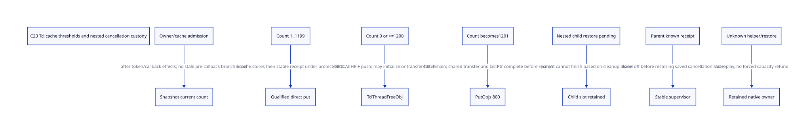.
Direct return covers counts 1..1199; the 1200 helper boundary retains 401 and
transfers 800. Unknown helper/restoration retains native-owner and slot custody.
Source-bound arithmetic and conditional model closure do not qualify native C23.

* RESEARCH PutObjs physical publication and cache incarnation
:PROPERTIES:
:AUTHORITY: GambitPutObjsCustody
:END:

[[file:putobjs-custody-design.org][PutObjs custody design]], [[file:putobjs-custody-matrix.org][projected benefit/gap matrix]],
[[file:models/sysml/putobjs-custody.sysml][SysML]], and 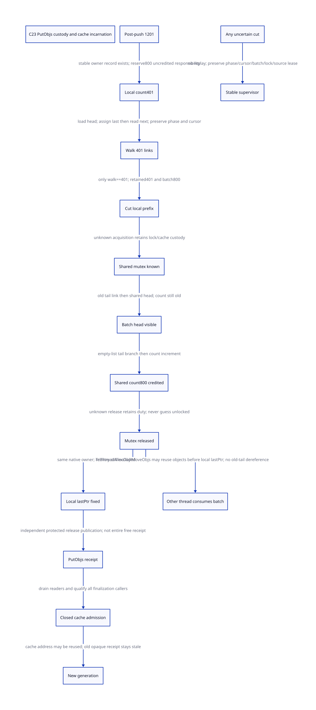 refine local split, shared mutex publication,
unlock and lastPtr before a distinct receipt. Keep=0 finalization/TLS, native
pointer refinement and unknown lock recovery remain separate unresolved obligations.

* RESEARCH PutObjs / MoveObjs pointer graph and old-tail authority
:PROPERTIES:
:AUTHORITY: GambitPutObjsMoveGraph
:END:

[[file:putobjs-move-graph-design.org][Pointer graph design]], [[file:putobjs-move-graph-matrix.org][projected matrix]],
[[file:models/sysml/putobjs-move-graph.sysml][SysML]], and 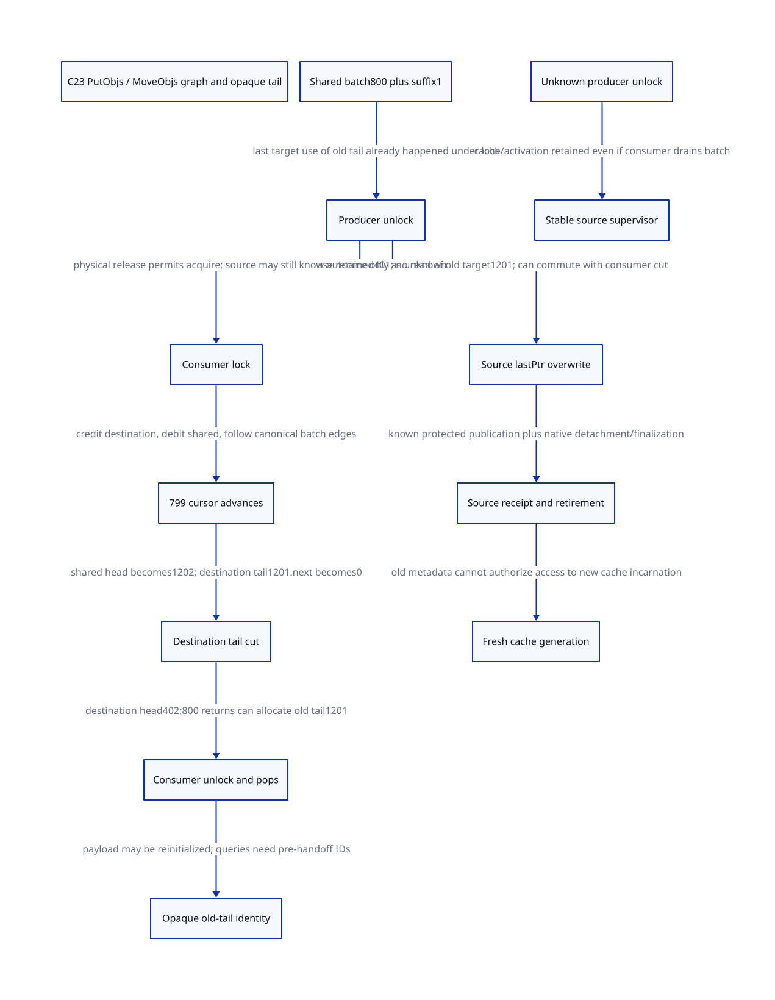 refine the actual shared-consumer schedule.
799 MoveObjs cursor reads and800 returns can reuse old tail1201 before source
lastPtr is overwritten. Stable identity is distinct from a target lease; unknown
source return still blocks source retirement despite consumer progress.

* RESEARCH Native node storage and complete reader authority
:PROPERTIES:
:AUTHORITY: GambitNodeStorageAuthority
:END:

[[file:node-storage-authority-design.org][Storage binding design]], [[file:node-storage-authority-matrix.org][projected matrix]],
[[file:models/sysml/node-storage-authority.sysml][SysML]], and 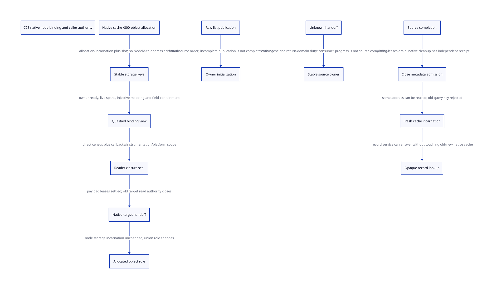 separate NodeId from allocation/slot/incarnation.
Direct Cache.lastPtr writers are classified; diagnostic callouts, NR interior
aliases, object hooks and platform TLS still block global native qualification.

* RESEARCH GetCache private construction and Ready diagnostics
:PROPERTIES:
:AUTHORITY: GambitCacheReadyPublication
:END:

[[file:cache-ready-publication-design.org][Ready publication design]], [[file:cache-ready-publication-matrix.org][projected matrix]],
[[file:models/sysml/cache-ready-publication.sysml][SysML]], and 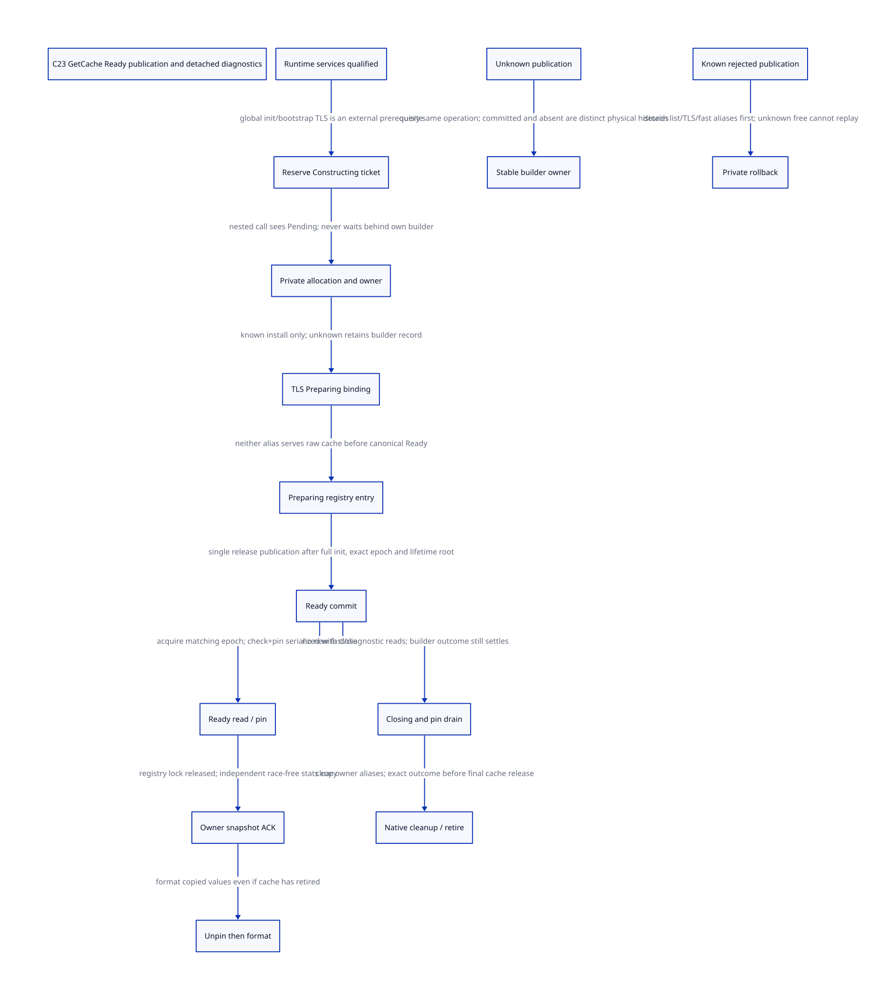 separate runtime-service readiness, private
thread-cache construction, platform/fast TLS, pin/close and detached diagnostics.
Unknown installation/publication/free retains stable custody. Legacy raw readers,
platform providers and race-free owner snapshots still require native qualification.

* RESEARCH Runtime services and platform / fast TLS lifecycle
:PROPERTIES:
:AUTHORITY: GambitRuntimeTlsReady
:END:

[[file:runtime-tls-ready-design.org][Runtime/TLS design]], [[file:runtime-tls-ready-matrix.org][projected matrix]],
[[file:models/sysml/runtime-tls-ready.sysml][SysML]], and 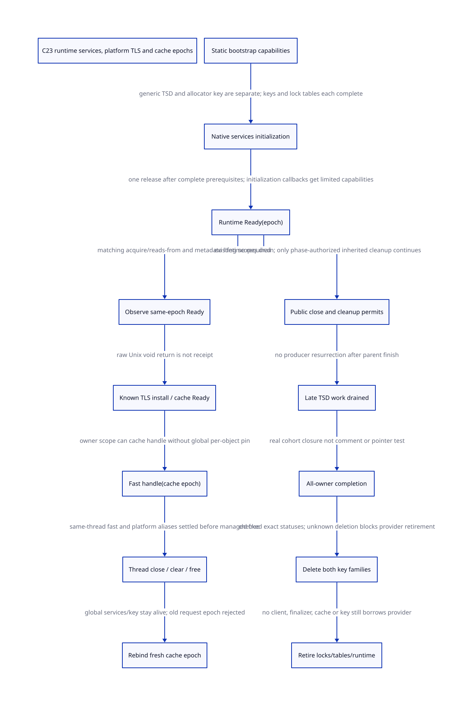 connect real Unix/Windows key policies to bootstrap,
thread-only rebind, phase-limited finalizers, two key families and provider retirement.
Four ignored Unix statuses and free-before-clear are source facts; native C23
ordering, all-owner closure and callback/panic behavior remain explicit blockers.

* RESEARCH Exit-domain producer closure and local versus global retirement
:PROPERTIES:
:AUTHORITY: GambitExitDomainDrain
:END:

[[file:exit-domain-drain-design.org][Exit-domain design]], [[file:exit-domain-drain-matrix.org][projected matrix]],
[[file:models/sysml/exit-domain-drain.sysml][SysML]] and 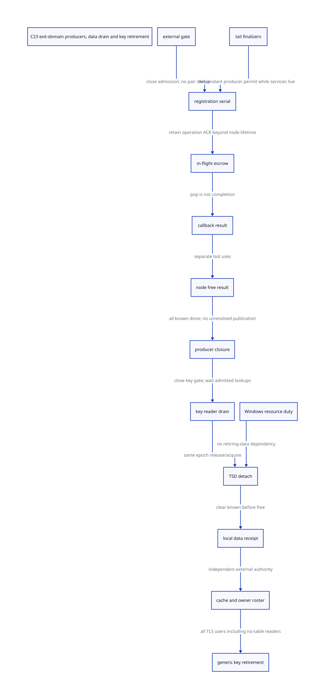 distinguish duplicate registrations,
in-flight callback/node duties, subsystem-tail producers and key-only readers.
Local data drain cannot authorize global key deletion. Native producer closure,
resource status and full C23 refinement remain unresolved; zero old paths retired.

* RESEARCH Independent runtime ownership architecture
:PROPERTIES:
:AUTHORITY: GambitRuntimeOwnership
:END:

[[file:runtime-ownership-design.org][Ownership architecture and compositional witness]], [[file:runtime-ownership-matrix.org][native-SysML matrix]],
[[file:models/sysml/runtime-ownership.sysml][SysML]] and 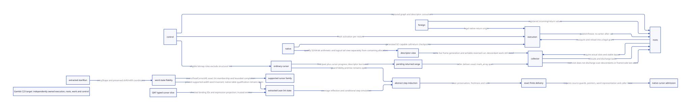 distinguish execution, VM-root storage,
collector work, captured frames and native return segments. Canonical
RuntimeComposition references this contract. The new candidate QNT and typed
Lean kernels study the replacement mechanism; full source/semantic/C23 and
physical-worker refinement remain open. Repair evidence remains a constraint.
