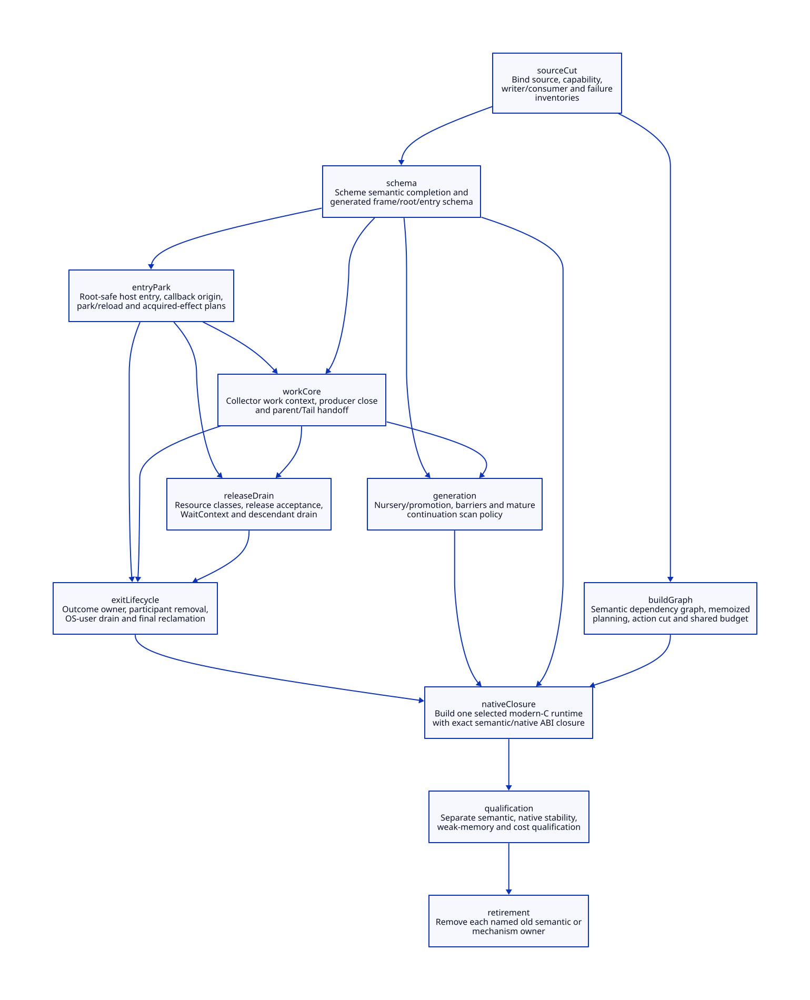
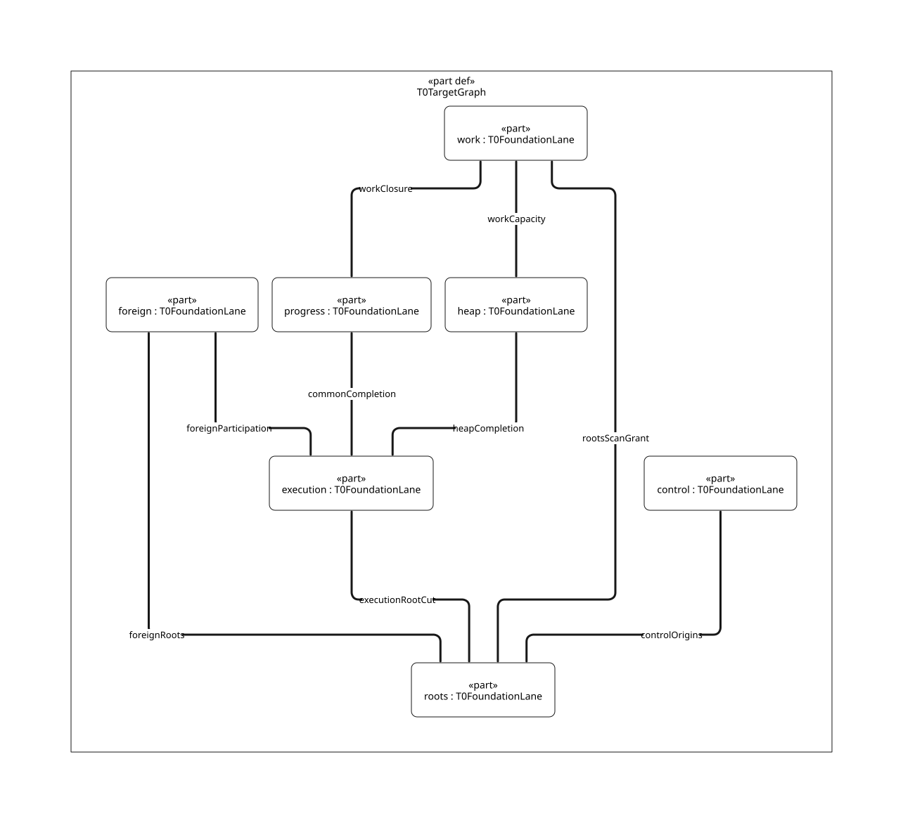

#+TITLE: Gambit Multicore Runtime Refactoring Blueprint in Modern C
#+SETUPFILE: ../../modeling/org/setup.org
#+CATEGORY: modern-c
#+OPTIONS: toc:3 num:t
#+PROPERTY: header-args :eval never

* RESEARCH A composed runtime with one Scheme semantic owner :modern_c:runtime:
:PROPERTIES:
:ID: c8a59cae-9035-4b51-b96c-c2498f2b7bea
:CUSTOM_ID: modern-c-runtime-blueprint
:OWNER: Gambit modern-C refactoring
:AUTHORITY: GambitRuntimeComposition; GambitRefactoring; GambitToolchain
:STATUS: design-only-composition-open
:EVIDENCE_CLASS: source-bound-architecture-and-conditional-benefit
:DEPENDS_ON: ROOT-HANDOFF; CONTROL-ORIGIN; RETIRE-WINDOW; GC-WORK-CLOSURE
:END:

This blueprint composes [[file:../pressure-map.org][the eight selected refactoring pressures]] into one
modern-C architecture. It uses Scheme-owned semantic contracts to amplify proper
tail calls, reusable continuations, C generation, C ABI, FFI and multicore
embedding, with semantic preservation as the foundation. Modern C is mandatory;
Zig remains a separately justified replacement candidate. Neither a second
runtime nor a foreign implementation language is required to realize this
architecture. LLVM/MLIR can consume a completed semantic contract through a
service interface without becoming the owner of Scheme or collector semantics.

There are three canonical model owners: [[file:../../architecture/runtime/models/sysml/composition.sysml][runtime composition]] owns module and
shared-interface relationships; [[file:../models/sysml/adoption.sysml][refactoring]] owns migration and benefit cases;
[[file:../../architecture/toolchain/models/sysml/architecture.sysml][toolchain]] owns incremental and parallel build contracts. Org owns arguments
and decisions. D2 and matrices derive from these models; there is no second
layout/configuration inventory. Existing QNT/Lean sources remain under models/.

** Read the architecture as responsibilities and prerequisites
:PROPERTIES:
:CUSTOM_ID: blueprint-navigation
:END:

- [[file:../../architecture/runtime/blueprint-map.org][Nine responsibilities, nine shared interfaces and source evidence]]
- [[file:../../architecture/runtime/diagrams/blueprint.svg][Runtime contract view]] and [[file:../../architecture/runtime/diagrams/blueprint.d2][D2 source]]
- [[file:blueprint-matrix.org][Eight benefit cases and eleven migration nodes]]
-  and [[file:diagrams/migration.d2][D2 source]]
- [[file:../../architecture/toolchain/incremental-build-design.org][Incremental and parallel build redesign]]
- [[file:../../architecture/toolchain/gerbil-macro-chain-design.org][gxi/gxc phase-aware module service refactoring]] and [[file:../../knowledge/systems/build-modernization.org][Chez/OCaml/Dune mechanism learning]]: immutable producer products, isolated frontend sessions, readiness-specific consumers, and one admitted executor; this is a compiler/service boundary change rather than a command-runner configuration.
- [[file:../../modeling/proof-obligations.org][Single closure ledger and new open composition obligations]]

Separate responsibility IDs do not imply separate processes, OS threads or
heap allocations. Combining storage is allowed when its consumers and lifetime
coincide. The runtime diagram shows contract producer/consumer relationships,
not every native call. The migration graph shows prerequisite deliveries;
runtime request cycles must not be mistaken for migration cycles.

** Selected direction and deliberately open decisions
:PROPERTIES:
:CUSTOM_ID: selected-direction
:END:

#+NAME: blueprint-decision-status
| Area | Selected architectural direction | Still requires evidence |
|---+---+---|
| Semantic ownership | Scheme completes semantics and generates native contracts; C mechanically realizes them | Complete primitive, FFI, frame and runtime-role coverage |
| Runtime identity | Distinguish VM, execution, participation, work custody and external-resource lifetime | Actual supported-host population and every transition |
| GC organization | Explicit work contexts and phases; private/claimed/queued/descendant custody survives owner transitions | Exact copy subframes, producer closure, resize/capacity and weak-memory refinement |
| Generation goal | Context-local young allocation, remembered mature-to-young edges and parallel stopped-mutator minor collection | All writers, promotion capacity/failure, mature continuation mutation and measurable net gain |
| Major collector | Preserve moving-root/control semantics behind the phase contract while evaluating its evolution | No unconditional selection of concurrent major collection or OCaml's major algorithm |
| Foreign support | Explicit root-safe entry, legal owner, park/reload and acquired-effect cleanup | Complete real callers and native-unwind boundaries; preserve existing supported C capability |
| Build system | Scheme-owned semantic units; dependency-aware planning, content-based rebuild decisions and bounded execution | Complete input cut, bootstrap lineage, output transaction and all nested schedulers |

These are design selections, not native admission. A sound full-scan route
remains necessary wherever mutation closure has not justified generation-based
scan exclusion. That route belongs to the same collector contract and is not
permission to keep two manually synchronized semantic implementations forever.

** Architectural commitment: redesign the coupled runtime
:PROPERTIES:
:CUSTOM_ID: coupled-runtime-redesign
:STATUS: selected-research-direction
:END:

The research decision is to design one coherent modern-C runtime reconstruction,
not to preserve historical coupling by accumulating local repairs. Cost and
proof analysis select mechanisms and expose failure conditions; they are not
an argument against a substantial refactoring. Runtime admission remains a
later, separate evidence decision.

OCaml's relevant lesson is that parallel execution, heap organization, native
roots and synchronization must evolve together. Its paper explicitly examines
the C-interface consequences of read barriers and the alternative coordinated
minor collector. Gambit's proper tail calls, multi-shot continuations,
stack/heap frames, still objects and embedding need their own composition.
Neither OCaml's fiber semantics nor a particular major algorithm is imported
as Gambit semantics. See the primary-source ledger in
[[file:../../architecture/runtime/gc/modern-c-generational-design.org::#evidence][the generational redesign]].

#+NAME: coupled-runtime-modernization
| Architectural change | Historical coupling to remove | Necessary shared contract |
|---+---+---|
| Execution context / VM / collector worker separation | PSTATE simultaneously supplies roots, allocation and collection participation | Explicit root-domain enrollment and safe-point acknowledgement; independent work grants and phase/capacity custody |
| Generational heap and semantic stores | Whole movable-heap copying plus unchecked pointer writes | Young allocation, promotion, remembered source slots/cards, bounded noncollecting barriers and complete major collection |
| Continuation and native root integration | Implicit macro/frame knowledge and unmediated raw references | FrameSpec, PointId, capture/restore/mutation coverage; parked raw borrows and rooted reload |
| Resource release coordination | Arbitrary foreign cleanup inside GC/teardown and unclear last users | Preaccepted custody, legal owner dispatch, no waits on one's own pin/callback, shutdown descendant drain |
| Generated native contracts and incremental builds | Repeated semantic/layout inference and coarse invalidation | Scheme-owned ModuleSpec/FrameSpec; typed modern-C consumers; explicit input/action/output identities |

The [[file:../../architecture/runtime/gc/modern-c-generational-design.org][modern-C generational design]] now provides the concrete collector policy,
store categories, theoretical work equation and retirement dependencies.
[[file:../../architecture/runtime/ffi/rc-freeze-publication.org][Native freeze and publication]] provides the associated C/FFI contract.
These extend existing SysML component owners and root-level QNT/Lean models.
No second runtime, renamed copied model or C++ migration is selected. LLVM/MLIR
remain consumers of completed semantic contracts; Zig still requires a distinct
incremental benefit beyond this modern-C reconstruction.

* RESEARCH The boundary between Scheme and modern C
:PROPERTIES:
:CUSTOM_ID: semantic-native-boundary
:END:

The [[file:../../../vendor/gambit/gsc/_front.scm::225][current front end]] builds a compilation context, environment and C interface
before normalization. [[file:../../../vendor/gambit/gsc/_t-c-1.scm::880][The C target linker]] also consumes module demand/supply,
ordered flags and metadata. The semantic export must include these obligations;
it cannot be reconstructed reliably from generated C or a filename alone.

The proposed completed plan contains the following logical records. This is
contract notation, not an implemented data schema or compiler pass:

#+NAME: completed-native-plan
#+BEGIN_EXAMPLE
SemanticUnit = producer identity + ordered source/phase closure + module identity
CompletedPlan = normalized/GVM operations + effects + primitive/FFI contracts
FrameSpec = slot interpretation + return/control edges + exact scan/reload rules
PointId = plan-scoped identity of entry/checkpoint/return/exception obligation
LayoutContract = target projection + object/frame/root ABI identity
ModuleContract = ordered supply/demand/init/foreign text + semantic-link metadata
#+END_EXAMPLE

Scheme owns evaluation order, closure semantics, nonlocal control legality,
tail positions, root liveness and checkpoint placement. Generated C owns the
mechanical realization: object accesses, frame/root maps, entry stubs, polling,
dispatch/trampoline edges and native declarations. Runtime C owns admitted
allocation, synchronization, OS and resource mechanisms. A C macro may remain a
mechanical access primitive; it must not become a second owner of semantic
frame, root or control decisions.

The current wait wrapper already orders return-address store, W_ALL, wait,
R_ALL and return-address reload. Reuse that contract. Retirement means removing
duplicated decisions after every generator and runtime consumer migrates; it
does not mean deleting a correct wrapper before its replacement qualifies.

* RESEARCH Runtime modules compose through epoch-bound contracts
:PROPERTIES:
:CUSTOM_ID: runtime-composition
:END:

** Execution, roots and control
:PROPERTIES:
:CUSTOM_ID: execution-roots-control
:END:

Execution grants name a live VM/context incarnation and exclusive legal owner.
Participation separately names the collection epoch and rendezvous state. Root
slots name their actual custodian and frame/ABI interpretation. Collector work
names a task and grant; none of these identities substitutes for another.
Existing CollectionScope and ResourceScope definitions remain the common
identity vocabulary rather than being copied into every subsystem.

At a GC-capable checkpoint, generated code materializes all required roots and
control metadata, acknowledges the cut and stops forbidden mutation. A scanner
must observe the published values and can update moving slots. Reentry must
reacquire ownership and reload the relocated values before managed execution.
Release/acquire ordering, slot lifetime and incarnation checks are proof
obligations; observing a Boolean rootsPublished is not their proof.

Control owns current, saved and captured frame origins, denv, frame mutation,
serialization reconstruction and restoration. Generated FrameSpec and PointId
connect those paths to the scanner. An effect-handler interface may be layered
over supported control, but the architecture must not silently reduce Gambit
continuations to one-shot resumptions or allow jumping through an unqualified
native frame. Unsupported new crossing modes need explicit admission policy;
existing supported Scheme/C behavior must remain represented.

** Collector work, allocation and generations
:PROPERTIES:
:CUSTOM_ID: collector-generation
:END:

PSTATE currently selects many collector lists and cursors. The new logical
CollectorWorkContext carries phase/grant identity, scan frontier, private copy
state, queue/claim custody, pending parent continuation, Tail responsibilities
and capacity grants. Logical worker roles may initially run on existing
participants; creating independent OS workers is an additional admitted mode.
No caller may assume worker ID, processor ID and execution owner are identical.

For the forwarding winner, visible forwarding is not a completed initializer.
The context must preserve the immutable incoming slot, source/destination
regions, initialized prefix, pending decrement, payload end, publication state
and parent advance at every admitted cut. Tail preparation is accounted before
it becomes executable. A rejected transfer restores the exact initializer
state; an unknown outcome freezes source execution and retains counted custody
and region pins. The existing [[file:../../architecture/runtime/interfaces/pair-resume-design.org][PAIR resume study]] is supporting work, not a
complete copy-subframe adapter. Byte-level native cuts remain unqualified.

The selected generation goal uses fast context-owned young allocation under
an exclusive execution grant, shared mature storage and remembered slots for
mature-to-young edges. At minor collection, mutators stop at qualified root
cuts; workers process complete roots and remembered edges, reserve promotion
capacity and relocate survivors. Allocation checks and common capacity results
must refer to the same collection epoch; one context cannot spend a stale grant
after another request resizes or consumes it. Failure must have a declared
retry/major-collection/resource-error route while roots and initialized state
remain owned. No partly initialized object is scanned as complete.

Reserve capacity before making a copy's forwarding/initialization obligation
externally visible. Once visible, an abort cannot simply forget the destination
or restart the parent scan. A capacity-failure route must finish or retain that
exact initialization responsibility before admitting another collection; its
failure semantics and any reserved emergency space remain explicit obligations.

The remembered set needs every relevant write: generated mutation, runtime
helpers, root updates, frame/denv changes, deserialization and FFI. New objects
also need an initialization-to-publication rule. If mature continuations cannot
change except through covered writers, minor GC can scan their dirty/logged
edges instead of the entire mature graph. An opaque C borrow needs tracked
stores, an explicitly sound conservative scope, or a full-scan route. Merely
assuming no mutation is not admissible. After major relocation, all remaining
slot locations and log ownership must be refreshed or rebuilt before another
minor cycle; raw remembered addresses cannot outlive moved containers.

Full heap scanning does not repair an unknown C root or an escaped raw pointer
that cannot be updated after movement. Such boundaries need a valid handle,
pinned representation or enforced borrow lifetime before the moving/worker mode
can be admitted. A sound fallback covers known roots and untracked reachable
heap mutations; it cannot manufacture missing native pointer ownership.

The first modern-C realization can retain an explicit stopped-mutator major
tracing/moving phase. Concurrent major collection is a separate algorithmic
decision requiring its own deletion/insertion barrier, root and termination
arguments. Thus the blueprint studies OCaml's generational benefits while
preserving Gambit's object/control and still/foreign-object choices.

** FFI, release and shutdown are one lifecycle composition
:PROPERTIES:
:CUSTOM_ID: foreign-release-exit
:END:

Before an allocating marker or callback entry, protect the incoming Scheme
values and establish the exact VM/processor owner. Record only actually acquired
effects. Nested callbacks stack origin/grant state; return or exception restores
the matching origin and disposes each acquired effect once. A blocked host ends
its managed borrow, publishes a qualified root cut and follows the participation
handshake. It cannot continue touching movable Scheme values while parked.

Foreign release is classified by actual resource effects: collector-safe local
cleanup, blocking native work, owner-thread work, and callbacks requiring Scheme
admission. The latter classes require the appropriate explicit route; arbitrary
existing C finalizers cannot be moved to a worker by assumption. For an eligible
deferred task, acceptance transfers payload/root and cleanup responsibility
before source storage is dismantled. Failed acceptance leaves responsibility
with the source; accepted failure has a retained result and final owner.

WaitContext tests and sleeps under the same synchronization protocol that
publishes completion, with the condition rechecked after wake. Cancelling a
waiter does not cancel accepted cleanup responsibility. A task that creates
descendants transfers or increments their accounting before dropping its own
credit. Closing external producers does not prohibit already accepted tasks
from producing accounted descendants. This is necessary for both no-lost-wakeup
and shutdown termination arguments; the blueprint does not prove OS fairness.

Shutdown seals external entry and error admission while receivers remain live,
drains or explicitly transfers accepted callbacks/work/resources, settles
outcomes and legal OS users, then removes participation and reclaims each target
after its own last consumers. Transfer can create new collector/release work,
so completion needs a recheck under the membership/request synchronization
boundary. A drained queue alone is insufficient. Descriptor storage can outlive
execution but must have a bounded, generation-safe reclamation policy.

* RESEARCH Learn mechanisms, retain Gambit's choices
:PROPERTIES:
:CUSTOM_ID: ocaml-learning
:END:

The [[https://ocaml.org/manual/5.3/parallelism.html][OCaml 5.3 manual]] describes domain-local young allocation, parallel
stopped-world minor evacuation and a concurrent major heap. These are distinct
choices. Gambit's candidate can adopt explicit generational edge coverage and
parallel minor work without selecting that major collector or domain ABI.

The local learning source is pinned at OCaml commit
46e1c324fb9e9f21f52c9cc3399020f7ef8b9b91, not inferred from a release name.
[[file:../../../vendor/ocaml/runtime/domain.c::2262][Domain termination]] finishes work, orphans resource-related work, rechecks new
mark/sweep work and serializes removal from the participant set. This motivates
Gambit's producer-close/transfer/recheck contract, not a literal domain port.
[[file:../../../vendor/ocaml/runtime/minor_gc.c::533][Minor collection]] explicitly partitions remembered-set work; [[file:../../../vendor/ocaml/runtime/memory.c::176][the write barrier]]
combines collector-specific obligations. Those ranges are hashed in the derived
map. Their memory-order details cannot serve as a generic Gambit C proof.

[[https://arxiv.org/abs/2104.00250][The effect-handler research]] demonstrates that control implementation and
stack-tool compatibility belong in the design. Gambit already has richer
nonlocal control; the lesson is to preserve and expose its invariants. No
OCaml benchmark number or proof transfers to this runtime.

* OPEN Benefit, migration and retirement are independently gated
:PROPERTIES:
:CUSTOM_ID: blueprint-benefit-and-retirement
:STATUS: theory-and-refinement-open
:END:

[[file:blueprint-matrix.org][The model-derived matrix]] has exactly one case per original pain ID. Each
names eliminated work, unavoidable added cost, a positive condition, refutation
and an open obligation. Examples include fewer mature-graph visits versus
barrier/log/promotion work; less rendezvous delay versus work-context traffic;
and fewer generation/compile actions versus planning/hash/storage work.

No single percentage summarizes these different dimensions. Use matched
capabilities and separately account executed work, critical path, peak/retained
memory, supported failure behavior and ownership decisions still duplicated.
A deferred destructor reduces a GC pause only if its queue/retention/drain cost
is acceptable; it does not eliminate the destructor's total work. A new worker
mode is useful only if work balance/progress gains exceed its synchronization
and metadata costs. AI implementation assistance does not remove these costs.

The migration DAG permits buildGraph to advance alongside semantic schema work.
entryPark precedes workCore; generation and releaseDrain consume those common
contracts; exitLifecycle composes accepted work/resources/outcomes. Exact native
closure and separate qualification precede per-route retirement. Shared support
gets one owner and is charged once across its users, not separately credited as
a benefit for every subsystem or for Zig.

Retirement preserves a supported capability while replacing its implementation
owner. Remove duplicated frame decisions after all consumers agree; remove
PSTATE collector dependence after every relevant producer/consumer migrates;
remove inline release only for eligible classes; remove coarse build envelopes
only after dependency and failure-publication equivalence. Correct mechanical
C accessors, sound full scans, required bootstrap stages and C ABI surfaces may
remain. Their mere existence does not count as failed retirement.

Eight new composition obligations extend the existing ledger. Existing partial
source facts and historical QNT/Lean results retain their scope. No runtime
contract is compositionally closed, no old runtime path is retired, and no new
native or performance result is asserted by this blueprint.

** Refinement ownership and missing composition
:PROPERTIES:
:CUSTOM_ID: blueprint-formal-frontier
:END:

#+NAME: blueprint-formal-correspondence
| Boundary | Existing unique formal owner | What the blueprint still needs |
|---+---+---|
| Root/park/reentry | ROOT-HANDOFF binding and its existing host_root_participation QNT / HostRootParticipation Lean | Complete legal producers and slot values, nested acquired effects, weak-memory publication and native restoration |
| Continuation origins | CONTROL-ORIGIN binding and existing saved-origin model/Lean companion | Mutation/serialization writers, generation barriers, physical frame/slot identity and all supported restores |
| Work/copy/phase | GC-WORK-CLOSURE and gc_work_closure QNT with its current Lean bindings | Exact partial-copy subframes, phase producer closure, capacity/resize and worker termination refinement |
| Exit/resource lifetime | RETIRE-WINDOW plus the existing release/retirement research under its owners | Compose accepted descendants, WaitContext, outcomes and legal OS users; earlier lifetime support is not a whole shutdown proof |
| Incremental/parallel build | Toolchain SysML, the new incremental_build QNT / IncrementalBuild Lean set, BF-BUILD-CUT / BF-BUILD-BUDGET | Bounded action protocol and conditional algebra exist; dynamic cut completeness, actual producer/step refinement, token progress and transactional publication remain open |

Reuse the exact existing binding sources and inventories from the derived
ledger. Do not copy a finite model into DEV or promote a companion theorem to
an unbound source. A valid composition must relate concrete steps and identity
domains, preserve invariants through failures, and supply liveness assumptions;
matching names or connecting model boxes cannot discharge those obligations.

[[file:../../architecture/toolchain/source-chain-design.org][The GSC source case]] and [[file:../../modeling/component-model-map.org][SysML-derived component/model matrix]] now instantiate the build side. Model-source identity, parsed specification, kernel-checked conditional theorem and native qualification remain separate.

** RESEARCH T0 GC/SMP foundation and concrete frame interface
[[file:t0-foundation-design.org][The T0 target refactoring design]] separates existing root model evidence from the new execution/participation/collector-work architecture. [[file:../../architecture/runtime/models/sysml/composition.sysml][Seven target lanes and exact baseline reuse]] and  derive from the existing runtime-composition owner. [[file:../../architecture/runtime/interfaces/frame-contract-design.org][FrameSpec coordinate/root laws]] are one shared interface; they do not substitute for a redesigned collector, scheduler or progress proof.

** RESEARCH Amplification through generated store contracts
[[file:../../architecture/runtime/gc/generational-barrier-design.org::#amplification][The barrier design]] makes Scheme's source-age/value/escape and safepoint
knowledge an input to native optimization. [[file:../../architecture/runtime/gc/generational-barrier-matrix.org::#barrier-amplification-matrix][The native-derived matrix]] records
proved generational barrier elimination, mature multi-shot frame reuse,
predictable C entry and parallel copy custody as capability goals. Every gain
has work units, added costs and a falsifier; preservation is the foundation.

* Physical promotion and epoch publication
:PROPERTIES:
:CUSTOM_ID: promotion-residual-blueprint
:END:
[[file:../../architecture/runtime/gc/promotion-residual-design.org][The promotion/residual study]] makes an architectural replacement explicit:
Scheme-generated FrameSpec/layout costs feed unique claims and physical reserve
receipts, while root/FFI domains settle before a staged remembered-set epoch is
published. Existing C forwarding and parallel assets are credited. The mandatory
modern-C path can remove repeated mature continuation work only after complete
alias/weak/writer closure; its simultaneous destination, recovery and two-bank
metadata costs are charged in [[file:../../architecture/runtime/gc/promotion-residual-matrix.org][the native-derived benefit matrix]].

* Explicit native interval and reader lifetimes
:PROPERTIES:
:CUSTOM_ID: interval-retirement-blueprint
:END:
[[file:../../architecture/runtime/gc/promotion-interval-handoff-design.org][The physical-interval refinement]] replaces PSTATE-only ownership assumptions
with allocator-issued extent receipts, immutable copied-prefix/suffix layouts,
idempotent worker-to-context ownership commit and finite reader tokens. All six
prepare_mem_pstate calls, root/FFI borrows, queue stealing, resize and destruction
must adopt these contracts before their implicit ownership paths can retire.
Existing same-PSTATE tail reuse is credited; late refunds cannot be counted as
reducing an earlier GC peak. [[file:../../architecture/runtime/gc/promotion-interval-handoff-matrix.org][The matrix]] charges placement, lifetime and peak
costs explicitly; no new Zig runtime or native implementation is introduced.

* Guaranteed future allocation roles in the pre-forward plan
:PROPERTIES:
:CUSTOM_ID: guaranteed-tail-blueprint
:END:
[[file:../../architecture/runtime/gc/guaranteed-tail-placement-design.org][The guaranteed-placement refinement]] binds Scheme-emitted ordered allocation
bounds and first resume PointIds to actual copy fences and future context
intervals. A heap allowance, span guard, stack grant, pending GC-completion
capacity and failure reserve are separate roles. Unknown commit cannot activate
a context, and actual surplus found after copying remains a late refund.
[[file:../../architecture/runtime/gc/guaranteed-tail-placement-matrix.org][The matrix]] compares every acquisition/copy/restore/failure phase against an
explicit baseline. Existing same-PSTATE tail reuse is credited; a separated
worker/context design gains space only when it avoids real fresh backing without
compensating arena/metadata growth or another dominant phase.

* Real rest constructor as a joint-capacity migration cut
[[file:../../architecture/runtime/gc/rest-gc-resume-envelope-design.org][The structure/rest chain]] requires Scheme argument-shape/PointId/FrameSpec and
C-backed noncollecting completion before framed GC. Restore heap0 is separate
from stack2, repeated frame8 growth and the following small/still allocator.
Retire implicit global-reserve sufficiency and unconditional post-GC grants only
after every caller and actual backing consumer is migrated. Existing pair/vector
semantics, roots and continuation lifetimes remain authoritative until then.
This amplifies precise portable-C generation and safe GC placement; Zig adds no
established incremental semantic or peak benefit here.

* Structure slow-path modernization cut
[[file:../../architecture/runtime/gc/structure-poll-still-envelope-design.org::#structure-migration][The POLL/frame/still replacement order]] adds PollEffectSpec, typed frame-growth
and noncollecting StillInitSpec to the Scheme-to-modern-C contract. Arbitrary
interrupts, exceptions and multi-shot captures remain language capabilities;
unknown effects refuse finite peak qualification, not execution. C owns actual
container/assignment/pin accounting, initialized-root publication and safe-point
acknowledgement. Unifying these removes hidden duplicated reasoning only after
all consumers migrate; no runtime path or existing reuse is newly claimed saved.

* Still initialization as an explicit modern C runtime boundary
[[file:../../architecture/runtime/gc/still-init-safepoint-design.org][The root/init/participation design]] assigns semantic InitSpec and PointId to
Scheme, physical fill/root records and request-generation leases to modern C.
Refcount, interrupt masks and pending flags no longer substitute for scan-ready
publication. Nested callbacks retain parent activation roots; unknown service
results retain full backing and the original initializer. Mature-object
initialization joins remembered-set coverage before minor collection.
Retire fixed scratch and implicit no-GC intervals only after all constructor,
SAVE/RESTORE, callback, exception and native-exit consumers migrate. This enables
context/collector separation without weakening continuation or FFI semantics;
no Zig-specific additional benefit or native retirement is established here.

* Recoverable initialization and result ownership
[[file:../../architecture/runtime/gc/still-init-recovery-design.org][The partial/result design]] gives modern C an operation record, generation-bound
initializer and atomic recipient-root/receipt boundary. Scheme supplies typed
InitSpec, cursor and invocation identity; multi-shot continuation calls remain
distinct semantic invocations. Readback never replays constructors or native I/O.
A synchronous fast path can keep one final cut. Per-field atomics, a copied input
image or a second runtime are not implicit requirements. Root/input/dedup
lifetimes and source memory order must close before old ownership paths retire.

* Native isolation before failure and exact retirement
[[file:../../architecture/runtime/gc/still-owner-retirement-design.org][The owner/root/receipt boundary]] separates native helpers from GC participants
only after independent roots, opaque handles, reserved buffers and collector
resources are established. Stop confirms an executor; full writer/borrower
closure authorizes only private effect-free replay. Managed materialization keeps
its own no-reentry and result-root gate. Complete reply records can shrink after
ACK/close/child drain, while late-retry generation fences persist. These changes
replace PSTATE-coupled ownership and ignored join outcomes in admitted services;
ordinary synchronous C remains the efficient constructor path. No native path is
retired or Zig-specific net benefit established by the model.

** RESEARCH Managed heap materialization and owner-loss custody
:PROPERTIES:
:CUSTOM_ID: managed-materialization-custody
:AUTHORITY: GambitStillMaterializationCustody
:STATUS: conditional-models-native-refinement-open
:END:
[[file:../../architecture/runtime/gc/still-materialization-custody-design.org][The modern C materialization study]] separates scan-valid shell enrollment,
write-lease closure, physical backing and result-root handoff. Its six needs
(MC-H/I/SHELL/WRITE/ROOT/RECOVER) are native SysML projections, evaluated by
the existing ASCENT DSL; SP-STILL depends on MC-ROOT and MC-RECOVER.
QNT checks22 named histories plus bounded positive/negative simulations. Lean
checks16 named statements including root Step/Trace preservation. These local
checks do not establish native writer closure, C atomics or allocator recovery.
Unknown-live heap writers cannot detach from a moving collector merely because
slots are valid. Stop/borrower closure permits abort and scanning without replay.
The current graph has118 needs,362 direct edges,58 source routes and8 shared
contracts;44 local model slices,61 source gaps and13 platform gaps; zero complete
or native-qualified components. Earlier study sections remain historical scopes.
The receipt and native-derived work/peak matrix are linked from the study.

** RESEARCH Heap authority closure and canonical still-domain handoff
:PROPERTIES:
:CUSTOM_ID: still-authority-handoff
:AUTHORITY: GambitStillAuthorityHandoff
:STATUS: conditional-models-native-source-refinement-open
:END:
[[file:../../architecture/runtime/gc/still-authority-handoff-design.org][The modern C authority/handoff study]] separates closing grant ingress from
settling pending writers/borrowers, native stop evidence from operation closure,
and physical StillDomain custody from old PSTATE cleanup. Current resize cleans
up before it joins; target ownership must be transferred before destructive
cleanup. A canonical domain retains one chain/charge and remains enumerable by
GC after processor retirement. Unknown raw writers/allocator mutation still
block; unknown commit replies retain aliases and query the canonical decision.
SysML owns AH-H/I/CLOSE/STOP/CHAIN/ADMIT and their dependencies. Root QNT
checks34 named histories; Lean checks22 named conditional statements including
Gate Step/Trace debt/no-reopen kernels. Current projection:124 needs,389 edges,
62 source routes,8 shared contracts;46 local model slices,65 source gaps and
13 platform gaps, zero complete/native-qualified components. Earlier sections
retain their historical scopes; no runtime or raw ABI path retires here.

** RESEARCH Canonical still inventory and snapshot-consistent capacity
:PROPERTIES:
:CUSTOM_ID: still-ledger-snapshot
:AUTHORITY: GambitStillLedgerSnapshot
:STATUS: conditional-models-native-refinement-open
:END:
[[file:../../architecture/runtime/gc/still-ledger-snapshot-design.org][The modern C ledger/snapshot study]] separates published/private/retired
backing from unbacked grants, phase counters and allocator request bytes. A
post-GC cut can still contain unbacked caller requests. Owner commit must share
revision/epoch admission with sweep and accounting publication. Metadata pins
are not raw payload capabilities. Unknown allocator/free results retain custody.
SysML owns LS-H/I/INVENTORY/INTENT/SNAPSHOT/RECLAIM. Root QNT checks30
histories and Lean checks16 named propositions, including a refund Step/Trace
kernel. Native projection:130 needs,415 edges,66 source routes,8 contracts;
48 local model slices,69 source gaps,13 platform gaps, zero complete/native-
qualified components. Prior sections retain historical scopes. No runtime
implementation, native test, measured saving or old-path retirement is claimed.

* RESEARCH Allocation receipts and atomic snapshot admission :modern_c:gc:
:PROPERTIES:
:CUSTOM_ID: still-receipt-admission
:AUTHORITY: GambitStillReceiptAdmission
:STATUS: conditional-extension-source-refinement-open
:END:
[[file:../../architecture/runtime/gc/still-receipt-admission-design.org][The receipt/admission study]] separates raw effects, immutable outcome
publication, exactly-once logical settlement and caller delivery. One domain
gate excludes sweep/accounting mutations from owner handoff. Raw pre-publication
loss remains unknown; no wrapper can infer a malloc/free result from stop alone.
The direct Darwin executable-path malloc/free path also bypasses allocation macros.
SysML drives a separate explicit 11-need,16-edge ASCENT extension: six new needs
and five imported open source premises. Current exact receipts qualify only
RA-H/RA-I; nine source obligations remain open, zero components qualify.
QNT checks19 named histories plus100 bounded sampled histories; Lean checks10
conditional declarations. The all-scoped-positive control is synthetic.
The historical130-need/415-edge global receipt is not recomputed or superseded
by this extension. No runtime implementation, native test, measured improvement
or executed old-path retirement is claimed. Gate contention, retained liability
and metadata bounds remain admission costs; modern C is the mandatory path.

* RESEARCH Native completion, exceptional exit and receipt lifetime :modern_c:gc:
:PROPERTIES:
:CUSTOM_ID: still-completion-lifetime
:AUTHORITY: GambitStillCompletionLifetime
:STATUS: conditional-extension-source-platform-open
:END:
[[file:../../architecture/runtime/gc/still-completion-lifetime-design.org][The completion/lifetime study]] refines no-escape raw-call publication,
expected versus partial gate exits, stable result/VM binding and receipt reuse.
Existing signal-mask primitives and reverse restoration are reusable, but their
void wrappers discard status. Scheme interrupt deferral is not pthread-cancel
control. Known published outcomes can be recovered after qualified stop outside
the gate; raw gaps, escaped destructors and dead-held gates refuse handoff.
ID-only handles, monotone retirement floors and raw-pin drain permit record-slot
reuse; ACK alone cannot reclaim a pinned record. Pool pages remain reserved.
SysML drives12 needs and19 edges: six new needs and six imported open source
premises. QNT29 named histories and100 bounded sampled traces plus Lean16
conditional declarations qualify NC-H/NC-I only; ten source obligations remain
open and zero components qualify. All-scoped controls are synthetic.
Historical global and predecessor receipts are preserved, not requalified.
No runtime implementation, native test, measured saving or path retirement.

* RESEARCH Native root views, participation and reentry :modern_c:gc:ffi:
:PROPERTIES:
:CUSTOM_ID: native-root-reentry
:AUTHORITY: GambitNativeRootReentry
:STATUS: conditional-extension-source-platform-open
:END:
[[file:../../architecture/runtime/gc/native-root-reentry-design.org][The native root/reentry study]] freezes canonical locations and ordinary writer
permissions while allowing exclusive collector relocation writes. Phase-gated
publication transfers active acknowledgement to frozen-root duty. Reentry must
grant active participation before reload and before Tcl's first RC payload
read; callback procedure roots precede marker allocation. Activation banks and
fresh parent revisions preserve nested callbacks. Already-enlisted pending root\nscans remain owed after a return request; later round admission is arbitrated. Unknown native outcome can
coexist with a valid scan view; unknown writer/binding or a dead-held gate
cannot authorize transfer. For N contexts/K released: active ack targets N-K,
root duties N, scan work O(R); no measured speedup or peak reduction.
Native SysML:16 needs,31 edges,7 source routes,12 caller families,8 cost rows.
QNT31 histories plus100 bounded sampled traces and Lean22 conditional
declarations qualify NR-H/NR-I only. Thirteen source needs plus one native
memory-order need remain open; zero components are admitted. Five ASCENT
cases check exact digest/method/scope and lossless transport; the all-scoped
control is synthetic. Historical reports are preserved, not requalified.
No runtime implementation, native test, benchmark or runtime path retirement.

* RESEARCH Admitted root scans and whole-round reentry :modern_c:gc:ffi:
:PROPERTIES:
:CUSTOM_ID: root-scan-arbitration
:AUTHORITY: GambitRootScanArbitration
:STATUS: conditional-extension-source-order-progress-open
:END:
[[file:../../architecture/runtime/gc/root-scan-arbitration-design.org][The root-scan arbitration study]] traces direct strong root calls, real local/remote
chunk claims, private copy state, idle termination and resize/exit callers.
A return ticket retains already-enlisted pending work. Pending/Owned/Ready/
Quarantined/ACK states conserve responsibility; unknown claim replies query
the same attempt. Only complete stopped checkpoints and known target acceptance
permit cooperative migration. Partial-copy ambiguity or unknown joins retain
debt. RootAck does not authorize return: weak continuation movement, cleanup,
capacity/context preparation and request-result delivery precede ResumeSeal.
Foreign cleanup waiting on an owner callback can cycle with return; qualified
collector-safe or deferred release custody is required, otherwise refuse the
released profile. Task/checkpoint pools and retained foreign/root backing are
new peak costs; no scan or whole-round peak reduction is established.
Native SysML exports18 needs,37 edges,7 source routes,10 caller families and8
cost rows. QNT27 histories/100 bounded sampled traces and Lean22 declarations
qualify RA-H/RA-I only. Fourteen source and two native-memory-order needs
remain open; zero components qualify. ASCENT has five scope/digest/transport
controls; all-scoped evidence is synthetic. No runtime implementation, native
test, benchmark or runtime path retirement; historical reports not requalified.

* RESEARCH Whole-round resume and deferred cleanup :modern_c:gc:ffi:
:PROPERTIES:
:CUSTOM_ID: resume-seal-cleanup
:AUTHORITY: GambitResumeSealCleanup
:STATUS: conditional-source-order-open
:END:
[[file:../../architecture/runtime/gc/resume-seal-cleanup-design.org][The resume/cleanup study]] binds whole-round seal issuance to closed strong/weak
work, qualified cleanup handback, covered roots, known capacity, prepared
success/error context, committed result and current binding/writer/gate state.
GC sweep currently calls release_fn synchronously then frees its wrapper.
Explicit foreign-release!, conversion rollback and teardown retain distinct
semantics. Device cleanup may wait using PSTATE scratch; a standalone executor
needs explicit WaitContext. device_release may free storage even on error, so
error/effect/disposition must be distinct. A queued owner callback cannot run
before active permit, and cleanup must not wait for it. Unknown handoff or
GC-critical state refuses resume; independently isolated native outcome debt
may retain backing while GC resumes. No automatic callback/owner-death repair.
Native SysML:19 needs,38 edges,7 source routes,11 caller families,9 cost rows.
QNT31 histories/100 bounded sampled traces and Lean25 conditional declarations
qualify RS-H/RS-I only. Fifteen source and two native-memory-order needs remain
open; zero components qualify. Five ASCENT transport/scope/digest cases retain
a clearly synthetic positive control. No measured speedup or peak decrease.
No runtime implementation, native test, benchmark or path retirement.
