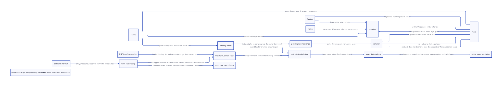

#+TITLE: Gambit C23 runtime ownership: target architecture and compositional models
#+SETUPFILE: ../../modeling/org/setup.org
#+LANGUAGE: en
#+OPTIONS: toc:3 num:nil
#+PROPERTY: header-args :eval never
#+TODO: RESEARCH DECIDED | ADOPTED RETIRED

* DECIDED DEV studies the replacement architecture
:PROPERTIES:
:CUSTOM_ID: runtime-ownership
:AUTHORITY: GambitRuntimeOwnership
:STATUS: candidate architecture; bounded witnesses and parametric kernels
:BASELINE: C23; Scheme semantic ownership; Gambit C portability
:END:

The research object is a runtime in which execution, root storage, collector work,
captured control and native return origins have independently defined ownership.
Repair evidence supplies semantic constraints, real counterexamples and cost
questions. A repair's function sequence is not the state machine of this design.
DEV adoption and native repair qualification remain different decisions.

[[file:repair-driven-gc-smp-design.org][The repair corpus study]] remains the evidence entry, not the new architecture's
implementation plan. This study advances from evidence association to one concrete
ownership mechanism and an executable cross-component witness. It does not turn
an eight-cut matrix into eight new runtime modules or merely rename PSTATE fields.

[[file:models/sysml/runtime-ownership.sysml][GambitRuntimeOwnership]] owns the proposed ownership laws, alternatives, model
subjects and proof boundaries. The canonical [[file:../../architecture/runtime/models/sysml/composition.sysml][RuntimeComposition]] references this
same contract. [[file:runtime-ownership-matrix.org][The matrix]] and  derive from native SysML, and the
[[file:../../modeling/ascent/runtime-ownership.rules.scm][actual ASCENT DSL]] checks exact law/property/kernel/source/scope associations.
Python [[file:../../modeling/tools/runtime-ownership-study.py][orchestrates the existing tools]]; it does not replace SysML or decide Scheme semantics.

* FACT The current source already has a split, with remaining coupling
:PROPERTIES:
:CUSTOM_ID: current-source
:EVIDENCE_CLASS: current working source; not a frozen repair binary
:END:

The modular collector has =collector_worker=, root-task claims and execution
contexts. In =collection-round.inc= a claimed root task still obtains
=context = task->origin->context=, and native collection functions repeatedly
obtain =ps = work->carrier=. RC tracing requires a closed context root domain;
captured continuation traversal uses real frame/link/return layouts.

These observations identify the next design question: what storage and legal
operations remain available after execution has logically ended? They do not
prove the current aliases are wrong on every path, that a historical crash used
these bytes, or that a dedicated worker pool already exists.

A split is architecturally complete only when consumers use the right authority:
collector code consumes stable root storage and collector host services; execution
code owns Scheme state and semantic resume grants. A renamed context pointer
with the old lifetime assumptions does not meet that condition.

* DECIDED Independent logical custody, replaceable physical realization
:PROPERTIES:
:CUSTOM_ID: selected-architecture
:END:

The selected research direction separates logical owners completely. It does
not prescribe one allocation or one OS thread per record. Dedicated GC workers
are a possible physical realization that needs a separate scheduling/cost proof;
logical separation alone does not justify that pool.

** ExecutionContext
Owns Scheme control, registers, current frame, dynamic environment and cached
locations under an exclusive run grant. Suspending execution removes its run
grant, not its roots. Retiring the logical context does not automatically free
its retained payload, captured frames or native return segments.

** FrozenRootStore
The VM owns a stable storage domain containing authoritative root-slot addresses,
origin/incarnation, FrameSpec/ABI identity and scan/update rights. Mutators close
all relevant writers before the collection cut; the collector then updates the
same actual slots. Root publication alone is not permission to keep mutating.

Two physical realizations satisfy different refinement obligations:

- Retain the existing context payload as VM-owned storage until its last root,
  scan and native borrower is gone. Logical context death does not free bytes.
- Move authoritative slots into a VM root slab only after every writer/alias is
  redirected or closed. A shallow copy of SCMOBJ values is not this handoff.

Neither requires copying all roots on every boundary or maintaining two semantic
root registries. Whichever realization is selected must retire the old authority
once consumers migrate. Payload retention and duplicate scanning are measured costs.

** CollectorWorkContext
Owns copy reservations, initialization frontier, Tail, queues, claimed chunks,
descendant tickets and phase/capacity obligations. It consumes root-slot grants
rather than relying on a still-executing Scheme owner. Work custody is independent
of worker identity and of public queue membership.

A native CollectorHost supplies legal memory/synchronization services while work
is executing. If such a helper still needs PSTATE, enumerate the exact services
and lifetime instead of assuming PSTATE implies a valid Scheme execution context.
Migrating C locals or partially initialized frames requires their own safe-cut
and restoration contract; this model does not infer one from a logical task ID.

** CapturedFrame and FrameSpec
Captured control retains its Scheme graph, layout and code/descriptor consumers.
A restore creates a fresh activation and does not consume the captured graph.
GC relocation changes root values while preserving logical slot interpretation
and return-point identity. An origin context need not remain executable merely
because a captured continuation remains usable.

FrameSpec classifies actual root, nonroot and control slots, including supported
frame mutation, denv and restore paths. The typed Lean kernel below operates only
on that declared classification. It does not discover all hidden roots or prove
native return addresses remain valid after unloading code.

** NativeReturnSegment
A live C activation has a legal origin, catcher/marker obligations and last-use
boundary. A Scheme continuation and a native C frame are not interchangeable
lifetimes. The originating carrier cannot retire while a native return/escape
segment remains live or its result is unknown. No arbitrary C-stack migration or
new one-shot restriction on Scheme continuations is selected.

* RESEARCH One composed lifecycle and its consumer contracts
:PROPERTIES:
:CUSTOM_ID: composed-lifecycle
:END:

#+NAME: ownership-lifecycle
#+BEGIN_EXAMPLE
Run grant + cached Scheme roots
  -> request collection (unfrozen contexts may still execute)
  -> close writers + materialize FrameSpec roots
  -> VM owns immutable membership / mutable scanner slot store
  -> collector claims tasks + reserved children
  -> initialize / publish / scan under work custody
  -> close only after private, queued and claimed obligations finish
  -> acquire updated roots + reload + issue a legal run grant

Logical context / execution-carrier retirement:
  run grant absent + native-origin obligations closed
  -> context may leave while root storage and scan work remain VM-owned
  -> release storage only after real last consumers discharge

Captured continuation:
  retain graph + layout/code interpretation
  -> GC rewrites declared roots
  -> fresh activation A
  -> fresh activation B, while graph remains retained
  -> program drops graph; finish activations/scanners before descriptor retirement
#+END_EXAMPLE

The protocol is a producer/consumer agreement, not a mandatory implementation
function order. It amplifies Gambit's continuations, movable roots and C backend
by giving them one shared interpretation across execution and collection.
A nursery/remembered-set collector can consume the same cut; it still needs all
its write-barrier, promotion and weak-phase proofs.

* RESEARCH Actual QNT: composition of independent lifetimes
:PROPERTIES:
:CUSTOM_ID: qnt-composition
:SUBJECT: models/quint/runtime_ownership.qnt
:LIMIT: two contexts, two logical workers, at most two collection epochs
:END:

The [[file:models/quint/runtime_ownership.qnt][candidate behavioral model]] represents run owners, VM root records,
frozen manifests, relocation/cache epochs, task and worker ownership, private
child reservations, retained native pins and a captured frame/descriptor.
It is a target mechanism, not a repaired C function trace or an observed native
execution. Different logical role IDs do not prove independent physical threads.

The principal witness captures from context 1, parks it, retires its execution
carrier eligibility, freezes a VM root cut and logically retires context 1 while
its root task remains. Another worker receives a claimed task. Collection updates
the context and captured-frame records, then context 0 reloads and restores the
captured control twice with fresh activations. Dead root storage and descriptor
retirement follow their own last-use conditions.

Additional witnesses cover a child reservation before parent completion, native
pin refusal, two GC epochs with reload, and mutation during rendezvous before
that context freezes. Six deliberate mutations expose missing root storage,
stale reload, closing with private work, dropped descriptors, one-shot consumption
and premature carrier retirement. They reject architectural alternatives; their
reachability is not an allegation about current C source.

** What is intentionally not hidden behind an abstract success action
All work completion requires explicit task states and discharge of the reserved
child ticket. Root membership cannot silently vanish when its origin retires.
Acquiring execution reloads the actual modeled relocated epoch. Native pin state
remains a separate refusal condition. No action named attest-all-roots or
assume-all-workers-done supplies the desired result.

The model nevertheless has real premises: a root record symbolizes a complete
slot domain; captured storage is distinct and remains interpretable; task handoff
is atomic; native pin state accurately represents last use. Those premises need
source realization and cannot be earned by sampling the model.

** Bounded witness restrictions are not new Scheme restrictions
The selected program retains one captured continuation for two restores, then
drops it. This bounds the scenario, not Gambit's legal number of restores.
The restore lease represents a noncollecting materialization cut; the model
prevents parking/GC inside that cut. If real generated restoration can allocate,
collect or escape there, subdivide the cut and root its partial state. Do not
claim the native cut exists because the model excludes the event.

The carrier-retired set removes eligibility to execute Scheme. It is not an
observed pthread_join or proof that physical GC-worker hosting survives arbitrary
OS-thread death. Unknown transfers/native results, physical cursor layouts,
weak phases, resize capacity and arbitrary populations remain refinement work.

* RESEARCH Lean: parametric semantic laws, not a fake extraction bridge
:PROPERTIES:
:CUSTOM_ID: semantic-kernels
:END:

[[file:models/lean/RuntimeOwnership.lean][The typed slot/frame kernels]] prove declared-root rewrite coverage,
nonroot/control identity preservation, composition of relocations, frame identity,
restoration from relocated roots, distinct fresh activations and wrong-layout
rejection. A separate happens-before lemma requires actual publication,
reads-from and sequencing premises.

The QNT model abstracts a whole root domain with an epoch. Lean uses a parametric
list of typed slots and activations. No generated whole-ownership QNT-to-Lean
AST bridge or whole-machine induction is claimed. The later cursor slice has
its own restricted extraction and supported-family proof scope. The next relation must connect every modeled
root record to its concrete slot collection and relocation, including multiplicity,
aliases, mutable frames and fresh activation identity. A generic supporting lemma
in the SysML law table does not prove the entire law.

Existing WorkAccounting remains the conditional task-conservation resource. Its
ProducerLifetimeSafe premise must be established for real copy/Tail/private and
weak producers. It cannot supply the missing FrameSpec census or C23 reads-from.

* RESEARCH SysML and ASCENT have distinct jobs
:PROPERTIES:
:CUSTOM_ID: modeling-method
:END:

SysML owns structural domains, authority, lifetime, alternatives, shared interfaces
and assurance subjects. QNT explores interleavings in the candidate mechanism.
Lean supplies parametric laws and eventually semantic/refinement proofs. ASCENT
links exact subjects/evidence and rejects promoting a sampled property, pure
kernel or logical worker into complete source semantics or a native pool.

The mainline's existing wait-return protocol and its positive/negative evidence
remain useful constraints. DEV does not copy their function phases into the new
ownership model. New architecture satisfaction needs a simulation of actual
consumers and preserved observable Scheme behavior, not merely connected files.

#+NAME: ownership-refinement-obligations
#+BEGIN_EXAMPLE
abstract RootStore cell
  <-> complete concrete SlotKey/generation/layout inventory
QNT relocation/cache epoch
  <-> Lean root rewrite + native moving-slot update/reload
claimed work / reserved child
  <-> copy subframe, Tail and physical chunk custody
logical context departure
  <-> closed execution grant, retained root bytes and native-origin last use
fresh activation
  <-> generated frame/denv/return mapping and legal multi-shot semantics
#+END_EXAMPLE

* RESEARCH Root storage becomes an addressable scanner authority
:PROPERTIES:
:CUSTOM_ID: root-store-projection
:MODEL: models/quint/root_store_projection.qnt
:STATUS: subordinate candidate realization; concrete inventory and semantic bridge open
:END:

The previous ownership model represents a whole domain by a root record and an
epoch. The new [[file:models/quint/root_store_projection.qnt][root-store projection]] expands that premise into registered
aliases, actual modeled cells, a generation-pinned backing allocation, writer
admission, selected cells, scanner updates and reload. It is a subordinate
refinement study of the same FrozenRootStore, not a second runtime registry.

** Source-selected root families and phase boundaries
Current =mark_execution_roots= calls continuation scanning and marks the actual
=r=, =saved=, =type_cache=, =startup_thunk=, =entry_marker= and processor fields,
then RC roots. =mark_frame= passes descriptor-produced physical runs to
=mark_array=. RC scanning marks both =h->data= and the initialized extra-root
span. The setter checks domain/count and closes under the same root-domain gate.
VM scanning includes retained resize request thunks even when their origin left.
The SysML slot-family matrix records these consumers and their outstanding writer
closure; it does not claim to enumerate every Scheme/FFI store.

The same root-task dispatcher also runs still-object preparation, weak will
processing and host-authorized cleanup. These are distinct phase capabilities,
not merely more strong slots to flatten into one array. A universal manifest
must not erase weak reachability policy, capacity accounting or thread-affine
foreign effects. The work and native-origin contracts continue to own them.

** Canonical identity and authority transfer
A =SlotKey= needs stable backing-storage identity, allocation generation, byte
interval/offset and root interpretation. The Lean kernel models the first three
as word-cell coordinates; native width, alignment and overlapping intervals still
need explicit target-layout refinement. Two aliases of the same cell may share
one scan/update right only when their roles, width and phase interpretation
agree. Conflicting overlaps are rejected before the cut or retained through a
sound fallback; they are not silently deduplicated.

Equal Scheme values at different addresses are not interchangeable slot identity.
Updating one leaves the other stale after moving collection. Conversely, two
aliases of one cell must observe its same updated value. The candidate projection
selects canonical cells and rewrites each once. Existing native =mark_array=
may safely revisit a cell if its actual forwarding/rewrite rule is idempotent;
the new negative double-rewrite witness uses a deliberately non-idempotent toy
relocation. It disproves assuming idempotence without a contract, not the safety
of every repeated native root scan.

A frozen store is authoritative only when its membership is complete and every
remaining writer is closed or mediated. Retaining context backing is sufficient
for storage lifetime if every registered slot still names live pinned bytes.
Copying values into a slab is insufficient: all consumers/writers must use the
new cells, or an explicit bidirectional update protocol must preserve them.
The target should retire the old writable authority, not keep two independently
mutable root copies.

** Publication, scan and last-use ordering
1. Retain backing allocation, descriptor and slot interpretation before the first
   metadata dereference. Reject stale generation; a plain pointer lookup followed
   by a pin is too late to establish lifetime.
2. Close writer admission while honoring already admitted writers. Finish or hand
   off collecting conversion roots before acknowledging the actual frozen cut.
3. Publish a complete membership/interpretation view for this epoch. Assign scan
   rights to canonical cells or proven nonconflicting ranges. Distinct cells with
   equal values stay in the inventory.
4. Scanner acquisition permits moving updates of the actual authoritative cells.
   Logical execution-context departure does not withdraw their storage or rights.
   Root-task completion includes required copying/descendant work, not only the
   root-array loop's return.
5. Finish scanning, acquire updated roots and reload into a legal execution grant.
   Close late scanner/alias admission and drain last borrowers before releasing
   backing bytes or permitting allocation-generation reuse.

Unknown registration/transfer result retains the source or a stable escrow as
custodian. This small model does not implement transport failure or invent an
absence receipt; those remain source obligations. Physical address reuse needs
an allocation-generation authority and overflow rule, not just a Nat field.

** New checks and what they establish
The projection has two equal-valued cells, with two aliases naming the first
and one naming the second. It explores a writer admitted before close, freeze,
canonical enumeration, independent scanner updates, context departure, reload
and backing release. Three positive histories cover aliases, retained backing
and writer drain. Six mutation histories reject value-based deduplication,
unqualified repeated rewriting, freeing with a scan lease, generation reuse,
a late root store and freezing over an admitted writer.

The model retains values after release only as ghost observations of prior
completion; no native load from freed storage is authorized by that state.
The restore witness creates a consumer activation independent of the departed
origin. Two GC epochs and multi-shot frame behavior remain in the parent
ownership model; this projection alone does not prove their full product.

Seven additional Lean kernels prove same-key alias agreement, complete key
selection's rewrite coverage, an equal-value/different-cell counterexample,
recycled-generation key distinction, a conditional retained-backing law, and
a domain-freshness/read bridge from complete selected-cell updates.
The last law deliberately exposes the registered-implies-live premise; it does
not prove native reclamation. The domain bridge defines freshness as every registered alias naming a cell
updated to the current epoch; its coverage premise remains explicit. It is a
mathematical link between abstractions, not a generated QNT AST extraction or
a proof that native SlotKey enumeration is complete. The kernel's functional heap update is not an
in-place C algorithm or a proof of no overlapping native writes.

Remaining composition: relate parent root-domain epochs to every selected cell,
prove actual layout/alias inventory completeness, map concrete freeze/claim/update/
reload steps, and preserve frame/control/native phase obligations. QNT sampling,
Lean kernels and source lookup are three different evidence dimensions.

** Conditional work and space gain
With A logical aliases and U compatible canonical cells, canonicalization can
remove at most A-U duplicate cell visits for that cut; it cannot remove scans of
distinct cells with equal values. Building/validating the identity map costs work
and retained metadata. Net benefit needs saved visits/ownership reconstruction to
exceed map construction, lookup, synchronization and backing retention. Native
forwarding may already make repeat visits cheap. No speedup or mandatory global
hash table is selected here. Reusable generated ranges and retained context
backing may be cheaper than per-cell registration when writer/lifetime closure
is the same.

* RESEARCH Root production authority and the nonblocking GC borrow boundary
:PROPERTIES:
:CUSTOM_ID: root-producers-and-borrows
:STATUS: selected real call chains mapped; full writer and native-read census open
:END:

This layer answers how the FrozenRootStore can acquire authority without
inventing an all-roots-attested action. The native-SysML writer-family matrix
assigns responsibility to generated register materialization, native saved-cell
helpers, RC bank registration, marker/converter ingress, teardown and retained
VM requests. It is a selected source closure, not a complete enumeration of
all writers. A compiler-generated frame map cannot certify native helpers or
escaped FFI pointers merely because it covers generated registers.

** One real ingress / allocation / root-update / reload chain
The current Scheme emitter =c-declare-argument= in =_ptree2.scm= selects distinct
Scheme-object argument macros. The modular =foreign_conversion.h.in= routes SFUN
begin/argument/end to runtime helpers. =___begin_sfun= creates registered argument
storage and a payload borrow; =___sfun_arg= writes initialized extra slots;
=___call_sfun= may allocate a marker and reload argument cells before calling
Scheme; =___sfun_error= records data/handler and maintains cleanup on throws;
=___end_sfun= returns the borrow and releases its owner. These roles must become
one generated effect/root plan instead of independent ownership decisions in
macros and helpers. A selected emitter match is not proof of all emitted branches,
conversion types, continuations or exceptional suffix coverage.

The smaller marker path is particularly discriminating:

#+NAME: actual-borrowed-marker-chain
#+BEGIN_EXAMPLE
___make_sfun_stack_marker
  -> retained RC cell / ___borrow_rc_root
  -> ___make_sfun_stack_marker_from_root
       -> allocate marker vector (can collect)
       -> proc_or_false = *proc_root  (reload actual updated cell)
  -> ___return_rc_root
#+END_EXAMPLE

A raw C pointer to the registered slot stays usable only while its backing and
layout remain live and access follows the collection protocol. A copied SCMOBJ
value is not pinned by that pointer's lifetime borrow. It must be independently
rooted or invalidated and reloaded across any collecting boundary.

** Three permissions, two different close operations
1. A storage borrow retains the RC cell/backing. It does not itself admit a raw
   object read or write, acknowledge GC participation, or prevent relocation.
2. A mutator access grant permits a bounded read/write under the appropriate
   execution/epoch and synchronization contract. Closing admission prevents new
   accesses; already admitted ones must complete or park without a usable raw
   cache before the frozen cut.
3. A scanner grant permits updates of authoritative cells after writers/readers
   are excluded. GC completion and same-epoch acquire/reload precede subsequent
   mutator access.

Current =close_rc_roots= sets the closed flag under the root-domain gate without
waiting for =rc_root_borrows_= to become zero. Its source comment explicitly says
the collector updates borrowed cells while borrowers wait. In contrast,
=prepare_rc_cleanup= and =cleanup_rc= reject outstanding borrows before destructive
teardown. GC closure and storage-retirement closure therefore cannot be the same
predicate. The existing source supplies this distinction; DEV must preserve and
make it compositional rather than replace it with a generic all-leases-zero gate.

If borrower B holds a cell while a converter needs GC, then GC waiting for B's
borrow release and B waiting for that GC form a dependency cycle. Breaking it by
freeing the cell or bypassing root scans violates semantics. The target protocol
lets B park access, keeps its storage borrowed, allows scanner update, then
reacquires execution and reloads before B continues. Storage release still waits
for both scanner and borrower last use. The source teardown currently rejects
violations; an asynchronous handoff/recovery service is a proposal requiring
separate ownership and source proof, not existing behavior.

** Actual writer closure needs more than a pointer list
=___W_R0= writes the context register cell; other target register modes determine
which values are cached and when materialization is required. =os_setup.c=
contains direct =context->saved[0]= writes and clears around native helpers.
RC stores check the owning domain, span bound and closed gate; RC bank count is
published after initialization. Context startup/marker writes and VM request
roots have different issuers and last consumers. Actual frame/denv mutation,
indirect calls and raw native escape remain separate census obligations.

The target descriptor is a root-enumeration program owned by the Scheme semantic
plan plus runtime-owned dynamic spans. Its operations can describe fixed register
ranges, saved/service spans, decoded frame runs and registered RC/VM slots. It
need not allocate a global hash entry per word. Admission requires complete
coverage of that program's selected writer population and compatible overlapping
ranges, not a source-code text search reporting no further matches.

For untracked native stores or unknown indirect targets, either keep a sound
existing full-scan/owner discipline with its actual premises, mediate the access,
or refuse the optimized transferable root-domain profile. Do not silently
accept an incomplete root census or forbid previously supported Scheme behavior
without an explicit scope decision. Scanning more objects cannot repair a freed
native slot or unrooted cached object value.

** Extended model and parametric laws
The subordinate root-store QNT now distinguishes the scanner pin, a native
storage borrow, active access and a usable cached value. Two positive histories
hold a storage borrow across GC and reload, including access admitted before
close. Two new negative histories reject freezing over active access and freeing
storage while a borrow remains. GC freeze deliberately does not require borrow
zero. These are bounded mechanism witnesses, not complete caller or OS-thread
simulation, lock-freedom or numeric latency proofs.

Five additional LeaseSafe kernels distinguish storage pin from access closure,
show parking preserves the pin, collection can update a parked pinned cell,
reload restores value agreement and early backing free violates the pin contract.
Reload's value agreement theorem assumes live pinned storage; it does not prove
that execution admission, GC completion or native acquire has been earned.
The existing source-to-key and QNT-to-Lean simulation obligations remain open.

** Net effect and falsifiers
The architecture can remove redundant root copying and prevent GC from depending
on a borrower whose return itself requires GC. It adds permission transitions,
rooted reloads and borrow/scan last-use accounting. A longer-lived native pin may
increase retained bytes even when GC proceeds. No finite stall is diagnosed as
this dependency cycle without matching actual wait edges and source identity.

Reject the design if it requires every storage pin to drain before GC, treats a
pin as permission to keep using raw object values, waits while holding a gate
needed by an admitted writer, or publishes initialized counts before cells exist.
Reject a claimed optimization if old and new writable root authorities coexist
without coherent updates, or if it removes needed exception/continuation cleanup
merely to reduce counts. These falsifiers guide the replacement architecture;
they are not another sequence of per-site patch gates.

* RESEARCH A generated enumeration recipe and a fresh root-domain instance
:PROPERTIES:
:CUSTOM_ID: root-enumeration-program
:AUTHORITY: GambitRuntimeOwnership.program
:SUBJECT: models/quint/root_enumeration.qnt
:STATUS: target architecture; declaration coverage and native interpretation open
:END:

The next design unit is a root-enumeration recipe owned by the Scheme semantic
plan, paired with runtime-owned dynamic root domains. This is a declarative
contract for existing scanners to consume, not an implemented new bytecode VM,
public ABI, global per-cell registry or replacement for control/weak-phase logic.
Its four operator families are authored in SysML and projected into the matrix.
The existing canonical composition references the same program owner.

** Concrete contract notation and ownership
#+NAME: enumeration-contract-shape
#+BEGIN_EXAMPLE
EnumerationRecipe = semantic-plan identity + target/root ABI + code/layout lease
                  + ordered typed enumeration operators
  FixedRange(context-role, field, count-rule, root-role)
  FrameRoots(frame-kind, descriptor-origin, ordinary-run rule, link exclusion)
  DynamicDomain(domain-role, initialized-span rule, membership protocol)
  ControlChain(origin, link/return role, legal traversal/repair rule)

RootDomainInstance = recipe identity + VM/context/storage generations
                   + actual backing/descriptor pins + writer/reader close state
                   + dynamic membership cut + private enumeration progress

ScanDelivery = instance identity + ordinary root coverage + control coverage
             + phase rights + pending descendant obligations
#+END_EXAMPLE

Scheme owns semantic root/control roles, effect-capable boundaries, FrameSpec
layout meaning and legal continuation operations. The generator projects those
roles to native field/range/descriptor access. Runtime services own actual dynamic
memberships, initialized counts, pin/grant lifetimes and epoch publication.
Collector workers consume granted scan addresses and return relocation/work
completion; they cannot manufacture missing writer coverage or change link roles.

A recipe can compile to generated C functions or static tables with specialized
adapters. Operator classes do not require an interpreter, indirect call per slot,
heap allocation per scan or a new language. Reuse the existing nonallocating bulk
marking paths when their contracts qualify. Native layout/code changes invalidate
recipe consumers through the same FrameSpec/ModuleSpec ABI graph.

** Source-selected frame case: ordinary roots do not own structural links
The current =___decode_frame_descriptor= distinguishes IFD and OFD, and converts
stored size for internal RETI frames. Its cursor starts at physical slot 1;
multiword bitmap traversal and sign-bit interpretation depend on target word
width. =___frame_ordinary_root_begin= excludes =frame->link+1=. The separate
continuation traversal uses link/return state and captured-chain rules.

Thus the complete coverage claim is composed: ordinary live cells are covered
by ordinary runs, and excluded live structural cells have an explicit control
consumer. Treating a control link as a normal Scheme-object slot, or considering
ordinary-run completion proof of full continuation traversal, changes the contract.
The control walker also has structural obligations when the bitmap does not mark
the link as an ordinary live value. The conditional bitmap-partition theorem
does not establish that control traversal is optional in that case. The program
must preserve actual frame-coordinate and mark_array direction/length mapping;
logical interval endpoints alone do not prove physical memory coverage.

The present cursor explicitly borrows its module descriptor, is nonallocating and
never crosses a safepoint. Keep that scoped helper for the current native route.
If the new architecture permits asynchronous planning, cancellation, migration
or suspension of enumeration, the continuation must own descriptor/code lifetime,
current bitmap word/index, fs, exclusion role and progress. It needs revalidated
identity and exactly-once range responsibility. A partially saved pointer or
recipe hash alone cannot authorize resuming a borrowed native cursor.

** Recipe reuse is different from instance reuse
Static fixed/frame recipe code can be AOT-reused while its semantic/layout/target
ABI remains valid. An RC membership change, retained VM request or new root span
requires a fresh closed dynamic instance even if no compiler/layout input changed.
A matching ABI does not prove unchanged roots, writer closure or slot backing.
The full program receives dynamic domains by their runtime authority, not by
replaying an old list of addresses.

Keep current root families separate from PREPARE still accounting, WEAK will
processing and host CLEANUP authority. Those operations participate in collection
composition but are not extra strong-root recipe cells. The program can reference
their required phase contracts without claiming a universal root pass performs
thread-affine release or weak reachability decisions.

** Publication is a completed, typed delivery
Recipe application produces private progress and output before scan admission.
The instance pins backing and interpretation, closes active writers/readers
while keeping permissible storage borrows, freezes dynamic membership and then
executes the relevant operators. Only the whole required coverage and control
agreement can publish a scan delivery. A partial fixed/frame prefix or a failed
private enumeration supplies no complete-root receipt.

If a failure occurs before delivery, the private instance retains responsibility
until rollback or transfer is known. If scanning has started, its descriptor and
backing remain live until scanner and derived-work last users finish; do not
pretend a published cut can be canceled as if it had no consumers. Unknown native
writer capability or unresolved indirect access prevents optimized-profile
admission. No self-attested metadata field substitutes for discovering the full
actual writer population.

** Executable contract and semantic proof split
The new [[file:models/quint/root_enumeration.qnt][subordinate enumeration model]] uses fixed root 0, ordinary frame root 1,
a runtime-optional dynamic root 2 and separate structural link 3. It models ABI
recipe reuse, dynamic membership revision, writer admission close, module pin,
private program counter, publication, consumption and release. Five positive
histories cover present/absent dynamic domains, static recipe rebuild, an admitted
writer finishing after close, and private failure before publication.

Eight negative histories expose late dynamic change, omitted dynamic roots,
omitted control handling, a structural link treated as an ordinary root,
descriptor release, prefix publication, an unknown writer and stale static ABI.
These are architecture counterexamples, not reached native failures. Dynamic
membership and family semantics are declared model premises; passing this model
does not discover a hidden root or prove the emitter's actual bitmap correct.

The additional Lean enumeration kernel gives semantics to typed operator families.
It proves coverage of their declared union; a separate inventory-completeness
premise connects actual roots to that union. Another law shows ordinary exclusion
needs a distinct handled-control coverage premise. A counterexample separates
ABI equality from dynamic membership equality. These laws expose the missing
source premises rather than treating a metadata list as a completeness theorem.
No extraction of the QNT state machine, in-place native range proof, full source
simulation or weak-memory completion is claimed.

** Elimination, overhead and retirement decision
A successful generated recipe can retire duplicate decisions about frame/root
layout in native emission and hand-coded scanner adapters. Static range and
recipe construction can be reused without rebuilding per-word inventories.
Dynamic membership cuts, writer closure, relocation and acquired reload still
perform necessary work; they are not repeated work to remove indiscriminately.

Added work includes recipe/ABI validation, closed-domain publication, progress and
lifetime metadata, and failure custody. A direct generated enumerator may be
cheaper than interpreted operators; a retained context span may be cheaper than
copying to a universal slab. The architecture selects one semantic recipe and
explicit dynamic authority, while physical representation needs measured evidence.
It fails the retirement criterion if existing scanner/emitter root decisions
remain independent and a new recipe merely audits them forever.

The next source proof must bind FrameSpec bitmap/run generation to the concrete
frame/RETI decoder and control consumer, then combine those with actual dynamic
RC/VM producers. Only that composed relation can turn declared coverage into an
earned complete-root delivery. Native tests remain a separate later qualification.

* RESEARCH Bitmap encoding, physical slots and control composition
:PROPERTIES:
:CUSTOM_ID: bitmap-frame-composition
:SUBJECT: models/lean/FrameBitmapComposition.lean
:STATUS: mathematical composition and boundary witnesses; full emitter/cursor/native proof open
:END:

This layer reuses the existing =frame_roots.qnt=, =frame_contract.qnt=,
=FrameRoots.lean=, =FrameContract.lean= and =FutureCoordinates.lean= instead of
building another root scanner model. The extension is
[[file:models/lean/FrameBitmapComposition.lean][FrameBitmapComposition]] plus source-selected packing/role histories in
[[file:models/quint/frame_roots.qnt][the existing frame-root model]]. Native-SysML bitmap-stage rows bind their
actual generator/emitter/header/scanner sources and each remaining obligation.
These local candidate sources are distinct from a frozen repair image.

** Exact source chain and what each stage owns
1. =targ-build-gc-map= visits the ordered variable list with zero-based i and adds
   2^i when the semantic live predicate holds. The normal return path reverses/
   extends frame slots. The internal path appends saved GVM registers, a return
   variable and alignment padding, with saved registers/return considered live.
   The semantic liveness and variable-to-physical-slot relation remain compiler
   correctness obligations; a well-formed integer bitmap does not prove them.
2. =targ-make-frame-spec= validates kind, stored size, actual size, link and map
   bounds and decides inline/outline from actual size. Its vector representation
   is not intrinsically immutable. All aliases/writers must still respect a
   private sealed plan or a versioned regeneration protocol before consumption.
3. Out-of-line emission splits the nonnegative bitmap into low-first 32-bit
   chunks. =targ-vector-like-object-body= groups up to two chunks using the
   maximum target word width, emits GCMAP0/1/2, and converts each chunk to U32.
   At a 32-bit target GCMAP2 emits two words; at 64 bits it packs unsigned low
   and high halves. An odd last chunk uses GCMAP1. Emitted table bounds and C
   literal/promotion/shift behavior still require exact configured source proof.
4. =___decode_frame_descriptor= decodes IFD/OFD metadata and converts internal
   RETI stored size to physical fs. It explicitly trusts live module metadata;
   it neither validates arbitrary pointers nor extends module lifetime. OFD
   table lengths, descriptor/code leases and supported kind/ABI remain inputs.
5. =___frame_slot_live= uses physical slot k>0, bit k-1 and a tail table that
   begins after the first native word. The ordinary root cursor uses the same
   convention but excludes link+1. It is borrowed, nonallocating and cannot
   cross a safepoint on the current native route.
6. =mark_frame= maps a logical [first,past) run to the ascending mark_array span
   beginning at FP_STK(fp,past-1), length past-first. Structural link and captured
   continuation traversal remain separate. GC-capable callers, code lifetime,
   relocation and frame mutation must preserve this interpretation together.

** New mathematical correspondence, with explicit limits
For a mathematical nonnegative bitmap M and positive target width W, define
wordAt(M,W,b) = floor(M / 2^(bW)) mod 2^W. The new universal theorem proves that
bit (i mod W) of wordAt(M,W,floor(i/W)) equals bit i of M. Its one-based corollary
uses i=k-1. The proof uses Lean's bit/division laws and the division/remainder
coordinate identity, not a finite collection of examples.

The pair32Packing theorem independently proves for arbitrary x that
low32(x) + 2^32 * low32(floor(x/2^32)) = x mod 2^64. Together these supply the
mathematical packing and target-word extraction legs. They do not themselves
prove recursive Scheme chunk emission, the C macro's effective unsigned types,
serialization/table alignment, or physical address validity.

Existing FrameRoots prefix induction proves visits cover the declared Boolean
root predicate at completion. The new composition instantiates it with ordinary
bitmap roots excluding the structural link. It does not silently claim that the
production next_run implementation refines that prefix machine: skipping zeros,
maximal runs, tail loads and final boundaries still need their step relation.
FutureCoordinates supplies the universal reversed-run-to-ascending-address law;
actual C pointer provenance and in-allocation bounds are separate premises.

The RETI algebra theorem has five GVM registers, alignment4 and reserve3 as its
explicit formula assumptions. It relates the stored-size expansion to
ceil(stored/4)*4+9; it is not a statement about every supported target configuration.
The existing descriptor packing proofs supply inline/outline field arithmetic
under their own size bounds. Full source correctness needs those bounds and
constants to come from the same generated/runtime ABI identity.

** Boundary and negative evidence
The existing finite root cursor uses width4 and remains useful for small-model
cursor histories. New independent arithmetic histories check 32/64 target-word
queries at physical slots32/33/64/65, a high root at slot70 with an intervening
empty region, and a structural link at a word boundary. A reversed low/high
packing witness is rejected. The earlier skipped-first-tail negative remains
unchanged. These are mathematical QNT histories, not generated C execution,
native performance tests or platform qualification.

The new Lean boundary examples use the same native bit positions, while the
word-bit and pair-packing theorems are universal over their mathematical inputs.
Preserved old warnings in foundational proofs do not become native errors or
source fixes. No native compiler, preprocessor, Scheme bootstrap or original
pressure workload is run by this study.

** What architecture can now reuse, and what it still must replace
The target need not abandon the current FrameSpec/decoder/bulk scanner. It should
make the semantic owner, representation identity, root/control roles and module
leases one generated contract, then retire independent reconstruction of those
decisions. The bitmap-stage matrix separates reusable mechanisms from missing
composition. Adding another descriptor with its own root meaning would increase
maintenance rather than achieve that replacement.

Potential work savings are bulk range scanning, static recipe reuse and avoiding
repeated per-consumer bitmap/frame interpretation. Added costs are contract/ABI
validation, retained module/backing leases and explicit progress metadata where
suspension is permitted. This pass establishes no speedup or removal of a native
path. The remaining source-to-model proof must bind semantic vars/liveness,
chunk order/length, IFD/OFD and RETI layouts, cursor steps, physical runs and the
independent control consumer in one supported configuration.

* RESEARCH Ordinary cursor microsteps and returned-range custody
:PROPERTIES:
:CUSTOM_ID: ordinary-cursor-refinement
:SUBJECT: models/quint/frame_roots.qnt; models/lean/FrameBitmapComposition.lean
:STATUS: microstep safety and grouping laws; complete C-to-model simulation open
:END:

This extension reuses the same frame-root QNT module and bitmap-composition Lean
file. It models the production ordinary cursor's two loops plus the caller's
separate range delivery, rather than substituting a different per-slot scanner.
SysML cursor-step rows bind conditions, updates, abstract states and outstanding
source obligations. D2 adds the returned-range-to-collector custody edge.

** Source microsteps and the actual return boundary
The header first skips while slot<=fs and either bit0 is clear or the slot is
excluded. Once a live ordinary slot is found, it records first, advances at least
once, and continues while the new slot is in-frame/live/nonexcluded. It records
past at that stop. Advance shifts the unsigned word and increments slot; only if
the new slot is still in-frame and starts a native word does it load the next
bitmap word. The tail pointer starts after the first word.

The model separates SKIP, COLLECT, PENDING and END. SKIP has no uncovered live
prefix. COLLECT owns a nonempty ordinary interval starting at first. PENDING
owns returned [first,past), while the cursor has advanced to the stop boundary.
The caller then delivers that exact range to its root traversal before resuming
SKIP. A yielded C return, source cursor state and caller work completion are
therefore different observations.

The actual native path immediately calls mark_array in mark_frame; the PENDING
state represents the responsibility between those source operations. It is not
an assertion that current C exposes a legal cancellation or suspension API there.
If future scheduling can interrupt this handoff, the retained descriptor/backing,
range progress and last consumer need explicit custody. Root visitation also does
not by itself discharge forwarding initialization, copy descendants, weak work
or the whole WorkClosure phase.

** What the strengthened QNT now checks
RunSafe relates the shifted current word to the bitmap's logical current bit,
tracks tail loads, and states that delivered slots equal the eligible prefix.
During COLLECT/PENDING that prefix stops at first; the not-yet-delivered run is
retained separately. At END all ordinary live slots have been delivered, with
no structural link included. The pending interval is nonempty and contiguous;
it stops at frame end or an ineligible slot.

The microstep initializer chooses mathematical widths4/32/64, frames through70
slots, sparse/dense/empty patterns and exclusion positions. This adds real target
bit-position coverage to the existing width4 scalar projection. It is not C
integer/alias verification or exhaustive exploration of all bitmaps/populations.
The unchanged max-step and per-command limits remain in place.

Positive witnesses cover an excluded live link splitting one run into two,
continuous live roots spanning a word, sparse roots with the middle link excluded,
an empty ordinary set, the cursor's empty-frame termination boundary, and
32/64-bit runs crossing slots32/33/64/65. Empty cursor input is not a claim that
the Scheme generator accepts a normal FrameSpec with no valid link.
Negative histories force END before returned-range delivery and mark an excluded
link as an ordinary root; both violate RunSafe. Earlier skipped-tail and reversed
packing controls remain retained. No native defect is inferred merely because
a deliberate mutation violates the candidate contract.

** Universal grouping laws and their refinement boundary
The Lean splitFlag operation takes a maximal prefix of one Boolean role and
leaves the remainder. The two-loop composition splits an eligibility sequence
into a false prefix, a true run and the remaining tail. Structural induction
proves reconstruction of the original sequence, one role throughout each prefix,
zero roots in the skipped prefix, all-live returned run, conservation of live
slot count and strict remainder-length decrease for a nonempty run. Further
laws prove that the remainder starts at an ineligible slot or is empty, and a
nonempty post-skip suffix produces a nonempty run.

This list model uses positions, not object-value equality. Combined with the
one-based bitmap theorem, it gives a precise candidate relation for ordinary
slot coverage; the existing physicalRunCoverage theorem maps each returned
interval to ascending mark_array addresses. A false eligibility entry may be a
zero bitmap bit or an excluded control role. Its skipping says nothing about
whether the separate control walker has completed.

These mathematical and microstep legs must still be connected to actual C:

- Define the live cursor relation for bits, nextgcmap, slot, fs and excluded_slot
  under exact decoded descriptor and target word representation.
- Prove each unsigned shift/load implements advance without an out-of-table
  dereference, including fs on the last word and final partial words.
- Relate each source loop iteration and return to the model's microsteps, and
  relate Boolean eligibility to concrete FrameSpec roles and actual addresses.
- Prove the caller delivers every returned range while frame/code/backing rights
  remain valid. Map downstream work to WorkClosure rather than equating function
  return or root-array visitation with GC completion.
- Preserve the independent structural-link traversal, captured-frame mutation,
  RETI/return interpretation and all legal multiple continuation restorations.

No verified whole-QNT extraction, full C cursor simulation, C23 memory-model
proof, arbitrary native reentry proof or whole-GC termination theorem is claimed.
A finite cursor's logical progress is not a wall-clock or scheduler-service bound.

** Architectural consequence and net work
The current nonallocating bulk scanner remains a useful implementation seed.
The target is one semantic FrameSpec/role owner, one qualified decoder/cursor
contract and explicit caller/work custody. It should retire repeated independent
root/layout interpretation, rather than add a tracker beside the same ambiguity.

Relative to a per-slot alternative, bulk runs can reduce call/dispatch work,
but current mark_frame already uses bulk runs. This study therefore credits zero
new bulk-call savings against that current baseline. New benefits must come from
retiring duplicate semantic interpretation or enabling a justified ownership
transfer, with actual run distribution and downstream marking cost measured.
On the existing synchronous borrowed path, PENDING can remain ordinary local C
control state; this model does not require a heap record or global ledger per
range. Resumable enumeration adds explicit private progress and descriptor/range
custody only when independent suspension or transfer is actually required. These are physical realization
choices under the same semantics, not a demonstrated performance result.

* DECIDED Abstract ordinary-cursor proof closure :gc:control:proof:
:PROPERTIES:
:CUSTOM_ID: cursor-mathematical-closure
:AUTHORITY: GambitRuntimeOwnership mathScope0..5
:PROOF_SUBJECT: models/lean/FrameCursorClosure.lean
:STATUS: abstract algorithm closed; native source refinement open
:END:

[[file:models/lean/FrameCursorClosure.lean][FrameCursorClosure]] supplies the missing microstep induction, rather than
inferring it from grouping lemmas or sampled QNT histories. It imports the same
bitmap/frame foundations and adds no runtime implementation. The SysML
=mathScope= rows own the six closure claims; ASCENT joins each exact claim,
source-hashed theorem symbol and successful default-limit Lean invocation.
The later supported-family result also closes the mathematical word/init bridge
for its declared profile; it does not extend native admission.
Mathematical closure cannot satisfy =sourceRefinementNeed= or =wholeNeed=.

** Quantified subject, invariant and termination argument
For arbitrary natural fs and arbitrary immutable Boolean eligibility predicate
root, slots are one-based in [1,fs]. Instantiate root with
=ordinaryLive(bitmap,link)= to exclude the structural link+1. This is a declared
root-role predicate, not a theorem that the compiler discovered every Scheme
root. The control walker remains independent.

The proof state contains mode, current position, first/past and delivered slot
membership. It defines six non-stuttering moves: skipDead, startRun, endFrame,
continueRun, returnRun and deliverRun. SKIP/DONE have an exactly delivered prefix;
RUN/PENDING keep that prefix at first and retain an all-live nonempty interval.
PENDING also records past=position and an ineligible boundary or frame end.

=preserves= proves the invariant for every move. =pathPreserves= lifts this to
arbitrary finite paths. =pendingRangeIsFresh= proves that no pending slot has
already been delivered. =completedExactly= proves equivalence, not just one-way
coverage: a delivered position is exactly an in-frame eligible position. Thus
there is neither missed declared-root delivery nor extra/control-slot delivery,
and a later delivered range cannot overlap a previous one.

For remaining r=fs+1-position, the rank is 3r+2 in SKIP, 3r+1 in RUN, 3r+3 in
PENDING and zero in DONE. Every move strictly reduces rank; every safe non-DONE
state has a move. Strong induction gives =finiteClosure=, and =totalCorrect=
combines safe initialization, finite completion and exact final membership.
=initialBudget= bounds any counted execution path by 3fs+2 moves. This is a
conservative logical bound, not a tight native cost estimate. QNT's DONE
self-loop is erased as stuttering; a scheduler that never executes an enabled
move gets no progress guarantee from this theorem.

#+NAME: cursor-proof-closure
| Claim | Universal checked result | Still outside this proof |
|-------+--------------------------+--------------------------|
| Safe handoff | Every abstract move preserves prefix/private range | C locals, pointer provenance and actual caller abandonment |
| Exact delivery | DONE iff every declared eligible slot delivered | Semantic liveness, full root census and structural control |
| No duplicate interval | Pending range disjoint from delivered prefix | Aliases of distinct native addresses and relocation |
| Completion | Safe states have a finite completed path | Whole GC termination, scheduler fairness and native faults |
| Step budget | Executed non-stuttering steps <= 3fs+2 | Native instructions, memory traffic and elapsed time |
| Source composition | Existing source witnesses and packing/span lemmas reusable | Actual QNT AST extraction and C23 source simulation |

** Source relation to discharge next, with explicit failure boundaries
The actual local header cursor and mark_frame consumer are already source-hashed
by the SysML witnesses. Their operations motivate this machine; hash association
is not a simulation proof. The required relation maps C slot to position,
first/past to the retained interval, decoded fs to fs, and word bit0 plus excluded
slot to root(position). It must retain the tail table, descriptor and frame
backing for the complete borrowed scope. The concrete mark_array delivery must
acknowledge precisely the returned span, then keep descendants in WorkClosure.

The existing QNT runStep carries shifted word/next and a delivered set, while
Lean Move uses eligibility and Boolean slot membership. The restricted actual
slice projection and conditional simulation are now checked below. This is not
verified extraction of the entire ownership model or complete native simulation.
Unsigned shifts, final partial-word bounds, pointer coordinates and module leases
still need C23 refinement after the remaining word-state induction closes.

Counterexamples retained in the existing QNT module include abandoning PENDING
before delivery and treating the excluded link as an ordinary root. Neither is
an enabled Move preserving Safe. A wrong guard caused by a stale/reversed bitmap
word lies outside the eligibility relation and is not repaired by this theorem.
A native delivery that starts descendants then reports completion too early
still violates WorkClosure even when this cursor theorem holds.

** Architecture return and additional cost
This closes the mathematical ordinary-root handoff contract that FrameSpec,
continuation and GC must share. It supplies a reusable invariant and finite
work bound for future implementation choices. It does not demonstrate any
numeric runtime speedup, certify multi-shot continuation semantics, or authorize
independent collector workers. No repair test result is promoted to this claim.

#+NAME: cursor-net-return
| Design decision | Work potentially removed | Necessary new work | Positive-return condition | Current status |
|-----------------+--------------------------+--------------------+---------------------------+----------------|
| One generated FrameSpec/role owner | Independent root/layout reconstruction in migrated consumers | ABI validation and shared decoder qualification | Retired duplicate interpretation exceeds validation/retention | Architecture candidate |
| Keep synchronous borrowed cursor | No new heap/atomic record per returned run is required | Existing locals and descriptor/backing lifetime | Preserve nonallocating/non-suspending consumer scope | Source seed reusable; admission open |
| Permit independent cursor transfer | Owner-bound enumeration/restart may become avoidable | Retained range/progress, backing pin and acknowledgment | Removed restart/owner coupling exceeds transfer cost | No native transfer or speedup proved |
| Reuse current bulk scanner | Zero new bulk-call savings against current mark_frame | Zero extra range mechanism required solely by this proof | Do not credit an optimization already present | Baseline fact |
| Share this proof contract | Removes separate unsupported coverage/termination assumptions | Maintain source and QNT refinement across ABI changes | All consumers migrate to one contract instead of parallel authorities | Six abstract scopes; source obligations remain |

The 3fs+2 bound estimates model transitions only. It cannot be subtracted from
native running time. A future cost model must charge actual per-word loads,
marking/copy work, barriers, leases and transfers against the same existing
bulk-scanner baseline. This research retires zero runtime paths.

** Checked closure ledger
The [[file:../../../evidence/research/future-frame-commit/runtime-ownership/checks.json][local check receipt]] records six abstract mathematical scopes, three conditional refinement scopes, one
extracted structural scope, one supported-family total scope, thirteen cursor-closure plus nine refinement and twenty-four word/family
Lean theorems, and seventeen ASCENT scenarios. The native runtime-ownership dependency closure is
validated in bounded query batches under the unchanged 60-second per-command limit;
the earlier single-batch timeout and unsuccessful proof drafts remain retained.
Existing QNT deterministic histories and bounded samples passed unchanged.

The forty-one remaining ASCENT obligations are thirty-three native source-simulation routes
plus eight whole-composition gates. This is an obligation inventory, not a count
of native bugs or a percentage of architectural completion. Six abstract scopes
are proved while these obligations remain open. Native runs, retired runtime
paths and demonstrated performance gains remain zero.

* RESEARCH Actual QNT cursor slice and conditional step refinement :gc:proof:
:PROPERTIES:
:CUSTOM_ID: cursor-actual-refinement
:AUTHORITY: GambitRuntimeOwnership mathScope6..9
:PROOF_SUBJECT: models/lean/FrameCursorAst.lean; models/lean/FrameCursorRefinement.lean
:STATUS: coverage reflection and conditional actual-step simulation checked
:END:

** Fix the invariant before claiming a bridge
The existing [[file:models/quint/frame_roots.qnt][QNT frame-root model]] now states =runCurrent=: mode is in 0..3;
RUN has an in-frame, eligible current slot; DONE has slot=fs+1. These are
reachable-state obligations added to runSafe, not constraints on legal Scheme
programs. Earlier runCoverage described the live interval only before slot and
could not establish either property for arbitrary states. These additions are
checked invariants, not guards filtering runStep: a violating execution must
fail the check rather than disappear from the transition system.

Two retained negative histories fabricate states satisfying runWord and the old
runCoverage: RUN at a dead current slot, and DONE at slot1 of an empty-root
size2 frame. Both violate runCurrent. They witness insufficient old invariants;
they are not claimed reachable from runInit or defects observed in native Gambit.
The original missing-delivery, excluded-control, reversed-packing and skipped-tail
negative controls remain intact.

** Project expressions and binding identities, not just names
[[file:../../modeling/tools/frame-cursor-projection.py][The restricted projector]] consumes actual Quint typed IR and emits
[[file:models/lean/FrameCursorAst.lean][FrameCursorAst]]. The slice is width, start, startRun, root, eligible, advanceCursor, runWord,
runCoverage, runCurrent, runSafe and runStep. The latter is a deterministic
conditional action with one assignment on each leaf; projection makes its next
state explicit as runNext. It preserves the actual branch guards, record
updates, local let bindings, delivered-set union and closed integer interval.

Source name/callee references must resolve to the expected declaration IDs.
The exact Scan fields/types and permitted expression operators are checked.
The driver compares regenerated Lean bytes to the maintained AST before proof
checking. Binding, field, callee and missing-dependency mutations are rejected;
a changed assignment or skipped refill offset must produce different generated
bytes and is rejected by the maintained-AST comparison. Source/typed-IR/projector/AST hashes are retained.
This is a useful independent mismatch check, not a proof of the Python emitter.

Integer fields remain Int. Sets are membership predicates over Int, with
extensional equality; this slice needs no cardinality or enumeration semantics.
Power uses a natural exponent under the declared nonnegative-exponent admission
condition. ProjectionDomain explicitly admits nonnegative bitmap/word/next,
positive scanWidth and a one-based current slot in the actual-step theorems. JSON parsing, Quint built-in semantics and the emitter remain trusted;
negative exponent behavior is not admitted or silently normalized as equivalent.
There is no native integer-overflow or C provenance conclusion.

** Checked semantic bridge and its remaining premises
[[file:models/lean/FrameCursorRefinement.lean][The nine refinement theorems]] establish these separate results:

#+NAME: cursor-actual-bridge
| Subject | Checked result | Essential limit |
|---------+----------------+-----------------|
| Int slots / delivered set | prefixReflection translates actual interval membership to the Boolean prefix | No native address or all-root classification |
| Actual runCoverage + runCurrent | coverageReflects establishes the previous Safe invariant | fs must match its natural frame size |
| Actual advance projection | Logical slot increments exactly once; role/root identity retained | Does not prove the shifted word is correct |
| Actual runStep branches | actualStepSimulation gives a Move or DONE stutter | ProjectionDomain plus current and advanced runWord observations are premises |
| Actual state identity | stepIdentity preserves fs, bitmap, excluded slot and legal mode range | Abstract integer/record semantics only |
| Actual next-step safety | actualStepPreserves invokes the existing universal preservation theorem | Conditional step bridge, not induction of complete runSafe |

The word premise is stated about the extracted advanceCursor expression, rather
than an invented publication receipt or a hypothesis that the step already
simulates Move. Six real branch updates are discharged by Lean, including
pending delivery's Int interval and set union. DONE stuttering is kept separate
from the strictly decreasing rank; it cannot inflate the 3fs+2 useful-step claim.

The stronger word-position invariant and actual startRun initialization are now
proved for Width4/32/64 in the supported-family result below. That result
constructs and preserves the premises used by this generic step bridge. These
conditional lemmas remain useful decomposition points; their existence alone
still cannot discharge a native C gate or prove arbitrary unsupported widths.

The source relation then binds C bits/next/slot/fs/excluded_slot and caller
first/past to those values. Actual source witnesses remain
=module_generation.h.in= ordinary cursor and =continuation-roots.inc= mark_frame.
The C word-boundary bit mask corresponds to QNT modulo only under the qualified
power-of-two word width. C integer increments, valid table loads, descriptor/
backing leases, optional diagnostics and real mark_array completion must all be
proved for the same supported profile. They remain unresolved here.

** Closure authority, costs and retirement
ASCENT distinguishes six =abstractClosure= facts, three
=conditionalRefinement= facts and one =structuralRefinement= fact and one =cursorFamilyClosure= fact from the same
native SysML authority. None populates sourceRefinementSeen or wholeSeen.
A conditional proof substituted for native completion is a retained rejected
scenario. An uncached whole-DEV query exceeded the unchanged 60-second limit;
its failure remains retained. Native checks now explicitly select this package
and canonical composition's conservative namespace dependency closure. Python
selects files only; the native parser/resolver/validator checks their meaning.
This scoped validation is not reported as whole-DEV validation. The complete architecture still has forty-one open native source/composition
obligations; the new bridge does not manufacture native admission.

#+NAME: cursor-refinement-return
| Decision | Reusable result / eliminated ambiguity | Added obligation or cost | Net-return condition |
|----------+---------------------------------------+--------------------------+----------------------|
| Reuse the existing cursor QNT | One actual branch roster and coverage contract feeds proofs | Restricted projector, byte checks and trust boundary | Retire parallel handwritten step mirrors rather than maintain both as authorities |
| Strengthen RUN / DONE guards | Removes two false abstract admission states | Prove preservation under exact word invariant | Added constraints reflect reachable source behavior |
| Compose with the existing Lean scanner | Reuses coverage, freshness and finite-step results | Supported-family induction is proved; native source/caller refinement remains | Native premises are discharged before profile adoption |
| Preserve synchronous bulk path | No new per-run heap record or global synchronization is required | Existing descriptor/backing borrow discipline | Same qualified scope remains nonallocating and nonsuspending |
| Whole GC / worker adoption | No claimed native speedup or old path retirement yet | Descendant-work, weak/control/root and C23 composition | Total removed work exceeds actual barriers/leases/transfer costs |

This extends C23 GC/SMP architecture research. It changes formal models and
research tooling only; runtime source, native programs and performance workloads
are not implemented or executed.

* DECIDED Supported QNT cursor family total correctness :gc:proof:
:PROPERTIES:
:CUSTOM_ID: cursor-supported-total
:AUTHORITY: GambitRuntimeOwnership law32; mathScope10
:PROOF_SUBJECT: models/lean/FrameCursorWords.lean
:STATUS: supported deterministic QNT slice closed relative to declared tool trust
:END:

[[file:models/lean/FrameCursorWords.lean][FrameCursorWords]] removes the externally assumed word observations for the
supported family. It imports the actual extracted definitions and the existing
step bridge. No second handwritten runStep implementation is introduced.

** Representation and refill induction
Let k=slot-1, w be the mathematical target width, and b the bitmap. While the
current slot is in-frame, the representation invariant states:

#+NAME: cursor-word-representation
#+BEGIN_EXAMPLE
next = floor(k / w)
word = (floor(b / 2^(floor(k/w)*w)) mod 2^w) / 2^(k mod w)
slot = k+1
#+END_EXAMPLE

wordObservation composes the existing word-bit correspondence with division by
a power of two. It proves word mod2=1 exactly when the bitmap root at k is set.
shiftWindow handles advancing inside one word. refillWindow and the quotient/
remainder coordinate lemmas handle the real next+1 load at a word boundary.
advanceWord proves the extracted advanceCursor preserves this representation
whenever the new slot is in-frame. If it has passed fs, WordGood records that
fact instead: it does not require a nonexistent last-word refill or an updated
next index after enumeration has ended.

The profile admits w=4,32,64. Four is the retained small-model width;32/64 are
mathematical target-width cases, not ABI or platform qualification. The proof is
universal over natural fs, bitmap and exclusion, not restricted to sampled frames
through70 or a fixed bitmap set. Unused high bitmap bits remain harmless because
all slot delivery is bounded by fs.

** Initialization, execution and exact integer membership
entry calls the extracted startRun with natural parameters. entryShape,
entryProjection and entryQualified prove its actual word/next initialization,
empty delivery and SKIP state. domainStep and wordStep preserve the admitted
integer domain and WordGood on actual runNext. qualifiedNext composes these
facts with the checked step simulation, so no external current/advanced-word
observation remains in this supported-family theorem.

sourceTermination uses the existing rank to find a DONE prefix in at most
3fs+2 actual nonterminal next-state steps, including the final END transition.
DONE self-loops are outside the useful-step bound; a caller may keep executing
stutters after completion. Source progress assumes it actually takes steps and
does not give a wall-clock, scheduler or whole-GC service bound.

positiveStep and executionPositive prove delivered Int slots stay strictly
positive. sourceTotalCorrectAll therefore quantifies over /every integer slot/:
final membership is exactly 0<i<=fs with eligible initial bitmap/role. This
prevents a Nat-only projection from hiding a spurious zero or negative delivery.
The static root identity is preserved across execution. The separate abstract
fresh-range theorem applies at each Qualified pending state; no returned live
interval can overlap the already delivered prefix.

Eligibility outside the admitted slot interval is only a total logical extension;
no equivalence for executing negative exponents is claimed. The actual cursor's
root observations use positive slot coordinates, and its refill exponents remain
nonnegative under the preserved domain. JSON parsing, Quint built-in semantics
on that domain and the restricted Python emitter remain in the declared trust
base. The extractor itself is not verified, and unrelated QNT actions, the
nondeterministic interpreter and the entire ownership model are not extracted.
The theorem applies to all startRun parameter instances covering runInit's
choices; it does not claim a proof of the whole frontend's nondeterministic
operational semantics.

#+NAME: supported-cursor-closure-matrix
| Layer | Result | Scope / remaining obligation |
|-------+--------+------------------------------|
| RUN current and DONE position | Strengthened actual QNT guards; two old-invariant counterexamples retained | No native bug or reachable bad execution inferred |
| Typed action / initialization | Actual eleven-definition slice projected with binding and expression checks | Trusted parser/emitter/built-ins, six projection negative controls |
| Word shifts / refills | Representation preserved for Width4/32/64, including end without refill | Real C table length, unsigned operations and integer bounds remain |
| Actual execution family | entry-to-DONE with exact membership over all Int slots | Declared root bitmap/roles; supported profile only |
| Useful control work | Completed prefix within 3fs+2 steps | Not a time, memory-traffic or whole-GC bound |
| Native source / GC | No qualification or path retirement claimed | Source liveness, pointer/backing/module lease, caller/descendant/control and C23 composition |

** Structural return and cost boundary
The proof now supplies one complete supported ordinary-enumeration contract for
FrameSpec, GC and continuation consumers. It removes the unsupported leap from
matching branch names or finite samples to exact finite delivery. It can be
reused when consumers retire independent root/layout interpretation under that
same contract. This is a proof and architecture benefit; no native speedup is
established.

Added maintenance is the restricted projection, profile/ABI correspondence and
source refinement when emitters or consumers change. There is no required new
runtime allocation, per-run global counter or task record on the synchronous
borrowed path. Current mark_frame already uses bulk ranges, so its existing
bulk-call savings are still credited as zero new optimization. Native adoption
must show actual removed work exceeds any new validation, retention, barrier or
transfer cost, and must retire the old authority rather than layer another one.

* RESEARCH C23 realization and whole-system progress
:PROPERTIES:
:CUSTOM_ID: c23-realization
:END:

The root-store membership/descriptor must be initialized before its release
publication and acquired while the storage is still pinned. Root values may be
ordinary mutable cells under a complete stopped-writer/collector discipline;
calling every field atomic is not a substitute for that discipline. C23 source
refinement must identify exact objects, lock order, reads-from, epochs and grace
periods. A fence after an unprotected read does not supply admission or lifetime.

A participant acknowledges the actual frozen cut, not merely that a request was
announced. Each private work producer holds custody until publication/handoff;
last-idle and phase close include it. Return from GC precedes acquired reload and
execution. Failure preserves duties under a legal owner; no counter is forcibly
cleared to manufacture retirement.

Whole progress composes execution checkpoints, GC service, worker hosting and
native-origin retirement. Fairness and capacity assumptions are explicit. The
bounded safety samples and deterministic paths do not prove lock freedom,
termination under arbitrary native code, numeric latency or target survival.

* RESEARCH Structural benefit, overhead and retirement
:PROPERTIES:
:CUSTOM_ID: benefit
:MEASURE: actual removed work and authority; no person-days or borrowed speedups
:END:

The architecture should eliminate repeated rediscovery of root ownership, duplicate
frame interpretation and Scheme-owner-dependent collector work. It should allow
captured control and GC tasks to survive context departure through their actual
custodians, while preserving C-native interoperability. It adds slot-domain and
layout identity, grants, handoff/closure synchronization and retained storage.

Benefit is conditional: removing repeated scans or shared coordination must exceed
new metadata/publication/reload/retention work. Separate logical domains need not
mean more allocations or one global registry lock. Per-context fast paths and
batch publication are valid only when the same contracts and failure ownership
hold. Dedicated worker pools and generations require their own cost evidence.

Retirement means consumers stop using implicit live-PSTATE root ownership,
collector-to-Scheme-context inference, duplicate generated frame decisions and
one-context cleanup authority. Keeping every old authority plus a new tracker
fails that criterion. Root/captured-graph representation, legal native return
semantics, exact initializers, promotion/weak work and ABI consumers must migrate
together before the admitted profile retires any path.

* RESEARCH Evidence boundary
:PROPERTIES:
:CUSTOM_ID: closure
:NATIVE_ADMISSION: false
:END:

Closed locally: native SysML structural queries, exact law/model/kernel links,
actual candidate QNT witnesses and sampled safety, typed Lean semantic kernels,
and ASCENT anti-promotion controls. The abstract ordinary-cursor algorithm now
has universal preservation, exact completion, fresh delivery and finite-step
proofs; see [[#cursor-mathematical-closure][the scoped closure matrix]]. Open: complete root census, native slot/frame
mapping, graph/weak/generational algorithms, physical workers, multi-shot contextual
equivalence, whole-ownership QNT-to-Lean refinement, C23 and same-source whole
native acceptance. The supported deterministic cursor family additionally has
proved initialization, word induction, all-Int exact membership and bounded
completion relative to the declared projection trust base; see
[[#cursor-supported-total][its explicit scope]].
No runtime code or original native workload is executed or modified here.
