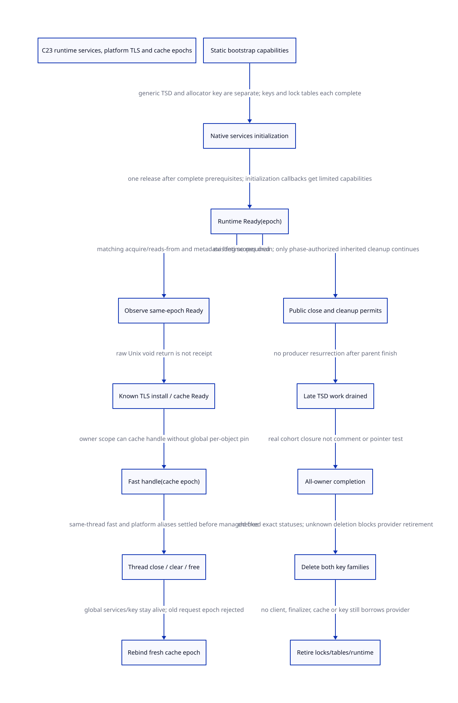

#+TITLE: C23 RuntimeServiceReady, platform TLS and fast-cache retirement
#+SETUPFILE: ../../modeling/org/setup.org
#+LANGUAGE: en
#+PROPERTY: header-args :eval never
#+STARTUP: overview

* RESEARCH Scope and authority
:PROPERTIES:
:AUTHORITY: GambitRuntimeTlsReady
:STATUS: exact platform source captured; conditional lifecycle proof; native qualification open
:CUSTOM_ID: runtime-tls-ready
:END:

Extend [[file:cache-ready-publication-design.org][private cache Ready]] to its real prerequisites and platform cleanup.
Distinguish bootstrap capabilities, allocator/TSD RuntimeServiceReady, complete Tcl
language/object/IO readiness, a per-thread cache epoch and OS-thread death. These
are different authorities. Source globals are scoped to the cooperating loaded
runtime image; VM identity alone is not the owner of its shared native TLS key.

[[file:models/sysml/runtime-tls-ready.sysml][SysML]] owns source/writer/consumer/issuer and proof routes, blockers,
benefits and edges; [[file:runtime-tls-ready-matrix.org][matrix]] and  are native projections. [[file:models/quint/runtime_tls_ready.qnt][QNT]] supplies
actual lifecycle actions; typed IR generates [[file:models/lean/RuntimeTlsReadyAst.lean][Lean AST]]. [[file:models/lean/RuntimeTlsReady.lean][Lean]] checks induction,
key/cache retention, epochs and the conditional ordering bridge. [[file:../../modeling/ascent/runtime-tls-ready.rules.scm][ASCENT DSL]]
checks exact action/lemma/source, refinement, issuer, consumer and writer rows.
[[file:../../../evidence/research/future-frame-commit/runtime-tls-ready/][Evidence]] retains source blobs, failed checks and current bindings. No runtime
implementation, native compile/preprocess, native test or benchmark is performed.

* Exact source acquisition and findings
The local snapshot lacked platform implementations. Only five missing official
files from the existing commit cbf86d62348d6b052e1961b4df995960fb21545f were added:
unix/tclUnixThrd.c, win/tclWinThrd.c, generic/tclThread.c, generic/tclThreadStorage.c
and generic/tclEvent.c. Each byte length and Git blob hash matches the retained
same-commit Git tree. This does not bind the installed Darwin Tcl binary/profile.

| Source family | Actual implementation | What it does not prove |
|---------------+-----------------------+------------------------|
| Unix bootstrap alloc mutex | static PTHREAD_MUTEX_INITIALIZER; documented no dynamic storage | every initialization/provider callback is nonrecursive |
| Unix allocator key | volatile initialized, lock/double-check, pthread_key_create with NULL destructor | OS success when return value is ignored; C23 acquire on the fast flag read |
| Unix allocator set/clear/delete | pthread_setspecific and pthread_key_delete as unchecked expression statements | void normal return certifies the requested effect |
| Unix generic TSD key helpers | check pthread key create/delete/set and panic on failures | drop-in allocation-free substitution: helper allocates its key wrapper |
| Windows allocator key | TlsAlloc/Get/Set/Free checks; setter/clear/delete panic on failure | plain once/allocOnce flags prove concurrent initialization; panic always ends process |
| Both allocator cache frees | TclFreeAllocCache(ptr) before clearing platform TLS | intermediate reentry cannot reach old raw cache; same-operation release receipt |
| Fast GETCACHE | static __thread tcachePtr, assigned after GetCache returns | captured finalization clears that variable; Tcl_FinalizeThread means OS thread death |

The four unchecked Unix operation sites are create, set, clear and key delete.
Separate pthread mutex init/destroy checks are not silently counted among them.
Windows checking is existing behavior, not a new benefit of the proposed design.
A qualified normal endpoint may use those checked branches only after OS/provider
and panic/nonreturn contracts are established. An abandoned call still has unknown
completion even when an OS effect happened.

The allocator key's pthread_key_create passes NULL as destructor. It is not an
installed automatic Tcl cache destructor. Explicit Tcl thread/process finalization
remains responsible. The generic TSD key is a separate key with a separately
allocated native wrapper and its own data table; deleting one family does not
complete the other.

* Real initialization and finalization graph
TclInitSubsystems holds the platform init lock around generic subsystem setup and
sets subsystemsInitialized afterward. Its comment explicitly notes callbacks into
initialization. The captured Unix initLock is a static pthread mutex; no complete
recursive callback path is proved by that comment, and no deadlock is asserted.
Its plain outer flag, GetCache's early listLockPtr test, Unix volatile initialized,
and Windows once/allocOnce are separate flags. None alone is the new C23 witness.

GetCache initializes allocator list/object/bucket locks and table entries, then
allocates/publishes a cache and binds TLS as studied previously. The generic TSD
initialization calls TclpThreadCreateKey. Native allocator services can be needed
before full object/IO/encoding initialization, so RuntimeServiceReady here means
that native subset, not all Tcl or Scheme semantics are available.

Thread finalization pops exit handlers before invoking their callbacks, then
cleans IO/notifier/async/object thread state and TSD. TclFinalizeThreadData clears
ordinary TSD first, then allocator cache when not in quick mode. The quick path
intentionally omits allocator teardown and is not a clean-close receipt.
Tcl_ExitThread calls Tcl_FinalizeThread then the OS thread-exit path. The former
returns; it is not evidence the OS TLS storage is dead or a foreign destructor
cannot still call Tcl. Native join/death and loaded-provider closure remain needed.

Process finalization invokes handlers, finalizes subsystems and repeats
TclFinalizeThreadData(0). Source explains intermediate work can recreate TSD and
references the historical bug. It later checks that exit handlers were not newly
created, finalizes synchronization, then allocator-specific resources. The generic
TSD finalizer explicitly requires all Tcl threads finalized; the caller comment
expects one thread left. Those are preconditions/comments, not all-owner receipts.
The source orders must not be blindly rearranged without their dependency proof.

* C23 construction and publication design
** Partial capabilities instead of recursive full Ready
Use Cold, Initializing(capabilities), Ready(runtime epoch), Closing and Retired.
A pre-reserved NativeThreadDomain and bootstrap-static mutex/direct system allocator
are prerequisites. An initializing callback receives only completed service
capabilities, not full Ready and not a wait on its own initializer. This preserves
necessary initialization work rather than rejecting all callbacks or putting the
whole path behind a recursively entered once primitive.

A RuntimeServiceReady publication requires native locks/tables, generic key and
allocator key installed with authoritative outcomes, and initialization borrows
settled. Every dependency must be qualified in the actual build. The finite model
tracks one limited bootstrap borrow, not all possible module dependency cycles or
nested callbacks. Full native init callback closure remains unresolved.

** Status-normalized TLS core with explicit key storage
A modern C23 TlsKeyOps contract should cover create/get/set/clear/delete results,
NativeKey identity/runtime epoch, thread identity, cache epoch and native storage
ownership. Reuse the checked generic policy where appropriate, not the old void
allocator wrapper that already discarded the result. Unix needs the four missing
status observations; Windows should retain its existing checks with a defined
panic/error-delivery boundary.

The generic helper allocates a pthread_key_t wrapper using TclpSysAlloc. Directly
using it for allocator bootstrap can add an allocation dependency or recursion.
Keep a qualified preallocated/static key-storage mode for allocator bootstrap and
an owned dynamic-wrapper mode where allowed. Consolidating the policy is a real
candidate for retiring duplicated support; zero additional allocation/overhead
has not been proved. Allocation, panic, key retirement and wrapper free each need
stable native guard/operation ownership.

** Ready memory order and metadata lifetime
The replacement's canonical state is atomic. A release publishes all completed
native initialization before Ready; a matching acquire observes that exact epoch
before dependent reads. The observer must already have authority to access the
publication record; acquire does not prevent record reclamation by itself.
The readyHappensBefore lemma composes initialization-before-release, the supplied
matching release/acquire edge and acquire-before-read. Its rf relation denotes
qualified Ready release/acquire pairs, not every relaxed reads-from edge. The
synchronization edge is an explicit premise, not inferred from volatile.

Legacy pthread/critical-section operations need an actual source-to-C23 mapping.
Fast readers that skip a lock cannot borrow its synchronization edge just because
another branch took that lock. Startup serialization may qualify an existing path,
but complete callers/launch evidence is not established here. Native CFG, compiler
profile and weak-memory refinement stay open; QNT uses atomic abstract actions.

* Thread cache and fast TLS lifecycle
A Ready runtime scope permits cache installation. An unchecked raw setter return
records only an observation; it does not create a successful-install receipt.
Unknown set/clear retains the exact source owner and operation record, and blocks
publication/free respectively. Do not query a possibly deleted native key or replay
its operation to learn whether deletion happened. A stable supervisor retains
metadata duty, not a guarantee uncertain native resources remain alive.

Fast TLS is a cached capability under the native owner scope. The new handle binds
runtime image/epoch plus thread/cache epoch. This need not require a new global
atomic operation for every object allocation while the scope is valid. Every raw
fast reader must migrate or be qualified; a nonnull pointer cannot bypass close.
Only its authorized native thread can clear its thread-local slot, unless a real
OS-thread-death contract supplies equivalent detachment evidence.

The model covers thread-only close while global services/key remain Ready, then
rebind to a fresh cache epoch1->2 on the same OS thread. Fast and platform aliases
settle before managed free; old request epoch is rejected until a current handle
is obtained. This is not a proof of native address equality/reuse or nonwrapping
infinite epochs. The runtime and cache epochs are separate authorities.

Actual platform cleanup frees before clearing TLS. Under a terminal, fully
nonreentrant caller this order might be qualified; that precondition is not proved.
The managed design selects detach-before-free with explicit outcomes. This is an
intentional protocol change, not an equivalence proof of every intermediate legacy
state. A callback/panic that abandons the clear leaves custody with the supervisor.
Unknown actual storage release must never be retried as if no effect occurred.

* Closing preserves valid work, not full public admission
Public close rejects new full runtime/cache scopes. Existing admitted scopes can
finish under their leases; they are not retroactively invalidated in mid-call.
Before close, authorized finalizers obtain phase-limited permits. During Closing
they may derive only allowed cleanup work and retain parent responsibility until
children settle. Late TSD bookkeeping does not grant access to already-finalized
Tcl object/IO/language services. Source specifically forbids new Tcl_Obj work after
object finalization; a generic allocator permit is not full subsystem Ready.

The finite late-work credit stays under its parent until drained. Finalizer finish
closes further derivation; cache retirement waits for all remaining native scopes.
A same-owner close must settle/transfer its caller's final-use responsibility before
waiting for other scopes, never wait behind itself. The model proves safety, not
universal progress, cancellation or arbitrary child-task closure.

Ordinary TSD payload/table deletion must finish while its allocator cache and
keys remain usable; TSDTableDelete frees its stored blocks. Only after producer
closure and data-drain receipts may aliases/cache be released. The finite work
credit does not prove every real table or callback was enumerated.

After cache aliases are detached and cache release known, gather the closed native
owner roster. That receipt includes each owner's ordinary TSD data-drain obligations,
not only a cleared allocator-cache slot. Generic TSD key and allocator key then retire under their own known
outcomes; shared locks/tables/provider retire only after no owner/key/initializer
borrow remains. The model's provider teardown order is deliberately an explicit
dependency design. Native equivalence to legacy synchronization-before-allocator
cleanup requires proving remaining helpers use no retired provider.

Raw external OS threads, cross-VM users of the same native runtime, foreign TLS
callbacks and all captured native return domains belong in the roster or must
remain outside admission. Existing source comments and a successful thread-cleanup
call cannot issue that complete global receipt. Unknown deletion blocks global
provider retirement even if the physical key might already be gone.

* Formal evidence and refinement limits
The model has one admitted native owner, one runtime epoch transition and at most
two cache epochs. It separately tracks generic/allocator keys, bootstrap borrows,
source outcomes, fast aliases, existing users, inherited finalizers and late work.
Pending/Ready/closing caches retain the key and allocator services they require.
A zero-cache runtime also has a closure path. Unknown installation during global
close retains the owner and blocks terminal retirement.

Theorems cover initialization prerequisites, no alias at modeled free, source
custody on unknown TLS, parent custody of late work, service lifetime, and terminal
retirement. The actual prior CacheReadyPublicationAst.installTlsKnown Guard/Step
is joined only under an explicit install mirror. Full product simulation, all
native writers and real weak-memory execution are not proved. Old proof AST reuse
checks source hash, artifact manifest and exact Lean binary rather than trusting
an unbound cache.

Deterministic histories exercise native-status distinctions, bounded bootstrap
reentry, thread-only rebind/stale handles, late cleanup, unknown clear/delete and
provider retention. Reachable guard controls and forged-state rejection are
separate. C23 memory-order transport requires its synchronization witness; it is
not an implemented compiler or a complete C23 memory model.

The [[file:../../../evidence/research/source-references/feeley-sfp/8bb2fae8ae4b54d3a86206596f90e9cf73da39846af0f39244a476074cf81ed4.txt][Feeley interoperability paper]] grounds the independent lifetime of native
activation contexts versus Scheme continuation control. It does not prescribe
this TLS core or certify native callback exit. Neither metadata nor an epoch token
can resurrect an abandoned C stack. NativeReturnDomain/guard and GC roots keep
their separate contracts from the earlier architecture studies.

* Concrete migration and retirement gates
| Existing path | Replacement | Necessary retirement evidence |
|---------------+-------------+-------------------------------|
| volatile/plain flags as complete authority | atomic runtime state plus limited bootstrap capabilities | all init callers, actual same-epoch release/acquire and global dependencies |
| unchecked Unix allocator key wrappers | status-normalized TlsKeyOps with appropriate key storage | all four statuses, ABI/caller adaptation and unknown-result settlement |
| raw fast pointer shortcut | owner-scoped epoch-stamped Ready handle | all readers, same-thread clear/death proof, thread-only rebind and no ABA |
| free-cache then clear-slot assumption | explicit close/detach/known release | actual panic/reentry/clear/free effects and no old native borrowers |
| repeat cleanup as implicit completeness | inherited cleanup permits and closed owner/task roster | all producers, callback registrations, TSD recreation and phase restrictions |
| delete keys/free locks by local pointer tests | known per-resource retirement receipts | both key families, every native owner and loaded provider lifetime |

GetCache is static inside Tcl; its macros, both TLS backends, interpreter getter,
thread/process exits and generic storage callers must cooperate. An outer Gambit
FFI wrapper cannot enforce this on unmodified native internals. Complete failure,
quick-exit and compatibility profiles still need qualification before old paths
can retire. No runtime files are modified here.

* Benefits and added work
The [[file:runtime-tls-ready-matrix.org][SysML matrix]] records mechanisms, overhead and blockers. Consolidating four
unchecked Unix sites can remove duplicated error policy. Epoch-scoped fast handles
can preserve native TLS locality and avoid global per-object admission while valid.
Keeping licensed cleanup capabilities alive until producers stop may remove
premature teardown/recreation work; it does not eliminate legitimate cleanup.

Costs include checked cold operations, key-storage modes, stable operation/owner
records, epoch and roster tracking, and cleanup accounting. Unknown outcomes can
retain resources indefinitely. There are no fabricated byte sizes, timing ratios,
person-day estimates or Zig-specific gains. Old native paths retired now0; native
implementation, loaded Darwin/Windows profiles and performance remain unqualified.
