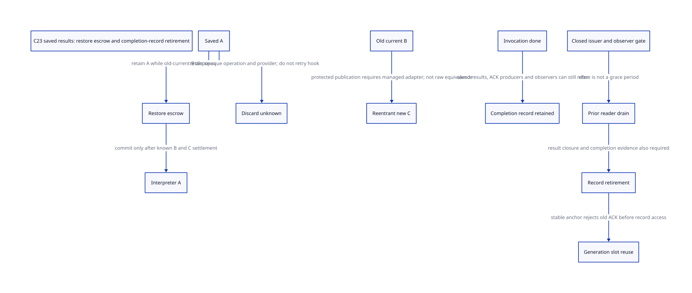

#+TITLE: C23 saved-result custody and InvocationId completion-record retirement
#+SETUPFILE: ../../modeling/org/setup.org
#+LANGUAGE: en
#+PROPERTY: header-args :eval never
#+STARTUP: overview

* RESEARCH Decision
:PROPERTIES:
:AUTHORITY: GambitSavedResultRetirement
:STATUS: conditional-model; native holder / adapter / observer closure unresolved
:CUSTOM_ID: saved-result-retirement
:END:

Separate saved state ownership, native result disposal and completion-record
reclamation. An InvocationId being done settles one execution, not all snapshot,
result, producer or observer references to its evidence. A saved result may
outlive the interpreter field that originally named it; an old result's release
can call out while a different result is already visible.

[[file:models/sysml/saved-result-retirement.sysml][Native SysML]] owns source/consumer/issuer/obligation/action routes and gains.
[[file:saved-result-retirement-matrix.org][Org matrix]] and  are projections. [[file:../../../evidence/research/future-frame-commit/saved-result-retirement/][Evidence]] binds inputs and
retains failures. No runtime implementation, native build/test or benchmark.

* Two token families and real holders
** Legacy moved string: Tcl_SavedResult
The captured tcl.h defines a caller-supplied struct, described as typically
stack allocated. SaveResult moves native result/freeProc ownership into this
struct and clears the interpreter string fields. RestoreResult and DiscardResult
consume the token by contract, but do not install a persistent settled flag in
it. A second Discard is not made safe by the first successful return.

In the current captured generic source subset, direct lexical searches find
legacy Save/Restore/Discard definitions and public/stubs declarations, but no
concrete legacy call site. Gambit's Tcl adapter also contains no such direct
legacy call. This does not close all Tcl source or external extensions: the
capture is partial, and function pointers, aliases and external C callers remain.
Do not invent a demonstrated legacy holder where none has been found.

The actual legacy holder remains the native caller's storage and the owner that
must consume it once. If it is on a C stack abandoned by longjmp, merely retaining
the pointer to the dead struct is not custody. A managed service must own an
independent snapshot/operation record before exposure, or refuse reusable lifetime
claims. A shallow memcpy is insufficient: result may point inside the original
struct's resultSpace; append buffer and custom free tuple also require identity-
correct normalization. No such copying adapter is implemented or proved here.

** Modern opaque object state: Tcl_InterpState
Real captured holders are found for SaveInterpState, which is materially different:
it obtains GetObjResult and increments object/error-state references in an allocated
token. For a nonempty legacy native string, GetObjResult first copies bytes into
an object and invokes the native string's free hook. Therefore successful object
snapshot creation need not retain that original Gambit char buffer/freeProc at all.
The pinned TclInitStringRep macro allocates n+1 bytes and copies n bytes for
a nonempty length-n string. This is an existing conversion/materialization cost,
not a newly introduced C23 cost or a measured speed claim. Object state/reference
accounting remains even if the original native buffer is no longer held.
If conversion/free exits abnormally, the snapshot may not have returned and no
successful transfer can be assumed.

| Concrete holder | Preparation | Normal consuming endpoint | Lifetime boundary |
|-----------------+-------------+---------------------------+-------------------|
| command trace local state | SaveInterpState before traceProc | Restore before final Tcl_Release | spans arbitrary trace callback |
| Tcl_ListMathFuncs local state | Save before script evaluation | Restore after result duplication | spans nested eval |
| background-error saved local | Save before bgerror | branch-dependent Restore or Discard | error/fallback/output branches differ |
| RewindCoroutine NR callback data[0] | Save then TclNRAddCallback | RewindCoroutineCallback Restore | callback stack, not just producing C activation |
| Tcl_NRExprObj NR callback data[0] | Save then callback registration | ExprObjCallback Restore on success, Discard on error | selected later callback endpoint |
| TclSubstCompile local out-parameter | TclSubstParse supplies state | conditional Restore before syntax-error emission | indirect producer definition absent from capture |

RestoreInterpState restores error/control fields, calls SetObjResult with the
saved object and then DiscardInterpState. Discard decrements saved object/error
references and frees its token. This is not the legacy raw freeProc handoff.
Native object destructors and escaped callbacks still need a closure proof;
normal endpoint enumeration alone does not prove all abnormal paths consume once.
The coroutine and NR callback shutdown/rewind product remains unresolved.
TclSubstCompile also shows why direct SaveInterpState searches are insufficient:
its state is written through an out-parameter by TclSubstParse, whose definition
is not present in the captured subset. This is retained as a real unresolved
producer edge, rather than guessed or declared closed.

The existing three-file Tcl ledger is rechecked with SHA-256 and original Git
blob SHA-1. Additional captured files used for real holder sites are bound to
their current exact bytes. Their commit-named capture path is not independently
re-proved upstream tree membership by this study. None identifies a loaded Darwin
Tcl ABI. The source inventory explicitly states its captured-file scope.

* Legacy Restore versus SetResult: opposite publication order
SetResult saves the old tuple, publishes the new tuple, calls the old custom free
hook, then resets the object result. A new result already exists while the old
release is in flight. In contrast, RestoreResult calls ResetResult before
installing the saved freeProc/string and replacing the object result.

Track three resources separately: A is the saved result, B is the current result
being reset, C is a result published by a reentrant custom hook while B is disposed.
A remains owned until restore commits or an explicitly known discard completes.
If B's release is unknown, A cannot be treated as transferred just because restore
was requested. If C appeared, its lifetime cannot silently disappear under the
later reset/restore writes.

This is a source-supported callout boundary and a conditional reentry scenario,
not a demonstrated supported-use bug or a guarantee that Tcl permits every
reentrant free hook. The selected Gambit release_string hook calls release_rc;
Scheme reentry is not established for that ordinary hook. Other application hooks
are arbitrary callouts and require an effects/admission policy.

Raw Tcl code does not provide the A/B/C transaction modeled below. ResetResult
calls custom freeProc before clearing the fields; reentrant writes could interact
with the remaining unconditional reset writes. A wrapper around the outer call
alone cannot prove it preserves C. Managed admission must intercept relevant
result mutations/free callbacks, bind interpreter owner/thread and generation,
and either preserve each new publication or refuse the unsupported hook profile.
Deferring publications or changing callback order would require a separate
observable-semantics proof. No equivalent raw-Tcl behaviour is asserted here.

* Discard and unknown native release
DiscardResult decrements the saved object, then frees its append/dynamic buffer or
invokes its custom freeProc. It has no interpreter argument and does not clear a
stable token state afterward. The native operation may partially execute before
control is lost. The old token is not a safe retry handle.

Before irreversible disposal, a stable owner must retain SnapshotId, ResultId,
OperationId, allocation/free origin, source/provider lifetime and any still-live
Scheme roots in independent records. On known completion, move to disposed and
release the corresponding holds. On unknown completion, retain opaque operation
identity/provider holds without dereferencing or rescanning possibly freed payloads.
Do not equate unknown with 'not executed', and do not invoke the hook again.

Restore has at least two separate commit facts: B disposal is known, and A is
installed with its new owner. An ACK lost after transfer is not permission to
restore or discard A again. Persistent handoff receipts and qualified recovery
are required. The formal model below separates B disposal and A commit; it does
not model the native instructions inside A's publication, so atomic commit and
lost-publication ACK remain explicit refinement premises rather than achieved
native crash consistency.

* Completion records: done is not reclaimable
:PROPERTIES:
:CUSTOM_ID: completion-record-grace
:END:

Potential readers/producers include outer SFUN/run landing, nested callback
completion forwarding, delayed result/source cleanup receipts, scheduler/NR
callbacks holding a token, diagnostics, parent producers and API outcome retry.
This is a proposed obligation roster, not a completed native caller census.
Current Gambit does not have the proposed InvocationId completion registry.
A Scheme continuation can carry an old identity; whether it may request a new
native entry or only observe historical completion must be an explicit interface
rule, not permission to dereference an old C activation.

A proposed RecordRetirementReceipt jointly requires:

1. exact invocation completion is durably known;
2. snapshot/result/storage duties referring to it have settled or moved with an
   independently proved consumer-detachment receipt;
3. all ACK/notification producers have closed and in-flight deliveries are drained;
4. lookup admission closes through an anchor that outlives the record;
5. readers admitted before closure have finished their last access;
6. a stable identity/generation service can reject old messages before reading
   reclaimed memory, or preserve a tombstone until that rejection is possible.

Closing the observer gate is not draining existing readers. Result free known is
not proof that all observers of the receipt have returned. A producer saying
'closed' without a delivery drain does not justify freeing an ACK target. Unknown
release or delivery keeps a stable owner/escrow and blocks this conservative receipt.

Slot reuse must not recreate the old identity. Two generations in the model expose
a stale ACK, but do not prove machine-width no-wrap. A generation check inside
already freed memory is too late. Any registry/high-watermark/tombstone anchor
has its own lifetime and observer grace. If multishot continuations may query old
outcomes indefinitely, either the API rejects retired identities through a live
anchor, returns a separately retained compact outcome, or the history remains.
Deleting it while promising permanent historical lookup is not an optimization.

Current source data cannot establish an asymptotically bounded completion ledger
for all users. Completed records can retire only after the specified observer and
producer closure. For L still-unqualified identities, storage is O(L), plus stable
identity service state. L can grow without bound if callers retain observers or
never relinquish replay rights. This is an explicit countercondition to a net gain.

* C23 order and issuer responsibilities
The snapshot owner/source authority signs exclusive consumption and the raw
storage identity; the Tcl owner signs owner-thread/interpreter-generation access.
The result owner signs known disposal and handoff. Completion registry/producer
owners sign no new/in-flight ACK users. The grace coordinator signs old readers'
last-use completion; the generation owner signs safe identity reuse.

At the native level, record publication must precede reader acquire. Entry/close
must linearize through live stable authority before a raw slot/record access.
Retirement observes release-published last-use/producer completion through the
matching acquire protocol. CAS failure/expected replacement is not a lease.
Atomic pointer exchange alone cannot atomically commit arbitrary free hook effects
and the completion record. No cast or generation number protects a dead first load.
Effective target atomics, owner-affine Tcl, descriptor/provider holds and counter
limits remain separate C23 refinement obligations.

* Actual model, evidence and limits
[[file:models/quint/saved_result_retirement.qnt][QNT]] has nine scalar fields and twenty-two actions. It tracks A saved/escrow/
restored/discard-inflight/unknown/disposed; B and protected C owned/releasing/
unknown/disposed; one invocation done record, observer gate/lease, producer
issuer closure, record lifetime and two generations. Empty B/C means no such
resource was created, not an unknown successful free.

The protected A/B/C model is the managed architecture, not a faithful execution
model of unmodified reentrant Tcl result mutation. ACK actions are authoritative
same-operation evidence inputs. No fairness, all-caller closure, native free
receipt or full recursive Tcl object destructor proof is manufactured. The
current modern-token holder chains supply concrete refinement obligations but
are not represented by the legacy-string A state machine.

[[file:models/lean/SavedResultRetirementAst.lean][Typed QNT IR]] is projected into the AST used by [[file:models/lean/SavedResultRetirement.lean][Lean]]. Per-action preservation and
reachable induction prove abstract safety. Completion not draining observers and
old-generation refusal are explicit lemmas. The actual preceding
CallbackProducerAst retirement transition is joined only with a result-settlement
mirror and independent control-exit premises. This is not a full product simulation
or a proof that completion-record retirement is required before every VM teardown;
a separately detached stable result/record service is a future alternative.

Six histories cover Restore, Discard, reentrant C, unknown B/A and an observer
outliving close before record reuse. Nine negative controls preserve: unknown B
blocks Restore, C blocks commit, unknown A/B blocks replay, done alone does not
close result issuers, a prior observer blocks retirement, open issuers block it,
late lookup is denied, and generation-one ACK cannot complete generation two.
ASCENT binds source hashes, actual action/compiled-lemma routes, eight consumer
classes and five issuers. Mutated done-as-grace and Restore-order claims must block;
current native gaps block admission. Synthetic receipts are wiring controls only.

* Gains, costs and migration gates
Use real modern object-state owners where present, rather than retaining native
Gambit char buffers solely because a state snapshot exists. That avoids redundant
ownership only after successful GetObjResult conversion/disposal is proved.
It does not remove Tcl object/reference management or destructor responsibilities.

During Restore, A, B and C may simultaneously require metadata/holds; supporting
reentry has a real cost. Unknown operations may retain providers indefinitely.
Completion records can be reclaimed rather than retained forever only after
producer/observer closure and identity-safe rejection of old messages. The
contracts can reduce unnecessary pins and permanent history, but no latency,
byte-layout or native throughput benefit is measured. Relative to today's raw
legacy API, managed bookkeeping is additional work.

Retire raw reusable snapshot consumption only after all caller storage/aliases
and selected disposal endpoints are mediated. Retire indefinitely retained done
records only after delivery/reader grace and generation policy are implemented
and qualified. Do not introduce a universal transactional Tcl subsystem merely
to claim those gains: an explicitly restricted ordinary release_string profile
may reuse the selected hook, while unsupported raw hooks remain refused.
No runtime path retires on the strength of this formal study.

The retained [[file:../../../evidence/research/source-references/feeley-sfp/8bb2fae8ae4b54d3a86206596f90e9cf73da39846af0f39244a476074cf81ed4.txt][Feeley continuations/C paper]] grounds separation of native activation,
Scheme continuation and persistent store. It does not prove the proposed snapshot
or completion-registry contracts. Their conditional claims come from current
source, explicitly stated design premises and the bounded formal protocol.
