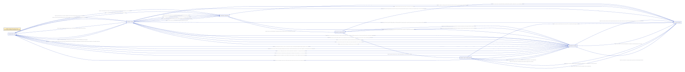

#+TITLE: Sender completion: generated paths and frame-backed resumption
#+SETUPFILE: ../../modeling/org/setup.org
#+LANGUAGE: en
#+OPTIONS: toc:3 num:t
#+PROPERTY: header-args :eval never :tangle no
#+TODO: RESEARCH SOURCE_REFINED | DESIGN_DELIVERED

* DESIGN_DELIVERED One whole DEV Goal
:PROPERTIES:
:CUSTOM_ID: sender-completion-goal
:AUTHORITY: GambitSharedHeapSmpRequestServiceSources
:SOURCE: models/sysml/shared-heap-smp/source-sites/request-service.sysml
:GOAL: complete sender-completion source refinement and cost-reduction handoff
:EXECUTION_SCOPE: DEV only; no runtime/build/native test modification
:NATIVE_ADMISSION: OPEN
:END:

The Goal is one design delivery, not one more setter or benchmark preparation:
trace actual fast/slow generated control; identify removable work; specify its
replacement together with roots, multi-shot control and exit; derive full-load
cost/capacity conditions; regenerate SysML/ASCENT/Org/D2 and the five existing
gates. Design completion does not close those native/source-adapter gates.
Runtime code and the physical build workspace remain owned by the other chat.

- [X] Bind inspected generated/source bytes and distinguish historical native cohorts.
- [X] Trace fast completion, helper-immediate, setup race, parked and service-drain paths.
- [X] Specify a complete private completion operation and frame-backed resume ownership.
- [X] Include added root/lookup/metadata/materialization costs and falsifiers.
- [X] Synchronize model projections and evidence without renewing stale PR admission.

Canonical source contracts are the parent document's
[[file:request-service-reconstruction.org::request-service-source-contracts][SysML-derived source table]], including senderCompletionFastLease,
senderCompletionSlowEntry, senderCompletionClosureOperands,
senderCompletionFrameBinding and senderCompletionBatchAccounting. The
 is the single derived diagram;
there is no parallel namespace, executor or root registry in this design.

* SOURCE_REFINED What the current generated C actually does

The evidence binds each file digest and starting/ending runtime HEAD. Published
generated C is an observation subject, not proof that a dirty/current producer
regenerated it or that prior native acceptance covers a successor. Literal
labels below belong to that bound _thread.c, not stable public API names.

| Cohort | Actual generated/source chain | Allocation and restart meaning |
|---+---+---|
| Async request | thread-intr L4 branches to L16 | No sender completion wait; exclude from original synchronous flood counts |
| Immediate completion | L4: lock M, owner=not-abandoned, set not-owned, unlock; L8: lock M again, read request state/result, unlock/handoff | No mutex-wait CAPTURE4 or resume closure. One extra primitive lock pair is a fusion candidate, not an already-removed cost |
| Anonymous helper immediate | L15 -> anonymous wrapper -> mutex-lock-out-of-line(new-owner=false); available/abandoned branches exist in the general helper | In this exact no-timeout path the M lease is continuous, so a cooperative normal completion cannot change unavailable to available before the helper check. Abandoned immediate remains possible; timeout conversion cannot open a race here |
| Wait setup race | Helper sees still-owned, unlocks M, jumps mutex-wait; later registration finds availability | CAPTURE4, ALLOC_CLO5, five setup stores and CHECK_HEAP occur even if no queue suspension follows |
| Physically parked | Same setup, registration enqueues actual Thread, saves resume action and transfers current ownership | One logical wait setup; repeated resumes/reparks reuse it, with operation-specific outcome and absolute-timeout semantics |
| Service drain | resume-execution saves resume thunk, dispatches node, pops its8-word return frame and loops; empty queue tail-calls resume | Several request actions can precede one resume/repark. N requests, K drains, E wait setups, P registrations, S suspensions and M restarts are distinct |

This path correlation assumes the selected no-hidden-GC contract and that all
owner writes obey M. It is a source refinement premise, not an executed weak-
memory proof. The real setup race starts when the helper releases M before
CAPTURE4; it does not justify a new success population between two checks still
protected by the same lease.

The emitted mutex resume environment has five operands: mutex, new-owner,
self resume, timeout and wait continuation. For this private completion call,
new-owner=false and timeout=true/no-timeout are constants; self resume denotes
a statically known internal entry. Request and completion already occupy the
caller's mapped frame. At thread-intr's L5 return descriptor,
RETN(fs5,link0,map0xf), ordinary slots2/3/4 correspond to completion,
async flag and request; slot1 is structural. The existing C receiver's returned
coordinates STK(-6)/STK(-4) hold completion/request. A new emitter must use
FrameSpec names/PointIds, not embed these numeric offsets as another ABI.

The baseline five-variable closure occupies7+T initialized heap words under
the asserted header layout; at T=0 and an eight-byte word that is56 bytes/setup.
This source arithmetic is not an observed contended fraction or an old/new
allocation/peak measurement. Capturing a stack wrapper is not itself a deep
frame copy. GC materialization, forwarding repair and census stay separate.

* RESEARCH Proposed whole replacement: private await plus frame-backed resume

The [[file:completion-frame-contract.org::#completion-frame-goal][structural wait-frame refinement]] now selects a concrete root-placement
candidate. It corrects two assumptions in this earlier handoff: captured
operands cannot simply alias mutable caller slots, and an auxiliary wait-origin
record is not free root coverage. The structural candidate preserves lexical
snapshot cells and existing continuation ancestry; it also states the extra
frame/restore and real debugger/serializer exposure costs. Earlier side-binding
alternatives below remain proposals, not implemented or admitted mechanisms.

** Private fast completion is one guarded operation

Keep request construction, physical completion mutex and target abandonment.
Give the internal sender operation a single semantic owner for anonymous
acquisition, terminal observation and physical unlock/handoff. On the immediate
not-abandoned branch, perform the existing not-owned transition, rooted state/
result observation and existing acquired-lock unlock protocol under the same M
lease, rather than unlock and reacquire M solely to read the result. Return or
raise only after the actual unlock/handoff and with mapped output roots.

This contracts an internal synchronization interval; it does not remove generic
mutex primitives, change their public behavior or permit user callbacks under M.
The compiler must preserve a complete no-GC root view and the original acquired-
lock slow unlock if another admitted waiter exists. Qualify the contraction
against supported observation, exception and reentry paths; do not presume all
private values are invisible to supported reflection/debugging interfaces.

Crucially, request.state=returned alone is insufficient: service stores result/
returned before its physical mutex unlock. Bypassing acquisition from that flag
can leave target-owned resources linked, miss abandonment or orphan waiters.
An abandoned-owner helper outcome must retain the old exception behavior even
when some result bytes exist. Ownership transition, publication and consumption
are different facts. This proposal does not weaken those facts into a flag test.

** Slow completion separates static code from dynamic frame state

Use the existing Scheme generator's liveness, FrameSpec and PointId authority
to describe the private completion wait. The candidate keeps dynamic request/
completion in a precise logical caller frame and replaces the heap self-resume
closure with a permanent static resume entry. It specializes only proven
internal no-timeout/anonymous completion waits; general mutex waits and opaque
or unqualified uses retain their existing path and costs.

Storing resume in Thread.resume-thunk is already an escape from a local Scheme
binding. Its internal name does not prove a closed use set. If supported
reflection/FFI can extract or invoke that callable, preserve its captured
operands and identity/behavior or retain the generic closure on the affected
path. A stateless procedure that consults whichever Thread happens to run is
not an equivalent replacement for an extracted old closure. This is an explicit
admission obligation; no Scheme input is rejected to obtain the optimization
and no new environment/configuration toggle grants that proof.

This is inspired by defunctionalization's separation of code alternatives from
their dynamic data, as described in
[[https://www.brics.dk/RS/01/23/BRICS-RS-01-23.pdf][Danvy and Nielsen, Defunctionalization at Work]], introduction and section1.3.
The paper does not prove Gambit's frame placement or concurrency protocol.
Replacing a closure with an equally fresh heap constructor would not establish
an allocation saving; frame/root placement is the additional Gambit design task.

| Logical operand / authority | Proposed representation | Required GC/control interpretation |
|---+---+---|
| Request and completion | Named ordinary root slots in the generated caller/wait FrameSpec | Both already exist in the current completion caller. Preserve exact moving aliases and supported reflection; do not duplicate a heap environment |
| Resume code and timeout/owner policy | Static PointId/module metadata; no-timeout and anonymous constants | Descriptor lifetime outlives all live/captured frames; static code is not user one-shot control |
| Waiting base | Canonical typed frame reference under existing root ownership | Stack and heap forms must use captured-frame scan/forwarding rules, not generic scanning of an untagged C address |
| Effective denv and user ancestry | Existing Thread/effective environment and captured frame graph | Internal wait denv policy cannot erase user dynamic-wind/denv or legitimate service ancestry |
| Physical registration | A scoped binding of logical wait incarnation to actual context/Thread | BTQ/TOQ ownership remains physical and unique; a saved user frame is not permission to reuse an old queue membership |

A static procedure cannot find this data by blindly reading Thread.cont.frame:
THREAD_RESTORE clears that field after moving its edge to the break chain.
The candidate therefore needs a canonical movable wait-origin binding, installed
before service exposure and rooted through existing RootOrigin ownership. It
identifies the live frame reference, descriptor/module, scheduler resume PointId
and current physical incarnation. Resolve/reload it after GC under the qualified
root-access protocol; never retain a raw frame/slot address across collection.
RootOrigin supplies scanning custody; a GC RootTask claim/completion does not
grant request execution, lock acquisition or scheduler resume authority.
An unbounded walk of saved frames is not an assumed O(1) replacement for a
closure call. The actual lookup and its cost must be implemented and measured.

The payload lives in the logical frame, not in one mutable Thread slot shared
by all captures. Physical bindings may use context-owned reusable storage only
after writer/query/scan/exit users drain. Nested waits need distinct active
bindings; a reusable pool is bounded by actual active nesting/retained users,
not promised constant for arbitrary Scheme. Captured user frames do not retain
pointers to recycled mutable binding records. After multi-shot/cross-context
restore, reconstruct the physical binding from the rooted logical frame under
the supported affinity policy; keep immutable values or logical revisions so
one shot cannot overwrite another's request/completion.

Scheduler service-retry, physical lock grant/abandonment and a user
continuation's ordinary return are distinct entry authorities. Existing mutex
unlock can already set the anonymous state to not-owned and install the fixed
locked-action before the recipient runs. Not-owned is not a fresh unlocked
mutex: blindly trying anonymous acquisition again can requeue a waiter that
already received its grant. Preserve these existing outcome actions and their
actual physical handoff, or refine their producers with an explicit qualified
incarnation-bound grant; a returned request flag is not that grant.

Do not turn every restoration of the caller return PointId
into a fresh wait or replay the original request. Preserve explicit continuation
values, dynamic-wind and supported nonlocal exits. Terminal request observation
can repeat as required by user control; initial request execution/publication
cannot be repeated merely to recover wait state. These are native/source adapter
obligations, not consequences of having named PointIds.

** Capture retirement is conditional on the direct-frame bridge

The complete direct-frame candidate publishes the already-complete wait frame
through the canonical captured-frame root before queue registration/service.
It may then retire the extra internal continuation wrapper as well as the
self-resume heap closure. Implementing a real captured-frame root scanner,
relocation/reload, descriptor access and stop/exit protocol is mandatory; storing
a stack pointer in byte metadata does not satisfy that requirement.

If this direct-frame bridge is not qualified, retain one existing capture as
the rooted base and credit no capture elimination. A closure-only specialization
still needs its canonical root binding and its own measured saving. Neither
variant is a native-admitted shortcut today. Any fallback to the current
generic environment is reported in the cost population; it is not counted as
a removed allocation. The design is not a request to implement these changes
in the concurrently owned runtime in this chat.

** Publication, wake race and exit form one handoff

Binding preparation/metadata queries occur outside M. A root handle retains
logical custody across collection; it is not a raw-address pin held while
waiting for a lock or GC. Resolve into mapped roots, release bounded source
access before a potentially participating M acquisition, and reload repaired
operands after any allowed collection. No blocking metadata query, allocation,
callback or collector wait may be introduced under M. The runtime owner must
qualify these edges against the existing metadata/source/physical-lock order;
otherwise this proposed static access path is not admitted.

Known preparation refusal before any queue/ownership commit may take the
existing rooted generic fallback and records its cost. After a partial or
unknown publish, retain the binding and root/queue obligation, query/settle the
same incarnation and do not start another registration as compensation.
Reusing physical storage before writer/query/scan last users close is a failed
implementation, even if its per-request allocation benchmark looks smaller.

1. At a complete caller-frame/checkpoint, establish root and module/descriptor
   custody before any allocating native registration. The fast operation keeps
   its qualified root check before M acquisition.
2. On slow admission, prepare the typed logical frame/binding, then under the
   original lock order recheck completion and atomically commit either immediate
   consumption or physical registration. Completion arriving during preparation
   is not a lost wake and must not cause duplicate registration.
3. Root/binding publication precedes queue/service exposure; selected release/
   acquire locks and freeze/task publication must establish the C ordering.
   Plain stores and a compiler label are not worker publication evidence.
4. Service drains retain their original scheduling policy. Empty observation
   selects the current fixed outcome action or static service-retry entry with
   the right binding; on the retry branch recheck completion/outcome
   under M, then consume or repark the same logical wait. No extra polling,
   spin-until-ready, yield loop or artificial service delay is introduced.
5. Normal result, abandonment, exception, nested/nonlocal exit and unknown
   native outcome settle or transfer physical registration and root ownership.
   Logical consumer close is not scan/query drain. Reuse binding storage only
   after all last users settle; UNKNOWN retains the affected state.

This retires the internal callable environment and its indirect/self-field
loads where qualified, not the request, completion, required result roots,
user thunk, queue operations, census or physical heap reservation. Moving values
into frame fields can increase captured-frame size, materialization, lifetime
or root scanning; those costs are mandatory deductions.

* RESEARCH Full-load net-benefit and capacity conditions

Let N=360000000 useful flood requests. For the original non-reentrant sender
invocations partition fast F, abandoned helper-immediate H, setup-race Z and
ever-registered setup episodes Q. Under the continuous-M premise normal
helper-immediate success is not another population in this private call.
P counts registration events including repeated repark, while S counts actual
suspensions; neither is substituted for Q. Async/control requests and harness
remain separate costs. Count setup E=Z+Q only for this qualified partition,
and record fallback/exceptional classifications rather than forcing an
incomplete sum. PBT multi-shot incarnations need their own invocation keys;
they cannot be forced into the original one-invocation-per-request partition.
K drains and per-role M restarts are observations, not N. No new batching policy
is proposed to improve these numbers.

| Retired work if admitted | Scope | Added cost / required counterexample |
|---+---+---|
| Redundant primitive lock/unlock pair before result read | F successful immediate completions | New predicate/root/branch cost; abandoned or pending-owned flag-only shortcut must fail |
| Generic five-free-variable resume closure and setup stores | Qualified Z+Q episodes | Canonical root binding, metadata lifetime, root scan/access and frame growth; a fresh replacement heap record defeats the allocation claim |
| Dynamic closure field loads/call at resume | Actual qualified M, not N | Static binding resolve/reload cost; large drains with few M defeat N-fold savings |
| Extra internal capture wrapper | Only episodes with a qualified direct-frame root bridge | Captured-frame publication/repair and exit costs; retaining existing capture means zero capture-elimination credit |
| Later copying/tracing of redundant environments | Actual epoch reachability and committed materialization | More/larger retained logical frames may offset or exceed it; alias repairs and census are not copies |

At word size w, baseline closure initialization is w*(7+T)*E_q bytes for the
qualified setup population E_q. Candidate allocation saving subtracts any new
frame materialization, binding overflow/spill or fallback allocation. At T=0,
w=8 and E_q=alpha*N, removed closure initialization alone is20.16e9*alpha
bytes; alpha is UNMEASURED and this is neither net peak nor timing. Persistent
metadata, root scans and active nested bindings belong in simultaneous peak.

For signed, exclusive paired cost differences, positive work requires

#+BEGIN_QUOTE
F*saved_fast_pair + E_q*saved_setup + M_q*saved_resume
+ saved_exclusive_GC
> added_binding_prepare_resolve_scan_exit + added_frame_materialization
  + added_request_fast_checks + fallback_and_other_delta.
#+END_QUOTE

Do not count closure setup and the same GC copy interval twice. Source byte
arithmetic does not supply machine time. Useful completion must remain C=N;
with the historical illustrative3600-second file budget the necessary useful
rate is100000/s before other work. Actual original budgets and timed-target
windows stay unchanged. CPU savings, wall deadlines, pauses and physical peak
are independently reported. If binding/frame costs exceed the removed work,
the candidate is not a positive-net-benefit solution.

* RESEARCH One implementation and native acceptance boundary

| Existing gate | Complete evidence required | Present status |
|---+---+---|
| SH-CUT-S | Same selected source/generated/backend cohort; fused M lease; complete FrameSpec/root binding before queue exposure; direct frame or retained capture explicitly selected | Generated paths refined; new bridge/atomic contraction not implemented or qualified |
| SH-ALIAS-S | Independent frame/slot oracle across GC; distinct shots/nested bindings; mutable reflection and source relocation; required user captures remain live | OPEN; locating existing slots does not prove all aliases |
| SH-BOUNDARY-S | Completion during setup, lost commit/ACK, target abandonment, slow unlock, module unload, nested/nonlocal/cross-context return and unknown last users | OPEN; no flag-only completion or recycled binding shortcut |
| SH-EXEC-N | Existing map two-restores/PBT at R3/W2/full GC plus unchanged interpreted/compiled original stress populations/repetitions and consumers | OPEN; no native tests run by this Goal |
| SH-COST-N | F/H/Z/Q/P/S/E/K/M on matching sources, allocation/materialization/scan/lookup/exit costs, useful throughput, original target windows and simultaneous physical peak | UNMEASURED; no speedup or capacity claim |

Negative controls must preserve meaning during replay/shrink: pending request
with early returned publication but physical owner still held; setup racing
completion with no suspension; abandoned owner with result bytes; nested wait
or two restored shots overwriting one reused binding; wrapper field cleared by
RESTORE; GC moving frame while a raw pointer is cached; large drains with little
resume work; frame/binding cost exceeding removed closure work. Probes use actual
legal generated/GC cuts, bounded preallocated records and no collecting callback
inside no-GC gates. Missing probes/overflow are INCOMPLETE, never a pass.

Existing QNT owns concurrent histories/unknown-result/last-user obligations;
existing Lean owns slot/representation/interval implications. This Goal adds no
duplicate model or proof. Its five gates remain open until actual source
adapters/native evidence satisfy them. Historical PR model-binding failure
stays a separate source-period issue, not a reason to claim or deny native
completion of this new candidate.
