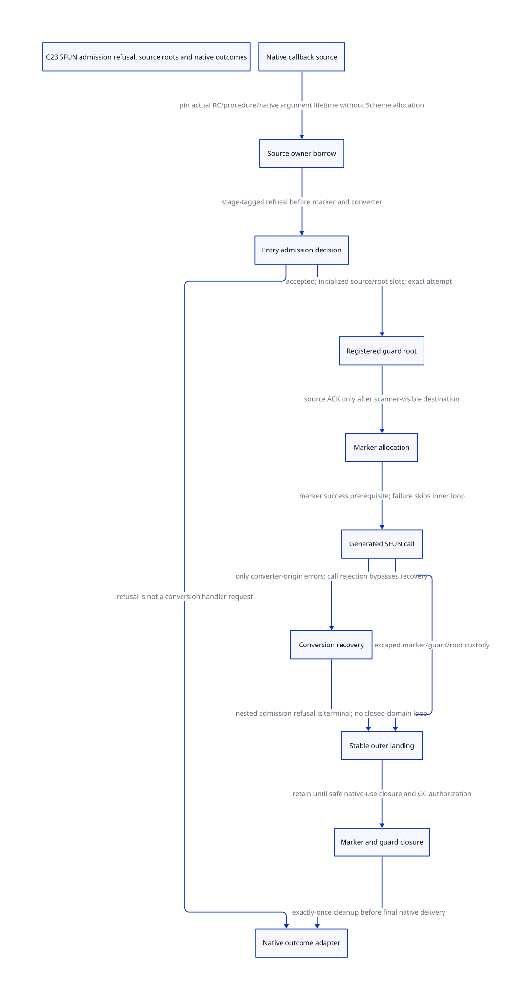

#+TITLE: SFUN admission refusal, real callers and preallocation roots
#+SETUPFILE: ../../modeling/org/setup.org
#+LANGUAGE: en
#+CATEGORY: modern-c
#+PROPERTY: header-args :eval never
#+OPTIONS: toc:3 num:nil

* RESEARCH Decision and achieved scope :c23:ffi:gc:
:PROPERTIES:
:CUSTOM_ID: sfun-admission-refusal
:AUTHORITY: GambitSfunAdmissionRefusal
:STATUS: SOURCE-CHAINS-CLASSIFIED; NATIVE-LOOP-REACHABILITY-OPEN
:BASELINE: C23
:END:
Admission refusal must be separated from conversion recovery by producer/stage,
not by globally blacklisting UNKNOWN_ERR. Establish source ownership and a
checked entry decision before any marker or converting allocation. Retain
ordinary converter recovery, Scheme exception semantics and C portability.

The prior [[file:size-family-guard-gc-design.org][stable guard/GC study]] found a conditional legacy retry recurrence.
This study identifies actual callers and its missing edge; it does not promote
that recurrence to an observed native failure. [[file:models/sysml/sfun-admission-refusal.sysml][Native SysML]] owns caller
classifications, components, source anchors, issuer boundaries, memory and
benefit obligations. Native evaluation drives [[file:../../modeling/ascent/sfun-admission-refusal.rules.scm][actual ASCENT joins]],
[[file:models/quint/sfun_admission_refusal.qnt][QNT actions]] and [[file:models/lean/SfunAdmission.lean][Lean reachable safety and legacy recurrence]].
[[file:models/lean/SfunAdmissionBridge.lean][The imported parent predicate bridge]] is deliberately smaller than a full
state or root-value simulation. [[file:sfun-admission-refusal-matrix.org][The evaluated matrix]],
 and [[file:../../../evidence/research/sfun-admission-refusal/checks.json][check receipt]] retain the distinction.
No runtime implementation, native compilation, native testing or benchmarking.

* RESEARCH What is actually connected :reachability:
:PROPERTIES:
:CUSTOM_ID: sfun-refusal-caller-closure
:EVIDENCE: local vendor source; no runtime reachability receipt
:END:
| Chain | Source closure | What it does not establish |
|-------+----------------+----------------------------|
| domain_record -> POINTER_to_SCMOBJ(domain_release) -> GC owner cleanup -> release_foreign -> domain_release -> ___call | Registered native release target and explicit OWNER_CLEANUP check exist in worker-root-domains.scm | Calls low-level ___call directly; no generated SFUN loop |
| Same releaser -> ___run | Explicit source rejection check before run-local writes | Does not exercise SFUN_ERROR or a generated argument converter |
| Tcl_CreateCommand -> scheme_call_cmd -> tcltk_call | Registration and generated typed-result c-define endpoint exist | No audited GC cleanup target calls this command; Tcl dispatch/binary cohort not requalified |
| tcltk_eval error -> tcltk_eval_error | Native error translator calls a void c-define endpoint | Its GC-closed invocation edge is not established |
| Tcl command deletion -> scheme_delete_cmd | Hook releases Scheme/RC payload | No Scheme call in that delete body; deleting a command is not calling it |
| mem.scm foo -> f -> hop | Actual function-pointer consumer and typed-result c-define exist | Allocations may collect before f; this is not a call during active owner cleanup |
| pthread increment -> increment_counter | Existing void SFUN, explicit ON_THROW and shared mutex | Closed example serializes increments and joins before get/release; mutex is not a universal GC admission service |
| Arbitrary registered release_fn -> user code | Public native release extension accepts a callback | Identity of a callback that calls a generated SFUN is missing in the audited chains |

The first two rows are real source-level GC reentry refusal users, not proof of
the SFUN error-loop bug. The ordinary SFUN rows cannot be spliced onto them by
matching the words callback, release or Scheme. Default release_pointer is a
no-op; release_function drops RC closure storage rather than executing that
closure. Default generated C storage destructors also do not by themselves
establish a Scheme invocation. An arbitrary user releaser can compose such a
call, but that is a legal-extension hypothesis, not an existing observed edge.

The selected test source assumes three participants. Current config.status
records Darwin arm64, GCC16.2, single-host/inline-jump/trusted-TCO options and
disabled SMP/multiple VMs. It does not qualify that three-participant test on
the configured binary. Generated monolithic gambit.h and current modular runtime
are not established as a complete same-generation loaded cohort. Hash-bound
local source, configured defaults and native execution remain different evidence.

* RESEARCH Exact legacy recurrence and its prerequisite :source:
:PROPERTIES:
:CUSTOM_ID: sfun-refusal-legacy-loop
:ASSUME: generated wrapper reached; marker allocation succeeds; phase remains non-RUNNING
:END:
BEGIN_SFUN variants allocate a stack marker and enter an outer success block.
Input conversion, SFUN_CALL and SFUN_ERROR are inside that block. SFUN_ERROR
loops for every status except NO_ERR and UNWIND_C_STACK; it invokes ___call on
the conversion-error handler using the same marker. Current ___call rejects a
non-RUNNING participant before frame/catcher writes, returning UNKNOWN_ERR.
With a persistent phase, the next low-level handler call returns the same code.
No handler Scheme body runs and cleanup is never reached by that recurrence.

Marker allocation failure is a different branch. It skips the entire success
block, including the inner error loop and marker invalidation, and propagates
SFUN_HEAP_OVERFLOW_ERR. If that propagation has no valid outer catcher, the
caller contract is unqualified; it is not evidence that the inner loop ran.
Small still allocations can succeed during owner cleanup, while a request that
would need another collection is explicitly refused. Therefore successful
marker allocation in cleanup is a conditional possibility, not something to
assume from every call or to prove by running an unauthorized probe.

All three result shapes matter: void, direct Scheme object and typed result.
The typed result may require another conversion on handler return; a void
callback has no result value in which to encode admission failure. The
operation inventory separately checks the three error macros and the two
normal return statements of current ___call.

* RESEARCH Preserve provenance without a global error-code rewrite :control:
:PROPERTIES:
:CUSTOM_ID: sfun-refusal-discriminator
:END:
In the current ___call function body, normal return is either UNKNOWN_ERR from
its pre-entry GC guard or NO_ERR after a matching native return. Other errors
rethrow through the restored catcher chain. For this exact implementation and
binding, call-site stage is enough to classify the returned UNKNOWN_ERR as
admission refusal. This is not a decoder for ___run, release_foreign, a custom
converter, an interposed function or every future ___call implementation.

The generated plan should carry a stable operation origin before each operation:
entry admission, marker allocation, input conversion, original Scheme call,
handler call, result conversion and outward landing. The resulting logical
outcome distinguishes RefusedBeforeEntry, RefusedAfterAcceptance,
ConversionFailed, AllocationFailed, NativeEscaped and Completed. This is proposed
metadata, not an implemented public ABI. A converter-origin UNKNOWN value can
still request ordinary conversion recovery; a call/handler-entry refusal cannot.
A global error-code blacklist would silently remove valid extension behavior.

No new global numeric error code is required merely to express that distinction
at the checked ___call boundary. Stable stage storage and coherent generated
consumers are still required. Error integers alone are insufficient after an
exception discards a local C frame or after a foreign function substitutes for
the source-bound call service.

| Event | Planned response | Custody |
|-------+------------------+---------|
| Rejected before entry | Return native refusal through the checked adapter; no marker/converter/handler attempt | Source owner releases its borrowed ticket under its existing protocol |
| Stable record capacity unavailable | Refuse before Scheme allocation; no fallback raw wrapper call | Source remains owner until known refusal/borrow settlement |
| Marker allocation fails after guard admission | Skip inner conversion recovery and close admitted guard before native propagation | Stable guard/source carrier remains visible |
| Input/result conversion fails | Invoke the existing recovery semantics only while the owner is admitted | Each successful prior conversion retains its own guard/hold |
| Original ___call or recovery ___call is refused | Stop recovery dispatch; retain accepted resources for safe cleanup | A post-acceptance refusal cannot pretend nothing was allocated |
| Nonlocal escape | Surviving NativeReturnDomain adopts the complete marker/guard/root subtree | Never recover ownership from discarded automatic locals |
| Late closure blocks cleanup | Retain registered state until authorized cleanup/landing | Do not busy-wait for GC from a callback whose return GC itself needs |

* RESEARCH Roots before both guard and marker allocation :roots:
:PROPERTIES:
:CUSTOM_ID: sfun-refusal-ingress-root
:ISSUER: proposed source-owner borrow; actual issuer remains open
:END:
A marker cannot protect the procedure or Scheme arguments used to allocate that
marker. A guard cannot protect inputs used before its own allocation/registration.
The initial owner must therefore already possess a valid source carrier, and
must issue a nonallocating borrow before entry admission or metadata reservation.

For Tcl, scheme_call_cmd loads data_rc(client_data) before entering tcltk_call.
The producer stores a STILL vector containing the Scheme procedure in the RC
payload. The current context-owned mark_rc scans h->data, including nonzero
participants when their root tasks are actually enumerated; do not repeat the
older claim that this source is scanned only by processor zero. But a raw
payload read is not a borrow: scheme_delete_cmd can decrement the vector and
free its RC header, and public set_data_rc changes the slot. The deletion,
setter and scanner lifetimes need a common generation/owner protocol.
The exported tcltk_call parameter contains only the loaded Scheme value; it no
longer identifies the ClientData storage from which it came. A reliable source
borrow cannot be reconstructed from that value inside BEGIN_SFUN. Pin while
the outer Tcl adapter still has source identity, then pass a checked carrier or
an authenticated entry context to the generated endpoint. Header macro changes
alone cannot repair this lost source-owner information.

The checked adapter needs SourceBorrow(VM incarnation, context incarnation,
storage identity/generation, slot identity, native argument lifetime), granted
by the actual source owner. A stale RC address cannot validate itself by
incrementing a count. Receiver root registration initializes slots first;
publication uses the root-domain release/acquire protocol; source release waits
for a known receipt identifying the same attempt and scanner-visible destination.
Unknown acknowledgement retains source and destination custody rather than
assuming the old source can be removed. Native char*/argv lifetimes remain
foreign-library borrows, not Scheme GC roots; deferral requires its own owned
copy/contract and is not automatically permissible for synchronous callbacks.

Static c-define procedure labels avoid a movable procedure value but still
require their module/code descriptors to remain live. Dynamically produced C
closures additionally require the code stub and its RC payload to remain live.
The rooted marker endpoint reloads *proc_root after allocation, which is reusable
mechanics; its legacy wrapper passes a local address and explicitly does not
make it a generic registered-root interface. Three fixed saved slots cannot
stand in for an unbounded nested-callback root registry.

* RESEARCH Native adapters and exception completion :ffi:
The existing C callback signatures differ. A void SFUN cannot return an error
integer; zero/NULL in a typed callback can be a legitimate result; a raw Scheme
object is not a universal refusal receipt. Expose a checked native outcome with
a separate result-valid discriminator, or bind an adapter to a documented native
status channel. Do not silently change an existing exported C signature.

For Tcl, a checked scheme_call_cmd adapter can map refusal to Tcl's native error
result only with a qualified result-storage contract. The native tcltk_eval
translator must preserve refusal provenance and avoid recursively calling
its Scheme tcltk_eval_error endpoint while the owner is closed. Fixing only
tcltk_call leaves that second callback edge. No arbitrary longjmp across Tcl
is justified merely because pthread.c explicitly installs ON_THROW elsewhere.

The pthread example supplies a real outer native catcher and an explicitly
held STILL counter. Those facts are reusable for that caller, not evidence
that Tcl or arbitrary C consumers establish the same catcher/roots. C23's
changed automatic-variable rule after longjmp makes a local mutable completion
flag unsuitable as the authoritative ownership record. Stable records must be
owned by a surviving return domain, with exact marker settlement and closed
return permission before the native activation disappears. Physical GC-closed
marker/root mutation or deferred invalidation requires additional native
maintenance authority; this study does not claim that pending cleanup can be
returned safely to every synchronous caller.

* RESEARCH Formal closure and limits :formal:
The QNT model contains managed protocol actions and an isolated legacy fragment.
The managed initial state keeps managed=1 across every step; legacy actions
require managed=0. Legacy init is used only for conditional recurrence histories.
This prevents an unqualified legacy trace from being counted as managed safety,
and prevents an idealized managed guard from being reported as current behavior.

Managed safety covers source-pin conservation, protected marker allocation,
guard/marker create/drop balance, pre-refusal without Scheme allocation,
producer-qualified recovery, and cleanup before final delivery. The initial
source pin and destination root validity are assumptions to refine against the
source owner and scanner; Boolean coverage does not prove exact native slot
values or weak-memory publication. The allocs field counts successful marker
construction, not every allocation attempt or converter allocation; pre-refusal
also structurally excludes the constructor branch. Native result-valid/status
mapping is an adapter obligation, not a result object proved by this model.
 GC close/resume are environment abstractions,
not a full collector model or a progress proof.

Lean consumes the actual typed QNT expression graph, proves every step and
reachable managed safety, and proves the legacy retry recurrence for arbitrary
natural counts. The parent bridge imports SizeGuardAst's actual admission
predicates. It does not simulate the full parent GC/guard state machine.
Countercontrols require legal projected prefix states: refused recovery,
unprotected handoff, marker before roots, delivery with live resources,
double marker release, marker-failure recovery and a numeric UNKNOWN blacklist.
The blacklist control checks disabled required recovery, not merely safety of
one incorrectly rejected path. Native issuer, complete source writer census,
actual cleanup-to-SFUN callback and multi-shot landing composition remain open.

* RESEARCH Basis and modernization reflection
[[https://www.schemeworkshop.org/2000/feeley.ps][Feeley's unrestricted Scheme/C continuation design]] motivates preserving Scheme
continuation lifetime independently of a native activation's return permission.
The preserved official paper is rechecked by hash. The present source caller
ledger, rather than that historical proposal, establishes which callbacks and
GC rejection hooks actually exist.

[[https://www.open-std.org/jtc1/sc22/wg14/www/docs/n3096.pdf][C23 N3096]], sections 5.1.2.4, 6.2.4 and 7.13.2.1, provides the memory/lifetime
framework for admission and surviving records; it does not provide an automatic
non-abandonable cleanup operation. The architecture inference is to move entry
provenance, root custody and completion out of discardable generated C locals.
Learning explicit foreign-control boundaries from modern runtimes does not
justify restricting Gambit's multi-shot Scheme continuations to one shot.

* RESEARCH Net return and migration :benefits:
R genuine pre-entry refusals can avoid R marker allocation attempts and the
associated input conversion work. For a persistent legacy rejection, k repeated
low-level handler dispatches can be avoided for any selected k; this is an
operation-count recurrence, not a measured speedup or evidence of an existing
native hang. Early marker failure takes a different path and has no such retry
saving. Recovery for actual converter-origin errors must remain available.

Costs include source-borrow checks, stable stage metadata, guard/root registration,
unknown-handoff retention, native ABI adapters, and code/descriptor retirement.
A simultaneous entries need O(A) active records; receipt/root retirement is a
separate bound. Reuse current context-owned RC scanning and shared guard services
rather than add a parallel root scanner. Neither a second implementation
language nor a wrapper-only layer removes these required contracts.

Migration order: qualify source-owner pins and checked admission; generate
stage-aware SFUN wrappers for all three result shapes; wire registered root
consumers and stable completion; migrate native callback registrations and error
translators; then retire the undifferentiated SFUN_ERROR ownership/retry path
for admitted managed profiles. Old generated macro-form C may be reusable when
its macro semantics alone change, but dependent objects must be rebuilt; new
plan/ABI fields invalidate the corresponding earlier generation stage. Raw
legacy exports remain restricted/unqualified until their caller contract is
known. No native path is retired by this research.
