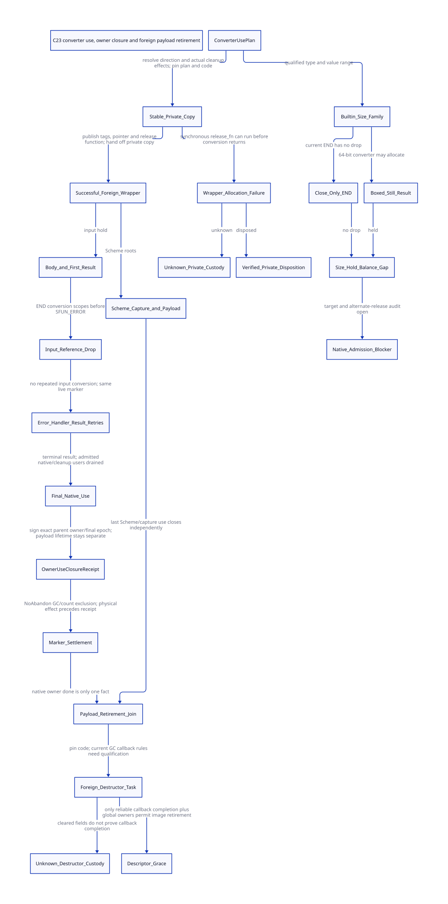

#+TITLE: C23 SFUN converter use, private-copy custody and foreign payload retirement
#+SETUPFILE: ../../modeling/org/setup.org
#+LANGUAGE: en
#+PROPERTY: header-args :eval never
#+STARTUP: overview

* RESEARCH Decision and scope
:PROPERTIES:
:CUSTOM_ID: sfun-converter-use-closure
:AUTHORITY: GambitSfunConverterUseClosure
:BASELINE: C23
:END:

Separate native converter-use closure from Scheme foreign-payload destruction.
The generated argument cleanup normally runs before the SFUN conversion-error
loop. Its common operation drops a native still reference; it does not run the
foreign destructor immediately. A captured Scheme argument can remain live after
the marker owner closes. Waiting for that destructor before closing the marker
would introduce an unnecessary ownership dependency.

The [[file:models/sysml/sfun-converter-use-closure.sysml][native SysML package]] is the source of roles, converter profiles, source anchors,
issuers, shared constraints and costs. Python calls the installed SysML evaluator,
[[file:../../modeling/ascent/sfun-converter-use-closure.rules.scm][ASCENT rules]], [[file:models/quint/sfun_converter_use_closure.qnt][QNT]] and [[file:models/lean/ConverterUse.lean][Lean]]. The [[file:sfun-converter-use-closure-matrix.org][matrix]] and [[file:diagrams/sfun-converter-use-closure.d2][D2]] /  are projections.
The [[file:sfun-owner-use-closure-design.org][parent owner/invocation study]] remains immutable. Its full runtime composition
is rebound against current local vendor hashes, with drift recorded separately.
No runtime implementation, native execution, preprocessing or performance test.

* RESEARCH Exact generated order
:PROPERTIES:
:CUSTOM_ID: converter-use-order
:END:

_ptree2.scm c-make-function emits convert-param-list, then SFUN_ERROR and its
additional c-set-result, followed by END_SFUN. convert-param-list recursively
wraps make-body and the first c-set-result in c-convert-argument. The latter emits
BEGIN conversion, body and END conversion. This gives the following source-level
trace, without executing the compiler or a native preprocessor:

#+begin_example
BEGIN_SFUN owner
  BEGIN argument conversion 1
    BEGIN argument conversion 2
      SFUN_CALL body
      first result conversion
    END argument conversion 2
  END argument conversion 1
  SFUN_ERROR while conversion status remains nonzero
    ___call handler_sfun_conv_error with the same marker
    repeated result conversion
  END loop
  final marker invalidation/reference release
  propagate remaining status
#+end_example

The nesting is conditional on successful argument conversion; conversion failure
does not execute the body of the failing wrapper. Already successful outer
argument wrappers still run their END paths on ordinary C control flow. A native
outward longjmp can bypass these local END paths, requiring stable guard custody.
Custom macro effects can add further behavior; this source trace is not an
effective generated-binary qualification.

** Exhaustive local single-line END inventory

[[file:../../modeling/tools/sfun-converter-use-inventory.py][The narrow source inventory]] checks 116 conversion BEGIN/END pairs in the current
modular header: 58 C-to-Scheme and 58 Scheme-to-C. Of the C-to-Scheme END forms,
43 call release_scmobj and 15 only close a scope. The 58 result-conversion END
forms are empty. The three COPY END forms only close scopes and are not included
in those 116 conversion pairs. Direct Scheme-object/void special forms are
separate profiles, not silently counted as allocating conversions.

These are template counts, not executed call frequencies or an effect proof for
the converter bodies. Changed or unrecognized END effects and missing BEGIN
partners are rejected by the inventory checker. It is a bounded text classifier,
not a verified C parser or preprocessor. No target configuration is inferred.

release_scmobj checks allocation/header kind and decrements a still count. It does
not call release_foreign. A Scheme capture or another root can keep the wrapper
and its native payload live after this native hold reaches zero. All physical
count writers still need the qualified GC/exclusive protocol; source simplicity
does not grant an atomic or non-abandonable native ABI.

* RESEARCH Close-only does not mean nonallocating: size-family hold gap
:PROPERTIES:
:CUSTOM_ID: converter-size-hold-gap
:END:

The exact END inventory exposed a conditional historical mismatch. SIZE_T,
SSIZE_T and PTRDIFF_T C-to-Scheme END macros only close a scope. The corresponding
functions delegate to U64_to_SCMOBJ or S64_to_SCMOBJ, whose out-of-fixnum branch
allocates a bignum. c_intf.c documents that a non-null processor produces a still
object with an initial native reference and that the caller must release it.

_parms.scm registers the actual size_t, ssize_t and ptrdiff_t builtin names with
these converter macros and a false cleanup flag. A source-only counterexample
schema is a c-define callback accepting size_t, returning void and ignoring the
argument, called from C with an out-of-fixnum value. It needs no arbitrary custom
converter, reflection or explicit Scheme refcount mutation. This schema was not
compiled or executed; effective type width and output mapping still qualify it.

The conditional source chain is: a legal native value outside the corresponding signed/unsigned fixnum test ->
64-bit converter's allocating branch -> still native hold -> normal SFUN END
without release_scmobj. Closing the C lexical scope does not discharge that hold.
If no alternate release consumes it, it survives even when the Scheme value
becomes unreachable. This is a source-level hold-balance counterexample under
those conditions, not a measured native leak or a proved effective Darwin ABI.

Qualification must establish native type ranges and FIX_WIDTH, the exact generator
and header selection, non-null processor allocation, all value branches and the
absence of an alternate owner/release. If a target's complete native type range
fits fixnum, the boxed case is unavailable. Other close-only converters must not
be labeled immediate merely from their END spelling.

A corrupted dropInputReference action retaining inputRef violates the model's
closure boundary on a prefix already exercised by QNT. That control reflects the
conditional missing-drop shape; it does not prove every instruction of the source
chain refines to that action. ASCENT keeps a distinct size-family native blocker
and rejects a forged profile claiming all close-only conversions are immediate.

With B qualified boxed occurrences, the candidate correction can remove B
unintended native holds, and enable reclamation only when no legitimate Scheme or
native owner remains. No exact bytes, time, GC speedup or whole-program leak count
is inferred. The replacement may generate the correct hold drop or return an
explicit owned-result descriptor; both require GC/count-writer qualification.

* RESEARCH Private copy and wrapper failure
:PROPERTIES:
:CUSTOM_ID: converter-private-copy
:END:

c-declare-argument emits BEGIN_SFUN_COPY_STRUCT/UNION/TYPE for by-value inputs.
The C branch allocates an RC copy before wrapping it as a Scheme foreign object.
The COPY END closes the scope; it does not free the copy. c-type-converter chooses
the explicit release function or a generated default release stub.

| Point | Actual source behavior | Required custody |
|-------+------------------------+------------------|
| Native copy fails | Null pointer reaches the typed wrapper converter, which reports an error | Do not invent a payload obligation for a copy never allocated |
| Copy succeeds, wrapper allocation succeeds | POINTER_to_SCMOBJ installs tags, release_fn and pointer | Transfer copy ownership to the initialized foreign wrapper; retain its native input hold |
| Copy succeeds, wrapper allocation fails | STRUCT/UNION/TYPE_to_SCMOBJ invokes release_fn(x) synchronously | Stable attempt must retain pointer/code through the callback and certify its disposition |
| release_fn returns an error | Its return is ignored by those wrapper-failure branches | Wrapper error status does not prove payload disposal |
| release_fn leaves nonlocally or result is unknown | No reliable local completion record exists in this source path | Preserve custody; never replay an uncertain destructor as if idempotent |

wrapFailureReturned in the model means a reliable private-disposition receipt,
not any return from the current legacy helper. A truthful receipt may report
disposed, transferred, retained-on-failure or unknown. Only disposed or a fully
acknowledged new owner can end the old private-copy obligation. The current source
does not provide that general issuer.

The proposed disposition record is AttemptId/incarnation, AllocationId, plan and
callback fingerprint, native owner/affinity, invocation state and outcome. Use
Prepared -> Invoking -> Completed(disposed/retained/transferred) or Unknown.
Transferred requires an accepting owner receipt. Callback return status maps to
an outcome only under a qualified callback contract; a nonzero status can occur
after effects have already happened. The modeled auditPrivateDisposed action
requires disposed evidence and excluded old executors; it is not a runnable
inspection algorithm. Transfer-to-another-owner is a future refinement.

Unknown retains responsibility and pointer identity, not a license to dereference
that pointer as live or to call its destructor again. The callback may already
have freed it. Code/tombstone retention and evidence recovery must remain safe
without touching uncertain storage. Process-crash recovery is outside this study.

Reserve the stable ConversionAttempt record before allocation, bind its plan and
code lease, then capture the native allocation result before any callback-capable
step. This still needs a non-abandonable allocation-return-to-record interval;
the pointer cannot be recovered from a discarded stack local. Metadata exhaustion,
partial initialization and arbitrary custom release effects remain native gaps.
No source-level conclusion is made that a demonstrated live-input leak occurred.

The Xlib example declares named native value types and custom release functions,
but that declaration alone does not prove a real by-value SFUN callback reaches
every copied-struct failure case. The generator and runtime establish the supported
path; an actual effective input/generated-profile witness remains required.

* RESEARCH ConverterUsePlan and normal owner closure
:PROPERTIES:
:CUSTOM_ID: converter-plan
:END:

The Scheme producer should freeze a plan with:

| Field | Meaning |
|-------+---------|
| PlanId/fingerprint | Exact generator, resolved type/alias graph and macro/runtime profile |
| Direction and position | C-to-Scheme parameter, Scheme-to-C result, copy wrapper or release path |
| Native acquisition | Allocation kind, ownership identity and publication cut |
| Scheme roots | Actual mutable slots, allocating safepoints and capture consumers |
| End-use operation | No effect, native-hold decrement, verified transfer or callback |
| Control effects | May allocate, call Scheme, register native use, leave nonlocally or retain aliases |
| Failure disposition | Per-status resource responsibility and unknown-effect custodian |
| Code owners | Converter, callback/destructor and descriptor/image leases |

The current type-needs-cleanup? and c-define-type cleanup boolean affect code
generation; they do not describe these effects. c-type-converter emits named
custom converters, so arbitrary native definitions cannot be qualified from that
boolean or an END macro's empty body. Complete and sealed custom effect summaries,
source bindings and alias/use admission are required. Existing Scheme semantics
must not be changed by quietly denying a formerly supported callback pattern.

At normal completion, all native parameter holds must be released or explicitly
transferred; the current result conversion must have reached a terminal success;
no admitted converter callback may still use the owner; the exact final-use gate
then closes. Delegate to the parent's owner/final-epoch closure. The model omits
arbitrary late aliases and represents admitted native use, not their automatic
enforcement.

[[file:models/lean/ConverterOwnerBridge.lean][The local normal-cut bridge]] checks the new model's normal signer against the
parent's actual signLocalClosure guard. Its adapter normalizes one admitted owner
and its current invocation for this local cut. It does not identify all source
resources, simulate every transition, preserve the parent's entire Safe predicate,
or prove cross-model retirement. Those broader refinement obligations stay open.

* RESEARCH Foreign payload and code lifetime
:PROPERTIES:
:CUSTOM_ID: converter-payload-lifetime
:END:

The copied argument's native hold can end before the retry loop, while the wrapper
stays reachable through Scheme. That payload lifetime is independent of marker
validity and owner closure. Keep a separate ForeignPayloadLease and destructor
code lease; do not keep the old native return permission alive merely to wait for
the wrapper to die.

release_foreign clears both the release function field and native pointer before
calling release_fn. Clearing prevents a later sequential release from seeing the
old callback, but it does not prove the callback completed, disposed the payload,
or ran on the right thread. The still-sweep consumers invoke release_foreign and
then free object storage without checking the returned error at the shown call
sites. This is concrete evidence for a new stable destructor task/outcome
protocol; it is not a concurrency-safe exactly-once proof of the old helper.

An unknown destructor keeps a stable external payload/code custodian. It cannot
rely on cleared wrapper fields to reconstruct the pointer or on retaining only
the wrapper after sweep has freed it. Descriptor/image retirement must wait for
these tasks, Scheme captures, maintenance readers and all other module users.
An independent GC worker cannot be admitted to arbitrary release callbacks from
this study; callback affinity and permitted reentry require separate contracts.

The model has one capture bit for any remaining Scheme payload user and one GC
lease. The roots bit means a live root/custody facility, not an unconditional
strong root to an otherwise unreachable wrapper. A detached native destructor
task must protect its actual callback roots and pointer independently. Destructor
actions cover a delayed-after-marker profile; explicit early release in existing
programs is not forbidden or proved equivalent by this model. It does not enumerate all Scheme aliases, model moving-slot rewrite or
prove an instruction-level shutdown/collector termination algorithm. Parent root
and global-image obligations remain separate.

* RESEARCH Failure, exception and continuation boundaries
:PROPERTIES:
:CUSTOM_ID: converter-control
:END:

On outward native transfer, the stable guard adopts still-owned input references
and any private attempt. Drain those input uses and authenticate owner exit before
abnormal closure. A Scheme exception handler returning a replacement value can
instead keep the same native owner alive through another typed conversion. The
parent's origin/invocation distinction is retained.

Continuation restoration can keep Scheme argument/descriptor uses alive after
the C frame expires. Its Scheme prefix may run again; the expired native marker
must remain expired. Neither dynamic-wind alone nor ordinary return from a custom
cleanup callback certifies all uses are over. C23 N3096 7.13 requires a live
same-thread setjmp invocation and constrains changed automatic locals; receipts
therefore reside in stable storage, with explicit source and owner identity.

The physical marker decrement and its commit remain separate states. NoAbandon,
all-writer/GC exclusion and commit-before-reply are model premises pending native
qualification. A release/acquire store on the final receipt alone does not make
copy handoff, callback effects or a plain count decrement transactional.

* RESEARCH Primary research and modernization rationale
:PROPERTIES:
:CUSTOM_ID: converter-research-basis
:END:

[[https://www.schemeworkshop.org/2000/feeley.ps][Feeley's 2000 Gambit continuation/C paper, sections 1–5]], separates Scheme
continuation extent from C activation lifetime. Preserve that semantic advantage
by splitting return permission, native use and payload reachability. Its native
thread proposal was not then implemented and supplies no present performance
claim. The locally preserved official PS/text is hash-bound; missing text glyphs
are not repaired into quotations.

[[https://www.iro.umontreal.ca/~feeley/papers/FeeleyMillerLFP90.pdf][Feeley/Miller PVM, section 2]], motivates explicit front/backend contracts. Scheme
should supply the converter-use plan and frame/root facts to modern generated C,
rather than making the runtime infer resource ownership from C macro spelling.

[[https://anil.recoil.org/papers/2021-pldi-retroeff.pdf][Retrofitting Effect Handlers onto OCaml, sections 3.2 and 5.3]], motivates explicit
cleanup/foreign control boundaries. Its one-shot control and restrictions on
effects across C are not imposed on Gambit. [[https://www.open-std.org/jtc1/sc22/wg14/www/docs/n3096.pdf][C23 N3096]] supplies publication and
dynamic native-lifetime rules, not a resource protocol. These are architectural
inferences grounded in the papers and current local source, not copied designs.

* RESEARCH Net return and replacement conditions
:PROPERTIES:
:CUSTOM_ID: converter-net-return
:END:

| Responsibility | Concrete benefit / limit | Added cost and positive-return condition |
|----------------+--------------------------+-----------------------------------------|
| Argument cleanup | Distinguish native-hold release from foreign destructor | One admitted input-use obligation; remove false destructor waits and duplicated cleanup inference |
| Input conversion across retries | Existing code already performs it outside the retry loop | No new speedup booked; result conversion work remains |
| Private wrapping failure | Known pointer has a stable custodian through callback failure | Attempt metadata and reliable disposal/transfer outcome; unknowns may retain indefinitely |
| Owner versus payload | Native owner can settle while Scheme payload survives | Separate payload/destructor image lease; no general liveness claim |
| Generated C migration | A sealed plan can replace implicit nested cleanup decisions | Retire old END paths only after per-profile normal/error/unwind equivalence |
| Shared support | Reuse necessary root/guard/image ledgers once | Duplicating ledgers or recording every no-op immediate conversion can erase gains |

For E fully successful owner entries with a admitted nontrivial input arguments,
the corresponding normal input native-drop obligations total aE for fixed a;
with variable argument sets, sum the actual releasing conversions. Failed partial
inputs and immediate forms do not justify that count. The inventory's 43 releasing
templates are not a or a dynamic frequency. If Q is the number of body/error
calls, aQ-aE is already avoided by existing code and is not a new saving.

The modernization target is one generated ownership/effect contract that deletes
old implicit responsibilities and admits safe parallel/GC work where effects
allow it. This study proves no time/byte speedup and no Zig-specific saving. It
uses no person-day estimate.

* RESEARCH Closure and remaining obligations
:PROPERTIES:
:CUSTOM_ID: converter-closure
:END:

The bounded protocol tracks one allocated copy, one wrapper/input hold, one
Scheme payload capture and one logical GC reader. It exposes unknown private
disposal, unknown destructor completion and marker effect-before-receipt states.
Its initial rooted owner and reliable disposition/NoAbandon authorities are
premises. It does not prove arbitrary converter safety or complete multi-shot
Scheme equivalence.

The typed-IR projector rejects altered bindings, field types, action rosters and
unsupported expressions. Nine mutated action/guard controls have exact Safe
witnesses also encoded as QNT prefix histories. ASCENT joins actual compiled
lemmas with component, source, effect/profile, issuer and cross-model normal-cut
constraints. Synthetic completeness is a wiring control; current native admission
remains blocked.

An initial Lean projection used a reserved field name and was rejected. A later
induction check exposed missing no-disposition provenance for an unreachable
initial state. Proof-automation timeouts and diagnostic attempts are also retained; source
constraints are projected explicitly without increasing default proof limits.
Both failed attempts and source snapshots are retained; neither
is relabeled as a runtime defect or a native test result.

| Obligation | Research closure | Remaining native gap |
|------------+------------------+----------------------|
| Built-in order | Exact nested generator order and 116 local macro pairs | Effective target/generated-code qualification |
| Boxed size family | Conditional allocation/empty-END hold mismatch and negative control | Native range/FIX_WIDTH, effective output and alternate-release closure |
| Input reference | Explicit decrement distinct from payload destructor | All physical writers and GC synchronization |
| Normal final use | Local bridge to actual parent guard | Complete converter effect/alias closure and generated signer |
| Private failure | Unknown remains owned, no blind replay | Stable allocation-result capture and trustworthy disposal issuer |
| Native escape | Guard input drain precedes modeled exit acknowledgement | Whole discarded subtree and actual GC/root handoff |
| Payload/code | Captures and unknown destructors retain modeled leases | Destructor affinity/effects, global images and moving-root refinement |

- [[file:../../../evidence/research/sfun-converter-use-closure/checks.json][Scoped checks]]
- [[file:../../../evidence/research/sfun-converter-use-closure/source-witnesses.json][Source hashes and anchors]]
- [[file:../../../evidence/research/sfun-converter-use-closure/macro-inventory.json][Exhaustive local conversion-END classification]]
- [[file:../../../evidence/research/sfun-converter-use-closure/ascent-results.json][Actual semantic joins and negative controls]]
- [[file:../../../evidence/research/sfun-converter-use-closure/input.json][Parent/source/formal bindings]]

Native paths retired here: zero. No runtime implementation or native tests.
