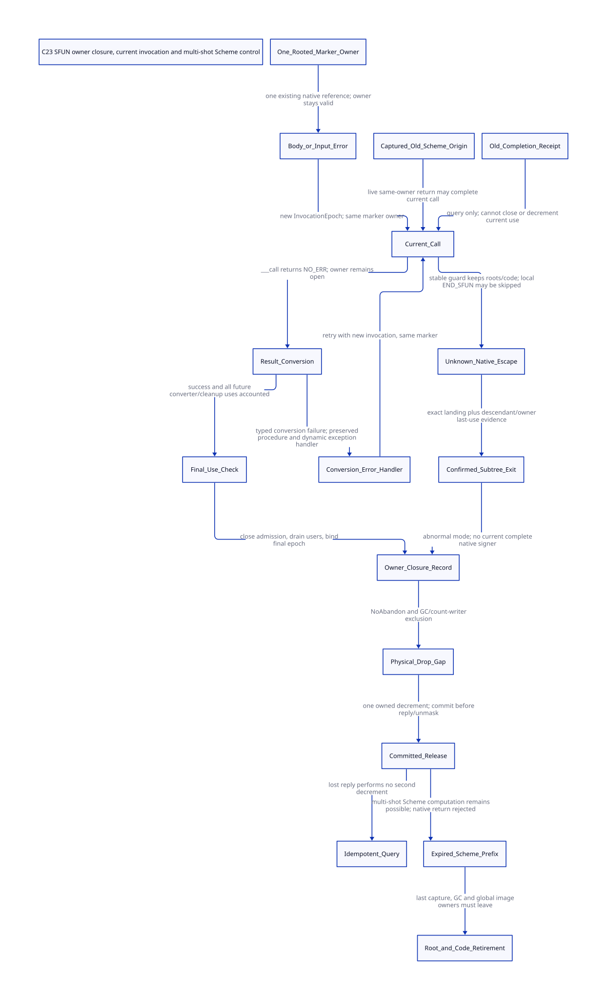

#+TITLE: C23 SFUN marker reuse, final-use closure and continuation identity
#+SETUPFILE: ../../modeling/org/setup.org
#+LANGUAGE: en
#+PROPERTY: header-args :eval never
#+STARTUP: overview

* RESEARCH Decision and scope
:PROPERTIES:
:CUSTOM_ID: sfun-owner-use-closure
:AUTHORITY: GambitSfunOwnerUseClosure
:BASELINE: C23
:END:

Preserve one marker owner across the complete generated SFUN conversion loop.
Give each actual ___call a fresh invocation identity. Close future owner use at
the generated final-use cut, or through an authenticated abandoned-subtree
protocol. Historical completion queries must not release a later invocation.
Historical Scheme continuation origins have a different role: while the same
marker owner remains valid, they may deliver a result to the current native call.

The [[file:models/sysml/sfun-owner-use-closure.sysml][native SysML package]] owns component roles, sources, return profiles, issuers,
dependencies and cost rows. Its installed evaluator feeds [[file:../../modeling/ascent/sfun-owner-use-closure.rules.scm][actual ASCENT rules]],
the [[file:models/quint/sfun_owner_use_closure.qnt][executable QNT protocol]] and [[file:models/lean/SfunOwner.lean][Lean preservation proof]]. The [[file:sfun-owner-use-closure-matrix.org][matrix]] and
[[file:diagrams/sfun-owner-use-closure.d2][D2]] /  are projections. Python orchestrates native tools and the existing
restricted typed-IR projector; it does not parse SysML.

Implementation claims use current local vendor files and content hashes. The
[[file:catcher-landing-marker-settlement-design.org][parent study]] remains immutable, including its outer ___run restriction. This
study adds an abstract SFUN lifecycle; it does not retroactively qualify that
parent's native path. The full runtime composition is rehashed against the
[[file:../../../evidence/research/sfun-owner-use-closure/parent-composition-drift.json][parent/current drift receipt]]; historical source/native conclusions are not
assumed valid for changed files. No runtime implementation, native test or performance test.

* RESEARCH Actual generator and consumer path
:PROPERTIES:
:CUSTOM_ID: sfun-owner-source
:END:

The local _ptree2.scm c-function/c-make-function producer emits the argument
conversion wrappers, SFUN_CALL body and its result conversion, SFUN_ERROR loop,
another c-set-result inside that loop, then END_SFUN. The modular
foreign_conversion.h.in consumes these choices. This is a generated control-flow
contract, not merely an allocation-helper change.

| Form | Source result path | Retry consequence |
|------+--------------------+-------------------|
| General C result | c-set-result emits a Scheme-to-C converter that assigns ___err | A body result can fail conversion; each error-handler result can fail again |
| void | SFUN_SET_RESULT_VOID does not convert a result | With built-in behavior, input conversion can lead to a handler call; no typed result conversion produces further retries |
| Scheme object | SFUN_SET_RESULT_SCMOBJ directly assigns PSR1 | The direct assignment does not produce a result-conversion error |

The actual ___call function either matches the live marker and returns NO_ERR,
or rethrows after its catcher is restored. It does not normally return an arbitrary
conversion-error code. Therefore the while predicate alone is not evidence that
all three forms can execute the same retry history. The predicate's UNWIND_C_STACK
case is also not evidence that longjmp returns that status through ___call.
Custom converters that manufacture reserved status codes need separate admission.

The example pthread/mylib.scm contains real int-returning get-counter,
scheme-object-returning new-counter and void release-counter entries. The Tcl
callback applies arbitrary Scheme code but normalizes its result to a string or
false; it is not an honest source of an arbitrary bad integer-result example.

The typed-loop handler stores the error, error data, marker and optional handler
in temp1..temp4, then calls handler_sfun_conv_error with the same marker. Kernel
label zero reads that marker's procedure and calls the optional handler or
##raise-sfun-conversion-exception. macro-raise calls the current Scheme exception
handler when the thread system is initialized. Such a handler can return a value
or transfer Scheme control. Neither event alone proves that the C owner exited.
The pre-thread-initialization exit path requires its own classification.

* RESEARCH A legal old origin is different from a stale receipt
:PROPERTIES:
:CUSTOM_ID: sfun-owner-origin
:END:

The return-to-C kernel handler checks processor ownership and marker validity.
The current ___call then compares the destination marker with its marker. These
checks do not compare the captured Scheme frame's originating invocation number
with the currently active ___call invocation number.

A source-composed witness for the general typed profile is:

1. The body invocation returns a value outside the C result converter's range.
2. Error-handler invocation two captures continuation K and returns another
   unconvertible value. A Scheme dynamic exception handler can supply this path;
   changing the private C errhandler variable is unnecessary.
3. Invocation three resumes K with another unconvertible value. The historical
   Scheme frame still refers to the same live marker; the current native catcher
   can accept that return. Result conversion fails again.
4. Invocation four resumes K with a convertible value, then reaches final use.

get-counter provides a real typed entry and an unconstrained Scheme counter
payload; an oversized integer or a non-integer demonstrates the converter input
condition. The remaining handler/control composition follows the source paths
above. This is a static reachability argument plus an executable abstract history,
not a witnessed native run or a proof for every effective generated profile.

Do not add an originEpoch=currentInvocation check as a blanket return rule: it
would reject this same-owner history. Instead, when control actually returns to
the active native invocation, issue its completion against that invocation's
fresh identity. The completion is not issued against K's historical origin.
This ledger labeling does not replace the selected historical frame's return
address, fp or dynamic environment: ___call restores PSR0 from that selected
frame. Their exact FrameSpec/register refinement remains required.

| Identity | Meaning | Cannot authorize |
|----------+---------+------------------|
| MarkerOwnerId/incarnation | One successfully created marker and its native reference | A different owner at a reused address |
| InvocationEpoch/FrameId | One currently active ___call under that owner | Closing future owner use after only this call returned |
| CapturedOrigin | Historical Scheme control and descriptor/root consumers | Releasing the native reference or reopening an expired C target |
| OwnerUseClosureReceipt | Final epoch plus closed future-use admission and native-exit mode | Any later invocation or new owner generation |

Nested callbacks require separate marker owners and a parent-use lease. The model
has one such borrower; it does not assert that arbitrary nested same-owner native
entry or cross-processor execution is already supported. No-winding/graft and
same-extent restoration prevent dynamic-wind hooks from serving as the only
execution/cleanup signer.

* RESEARCH OwnerUseClosureReceipt and real issuance cuts
:PROPERTIES:
:CUSTOM_ID: sfun-owner-issuers
:END:

The proposed receipt carries OwnerId/incarnation, final admitted invocation epoch,
FinalUsePointId, converter/cleanup plan fingerprint, native thread/context identity,
normal-final-use or abandoned-subtree mode, and root/code/guard bindings. Its
stable record lives outside frames that may be discarded.

** Normal generated completion

The proposed GeneratedSfunFinalUseAdapter belongs at the generated end-of-loop
cut after successful final conversion and all relevant cleanup uses, immediately
before delegating END_SFUN's marker release. Close the same-owner admission gate,
exclude any late converter/native borrower, confirm zero active invocations and
zero nested users, then publish the exact final epoch. The current END_SFUN is a
source control point, not an existing complete signer.

A ConverterUsePlan must cover built-in conversion bodies, argument cleanup,
result conversion and any admitted custom converter callbacks. Arbitrary raw C
that can retain or use the marker is not proved closed by the surrounding macro.
Do not silently reject supported Scheme behavior or book unchecked custom code
as equivalent. The native lowering/coverage obligation remains open.

** Native outward transfer

SFUN_BODY is empty; an outward ___call rethrow can skip local END_SFUN entirely.
A CFUN cleanup catcher may intercept first and rethrow. A stable
NativeReturnCoordinator must close future use, retain the owner in escrow, drain
descendant users and authenticate the whole abandoned native subtree before
issuing abnormal OwnerUseClosureReceipt. A Scheme exception handler, an
intermediate catcher or END_TRY's restored current catcher pointer cannot sign it.

The model explicitly distinguishes unknown exit, descendant drain, native-exit
acknowledgement and closure signing. No timeout creates an acknowledgement.
The exact generated/rooted stable signer and complete catcher manifest remain
unimplemented and unqualified.

** Reference release and acknowledgement

Owner closure, invalidation and physical native reference release are separate
facts. The current kill helper clears vector zero and performs a plain decrement.
The model exposes the effect-before-commit interval and requires the parent's
qualified NoAbandon/GC-count-writer exclusion throughout it. Commit before
unmasking cancellation, invoking callbacks or delivering a reply. A lost reply
queries that committed record; it never performs the decrement again.

The ref field is this owner's native reference obligation, not the full physical
still header count. Other owners and Scheme reachability require separate
accounting. Captured Scheme frames may continue running after native expiry;
attempting to return to that expired native owner must still raise the existing
multiple-C-return error.

** C23 publication and failure custody

Initialize the stable owner and rooted procedure before allocation/entry can
collect; constructor failure before a marker exists must not run a marker drop.
The model starts after successful rooted creation, so the raw constructor's
preallocation root gap is not solved here.

Publish current invocation identity under the owner gate before entering Scheme.
Use a real shared gate/exclusion carrier for close-versus-enter, converter borrows,
GC readers and receipt publication. An acquire/release receipt alone cannot make
several plain stores, a count decrement and a root transfer transactional. The
QNT actions are logical atomic steps whose instruction-level C23 refinement is
still required. Modified nonvolatile automatic locals after longjmp are not
stable receipt storage. C23 atomics cannot extend a dead setjmp invocation.
New generated setjmp use must also meet N3096 7.13.1.1 expression-context
constraints. The existing ___SETJMP mapping is target-dependent; the macro
template alone does not identify it as an ordinary standard setjmp expansion.

Receipt lookup must pin a stable owner record and return inert identity/result
information. It must not recover a raw marker or RootBundle pointer from a stale
receipt after reclamation. Retired-owner tombstones, lookup leases and generation
exhaustion require their own storage-retirement protocol; the bounded receipt
observations here are not a proof of that unbounded service.

Unknown native exit retains roots, descriptor leases and the native reference.
Failure before closure commit leaves the stable owner responsible. Failure after
physical decrement cannot be repaired by replay: completion requires the
qualified non-abandonable interval. No hardware/process-crash recovery or fairness
guarantee is proved.

* RESEARCH GC, continuations and descriptor retirement
:PROPERTIES:
:CUSTOM_ID: sfun-owner-gc
:END:

The new model retains logical root/code leases during active calls, conversion,
unknown native transfer, captured Scheme prefixes and the release gap. A modeled
GC reader excludes the physical decrement and prevents root retirement. Each
capture keeps both roots and descriptors even after owner closure and settlement.

This lease bit is not the parent's complete registry/context slot protocol.
Real temp1..temp4 handoff, PSR1, saved registers, captured frames, all per-context
root consumers and moving-slot updates require FrameSpec/RootBundle refinement.
The sources establish actual register/root consumers; they do not certify that
every raw temporary is scanned. Module/image, cross-VM and permanent raw code
owners remain external to this one-owner descriptor model. Its retireCode action
cannot be used as global dlclose authority.

newOwner represents a newly admitted marker owner at a fresh incarnation after
all modeled old resources retire. It does not revalidate an expired marker vector
for a surviving old continuation. Real generation exhaustion and address reuse
need their own no-ABA allocation/admission proof.

* RESEARCH Gambit papers and modern mechanisms
:PROPERTIES:
:CUSTOM_ID: sfun-owner-literature
:END:

[[https://www.schemeworkshop.org/2000/feeley.ps][Feeley (2000), sections 1–5]] separates unlimited Scheme control from dynamic C
extent. Its lazy native-frame removal explains why a Scheme continuation may
remain useful even after a native target expires. Its native-thread proposal was
not implemented then. Preserve that distinction while giving native owner use
and cleanup explicit generated contracts. The locally preserved official PS is
hash-bound; the damaged text extraction is not used to reconstruct quotations.

[[https://www.iro.umontreal.ca/~feeley/papers/FeeleyMillerLFP90.pdf][Feeley/Miller PVM (1990), section 2]] motivates a compiler/backend contract carrying
machine-specific facts. FinalUsePointId, converter effects and root/descriptor
bindings belong in Scheme-produced specifications, rather than being inferred
from a C macro's incidental placement.

[[https://anil.recoil.org/papers/2021-pldi-retroeff.pdf][Retrofitting Effect Handlers onto OCaml (2021), sections 3.2 and 5.3]] makes callback
boundaries and resource cleanup explicit. Learn that separation; do not import
its one-shot or no-effects-across-C restriction into Gambit's multi-shot control.
No published benchmark is transferred to this architecture.

[[https://www.open-std.org/jtc1/sc22/wg14/www/docs/n3096.pdf][C23 draft N3096, 5.1.2.4 and 7.13.2.1]] supplies publication and live/same-thread
setjmp conditions. It does not supply an owner-use protocol or make a plain
decrement plus separate receipt atomic. This is a public draft reference, not a
claim to quote the purchased final ISO text.

* RESEARCH Quantified return and migration
:PROPERTIES:
:CUSTOM_ID: sfun-owner-return
:END:

Let E count successfully created marker owners, and Q count actual ___call
invocations, including conversion retries. The old path already constructs E
markers and normally drops E native references; Q can be larger than E. Therefore
Q-E avoided marker constructions are not a new benefit of this refactoring.
Unknown outward transfer can skip the old local kill; normal-path counts do not
prove complete cleanup.

| Responsibility | Structural return | Added support / condition |
|----------------+-------------------+---------------------------|
| Invocation retries | Reuse one owner while keeping exact current receipts | Per-call epoch publication; no claimed reduction of Scheme conversions |
| Lost closure reply | Zero extra physical decrements after commit | Stable lookup, retained receipt and incarnation validation |
| Three END_SFUN forms | Eligible for one generated managed owner-finalization contract | Retire old unconditional kills only after all normal/error/converter paths qualify |
| Same-owner old continuations | Preserve result delivery without replaying an old completion | Separate origin identity and current invocation ledger |
| Opaque native token candidate | Eligible to remove E old marker objects and E native drops | Deduct R reflective views, S boxes and D new native releases; net counts E-R-S and E-D |
| Shared root/code/receipt support | One coherent owner ledger can replace independent reconstruction | No positive work claim if another ledger is merely layered on top |

For observation-only invocation receipts, one per-owner current epoch and
completed watermark can classify older queries without retaining every past
result. Identity metadata can therefore be O(E), instead of adding O(Q) outcome
records. This is a choice between proposed support designs, not removal of an
existing Gambit ledger. It does not bound all retained roots/code/transport state.
If the API promises exact historical result or exception payload replay, that
watermark is insufficient; the additional records and their roots must be charged.

Time and byte net return require the removed construction/count/census and
duplicate recovery work to exceed identity, gating, root scanning, code grace,
reflection and retention costs. Q may be unbounded; the finite model's four-call
limit is an analysis bound, not permission to cap Scheme retries. Zig contributes
no demonstrated unique saving to these necessary contracts. No person-days or
fabricated speedup is used.

Migration: generate OwnerId/InvocationId/FinalUsePointId and ConverterUsePlan;
root ingress and captures; replace local finalizers; add stable abnormal subtree
closure; qualify count-release and GC/image retirement; then remove obsolete
kill sites and evaluate the token ABI. This is a C-layer replacement plan, not
an extra cleanup wrapper.

* RESEARCH Formal closure and unresolved native obligations
:PROPERTIES:
:CUSTOM_ID: sfun-owner-proof
:END:

The abstract protocol bounds two owner generations, four invocations per owner,
two Scheme restorations and one nested borrower. It covers conversion retries,
current versus old receipt observation, normal versus unknown native escape,
final-use closure, release gaps and capture-aware retirement. Initial rooted
creation and NoAbandon/complete mediation remain premises.

The shared restricted projector checks typed QNT references, field sorts and the
whole action roster before emitting Lean AST. The parser/emitter and C23 lowering
remain trusted/unproved boundaries. Lean proves action preservation and reachable
safety, not full Scheme observational equivalence or eventual completion.

The model retains the most recent completed invocation and one prior owner
receipt; it is not an unbounded receipt-map/transport proof. Other historical
receipt identities must refine to the same observation-only policy. Generation
exhaustion, adversarial credentials and crash recovery are not proved.

Eight corrupted updates/guards have admissible Safe witnesses independently
matched against actual QNT prefix histories. A separate compatibility negative
adds originEpoch=currentInvocation to resumeOldReturn and must fail the old-origin
two-restoration history. This is a semantic regression control, not another
count-safety test. ASCENT joins profiles, source anchors, actions, compiled lemmas,
issuers and cross-component contracts; synthetic completeness is never native
admission.

| Layer | Research closure | Remaining obligation |
|-------+------------------+----------------------|
| Typed SFUN loop | Explicit invocation/owner/origin distinction | Complete generated-profile and custom-converter lowering |
| Local final use | Terminal result decision, gate closure and exact epoch | Real generated signer and late-user exclusion |
| Outward transfer | Unknown retains custody; closure follows exit acknowledgement | Complete native subtree manifest and stable exception signer |
| Native release | At most one effect per owner; reply queries do not replay | NoAbandon and all count/GC writers covered |
| Scheme control | Same-owner old origin can complete current call; expired prefix remains live | End-to-end Scheme/FFI observational equivalence |
| Roots/code | Captures and readers block modeled retirement | Moving slots, descriptor grace and all global image users |

- [[file:../../../evidence/research/sfun-owner-use-closure/checks.json][Scoped checks and unresolved boundaries]]
- [[file:../../../evidence/research/sfun-owner-use-closure/source-witnesses.json][Current local source hashes and anchors]]
- [[file:../../../evidence/research/sfun-owner-use-closure/ascent-results.json][Semantic joins and negative controls]]
- [[file:../../../evidence/research/sfun-owner-use-closure/input.json][Parent/current source and formal input binding]]

No native path is retired by this study.
