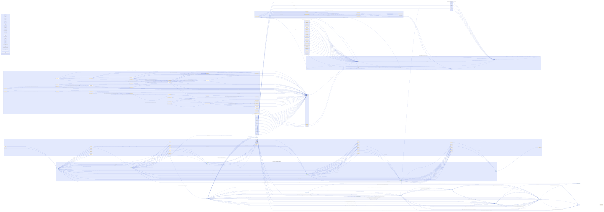

#+TITLE: Modern C shared-heap SMP and GC: joint architecture contract
The [[file:pr988-refactoring-validation.org][PR988 mechanism and native-reuse matrix]] separates historical repair guarantees, current source adapters, archived native replay and original-load acceptance.

#+SETUPFILE: ../../modeling/org/setup.org
#+LANGUAGE: en
#+CATEGORY: modern-c
#+OPTIONS: toc:3 num:nil
#+PROPERTY: header-args :eval never :tangle no :exports code
#+TODO: RESEARCH LOCAL_CHECKED | SOURCE_QUALIFIED NATIVE_QUALIFIED
#+COLUMNS: %42ITEM %24AUTHORITY %24EVIDENCE_CLASS %20BOUNDARY

Architectural entry: [[file:runtime-blueprint.org::#modern-smp-whole-delivery][the whole SMP blueprint and next complete delivery]].
This document supplies its derived closure matrix and detailed adapters. Source
case and call-point counts are not projects, REVs or SMP completion counters.

The [[file:request-service-reconstruction.org::#service-root-writers-and-net-benefit][request-service writer and net-benefit refinement]] joins generated register
publication, wait/resume closures, RC/native extents and user aliases. It counts
wait restarts separately from original request volume. Current PR revalidation
is STALE due to a changed commit-gates model digest; historical4/12 remains
source-period evidence, not current model/runtime admission. All five joint
source/native gates remain OPEN.
The [[file:request-service-reconstruction.org::#service-whole-cost-chain][whole cost chain]] now separates sender/target/harness waits, census,
first materialization, forwarding repair and terminal resume-thunk disposition
across all six original request populations. Source path retirement does not
itself establish a positive original-load timing or peak difference.
Its [[file:sender-completion-design.org::#sender-completion-goal][sender-completion design Goal]] is one whole generated-C/FrameSpec handoff,
not a collection of setter commits or a new native acceptance claim.
The [[file:completion-frame-contract.org::#completion-frame-goal][static-resume structural frame contract]] refines that handoff across
shared mutation, stack/heap movement, real debug/serializer exposure and all
exit routes; its native/source-adapter gates remain OPEN.
The [[file:completion-generator-contract.org::#completion-generator-goal][GVM-to-consumer refinement]] adds actual generator/check/debug/host and
GC publication clauses under the existing freeze adapter; it is not a new
proof owner or a native-acceptance promotion.

The [[file:sharing-and-heap-domains.org][sharing/allocation/collection-domain contract]] distinguishes the semantic
graph from physical placement and the authorized collection cut. Its three
logical roles, source cases and existing proof-owner dependencies are projected
below from SysML; they are not new runtime modules or progress counters.

See the joined [[file:completion-retry-handoff.org::#completion-retry-goal][static retry / generic handoff]] for admission, exposure,
partial conversion and qualified-population cost accounting.

* RESEARCH Decision and scope :smp:gc:architecture:
:PROPERTIES:
:CUSTOM_ID: modern-shared-heap-smp
:AUTHORITY: GambitSharedHeapSmp
:SOURCE: models/sysml/shared-heap-smp.sysml
:EVIDENCE_CLASS: composition-design-and-conditional-formal-laws
:IMPLEMENTATION: modern-generated-C; Scheme-semantic-owner; C23-consumers
:RUNTIME_ADMITTED: false
:PROGRESS_DELTA: 0
:END:

[[file:models/sysml/shared-heap-smp.sysml][SysML]] owns this composition contract, questions, exact model scopes and
dependencies. This study strengthens the design while a separate session owns
modern-C implementation. It changes no vendor runtime, profile, native source/cache configuration,
heap limit, timeout or CI. The scoped source packet now reads the existing
configured cache and executes preprocessing only, with separate retained inputs
and no runtime acceptance. The LLM is the working environment, not another
component or source of mathematical/native authority.

Formal sources: [[file:../../architecture/runtime/gc/models/quint/shared_heap_cut.qnt][joint-cut Quint model]] and
[[file:../../architecture/runtime/gc/models/lean/RelocationSlots.lean][authoritative-slot relocation law]].

The target is shared-heap Scheme with explicit execution, roots, collector work,
message ownership and resource lifetime. Actor is a programming/communication
boundary, not a synonym for an OS thread, private heap or collector worker.
A VM's heap/root/collection boundary differs from an OCaml Domain. Execution
contexts inside an admitted VM may reference each other's young objects; the
existing VM-wide minor-cut candidate accounts for those references. Cross-VM
copy/move/immutable-sharing/native-handle policies remain explicit design choices.
No transparent migration of arbitrary mutable graphs or resource-bearing
continuations is assumed.

** Progress and evidence epochs

The [[file:post-delivery.org#POST-DELIVERY-AUDIT][existing4/4 foundation record]], [[file:models/sysml/pending-cuts.sysml][independent1/12 checkpoint/routes]] and
the user's reported repair-line9/12 have different source cohorts and counting
units. This design does not rerun, promote or combine them. Earlier3/4 views
remain historical. The thirteen programme stages remain a responsibility
catalogue. Seven questions below are an assurance frontier, not seven new SMP
milestones, promised commits or a replacement progress percentage.

The fixed-slot joint source packet is specified in
[[file:../../knowledge/systems/shared-heap-smp.org::#take-slot-c-settlement][the concrete C settlement/provider composition contract]]. Its five-obligation
matrix distinguishes source refinement from native implementation/cost evidence.
The [[file:../../knowledge/systems/shared-heap-smp.org::#take-slot-backend-settlement-drain][backend/settlement/disposal prerequisite cut]] binds provider selection and
resource lifetime to the same operation and outer storage. It is a required
implementation contract, not an implemented slot or retirement receipt.
The [[file:../../knowledge/systems/shared-heap-smp.org::#take-slot-runtime-owner-packet][runtime-owner whole patch packet]] gives required per-TU evidence fields,
existing file ownership, retired responsibilities and the complete unchecked
implementation acceptance list. Its source inventory is generated below;
occurrence counts confer no closure.
The [[file:../../knowledge/systems/shared-heap-smp.org::#take-slot-observed-source-review][actual 82-occurrence review and TU preprocessing observation]] now supplies
scoped source evidence and the explicit 12-input checkout mismatch boundary.
The [[file:../../knowledge/systems/shared-heap-smp.org::#take-slot-input-attribution][twelve-input and canonical-producer attribution]] separates unchanged cache
observation reuse from required current-source recapture. Coordinate-only
classification does not grant C semantic equivalence or layout/native credit.
The attribution records a refused stale-cache reuse followed by fresh
same-cache preprocessing; one original difference is resolved, eleven remain.
Complete compiler streams stay managed outputs under the existing storage
policy; structured observations, classifications and digests are retained here.
The generated cases below include its dependency edges; no source/native clause
is closed merely by recording this design.

* Root cause and necessary architecture :refactoring:rationale:

Shared memory itself is not the defect. The dangerous coupling is using one
carrier identity or one counter as simultaneous authority over Scheme execution,
root membership, GC work, physical allocation and resource death. More locks or
a faster copying loop do not remove that coupling.

The replacement separates these responsibilities and joins them at explicit
contracts. A local callback can park safely without proving the whole VM round
complete. A root task can finish without proving every copied payload initialized.
A queue can be empty while a worker still owns a private scan frontier or Tail.
A logical continuation can remain valid while its cached physical addresses need
reloading. Unknown join does not prove death. Each shortcut has a concrete
falsifier and a separate source/implementation obligation.

** The joint collection and resume cut

A cut must name one VM, frozen participant/root inventory, epoch and layout
identity. It requires known managed/native writers, closure of new admissions,
acknowledgement of admitted writes, parked raw Scheme borrows and stable source
slot lifetime. Root-task completion then composes with unique copying ownership,
copy/scan debt, physical interval capacity and actual authoritative-slot rewriting.
Resume is legal only after those required memory-safety duties are complete and
the caller acquires/reloads the updated references under fresh authority.

A full VM implementation must additionally cover all producers, weak/will phases,
major/minor interactions, failure paths and epoch reuse. The new Quint model
checks a narrower seam: one imported host-root protocol, one abstract collection
cycle, abstract copy/producer acknowledgements and repeated restoration. It is
not a replacement for the existing worker, capacity, registry or GC models.

** Separate memory-safety debt from owner-affine effects

GC-required copy/scan/update debt must settle before moving-memory access resumes.
An owner-affine destructor or callback may instead need the owner to resume first.
That effect requires accepted native-only or already-rooted retained custody,
resource affinity and later delivery/drain. It must not be included in a GC wait
whose completion requires executing the still-closed owner. It also cannot create
unregistered moving roots after the root inventory is sealed.

The imported RC protocol supplies its existing native-only queued cleanup and
callback-lifetime guards. The composition model adds the explicit distinction
between memory-safety work and retained post-resume effect custody. Actual foreign
release functions, root-bearing payloads, thread affinity, cancellation and shutdown
are source/native questions, not proved by an effectRoot Boolean.

** Unknown writers and isolation

Unknown native join status requires retained custody. Independent healthy VMs
must not wait on an unrelated VM's unresolved resource retirement. However, if a
mutator may still write into the SAME shared heap and physical write closure is
unknown, the collector cannot manufacture a moving-GC permit. Separate-VM
isolation is not proof that arbitrary uncertain writers can be quarantined inside
one shared moving heap. Progress then requires a real stop/participation witness
or a separately designed collector/barrier architecture.

The first joint simulation exposed late unknown-writer discovery with a still-valid
root receipt. The retained =lateUnknownDiscoveryControlTest= makes that breach
explicit. Before pin, discovery revokes an issued but unclaimed receipt. After
pin, an unmediated raw writer violates the admitted source contract; the model
does not pretend a status flag can safely undo in-flight object movement.

** Preserve and amplify Gambit's control semantics

Scheme and its generator retain dynamic-wind, full multi-shot continuation and
observable mutable sharing. Repeated restoration prepares a fresh execution view;
it does not consume the captured continuation or roll back shared-heap effects.
Captured control may share backing frames subject to complete writer/revision
coverage. Mature captured frames can skip minor interior scans only when every
old-to-young boundary, including denv, reflection, deserialization and FFI writes,
is remembered and all authoritative source slots are updated.

PointId/FrameSpec and logical frame revision must remain distinct from physical
GC address movement. The new Lean obligation concerns only admitted heap-pointer
slots: complete slot rewriting and forwarding injectivity on admitted targets
preserve alias/equality observations. It does not prove all Scheme eq?/eqv?
semantics, dynamic-wind effects, C memory ordering or continuation scheduling.

* SELECTED Amplifying Gambit as one modern SMP architecture :architecture:handoff:
:PROPERTIES:
:CUSTOM_ID: gambit-amplification-delivery
:AUTHORITY: GambitSharedHeapSmp::jointDelivery
:SOURCE_CASE: GambitSharedHeapSmp::gambitAmplificationDelivery
:IMPLEMENTATION_OWNER: vendor/gambit modern-c runtime conversation
:DESIGN_OWNER: SMP/dev
:STATUS: DESIGN-SELECTED; IMPLEMENTATION-REFINEMENT-OPEN
:PROGRESS_DELTA: 0
:END:

This section explains the existing SysML joint delivery. Its component, flow,
dependency and open-clause rows are generated in the next section. It does not
create another checklist or count model checks as SMP passes. The historical
+2.93% common-cause question stays open in its own source period and does not
block this architecture handoff. The research conversation owns DEV only.

** Paper mechanisms, source witnesses and choices

#+NAME: gambit-amplification-paper-decisions
| Primary source / inspected scope | Mechanism | Gambit choice and transfer limit |
|---+---+---|
| [[https://www.iro.umontreal.ca/~feeley/papers/FeeleyMillerLFP90.pdf][Feeley/Miller, PVM, sections 2 and 2.3]] | Front/back-end cooperation and explicit frame coordinates carry information across target choices. | Extend Scheme-owned semantic completion into one frame/checkpoint contract consumed by Modern C. The historical PVM paper does not certify today's FrameSpec or SMP. |
| [[https://www.cs.tufts.edu/~nr/cs257/archive/marc-feeley/polling.pdf][Feeley, Polling Efficiently, abstract and sections 1.2.1-2]] | Poll placement balances instruction-distance latency and checking work; checks occur outside inconsistent sequences. | A poll publishes only a complete parseable root state. Measure nonallocating paths and native exclusion separately; an instruction bound is not an unconditional wall-clock pause bound. |
| [[https://kcsrk.info/papers/retro-parallel_icfp_20.pdf][Retrofitting Parallelism onto OCaml, sections 3.4 and 4.4]] | Safety points, a coordinated parallel copying minor, cross-minor references and C-interface constraints are designed together. | Evaluate a VM-wide young cut with local allocation and explicit incoming edges. Do not infer heap privacy from allocation locality or import OCaml's major collector unchanged. |
| [[https://kcsrk.info/papers/retro-concurrency_pldi_21.pdf][Retrofitting Effect Handlers onto OCaml, one-shot and fiber discussion]] | Stack ownership and effect resumption are designed jointly; the evaluated continuations are one-shot. | Reuse the design question, retain Gambit's multi-shot and wind semantics. Separate persistent captured identity from writable per-shot execution storage; any sharing optimization needs alias proof. |
| [[https://simonmar.github.io/bib/papers/parallel-gc.pdf][Marlow et al., sections 3.5-3.6]] | An empty pending set alone does not establish termination; work export granularity can conceal available parallelism. | Join private frontier, queued work, Tail and producers before phase closure. Tune export by measured span/locality and traffic; no published GHC speedup transfers to Gambit. |
| [[https://iris-project.org/pdfs/2026-pldi-parabs.pdf][Allain/Scherer, PLDI 2026, worker blocking/awaiting/shutdown]] | Blocking a stopped worker's deque and registering wake responsibility are part of scheduler lifecycle correctness. | Make stop, claims and wake-resource lifetime explicit in GC worker custody. Its verified scheduler is not a proof of our collector, fairness assumptions or C23 memory order. |

The inspected Chez one-shot paper's author-hosted PDF was unavailable in this
review. Existing [[file:../../architecture/runtime/control/continuation-segments.org][Chez/Guile continuation research]] remains a separate input;
no new Chez implementation or performance claim is admitted from search text.

** One real path: map capture, full collection and two restores

The actual =map-1*= in
[[file:../../../vendor/gambit/lib/gambit/list/list.scm][list.scm]] calls =proc=, saves its result, recursively computes
the tail and then conses. A callback capture therefore retains a non-tail
continuation with pending recursive and construction work. A second invocation
reexecutes the continuation suffix; it does not roll back shared heap mutation
or memoize effects from the first invocation. This is the semantic control.

1. =targ-check-conditions= and =targ-gen-label-return*= in
   [[file:../../../vendor/gambit/gsc/_t-c-2.scm][_t-c-2.scm]], and =targ-make-frame-spec= in
   [[file:../../../vendor/gambit/gsc/_t-c-3.scm][_t-c-3.scm]], must agree on live slots, return identity and allocation
   bounds at every admitted slow path. The presence of POLL emission alone
   proves neither complete poll placement nor complete roots.
2. Capture and frame/denv mutation in
   [[file:../../../vendor/gambit/include/_gambit/gvm_operations.h.in][gvm_operations.h.in]] and [[file:../../../vendor/gambit/lib/_kernel.scm][_kernel.scm]] preserve one logical graph.
   [[file:../../../vendor/gambit/lib/_mem/continuation-roots.inc][continuation-roots.inc]] must repair the authoritative slots, including
   aliases. A referent kept alive by an RC root can still leave an uncorrected
   frame slot; referent survival is an insufficient oracle.
3. [[file:../../../vendor/gambit/lib/_mem/root-tasks.inc][root-tasks.inc]] freezes R member-root domains and grants scan tasks to W workers.
   Each member can supply several root kinds and global shards; task count is
   neither R nor W. At R=3, W=2, the third member's sources must be scanned and
   queried without acquiring a fictitious worker identity. Source lifetime
   continues after task DONE.
4. [[file:../../../vendor/gambit/lib/_mem/heap-sections.inc][heap-sections.inc]] and [[file:../../../vendor/gambit/lib/_mem/collection-round.inc][collection-round.inc]] join queue publication and claims
   with private scanning, strong/weak closure and physical restoration. Busy
   gate acquisition and confirmed empty currently both return zero; a proposed
   replacement must prove its own-drain interpretation at every caller.
5. Reopen and whole-round completion precede each fresh restore grant. Reload
   repaired registers, frame and denv handles before Scheme resumes. Run actual
   =dynamic-wind= behavior and shared mutation observations twice. Native entry
   in [[file:../../../vendor/gambit/lib/setup.c][setup.c]] and [[file:../../../vendor/gambit/lib/c_intf.c][c_intf.c]] must retain parent-root protection,
   borrowed lifetime and any pending result through exceptional exit.

Release/acquire publication orders initialized views only after writers and raw
readers have been excluded by a common protocol. Atomic flags do not make racing
ordinary slot accesses legal. A wake is a hint to recheck a predicate; it is not
a task-completion, restored-root or reclaim receipt. Logical identity persists
across relocation, while per-shot execution state is reacquired.

** Whole implementation boundary and retirement

The existing root handoff delivery is qualified with full GC first. This is one
end-to-end responsibility replacement across generator, roots, work and reentry.
The subsequent generational delivery consumes that boundary and adds writer
coverage, remembered-set overflow, residual edges, weak repair and promotion
capacity together. Splitting these dependency stages is not permission to ship
an isolated setter or scanner as the joint delivery.

#+NAME: gambit-amplification-retirement
| Old authority or repeated work | Replacement owner | Retirement condition |
|---+---+---|
| Carrier identity decides whether a source is scannable | RootOrigin plus epoch-bound RootTask | All source kinds, registration gaps, borrowers and exit readers use the same freeze/reload protocol |
| Separate capture, GC and restore interpretations of a frame | Scheme FrameSpec / PointId with checked C consumers | Generated frames, reflection, serialized reconstruction and every restore agree on canonical slots and supported aliases |
| Queue-empty or idle count substitutes for work closure | Counted producers and unique private/queued/claimed custody | Own busy/empty distinction, partial claims, Tail, weak children and late publishers refine the existing QNT protocol |
| Carrier exit or join decides physical reclamation | Scoped last-user and VM-owned retirement | Writer closure and known stop cover all helpers; unknown outcomes retain responsibility and cannot release storage |
| Every minor traces clean mature continuation graphs | Writer-closed remembered coverage | Only admitted generations may skip; overflow falls back before unsafe exclusion, residual edges cross epochs, and complete major collection remains |
| Native-only backend work rediscovers Scheme meaning | Generated contract consumed by Modern C | All affected producers/consumers retire duplicate inference; build/Darwin acceptance remains independently scoped |

Opaque foreign writers remain conservative, pinned/handled or inadmissible to a
moving cut according to their actual contract. Unknown access in one shared
moving heap can still block that heap. Healthy-VM independence requires absence
of unresolved shared storage or global-service dependencies. Actor isolation
and concurrent invocation of the same continuation require separate explicit
admission; sequential multi-shot support does not prove either property.

** Benefit and new-cost accounting

#+NAME: gambit-amplification-benefit-matrix
| Capability | Work that can be removed | Necessary added cost | Positive-benefit condition | Current evidence class |
|---+---+---+---+---|
| Generated safety contract | Repeated root discovery and inconsistent layout inference | Descriptor bytes, decoder validation, poll slow-path publication and reload | Old inference really retires; complete safe-point paths retain cheaper admitted fast paths | Source/design; current whole delivery unmeasured |
| Multi-shot control | Eligible repeated representation and clean mature-slot visits | Per-shot writable frames, wind/effects, alias handling and retained code/roots | Saved representation/scan work exceeds extra metadata and retention; required effects still execute | Full-GC map controls are scoped; optimized production path open |
| Independent workers | Fixed source/carrier mapping and avoidable scan imbalance | Claims, queue traffic, export slack, synchronization and bandwidth | Root/work parallelism exceeds task overhead and graph span; W<R is correctness evidence, not a speedup | Historical R3/W2 controls; current-source net cost open |
| Phase and exit ownership | Repeated blind retries, stale claims and waits on dead carriers | Settlement/query, source pins and last-user retention | Known closure releases promptly; unknown debt remains localized without freeing live data | Conditional source protocol; joint failure acceptance open |
| Generational exclusion | Mature graph work on minor rounds | Mutator barriers, remembered scan, promotion, residual banks and major work | Lifetime/mutation profile amortizes all added work over an equal-work major interval | DEV selective controls; production minor not admitted |

For equal completed Scheme work and the same major interval, define all terms
in comparable measured CPU-time units. Let =S= be eliminated mature scans,
duplicate representation work and redundant bookkeeping. Let =A= be additional
barrier, remembered-scan, task, publication, restore and amortized major work.
The CPU-work benefit requires =S > A=. Space, pause and throughput are separate
acceptance dimensions; a positive CPU estimate does not establish any of them.

Measure pause from request to resumed Scheme execution in disjoint intervals:
last-participant arrival, collection, restored-root completion and final wake/
dispatch. Within collection, simultaneous worker times are overlapping CPU
contributions, not additive wall-clock phases. Per-worker load, graph critical
path and bandwidth bound useful parallelism. The existing GC report ends before
some restoration and final-barrier work and cannot substitute for total pause.

Peak space is the maximum simultaneously committed physical interval set plus
live metadata, not a sum of unrelated per-phase maxima. Include copy space,
context restore space, remembered banks, private slack and unknown retention.
Already reserved space lowers peak only if its lifetime overlaps the alternative
reservation and it is genuinely reassigned; a post-GC refund is insufficient.
Do not eliminate the current serial census until published source/initialization
and allocation certificates prove the same bounds. Census remains in this packet.

#+NAME: gambit-amplification-quantitative-bounds
| Quantity | Conditional bound / comparison | Required observation |
|---+---+---|
| Mature slots avoided per minor | =0 <= avoided <= C=, where C is eligible clean mature slots that the full control would visit; uncovered or overflow-fallback classes earn zero exclusion credit | Independent canonical-slot oracle and actual visits, including residual edges without a new store |
| Minor CPU work | Direct roots + young live closure + remembered coverage + promotion/weak work + task/synchronization; savings must exceed mutator barriers and amortized major work | Equal completed workload over a major interval; visits, bytes, stores and CPU separately |
| Useful collector parallelism | Wall time cannot beat the maximum of work/W, dependency span and bytes/effective bandwidth, before coordination overhead | Actual W, per-worker work, graph skew, memory traffic and phase timestamps; no W-fold speedup assumption |
| Private-tail slack | At most W times the per-worker slack bound only if each worker owns at most one such live tail; additional copy/restore reservations remain separate | Real arena/interval ownership and simultaneous committed ranges; no invented constant or extra heap |
| Benefit of repeated restoration | Saved representation work may grow with repeated shots; mandatory suffix effects, wind transitions and writable restore work also grow | Per-shot materialized bytes and effect trace; do not count replayed effects as eliminated computation |

These are falsifiable symbolic boundaries, not measured percentages. The
historical timing cohorts do not fill current-source numeric cells. No speed,
pause or peak improvement is declared until the implementation packet supplies
the corresponding matched observations.

** Joint acceptance handed to the implementation conversation

The five source/native obligations remain separately owned in SysML and joined
by =joint-delivery=. Reuse existing QNT for interleavings and existing Lean for
slot/representation/accounting laws. The C adapter must establish their premises.
ASCENT derives dependency closure over exact subjects; LLM source review is an
authored argument, never a substitute for native evidence.

#+NAME: gambit-amplification-acceptance
| Existing gate | Whole-path acceptance | Failure retained as counterevidence |
|---+---+---|
| SH-CUT-S | Generated complete checkpoint, protected registration, source freeze, R3/W2 claim/update, borrow reload and exit drain | Late writer, busy own queue, lost committed result, private/Tail debt or unfinished weak phase permits early resume |
| SH-ALIAS-S | Actual frame/denv canonical slots and reflective/rebuilt aliases survive capture and two restores | Missed slot despite an independently live referent; stale logical revision after physical relocation |
| SH-BOUNDARY-S | Wind/effects, native resource affinity and supported sharing domain remain explicit | Cross-domain raw pointer/control migration or ambiguous native effect is accepted without ownership |
| SH-EXEC-N | Existing map/PBT real-C replay/shrink plus complete affected official tests, full GC and original limits | Missing fixture, changed workload, wider heap or timeout is presented as a pass |
| SH-COST-N | No-probe official tfib/gcbench and map controls match source, profile, topology and completed work; diagnostics separate | Probe cost, historical image or reduced useful work is reported as current production benefit |

The implementation conversation may turn this package into its next complete
code delivery. It owns runtime files, build-directory writes and exact-REV
acceptance. This DEV review makes no SMP-family counter increment or commit
admission. A reviewable source delta, tests, advantage/cost matrix, checklist
position and remaining questions must accompany its eventual REV.

** Complete implementation packet for the runtime conversation
:PROPERTIES:
:CUSTOM_ID: gambit-amplification-implementation-packet
:AUTHORITY: GambitSharedHeapSmp::jointDelivery
:MODEL_GATES: SH-CUT-S SH-ALIAS-S SH-BOUNDARY-S SH-EXEC-N SH-COST-N
:STATUS: READY-FOR-IMPLEMENTATION; SOURCE-AND-NATIVE-ACCEPTANCE-OPEN
:END:

The packet refines the five existing gates; the generated gate and call-boundary
matrices below own their current scope. It is implementable design, not a source
attestation. Existing modeled receipt roles describe facts that bounded runtime
records may establish; they do not prescribe an allocation for each fact.

The starting observation is modern-c =568e02766ba0bc091e623506224558490fbba267=.
Dirty source content hashes in the refreshed receipt are part of the subject.
The implementation conversation must rebind changed inputs before acceptance.
An inspected definition is a witness for one mechanism; omitted callers,
conditional branches, foreign code and generated expansions remain explicit
coverage obligations. Keep the existing Scheme names and Gerbil build entrypoints.

*** Caller-to-consumer modifications in one dependency order

#+NAME: gambit-implementation-caller-map
| Real producer and consumer chain | Existing mechanism to retain | Required change / remaining coverage | Old responsibility may retire when |
|---+---+---+---|
| =_t-c-2:targ-check-conditions -> targ-gen-label-return*= and =_t-c-3:targ-make-frame-spec -> mark_frame/mark_continuation= | Actual return descriptors, liveness bitmap and allocation checks | Associate every selected poll, allocation/arity slow path and internal return with complete registers/frame/denv/native root view and unchanged allocation bounds | Every generated entry and scanner/restore consumer agrees on slot coordinates; no separately inferred root layout remains on admitted paths |
| =_ptree2:c-make-function/root-arguments -> BEGIN_SFUN_VOID/SCMOBJ/general -> ___begin_sfun= | One activation record and existing RC procedure/argument span | Qualify the whole prefix before ROOT_ARG: either protected parent/source root, or proved noncollecting, nonreentrant, freeze-excluded execution; cover permanent/FAL closure/moving proc and raw/converted arguments | Ad hoc per-wrapper rooting is replaced for all admitted variants, including failure and conversion-error callbacks; unconverted external wrappers retain their declared mode |
| =___alloc_rc_roots -> ___alloc_rc_no_register -> ___register_rc -> store_rc_root/___sfun_arg -> ___borrow_rc_root -> ___sfun_marker= | Fully initialized span, source gate and canonical payload cell | Distinguish linked membership, initialized payload installation and ACK. Keep source root until target protection covers every overlapping collection prefix; park data access separately from lifetime borrow | Registration success or equal payload no longer substitutes for complete installation; lost results are queried by pinned exact source/activation identity before retry/release |
| =collection-round -> ___root_round_begin/freeze/publish -> ___root_round_scan -> root-task source scanners= | Closed membership and VM/symkey, RC, globals, stack and bank coverage | Prove selected C atomic/mutex/barrier backend; close writers before release publication and acquire before scan. Enumerate all R members' source kinds/shards independently of W workers | Carrier identity no longer authorizes source observation or root scan. An R3/W2 non-worker member can query its own source through an authorized pinned origin, without pretending to be the assigned worker |
| =mark_continuation -> mark_frame / mark_captured_continuation_locked -> forwarding/copy/scanning= | Existing precise stack and captured-frame scanners and frame access exclusion | Preserve canonical alias coordinates when source containers move; keep unique copy initialization and Tail owner. =continuation-copy= shares its copied frame/denv references; it is not a deep frame copy | Capture/GC/restore/reflection no longer interpret the same frame differently; all admitted logical writers and reconstruction paths use the same revision/freeze rules |
| =scan_movable_objs_to_scan / scan_complete_heap_chunk -> take_heap_chunk / end_heap_chunk -> mark_reachable_from_marked= | Local scan work, FIFO publication and copied-payload ownership | Separate busy, confirmed empty and claimed work at own-drain boundaries. Prove last local use and partial/lost claim settlement before idle; retain private frontier, still scan and Tail through stop | Queue position, a null take or one counter cannot replace producer/private/claimed custody; all original callsites and phase reuse obey the replacement |
| =___root_round_finish_scan -> weak phase -> prepare_mem_pstate/reopen_rc_roots -> ___root_round_end= | Strong collective followed by weak work, root restoration and source re-admission | Keep strong DRAINING distinct from all-round completion. Settle weak children/slot repair and physical restore intervals before releasing reentry; query/record pins outlive unknown results | RootTask DONE cannot reopen writers or reclaim source/control storage; every required last user is closed or explicitly retained |
| =continuation-return-aux/graft-aux -> continuation-unwind-wind -> no-winding successor= | Existing same-context shortcut, wind/unwind order and multiple values | Reacquire exact restored epoch and reload before each shot; audit both conditional implementations. Reflective setters and =_io:implode-frame= participate in the same slot contract | Shared frame/denv aliases and repeated effects survive every admitted restore; local interrupt masking is no longer treated as cross-core exclusion |
| =run_startup_root= and initial =___setup -> ___run=; =___call/___run -> TRY/catcher -> marker kill -> lifecycle leave=; generated =END_SFUN -> ___end_sfun -> ___propagate_error= | Existing startup routes, catcher restoration, expired-return detection and lifecycle records | Cover normal/error/unwind/conversion exits and nested callbacks. One cleanup owner settles roots, marker and pending result; no replay of uncertain native effects | Owner/carrier exit or failed join no longer grants reclamation. Remaining roots/resources/control records retain a named custodian until physical last-use closure |

Implement these dependencies as one root-to-resume responsibility replacement.
Private development commits may stage dependent edits, but an independently
claimed delivery must expose the entire chain and its acceptance record. Do not
rewrite unrelated scheduler policy, all foreign libraries, actor transfer or
the major collector to make this packet appear complete.

*** Failure and memory-order decisions that implementation must preserve

#+NAME: gambit-implementation-outcome-ownership
| Cut / outcome | Authority and retained owner | Permitted next action |
|---+---+---|
| Private RC allocation fails before publication | Caller retains source roots; private byte allocation is either absent or caller-owned | Return known failure; release only proved private allocations, preserving a complete caller root view |
| RC node linked, payload installation refused | Source domain owns linked empty node; caller still protects raw input | Query exact state and discharge partial node responsibility; membership alone cannot ACK source-root release |
| Payload installed, return/ACK lost | Source and potential target both remain rooted; operation/control identity is pinned | Query committed installation; ACK once under the same incarnation. Unknown cannot authorize a second effect or early reuse |
| GC closes during borrow or generated conversion | Lifetime custodian keeps roots; raw pointer use must park at a complete checkpoint | Collector may scan only after data-access exclusion; reentry acquires completed epoch and reloads before access |
| Worker take partly committed, result unknown | Counted claimant or explicit successor retains node, arena, root and control lifetime | Settle by exact claim identity; no idle/DONE/requeue inference from a missing return |
| Strong phase complete, weak/restore unfinished | Round coordinator retains phase, source and restore obligations | Process weak children and repairs, then finish restoration. Strong DRAINING cannot authorize writer reentry |
| Owner/helper exit or unknown join | VM-owned roots and actual resource last users retain scoped storage | Accept takeover only after real writer-stop proof; isolate another VM only if no unresolved shared-storage/global-service dependency remains |

Use the existing C23 atomic-service interface and the selected GCC backend;
capture the actual translation-unit configuration. Source-gate unlock or release
publication must follow ordinary initialized writes; the matching acquire must
precede reads/repairs. Specify the enclosing exclusion for non-atomic fields.
A release/acquire flag cannot repair an already racing ordinary slot access.
The moving collector cannot proceed while an unexcluded native reader may use
an old address. No timeout, marker value or equality test substitutes for stop.

*** Executable acceptance manifest and evidence boundary

Use the existing configured Make targets through the established Bazel profile
and the same Modern C cache. The configured build directory, effective argv,
compiler/configuration/module ABI and exact executable/library hashes are inputs
to every receipt. Reuse completed products only for their exact input identity.
Tests still execute; an executable's existence is not a completed test receipt.

#+NAME: gambit-implementation-native-manifest
| Existing asset / entrypoint | Required outcome | Coverage it cannot establish by itself |
|---+---+---|
| =tests:test-frame-contract= and =frame-continuation-roots.scm= under R3/W2 | =FRAME-CONTINUATION-ROOTS-PASS= and =FORCED-GC-COMPLETE count=11=; asserted >64 live slots, two restores, wind sequence, =wide-visits '(3 3 3 2 1)= and three native suffix calls | Every frame writer, foreign raw alias and concurrent stop/history |
| =tests:test-entry=, =test-sfun-entry= and =test-rc-roots= | All selected SFUN result/conversion/error variants and nonzero-processor RC regression complete with their existing oracles/status | Arbitrary external FFI clients, unqualified C-stack escape or async process death |
| =tests:test-root-task= with its existing normal/bank/primitive variants | Existing replay, RC writes, frozen union, collector, process-contract, moving-bank and moving-globals checks; add the missing source-origin query and actual claim-settlement cuts in the owned fixtures | A source-origin query inferred from a worker-only completion function; nursery correctness |
| =tests:test-vm-lifecycle= and existing host fixture | Accepted startup, partial failure, exit and unknown-join custody preserve healthy independent-VM GC | Moving a shared heap with an unknown live writer; physical crash recovery without a separate contract |
| =map-worker-stop.scm= plus its existing replay helper and GC cuts | Preserve overlay controls; bind each newly claimed real fault history to actual C cuts and replay/shrink the same failure signature | The substituted =worker-stop-trial= exercises fixture state. Its marker and a subsequent real map pass do not prove the fixture history happened inside GC |
| =map-slot-full-collector.scm= and existing independent-slot oracle | A deliberately missed source slot fails even if another root preserves the referent; observer faults are identified separately | The serialized p1 selective control is neither R3/W2 moving-GC coverage nor an implemented production minor |
| Original GSI/GSC populations and affected Gerbil consumers | Complete manifests and natural statuses; compare any failure to the same-condition baseline and preserve unexecuted cases as such | Patch-line 9/12 or historical architecture 4/4 does not grant this branch a new SMP-family pass |
| Official no-probe =tfib= and =gcbench=, plus equal-work map control | Matched source/profile/workload/topology/order, completed work, CPU/throughput, pause and simultaneous peak; retain diagnostic cohorts separately | Historical +2.93% common cause, cold-build acceleration or a production minor speedup |

R3/W2 means three member-root domains and two active collector workers. Verify
the actual roster in the real fixture; a =p3= command line alone is insufficient.
The 11 forced collections are asserted by the existing wide-map fixture, not
a reason to modify unrelated workloads. Keep all original deadlines, census,
heap and workload limits. An unrelated baseline failure needs same-condition
attribution and the existing audit decision; it is neither erased nor silently
turned into a regression caused by this packet.

No new QNT/Lean artifact is needed. Existing QNT owns the allowed interleavings
and failure/phase/reentry histories; existing Lean owns canonical-slot, alias
and interval/accounting propositions. The actual C adapter must discharge the
premises at these selected calls. Native replay does not inherit a model proof,
and a model check cannot replace native completion.

*** Net-benefit decision and subsequent-delivery boundary

Use the existing benefit/bounds matrices above for units and inequalities.
The current full-GC packet may claim only measured elimination of duplicate
discovery/representation/bookkeeping and demonstrated ownership/correctness.
Charge descriptor, pin/query, synchronization, restore and retained-space costs
against equal completed work. A regression is retained and explicitly reviewed;
it cannot be labeled a net performance win. Added peak must be the actual
simultaneous commitment, including unknown retention, not just copied live bytes.

Future generational exclusion must separately qualify every mature writer,
remembered log overflow, weak repair, residual edge and promotion failure over a
major interval. The current packet must not grow into that implementation to
close its own five gates. Keep those obligations in the generation workstream.
Likewise, cross-VM continuation migration, scheduler-policy changes, Darwin cold
build and the historical +2.93% question remain independently owned.

The handoff is accepted by the research side when model-derived gates, caller
arguments, failure ownership, native manifest and cost definitions agree and
the existing SDK/ASCENT projections reproduce. Runtime admission remains OPEN
until the implementation conversation supplies exact-subject source attestations,
native results, cost/tradeoff review, checklist position and remaining questions
for its complete REV.

** Protected installation, source observation and real-cut replay
:PROPERTIES:
:CUSTOM_ID: protected-root-origin-replay
:AUTHORITY: GambitSharedHeapSmp::rootHandoffReplayBinding
:SOURCE_PREMISES: preRegistrationLoan originRecoveryQuery wholeWorkPublication
:STATUS: IMPLEMENTATION-ADAPTER-OPEN
:END:

The existing root service must carry one identity/lifetime chain from protected
entry through install/query/ACK and the next full-GC round. Its worker-only
=___root_task_completed= remains a worker operation. The responsibility being
retired is its misuse as source-origin observation; claim/scan/finish authority
must stay exclusive. The following fields specify that source role, not a new
public Scheme API, generic identity registry or independent runtime namespace.

#+NAME: protected-origin-observation-fields
| Input / result | Required meaning | Unsafe substitution |
|---+---+---|
| VM/source lifetime pin | Held before lookup or dereference; includes the physical record and a live admission scope | Reused VM address, processor index, resize generation or an epoch checked after stale dereference |
| Prebound admission identity | Parent/activation or stable caller-owned result location known before fallible publication | Target pointer known only after a return that may be lost |
| Origin and epoch | Root kind, member/shard and source incarnation; current round and installation revision | Assigned worker ID used as source identity |
| Lookup observation | Matching live record, stale key, or unobserved consistent state | False means absent; known absent requires a complete closed admission scope |
| Installation observation | Private, enrolled-empty, committed, known-refused or unknown, independently of payload value | Scheme #f or node membership means initialized installation |
| Task / round observations | Separately justified local scan progress and whole-round restored permission for the same pinned epoch | Task DONE means resume, root release or physical retirement |
| ACK and release | A matching committed installation may discharge its loan; source clearing, query-pin release and last-user retirement retain separate guards | ACK permits clearing a source while frozen, dropping a target after owner exit, or immediate slot reuse |

RC metadata already uses a source gate, but ordinary bank/stack/global and round
fields rely on confined collective execution. An origin observer cannot make
their concurrent reads safe merely by taking the RC mutex. The implementation
must give every observed field a common writer/reader synchronization discipline,
or expose only a safely published collective observation. If a query combines
separately published facts, it must validate their common pinned epoch and the
permitted monotone relation; it cannot call unrelated-time reads one atomic
snapshot. Until then the result is unobserved/UNKNOWN, with custody retained.

Do not hold a source/queue gate across allocation, Scheme conversion, winding,
a collector barrier, native callback or join. The admitted noncollecting entry
prefix must also exclude concurrent moving GC; metadata malloc alone is not
that proof. Arbitrary interruption inside allocator or locked publication is
not recoverable merely because an operation key exists. Without known stopped
writers and complete owned progress, preserve UNKNOWN. A first admission whose
identity and output were never captured has no promised query recovery.

Bound record retention by live source/activation/observer obligations, not total
historical requests. Query-pin acquisition must reject overflow, epochs must
not wrap into a live old identity, and IDLE reuse waits for queries and ACK/loan
obligations to drain. Unknown users can still retain space indefinitely; no
constant-space or guaranteed-recovery claim follows from a fixed record layout.

*** Selected implementation decisions for this packet
:PROPERTIES:
:CUSTOM_ID: root-origin-selected-implementation
:AUTHORITY: GambitSharedHeapSmpRootHandoffRefinement
:STATUS: DESIGN-SELECTED; NOT-IMPLEMENTED
:END:

For normal managed entry, select the existing parent/source activation loan
before =___begin_sfun=. Retain it while native metadata is allocated outside
source locks. A legacy no-GC prefix is an exception requiring explicit moving-cut
and reentry exclusion, not a second normal implementation. Keep the admitted
permanent/no-argument shortcut under its code and VM lifetime grant.

The generator must distinguish initialized raw-entry completion from list
registration. A mixed signature can install raw Scheme argument2 before
converted argument1; a contiguous high-water index is therefore insufficient.
Commit one stable raw-entry-ready fact only after the procedure and all emitted
raw Scheme stores succeed. Do not use legal #f data or the physically expired
=___sfun_rooted= C array as that receipt. Marker allocation/conversion then uses
the protected target and reloads relocated slots. The generated/runtime cohort
must reject an old unprotected entry contract before execution.

#+NAME: root-origin-selected-change-map
| Implementation owner / actual consumer | Selected change | Complete retirement condition |
|---+---+---|
| =gsc/_ptree2.scm= and =include/_gambit/foreign_conversion.h.in= | All VOID/SCMOBJ/general forms prepare the parent loan, install all raw values, commit raw-entry-ready, then enter marker/conversion; keep error/unwind cleanup paired | No admitted raw input obtains its first protection after a collecting operation; old generated entry cannot bypass the cohort check |
| =lib/_c_intf/sfun-entry.inc= and marker entry in =lib/c_intf.c= | Reuse the live activation/root span for admission identity, installed result and once-only cleanup; keep permanent, closure-self and moving-procedure cases explicit | Target protection survives GC and original owner exit until required last use; no per-argument identity table or repeated native effect |
| =lib/rc.h= and =lib/_mem/rc-allocation.inc= | Add the required source-observer lifetime and installed-entry facts to existing source/control ownership; keep them distinct from raw-access borrow and scan lease | Registration, payload install, ACK and physical unlink each have a justified cut; cleanup/reuse checks all remaining observers and loans |
| =lib/root.h= and =lib/_mem/root-tasks.inc= | Bind published tasks to a stable metadata owner; source-role observation is distinct from existing worker claim/finish/completed authority | Every observed state/lease/epoch has a writer and reader using the same guard; a non-worker source never impersonates an executor |
| =lib/_mem/continuation-roots.inc= and other task scan adapters | Publish SCANNING/SCANNED under the selected metadata guard, scan outside it, then finish under that guard | No source/queue gate spans frame traversal, callback, allocation or phase barrier; unique copy/Tail duties remain owned |
| =setup.c= startup and existing lifecycle cleanup | Bind initial setup thunk and launch-root routes to the same protected-entry result; acquire reentry and reload before each resumed call | Normal/error/unwind/nested exit settles the right activation; a failed join never frees unknown users |
| Existing =tests/root-task.scm=, replay helper and map fixture | Add one explicit live-frame/topology-bound case, retain existing p1 destructive API controls and all official names | The combined claim is supported by actual C cut observations and independent oracle/shrink evidence, not adjacent fixture and map successes |

For task metadata, the selected source gate is the member's RC gate for RC,
bank, stack and globals; coordinator-owned VM/symkey and terminal round facts
use the coordinator source gate. Bind that owner before publishing a task and
retain its physical lifetime. Apply the discipline to validation reads as well
as state/lease writes. Standalone confined p1 tasks without published metadata
ownership remain worker-local; no origin query is admitted on their stack address.

Existing global-registry exclusion is still required. When an operation requires
both guards, order the global gate before source metadata. Queries do not take
the global gate. Audit and restructure any inverse path before enabling the
source observer. Release all such guards before traversal or collective waits.
This is a source-refinement obligation, not an assertion that current C has it.

The observation result contains separately tagged facts: lookup status,
initialized installation, task progress and terminal round/reentry evidence.
It never copies a moving Scheme value. A query acquires bounded read protection,
captures metadata, publishes its scalar output and ends read access before
returning. It never waits for worker DONE or a GC phase. Combining facts from
different records requires a common pinned epoch and a proved publication
relation; inconsistent observations return unobserved rather than a fabricated
atomic snapshot.

Keep durable installation settlement in the retained activation/source record,
not a historical round table. After round-slot reuse, obsolete per-round detail
may return stale/superseded; it cannot erase known installation or grant resume.
A lost response can be queried again against the admission identity, while a
finished read pin need not retain the old round indefinitely. Admission without
a previously known key/output capture, or interruption of a locked/native
allocator prefix without physical stop evidence, remains UNKNOWN.

#+NAME: root-origin-control-costs
| Quantity | Source-derived bound or condition | Evidence needed |
|---+---+---|
| Active direct tasks | =K=2+4R= in the current union: RC/globals/stack/bank per member, plus VM and symkey; R3 gives K14, independent of W2 | Actual roster and task completion, including empty shards; excludes still/private/weak obligations |
| Added task/query synchronization | Target =O(K+Q)= metadata operations for Q observations, not one lock per heap/root slot | Counts and CPU from the actual implementation; the coefficient and contention remain unmeasured |
| Metadata-owner pointer field | If added per task, field payload =sizeof(void*)*(2+3P+D)= for allocated member capacity P and allocated RC domains D | Actual layout/allocator peak including padding. Do not substitute active K for fixed allocated capacity |
| Entry/observer state | Storage follows live activations and admitted observers, with wrap/overflow refusal and last-user drain | Actual struct/span size and retained UNKNOWN population; no constant-space promise for unknown users |
| Real-cut diagnostic log | Pre-reserved from the admitted trace/cut bound; overflow invalidates the run | Diagnostic-only peak and observer overhead; not included as an uninstrumented throughput gain |

*** Task metadata, lock order and last-reader settlement
:PROPERTIES:
:CUSTOM_ID: task-metadata-pin-exit-handoff
:AUTHORITY: GambitSharedHeapSmpRootHandoffRefinement::metadataPinExitHandoff
:INVENTORY: taskMetadataReadersWriters rootControlLastUsers
:STATUS: DESIGN-SELECTED; C-REFINEMENT-AND-NATIVE-EVIDENCE-OPEN
:END:

This is the synchronization/lifetime refinement of the same packet. The two
model-owned inventory families retain lexical candidates across the declared
source scopes; comments, aliases, macros and selected translation units still
require review. The following function ledger records inspected mechanisms and
the required replacement. It is not a whole-program call-graph certificate.

#+NAME: task-metadata-function-ledger
| Current readers / writers | Actual current exclusion | Required adapter |
|---+---+---|
| =root_task_matches/fresh/claim_state/finish_state/publish_confined= and =___root_task_init= in =root-tasks.inc= | Common helpers perform ordinary field reads/writes; exclusion is supplied by callers | Gate-held helper contracts or private-unexposed construction; never add recursive locking inside a helper already called under the source gate |
| RC publish/claim/finish/completed and =mark_rc= | RC wrappers use their source gate; =mark_rc= retains it throughout list traversal | Same metadata gate for validation and state/lease updates; frozen topology lease before moving traversal outside that gate |
| VM/bank/stack/symkey/global publish/claim/completed wrappers; scans in =root-origins.inc= and =continuation-roots.inc= | Confined collective/worker execution protects ordinary task fields; several scan adapters set SCANNING/SCANNED directly | Bind metadata owner before exposure and cover every validation/read/store. Retain standalone p1 confinement as a distinct scope, not arbitrary observer permission |
| =___root_task_finish_globals=, =___root_globals_begin/end= and shard snapshot | Global gate protects registry/snapshot/shard operations; finish currently writes task and shard there | Global-before-source only for the joined task/shard commit. Source-only observers do not read mutable shard flags or acquire the global gate |
| =root_round_begin/freeze/publish/finish_scan/end/refuse= and =reopen_rc_roots= | Some RC fields use member gates; other task/round fields are read or reset under stopped-roster assumptions | Cover every task/epoch/reuse path, including known refusal. Validate separately published round/restore facts before taking a member gate; do not nest member and coordinator source gates |
| =release_rc/return_rc_root/rc_unlink_if_dead=, =setup_rc/rc_can_close/cleanup_rc= | Zero refcount plus zero borrow permits unlink; cleanup may free the round/idle record under the source lock | Frozen-view, observer, install and cleanup last-use guards decide physical retirement. Logical release alone does not remove a traversable header |
| =lifecycle_marker_prepare/abort/kill=, =lifecycle_close_context= and idle-cache reacquisition | Owner-only active-list discipline; abort/terminal cleanup can unlink/reset/free records | Source/control exclusion for lookup and mutation; reserve sole retirement, perform controlled root/free postlude outside the nonrecursive gate, then publish clean reuse |
| =lifecycle_enter/leave=, registry lookup and VM dispose | Brief global registry reader transfers to an execution entry requiring current PSTATE | A metadata-only observer needs separate VM/source-local lifetime admission; an execution-owner check or saved VM pointer is not that role |

**** Lock domains and ordering

Use =G= for =___GSTATE->mem.global_gate=, =S_i= for source i's RC/metadata gate,
and =R_g= for the registry reader/writer word. These are different resources.
The rule =G -> S_i= does not authorize retaining =R_g= while waiting for =S_i=.
Frame/copy/FIFO gates belong to traversal/work, not source observation.

#+NAME: root-metadata-lock-order
| Operation | Selected acquisition / publication order | Forbidden dependency |
|---+---+---|
| Global shard completion | G, then S_i; publish task completion and shard fact while both apply; release S_i then G | S_i followed by G, or traversal/callback while either remains held |
| Global begin/end and round closure | Validate each source under its own gate and release it; enter global phase separately; publish terminal round fact under coordinator gate separately | Holding a source gate across global acquisition, or nesting member and coordinator source gates |
| RC/root scan | Under S_i validate and publish SCANNING with a live frozen-view lease; release S_i; traverse/copy; reacquire S_i to publish completion | Removing the old traversal lock without preventing native unlink/free |
| Source observation | Checked short route lookup transfers to VM/source-local protection; end R_g; take S_i for scalar metadata, capture output, end read access | PSTATE impersonation, global-registry pin held through local waits/ACK, or waiting for GC while holding S_i |
| Cross-source root transfer / ACK | Under target gate obtain durable installed-root protection; release it; commit parent ACK/loan discharge under parent gate; release it; settle target afterward | Any S_i -> S_j nesting, or dropping the target protection between certificate capture and parent release |
| Activation/node retirement | Reserve exclusive cleanup under S_i; release; execute controlled postlude; revalidate/publish completion before reuse or final free | Calling public =return_rc_root/release_rc= recursively while their same source gate is already held |

Where global finish must expose task DONE and shard2, make the completion
publication cover the pair. A source query sees only its gate-protected task
observation; global end continues to validate every shard under G. A task or
round guard that reads ordinary fields before taking its required exclusion
has not been repaired by locking only the final assignment.

**** Frozen RC topology is part of the replacement

Current =mark_rc= holds S_i while saving =next= and calling =mark_array= for the
procedure cell and argument span. The latter can enter copy/publication work.
Current =rc_unlink_if_dead= tests refcount and borrow only. Thus shortening S_i
without changing unlink lets a native last release invalidate the saved iterator.

Select a frozen source-view lease through known full-round restored closure
or known pre-copy refusal. While FROZEN or still joined to that round, logical
native release can decrement its ownership count, but physical unlink/free and
payload rebinding cannot invalidate the view. Retain existing nodes and canonical
cells; do not create copied root words as a second authority. This also covers
zero-refcount nodes whose last logical owner drops during traversal.

After the source view and required raw/scan/query users end, detach eligible
headers under S_i and free byte storage outside it under sole cleanup custody.
Known refusal has its own no-relocation drain cut. Unknown scan/stop cannot
synthesize either endpoint. Retaining a node can retain its reachable Scheme
graph, so charge that graph as well as header bytes and delayed free work.

**** Observer admission, lost ACK and reuse

Close admission in two distinct cuts. First reject new logical operations while
preserving settlement for already accepted installation keys. Otherwise owner
exit would prevent the very lost-ACK query needed to retire its record. Only
after accepted keys settle or are safely abandoned may final settlement close;
then drain short readers and physical last users before IDLE/rebind/free.
These are refinements of existing admission/last-consumer obligations, not a
second temporal model or a new request-history table.

A registry read must establish a checked incarnation and transfer lifetime to
VM/source-local protection before it ends. Do not call the execution-only
=lifecycle_enter= on a fictitious PSTATE. A standing accepted-key loan and a
short query read pin are separate: the query returns scalar observations without
waiting for scan/GC, then stops accessing the record before returning. A delayed
reply does not retain an obsolete round indefinitely. An interrupted locked
prefix without physical stop evidence remains UNKNOWN.

For a matching committed installation, factor the controlled ACK decision and
counter-only parent-loan discharge into one noncollecting source-gate commit.
That commit must be queryable and idempotent for the exact key. Physical clear,
unlink and byte free remain separate owned work; the public counter API cannot
be called while already holding its nonrecursive source gate. Across sources,
the durable target protection bridges the unlocked handoff and target settlement
is separately idempotent. A lost response after this committed cut can be
queried; arbitrary death between ordinary stores inside an unqualified critical
section is not the same failure and has no automatic recovery claim.

#+NAME: root-reuse-permission-separation
| Reused or retired storage | Required closure | What does not block it by itself |
|---+---+---|
| Task/round epoch slot | Required collection/restore work closed; active readers cannot dereference overwritten metadata; publish the next epoch under its owner | A standing installation key need not retain every old task epoch. Its obsolete task detail can return stale while installation settlement remains available |
| Activation/control IDLE slot | Accepted keys settled or safely abandoned, final settlement admission closed, readers and exclusive cleanup complete | RootTask DONE or a zero execution-entry counter does not independently establish this closure |
| RC header/argument span | Logical owners and raw borrows ended; no frozen topology, query or retained-install user can access the header or canonical cells | A zero refcount alone is insufficient; a pending metadata-only query is not permission to read the Scheme payload |
| Source gate/domain/VM route | All physical source/control users ended and the closed route cannot admit new readers; byte-only detached owners retain exactly their necessary storage | Epoch equality, failed join or logical VM removal does not independently prove physical last use |

Thus ROOT_ROUND_IDLE, activation IDLE and physical free remain different facts.
Never implement a single global pin count that requires all outstanding ACKs to
finish before every healthy GC round. Keep retained installation roots visible
to the current collector while only short actual metadata readers protect the
particular round lookup. Unknown physical readers/writers can still prevent
safe reuse and require explicit custody.

**** Real-cut campaign and five remaining gates

#+NAME: metadata-pin-exit-native-campaign
| Required history | Actual effect to observe | Disallowed passing substitute |
|---+---+---|
| Last release during RC scan | Real =release_rc= reaches zero while frozen traversal owns the node; physical retirement occurs only after lease/readers drain | Changing a fixture flag, releasing the scan lock without retaining topology, or extending a timeout |
| Global finish versus source query | Real lock/metadata publications preserve G-before-S_i and task/shard completion | A source-only reader locks while production writers remain plain; or a probe itself introduces an inverse lock wait |
| Admission close versus query | A short route-to-local pin either commits before close or is refused; old accepted keys still settle | Retaining global registry read until ACK; treating failed observation as absent |
| Lost committed ACK versus abort | Exactly one parent-loan discharge; target protection and pending cleanup survive a suppressed reply and repeated query | Replaying the decrement, abandoning target protection, or asynchronously killing a locked owner as though it were reply loss |
| Idle reuse versus delayed observer | Actual abort/terminal/reacquire paths retain the old record until the final admitted reader ends | Comparing an epoch after dereferencing reused storage or clearing a live pin on timeout |
| Refusal/restoration and next round | Known refusal or actual root/weak/restore closure drains deferred work without early root release | Local scan DONE authorizes reuse, or fixture carrier exit is reported as proven PSTATE death |

In R3/W2, distinguish a completed native activation or external observer helper
from an actual GC-participant carrier exit. The former can leave three GC members
alive while its source record remains retained. A physically stopped participant
additionally needs a complete frozen root handoff to VM custody and a qualified
roster change before its PSTATE is reclaimed; that implementation remains open.
Unknown raw access may still forbid moving its shared heap. Unrelated VM
progress requires independent storage/service dependencies and cannot be inferred
from a failed join.

PBT must record hit production cuts, exact key/epoch/actor and expected ownership
independently of the tested return. Preserve the existing map/wind/two-restore
and 11 forced-GC assertions. Shrink keeps valid setup, R3/W2 and the same real
failure signature; missing hooks, malformed histories and precondition exits are
not smaller counterexamples. Inside gates, hooks record bounded scalar data;
scheduled delays occur only at legal unlocked boundaries. Calibration faults
remain labeled fixture mutations, not newly discovered production failures.

#+NAME: metadata-pin-exit-five-gate-frontier
| Existing gate | Remaining evidence required |
|---+---|
| SH-CUT-S | Complete task/control readers and writers, selected TU backend, G/S ordering, stable frozen list, route-to-local pins, once-only ACK and actual cleanup/reuse consumers |
| SH-ALIAS-S | Canonical RC/frame/denv slot repair and shared aliases remain correct while nodes/records are retained; no live referent can hide a missed source slot |
| SH-BOUNDARY-S | Real wind/native/catcher/marker exits obey the new last-user protocol; activation exit, helper exit and PSTATE death retain distinct admission conditions |
| SH-EXEC-N | Actual combined R3/W2 histories above, independent oracle, replay/shrink and complete affected official/consumer manifests under original limits |
| SH-COST-N | No-probe equal-work CPU/throughput, complete pause and physical peak; charge new guards, registry attach, deferred-node/graph retention and drains; no minor-scan saving or historical +2.93% credit |

The possible benefit is shorter source-lock occupancy and useful observer/native
progress under contention. Full-GC root scan work is still present. Target
metadata work =O(K+Q)= additionally needs direct bound-source and protected
record validation (fresh activation-key lookup still costs O(A)); native
deferred drain adds =O(U)= for U eligible nodes, and fresh observer attach still
pays the existing registry lookup =O(V)= for V live VMs. Measure actual critical
sections, waits, retained graphs and padding. Neither these work bounds nor a
green SDK projection establishes a speedup or completes any of the five gates.

*** Complete frozen-view, ACK and query-retirement implementation contract
:PROPERTIES:
:CUSTOM_ID: frozen-view-ack-pin-layout
:AUTHORITY: GambitSharedHeapSmpRootHandoffRefinement::metadataPinExitHandoff
:SOURCE_LAYOUTS: packetRcLeaseLayout packetActivationAckLayout packetCanonicalRcSpan
:STATUS: IMPLEMENTATION-READY-DESIGN; FIVE-JOINT-GATES-OPEN
:END:

This is one extension of the existing root-handoff adapter, not another REV,
identity table or temporal model. SysML owns its premises and acceptance; these
Org tables explain the source refinement. Field labels below are proposed
private C members, not implemented fields or a promised binary layout. Keep
public Scheme names and generated/runtime cohort checks. No field offset,
sizeof, lock-freedom or performance claim follows from SDK acceptance.

**** Selected holders and field semantics

#+NAME: frozen-handoff-field-layout
| Existing holder / source | Proposed private field group | Ownership, initialization and reuse |
|---+---+---|
| =rc_domain= / =lib/rc.h= | =view_epoch: UWORD=, =view_held: BOOL=; source =readers: SIZE_T= and admission state | All under S_i. One joined view per domain; match round incarnation, not worker ID. Initialize before exposure. A view survives task SCANNED/DONE until restored closure or known pre-copy refusal and scanner last use. Reader count is actual access, not outstanding replies |
| =root_task= / =lib/root.h= | Bound metadata-owner reference; retain existing =epoch/state/scan_leases= | Bind before publication, immutable until task retirement. Member RC/bank/stack/globals use S_i; VM/symkey use coordinator source gate. Every validator, reset and scan-state writer follows that owner. Do not infer authority from executor=current processor |
| =activation_record= / =lib/lifecycle.h= | =generation: UWORD=, admission enum {new-and-settlement, settlement-only, closed}, =readers: SIZE_T= | Under its source gate. Increment generation only after old last users and cleanup end; exhaustion refuses reuse. Closing new admission preserves accepted-key query/ACK; final close rejects new pins and precedes drain. Existing =kind= continues to describe activation semantics |
| Same activation | One transfer record: key {VM/source identity, activation generation, installation revision: UWORD}, phase enum {none, preparing, installed, acked, settled}, parent RC handle and durable-target handle | Key includes VM incarnation, source identity, activation generation and installation revision; target slot/extent is bound before installed. Store one outstanding transfer per activation; nested entries already have their own records. No unbounded reply history. A second transfer cannot overwrite an unsettled one |
| Same activation | Exclusive cleanup reservation and owned postlude progress | Reserve under S_i; retain record, domain and each detached resource while unlocked. Completion is published only by the reservation owner after known cleanup results. UNKNOWN prevents reuse; a helper needs actual writer-stop evidence, not owner logical exit |
| =vm_lifecycle= / =lib/lifecycle.h= | Local =observer_word: ___WORD= (bit0 final-close, +2 per admitted observer), independent of =entries[]= | Route lookup must transfer a checked incarnation to this local lifetime before ending registry access. Acquire must be bounded/nonblocking while registry read is retained; on contention release and retry/refuse. Then pin the source record under S_i. Execution entries cannot substitute for observers |
| =rc_header= / =memory_state.h.in= | Reuse =prev/next/domain/data/root_count/root_borrows/refcount=; no mirror root array | Freeze seals canonical node/slot extent. Collector alone repairs moving cells after data writers/borrows park. Logical release may change counts; unlink, rebind and physical free wait for view/raw/scan/install last use. Metadata queries return scalars, never borrowed Scheme payload pointers |

The installation key must be available before the first fallible publication,
so a lost return cannot require the lost pointer to perform lookup. The
source/activation lifetime supplying that key must itself already be protected.
Initial lookup searches the retained active/retiring records under S by exact
key after source lifetime is protected; never dereference a caller-supplied raw
record pointer. Keep unsettled records discoverable until final settlement. A
direct record handle is valid only with a pre-existing record lifetime loan.
For this first adapter, a local VM observer pin conservatively retains its
source-route descriptors, domains and their gates through the subsequent
source-pin attempt. Every source destruction path checks that obligation; a
VM pin that protects only the lifecycle header leaves a use-after-free window
before S acquisition. This may defer other source-domain frees in the same VM
for a short actual query, but does not freeze their GC or retain an obsolete
round. Refining it to per-source route pins is a later optimization requiring
the same no-gap transfer proof.

An observer with only an unpinned address is refused. Retain a target token in
existing protected target/source custody, not on the exiting owner's C stack;
this is required even after the parent loan has been ACKed.

For raw SFUN arguments, commit =installed= only after the procedure and every
required raw slot are initialized. Generated raw Scheme arguments can precede
other argument positions. Therefore an argument high-water mark, =FAL= payload,
or dead local =___sfun_rooted[]= is not an installation receipt. An admitted
noncollecting generated prefix may establish all-slot readiness without a new
per-slot bitmap; any proposed partial-recovery bitmap needs a separate extent
and initialization proof. Until then an uncertain partial span retains the
parent root and refuses installed/ACK.

**** Result consumption is a retirement prerequisite

ACKED means the parent loan was discharged once; it does not mean its reply was
received. A separately completed target settlement does not close the accepted
consumer's query right. Reuse the existing transfer phase: SETTLED additionally
requires known result consumption, or qualified abandonment/revocation of that
right with all admitted reads drained. Do not allocate another reply-history
table or add a global completion flag. Normal scope exit, nonlocal escape and
physical owner stop must each identify who can still query the exact key.

Parent-loan discharge and target scope cleanup are separate acquired duties.
Even when their RC handles alias, two successful borrows require two distinct
returns. ACKED records only the parent return; end_sfun/abort owns the target
borrow/refcount duties. Neither pointer equality nor a nonnull roots field
can authorize a second parent return. Preserve counter-only commits and the
separate physical cleanup reservation. Include a real same-domain aliased-
handle control with exact acquisition/return counts in the joint campaign.

The counterexample is ACK commit -> reply lost -> target settlement -> early
IDLE -> old requester queries. An early reuse destroys the only settlement
witness. The real-cut campaign must attempt that reuse, observe refusal, then
close the consumer right and drain its pin before demonstrating safe reuse.
Old/stale key refusal never authorizes another loan decrement or action replay.
Unknown result consumers retain their bounded record/custody, not every old GC
epoch; current collectors must still scan retained installed roots.

**** Ordered commits and critical-section boundaries

#+NAME: frozen-handoff-commit-order
| Step / real caller chain | Inside exclusion | Outside exclusion and permission granted |
|---+---+---|
| 1. =_ptree2 c-make-function= -> =BEGIN_SFUN*= -> =begin_sfun=; =run_startup_root= separately | Admit parent/source protection before fallible target enrollment; private target allocation is not installed | Allocate/prepare privately under the qualified no-GC/no-reentry prefix or rooted allocator path. On failure retain parent, own all acquired resources and report known refusal only for known results |
| 2. =alloc_rc_roots/register_rc= -> generated =SFUN_ROOT_ARG/sfun_arg= -> marker/conversions | Target S seals initialized membership, canonical extent and installed revision; acquire durable target protection before exposing installed | Unlock before allocation, callbacks, GC participation or waiting. Freeze may accept only the fully protected target or the still-held parent; never an unprotected interval |
| 3. =root_round_freeze/publish= -> =mark_rc= | S seals view epoch/hold and topology, then publishes SCANNING under task authority; all raw data access is already parked | Scan actual canonical cells using separate worker authority after releasing S. Keep iterator, source and slot extent alive; no concurrent unlink/insert/rebind invalidates them. Claim failure retains the original task custodian |
| 4. Target lookup -> parent ACK -> target settlement | Capture protected installed fact under target S, unlock; under parent S validate key, commit ACK phase and decrement both header root_borrows and domain borrows for its one loan via private counter-only core; unlock; target S later records settlement | Never nest two source locks. Public =return_rc_root/release_rc= cannot be called under their own nonrecursive gate. Separate refcount ownership from borrow discharge; retain physical-cleanup work. Lost replies query the recorded phase instead of decrementing again |
| 5. =lifecycle_enter/leave= neighbors -> source observation -> close | Short registry read establishes local VM lifetime and ends; source pin increments before reading record. Copy scalar key/phase/epoch facts under S, end read/pin, then return | No blocking source acquisition while holding registry reader. No Scheme payload escapes. If observation cannot be acquired return unobserved, not absent. A reply transport delay alone holds neither pin nor obsolete round |
| 6. =lifecycle_marker_abort/kill=; =lifecycle_close_context= | Close new operations, keep settlement for accepted keys; after settlement close final admission and drain readers. Reserve one cleanup owner and detach eligible resources under S | Controlled root return, marker work and byte frees occur under their actual authority outside S. Reacquire S to publish known clean state, then cache IDLE or detach/free record. Do not release the reservation's domain lifetime before its final S unlock |
| 7. =root_round_end/refuse= -> =reopen_rc_roots=; =release_rc/return_rc_root/cleanup_rc= | Known restored/refused cut ends view only after scanner/writer last use. Detach zero-owner eligible headers under S. Preserve unknown users and live install protection | Free detached byte storage under sole cleanup custody; account partial/unknown free results. Final gate destruction requires no users or possible new route admissions. A pending ACK need not hold an old round, but its retained root remains in each current frozen source set |

The gate-held ACK core is indivisible relative to admitted observers, not
crash-atomic across ordinary C stores. Underflow, stale keys, duplicate ACK and
count/generation overflow are checked before mutation. A lost response after
unlock is recoverable. Interruption midway through the ACK or allocator prefix
without qualified physical-stop/progress evidence remains UNKNOWN; preserve
both possible holders and do not replay a decrement. The same limitation
applies to interrupted route-pin increments and cleanup postludes.

For the selected mutex implementation, successful unlock/next lock provides the
release/acquire relation for these ordinary fields. =volatile= is insufficient.
For the local observer word, reuse the existing ordered-word/CAS service, not
a second atomic wrapper. Private initialization is zero; admit checks bit0 and
=old <= MAX_FIX-2= before CAS to old+2. While a registry reader is retained,
perform only a qualified nonblocking attempt; on conflict end registry access
and retry/refuse rather than spin or wait there. Finish every local access
before publishing count release; final close is a checked acq_rel RMW setting
bit0 without erasing the count, and retirement acquires the closed zero-count
observation. A release store of 1 would incorrectly erase live pins.

The current =___WORD_CAS_ACQUIRE= supplies acquire success/relaxed failure, not
the release half required for final close or last-use publication. Reuse a
qualified existing full-RMW =___lifecycle_cas/COMPARE_AND_SWAP_WORD= path or
extend that same service with the required order; selected GCC/C23 TU evidence
must decide it. Do not infer full ordering from a macro name or a volatile
field. Source/record counters under S remain ordinary fields; do not mix plain
and atomic access to the observer word. No data
root is made safe merely by atomically publishing a control pointer. The
existing G-before-S order for joint global shard/task completion remains;
queries never take G while holding S. No source gate is held across copy, a
phase barrier, callback, allocation, join or collector completion wait.

**** One real-cut PBT acceptance campaign

#+NAME: frozen-handoff-cut-pbt
| Real C cut / production paths | Required independent observation and negative control |
|---+---|
| Generated prefix before enrollment and after all raw stores / =_ptree2=, =foreign_conversion=, =sfun-entry= | Valid FAL and out-of-order raw positions; moving argument survives marker/conversion GC; suppress installed reply after unlock. Missing readiness must keep parent custody, not let a still-reachable object hide a missed slot |
| SCANNING published, S released / =rc-roots= and =release_rc= | Last native reference drops while scanner owns its saved next; node cannot unlink before view closure. Deliberately omit topology retention as a labeled calibration fault; independent slot oracle must detect it |
| Installed capture, parent ACK unlocked, target settlement / actual RC borrow return and scope exit | Lose each reply independently and query/replay; exactly one loan decrement, no nested source lock, protected target appears in next full GC after original owner exit. A duplicate/stale key changes no counters |
| Local route lifetime acquired, record pin admitted, final close / registry, abort, terminal cleanup and idle reacquire | Delay a real admitted observer only outside locks; IDLE/free waits for its last access. Refuse late new pin, allow accepted settlement, reject old generation before dereference. Overflow and generation exhaustion retain ownership rather than wrap |
| Known refusal/restored closure and unknown stop / round end/refuse, reopen and cleanup | Differentiate no-relocation refusal, completed restoration and unknown writer. View/cleanup debt releases only on its qualified endpoint; late task observation may be stale while install settlement remains queryable |

Use the existing map two-restore/wind/11-forced-GC fixture and PBT replay/shrink,
with real R=3/W=2 observations. Existing p1 destructive task replay remains a
separate scope. Preallocate bounded scalar hook logs from the trace bound;
inside-lock hooks cannot allocate, print, call Scheme or wait. Missing hooks,
log exhaustion, failed setup or changed topology are INCOMPLETE, not passing
or shrunk counterexamples. Shrinking retains actor/key/epoch dependencies and
the same failure signature. These are required cases, not executed evidence.

**** One implementation boundary and current mainline audit

The complete replacement includes generated pre-registration protection and
all-slot readiness; source/control admission and same-source metadata guards;
frozen chain and W<R task consumption; exact-key install/ACK/query; normal,
exceptional and terminal exit; and known-clean record/domain retirement.
Implementing only mark_rc, one setter, a reader helper or one abort path is not
this delivery. The C mapping remains the existing holders and entrypoints in
the function/commit tables above. No new parallel public API is proposed.

The [[file:request-service-reconstruction.org][complete current-source service reconstruction]] and
[[file:repair-driven-gc-smp-design.org::#modern-mainline-repair-audit][scientific audit and Repair9 bridge]] preserves published3/12 at REV32028f5d and now revalidates the later complete
fourth family =pr-gsi= on its exact producer. Its retained
publication manifest matches all56 selected files; the working successor has
three changed selected inputs and must be qualified independently. Both changed
Org audit documents have byte-valid frozen reviewed snapshots; their current
bytes cannot substitute for those snapshots. This packet does not edit the
other conversation's source, checklist or native evidence.

This root handoff is necessary for Repair9's moving-root and lifetime safety,
but does not retire its request-routing or repeated wait/service-control work.
Those dependent whole deliveries and original stress/capacity acceptance remain
explicit below. Neither a new 4/12 pass nor a root-only success earns all-SMP
credit. Historical +2.93% attribution is excluded from this implementation's
five gates; current matched cost/peak evidence is still mandatory.

**** Unified closure and benefit matrix

#+NAME: frozen-handoff-benefit-frontier
| Gate / responsibility | Eliminated work or coupling if implemented | New cost and closure still required |
|---+---+---|
| SH-CUT-S / frozen source | Removes source mutex residency during full RC scan and carrier-only metadata lookup | Same scan volume; extra short gate transitions, direct owner references, retained nodes. Complete selected-TU/generator/caller audit and actual C mapping remain OPEN |
| SH-ALIAS-S / canonical cells | Keeps one authoritative root span while shared continuation aliases survive repair | No mature-scan omission claim. Independent slot/alias oracle must show all moving cells repaired and reloads correct; OPEN |
| SH-BOUNDARY-S / once-only ACK and exit | Removes dependence on original owner remaining alive to answer a committed-result query | Retained target/parent roots, observer pins, exclusive cleanup progress; real wind/catcher/native exits and physical-stop qualification remain OPEN |
| SH-EXEC-N / combined protocol | One replayable acceptance binds freeze, ACK, pin and next-round coverage | Actual GCC/C23 R3/W2 histories, affected official tests and consumers not executed this turn; OPEN |
| SH-COST-N / net benefit | Potentially shorter lock wait and better progress under contention | Measure no-probe equal-work CPU/throughput, full pause, peak native bytes and retained Scheme graph. All performance and net benefit remain UNMEASURED |

Source freshness is separately recorded in the existing design receipt. The preceding frozen-handoff projection recorded generated =_std.c= binding
drift for =generatedBulkCaller= and =generatedFillCaller=. Those observations
remain STALE_AFTER_PROJECTION in the prior-projection receipt and cannot support
whole-adapter closure. A subsequent historical-accounting projection rebinds
current source bytes separately; it does not erase the earlier drift.
The twelve directly reviewed root/lifecycle/entry files and this packet's
implementation-boundary sites matched repeated hash observations. This is not
an atomic checkout snapshot and does not authorize another thread's runtime.

For K=2+4R direct root tasks, K=14 at R=3 with W=2. Bound metadata-owner
references cost raw pointer payload =sizeof(void*)*(2+3P+D)= for allocated member
capacity P and RC domains D, not K pointers if storage is fixed at maximum
capacity. Additional domain payload includes two machine-sized view/count
words plus admission/hold fields; activation growth includes key/token handles,
count/generation and phase/cleanup fields. Padding and any existing spare
capacity require actual C layout evidence; do not sum these as measured bytes.
Keep fixed per-activation storage; overflow or unsettled reuse refuses new work
without dropping old custody. Unknown retention has no finite peak bound until
last-use/stop evidence exists.

With direct source and already protected record binding, Q metadata queries
and U eligible deferred nodes target O(K+Q+U) metadata/drain work. Fresh keyed
lookup instead pays O(A) over A retained source activation records per lookup;
do not claim constant lookup without a validated direct lifetime handle. H
fresh route attachments still cost O(H*V) with the current V-entry registry
search. Full scan work is unchanged.
A positive net benefit requires saved contention/wait and retry work to exceed
added gates, route admission, drain and graph-retention costs at equal workload.
A low-contention workload may regress. Neither historical +2.93% nor minor-GC
savings can be credited to this adapter. This replaces lock/lifetime authority
across all listed producers and consumers; changing only mark_rc or a query
helper does not deliver it.

*** Actual C replay adapter and joint counterexamples

The current =root-task-replay.scm= launches =-:p1 --replay=; some =replay-native=
families clear root banks and terminate their disposable child. Preserve that
population. Extend the existing fixture's selected case/transport to declare
R3/W2 and preserve live map frames, rather than changing p1 defaults or spawning
a new test framework. Keep the existing result/status and shrink interface.

Before collection, reserve diagnostic storage from the declared trace bound and
pin each referenced source. A hook inside a lock/collector phase records only
bounded scalar observations. Delay/grant points must occur at legal boundaries
that do not hold a lock needed by the scheduled counterpart. No hook may
allocate, call Scheme, join or wait on a GC participant. Log overflow or a
missing required observation invalidates the run; diagnostic logging is charged
separately from no-probe performance. Hook presence does not prove it was hit.

#+NAME: protected-origin-real-cut-campaign
| Joint history | Actual production cuts to bind | Independent oracle / forbidden result |
|---+---+---|
| Close before install | Generated entry, initialized private span, registration admission and caller-root reload | Original input and each raw argument remain rooted; no partial caller frame or unowned native node |
| Legal #f and lost install return | Real initialized payload commit, delivery suppression, source observation and matching ACK | Committed #f differs from enrolled-empty; recovery neither reinstalls nor releases twice |
| R3/W2 non-worker origin | Member2 source assignment to worker0, actual claim/scan/DONE, read-only source observation | Source query never impersonates worker0 or changes claim/scan leases; DONE alone cannot resume |
| Query pin versus owner exit | Source lookup pin, lifecycle cleanup/reuse, next-round source scan and delayed ACK | No stale dereference; target root remains covered in the following GC after original owner exit |
| Local DONE before full completion | Real strong-finish, weak work/repair, physical restore and root-round end | Query retains distinct progress and restored facts; no early raw-pointer use or reentry |
| Stale/unknown observation | Actual epoch/source-slot reuse guard and unavailable metadata snapshot | Stale or unobserved is not absence. No blind retry, reclaim or success synthesized from a timeout |

Each replay records exact workload/runtime/toolchain identity, topology, source
and operation identities, hit C cuts and the existing failure signature. Oracle
expectations come from the specified ownership/slot observations and independent
rooted referents, not from copying the tested function's return. Shrink removes
only dependency-closed commands while preserving source/parent setup, R3/W2 and
the same failure. Exit72/precondition failure, log truncation, a changed actor or
an absent C hook cannot be accepted as a smaller property counterexample.

The worker-stop fixture's substituted trial and later successful real map remain
different evidence scopes. Keep both controls and require the new joint adapter
to show its actual interleaving. Retain the wide map's two restores, wind and
11 completed forced collections, and the independent-live-referent missed-slot
negative. Production minor overflow/residual tests stay in the later delivery.

All five existing gates close together only after these source contracts, alias
and native-control premises, actual-cut histories and matched cost evidence
agree on one source subject. Retire raw-input-after-registration protection,
worker-as-source query and fixture-only-as-joint-evidence assumptions at that
point. Charge query pins, snapshot publication and retained records against the
work actually saved; until measured, no throughput or pause win is asserted.

** Reproduce the design projection through the existing SDK
:PROPERTIES:
:CUSTOM_ID: gambit-amplification-reproduce
:EXECUTION_CLASS: DESIGN-ONLY
:END:

This block uses existing SDK, ASCENT and renderer owners. It regenerates the
model-declared Org/D2/SVG views and prints open obligations; it performs no
runtime build, native acceptance or formal-model rerun. =d2= resolves through
the existing environment. A fresh projection may invalidate older source-bound
receipts; it cannot upgrade their native scope.

The entry model owns only shared schema, metadata and native package imports.
Its =ModelModule= declarations assemble responsibility packages for architecture,
assurance, delivery, source sites, writer inventory, refinements and handoff.
The module table below is read from those native declarations, not a JSON layout
or Python component catalog. Public imports preserve qualified entry lookup;
physical declaration packages and model-input hashes intentionally change.
Earlier source attestations must be rebound. The retained modularization receipt
compares all semantic records and ASCENT answers, not just total line counts.
Its [[file:../../../evidence/research/retained/modern-c/shared-heap-smp-design/modularization-inputs.json.gz][frozen model inputs]] preserve that source period. Later intentional refinement
edits have a new model hash; the earlier equality check is not relabeled as a
claim that those edits changed no design. The archive is an immutable audit
input, not a second maintained model template.

#+NAME: gambit-amplification-sdk-projection
#+BEGIN_SRC python :dir ../../.. :python .venv/bin/python :eval never :results output
from pathlib import Path
import json, re, shutil, subprocess
import opensysml
from gambit_smp.sysml_flow import drive_flow

root = Path.cwd()
entry = Path("dev/refactoring/modern-c/models/sysml/shared-heap-smp.sysml")
models = ["dev/modeling/models/sysml/verification-responsibilities.sysml",
          str(entry), *map(str, sorted(entry.with_suffix("").rglob("*.sysml")))]
connection = opensysml.connect(version="v0.10.1")
documents = [(p, Path(p).read_text()) for p in models]
result = drive_flow(connection, root, documents,
                    "GambitSharedHeapSmp")["view"]
projection = result["projection"]
catalog = connection.parse_sources(documents, strict=True, strict_conformance=True)
catalog.raise_for_errors()
assert catalog.hash == result["modelHash"]
source_modules = []
for item in catalog.find("GambitSharedHeapSmp").parts():
    if item.type_facts.resolved_id == "GambitSharedHeapSmp::ModelModule":
        row = {a.name: catalog.eval(item.id + "." + a.name)
               for a in item.attributes()}
        assert row["source"] in models
        assert catalog.find(row["namespace"]) is not None
        source_modules.append(dict(row, lines=len(Path(row["source"]).read_text().splitlines())))
projection["sourceModules"] = source_modules
views = {v["kind"]: Path(v["path"]) for v in projection["views"]}
render = json.loads(subprocess.check_output(
    ["jq", "-f", "dev/modeling/ascent/render-shared-heap-smp.jq"],
    input=json.dumps(projection).encode()))
org = views["org"]
text, count = re.subn(
    r"(?ms)^#\+NAME: shared-heap-smp-contracts\n#\+BEGIN: sysml-view .*?^#\+END:\s*$",
    lambda _: render["org"].rstrip(), org.read_text())
assert count == 1
org.write_text(text if text.endswith("\n") else text + "\n")
views["d2"].write_text(render["d2"])
tool = shutil.which("d2")
assert tool, "D2 must resolve from the existing environment"
subprocess.run([tool, str(views["d2"]), str(views["svg"])],
               check=True, timeout=60)
service_paths = {kind: Path(catalog.eval("GambitSharedHeapSmp::requestService" + suffix))
                 for kind, suffix in (("org", "Org"), ("d2", "D2"), ("svg", "Svg"))}
for kind, target in service_paths.items():
    assert target.parts[:3] == ("dev", "refactoring", "modern-c")
    assert ".." not in target.parts and target.suffix == "." + kind
service_text, count = re.subn(
    r"(?ms)^#\+NAME: request-service-source-contracts\n(?:\|[^\n]*\n)+",
    lambda _: render["serviceOrg"], service_paths["org"].read_text())
assert count == 1
service_paths["org"].write_text(service_text)
service_paths["d2"].write_text(render["serviceD2"])
subprocess.run([tool, str(service_paths["d2"]), str(service_paths["svg"])],
               check=True, timeout=60)
from gambit_smp.suite_coverage import accepted_smp_status, require_pr_smp_evidence
ledger = accepted_smp_status(root)
pr_ref = ledger["receipts"]["pr-gsi"]
pr_receipt = json.loads((root / pr_ref["path"]).read_text())
require_pr_smp_evidence(root, pr_receipt)
pr_manifest = json.loads((root / pr_ref["path"]).with_name("manifest.json").read_text())
pr_rows = ["#+NAME: request-service-pr-population",
           "| Target | Kind | Original source SHA prefix | Executed SHA prefix | Extra file cap |",
           "|---+---+---+---+---|"]
for case in pr_manifest["cases"]:
    executed = pr_receipt["testInputFiles"]["unit-tests/" + case["target"]]
    cap = str(case["seconds"]) + "s" if case["seconds"] else "shared whole deadline"
    pr_rows.append("| " + " | ".join((case["target"], case["kind"],
                   case["sha256"][:12], executed[:12], cap)) + " |")
pr_text, count = re.subn(r"(?ms)^#\+NAME: request-service-pr-population\n(?:\|[^\n]*\n)+",
                        lambda _: "\n".join(pr_rows) + "\n", service_paths["org"].read_text())
assert count == 1
service_paths["org"].write_text(pr_text)
print(json.dumps({"modelHash": result["modelHash"],
                  "open": result["answers"]["shOpen"],
                  "nativeReady": result["answers"]["shNativeReady"],
                  "runtimeAdmitted": result["runtimeAdmitted"]}))
#+END_SRC

* SysML-derived contract and closure view :sysml:ascent:
:PROPERTIES:
:CUSTOM_ID: shared-heap-smp-contracts
:AUTHORITY: GambitSharedHeapSmp
:EVIDENCE_CLASS: SDK-DERIVED-CONDITIONAL-CLOSURE
:END:

#+NAME: shared-heap-smp-contracts
#+BEGIN: sysml-view :kind shared-heap-smp :source models/sysml/shared-heap-smp.sysml
| Declared proof dependency | Release / immutable revision | Toolchain |
|---+---+---|
| LeanPoo.Functional.Transformation | https://github.com/tao3k/lean-poo/releases/tag/v0.1.2 / b29ea0d9d2ffeed0c13b66794fc6d418fd5b0393 | leanprover/lean4:v4.34.0 |

| Progress axis | Reported source-period status | Meaning | Credit boundary |
|---+---+---+---|
| foundation-progress | Historical4/4 local foundation delivery record; source-period bound, not current integration-REV admission | Foundation responsibility replacement; not current-source full SMP or generational acceptance | No cross-axis arithmetic, inherited pass or progress credit from this design flow |
| independent-smp | Recorded5/12 at canonical65a4a2e2: bootstrap, gsi, gsc, pr-gsi and pr-gsc; seven remain. The planning snapshot revalidated both model-bound PR receipts without rerunning native workloads. This is the accepted evidence period, not current dirty HEAD or fresh remote CI. Read the authoritative accepted_smp_status ledger before any later report. | Independent whole-family modern-c native acceptance | No cross-axis arithmetic, inherited pass or progress credit from this design flow |
| repair-history | 9/12 current user-reported repair checkpoint; not rerun here. Repair19 is a retained 2026-10-26 8/12 evidence cut, not a contradictory current numerator or modern-c credit. | Historical architecture failures and repairs inform hypotheses, not modern-c passes | No cross-axis arithmetic, inherited pass or progress credit from this design flow |
| integration-admission | Keep the registry OPEN_INTEGRATION and the separately closed scoped requirement packet distinct from historical local4/4. Current selected-tree five-gate REV admission is not inferred from either count. | One source/scope-bound integration result versus its native prerequisites and publication admission; thirteen catalogue stages are not another denominator | Do not rewrite historical model inputs or promote scoped native closures to current working-tree admission |

| SysML responsibility module | Native package | Single source | Lines |
|---+---+---+---|
| architecture | GambitSharedHeapSmpArchitecture | dev/refactoring/modern-c/models/sysml/shared-heap-smp/architecture.sysml | 135 |
| assurance | GambitSharedHeapSmpAssurance | dev/refactoring/modern-c/models/sysml/shared-heap-smp/assurance.sysml | 196 |
| delivery | GambitSharedHeapSmpDelivery | dev/refactoring/modern-c/models/sysml/shared-heap-smp/delivery.sysml | 169 |
| adapter-contracts | GambitSharedHeapSmpAdapters | dev/refactoring/modern-c/models/sysml/shared-heap-smp/adapter-contracts.sysml | 215 |
| writer-inventory | GambitSharedHeapSmpWriterInventory | dev/refactoring/modern-c/models/sysml/shared-heap-smp/writer-inventory.sysml | 207 |
| source-sites/roots | GambitSharedHeapSmpRootSources | dev/refactoring/modern-c/models/sysml/shared-heap-smp/source-sites/roots.sysml | 462 |
| source-sites/collector | GambitSharedHeapSmpCollectorSources | dev/refactoring/modern-c/models/sysml/shared-heap-smp/source-sites/collector.sysml | 513 |
| source-sites/execution-and-control | GambitSharedHeapSmpExecutionControlSources | dev/refactoring/modern-c/models/sysml/shared-heap-smp/source-sites/execution-and-control.sysml | 511 |
| source-sites/foreign-entry | GambitSharedHeapSmpForeignEntrySources | dev/refactoring/modern-c/models/sysml/shared-heap-smp/source-sites/foreign-entry.sysml | 216 |
| source-sites/qualification | GambitSharedHeapSmpQualificationSources | dev/refactoring/modern-c/models/sysml/shared-heap-smp/source-sites/qualification.sysml | 168 |
| source-sites/coordination-and-lifecycle | GambitSharedHeapSmpCoordinationLifecycleSources | dev/refactoring/modern-c/models/sysml/shared-heap-smp/source-sites/coordination-and-lifecycle.sysml | 508 |
| refinements/root-handoff | GambitSharedHeapSmpRootHandoffRefinement | dev/refactoring/modern-c/models/sysml/shared-heap-smp/refinements/root-handoff.sysml | 110 |
| refinements/dependencies | GambitSharedHeapSmpRefinementDependencies | dev/refactoring/modern-c/models/sysml/shared-heap-smp/refinements/dependencies.sysml | 110 |
| refinements/collector-work | GambitSharedHeapSmpCollectorWorkRefinement | dev/refactoring/modern-c/models/sysml/shared-heap-smp/refinements/collector-work.sysml | 96 |
| refinements/continuation-and-domain | GambitSharedHeapSmpContinuationDomainRefinement | dev/refactoring/modern-c/models/sysml/shared-heap-smp/refinements/continuation-and-domain.sysml | 44 |
| refinements/regions-and-bulk | GambitSharedHeapSmpRegionBulkRefinement | dev/refactoring/modern-c/models/sysml/shared-heap-smp/refinements/regions-and-bulk.sysml | 109 |
| handoff/contracts | GambitSharedHeapSmpHandoffContracts | dev/refactoring/modern-c/models/sysml/shared-heap-smp/handoff/contracts.sysml | 94 |
| handoff/callers | GambitSharedHeapSmpHandoffCallers | dev/refactoring/modern-c/models/sysml/shared-heap-smp/handoff/callers.sysml | 369 |
| handoff/facts | GambitSharedHeapSmpHandoffFacts | dev/refactoring/modern-c/models/sysml/shared-heap-smp/handoff/facts.sysml | 488 |
| current request/wait/service/GC/exit conditional refinement | GambitSharedHeapSmpRequestServiceSources | dev/refactoring/modern-c/models/sysml/shared-heap-smp/source-sites/request-service.sysml | 312 |
| static resume structural frame/root/alias/exit refinement | GambitSharedHeapSmpCompletionFrames | dev/refactoring/modern-c/models/sysml/shared-heap-smp/source-sites/completion-frame.sysml | 88 |
| GVM liveness/checkpoint/emission/consumer refinement | GambitSharedHeapSmpCompletionGenerator | dev/refactoring/modern-c/models/sysml/shared-heap-smp/source-sites/completion-generator.sysml | 261 |
| same-wait root transfer/query/ACK and real-cut accounting | GambitSharedHeapSmpCompletionSettlement | dev/refactoring/modern-c/models/sysml/shared-heap-smp/source-sites/completion-settlement.sysml | 386 |
| historical repair mechanism to current responsibility and acceptance refinement | GambitSharedHeapSmpPr988Mechanisms | dev/refactoring/modern-c/models/sysml/shared-heap-smp/source-sites/pr988-mechanisms.sysml | 94 |
| whole interpreter environment/root/exposure source refinement and stress admission | GambitSharedHeapSmpEnvironmentQualification | dev/refactoring/modern-c/models/sysml/shared-heap-smp/source-sites/environment-qualification.sysml | 392 |
| no-escape production wait, same-shot rearm/fallback and exit native acceptance source adapters | GambitSharedHeapSmpWaitNativeAcceptance | dev/refactoring/modern-c/models/sysml/shared-heap-smp/source-sites/wait-native-acceptance.sysml | 199 |

| Workstream / authority | Complete delivery unit | Entry / exit | Excluded work | Benefit and added cost |
|---+---+---+---+---|
| Gambit safepoint, multi-shot and parallel GC joint delivery / GambitRuntimeComposition / GambitSharedHeapSmp | One source-bound implementation packet joins generated safepoints and complete FrameSpec, per-shot shared continuation identity, frozen RootOrigin tasks from R member domains dispatched to W workers, producer-aware strong/weak closure and restored reentry. Task/shard count is not R or W. SH-CUT-S, SH-ALIAS-S, SH-BOUNDARY-S, SH-EXEC-N and SH-COST-N remain five distinct gates, not five feature REVs. Generational scan exclusion consumes this foundation in a subsequent whole delivery. | Exact modern-c working-source identity and generated ABI; finite writer/source census plus declared external admission policy; existing QNT/Lean kernels and imported owner premises / All five exact-subject obligations and their inherited prerequisites close; QNT schedule refinement and Lean slot hypotheses hold in C; complete affected native/PBT populations and matched work/pause/peak costs pass the five REV gates | No claim of all-SMP completion, new generational scan exclusion, Actor migration or cold-build speedup; no source-location/SDK-pass credit and no runtime edits by this research task. Historical +2.93 percent common-cause attribution stays OPEN in its own evidence period and is not a current implementation delivery gate. | Current full-GC handoff earns no mature-scan-exclusion credit. It can replace scan-length source-lock occupancy with brief metadata exclusion only if frozen topology/node lifetime is proved. Scanned root words remain; charge source-view leases, once-only ACK/counter work, task/query synchronization, deferred unlink and UNKNOWN retention. Current direct K=2+4R gives K14 at R3, independent of W2. With direct source and already protected record validation, metadata targets O(K+Q); fresh key search over A retained activation records adds O(A) per lookup; deferred drain adds O(U) for U released nodes and can conservatively retain their reachable graph. Fresh observer attachments still pay existing registry lookup O(V) for V live VMs unless a proved direct route exists; reuse VM/source-local admission for repeated queries. A per-task pointer costs sizeof(void*)*(2+3P+D) payload for allocated member capacity P and RC domains D, plus padding. Peak includes deferred node bytes, retained referents, activations and logs. Known closure bounds retention to drain; UNKNOWN has no fixed bound. Only matched CPU/pause/throughput/physical peak establishes a benefit. Keep census/heap and future generation cost separate; no current speedup claim. |
| Whole root handoff and resume refinement / GambitModernCDeliveryPlan / GambitPendingCuts | Next complete delivery: generated caller roots -> requester/child RC install and ACK -> still marker -> frozen RootTask/W<R scan -> source reentry/reload -> exceptional exit and last-user retirement; consume historical4/4 without changing its denominator | Reuse the published source-bound four deliveries; reconcile current dirty adapters separately / One source-bound implementation covers root/writer/borrow producers and consumers, parent ACK only after target install, source queries distinct from executor grants, relocation reload and pre-RUN VM-control pins; whole native/PBT/cost acceptance closes five REV gates, never point-by-point credit | No generations, Actor isolation, full SMP acceptance or cold-build claim inside foundation 4/4 | Explicit source identity and durable ownership remove inferred carrier authority; gate/pin/scan/restore costs remain |
| Independent modern-c SMP qualification / GambitModernCDeliveryPlan::a1..a12 / suite_coverage.accepted_smp_status / evidence/research/retained/modern-c/delivery-plan/current/accepted-smp-progress.json | Twelve complete native families; exact branch/profile/artifact/population | Bind each family to current producer and original limits; preserve baseline failures / Complete affected whole families with assertions, natural exit, PBT replay/shrink and failure attribution | No patch-line pass transfer; local model/source review does not increment families | Establish reliable parallel behavior; test cost is not a runtime speedup |
| Binding and request hot-path cost / GambitPendingCuts / post-delivery matched-cost-matrix | Matched workload cost claim, separate from correctness and family counts | Exact baseline/candidate source, profile, topology, warm/cold state and complete population / Show avoided work exceeds lookup/permit/barrier/synchronization work and peak-space costs | No reuse of historical percentages as current checkout measurements; cold builds stay separate | Amortize identity/slot resolution at module/context admission and safe-point refresh; preserve freeze/exit exclusion |
| Generational shared-heap GC / GambitGenerationalAdmission / GambitGenerationalBarrier | Whole allocation/store/minor/promotion/major contract | Complete roots and writers; forwarding/copy authority, contiguous reservation and restore are source-bound / Complete remembered sources, residual edges, promotion failure custody, major/weak/will and matched costs | Not another age policy or a duplicate QNT/Lean proof; concurrent major not assumed | Avoid proven-clean mature interiors; pay barriers, rendezvous, promotion, major traffic and physical reserve |
| Actor message and control boundary / GambitContinuationSegments / shared-heap boundary policy | Admission contract for current same-VM shared messages, control and native resource affinity; future cross-VM isolation/monitor services are separate implementation work | Distinguish logical Actor, VM heap, execution context and carrier / Explicit same-VM sharing and cross-VM transfer admission; per-shot control and resource affinity remain valid | No forced share-nothing rewrite of Scheme; mailbox delivery alone grants no cross-VM continuation migration | Explicit isolation prevents global lifetime coupling; cloning/serialization, monitoring and retained pins cost work |
| Build and Darwin developer experience / GambitPendingCuts::currentPackages/currentRoutes | Producer/configuration/compile/link invalidation contract | Existing configure/Make/Bazel profile and same task-owned workspace / Source identity preserves completed products and rejects stale producer reuse; measure complete build separately | No new profile, executor or environment layer; not a runtime REV acceptance dependency by default | Remove repeated generation/configuration/compilation only with exact dependency proof; metadata checks have cost |
| Current-subject stress and marginal-work qualification / Runtime owner selected source/ABI/profile/artifact subject; accepted_smp_status families stress-gsi/stress-gsc; DEV source and value review | One joined source freeze, whole declared stress evidence and causal-work decision; no new progress denominator or isolated setter/MVP credit | Runtime owner freezes the complete selected responsibility and dirty/support boundary on the existing branch; bind generated C, headers, compiler, profile and linked artifacts. Accepted5/12 source period and archived DEV cache are evidence, not automatic identity of this subject. / Run original stress-gsi/stress-gsc populations under original limits, preserving passes, classified failures and unstarted work. On that same subject measure or explicitly bound slow-wait, capture/closure, physical arm, frame-materialization, scan, binding-read and root/metadata costs. Produce one complete next responsibility replacement or a justified no-change decision. A failing campaign may identify a falsifiable owner defect; it cannot advance a family. | This DEV task does not select/commit peer runtime hunks, rerun an archived cache as current HEAD, widen test populations/budgets, introduce static S or minor GC speculatively, or absorb build/CI/Darwin work beyond required dependency closure. | N_elim cannot exceed actual eligible slow entries; legal physical rearm does not multiply capture savings. Require measured avoided work or explicit correctness benefit to justify added admission/root/frame/retention costs. Prior +2.93 percent and other historical regressions do not explain current source by themselves. No new throughput/peak claim without a matched subject. |

| Workstream | ASCENT-derived blocker |
|---+---|
| acceptance | prerequisite-open |
| acceptance | question-open |
| actors | prerequisite-open |
| actors | question-open |
| current-subject | prerequisite-open |
| fastpath | prerequisite-open |
| fastpath | question-open |
| foundation | question-open |
| generations | prerequisite-open |
| joint-delivery | prerequisite-open |

| Supporting factor / existing owner | Exact subject / scope | Actual observation | Boundary |
|---+---+---+---|
| GW-work-transitions / GambitRuntimeAssurance::work.history | models/gambit/gc_work_contract.qnt / 3f7d1891eb6f130564670796e5279e4ed42b88cca0c243e3421ea920048eb603 / gc_work_contract:Test$ | OPEN | Existing finite private/publish/acquire/rescan histories only; no C source refinement |
| GW-work-schedules / GambitRuntimeAssurance::work | models/gambit/gc_work_closure.qnt / 9c486b9f28828fc5eecb64ebab3fccd6dfaa1b7c76705f504943a8070287eb1b / gc_work_closure:initFixed/step/safe;seed3;1000samples;40steps;Test$ | OPEN | Typed queue results plus fixed worker-slot intent/claim/unlink/commit/release/delivery microsteps, lagging progress/query pins and stale-key settlement in existing two-worker abstraction; no exhaustive/liveness/C memory or general crash proof |
| GW-work-lifetime-algebra / GambitRuntimeAssurance::work.induction | models/gambit/lean/WorkAccounting.lean / ce8476074e1fa2e4de1ba4c287f271ac06c97449eb970b947ee72d49536a99c9 / GambitSMP.WorkAccounting:zeroCountAndEmptyQueuesExcludeHiddenWork;missingLifetimeCounterexample;reopenedWorkRevokesZeroCount;zeroCountAndProducerCoverageExcludeHiddenWork;missingPublishedLifetimeCounterexample;unobservedPreservesQueueCustody;confirmedEmptyRequiresEmptyQueue;acquiredObservationConservesWorkCount;busyMayRetainNonemptyQueue;mismatchedClaimKeyHasNoPayload;claimQueryReturnsOnlyRecordedItem;gateEncodingInjective;sealedGateZeroHasNoBorrowers;checkedBorrowStepFits;checkedGenerationSuccessor | OPEN | Conditional ProducerLifetimeSafe algebra; current LeanPoo release identity in model; no scheduler or C census theorem |
| GW-last-users / GambitRuntimeAssurance::work.history | models/gambit/retirement_last_consumers.qnt / 589c56894997c77697e9e77df6078532ad591643a72c6f83a61175280ffaa81c / retirement_last_consumers:all-declared-runs;runtime_retirement_quarantine:all-declared-runs | OPEN | Existing finite last-consumer and unknown-join retention histories; distinct owner slices, not a joint C simulation or physical-stop proof |
| GW-publication-source / GambitRuntimeAssurance::work.platform | vendor/gambit/lib/_mem/heap-sections.inc / 8c8bf467e325c4f7034d62c3dca425e85b12a72105a10546159a600a89f1a98d / Exact mem.c/os_thread.c TU provider binding -> initialized intent/publication -> unique source-closed claim settlement -> private/Tail custody under selected C memory order; lifetime disposal belongs to GW-termination-source | OPEN | OPEN C producer/consumer and backend refinement; formal observations cannot satisfy this source factor |
| GW-termination-source / GambitRuntimeAssurance::work.source | vendor/gambit/lib/_mem/collection-round.inc / 17db50a00fc262a6a5b175e0f254f24633e9061d0eb037afcc03362c4c37e7b9 / One publication-idle-phase-exit chain: producer lifetime through last publication, failed claim and idle; wait predicate, private/dequeued/Tail/weak debt, no postzero publisher and unknown-stop resource custody | OPEN | OPEN complete C lifetime and phase/exit refinement; queue/count observations and conditional Lean laws alone are insufficient |

| Question | Primary workstream |
|---+---|
| SH-CUT-Q | foundation |
| SH-ALIAS-L | foundation |
| SH-CUT-S | foundation |
| SH-ALIAS-S | foundation |
| SH-BOUNDARY-S | actors |
| SH-EXEC-N | acceptance |
| SH-COST-N | fastpath |

| Component / authority | Guarantee | Responsibility retired after qualification | Added cost | Falsifier |
|---+---+---+---+---|
| Shared graph semantics / logical identity / GambitSharedHeapSmp:sharing-contract | Within an admitted sharing domain, object identity, aliases, shared mutable cells, closures and multi-shot continuation observations survive relocation; control restore does not roll back shared heap effects. A sharing domain is a semantic boundary, not one contiguous heap or an OS thread. | Retire physical address, request completion or actor membership as a proxy for shared identity/liveness only after every admitted store, root and per-shot observer preserves the same graph contract. Do not silently copy ordinary shared references across a new isolation boundary. | Shared mutation still needs a defined memory model, writer admission and root/update coverage; privacy and isolation are not free consequences of placement. | Two restored wrappers observe different copies of a previously shared mutable cell, or a request frees an environment retained by a continuation/native borrower. |
| Allocation regions / placement and capacity / GambitSharedHeapSmp:allocation-placement | A region owns physical allocation/copy/restore intervals and capacity accounting; context-local allocation does not prove private reachability or authorize independent collection. Mutator nursery, collector destination and native pinned/permanent space are distinct roles. | Retire carrier identity or allocation address as heap/object owner only after source bounds, initialization publication, cross-region references and actual capacity transfer/free are explicit. Current WorkerArena cannot be relabeled as an implemented nursery. | Region descriptors, refill/reserve slack, fragmentation, promotion and incoming-edge tracking; local bump allocation may save coordination but not tracing all by itself. | A supposedly private region is freed while another context/global/continuation/FFI still refers into it, or copy/restore intervals overlap after repartition. |
| Collection domains / authorized evacuation cut / GambitSharedHeapSmp:collection-cut | A collection domain identifies collected regions, epoch, admitted mutators/root sources, all incoming edges and native-access exclusions. Root count R, collector count W and domain membership are separate. Current VM-wide cut is a candidate boundary; finer domains require an actual cross-boundary protocol. | Retire one VM/processor/actor count as universal collection and reclaim permission only after every uncollected-to-collected edge is repaired, handled, pinned or excluded, and all scoped work/weak/restore/last-user debt closes. No independent per-region GC is admitted from local allocation alone. | Rendezvous, remembered edges, access barriers/handles/pinning and domain coordination; smaller cuts can reduce scanned work but increase publication and reclamation complexity. | A collector moves an object while an unknown raw borrower in the same domain may access it; another VM's progress is asserted despite a shared mutable dependency or unreleased global service. |
| ExecutionContext / carrier / GambitRuntimeComposition:execution | ExecutionContext owns registers, denv, PointId and per-shot restore; VM owns membership and heap epoch; carriers hold revocable execution grants. Park requires a complete root view, and reentry acquires the completed epoch before reloading relocated values. | Retire PSTATE/carrier identity as execution/root/collector authority only after generated entry, direct/apply/native entry, park, restore and exceptional exit use the same context grant; keep actual platform TLS transport. | Per-shot roots and reentry refresh; restoration can still copy frames. | A restored continuation remains multi-shot and keeps shared mutable cells; restoring control does not roll back the heap. |
| RootOrigin / RootTask / GambitRuntimeAssurance:roots | All admitted roots and native borrows publish one epoch-bound frozen view; scan authority outlives the carrier until every authoritative slot is updated. | Retire carrier-index root discovery only after bank/stack, captured frames/denv, RC, VM/global, symbol/keyword and strong still sources have writer/borrow closure, installation-before-parent-ACK, scan leases and source-side completion/reload; no lexical inventory grants retirement. | Root descriptors, writer/borrow exclusion, source pins and retained unknown debt. | An unknown writer, incomplete frame, unregistered RC source or stale receipt vetoes the cut. |
| CollectorWorker / WorkerArena / GambitRuntimeAssurance:work | One copy initializer owns claimed objects, private frontiers and Tail debt; R root domains and W workers are distinct; resume waits for real work closure. | Retire carrier-index arenas and fixed R=W scan assignment only after W<R roots, private/dequeued/chunk/Tail custody, copy-before-forwarding capacity and per-context restore intervals close; queued work count alone never grants resume or reclamation. | Census, packing, CAS/refunds, private work custody and physical slack; useful parallelism also depends on serial root prefix, export delay, graph span and memory bandwidth, not just copied-byte balance or W count. | No partial forwarding, uninitialized payload, unowned dequeued work or unreserved contiguous copy/restore interval may be admitted. |
| Generational selection / barriers / GambitGenerationalAdmission:candidate | Consume the existing VM-wide young-cut candidate: roots, remembered source slots and young closure; mature skips require complete writers, residual edges and major/weak semantics. | Retire repeated mature interior scanning class by class only after all initialization/mutation/FFI/continuation writers, remembered residual edges, minor promotion capacity and major/weak/will processing close; still/permanent tags are not object ages. | Barrier/card/log work, rendezvous, promotion, extra major traffic and peak reserve; concurrent major remains a separate choice. | Barrier overflow must retain coverage and cannot hide an allocating GC in an unrooted store; a major collector remains mandatory. |
| CapturedControl / FrameSpec / GambitContinuationSegments | Scheme owns dynamic-wind and semantic control; one frame/root description serves capture, scan, deserialization and repeated restore with fresh physical authority. | Independent frame coordinates, cached moved addresses and one-shot consumption imposed to make scheduling easier. | Version/view checks, retained frames, Scheme hooks and necessary materialization remain. | Logical frame revision differs from physical GC relocation; every aliased authoritative slot must agree after relocation. |
| Scheduler / request / mailbox ownership / GambitModernCOutcomes:execution | Scheduler owns runnable/waiting membership, priority/FIFO publication and claim; service activation owns request execution, not the waiter continuation. One publish-claim-execute-result-or-abandon chain preserves policy; mailbox protocol does not mandate per-actor heaps. | Retire wakeup-as-completion and duplicate FIFO ownership only after every enqueue/dequeue, BTQ/TOQ key reorder, owner propagation and exception path shares one authorization transaction; do not replace scheduling policy or multi-shot control. | Queue synchronization, ordering, request roots and optional isolation transfer costs. | Cross-VM messages need an explicit copy/move/immutable-share or external-handle policy; do not silently migrate shared mutable graphs or live native continuation resources. |
| VM / resource retirement / GambitRuntimeAssurance:release | Execution exit, GC participation, native return and resource-specific last use are separate; unknown join retains local custody without global healthy-VM veto. | Retire one join/count/global cleanup permit only after separate execution-write closure, root/borrow drain, native-return and resource last-use facts. A pre-RUN child already reads VM/lifecycle/gate, so data_closed alone cannot authorize their free; unknown join retains local pins without vetoing unrelated healthy-VM collection. | Retained unknown resources, deferred queues and shutdown drain obligations. | GC may not wait for an owner-affine destructor while owner reentry is forbidden. Deferred effects need retained custody and may finish after resume. Unknown join isolation never authorizes moving a VM heap with an unknown live writer. |
| Generated C / evidence boundary / GambitModernCDeliveryPlan:qualification | Scheme semantics plus generated contracts feed C23 consumers; source epoch, profile, workload and observer identity accompany every claim. | Patch-line progress, model success, module counts or artifact presence as current SMP acceptance. | Model/source correspondence, implementation PBT and matched native/resource/performance evidence. | 4/4 foundation, independent SMP checkpoint and repair-line status remain different axes; source changes invalidate impacted acceptance. |

| Obligation | Exclusive owner | Actual local evidence | Remaining boundary |
|---+---+---+---|
| SH-CUT-Q / control/host-freeze-to-whole-round-resume | quint | OPEN | Does a local host-root completion permit early whole-round resume while copy/producer debt or stale reload remains? |
| SH-ALIAS-L / data/relocation-preserves-authoritative-slot-equality | lean | OPEN | Do complete slot rewriting and injective forwarding preserve shared-cell equality observations for arbitrary slot/address types? |
| SH-CUT-S / refinement/c-same-epoch-root-copy-resume-cut | source | OPEN | Does the map two-resume joint cut close actual writers and borrowers, scan a non-worker root source, and settle known pre-copy refusal separately from unknown reservation custody? |
| SH-ALIAS-S / refinement/c-authoritative-slots-and-injective-live-forwarding | source | OPEN | Do FrameSpec, RC, globals and frame/denv adapters supply complete canonical slot rewriting, including reflective and generated writes, dirty overflow and residual young edges? The mature-slot replacement joins writer closure, independent slot oracle, overflow scan and next-epoch rearm before thaw; retain current census for this cut. Scheme-level full collector slot identity is a functional control. The collector exposes paired test-only cuts before planning and after the weak-work join before restoration. The p1 full collector observes actual frame and continuation denv slots at both cuts against independent RC roots. The DEV C23 bounded-log control executes overflow and next-bank rearm with supplied slot and generation premises. A p1 RC-staged full collector control observes relocation for bounded and overflow cases with no intervening logical store. A full collector sole-registration negative confirms that omitting next-round staging leaves a C-created referent unforwarded. A DEV collector overlay omits actual stationary frame and denv slots with census unchanged and detects stale values against independent roots. The DEV p1 overlay exercises recorded mature writes, omission, overflow and no-store rearm against independent RC roots. DEV native PBT exercises omitted rearm, sole-edge survival and overflow in the same selective path; paired DEV scan work is two versus four visits with 80 bytes of log storage. Production minor membership, writer admission, CPU, pause and peak remain open. |
| SH-BOUNDARY-S / semantics/cross-domain-control-resource-ownership | source | OPEN | Which sharing/isolation boundaries and continuation/resource transfers are supported without changing shared Scheme or multi-shot semantics? |
| SH-EXEC-N / native/current-source-whole-smp-gc-composition | native | OPEN | For the current full-GC handoff packet, do the exact-source official frame/entry/SFUN/RC/root/lifecycle targets and map two-resume controls complete under original budgets, with R3 W2, actual generated entry, non-worker source, alias repair, delayed publish/claim result, weak/restore and known/unknown exit controls? Actual implementation replay/shrink must reach the production cuts: map-worker-stop's substituted trial partly exercises fixture storage and is not whole-path coverage. Keep diagnostic mutation distinct from the independent slot oracle. Original GSI/GSC and affected Gerbil consumers retain full populations; a baseline failure needs same-condition attribution, not removal. Nursery clean/dirty/overflow/residual and promotion-refusal tests remain mandatory for the subsequent generational packet, not a requirement to implement that excluded feature in this full-GC packet. |
| SH-COST-N / native/matched-smp-gc-work-and-physical-cost | native | OPEN | For the current full-GC handoff packet, compare the same source cohort/profile/topology/completed workload: no-probe official tfib/gcbench and map controls, per-shot bytes, actual root/claim/restore work, request-to-last-park, collection, restore/reentry, wake/dispatch and simultaneous physical peak. Diagnostic timing is a separate cohort. Performance regression needs retained attribution and an explicit architecture tradeoff; no unmeasured speedup or historical +2.93 percent transfer. The subsequent generational packet additionally compares full/minor-with-census/certified-minor over a major interval and charges barriers, remembered scans, promotion, residual retention and major work. No census removal, heap increase or timeout widening in this packet. |

| Joint implementation gate | Primary workstream | Source/native requirement |
|---+---+---|
| SH-CUT-S / source | foundation | Does the map two-resume joint cut close actual writers and borrowers, scan a non-worker root source, and settle known pre-copy refusal separately from unknown reservation custody? |
| SH-ALIAS-S / source | foundation | Do FrameSpec, RC, globals and frame/denv adapters supply complete canonical slot rewriting, including reflective and generated writes, dirty overflow and residual young edges? The mature-slot replacement joins writer closure, independent slot oracle, overflow scan and next-epoch rearm before thaw; retain current census for this cut. Scheme-level full collector slot identity is a functional control. The collector exposes paired test-only cuts before planning and after the weak-work join before restoration. The p1 full collector observes actual frame and continuation denv slots at both cuts against independent RC roots. The DEV C23 bounded-log control executes overflow and next-bank rearm with supplied slot and generation premises. A p1 RC-staged full collector control observes relocation for bounded and overflow cases with no intervening logical store. A full collector sole-registration negative confirms that omitting next-round staging leaves a C-created referent unforwarded. A DEV collector overlay omits actual stationary frame and denv slots with census unchanged and detects stale values against independent roots. The DEV p1 overlay exercises recorded mature writes, omission, overflow and no-store rearm against independent RC roots. DEV native PBT exercises omitted rearm, sole-edge survival and overflow in the same selective path; paired DEV scan work is two versus four visits with 80 bytes of log storage. Production minor membership, writer admission, CPU, pause and peak remain open. |
| SH-BOUNDARY-S / source | actors | Which sharing/isolation boundaries and continuation/resource transfers are supported without changing shared Scheme or multi-shot semantics? |
| SH-EXEC-N / native | acceptance | For the current full-GC handoff packet, do the exact-source official frame/entry/SFUN/RC/root/lifecycle targets and map two-resume controls complete under original budgets, with R3 W2, actual generated entry, non-worker source, alias repair, delayed publish/claim result, weak/restore and known/unknown exit controls? Actual implementation replay/shrink must reach the production cuts: map-worker-stop's substituted trial partly exercises fixture storage and is not whole-path coverage. Keep diagnostic mutation distinct from the independent slot oracle. Original GSI/GSC and affected Gerbil consumers retain full populations; a baseline failure needs same-condition attribution, not removal. Nursery clean/dirty/overflow/residual and promotion-refusal tests remain mandatory for the subsequent generational packet, not a requirement to implement that excluded feature in this full-GC packet. |
| SH-COST-N / native | fastpath | For the current full-GC handoff packet, compare the same source cohort/profile/topology/completed workload: no-probe official tfib/gcbench and map controls, per-shot bytes, actual root/claim/restore work, request-to-last-park, collection, restore/reentry, wake/dispatch and simultaneous physical peak. Diagnostic timing is a separate cohort. Performance regression needs retained attribution and an explicit architecture tradeoff; no unmeasured speedup or historical +2.93 percent transfer. The subsequent generational packet additionally compares full/minor-with-census/certified-minor over a major interval and charges barriers, remembered scans, promotion, residual retention and major work. No census removal, heap increase or timeout widening in this packet. |

| Implementation call boundary | Observed mechanism | Required replacement | Unclosed premise |
|---+---+---+---|
| packetRcFrozenChainLease / SH-CUT-S / vendor/gambit/lib/_mem/rc-roots.inc:2 | mark_rc holds the RC source gate from CLAIMED validation through the complete header-list traversal and both mark_array calls per node, then publishes SCANNED. This currently protects the next pointers and node storage, not just task metadata. | Before shortening the metadata critical section, establish a whole-round frozen topology/node lease: registration and payload rebinding remain closed, release can drop logical counts but cannot unlink/free a traversable node, and scan/observer/round pins cover all last users. Scan outside the gate only under that lease; deferred byte unlink/free drains after known restored/refused closure and reader drain. | The existing task scan lease and FROZEN flag do not by themselves change release_rc's unlink policy. Removing the scan lock without updating every unlink/free and list-reader path creates a dangling iterator; no native safety claim is made. |
| packetRcUnlinkGuard / SH-CUT-S / vendor/gambit/lib/_mem/rc-allocation.inc:217 | rc_unlink_if_dead currently tests refcount and root_borrows only. release_rc/return_rc_root may unlink under the source gate and free outside it; cleanup_rc may free the round and idle activation after rc_can_close. | Add frozen-view and short-reader/retained-install last-use guards to physical unlink, domain destruction and cleanup. Zero reference count is logical release, not node retirement while a frozen iterator or source observer still exists. Failed/unknown stop retains node/domain/gate; known pre-copy refusal and successful restored closure have explicit deferred-drain endpoints. | No implemented frozen-topology or query-pin guard exists. All release/addref/borrow-return, owner detach and cleanup callers must be audited together; an atomic refcount alone cannot supply that lifetime proof. |
| packetGlobalTaskGuard / SH-CUT-S / vendor/gambit/lib/_mem/root-tasks.inc:523 | Global finish currently changes task DONE/scan_leases and snapshot shard under the global gate. Global claim/completed and several confined task validators use plain fields. root_round_finish_scan checks RC under member gates but reads other task states after the collective; round refusal also rewrites tasks and shards. | Use global-before-source order where global finish needs both; source observers never request global while holding source metadata. Treat shard completion and task completion as related but separately guarded facts; global end still requires every shard. Cover init/publish/claim/scan/finish/completed, round join/end/refusal and restore validation, not only the common state helper. | Current collective confinement is not arbitrary observer safety; no existing whole read/write gate inventory or cross-record atomic snapshot is established. Source locking added only to query would still race ordinary writers. |
| packetTaskMetadataGuard / SH-CUT-S / vendor/gambit/lib/_mem/root-tasks.inc:13 | Common task-state helpers update ordinary state/lease fields. RC operations wrap them in the source gate, while several confined VM/bank/stack/global operations use stopped-collective or registry exclusion. There is no universal observer gate implied by an RC lock. | Bind every observed task to its source metadata owner and route all matching readers/writers through the same guard. RC/member tasks reuse the source RC gate; VM/symkey/round facts use coordinator ownership. Keep global-before-source lock order when both are required; release before root traversal, callback, allocation and phase barriers. | The selected source-role query needs an actual writer-side synchronization retrofit and source pin/reuse lifetime, not just a read helper. Standalone confined p1 tasks without published metadata ownership remain worker-local, outside source observation. |
| packetRcLeaseLayout / SH-CUT-S / vendor/gambit/lib/rc.h:24 | The existing domain stores gate/head/owner/nodes/borrows/phase/task/round/idle_activation/joined_round; it has no independent query-reader or explicit frozen-view completion fields. | Reuse the domain and gate; add checked view lifetime and observer admission/count. Freeze holds canonical header/slot topology through known restored/refused closure; logical reference drops cannot unlink it. | Selected layout/commit design only; C implementation, selected backend ordering, complete callers and real-cut native/cost evidence remain open. |
| packetCanonicalRcSpan / SH-CUT-S / vendor/gambit/include/_gambit/memory_state.h.in:49 | The RC header owns intrusive links, refcount, data, domain, root_borrows and root_count; root_count describes the appended canonical Scheme span. | Retain these canonical cells and slot extent while source view or raw/scan custody exists. No copied root words, FAL sentinel or ordinary query pin permits moving-slot payload reads; count-only ACK never owns physical free. | Selected layout/commit design only; C implementation, selected backend ordering, complete callers and real-cut native/cost evidence remain open. |
| packetWholePauseCost / SH-COST-N / vendor/gambit/lib/_mem/collection-round.inc:466 | Reported GC time precedes prepare_mem_pstate, reopen_rc_roots, root_round_end and the final member barrier. The report therefore omits part of the complete root-to-resume interval. | Pair uninstrumented equal-work controls; use separate probes to attribute request/park/collector/restore/wake and first Scheme reentry. Count simultaneous physical intervals and metadata, keeping census and heap unchanged. Gate correctness separately from a measured net-benefit claim. | Historical rebuilt cohorts and collector-only reports do not establish current-source pause, throughput or peak benefit, and outside-report time is not exclusively an OS-wakeup cost. |
| packetGeneratedEntryOrder / SH-CUT-S / vendor/gambit/include/_gambit/foreign_conversion.h.in:211 | VOID/SCMOBJ/general SFUN variants call begin_sfun, then generated ROOT_ARG stores, then sfun_marker; END variants call end_sfun after END_TRY and before propagate_error. _ptree2 root-arguments emits direct scheme-object stores; converted arguments use SFUN_ARG. | Qualify the entire pre-registration prefix as noncollecting/nonreentrant and excluded from concurrent freeze, or hold a parent/source root loan before first fallible/collecting access. Target initialized membership plus payload commit precedes parent ACK; every conversion/error/result variant reloads after admitted GC. | Macro order is observed, not a proof that every selected producer, source borrower, callback and exception variant obeys this protocol. A native malloc that does not call Scheme does not alone prove parallel moving-cut exclusion. |
| packetMapReplayScope / SH-EXEC-N / dev/refactoring/modern-c/tests/map-worker-stop.scm:28 | The local trial replaces the included replay helper with inline DEV fixture effects; it then requests R3 W2 and includes the real frame-continuation-roots map/full-GC control. The overlay marker and real map marker establish different scopes. | Retain fixture negative/shrink controls, then bind claimed whole-path traces to actual C publish/claim/stop/restore cuts with exact operation identities and same failure signature during shrinking. Verify W2, R3 and the real 11 completed forced collections; neither marker subsumes the other. | No production take/partial-commit/last-user interleaving follows from the substituted fixture trial or from running the real map afterward. Current full-GC acceptance needs a real implementation adapter for those claimed histories. |
| packetOfficialManifest / SH-EXEC-N / vendor/gambit/tests/makefile.in:506 | Existing test-frame-contract includes frame-continuation-roots; test-entry/test-sfun-entry/test-rc-roots/test-root-task/test-vm-lifecycle exercise entry, RC, root and exit consumers. Root-task variants include real replay/shrink, frozen-union, collector, process-contract, moving-bank and moving-globals routes. Top-level check also lists core and test1..test12. | Use configured Make and the existing Bazel profile in the single Modern C cache. Record target, feature variant, effective argv/toolchain, exact executable/library identity, required markers and natural status. Extend these owned fixtures only for missing actual-cut coverage; preserve official names, populations and limits. | A listed target is neither executed evidence nor a substitute for original GSI/GSC and Gerbil consumers. Independent modern-c SMP family counts require their own exact-source results and cannot inherit patch-line passes. |
| packetReplayTransport / SH-CUT-S / vendor/gambit/tests/root-task-replay.scm:11 | trial-file launches the current executable with fixed p1 and --replay; mismatch requires the existing structured result and natural status 71, while precondition/runtime failures are distinct. shrink deletes command ranges and checks the same signature. | Preserve the p1 API population. Add an explicitly topology-bound mode to the owned fixture/helper for actual R3 W2 cuts; fixed topology and valid admission dependencies survive shrink. Reuse the existing Scheme trace envelope and oracle interface, not a second runner or model. | Fixed p1 replay cannot certify W<R source queries or an active multi-member moving cut. Deleting setup into precondition failure cannot count as a smaller counterexample; no concurrent-mode implementation is claimed by this source record. |
| packetReplayNativeScope / SH-CUT-S / vendor/gambit/tests/root-task.scm:245,401 | replay-native executes actual root service functions but some source-family routes require one processor and clear actual VM/bank/global/stack anchors before a nonreturning child exit. Those are intentionally destructive local API controls, not a live multi-shot frame schedule. | Keep those controls. A separate case within the same fixture must retain real map frames, native parents and R3 W2 membership; select hooks at actual source enrollment, initialized install, ACK, root publish/claim/finish, origin observation and reentry/exit. Collect bounded nonallocating observations at the cuts, then check them after reentry. | No destructive reset or fictitious processor pointer may be used to manufacture the concurrent witness. Actual hook selection, source lifetime, generation checks and production-path coverage remain implementation duties. |
| mainlineThirdFamilyAudit / SH-CUT-S / dev/refactoring/modern-c/independent-smp-audit.org:27 | Published32028f5d binds bootstrap and original GSI/GSC408 populations to a76175ee/65a4a2e2 equivalence, fifty recorded rejection controls and immutable reviewed Org snapshots. Fifty-six selected publication files match the manifest. At that read cut three selected working paths differed, so source equivalence could not be assumed. A later complete-pr-gsi receipt is separately revalidated by mainlineFourthFamilyAudit. | Family4 is complete-pr-gsi, not stress test4 or repair ordinal4. Freeze the exact additional PR manifest, producer/compiler/runtime/cohort and original limits. Bind every natural exit and required assertion to the same candidate; requalify affected earlier families after semantic changes. | This DEV review checks retained trees and evidence identities; no new native execution, phase4 pass, remote CI acceptance or whole-SMP verdict follows. |
| repair19CapacityBoundary / SH-CUT-S / docs/current-repair-research.md:4656 | The retained e782 cut reports fourteen focused controls, an exact120000-request sample with499270256 reported allocation bytes and115 collections, yet original interrupt stress exits1 with Thread is not active; the second original file is unstarted. It is diagnostic historical8/12, separate from current user-reported patch9/12. | Retire split request routing/active-invocation ownership, repeated private wait/service control construction, transport-as-completion and carrier-inferred root/cleanup authority together through dependent whole deliveries. Keep user multi-shot/wind/false-exception semantics. Join per-target accepted/claimed/completed/abandoned debt, capture/materialization, scan/copy work and simultaneous peak on unchanged original populations. | Focused safety and root retention do not establish capacity, fairness, deadlines or the actual failure cause. Approximately4160.59 reported bytes per request is not an attribution to continuations. Root handoff alone cannot close Repair9, and this corpus does not prove every possible patch intrinsically impossible. |
| mainlineFourthFamilyAudit / SH-CUT-S / evidence/research/retained/modern-c/pr-gsi/qualified-native.json:3 | Existing accepted_smp_status and require_pr_smp_evidence revalidate4/12: eight exact PR/control fixtures at each p1/p2 topology, one300/295 whole/inner budget,7.19708179 seconds and a producer-bound private-constructor projection retaining assertions. Canonical65a4a2e2 is explicitly related to published32028f5d. | Retain the pinned manifest and original references, source/generator/header/runtime identities, real topology probes, all natural case exits and projection digest. Preserve historical3/12 evidence and require fresh equivalence for dirty source changes. This family does not close original stress, request capacity, GC/FFI or current remote CI. | This turn revalidates retained evidence with the existing framework, without native reruns. No current dirty-candidate or all-SMP performance/peak claim follows. |
| packetObserverRouteLifetime / SH-CUT-S / vendor/gambit/lib/_setup/vm-registry.inc:123 | lifecycle_enter briefly takes a registry reader, verifies the VM and current physical owner, increments that owner's execution entry and releases the registry reader. The interface requires current PSTATE and is not a metadata-only observer admission. | A source observer needs a checked route/incarnation and VM-local lifetime admission without impersonating an execution owner. Transfer from a short registry lookup to VM/source-local protection before ending lookup; never retain the global registry reader through RC lock waits, GC or pending ACK. Close observer admission before physical VM/source cleanup and separately drain admitted local readers. | No current observer-role route/pin transfer exists. A saved VM/source address or reused execution/member entry counter cannot prove it. Unknown route admission cannot be upgraded to absence or physical death. |
| packetActivationObserverRetirement / SH-CUT-S / vendor/gambit/lib/_setup/vm-registry.inc:189 | marker_prepare/abort own the active activation list and idle slot cooperatively; abort unlinks, returns roots, resets the record and reuses/frees it before dropping its entry. Terminal lifecycle_close_context also walks and frees activations. GC workers currently do not inspect that list. | Metadata observation introduces another reader: protect active-list/idle-slot publication, lookup pins, unlink and reinitialization by the same source/control protocol. Close new observations, retain installed-root/ACK results and drain actual readers before IDLE/free; do not overwrite uncertain records or force native root cleanup under a source lock. | Existing owner-only list discipline is insufficient for helper observation. Root-return/free must be staged outside nonrecursive source lock with an exclusive cleanup reservation; normal abort, terminal cleanup, cached-record reacquisition and failed setup must share the guard. |
| packetActivationAckLayout / SH-CUT-S / vendor/gambit/lib/lifecycle.h:52 | The existing activation contains next, owner, marker, roots and kind; lifecycle entries count execution borrows and the active/idle records have owner-confined mutation. | Extend the existing record with generation, two admission cuts, short readers, exact transfer phase/key and exclusive cleanup reservation. One outstanding transfer per activation, nested calls use separate records. Factor same-source ACK/counter-only loan discharge and guard normal/terminal/reuse paths. | Selected layout/commit design only; C implementation, selected backend ordering, complete callers and real-cut native/cost evidence remain open. |
| packetObserverAtomicOrder / SH-CUT-S / vendor/gambit/include/_gambit/activity_log.h.in:234,246,253 | Native GCC ordered-word CAS has acquire success and relaxed failure. Release fetch-add and release-store exist; fallback paths differ. lifecycle_cas delegates to the existing compare-and-swap backend. A macro definition is not a selected-TU backend receipt. | A checked local observer WORD uses closed bit0 plus two per pin. Admit acquires lifetime; last-use publication releases; close preserves pins with a qualified acq_rel or full RMW; retirement acquires closed-zero. Reuse/extend the same service, never assume acquire-only CAS supplies release. Route pin attempt must not block while registry reader is retained. | No actual local observer protocol or selected GCC/C23 TU/mutex backend proof is implemented here. Final close release semantics and all atomic accesses must be qualified together; current source location is not concurrency acceptance. |

| Whole source adapter | Full subject digest | Actual clause evidence |
|---+---+---|
| root-freeze / SH-CUT-S | 76fc378490388ca4e571ee7757925055db97b0b7ba8ee02ea6ce4b404bbd3a18 | SOURCE_REFINEMENT_OPEN |
| continuation-alias / SH-ALIAS-S | bad5bbc9068d3a79954ae148375971f3695080795eba89f8bc48862325adb6e7 | SOURCE_REFINEMENT_OPEN |
| domain-boundary / SH-BOUNDARY-S | 0ae40ee83e7f682c06fcada25c5968c8c8106c592af4e831bd1c605484c6e945 | SOURCE_REFINEMENT_OPEN |

| Adapter | Contract field | Required meaning |
|---+---+---|
| root-freeze | inputs | VM and collection epoch; closed member roster; complete six-kind authoritative root views; native slot handles and producer/copy/restore debts |
| root-freeze | precondition | All configured writers have declared access authority and complete frames; raw Scheme inputs have a parent/source root loan before native registration; known borrowers park data access while retaining reloadable source handles |
| root-freeze | authorization | RootOrigin owns lifetime; each RootTask owns one epoch-bound scan lease; worker owns copy/scan capability; no carrier ID alone grants any of them |
| root-freeze | linearization | Under source exclusion close semantic writes and binding access, then release-publish the frozen roster/view; acquire before claims and slot rewrite; restore completion precedes release re-admission |
| root-freeze | postcondition | Every authoritative slot points to the current live object; copy/scan/weak/required cleanup and physical restore debts are settled before writer reentry |
| root-freeze | recovery | Before any claim/forwarding a known refusal may retain the original view and return it; after publication unknown outcomes retain source pins and physical debt until queried/settled; never replay destructive work blindly |
| root-freeze | retirement | Task DONE drops only its scan lease; source domain/roster/PSTATE retirement waits for last reader/borrow and whole-round restored acknowledgment; owner-affine effects are separately retained |
| root-freeze | stateModel | Reuse shared_heap_cut: close/park/issue/pin/begin/finish/reopen/restore and rc_freeze_publication; no new transition model |
| root-freeze | dataModel | Reuse existing root coverage and copy/restore interval owners; RelocationSlots applies only after complete authoritative slots are admitted |
| root-freeze | acceptance | Whole source audit plus current test-rc-roots/test-root-task/frame/worker/lifecycle/PBT manifests; all required platforms, W<R and unknown join; no native pass inferred here |
| root-freeze | rejection | Incomplete frame, unmediated writer, active raw native reader, stale epoch, unresolved same-heap writer or unknown destructive completion refuses the moving cut |
| root-freeze | benefit | Removes carrier-dependent root eligibility and local-DONE/global-reclaim conflation; adds roster, leases, exclusion and scan/reload work |
| continuation-alias | inputs | Logical captured control with shared frames/denv; FrameSpec and return metadata; authoritative root-slot handles; per-shot target context and native activation lineage |
| continuation-alias | precondition | The required root cut and structural layout are valid; distinguish semantic graph mutation from physical relocation; a wrapper copy is not a deep graph copy |
| continuation-alias | authorization | Shared frame identity owns semantic revision; each shot obtains independent execution/root authority; collector writes use relocation authority while semantic writers are closed |
| continuation-alias | linearization | Under frame/source access publish each complete semantic mutation with shared revision and required remembered coverage; after GC acquire rewritten slots before constructing the next shot |
| continuation-alias | postcondition | All aliases observe the same Scheme cells and latest logical mutation; injective forwarding preserves distinct live identities; each restore sees current physical coordinates without consuming the continuation |
| continuation-alias | recovery | Partial decode/copy retains rooted source and incomplete destination responsibility; an uncertain write prevents stale restore until source exclusion and completion are known; never retry user hooks as an idempotent copy |
| continuation-alias | retirement | Captured graph remains rooted while reachable, independent of completed shots; source/revision metadata cannot retire before all aliases and in-flight restores leave |
| continuation-alias | stateModel | Reuse continuation-segments and shared_heap_cut: repeatedRestoreTest/staleReloadControlTest; QNT owns ordering, not the alias algebra |
| continuation-alias | dataModel | Reuse RelocationSlots: RewrittenOn and injective forwarding on admitted live targets; all authoritative slots and FrameSpec coordinates are source premises |
| continuation-alias | acceptance | Trace producer, raw reflection, continuation-next!, serializer and collector consumers; native multi-shot map/shared mutation/serialization/GC and PBT; dynamic-wind before/after counts remain Scheme semantics |
| continuation-alias | rejection | No one-shot substitution, heap rollback or collector-lock-only alias proof; invalid/unmapped structural slot or an unmediated semantic writer cannot enter optimized skip/restore paths |
| continuation-alias | benefit | Unifies capture/scan/reflect/rebuild/restore coordinates and avoids redundant mature scans only after barrier coverage; revision checks, retained graphs and required materialization remain costs |
| domain-boundary | inputs | Message identity and initialized payload; source/target VM heap identity; per-shot captured control, denv, dynamic-wind context and native resource/activation dependencies |
| domain-boundary | precondition | Same-VM payload sharing preserves reference identity; VM lifetime entry, queue ownership and control/resource admission are separate checks; cross-VM policy is explicit |
| domain-boundary | authorization | Mailbox publisher owns the detached rooted cell until link commit; receiver claims once; execution admission owns the control shot; native resource authority remains with its declared affinity/lifetime owner |
| domain-boundary | linearization | Initialize and root before queue permit; commit the link without GC under the permit; wake only advertises availability; claimed control obtains refreshed roots and target admission before winding hooks |
| domain-boundary | postcondition | Same-VM aliasing and multi-shot behavior survive; each payload/shot/resource has one current owner of delivery debt; queue receipt does not authorize cross-heap pointer execution |
| domain-boundary | recovery | Cancelled/unclaimed messages retain or return publisher custody; claimed/unknown delivery uses exact identity settlement; hook or callback exceptions preserve activation/root/resource debt and cannot imply physical stop |
| domain-boundary | retirement | Deletion/exit closes new admissions, drains queued/in-flight claims and native borrows, then retires resources; isolated VM uncertainty must not become global GC authority |
| domain-boundary | stateModel | Reuse existing request/FIFO/lifecycle/control owners and shared_heap_cut effect custody; no second Actor scheduler or cancellation model |
| domain-boundary | dataModel | Reuse captured-slot alias/identity and existing registry/transfer data owners; raw C pointers and live continuation roots are not serialized message values |
| domain-boundary | acceptance | Source-selected mailbox variants, VM entry, winding and foreign marker paths; native shared-payload FIFO, nested hook/exception, multi-shot and shutdown/unknown-join controls; cross-VM transfer remains separately gated |
| domain-boundary | rejection | Undescribed cross-VM live closure/continuation/native handle transfer is not admitted; this does not reject ordinary same-VM shared Scheme values or force isolated heaps |
| domain-boundary | benefit | Separates scheduling, message and resource failure domains while preserving Scheme sharing; transfer copies/encoding, monitoring, pins and last-use bookkeeping add work |

| Source adapter clause | Actual evidence | Required rule | Implementation gap | Acceptance |
|---+---+---+---+---|
| root-freeze / freezeRoster / coverage | OPEN | One sealed roster covers VM/bank/stack/RC/globals/symkey sources and every additional generated/native producer; R roots and W workers are independent roles | Current roster and executor checks still use processor slots and synchronous entry; complete native/global writer and source lifetime coverage is unproved | Review every roster/write/exit constructor and raw store; bind root-union and native manifests to configured source; missing source vetoes the cut |
| root-freeze / freezeAccess / exclusion | OPEN | Lifetime borrow survives parking but raw data access is closed before relocation; root handle is reloaded only after acquire reentry | Borrow returns &h->data and freeze does not itself require zero borrows; no demonstrated complete park/reload protocol for arbitrary native readers | Audit borrow/read/return callers including setup and c_intf; adversarial GC while parked plus forbidden raw-reader source controls, without heap or wait changes |
| root-freeze / freezePublish / publication | OPEN | Final writes happen-before frozen publication; worker acquire sees the exact epoch/view; task and completion access use documented confinement or supported atomic/mutex ordering | Native/legacy/sequential word variants and all-R collectives exist but no complete configured-platform closure is retained for this adapter | Preprocess/compile supported existing profiles and review BARRIER/source mutex/claim ownership; plain concurrent stores or mismatched epochs falsify the refinement |
| root-freeze / freezeReentry / reentry | OPEN | Root scan completion composes with copy/Tail/weak/physical restore and required cleanup before a new writer permit; owner-affine effects are delivered later | finish_scan and root_round_end are explicit but complete producer/borrow/exception coverage and stopped-native admission remain open | Whole caller chain plus current W<R/multi-shot/root/healthy-VM unknown-join consumers; local DONE or queue empty must not close the round |
| root-freeze / freezeFailure / failure | OPEN | Known pre-copy refusal returns unchanged roots; uncertain post-publication work retains pins and debt, with no double release or circular GC/owner wait | Source retains some planning uncertainty via contract error; no generally recoverable multi-stage unknown-outcome adapter is demonstrated | Audit refuse/claim/scan/restore/unwind cuts; keep failed/unknown cases and verify original budgets with exact receipts rather than inferring thread death |
| root-freeze / freezeValidation / validation | OPEN | A source verdict covers the full contract and all related source bytes, not one successful mark_rc call | Complete source-refinement attestation and affected native manifests are absent for this whole adapter | Require all six clause attestations bound to full subject; native SH-EXEC-N and cost SH-COST-N stay independent even after source review |
| root-freeze / completionGeneratorCoverage / coverage | OPEN | GVM snapshot/link/return liveness and debug roles produce all S/caller/checkpoint roots before C emission; no C-only deletion as semantic lowering | S semantic lowering and complete supported ingress/exposure inventory are absent | Inspect generated positive and generic paths; independent operand/slot oracle catches stale closure-env and omitted register homes |
| root-freeze / completionGeneratorExclude / exclusion | OPEN | No blocking, allocation, opaque semantic effect or unplanned poll/adjust crosses final frame decode to SAVE; mutable operand evaluation order is preserved | No typed effect/corridor emitter or complete writer exclusion is implemented | Inject legal precheck GC/reflective mutation and overflow; prove no new unchecked raw pointer or changed snapshot value |
| root-freeze / completionGeneratorPublish / publication | OPEN | Complete generated S/temporaries precede actual source freeze and task publication; post-GC repair/round authorization precedes resume | No current-source end-to-end generator/round/repair simulation is qualified | Trace same-source prefreeze and repaired slots at W<R; known refusal keeps caller roots, unknown work retains the same owned source |
| root-freeze / completionGeneratorReenter / reentry | OPEN | Label/host remapping and fixed grant/user-return routes preserve S ancestry and operand snapshot after check/restore; decode no stale code/data address | Nested/multi-shot/overflow/exception and physical-host effects lack a complete emitted adapter | Restore twice across GC, vary logical sharing, and preserve ordinary user result versus scheduler grant; no N-fold restart assumption |
| root-freeze / completionGeneratorFailure / failure | OPEN | Choose generic before publication when admission/physical reserve is unqualified; late partial/unknown work needs rooted qualified settlement, never second registration | No generated slow/deoptimization landing covers all post-publication cases | Fail reserve/check/module binding and lose commit returns; keep roots/ancestry and original budgets; no retry of opaque hooks or user request |
| root-freeze / completionGeneratorValidate / validation | OPEN | Same-cohort GVM, FrameSpec, debug/serializer maps, C descriptors and native slot/cost observations agree; named points alone never sign admission | No regenerated S emitter or native original-load performance/capacity campaign exists | Existing map/PBT and original360-million-request populations compare useful completions, exclusive work, new frame/check/lookup overhead and peak under unchanged limits |
| root-freeze / completionFallbackCoverage / coverage | OPEN | One semantic operation emits qualified static and complete generic branches with exact operands/frame maps and all exposure exits | S admission producer, both lowerings and full use coverage absent | Inspect actual emitted roots/effects and independent slot oracle, not macro-name absence |
| root-freeze / completionFallbackExclude / exclusion | OPEN | Unsupported late writes/exposure must be excluded by real capability/alias coverage or converted, not assumed absent | No complete logical writer projection or closed-scope admission | Mutate captured cell across poll and retain independent aliases; no source pointer across GC |
| root-freeze / completionFallbackPublish / publication | OPEN | Destination GC visibility precedes execution/registration authority; transfer then ACK preserves same registration | No partial-conversion publication and query/ACK implementation | Inject collecting allocation, lost commit result and concurrent freeze; source stays rooted until known successor |
| root-freeze / completionFallbackReenter / reentry | OPEN | Restore/rebuild preserves logical sharing, fresh physical coordinates and shot-local registration authority | Multi-shot S/round-trip/slow landing adapters absent | Two shots across GC plus graph-sharing round-trip; no one-shot or duplicate registration |
| root-freeze / completionFallbackFailure / failure | OPEN | Unknown conversion/registration retains both roots and query-settles same operation; no helper replay | Settlement and last-reader/exit custody unqualified | Precommit refusal, late return, exception and partial transfer preserve one outcome and original budgets |
| root-freeze / completionFallbackValidate / validation | OPEN | Count entry alpha separately from complete closure elimination; debit S, roots, late conversion and peak | No alpha/cost or full native campaign | Report E=G+A, Q<=A, L,F,M,U,Kq and signed matched total cost, malformed metadata and generic controls |
| root-freeze / completionSettlementCoverage / coverage | OPEN | Complete source/destination/selected operands, active/captured/cached/RC homes and edge maps precede checks/freeze | No typed lowering or complete source adaptation | Independent slot oracle before freeze/after repair at W<R, including cleared Thread.cont |
| root-freeze / completionSettlementExclude / exclusion | OPEN | Bounded commit revalidates same shot/wait/outcome; no allocation/hooks/queue reinsertion or reversed source/queue lock order | No converted writer/exclusion protocol | Race grant, reflection and cached action through commit without replay or changed selected outcome |
| root-freeze / completionSettlementPublish / publication | OPEN | Complete GC-visible destination precedes execution authority and immutable receipt; ACK releases only transfer hold | No actual same-wait publication/query/ACK implementation | Lose all responses and scan both graphs; query never executes wait or creates second registration |
| root-freeze / completionSettlementReenter / reentry | OPEN | Within-shot query/retry uses original claim; new user shot gets fresh physical authority with same specified logical sharing | No multi-shot transfer/metadata and post-ACK next-round adapter | Two restores across GC plus no new writes and owner exit; do not reuse captured physical token |
| root-freeze / completionSettlementFailure / failure | OPEN | Unknown partial transfer remains source/VM-owned and queryable until closed writers and last readers; generation cannot wrap with old users | No exit/query pin/slot retirement implementation | Lost ACK, stale query, cached reader, owner exit and exhausted reserve preserve custody without changing budgets |
| root-freeze / completionSettlementValidate / validation | OPEN | Reconcile E=G+A and A=Q_closed+L+P; count equivalent facade allocations, actual frame/root deltas and censored lifetimes | No actual alpha/elimination or native cost observations | Real generated cuts plus independent completion/queue/slot controls, counter overflow invalidation and no-probe paired timing |
| root-freeze / pr988Validation / validation | OPEN | Historical repairs, existing-model counterexamples, archived binary replay and current-producer qualification are distinct evidence classes | No PR988 whole Repair9 receipt or current-cohort native failure/cost campaign | Same-cohort native ownership, failure, GC, exit and original-load cost pass before old duties retire |
| root-freeze / normalWaitAcceptanceClause / validation | OPEN | Observe actual wait entry, queue state, selected outcome, repaired return frame, public result and natural Thread join without invoking an escape before production wait return. Immediate public bypass is a separate control. | Production static/late-landing fixtures and independent operand/slot oracle remain absent. DEV generic normal-return fixture requires a bound cached cohort and cannot qualify current vendor HEAD. | Existing five-gate acceptance, real generated branches and complete normal result/GC/exit oracle; preserve original topology and budgets |
| root-freeze / lateFallbackAcceptanceClause / validation | OPEN | Separate logical wait, user shot and physical arm. A terminal result is consumed once. A known removed arm plus unsatisfied durable predicate may authorize one fresh arm; UNKNOWN and query alone may not. Keep original deadline and no request service replay. | Concrete arm settlement/query, bounded preknown identity and queue/outcome probes are not implemented. | Existing five-gate acceptance, real generated branches and complete normal result/GC/exit oracle; preserve original topology and budgets |
| root-freeze / waitExitAcceptanceClause / validation | OPEN | After actual normal return or supported abnormal exit, ACK drops transfer custody only; cached dispatcher locals, user captured frames, result/query consumers and next-round root obligations drain independently. Fresh user shots receive fresh physical authority. | Production cached-action drain, owner exit/next-round root observations and no-escape fallback acceptance remain unqualified. | Existing five-gate acceptance, real generated branches and complete normal result/GC/exit oracle; preserve original topology and budgets |
| root-freeze / lateLandingPublish / publication | OPEN | A typed static retry and materialized general landing consume the same W/U/A and selected outcome. Installed target roots precede published status/ACK; query never invokes either landing. Known withdrawal plus predicate check may authorize a new arm, UNKNOWN may not. | Semantic S/PointId lowering, normal/RETI materialization, production rooted intent/lookup/pin and C atomic/lock refinement are absent | One same-cohort campaign covers target install/freeze, lost responses, grant versus rearm, exposure/GC, actual source exit and last-user release without duplicate action or physical live arm |
| continuation-alias / aliasWriters / coverage | OPEN | Every semantic frame/denv/continuation/reflection/bulk/native writer has the same ownership, revision and future generational-store meaning | continuation-set! writes heap and stack coordinates directly; frame-set!, macro setters and next! remain separate paths | Enumerate generated macros/raw stores/rebuild callers; inspect structural link semantics including i==link and first-section cases, not just ordinary value slots |
| continuation-alias / aliasExclude / exclusion | OPEN | Capture, mutation, relocation and each restore have explicit nonracing graph access; concurrent shots retain independent control and shared heap identity | VM collector frame gate excludes collector structural repair but does not demonstrate semantic writer or alias-revision exclusion | Source audit proves which semantic writers are stopped; native shared aliases across multiple restores and interleaved mutation must preserve Scheme observations |
| continuation-alias / aliasPublish / publication | OPEN | Initialization and semantic updates publish only complete rooted frames; all aliases share logical revision; collector relocation does not increment a semantic revision | Deserializer and continuation-next! have no demonstrated unified initialization/revision/remembered-source publication adapter | Trace make-frame/check-heap/implode-frame/continuation rebuild and every old-to-young source; validate partial initialization/GC/exception custody |
| continuation-alias / aliasReentry / reentry | OPEN | One FrameSpec coordinates stack/heap/live/link slots; all admitted slots are rewritten under injective live forwarding before a fresh multi-shot restore | Descriptor scanner exists but complete liveness/structural/foreign/serialization correspondence and physical-versus-logical refresh are unproved | Review generator and every decoder/consumer against existing Lean premises; native map capture, two or more restores, shared mutation and dynamic-wind under GC |
| continuation-alias / aliasFailure / failure | OPEN | Failed copy/decode/restore retains the source graph and sole initializer; uncertain user hook effects cannot be retried as internal idempotent work | Shallow wrapper copy shares graph; no uniform failure/unknown-write settlement has been shown for all reflection/rebuild/restore paths | Trace all allocation/exception exits and result roots; PBT preserves a minimal shared-alias failure and distinguishes missing slot rewrite from legal shared mutation |
| continuation-alias / aliasValidation / validation | OPEN | Existing algebra proves equality only for complete admitted slot rewrites and injective live identities; source must establish both premises | A well-formed frame size and local algebra proof do not close actual writer coverage or logical revision semantics | Full-source clause review plus native multi-shot/serializer/frame-root inventory; do not duplicate the Lean law as a Quint data theorem |
| continuation-alias / environmentQualificationClause / validation | OPEN | One source-bound environment/root/exposure delivery must preserve logical lexical identity across hook, reflective alias, multi-shot restore, GC movement and exceptional exit before removing ordinary environment allocations. | No qualified transient storage/root map, materialization commit/query adapter, complete dynamic/native alias census or same-subject whole stress evidence. | Keep exact canonical baselines, unchanged original GSI stress populations and300/295-second whole/inner limits, and the GSC family own frozen recipe; native graph identity and slot oracle plus uninstrumented matched cost and peak are separate gates. Any diagnostic observer must reproduce the exact original failure and qualify its observation cut; passing modified images or opaque printer serials are insufficient. |
| domain-boundary / domainCoverage / coverage | OPEN | Heap domain, logical Actor, carrier, execution context, resource affinity and VM lifetime entry remain distinct authorities | VM registry entry exists; no demonstrated per-captured-control domain/resource descriptor or complete cross-VM transfer policy | Trace thread creation/send/receive/control/native activation/exit callers; bind the configured conditional mailbox branch and name every supported transfer class |
| domain-boundary / domainExclude / exclusion | OPEN | Publisher owns a rooted detached payload before queue commit; receiver claims a delivery once; wake or queue presence alone grants no execution/resource authority | Mailbox/FIFO code alone does not qualify all delete/cancel/exception and cross-domain ownership paths | Review allocation before lock and claim/removal/last-use; native FIFO/shared-value identity and cancellation/exit controls with actual PBT shrink/replay |
| domain-boundary / domainPublish / publication | OPEN | Initialized payload publication has release/acquire ordering; no allocation or winding callback under queue permit; cross-VM representation is copied/encoded only by explicit policy | Current same-VM reference passing is visible but does not establish portable cross-VM control/resource transfer | Audit lock/claim ordering and root edges; cycle/sharing-preserving data transfer must have its own source/native evidence, not a raw object-pointer message |
| domain-boundary / domainReentry / reentry | OPEN | Each control shot reacquires target VM/context roots and activation lineage before Scheme-owned wind/unwind; no one-shot restriction or heap rollback | Winding branches exist but complete capture/resource-domain validation and nested callback restoration are unproved | Native repeated map restoration with shared cells, hooks and nested callbacks; verify required per-shot semantic effects exactly, not only return values |
| domain-boundary / domainFailure / failure | OPEN | Queued/in-flight/returned/unknown activations retain separate custody; uncertain native writers in the same moving heap still veto its cut | Marker TRY cleanup is source-visible; complete SFUN/CFUN/catcher/deletion/unknown native exit coverage and deferred affinity audit remain open | Audit allocation-before-marker root protection and all exceptional exits; original healthy-VM unknown-join and GC/owner-cycle controls, with retained resource roots |
| domain-boundary / domainValidation / validation | OPEN | Source closure covers supported transfers and explicit exclusions; separate native whole-family and net-cost obligations remain open | No complete domain/resource policy attestation or current whole-family acceptance is supplied here | Require full-subject source clause attestations; cross-VM capability/serialization proofs remain existing-owner work and cannot be inferred from Actor terminology |

| Unified handoff | Contract field | Required meaning |
|---+---+---|
| root-freeze-handoff | key | VM incarnation + pinned source origin + admission/enrollment scope established before fallible work; target slot identity and payload revision when known; round/task epoch and assignment incarnation are distinct observations |
| root-freeze-handoff | joinRule | Parent ACK requires known installed payload and durable target protection in every overlapping collection prefix. Under the parent source gate, commit the matching ACK decision and counter-only loan discharge once; no recursive public RC release is called while that gate is held. Across sources, target protection is sealed first and target settlement follows after releasing the parent gate, with no two-source nesting. Physical free and source clearing retain access/last-user guards. GC resume still requires root/copy/Tail/weak/physical restore closure; observation never waits for it. |
| root-freeze-handoff | scope | One whole generator/native borrower/root scanner/restore/exit responsibility. Supports same-VM sharing and multi-shot control; ordinary successful cooperative windows need no per-instruction transaction log |
| root-freeze-handoff | valuePolicy | Never encode installation or stop state using Scheme payload FAL; do not equate data equality, node membership, scan DONE, VM entry or join status with another role |
| root-freeze-handoff | unknownRule | Distinguish committed, known refused/absent and unknown. Retain original source loan, possible target root, query/record pins and physical debt until exact identity observation settles it; no destructive replay, double ACK or timeout-based release |
| root-freeze-handoff | retirement | No origin/control reuse or counter wrap while permitted old observers or unacknowledged loans remain. Use bounded existing VM/source/activation records; retain byte-only descriptors separately when heap access is proven closed. ACKED result stays queryable until its accepted consumer right is closed by known consumption or qualified abandonment; target settlement alone cannot authorize SETTLED/IDLE |
| root-freeze-handoff | acceptance | All real point gaps and existing root-freeze clauses close together; selected producer/platform source refinement plus complete affected native/PBT manifests and independent cost evidence; no local Python/SDK/ASCENT result creates runtime permission |
| root-freeze-handoff | nonGoals | These receipt roles are necessary facts, not seven allocated objects, new C namespaces, an executor or another QNT/Lean state machine. Broader scheduler/FFI/Actor policy remains separately owned |

| Receipt role | Identity / condition | Outcomes | Permitted fact / forbidden inference | Unknown custody |
|---+---+---+---+---|
| installedRoot / install | Origin/enrollment scope, target canonical slot, payload installation revision and target lifetime/protection owner / Source and target identities match; payload installation and durable target root protection known for overlapping/current and future collection prefixes; parent loan held until ACK and physical removal obeys its own guards | committed / known-refused / unknown | Matching parent/source loan may be acknowledged only for committed protection; synchronous known control flow can supply the fact / Membership, FAL value, unrelated success or scan completion is insufficient; ACK alone cannot free source/control storage or bypass parked-access and old-reader guards | Keep source and possible target protection and metadata debt until exact settlement; known refusal does not erase partial resource cleanup |
| parkedBorrow / park | Source origin, lifetime loan, activation/read scope, collection epoch and complete caller/root view / All raw payload reads/writes closed; pending initialization/result roots published; lifetime pin remains valid | parked / known-refused / unknown | Source can join the frozen cut; collector uses its separate claimed scan authority / Lifetime count, const pointer, OS wait or logical close cannot sign physical data quiescence | Retain source and native access debt; do not enter the moving cut until closure is known |
| sealedProducers / producer | VM/round epoch, supplemental still/list/count/payload/weak producer population and work-accounting owner / All prior admitted root-status writes are before selection; late roots retain an already admitted source and a proved accounting path | sealed / admitted-late-work / retained-unknown | Still prefix and subsequent work can be consumed consistently under existing collector ownership / Six direct RootTask kinds or an atomic count alone cannot establish producer closure | Keep writer/source/root and work debt; no unrooted resurrection or premature finish/reopen |
| scanProgress / scan | Pinned origin, round/task epoch, current assignment incarnation, worker/task lease and scan state / Known assigned worker owns claim; source remains frozen; all progress observations correspond to that same task | ready / claimed / scanning / rewritten / done / unknown | Describe local scan state; only existing worker authority may execute/complete scan / No parent ACK, payload access, source release or whole-round resume follows from DONE | Retain source, unique copy/scan/frontier and physical debt; do not reset or requeue partial destructive work |
| originObservation / observe | VM/source lifetime pin acquired before lookup, source kind/member or shard, prebound admission identity, payload installation revision and round epoch; assignment incarnation is a separate field and grants no observer authority / Validate prebound VM/source lifetime before task lookup; read scalar installation/task facts under the published metadata owner shared by all matching readers/writers. Release metadata guards before any scan or wait. Round facts carry their own matching epoch/publication evidence, not an invented atomic multi-record snapshot. End short query read access after scalar output capture; retain admission/target settlement separately. A known absent result needs complete closed admission scope; stale, superseded or unobserved detail is not absence and never grants reentry. | lookup match/stale/unobserved; installation private/enrolled-empty/committed/known-refused/unknown; independent task state and round state with a separate restored permission. These are a product observation, not one DONE/false flag. | Settle the matching observation only; caller applies the distinct installation/resume/retirement guards / Cannot claim/execute a scan, treat false as absence, revive a retired identity or read payload while parked | Keep query/source/target pins and parent debt; record reuse remains blocked until observers settle |
| roundResume / resume | VM/round epoch, complete source set, physical restore grant, rewritten root/view revisions and reentry scope / All required root/copy/Tail/strong/weak/memory work settled; context has accepted restored storage; acquire reentry refreshes canonical roots/bindings | restored-and-admitted / known-refused / unknown | Read canonical slot under renewed data authority, reload after any GC, then resume semantic writes / Local scan DONE, owner-affine effect completion or old copied payload is not this permission | Keep frozen/restore responsibility; no callback/GC wait cycle and no old-address continuation restart |
| sourceRetired / retire | Source/control incarnation and every borrower/observer/initializer/native resource last-use owner / First close new logical admission while allowing matching accepted-key settlement; close that settlement admission only after every accepted install/ACK obligation is settled or safely abandoned. Then all short readers, frozen-view/scan borrowers, cleanup claims and actual native last users end before IDLE/rebind/free. Counter and epoch wrap is refused. Source loan release, task completion and byte-resource retirement remain distinct; uncertain records cannot enter the idle cache. ACKED must remain queryable until known result consumption or qualified abandonment closes its accepted consumer right; target settlement alone is insufficient. SETTLED and final pin drain precede IDLE/free. | retired / retained / unknown | Release exactly the authorized source/record/gate/PSTATE storage, respecting affinity / No timeout, failed join, local task DONE or logical phase alone permits reclamation | Retain needed source/gate/control storage; isolate unrelated VM work only with safe shared-global dependencies |

| Actual call boundary / site | Required input and commit point | Remaining implementation gap | Unknown-result custodian | Whole acceptance |
|---+---+---+---+---|
| emitRootPrelude / foreignRootEmitter / _ptree2 c-make-function/root-arguments -> foreign_conversion BEGIN_SFUN_VOID/SCMOBJ/general -> begin_sfun -> SFUN_ROOT_ARG/sfun_arg -> sfun_marker -> conversions/SFUN_ARG -> call_sfun -> END_SFUN/end_sfun -> propagate_error | Caller/source root protection already valid before raw argument access; allocator/lock window is qualified noncollecting and nonreentrant / Enter the parent/source loan before begin_sfun and any raw moving input; after all raw procedure/argument stores succeed commit stable raw-entry-ready before marker/conversion. ACK releases only the matching loan, with physical clearing and scope exit separately guarded; converted values reload canonical cells after any GC. | Map every raw proc/argument and generated result/error variant to a protected pre-registration prefix and installed target payload. begin_sfun reaches native metadata allocation/registration before ROOT_ARG; its noncollecting claim still needs selected backend, native-reentry and concurrent-freeze proof. Keep permanent/FAL-closure and moving-procedure branches distinct, without imposing a redundant allocation on the admitted permanent no-argument branch. | Unknown producer/registration result preserves parent and potential target protection; do not infer absence or skip a stale branch | Actual selected emitter/macro/native consumer identity and all raw/void/result/error parameter variants |
| enrollTargetSlot / firstRootRegistration / begin_sfun -> alloc_rc_roots -> alloc_rc_no_register/private initialized span -> register_rc/source list -> try_set_data_rc/store_rc_root -> sfun_arg/argument span -> borrow_rc_root -> sfun_marker; startup run_startup_root borrows its launch root separately | Private node and source lifetime held; valid source data authority and incoming root loan / Target source gate commits initialized canonical membership, complete raw-slot readiness and installed revision with durable target lifetime. Registration alone or FAL value is not installed; no partial high-water proof. Release gate before any collecting marker/conversion. | No general initialized-root/enrollment observation protocol across all lost returns and partial failure; ordinary synchronous success has bounded support | Keep parent and possible registered target for partial/lost return; lookup uses the preknown exact activation/install key. An uncertain partially initialized span cannot authorize ACK. | GC-closing/failure/lost-return at private/link/set/ACK cuts; no FAL sentinel and no arbitrary asynchronous kill assumed safe |
| reloadSfunArgument / foreignRootMacros / SFUN_ROOT_ARG / SFUN_ARG / END_SFUN macro consumers | Every incoming Scheme-bearing value has qualified source protection; conversion results retain their declared holds / Reload actual registered payload into canonical stack after conversions/any GC; end macros release only after final use | Complete selected expansion, caller frame/root span, error scratch and nonlocal exit coverage remains open | Retain installed argument/result roots and marker/entry debt until known last use or owned exceptional transfer | All NARGS/type/result/error/CFUN variants; frame/liveness consumers, nested callback and actual implementation PBT |
| installMarkerTarget / markerTargetInstall / make_sfun_stack_marker[_root] and make_sfun_stack_marker | Preprotected proc/source slot and correct VM/activation entry; all native payload access is admitted / Allocate marker, reload root after potential GC, initialize payload and install record->marker before reporting success | Every raw proc/closure-self/immutable/rooted variant and failed/unknown exit has not been unified into whole-source proof | Known failure preserves old source until cleanup; unknown target installation cannot release caller loan by error code alone | Marker GC/error/nested entry and rooted/raw caller variants under unchanged profiles |
| requestResizeWithRoot / startupBorrowCaller / current_vm_resize -> on_all_processors -> optional GC/retry -> return_rc_root/release_rc | Input thunk has parent/source protection until requester RC payload and borrow are installed / Carry stable canonical cell through collective; after complete GC/restore reload cell before uses; release after last synchronous/exceptional use | Global borrower parking and acquired reentry/last-use coverage is not established for every counterpart and error branch | Retain request/source/borrow while outcome unknown; never replay completed user work or reuse a copied pre-GC thunk | Concurrent resize, GC/retry, refusal and exceptional exit using actual original manifests and fixed limits |
| publishStartupSlot / startupSlotInstall / Resize slot root/cell initialization -> setup_pstate -> native launch publication | Requester loan remains valid; native descriptor/source record survives partial setup and allocation failure / Install each RC root and lifetime borrow before any executable child can read it; child admission/launch identity is separate | No complete generic lost-install-result, partial-create or changed-generation observation/ACK protocol | Retain slot/root/descriptor according to actual initialization stage; no source release from thread-created status | Known failure versus uncertain create/join, late start and rollback with exact generation and original budget |
| ackStartupMarker / startupActivationAck / run_startup_root -> rooted marker -> release_startup_activation_root -> call/TRY cleanup | Startup slot loan is held and child has valid data/VM entry; marker rooted by its activation/still lifetime / On known marker success, target protection precedes return_rc_root/release_rc; owner local prevents normal double cleanup | Bounded normal path exists; complete source handoff evidence for nested/unknown/nonlocal exits and future observers remains open | If target result unknown retain source/target and activation debt; no inference from slot clearing or owner variable after unsupported interruption | Real startup multi-shot/GC/error path; known success and failure branches, exact one borrowed-root return |
| freezeSourceUnion / rootEpoch / root_round_begin/freeze/publish and current source ACK callers | Every writer/borrower has complete root view and closed data access; record and source identities/epochs match / Under each source metadata gate seal view_epoch/view_held and node/slot topology after data-write closure, then publish/claim task authority. Release before traversal; hold frozen source lifetime until actual restore or known pre-copy refusal and scanner last use. Member and coordinator gates never nest. | RC phase/cooperative predicate alone does not prove every native or supplemental writer is closed | Unknown stop or publication keeps pins/parent loans and rejects unsafe moving cut; do not merely wait longer | Configured barrier/mutex acquire-release and complete six-kind plus supplemental source coverage; W<R |
| sealStillPrefix / stillRootProducer / still_obj_refcount_inc/dec / addref-release_scmobj -> setup_still_objs_to_scan -> scan transport | External count/list/payload producers quiescent or admitted by a proved same-epoch late-work path / Seal selection prefix before consuming count-based strong roots; account every admitted late root and work item | Plain count writes and current selection do not implement a general producer-seal/late-work protocol | Keep rooting source and pending work; no raw-pointer resurrection or atomic-count-only closure claim | All holds/releases/conversion/client cleanup, zero/nonzero selection, weak/will and actual late-operation negative controls |
| completeWorkerScan / workerCompletionQuery / root_task_claim/scan/finish/completed and assigned RootTask consumers | Matching frozen source, task epoch, single scan lease and actual current assigned executor / Worker alone changes progress; DONE returns local lease after canonical root updates | Current worker-private API is not a publisher query or a proof all copy/weak/restore work drained | Unknown partial scan keeps task/frontier/copy/source debt; no reset READY or blind destructive replay | W<R strided assignment, partial progress/failure and canonical root/continuation cases |
| observeSourceOrigin / workerSourceAssignment / Generated parent/startup recovery -> pinned source observer in the existing root service -> installation/query ACK; worker completed/claim/finish remain worker-role operations | Exact VM/source incarnation protected by a route-to-local observer handoff before registry read ends. Actual short source/record pin admitted under its gate; existing accepted-key settlement survives logical owner close. No unpinned record address is dereferenced. / Under bound source gate pin, copy exact installation/task/round scalar observations, end read and drop pin before reply. Distinct facts require matching epochs, not an invented atomic aggregate. Fresh key lookup searches retained active/retiring records; only preprotected direct handles avoid that traversal. | Actual local observer admission backend, all guarded task/control writers, checked reader/generation counts, both close cuts and queryable retained installed/ACK records. No existing observer implementation or native C-cut evidence establishes these guarantees. | Unknown retains loan and old-observer pin; no false==absent, executor substitution or record reuse while stale observers exist | Actual R3 W2 member2 source observed before/after worker0 claim and DONE; no PSTATE impersonation. Include initialized legal FAL, lost install return/ACK, query versus cleanup, source owner exit and next-round reuse; all scan/restore/payload permissions remain distinct. Preserve existing worker-only API negative controls. |
| resumeSourceAndReload / borrowReentry / reopen_rc_roots -> restored collective -> root_round_end -> binding_context_admit -> payload users | Required scan/copy/Tail/strong/weak/memory work settled; accepted physical restore and current source owner/assignment / Acquire completed root/view revisions before reload and new semantic access; scan executor may differ from reopening owner | Normal W<R restoration checks exist; full native borrower and exceptional reentry mapping remains open | Unknown restore keeps source/data permission closed; affine effects retain custody for after owner resume | All source owners and borrowers, frame/marker/resize GC restoration; no stale copied address or GC/owner callback wait cycle |
| retireSourceAndQueries / lifecycleRootExit / lifecycle_close_context / rc_prepare_cleanup / cleanup_rc and native last-use callbacks | Known data-write closure and settled payload/borrow/query/initializer debts; supported native stop assumptions / Close new operations while preserving accepted-key settlement. After all keys terminal and their result consumers have consumed or safely abandoned the accepted query right, close final settlement and drain short readers; reserve sole cleanup under source gate, run controlled root/marker/free postlude outside it, then publish known clean IDLE or physical detach. Same-source ACK decision and one counter-only loan discharge commit under parent gate; cross-source durable target capture precedes it and target settlement follows unlocked. | No complete arbitrary native-death recovery or source-query last-reader protocol; broader affinity/FFI owners remain necessary | Lost replies after completed unlock query exact recorded key without repeating release. Unknown locked/allocator/cleanup prefix retains all possible holders and reservation; only qualified physical-stop/progress evidence permits takeover. No timeout clears pins or resets generation. | Real abort/terminal/idle reuse, delayed query, duplicate/stale ACK, partial installation, lost committed replies, next full-GC target coverage, view drain and overflow/exhaustion under R3/W2; no missing-hook pass. |
| externalClientHandoff / externalClientData / Tcl scheme_create_cmd / scheme_call_cmd / scheme_delete_cmd -> Scheme command-payload loader | ClientData RC identity and installation lifetime are held before payload access; each load or release has admitted VM/root/count authority / Construction roots proc before allocation then installs vector; callback pins native identity before entering Scheme and loading payload; deletion drops only owned holds after last use | Whole callback/delete/constructor rejection/escape population lacks a unified source/park/strong-hold settlement proof; broader Tcl policy stays separately owned | Keep ClientData node, possible payload/marker, still-hold and callback debt until known root handoff or final release; no deletion means callback physically stopped inference | Actual constructor success/failure, nested deletion/callback and GC root holds under declared owner; existing implementation PBT and native manifests, no new Tcl cancellation policy |
| bulkStageInstall / typedStagingSource / Candidate alloc_rc_roots/register_rc -> bulk input commit; existing parent source keeps original inputs | Real bulk purpose and parent source roots; initialized fixed count and registered lifetime precede staged input / Input-ready revision is published only after every required root slot is valid; FAL registration alone is not parent ACK | Bulk-purpose input store/ready publication and owner validation are absent | Registration/result loss retains original roots and stage owner until exact query settles | Register/fill/ready failures and lost ACK preserve one operation and no lost source roots |
| bulkStageCloseWrites / bulkStageFreeze / Candidate bulk stage/destination span close -> existing root_task_publish | Known scan-valid stage and destination, closed new writes, all prior physical writers drained / Existing RC freeze publication consumes bulk closure before READY; release/acquire accompanies qualified source exclusion | No active bulk span integration exists in source publication | Unknown writer retains affected source/destination, rooted input and operation; do not sign stopped | Race late source/destination writes, stale helper and freeze; lock must not be held while waiting for GC |
| bulkStageScan / rootScan / Existing mark_rc -> future bulk source/destination/staging consumer | Matching frozen task/epoch/executor and scan-valid fixed payload; physical write access stopped / Scanner repairs every typed root and publishes only local scan progress | RC scanner exists; destination torn-slot repair and bulk readiness premises are unimplemented | Partial scan keeps the existing scan/copy/source debt and rooted stage, never reset progress blindly | Move source/destination and stage referents after ready; wrong task or incomplete input must refuse scan |
| bulkStageObserve / bulkStageUnlink / Proposed lifecycle_bulk_query(held operation/query ref, value key, native observation_out); new lost-result recovery caller at prepare/install/ACK/exit, absent from current runtime | Control/VM and operation/query lifetime held before any dereference; exact incarnation/attempt/revision; status output is native metadata only, not Scheme/root payload / COMMITTED query means consistent snapshot only; observation target/effect/ACK fields may still be UNKNOWN or partial. STALE grants nothing and never establishes absence Registration status comes from actual qualified completion/ownership, never domain zero, same-domain repeat success, linked shape or debug allocation counts; inaccessible or uncertain native lock/output remains UNKNOWN. Lost reply after published witness can query the same completion; loss before witness publication remains UNKNOWN. Query cannot reconstruct missing registration from header/list/debug counters or normalize a lock/allocator interruption. | No lifecycle_bulk_query(held_ref,key,observation_out) exists; proposed status vocabulary cannot infer absence or grant payload access | Unknown remains retained; no false-as-absent, blind overlap replay or storage reuse | Lose replies before and after metadata publication; repeat exact pinned query without replay. A delayed stale helper must fail before payload access, including after IDLE reuse |
| bulkStageResume / borrowReentry / Candidate GC-only park -> existing reopen_rc_roots/whole-round restore -> bulk reload | Whole round and physical restoration complete, operation outcome settled or explicitly retained; current authorized source owner / Acquire refreshed source epoch and canonical source/destination/stage values before deriving addresses for next span | No GC-only bulk continuation adapter or bulk-purpose reopen exists | No stale physical pointer or shared completed cursor may authorize a new Scheme shot | GC-only park resumes same call; real map restoration preserves aliases; unsupported callback/capture in native span refuses admission |
| bulkStageRetire / bulkStageCloseGuard / Proposed lifecycle_bulk_settle_exit(actual executor, held operation ref, exit_reason); insertion at lifecycle_close_context plus cleanup_pstate, resize rollback/shrink and final VM cleanup callers | Exact outcome/root ownership and known physical writers/helpers stopped; effect affinity and C return eligibility; target coverage if transferred; ordinary OPEN or explicit exclusive maintenance authority for clearing Classify prepared private/registered ownership, accepted bank loan, marker still reference, lifecycle entry and external query/helper obligations separately; no duplicated decrement or treating REVOKED as physical stop. Any offer to current idle_activation reuse slot requires no prepared allocation, unresolved registration/intent/reply, stale query/helper or return-affinity debt, in addition to clean old fields. / COMMITTED grants only the stated exit/retirement postcondition after clearing and last use; IN_PROGRESS/UNKNOWN retain custodian. Neither generic activation abort nor rc_can_close may bypass staged effect/query debt | Generic terminal activation cleanup does not implement this dispatch | Pending effect or late native user transfers explicit VM custody or keeps source/PSTATE dependencies retained REGISTERING/unknown output is not released via the domain-zero private branch; no return_rc_root before actual loan acquisition; ambiguous node/count/gate state remains retained. | Prewrite abort, already committed unknown return, cancel after partial write and terminal cleanup must not lose or duplicate effects |
| bulkParkEffectBoundary / bulkSyncDispatch / Proposed execute_sync_op_core(current ps, ___sync_op_struct *borrowed_sop, ___BOOL first_iter, rooted outcome_sink); real callers service_sync_op/on_all_processors pass 1, start_processor_execution passes 0 | Actual current ps and member/lifecycle authority; full frame and held bulk operation; borrowed sop cannot outlive its stack; pending-value sink rooted before later GC; physical spans closed and no source lock held / COMMITTED means exact core request/restore outcome published, not effects delivered. Preserve first_iter interrupt-reset behavior, all collective participation and on_all_processors TRY/request decrement before rethrow | Actual dispatcher/effect split, deferred-error roots and no new callback/capture semantics are absent | Uncertain effect or collective outcome retains operation/roots and prevents unqualified raw resume | Combined GC/resize and pending hooks/cleanup must neither invoke effects midcopy nor skip collective participation |
| bulkVmRootInstall / bulkRootTransferGuard / Candidate lifecycle_bulk_prepare/install/query/ack private handlers: one held target intent -> actual surviving RC source -> continuous coverage -> source ACK | Old data writers stopped, both source lifetimes held, target owner admitted; current roster is not being mutated mid-round / Independent target span has installed canonical endpoint/input roots and live operation/query owner; future round includes it before original ACK | No qualified root-copy/query/ACK service; register_rc cannot reparent old block and active roster excludes orphan domains | Target failure or lost ACK retains original and possible target roots; no owner/PSTATE cleanup from metadata ownership alone | Test refusal/unknown target, next-round scan, no double effects and unchanged root identity through target movement |
| bulkDeliverDeferredEffects / bulkOwnerEffectDispatch / Proposed deliver_sync_postlude(current ps, held outcome, operation ref) from ordinary sync wrapper or bulk semantic completion; actual consumers lifecycle_drain and Scheme interrupt delivery | Recipient/affinity exact, rooted outcome and known operation lifetime, restored memory and permitted effect boundary; no raw body span or held source lock / Postlude result separately records pending/inflight/uncertain/settled; nested drain true and cleared FOREIGN fields do not mean COMMITTED effect. Ordinary cleanup-before-designated-throw behavior remains | No bulk-purpose effect-safe completion dispatch or general unknown callback recovery is implemented | Effect outcome unknown remains owned; a destructor/callback is never replayed as internal idempotent work | Nested callback/GC/exception and owner exit retain exact resources/winding; no suppression of pending interrupts |
| bulkCollectiveOutcome / bulkCoreOutcome / Startup error producer / execute_sync_op_loop request result -> candidate deferred core outcome | Exact request/VM incarnation and complete pre-reserved roots or proved nonmoving pending error; physical spans closed / Record memory/request completion independently of first pending error and cleanup status, retaining existing designated delivery ordering | No bulk-specific bounded outcome record/query or effect-restricted postlude exists | Lost return retains first error/result roots and possible request completion; never rerun effectful collective from unknown | Two pending errors plus cleanup failure/nesting and lost ACK distinguish request completion, memory resume and actual effect delivery |
| bulkCleanupObserve / bulkForeignInvocation / lifecycle_defer -> lifecycle_drain -> release_foreign -> retained inflight result | Actual effect owner, original callback/payload and lifetime known; compatible semantic boundary and no raw bulk span / Publish known callback outcome separately from pre-invocation field clearing and nested-drain observation | No general recovery for unknown native side effects; ignored drain boolean is not a completion attestation | Keep original inflight/callback/opaque payload state uncertain; do not retry from either cleared shell or saved callback | Known success/error, nonlocal escape and nested GC preserve one effect and exact root/resource responsibility |
| bulkTargetNextScan / bulkTargetScanChain / Between-round target installation/ACK -> root_round_begin/freeze/publish/scan -> mark_rc | Complete target slots and operation lifetime, actual surviving source/roster member, protected membership before original source release / Next round scans and rewrites target under assigned worker; install ACK relies on continuous coverage, not future scan DONE | Target root-copy/admission/query/ACK and source/target retirement exclusion are not implemented | Target existence/coverage unknown retains original and possible target roots, all late writer and query dependencies | Race install and retire against roster freeze; defer ACK if sealed round lacks coverage. No intervening GC before ACK and physical owner exit; target index >= W in next W<R round must be claimed/scanned/finished by strided worker; reload moved target slots and resume map twice |
| bulkPurposeWrite / rcReferenceStore / Generalize existing private store_rc_root(___processor_state,void*,___SIZE_T,___SCMOBJ,real purpose record); existing callers ___sfun_arg and ___store_rc_root remain actual legacy result adapters | Real current ps/domain and SFUN or BULK owner, exact span/key and fixed valid index; rooted value in noncollecting span; zero primary index and positive payload indices retain separate checks / COMMITTED is a known single slot store or admitted same-value no-op. Legacy BOOL/SFUN error code maps only known return outcomes; a nonlocal unknown write is retained by bulk operation, never silently projected to false/refusal | No real BULK branch or purpose-aware positive-index authority exists; SFUN admission must remain intact | Wrong/stale purpose refuses before this store; native interruption with unknown store retains span/root/repair debt | Wrong purpose, root pointer, source, epoch/index and GC-close races cannot bypass checks; successful slot write alone cannot ACK target |
| bulkTargetPrepare / typedStagingSource / Proposed lifecycle_bulk_prepare(actual target ps, held operation ref, value key, ___SIZE_T checked count); source allocator currently called by begin_sfun and has no bulk caller yet | One prepublished intent with VM/operation and target lifetimes; checked count equals fixed declared layout; target current owner, no locks over allocation, original roots held Owned_out is a typed allocation-status sink, separate from record->roots until any required root loan is known accepted; partial registration cannot enter generic abort/release. Registration starts from a known fresh unlinked private output or consumes an already known complete witness for this same attempt; re-registering an UNKNOWN attempt cannot manufacture completion. / Issue embedded registration/adoption witness only after the same attempt has a qualified normal register_rc return, usable released source exclusion, captured/adopted output and any required accepted loan. Then publish PREPARED under the metadata guard/release discipline. Ordinary prewrite refusal stays known; interior native/return-to-publication loss without witness stays UNKNOWN. | No bulk target service or common owned_out adoption seam exists. Proposed private alloc_rc_roots sink requires rc.h/current begin_sfun caller migration and keeps native result-loss/partial registration windows UNKNOWN when no witness exists | Lost allocation result remains UNKNOWN; no second possible target or false known absence | Allocation/register failure, lost result before owned pointer publication and repeated prepare preserve original roots and one attempt |
| bulkTargetInstall / bulkRootTransferGuard / Proposed lifecycle_bulk_install(actual target ps, held operation ref, value key, qualified canonical source_view); planned bulk writer/retiring-owner adapter, no existing C call site | Source_view has held source lifetime, known data closure and canonical fixed ranges/counts; target purpose/key/current owner valid; both sources at qualified cut, not raw pre-GC slot addresses Known registration witness and explicit allocation owner/accepted-loan facts precede filling target; no assignment to accepted roots before a loan is actually acquired. / IN_PROGRESS identifies valid partial prefix and retained source; COMMITTED only after all endpoint/input/error slots and exact revision are published. Relocation rewrites addresses without changing input revision | Cross-source read maintenance, target-purpose writes and atomic complete-payload publication are absent | Partial target remains owned and scannable if valid; original roots stay authoritative; no destructive overlap/effect retry | Partial fill, source/target movement, late writer and lost commit must not issue complete installation early |
| bulkTargetAck / bulkRootTransferGuard / Proposed lifecycle_bulk_ack(admitted source ps or explicit stopped-source maintenance authority, held operation ref, key, target_commit observation); planned owner-exit handoff consumer, absent from runtime | Known exact installed target revision, protected live target membership and all-prefix coverage; old data closure and original root/query lifetimes; no fabricated current PSTATE Target native allocation, full registration, adopted owner/reference and required loan are known complete; list membership and payload equality alone are insufficient. / COMMITTED records idempotent ACK, not source clearing/free. Unknown/lost response keeps original and possible target; original owner can exit before next actual GC only after separate source-removal and native last-use guards Return means the target obligation is recorded for the exact installed revision; future scan coverage must follow from stable admitted target lifetime, not a stale registration-round equality or marker revocation. | No actual stable commit/ACK/last-user adapter exists; original registration cannot act as ACK | Unknown ACK keeps original and possible target roots until query settles; stale key grants nothing | Install under target membership/freeze exclusion; close and drain writers before certifying exact revision. ACK then physical original owner exit before next W<R GC; duplicate ACK repeats no effects; target retirement preserves coverage |
| settleWaitInstall / settlementRootPark / typed S/generic producer -> THREAD_PARK root homes -> same-registration conversion commit | Preknown same-wait/shot/VM key, complete source and destination root homes, current physical registration and selected outcome authority / Complete target root install precedes authority commit and matching ACK; root stores alone are not queue commit | No generated S destination publication/installation receipt exists | Lost install return retains both homes; query uses the preknown key, not an unreceived returned generation, and never repeats registration | Install while GC closes and while grant wins; no duplicate wait |
| settleWaitAccess / settlementParkEmission / GVM operand maps -> check/adjust -> typed decode -> park/restore macro | Complete caller/selected operands and exact epoch permissions / Close raw accesses at a complete collecting checkpoint; keep canonical lifetime roots | No typed corridor/checkpoint or raw access-stop adapter exists | Unknown access closure retains data authority debt and excludes unsafe move | Collect before decode and during preparation; every saved register/root repaired |
| settleWaitProducers / settlementWakeOutcome / mutex-wait-register!/wake outcome -> source freeze -> restored wait owner | Same wait/shot and explicit producer population for this collection cut / All admitted root/action writes for this cut precede freeze; late work retains an admitted owned source | All writer/freeze ordering and selected atomic backend not qualified | Unknown writer close retains its source/work; no fabricated global stop | Race final action publication, registration and freeze without changing scheduling policy |
| settleWaitScan / settlementStackSource / RootTask source stack plus registered RC/native homes -> scan/repair | Matching source/epoch/task lease and current assigned worker / Complete local canonical scan under actual frozen source; progress is not ACK/resume | No native conversion destination scan or independent slot-oracle evidence | Partial scan stays task/source-owned until authorized continuation | R3 W2 member2 source scanned by worker0; missing cache/RC home negative |
| settleWaitObserve / settlementCachedAction / cached action/registration recovery -> resident same-wait query -> receipt/ACK observation | Stable preknown lookup identity and admitted storage pin; root handles cover SCM results / Acquire a consistent status/receipt under the existing authority; SCM payloads need GC-visible handles and repaired reload. Query executes no wait, service, resume closure or resolver | No same-wait resident query/pin/generation or lost-response implementation | Missing/unknown record is not absent; retain pending root and query debt | Lose commit/query/ACK responses and hold cached local alias across interrupts |
| settleWaitResume / settlementRootRestore / actual GC restoration -> THREAD_RESTORE break.next -> user/static/generic landing | Whole applicable round restored; same-shot recovery retains the original registration and selected outcome, while a new user shot receives fresh physical authority / Acquire repaired target and decode current ancestry after restore, not cleared Thread.cont | No exact S/generic resume and two-shot adapter exists | Unknown restoration keeps execution permission closed and roots owned | Two restores across GC, ACK then owner exit and next W<R roster |
| settleWaitRetire / settlementThreadExit / Thread exit/cached action last use/query pin release -> VM custody -> record reuse | Closed writers, settled accepted keys and actual last readers; target roots survive future cuts / Drop transfer hold only after matching ACK; record reuse only after all record users drain | No complete same-wait source-exit/query/cached-action drain protocol | Unknown exit/last use retains source or VM custody; ACK drops only transfer hold, never cached alias, result root, code pin or final-reader duty | Retain final query reader/captured alias, reject stale generation and prove one authorized release |

| Call boundary | Receipt role | Use | Conditional guard |
|---+---+---+---|
| emitRootPrelude | installedRoot | establishes / parent-ack | Only after actual target protection and caller/source prelude premises are known |
| enrollTargetSlot | installedRoot | establishes / parent-ack | After exact payload commit with target lifetime; not after link alone |
| reloadSfunArgument | installedRoot | requires / parent-ack | Argument slot/source protection installed; no release permission for another scope |
| reloadSfunArgument | roundResume | requires / reload-after-resume | If a conversion or marker collected, reacquire/reload before payload use |
| installMarkerTarget | installedRoot | requires / parent-ack | Input proc/source already protected before allocation |
| installMarkerTarget | roundResume | requires / reload-after-resume | If marker allocation collected, canonical source slot is refreshed before read |
| installMarkerTarget | installedRoot | establishes / parent-ack | Known initialized marker/activation root can become the child target |
| requestResizeWithRoot | installedRoot | requires / parent-ack | Retain requester source until its enrolled cell is protected |
| requestResizeWithRoot | parkedBorrow | establishes / access-stopped | Only at complete collective participation, not from positive borrow count |
| requestResizeWithRoot | roundResume | requires / reload-after-resume | After an actual GC before next canonical payload read |
| publishStartupSlot | installedRoot | requires / parent-ack | Input source lifetime valid while initializing child slot |
| publishStartupSlot | installedRoot | establishes / parent-ack | Target RC cell and transferred lifetime custody established before launch |
| ackStartupMarker | installedRoot | requires / parent-ack | Parent/startup root holds through allocating marker construction |
| ackStartupMarker | installedRoot | establishes / parent-ack | Known marker/activation protection precedes old RC borrow/ref release |
| ackStartupMarker | roundResume | requires / reload-after-resume | If construction collected, use the post-restore payload |
| freezeSourceUnion | parkedBorrow | requires / access-stopped | Every relevant writer/borrower contributes actual data closure before sealing |
| freezeSourceUnion | parkedBorrow | establishes / access-stopped | Aggregate only known complete same-epoch views; current phase change alone is insufficient |
| sealStillPrefix | parkedBorrow | requires / access-stopped | Actual supplemental writers are quiescent or have a qualified admitted path |
| sealStillPrefix | sealedProducers | establishes / producer-closed | Selection and late-root accounting satisfy existing producer owner premises |
| completeWorkerScan | parkedBorrow | requires / access-stopped | Source remains frozen; scanner also has its separate assigned lease |
| completeWorkerScan | scanProgress | establishes / scan-status | Report only local matching-task progress and final lease state |
| observeSourceOrigin | originObservation | establishes / observe-origin | Pinned consistent metadata query; no payload read or mutation authority |
| resumeSourceAndReload | scanProgress | requires / scan-status | All relevant task completion plus non-task copy/scan debt, not one DONE |
| resumeSourceAndReload | sealedProducers | requires / producer-closed | Supplemental strong/weak producer closure remains part of the joint cut |
| resumeSourceAndReload | roundResume | establishes / reload-after-resume | All memory work and physical restore completed before acquired access |
| retireSourceAndQueries | originObservation | requires / observe-origin | If an admission/return/query outcome was unknown, it must first be settled or explicitly retained |
| retireSourceAndQueries | roundResume | requires / reload-after-resume | When completing a joined GC round; terminal nonjoined cases prove their own stopped-source boundary |
| retireSourceAndQueries | sourceRetired | establishes / retire-storage | Only exact storage with known physical closure and last use can retire |
| externalClientHandoff | installedRoot | requires / parent-ack | ClientData/source payload stays installed and pinned before calls or last-use release |
| externalClientHandoff | installedRoot | establishes / parent-ack | Known constructor payload install and accepted library ownership preserve target protection |
| externalClientHandoff | parkedBorrow | requires / access-stopped | Any GC cut requires native payload and still-hold writers closed; RC identity count alone is insufficient |
| externalClientHandoff | roundResume | requires / reload-after-resume | If nested conversion collected, load canonical payload only after acquired Scheme/source reentry |
| bulkStageInstall | installedRoot | requires / parent-ack | Original parent roots protect inputs until complete installed stage input, not merely FAL membership |
| bulkStageInstall | installedRoot | establishes / parent-ack | Complete immutable stage/input revision and target root lifetime are durable before source ACK |
| bulkStageCloseWrites | parkedBorrow | establishes / access-stopped | Only when every selected stage/destination data writer and helper has actual closure |
| bulkStageCloseWrites | sealedProducers | requires / producer-closed | Other root/work producer closure plus bulk spans are required for the selected whole cut |
| bulkStageScan | parkedBorrow | requires / access-stopped | Staging and destination scan cannot race physical access or torn writes |
| bulkStageScan | installedRoot | requires / parent-ack | All typed stage roots and canonical input sources remain installed |
| bulkStageScan | scanProgress | establishes / scan-status | Only exact claimed task and valid rewritten slots establish local progress |
| bulkStageObserve | originObservation | establishes / observe-origin | Pinned consistent status identity grants no physical write/read or source ACK by itself |
| bulkStageResume | roundResume | requires / reload-after-resume | Whole-round memory/restore completion precedes refreshed root reload |
| bulkStageResume | originObservation | requires / observe-origin | Known same-call cursor/effect state is required; unknown cannot be guessed |
| bulkStageRetire | parkedBorrow | requires / access-stopped | Physical last writers/helpers are closed; known stop is not inferred from lifecycle status |
| bulkStageRetire | originObservation | requires / observe-origin | Outcome and root/result/query users are settled with exact identity |
| bulkStageRetire | sourceRetired | establishes / retire-storage | Only after all source/root/span/result/native users and required scans are done and cells cleared |
| bulkParkEffectBoundary | parkedBorrow | requires / access-stopped | All prior physical bulk spans have actually stopped before memory movement |
| bulkParkEffectBoundary | installedRoot | requires / parent-ack | Current operation endpoints/input and pending error values are rooted before coordination |
| bulkParkEffectBoundary | roundResume | establishes / reload-after-resume | Only complete memory/restore closure plus valid effect restriction permits same-call address reload |
| bulkVmRootInstall | parkedBorrow | requires / access-stopped | Original data writes closed and actual old source access is qualified |
| bulkVmRootInstall | installedRoot | requires / parent-ack | Original source and parents remain installed until matching target commit |
| bulkVmRootInstall | installedRoot | establishes / parent-ack | Known target commit and all overlapping/future roster coverage precede original source release |
| bulkVmRootInstall | originObservation | requires / observe-origin | Pinned target query separates no-effect refusal, committed installation and unknown |
| bulkDeliverDeferredEffects | roundResume | requires / reload-after-resume | Memory/restore completion precedes effects but does not count as their completion |
| bulkDeliverDeferredEffects | originObservation | requires / observe-origin | Effect/call status and owner affinity remain separately known or retained |
| bulkCollectiveOutcome | installedRoot | requires / parent-ack | Pending root-bearing results/errors are protected before any later moving cut |
| bulkCollectiveOutcome | originObservation | establishes / observe-origin | Consistent request/error/cleanup fields are status only, never effect completion by implication |
| bulkCleanupObserve | roundResume | requires / reload-after-resume | Permitted effect delivery follows full memory restoration and an effect-safe call boundary |
| bulkCleanupObserve | originObservation | establishes / observe-origin | Known effect result or explicitly retained uncertainty cannot be replaced by cleared object fields |
| bulkTargetNextScan | installedRoot | requires / parent-ack | Actual canonical target slots and lifetime cover all GC prefixes after original source ACK |
| bulkTargetNextScan | parkedBorrow | requires / access-stopped | No source/target/stage data access races relocation; retired old writers really drained |
| bulkTargetNextScan | scanProgress | establishes / scan-status | Matching enrolled task and actual target root rewrites establish local scan completion only |
| bulkPurposeWrite | installedRoot | requires / parent-ack | Original canonical value/source roots already protect this slot input; target ACK is a separate event |
| bulkTargetPrepare | installedRoot | requires / parent-ack | Original source roots remain installed through target native allocation uncertainty |
| bulkTargetInstall | parkedBorrow | requires / access-stopped | All relevant old source/destination data writes actually stopped before copying canonical roots |
| bulkTargetInstall | installedRoot | requires / parent-ack | Original parent/root lifetime covers the full partial target interval |
| bulkTargetInstall | installedRoot | establishes / parent-ack | Only exact complete root payload and protected target lifetime establish target installation |
| bulkTargetAck | installedRoot | requires / parent-ack | Matching complete target protection spans every overlapping/future GC prefix |
| bulkTargetAck | parkedBorrow | requires / access-stopped | ACK never substitutes for known old physical write closure |
| bulkTargetAck | originObservation | requires / observe-origin | Pinned consistent target commit/revision and prior ACK state precede idempotent decision |
| settleWaitInstall | installedRoot | requires / parent-ack | Only with same wait/shot/source scope and Preknown same-wait/shot/VM key, complete source and destination root homes, current physical registration and selected outcome authority; current missing adapter stays OPEN |
| settleWaitAccess | parkedBorrow | requires / access-stopped | Only with same wait/shot/source scope and Complete caller/selected operands and exact epoch permissions; current missing adapter stays OPEN |
| settleWaitProducers | sealedProducers | requires / producer-closed | Only with same wait/shot/source scope and Same wait/shot and explicit producer population for this collection cut; current missing adapter stays OPEN |
| settleWaitScan | scanProgress | requires / scan-status | Only with same wait/shot/source scope and Matching source/epoch/task lease and current assigned worker; current missing adapter stays OPEN |
| settleWaitObserve | originObservation | requires / observe-origin | Only with same wait/shot/source scope and Stable preknown lookup identity and admitted storage pin; root handles cover SCM results; current missing adapter stays OPEN |
| settleWaitResume | roundResume | requires / reload-after-resume | Only with same wait/shot/source scope and Whole applicable round restored; same-shot recovery retains the original registration and selected outcome, while a new user shot receives fresh physical authority; current missing adapter stays OPEN |
| settleWaitRetire | sourceRetired | requires / retire-storage | Only with same wait/shot/source scope and Closed writers, settled accepted keys and actual last readers; target roots survive future cuts; current missing adapter stays OPEN |

| Guarded source case | Required premise | Actual source argument / local conclusion | Remaining implementation gap | Acceptance / model boundary |
|---+---+---+---+---|
| metadataPinExitHandoff / existing clause freezeFailure | Exact VM incarnation, pinned source domain and activation generation identify one accepted transfer per activation; nested calls have separate existing activation records. Bound parent loan and target protection survive unlocked handoff. Source metadata is ordinary C data accessed under its one selected gate; route admission uses a qualified acquire/release backend. All count/generation increments are checked before mutation, with no wrap or timeout-based reset. Arbitrary asynchronous death inside a locked/allocator prefix is not admitted. | Selected field layout extends existing holders, not a history table: rc_domain owns view_epoch/view_held and short source readers/admission; activation_record owns generation, accept_phase, readers, transfer key (VM/source identity, activation generation and installation revision UWORDs), phase enum, parent RC handle, durable target handle and cleanup reservation; The first local VM observer pin conservatively retains source route descriptors/domains/gates until source lookup and pin end; every source-destruction path honors it, otherwise the pre-source-lock window still dangles. It defers frees, not healthy GC. lifecycle owns a local observer WORD (bit0 final-close, +2 per pin, checked MAX_FIX bound) protecting source routes. Reuse existing ordered-word/CAS service; acquire-only CAS cannot publish final close or last-use release. Require qualified full/acq_rel RMW, acquire closed-zero observation and one nonblocking route-pin attempt before registry read ends; never overwrite count with a close store. Existing rc_header links/data/root_count remain canonical and immutable in extent while frozen. Each task binds its metadata owner before exposure. Under source gate freeze seals topology and admitted canonical slot extents, then claim publishes scanner ownership; lock-free traversal is legal only while view and scan custody survive. Retain FROZEN/joined source view until actual restored or known pre-copy refusal closure, independently of task DONE. Target gate seals complete installed payload and durable protection, releases; parent gate commits exact-key ACK plus counter-only loan discharge once, releases; target settlement follows separately. No two source gates nest. Entry admission closes first; matching accepted-key settlement remains until terminal; then final settlement closes, pins drain and exclusive cleanup executes outside the source gate before clean IDLE or free is published. ACKED remains queryable while the result consumer retains its accepted-key right, even after target settlement. Existing SETTLED phase additionally requires known result consumption or qualified abandonment/revocation of that query right; no extra history table or delivery flag is needed. Parent-loan ACK and target scope root cleanup are separate acquired duties even if RC handles alias; two successful borrows need two returns, and ACKED authorizes only the matching parent return. Preserve target borrow/refcount cleanup and never infer obligations from pointer equality. / One frozen root-handoff adapter combines metadata exclusion, topology/node lifetime, once-only loan settlement and last-reader retirement. Gate unlock/lock supplies release/acquire only for qualified mutex backends; moving canonical slot writes require collector ownership and post-restore reload, not query permission. Lost responses outside completed critical sections can be queried; unknown partial physical writes keep source/target and cleanup custody. Pending ACK does not retain all obsolete task epochs. | No implementation yet of the proposed holder fields or gate-held operations. ACK commit, target settlement and result-consumer closure are three facts: IDLE requires the latter, and a lost reply cannot retire its own query evidence. A stale retired key never authorizes replay or physical release. Cover alloc/register/release/return/unlink, setup/reopen/refuse/cleanup, all task validators and reset paths, marker prepare/abort/kill, terminal lifecycle_close_context and idle reacquisition together. Parent counter discharge must not call public return_rc_root under its gate. Route-to-local pin acquisition needs a teardown-compatible nonblocking checked handoff before registry reader ends. Generation exhaustion refuses reuse while retaining debt. Installed target lifetime must outlive original owner exit through current and next GC source membership. Fresh key lookup searches retained active/retiring records under the source gate after source lifetime admission, without dereferencing an unpinned caller address; O(A) lookup is charged unless an existing protected direct handle is proven. Produce selected-TU atomic/mutex and generated cohort evidence; source anchors and model projection are insufficient. | One real-C R3/W2 campaign covers last native release during unlocked frozen traversal, known refusal/restored drain, route-close versus query pin, all-argument installed-ready with legitimate FAL, lost target/ACK/settlement returns after unlock, duplicate and stale ACK, final reader versus abort/terminal/IDLE reuse, generation/count exhaustion and unknown stop. Lose ACK after commit, finish target settlement, and attempt IDLE while the consumer still owns the key: refuse reuse until result consumption or qualified abandonment and reader drain. Independent ownership/slot oracle checks no missing root or duplicate decrement; preserve map multi-shot/wind and next full-GC scan. Record bounded production cuts, selected GCC/C23 backend, no-probe CPU/pause/peak and actual affected official consumers. No native execution occurred for this design. / Reuse existing QNT ownership/phase/last-consumer histories and Lean slot/interval/count laws. This source argument establishes required C adapter premises and native controls; it neither defines a second state machine nor proves C23 ordering, arbitrary native progress or bounded unknown retention. |
| gambitAmplificationDelivery / existing clause freezeValidation | One exact generated-code/runtime subject; shared Scheme identity, proper tail calls, multi-shot control and dynamic-wind remain observable. A complete generated checkpoint/root view and parent-root protection precede any allocating native registration. R member-root domains and W collector workers have separate rosters; each domain can supply multiple task kinds/shards. Full GC, census and original physical budget remain the control. | Scheme owns logical frame liveness, allocation bounds, PointId and wind/effect semantics. Modern C owns target layout, atomic publication, physical intervals and lifecycle. Release-publish a complete frozen root view only after writer/native-data exclusion; an acquire claim grants scan/update authority without granting source reclamation. Unique forwarding winner retains payload, frontier and Tail responsibility until initialized work transfers to a counted custodian. Strong producer closure precedes weak work; weak slot repair, restored roots and context space precede release completion. Each shot acquires completion, reloads canonical slots and obtains fresh execution authority while observing the same shared cells. Unknown claim, stop or join retains scoped debt; an independent VM proceeds only if it has no unresolved shared moving-heap or global-service dependency. / This is one replacement of implicit carrier-based safety by generated semantic facts and explicit root/work/restore authority. Current full-GC correctness can qualify independently of subsequent generational scan exclusion. Fewer repeated scans or captures are predictions until exact-source work counts and matched native cost show them. | Complete emitted poll/frame/allocation branch coverage; native borrow and raw-writer admission; canonical frame/denv/reflection and serialized-frame slot adapter; three-outcome own-queue drain and committed-claim settlement; private/Tail and weak closure; physical copy/restore capacity and exit last-user proof. Current anchors and diagnostic overlays do not close these C refinements. | One packet joins SH-CUT-S, SH-ALIAS-S, SH-BOUNDARY-S, SH-EXEC-N and SH-COST-N. Use actual map callback capture and two restores across full GC, shared mutation and wind observations, independent live-referent/missed-slot negative, generated allocation/native entry, R3 W2 non-worker root source, delayed publication/claim result, carrier exit, weak repair and restoration. Bind replay/shrink to actual C cuts. Preserve original budgets, census and heap; compare equal completed work with no-probe official tfib/gcbench plus observer-only diagnostic cohorts. Retain failures and historical/current source separation. / No new QNT or Lean model. QNT owns admission, claim/phase/reentry/exit histories under existing fairness assumptions. Lean owns complete canonical slot maps, injective forwarding and physical interval/accounting laws. C refinement must establish each premise; ASCENT links exact subjects and propagates open dependencies, and LLM review supplies an authored argument rather than proof. This case depends only on root-adapter cases; alias/domain refinement and native/cost gates remain separately joined at the existing joint workstream. |
| acceptedRoundSimulation / existing clause freezePublish | One accepted collection with decision=1, fixed VM/round epoch, all cooperative source views complete, no unqualified raw/native writer and admitted publication happens-before edges | root_round_begin/freezes/publication set roster, joined_round, FROZEN, READY and scan_leases under exclusion; collection-round barriers publish the accepted decision. Use C control location plus source/task/work state, not round enum alone, to abstract close/park/issue/pin/begin. Task claim/scan/finish are internal steps while aggregate pending remains nonzero. Strong DRAINING precedes weak scan and restore, so abstract finish requires their real closure; source reopen and final collective reload correspond to reopen/restore only after that cut. / The accepted cooperative route has a concrete state/action correspondence candidate; a rejected guard that changes no abstract observable is a stutter, not proof of completion | No total weak-memory forward simulation: raw borrower activity lacks a complete park census; unknown publication/forwarding can terminate rather than recover; the existing local QNT step has no accepted transition for the real pre-copy refusal/unpin rollback, so that path is not silently simulated | Check every real participant branch and barrier with selected C backend; preserve known-refusal and unknown-result histories as OPEN refinement duties; no source or native positive attestation from this argument / Existing shared_heap_cut/rc_freeze_publication own temporal transitions. pending=1 is an aggregate debt predicate, not C queue length; restores<2 is bounded; compiler/C11-C23 memory-order and fair progress remain separate source premises |
| preRegistrationLoan / existing clause freezeRoster | Before raw Scheme input is decoded, a managed parent/source root and VM lifetime/data-access grant already cover it, or the entire prefix has an explicit noncollecting/nonreentrant moving-cut exclusion. The admission key or stable caller-owned result slot is known before fallible publication. A newly returned target pointer cannot retroactively protect its own input or recover its own lost first return. | Selected managed-entry design: borrow the existing parent/source activation and its admitted data view before begin_sfun; retain that loan while allocating native metadata outside source gates. Preserve the permanent/no-argument shortcut under its code/VM lifetime grant. _ptree2 emits the raw Scheme argument stores before collecting conversions, but parameter positions need not form a prefix: a raw argument at position2 may precede converted position1. Commit one stable raw-entry-ready fact only after procedure and all generated raw stores succeed. Then marker allocation and conversion may collect, using canonical reloads. The initial setup thunk needs either proven immovability or managed source protection; startup already carries a launch root. No target pointer returned after fallible work can bootstrap its own input protection. / The handoff is source protection -> initialized private span -> source-gated membership and per-cell install -> exact observation/ACK -> parked access and post-GC reload. Linked membership and payload equality never supply install evidence. A successful ACK retires only the matching loan; clearing the source slot, source record retirement and target last use require their own access/lifetime guards. | Implement the parent-entry loan and stable admission/output capture in the existing activation/root services; add an initialized raw-entry commit fact independent of FAL and registration. Do not use a contiguous argument high-water index or the dead C stack's sfun_rooted array as a persistent receipt. All VOID/SCMOBJ/general generated variants share the same preparation/commit/abort obligations; the descriptor cohort must reject older unprotected generated entry before execution. A legacy protected prefix is admissible only with explicit freeze exclusion, not a second normal managed path. No GC/callback/cancellation occurs in the short metadata commit; arbitrary interrupted allocation/locked publication without actual stop/progress remains UNKNOWN. | Use real SFUN variants and startup entry. Force closure/failure before registration, after empty link, after payload install, before ACK and after ACK before owner exit; verify a protected referent and each raw argument across GC. The target remains in a retained scan-visible domain through the next R3 W2 round even if the original owner exits. Unknown first admission keeps the parent/provisional target and cannot be retried blindly; asynchronous kill of an allocator/locked prefix is outside a safe takeover claim. / Existing Host prepare/publish starts with managed root state; the pre-registration caller loan is a SOURCE PREMISE, not a proved transition of that kernel; no new QNT/Lean law is claimed |
| parkReloadBorrow / existing clause freezeAccess | Valid RC node/domain pin, registered source membership, all raw native accesses closed while GC mutates the slot, and acquire reentry after complete restoration | borrow increments node/domain counters and returns &h->data; unlink requires both refcount and root_borrows zero. The header-data setter forbids changed borrowed procedure data; the new sfun_arg span writer instead requires the owning OPEN domain, no joined round and one accepted lifetime borrow. mark_rc scans both payload and span; call_sfun copies relocated span cells under the gate; marker reload occurs after make_vector and resize carries its cell through sync/GC before cleanup. / The slot address can remain valid while its Scheme payload changes; under parked access and completed reentry a post-GC slot load can obtain the rewritten value; lifetime counters alone do not establish parking | Complete active-read/write parking acknowledgment and reload coverage for every borrower, callback, allocating conversion and exceptional return; preserve exactly-one return and last-use retirement | Audit resize/launch/marker/client call paths; native GC between borrow/use/reload plus nested escape and unknown result; never validate by comparing only pre-GC copied payloads / Host park/relocate/reload and shared_heap_cut restore supply temporal premises; C slot identity, publication and each actual native reader remain source refinement |
| stillStrongClosure / existing clause freezeRoster | Every external count/list/payload writer is stopped or admitted by the same epoch protocol before GC still selection; remaining strong/weak producers are accounted by their existing owners | still_obj_refcount_inc/dec directly mutate header-body counts; setup_still_objs_to_scan selects nonzero-count objects into strong work and marks zero-count objects -1; scan_still_objs_to_scan later consumes that work outside the direct RootTask union / Six direct root kinds cannot alone establish full strong-root producer closure; under closed count/list writers the observed selection has a coherent cut, and its queued scan work must finish before resume | Prove all count/list/payload callers quiescent or implement one admitted count/write protocol and late-work custody; atomic count operations alone would not repair selection-versus-late-root races | Audit conversion/addref/release/client cleanup and setup/sweep; control zero/nonzero selection, legal parent-root transfer and attempted late operations; actual admission must exclude unprotected raw-pointer resurrection / Existing GW-S producer closure and generational source owners retain this obligation; the composition kernel uses abstract producer acknowledgment and does not prove concrete still closure |
| originRecoveryQuery / existing clause freezeFailure | Same VM/round/source identity remains pinned; scan tasks may be assigned to W workers independently of R source owners; observer holds no implicit scan or mutation authority | root_round_publish assigns member i to worker i%W; completed requires executor==PSTATE and stored executor, while reopen validates the original owner. Selected observer design: each published task binds a stable metadata owner at construction. RC/member bank/stack/globals use that source's RC gate; VM/symkey and round terminal facts use the coordinator source gate. All task publish/claim/scan-state/finish readers and writers use the same discipline, releasing before traversal. Existing global-registry exclusion remains necessary; when both gates are required use global gate before source metadata and never invert it in observation. Query returns scalar observations tagged with source/epoch; a separately observed round fact is not mislabeled an atomic multi-record snapshot. / Worker completion is a local scan observation; publisher recovery must independently identify origin/enrollment and assignment epoch, while whole-round resume and payload transfer use different receipts | Add the source observer in root.h/root-tasks and source/control pin guards in RC/lifecycle cleanup. Caller supplies a prebound VM/source admission and output location; query acquires its bounded read pin before task lookup, snapshots under the published metadata owner and releases read access before return. Keep installation settlement in the retained activation/source record, not a history table. Old per-round detail may return stale/superseded after reuse; this cannot erase committed installation or grant resume. Brief query pins must not wait for scan/GC completion or become lifetime-long old-round pins. Plain non-RC task stores must join the same gate discipline; observer-only locking is insufficient. Reject pin overflow/wrap; failed consistent observation remains UNKNOWN. Actual physical stop is still required before recovering an interrupted pin/lock prefix. | Use actual R3 W2: member2's task executor is member0, while member2 or an admitted metadata-only observer queries the same pinned origin without changing current PSTATE or scan authority. Cover READY/CLAIMED/SCANNING/DONE and all-round restoration separately, epoch/member reuse, lost install return, failed gate observation, delayed ACK, owner exit and query-pin versus cleanup. Query may change only its declared pin bookkeeping, never claim, scan, finish, release a loan or authorize resume; concurrent workers may independently advance. / Existing source/scan/retirement QNT owners supply control laws; no new scheduler model or native counterexample is inferred from the arithmetic witness |
| rootHandoffReplayBinding / existing clause freezeValidation | The same exact-source full-GC subject supplies protected entry, pinned source-role observation and actual root/claim/reentry cuts. The trace declares R3 W2 and bounded control/log storage before freezing; the existing p1 destructive API population stays unchanged. | Extend the owned root-task/map fixtures and existing Scheme replay/shrink envelope. Schedule actual C cut grants by operation identity, origin, epoch and actor role; record emitted cut observations rather than pretending a trace command executed a store. Maintain real map frames/denv and independent expected roots while the real collector runs. Hooks inside source locks or a collector phase only capture pre-reserved scalar metadata; they never call Scheme, allocate, join, wait on a participant or print. Freeze-gated writes use the tested service; unknown outcomes keep their custodian. Validate observations and replay the same failure signature only after a legal reentry or terminal child result. / Existing real root API replay, fixture-state worker-stop controls and real full-GC map controls can coexist in one owned testing path with distinct scopes. A new joint result requires the actual C observations and same topology for every required history. Reusing a shrink helper is useful but cannot itself establish production-cut coverage. | Implement one topology-aware live-frame case in the existing fixture/helper, preserving p1 defaults. Pre-reserve C control/log slots from the admitted trace bounds, freeze the expected operation/source/epoch/actor and require every commanded production hook to hit. Choose delays before gate acquisition or after release; inner critical hooks only append bounded scalar observations. No Scheme allocation/callback or participant wait is introduced inside frozen/locked code. Keep expected observations independent of implementation return, qualify hook omission/stale identity/missing root with negative controls, and require the same actual-cut signature under dependency-preserving shrink. Actual stop uses lifecycle admission, never async kill. No fixture-only mismatch or unrelated successful map upgrades coverage. | Joint schedules cover pre-registration close, legal FAL installation, lost install return with source query and once-only ACK, query-pin versus owner cleanup, member2 observation before/after worker0 DONE, local-DONE before weak/restored completion, stale epoch rejection and the next no-new-write full-GC round after owner exit. Replay/shrink preserves fixed R3 W2, parent/target lifetimes, dependency-closed setup and the failure's source/operation identity. Invalid histories, precondition exit72, timeout, incomplete trace or changed actor/topology are not property mismatches. Keep the real 11-GC/two-restore/wind map oracle and official populations; later minor-only faults remain separately scoped. / QNT owns protocol interleavings and failure histories; Lean owns slot/alias/accounting implications. This adapter only specifies how actual C observations establish those existing premises and how native PBT checks implementation properties. The oracle is independently maintained against specification semantics, not copied from the same implementation return. No new transition or data proof is introduced. |
| queueObservationToIdle / existing clause freezePublish | Exact VM/collection/phase, target queue and live control storage; initialized publication and unique claim; caller counted active; no unresolved prior take may be overwritten | Acquired transfers only the selected node from publisher queue custody to active claimant private debt. ConfirmedEmpty requires acquired queue exclusion and empty head/tail at its linearization; it is scoped to queue/phase/revision. Unobserved is a known failed gate acquisition: this operation performs no custody transfer, while other operations may still change the queue. Local idle joins a fresh own-queue empty observation with private/frontier/still/initialization/Tail drain. Publish revokes prior empty evidence; busy is never upgraded to empty. Lost delivery after a committed claim is unsettled operation state, not an Unobserved result; retain counted claimant, node/arena/root/control lifetime until identity settlement. / Existing QNT distinguishes the three outcomes and prevents stale empty or unsettled claim from authorizing idle; existing Lean QueuePost relates each linearized operation to its data transfer without a second state machine | Current C still collapses busy and acquired-empty to zero. Implement or establish an authoritative owner-drain interface, exact return/claim mapping and publication invalidation before idle. Ghost revisions and phase witnesses are model evidence, not new runtime fields or a proposed identity table. Complete unknown-before-commit and physical owner-stop adapters remain OPEN. | One whole queue-result/local-drain/idle/phase/exit packet: busy with queued work retains publisher; acquired result retains private debt; confirmed empty cannot settle Tail; publish/phase reuse invalidates old evidence; committed result loss blocks finish/retry/idle until exact settlement; native last users remain covered by existing retirement gates / QNT owns freshness, transition ordering and unsettled custody; Lean owns QueuePost data preservation/count conservation. A no-effect law compares this operation's linearized projection, not arbitrary concurrent snapshots. Source factors and all five joint obligations remain distinct and OPEN. |
| queueCallerAdapter / existing clause freezePublish | One private C interface replacement covers both direct take callers, publisher, initialization, restoration and round-storage retirement; exact worker/target identity and configured synchronization lifetime are admitted | Keep take_heap_chunk as the existing internal operation and change its contract to a typed status plus nonaliasing caller-owned chunk output. Clear output on non-acquired results; use one gate-protected claim/head-removal core and release the gate before scan. Owner drain handles Unobserved by retaining cursor, count and work custody until authoritative reprobe; thieves may skip a busy or empty victim without treating either as local drain. Install existing active_scan_chunk/scan_origin claim custody before queue removal is externally complete; scan_complete validates and completes that claim. scan_movable returns only after authoritative own-empty and complete movable frontier; mark_reachable's outer still/movable loop supplies the combined local fixed point, including synchronous initialization/Tail closure. Nonterminal wake refreshes that cut before another idle decrement. Phase barriers then authorize restoration observations; fresh setup and cleanup_rc cannot reset/free VM-owned workers while any publisher, waiter, claimant, returning native user or unsettled take can still access them. / A complete private queue/scan/termination/lifecycle adapter is specified without changing Scheme scheduling policy, public Scheme names, heap limits, wait budgets or introducing a parallel namespace; it is not implemented by this research | Current C pointer-or-zero interface, both callsites, claim-registration return gap, cursor-only local return, wake-to-steal route and raw post-phase head/tail check must all refine the chosen contract. Current preflight checks copy/arena/Tail debt but is not a proof that queue gates, active claims and native last users have closed. No unknown internal fragment can be repaired merely by forcing a gate open or clearing the worker array. | One responsibility delivery validates acquired/busy/empty at both real callsites, private claim visible across return loss, no scan/copy/callback while queue gate held, owner fixed-point drain and wake refresh, W<R source restoration, strong/weak phase identity, fresh storage setup and delayed last-user free. Reuse existing component/Scheme consumers only after current-source interface qualification; deterministic gate-contention and actual private-operation test access remain native acceptance requirements. / Existing QNT localDrainReady and phaseClosed own temporal admission; QueuePost owns data transfer. Source must supply actual C status/out-pointer decoding, linked-layout coverage, selected acquire/release and last-user correspondence. No QNT/Lean duplicate or model-only C qualification is introduced. |
| claimInterruptionSettlement / existing clause freezePublish | Caller knows a fixed worker-slot operation key before the fallible call; VM/control entry pins storage before pointer access. Immutable key/item/queue fields are initialized before release-publishing an intent. At most one unsettled take per worker; original and helper writers require exclusive generation authority. | Current C changes chunk state, then head, chunks_claimed, gate and return; later scan_complete records active private work. The adapter needs a bounded take slot in the VM-owned worker, keyed by VM incarnation/collection/phase/worker/generation. Published intent is not claim authority. Successful chunk1->2 transfers logical custody even while linkage remains; head removal does not finish it. Progress may lag each real store: query reports partial, never reissues take. Commit decision is separate from last gate-use publication and result delivery. Exact-key pinned query observes immutable data without queue mutation; settlement after known commit/release delivers the same claim once. Source-closed helpers may finish the existing fragment only after original/helper permits close; unknown owner retains counted work, gate, arena and enclosing round. / Existing QNT exposes log-lag windows and read-only repeated queries; existing Lean immutable-key lookup laws cannot return a different recorded item. This specifies a complete bounded settlement protocol, not an existing native query API or a physical-stop theorem. | Current active_scan_chunk/origin lack operation key, immutable decision, gate-use and query-grace information. Add or establish that fixed-slot representation; do not conflate pointer presence, diagnostic chunks_claimed, physical gate zero, or a lagging progress word with committed/closed status. Real immutable publication, CAS/store readback, nonwrapping identity, entry closure, helper exclusion and slot retirement remain source/native duties. | One packet covers interruption before intent publication, after chunk claim before progress log, after unlink before log, after commit before release, after release before closure receipt, lost result, duplicate query/delivery, stale key and slot pin. Known unclaimed abort keeps publisher; postclaim uncertainty keeps VM claim custody. Native helpers require independently established writer closure and no late stores; keep all five joint acceptance obligations OPEN until actual qualification. / QNT uses atomic source-effect and separate log-effect microsteps but not individual machine instructions, torn fields or C weak memory. Completed atomic acquire remains the existing abstraction; interrupted paths refine its pending boundary. Lean proves immutable receipt lookup/data identity only. Existing retirement models own native last-user premises; owner knowledge loss is a no-authority observation, not a certified stop. |
| takeSlotPublicationRetirement / existing clause freezePublish | Existing VM/control lifetime pins the enclosing round before slot address use; one allocated worker slot and nonwrapping operation identity; every owner/helper/observer uses the same atomic access and admission protocol | Layout separates immutable key/intent from atomic query gate, exclusive writer gate, writer generation, decision and gate-use closure. Query gate combines closed bit and reader count in one CAS word: pin storage before key check, seal without erasing old pins, mutate/reuse only after closed-and-zero. Writer gate closes new entries but preserves the current borrower; validate operation key and writer generation after pin, then write. Rotate helper generation only while writer gate closed and empty; operation key stays unchanged. Initialize header before release-opening query admission, initialize intent before release-publishing its readiness, and read plain payload only after acquiring the corresponding readiness while pinned. Terminal stage/zero pins alone cannot retire live claim work, an unclosed writer or unknown gate use. / Existing QNT now exposes pin-before-key, seal/drain, writer-generation handoff, helper interruption and explicit slot retirement; Lean checks closed-bit/count encoding only. This is a concrete access-class/layout contract with no runtime implementation or additional global identity table. | Map logical atomic words consistently to the existing ordered-word/full-RMW service and selected C23 compiler/backend; no volatile-only synchronization or plain/atomic mixture. Prove actual prefix publication, all writer enrollment, no post-release slot access, count/generation overflow rejection, VM address admission and arbitrary query-reader grace. Unknown borrowed writer cannot be declared drained from timeout or join alone. | One packet races pin versus seal, delayed key validation versus reuse, seal versus original/helper release, stale helper entry after generation rotation, unknown helper retention, completed claim versus zero-query counters, phase seal and fresh key publication. Preserve every existing queue/claim test and source/native gate; finite one-reader model support is not a native drain certificate. / QNT owns transitions/exclusion; Lean gateEncodingInjective and sealedGateZeroHasNoBorrowers own Nat encoding data, not atomic interleavings. Current C lifecycle entries show a related closed-bit/+2 pattern, not a take-slot implementation or its correctness proof. Actual layout offsets/bytes and compiler atomics remain qualified-source obligations. |
| takeSlotAtomicServiceMap / existing clause freezePublish | Naturally aligned existing word storage and one selected native or legacy provider; immutable header/intent prefixes, exact operation key and live enclosing storage; no plain concurrent control access | Map acquired decision/generation reads to WORD_LOAD_ACQUIRE, immutable-prefix/open publication to WORD_STORE_RELEASE and last borrower release to WORD_FETCH_ADD_RELEASE(-2). Gate pin/seal and once-only decision transitions use the existing observed-value COMPARE_AND_SWAP_WORD contract with failure reload, not an assumed expected-argument update. Native WORD_CAS_ACQUIRE is acquire-only and changes expected on failure; its legacy expression does not provide identical expected-variable behavior. Emulated qualification uses same-address mutex edges; the checkout C23 seq_cst fence is not quiescence or a complete publication/data-race proof. The captured historical cache has an empty fence implementation, inactive in its selected sync branch. Guard old<=checkedWordLimit-2 before add2 and generation<limit before successor; exhaustion retains/refuses rather than wrapping. Late owner/helper pins storage before checking key and writer generation; an unvalidated pin grants no payload write and still blocks drain. Helper generation resets only under complete slot retirement and a fresh operation key, never while an old operation or borrow survives. / Existing QNT checks post-pin validation and responsibility retention after refused admission at generation/capacity boundaries; Lean alone proves bounded addition and strict-successor arithmetic. The provider mapping is explicit but source/ABI/compiler qualification remains OPEN. | Prove concrete WORD width/alignment/accessor ABI, each same-object release/acquire chain, native and forced-legacy compiler paths, alias discipline, failure-return handling, count underflow/double-release exclusion and a pre-destructive-GC generation headroom/refusal strategy. A finite test ceiling is not a runtime knob. No bounded recovery under arbitrary helper failure is claimed. | One packet covers CAS-failure expected behavior, admission refusal with old custody retained, operation/helper generation exhaustion, stale owner key after reuse, stale helper token after reopen, unvalidated pin retention, prefix acquisition and actual provider code generation. Unsupported or unknown provider behavior remains unresolved; no sequential-backend SMP attestation. / Quint ceiling3 is a small qualification horizon for exhaustion histories, not an implementation constant. Lean Nat boundedness is conditional on the checked field limit. Neither proves finite C integer semantics or selected compiler memory behavior; both C support factors and five joint questions stay OPEN. |
| takeSlotCSettlement / existing clause freezePublish | Live VM/round address admission precedes slot access; selected ordered-word and full-CAS operations interoperate on the same naturally aligned field; original/helper writers and queries hold separately owned borrows; source-bound compiler/target/word/thread/macro expansion identifies both actual provider selections; provider setup has completed and its synchronization resources outlive every enrolled accessor | Current take_heap_chunk holds owner chunk_gate while changing chunk state1->2, replacing head and incrementing chunks_claimed, then unlocks and returns; scan_complete_heap_chunk registers active_scan_chunk only later. A replacement must register immutable operation key/intent before the first queue effect and retain source-closed reconciliation authority across each effect/log window. Claimed-linked, detached, committed, gate-closed and delivered are distinct outcomes. Exact-key query is read-only and returns pending or a recorded outcome, never a second take. A stage value alone cannot tell whether its following physical effect happened. Last writer release follows its final data/log touch; query seal preserves old pins. Writer generation rotates only after old writer admission is closed and drained; slot retirement additionally waits query grace, terminal work transfer and enclosing last users. Full-CAS selection follows word width and GCC sync feature macros, otherwise Win32/POSIX-emulated/sequential; ordered-word selection independently follows ATOMIC feature macros and legacy override. setup_thread_module initializes emulated hash mutexes; cleanup_thread_module destroys them when its module refcount reaches zero. rc_can_close checks round/RC/census state but contains no take-slot reader/writer predicate, and root_round_end returns to IDLE after root restoration without a take receipt drain. Neither existing check can stand in for the proposed slot grace. cleanup_runtime and cleanup_os_and_mem must retain actual provider resources until all unresolved slot users are excluded. / The concrete queue mutation/return/registration interval and existing provider/lifecycle primitives are now one source-refinement chain. Retained review classifies 82 occurrences in 9 files; actual Make-derived cache preprocessing captures both TUs selecting native ordered-word plus sync CAS, with an original12 checkout input mismatches and no object/link/runtime acceptance; after another owner updates os_thread.c, two recaptured TUs still select native+sync with 11 mismatches remaining. Exact attribution separates 5 line-coordinate-only inputs from 7 configured/semantic inputs. Generated checkout gambit.h is a different single-VM/single-threaded artifact; canonical header inputs additionally remove obsolete native_scope storage, so neither stale generated output nor cached layout can be copied as current authority. mem.c is the actual collector TU including the ordered .inc fragments; os_thread.c is a separate provider TU. Their effective provider records must agree on shared word layout, operation interoperability and linked provider availability. Current C has no fixed-slot operation receipt or exact-key settlement query; this case specifies replacement requirements without claiming runtime implementation. | Runtime patch boundary is collector.h, the mem.c include consumers, existing atomic service/provider and root/VM teardown integration, plus existing fixtures; exclude scheduler policy, generational policy and unrelated FFI redesign. Implement one VM-owned per-worker record and its lifecycle in the runtime-owning thread; bind physical effects to immutable before/after identity and idempotent settlement under actual writer exclusion; route both take callers through typed outcomes and install private scan custody before delivery ACK. Qualify cross-family atomic interoperability: native ordered loads/stores mixed with mutex-emulated ordinary-access RMW are not admitted merely by two macro names. Check retained VM/round storage, source-only plain access under queue gate, fatal-hook escape and exact outer last users. Current maintained references to chunks_claimed/completed are declarations, increments and resets, with no decision consumer found; preserve that diagnostic-only status. A possibly repeated diagnostic increment must be marked unresolved or reconciled, never made ownership/termination authority or blindly replayed. External/unqualified readers remain outside this finding. Bind selection and setup/teardown to the same source period and exact translation unit, not an unrelated configure cache. Owner-controlled source-delta synchronization must refresh canonical generator inputs/configuration and regenerate the header in the same build product, then recapture both TUs; coordinate-only changes still invalidate exact expanded bytes and diagnostic coordinates. Emulated arithmetic/fence changes require separate admission only for that backend; no emulated performance cause is established for the observed native+sync path. Extend round end/refusal, queue reset, RC prepare/free and global provider teardown with the actual slot-last-user predicate; preserve pre-copy refusal as a no-effect path, not a rollback of partial claims. Unknown query/writer or held shared gate retains the affected VM and provider dependencies; a known join alone does not settle a possibly completed effect. | One whole patch acceptance packet binds mem.c and os_thread.c actual build requests, expanded provider operations and link/runtime artifact identity; it covers both callers, original/helper late pin validation, each physical-effect/log interruption, gate release before return, delivery before ACK, slot reuse, unknown stop and native last use. Exact-key repeated queries must not change queue/copy ownership; known stale key rejects only after storage admission; unknown access keeps the affected slot/round alive. Preserve original budgets and all five joint acceptance obligations; no whole-VM independence claim while shared gate ownership remains unknown. Include fresh setup, setup rollback, repeated round reuse, local cleanup refusal and final global cleanup with the selected provider; all payload/gate postludes finish before their enclosing storage or emulation mutex is destroyed. A nonterminal pending claim remains represented in phase termination and cannot disappear at idle decrement. / Consume existing QNT custody/interleaving histories and Lean representation/arithmetic laws only. This case owns concrete C correspondence, including field widths, selected providers and actual interruption guards; it does not add temporal or arithmetic proofs. Native execution and matched cost remain independent evidence. |
| wholeWorkPublication / existing clause freezePublish | Fixed accepted VM/collection/phase membership; every private copier, Tail, local frontier, dequeued scanner and external producer is covered by an active owner or accepted transfer; destination scan metadata initialized for this collection | publish_object_scan changes initialized movable identity UNPUBLISHED->READY; scan claims READY->OWNED and repeats return without field mutation. end_heap_chunk closes the boundary, changes chunk0->1 and publishes link/tail under chunk_gate plus ordering barriers; take_heap_chunk changes1->2 before removing queue reachability. Local/incomplete frontier and active_scan_chunk remain private obligations. mark_reachable_from_marked scans local/still work, steals then decrements the phase counter under scan_termination_mutex; only an active counted owner may publish new work. All R root sources and recovery spans remain distinct from W scanning workers. / A complete producer-lifetime adapter could justify phase termination and avoid repeated movable field mutation; existing source mechanisms are candidates, not a verified all-producer closure | The abstract idle mismatch is corrected in the existing QNT: localDrained includes private, queued and claimed work owned by this worker; producerCoverage retains every other item's counted custodian. Successful acquire transfers to an active claimant; failed CAS is an observation-free stutter; nonterminal wake needs no queue predicate. This yields a conditional counted-work simulation, not a total C proof. Still establish actual scan_ptr/cursor and FIFO-layout drain, all private/Tail/weak/helper producers, initialized release/acquire visibility, successful wait behavior, fixed phase membership and no old-phase last user. The phase token is a logical witness, not an implemented C check. Unknown claim/stop retains data and synchronization resources; do not decrement its authority on timeout. Strong zero/DRAINING still precedes weak, restore and cleanup. | Conjoin both C factors on one exact source/backend/epoch; existing gc_work_closure local-idle/spurious-wake/late-phase histories, WorkAccounting private-plus-published coverage algebra and existing last-consumer/quarantine histories supply distinct premises. Require real last-publish/busy-gate/idle/wake, weak will discovery, restore/cleanup and known/unknown-stop controls with exact custodians. Phase barriers and native last users need source qualification. Preserve healthy independent-VM collection and all five joint native/cost gates; no source pass from model support / GW-S retains source ownership. Existing gc_work_closure checks localDrained, queued/private producerCoverage, nonterminal spurious wake and phase witness in a finite atomic model. WorkAccounting derives empty queues from zero and published/private lifetime coverage, rather than assuming a global queue snapshot. Existing last-user/quarantine slices preserve their separate temporal owners; their join to current C identity/lifetime is a source premise. No arbitrary R/W, C memory order, native stop or fairness theorem is implied. |
| bulkRuntimeInterface / existing clause freezeFailure | Held VM/operation lifetime precedes dereference; actual BULK/SFUN purpose, exact source/target attempt and input revision, fixed root layout, real data closure and protected membership qualify each private operation | Existing setup core/result/postlude and RC source/lifecycle consumers are mapped to private operation contracts in the bound interface packet. Core completion, pending error and native cleanup are separate. Target prepare/install/query/ACK uses one held intent, valid typed writes, complete commit and future source coverage. Allocation-to-result-publication uncertainty is explicitly retained rather than hidden by metadata intent. Actual caller mapping preserves startup first_iter=0, ordinary sync first_iter=1, request-count decrement under TRY and legacy BOOL/SFUN result projection. Query call success is distinct from target commit state. Current registration exposes a linked-node prefix before domain/count stores complete, same-domain re-registration returns without repairing that prefix, and release_rc treats domain zero as private. Native allocator/debug counters provide no keyed result journal. Owned allocation capture must be separate from accepted borrowed roots in lifecycle records. The real begin_sfun success path installs procedure in a registered bank, acquires the bank loan, then returns the closure-self loan; failure separately releases an unborrowed bank. Marker revocation keeps bank/entry through physical END_SFUN. Registration witness must bind one held node/source/attempt and actual complete outcome, not stored domain/count observations alone. In the reviewed cooperative register_rc body, all ordinary refusal returns precede the first list write and no explicit Scheme poll/callback/throw occurs inside registration. Receipt issuance can follow qualified normal return instead of inventing interior recovery. Current marker prepare/abort now reuse or free a cleared IDLE record; new allocation/intent/query debts must be excluded from that reuse eligibility. / Runtime owner receives complete input/authority/linearization/result/custody/retirement contracts and a whole native acceptance set. Existing entry names and SFUN rules remain; proposed private helpers implement real responsibilities, not a parallel runtime/configuration/registry. No source/native closure is issued by this interface definition. | Implement purpose-aware writer and lifecycle dispatch, synchronization core extraction and permitted postlude, one-intent target allocation/install/query/ACK, actual source/target lifetime and scan consumers. Prove native allocation result capture, lock order, first-error/root representation and old data closure; unknown OS/native outcomes remain retained where no recovery witness exists. Unify prepared-allocation versus accepted-loan settlement across begin_sfun failure, marker_abort, end_sfun and terminal close. Registration completion witness is proposed native metadata under existing handoff roles, not an existing runtime receipt or robust journal. | Exact operation keys and all partial/lost-return boundaries; real purpose/index/source checks, combined GC/control/effect ordering, overlap/movement/multi-shot semantics, stale helper/query, target commit/ACK and original owner exit before next W<R GC. Unchanged budgets and independent matched costs required. Include allocator-private/linked/returned-but-unadopted windows, typed parameter/range guards, all real sync callers and no-GC interval between source ACK/owner exit and next GC. Distinguish each abstract link-store prefix without assuming compiler/hardware visibility order; do not free reachable domain-zero nodes or return an unaccepted root loan. Query/ACK requires known registration/adoption and continuous target coverage, not matching shape/count. Cover permanent no-bank entry, closure-self transfer, partial root allocation, bank-loan rejection/lost result, marker allocation GC/failure, ACTIVE-to-REVOKED with physical call still live, nested call entry and all three cleanup consumers; ACK then actual old owner exit followed by W<R GC must retain exact target roots. Separate ordinary prewrite refusal and published-reply loss from out-of-contract interior native interruption. Extend actual IDLE eligibility and all reuse/free consumers before introducing pending allocation/intent/query state; zero visible root fields alone cannot establish it. / Existing QNT temporal and Lean data/slot/alias/accounting owners stay unchanged; C ABI/control/lifetime and actual producer/consumer adapters require source/native acceptance. Interface result vocabulary is not another formal state machine or proof. |
| bulkSyncRootDelivery / existing clause freezeFailure | Bulk operation has complete canonical roots and closed physical spans; collective request identity, first pending error, owner cleanup state and installed target revision have separate lifetimes; no target/source retirement crosses an unqualified roster cut | run_and_throw_error_on_processor_0 sends startup return through OP_PROCESSOR_0_THROW_ERROR. execute_sync_op_loop retains first error locally, completes collective arbitration and matching-request result delivery, calls lifecycle_drain and only then throws on processor0. release_foreign clears callback/payload before invocation; drain saves originals in an inflight record and marks uncertainty on failure. RC registration plus next root_round_begin/freeze/publish/strided scan/mark_rc supplies the actual target scan chain, not root_task_scan_vm over an arbitrary native list. / Separate core-memory/request completion from error/effect delivery while retaining current ordering and designated recipient. Target install ACK needs complete roots, stable source membership and protection in every overlapping/future GC prefix, not waiting for another GC to execute. Native cleanup, root transfer and next-round scan must compose as one adapter with exact outcome records. | Implement pre-reserved/rooted pending state and purpose-aware ordinary versus effect-restricted postlude; distinguish nested drain, pending/inflight/uncertain outcomes and disallow replay. Provide target-purpose root writes, pinned deduplicated query/ACK, membership/source lifetime and next-round scan consumers. Actual current code has no such bulk source transfer/result service. | Combine multiple startup/control errors with cleanup pending/failure/nesting and lost core/result ACK; preserve first-error selection and designated delivery without hiding cleanup uncertainty. Cover target install before next cut, overlapping-cut refusal, source release before actual next GC under proved future coverage, target retirement race, W<R scan, error/source/destination/stage relocation and late native writes; test map multiple restores and original fill/effect boundaries. / Reuse existing QNT temporal work/unknown/retirement and Lean root-slot/alias/accounting owners with unchanged scope. Error ordering, C callback settlement, actual roster inclusion and generated root adapters remain source/native premises; a causal source chain is not native execution or another theorem. |
| bulkParkExitRefinement / existing clause freezeReentry | Actual bulk purpose retains registered endpoint/input roots and current VM/source lifetime; raw physical span is closed at a complete-root boundary; collective participation, Scheme hooks, foreign effects and error delivery are separate authorities | POLL jumps to stack-limit handler, which builds an internal return frame and dispatches interrupt-handler; it can call Scheme handlers. sync-op-interrupt saves/reloads GVM state around service_sync_op. execute_sync_op_loop participates in combined VM operations including resize, then drains owner cleanup and may throw. lifecycle_drain invokes release_foreign. Current root_round_begin enumerates active PSTATE RC sources, register_rc refuses cross-source relinking, and lifecycle_handoff transfers still chains/accounting rather than arbitrary RC roots. / GC-only bulk parking requires a real effect-restricted adapter, not reuse of POLL or service_sync_op by name. Keep required collective participation and active-bulk retirement exclusion; factor permitted memory/root work from deferred user/native effects and errors. Cooperative owner exit can use a fully installed span in an existing surviving RC source, with ACK and next-round membership before releasing original roots; a VM-owned native list alone is not scanned. | Implement a real bulk lifecycle purpose and purpose-aware close/abort/resize dispatch; effect-restricted synchronization/restore and rooted pending-error state; bounded target preparation and authorized same-VM root copying/query/ACK. Existing roster has no orphan-root source and existing register_rc cannot reparent a block. Abrupt unknown owner stop and active frozen-roster transfer remain retained/unqualified. | Keep pending GC, resize, heartbeat/user and foreign-cleanup work together without callbacks inside physical copy or missed collective participation. Cover known cooperative exit, target reserve/refusal/lost ACK, current-round transfer refusal, future-round target scan, stale writer, unknown stop and cleanup refusal. Real map repeated restore/winding and original fill POLLs remain unchanged; generic C-to-Scheme callbacks keep their effect semantics. / Existing QNT owns publish/close/unknown/retirement interleavings and Lean owns canonical slot/alias laws. The C dispatcher/effect split, complete root materialization and source-transfer adapter are source/native obligations; no duplicate formal model or claim of proved GC-only execution or dead-owner progress. |
| bulkStagingAuthority / existing clause freezePublish | Copy operation owns a registered typed RC span and an actual bulk-purpose lifetime record; owner/VM incarnation, source-domain epoch, exact roots pointer, immutable count, checked range, stage revision and exclusive writer are validated before any positive-index store | alloc_rc_roots publishes FAL-initialized immutable-count cells and mark_rc scans them under a frozen claimed source. Existing store_rc_root admits positive indices only for SFUN ROOTED/ACTIVE records and borrow count one. root_writer_open is current-owner OPEN and nonjoined; root_task_publish freezes under the same source gate but has no bulk-span drain. rc_can_close rejects non-FAL cells/borrows/scan leases; unlink checks refcount and borrows, so a bulk owner reference must survive pending writes and queries. Terminal activation cleanup currently releases roots generically and cannot settle staged effects. / Reuse RC allocation/list/scanner and existing lifecycle ownership, with a real bulk writer purpose and explicit scan-valid park/settlement/retirement adapters. Do not set SFUN kind, treat borrow count as authority, reduce root_count to hide partial state, or create a parallel registry. Existing handoff receipt roles name the needed installation/stop/producer/scan/query/resume/retire facts. | Implement bulk-purpose validation and noncollecting bounded source-gate writes, enroll/drain destination physical spans before freeze, publish stage readiness separately from list registration, provide known-stop settlement and checked last-user cleanup dispatch. Current source has neither bulk-purpose authorization nor safe generic partial-commit/late-writer recovery. | Cover register/fill/ready/write/unknown/settled/parked/resumed/retired boundaries; malformed purpose, wrong source/span/index/count, freeze races, relocation of source/destination/stage referents, lost results and stale helper writes must not grant access. Test ordinary exit, prewrite cancellation, already committed result, unknown native stop and lifecycle teardown; preserve real map multi-shot aliases and no new user callbacks inside a native move. / Reuse existing QNT publish/freeze/unknown/task/last-user slices and Lean typed-slot/alias/checked-accounting premises with their unchanged owners. Handoff declarations are required source facts, not a new temporal executor, proof or runtime receipt implementation. |
| bulkBranchAliasRefinement / existing clause freezePublish | Producer target and generated artifact identities are separate evidence; selected module aliases are resolved by canonical object identity and typed offsets; native extension/ABI branches require explicit admission | macro-case-target reads compilation-options target and defaults to C. The vector macro forms public/primitive names and C subvector/subvalues move bodies. Observed _std.c routes vector-copy! through POLL to the primitive memmove and fill through VECTORSET plus POLL; small-copy allocation roots operands before deriving bodies. Tcl registration passes proc to scheme_create_cmd, RC stores a vector payload, call pins the native identity then generated Scheme entry reloads its current payload. Function conversion separately selects static c-define host or platform-conditional RC trampoline; pointer/string conversions have distinct data ownership. / Concrete branch, direct-caller and alias chains replace mere token counts for these reviewed mechanisms. Checked-in generated C corroborates a selected C path but does not establish current producer/build equivalence. RC root_count spans are already initialized before registration and scanned, but their positive-index write policy is SFUN-specific, so rooted bulk staging requires a real owner/write adapter rather than pretending to be an SFUN. | Implement canonical typed bulk spans, stage-root owner admission, direction-preserving progress and cut-aware publication/repair; prove current generated-build/FrameSpec consumers and actual native stop/cleanup. Verify real callback ABI/platform branches; arbitrary C address escape and cross-library nonlocal exits remain unsupported unless qualified. | Test same-object left/right/equal/zero copies, distinct objects with shared referents, source/destination/staging relocation between completed chunks, lost completion before/after destructive writes, and old helper access. Preserve map aliases across two restores and Tcl nested callback/delete/exception paths; static-host and supported dynamic closure branches are separately admitted with unchanged budgets. / Use existing Lean injective identity/slot rewrite premises for canonical equality and staging roots; existing QNT owns writer-close/work/last-user/unknown settlement. The directional overlap invariant and concrete C-to-model adapter remain source obligations; no duplicate state model or data theorem and no new native pass is inferred. |
| bulkForeignWriteCustody / existing clause freezePublish | Selected modules, macro instances and native extensions declare pointer layout, incoming-edge effects, callbacks and last use; source/destination roots precede metadata or staging allocation; no concurrent conflicting vector mutation is assumed safe merely from a GC permit | The vector macro generator selects raw word memmove for vector and values, scalar setters for fill and a direction-aware setter fallback outside C. Small copy macros initialize new payloads. FFI POINTER extracts a FOREIGN native address rather than automatically borrowing a Scheme body; string conversion allocates RC byte storage. Tcl ClientData pins an RC record across callback entry but create_cmd writes a vector directly and arbitrary c-code is emitted verbatim. These paths require distinct typed access and publication contracts. / One whole bulk/native writer adapter must replace implicit raw-span assumptions. Complete actual generated/callback consumers plus explicit native extension admission are required; repository matches do not attest arbitrary C code or authorize independent collection. | Provide a noncollecting bulk metadata reservation, canonical source+offset identities and relocation-safe rooted staging/progress where recovery is promised. Couple physical mutation to edge commit and writer closure. Unknown memmove may leave partially written words; only known write-stop plus sufficient rooted input permits reconstruction before scan. Scope/gate lifetime, deletion/callback exceptions, published-object distinction and whole consumer evidence remain open. | Preserve vector-copy overlap directions, fill, zero and card boundaries, boxed values, private construction and mutable frame semantics. Exercise overflow before first write and after completed chunks, source/destination movement, late writers, callback deletion, conversion failure, borrowed root reload and unknown exits; restore map twice with alias and winding equality. Native PBT and matched work/peak evidence must use the actual generated C and declared extension set. / Consume existing QNT publish/freeze/borrow/unknown/task/retirement results only within their declared scope and existing Lean slot/alias/accounting data laws. Bulk overlap/progress and new barriers are unproved source/native obligations, not automatically established by those models or duplicated as QNT/Lean theorems. |
| crossRegionIncomingEdges / existing clause freezePublish | Collected regions C and epoch are explicit; all direct roots and incoming slots from outside C are covered, including generated, reflective, bulk and native access; writes and relocation have distinct authorities | Actual map evaluates proc, recursive tail, then cons under let*. Generated SETCAR/SETCDR/VECTORSET/CLOSURESET and continuation field stores are direct stores; targ-apply-simp-generator disables its ssb-space hook. store_rc_root has source admission and locking, and mark_rc rewrites canonical cells, but neither establishes all mature or cross-region incoming edges. A retained wrapper shares frame/denv and can outlive the request. Root retention, incoming-slot repair and native pointer validity are different premises. / Coordinated VM cuts remain the candidate until complete incoming-edge and raw-access closure is supplied. Independent regional collection is conditional, not implied by local allocation, W/R separation, root locks or release stores. Sharing and age are independent: a shared mature graph may still admit minor-scan exclusion. | Bind generated direct/CAS/bulk stores, frame reconstruction/reflection, RC/foreign borrowers and collector rewrites to one edge policy. Reserve metadata before mutation; close and drain enrolled writers before frozen scanning, or separately establish concurrent rescan. Keep unknown effects, source/target roots and last users in custody; relocation-stable dirty-source identity and promotion residual edges remain implementation requirements. | One whole map callback captures reusable control, mutates a shared mature cell/frame toward young storage, retains it through RC/FFI and restores twice across GC with winding intact. Exercise store-versus-close, log overflow, successful/failed CAS, native park/reload, relocation of dirty sources and unknown exits. Compare a coordinated cut and only qualified independent cuts; refusal affects GC policy, not valid Scheme mutation. / Existing QNT cut/publication/work owners retain temporal obligations; existing Lean slot/alias owners retain data obligations. A regional remembered-set protocol outside those scopes remains OPEN rather than receiving duplicate theorems. Source/native gates require actual adapter and execution evidence. |
| regionCollectionPartition / existing clause freezeRoster | Collected physical regions and epoch are declared; all incoming references, active/frozen root sources and native access are covered; copy and restore intervals are separately reserved | Current alloc_heap_ptr aliases a PSTATE memory field, CollectorWorker arena is a private destination, and root_round_begin builds a VM-bound source roster. These are three different concrete responsibilities, not an implemented per-context nursery or independent GC domain. Candidate context-local young allocation can retain a VM-wide cut and shared mature storage; a finer collection cut additionally needs complete remembered incoming slots or qualified access/promotion/pinning rules. / VM-wide coordinated minor collection remains the existing candidate; independent local minor or request-private collection is an alternative with unresolved entry/escape/barrier obligations. W different from R is not proof of multiple independent collection domains. | Modern C generator stores and all bulk/reflection/native writers need incoming-edge coverage, noncollecting barrier overflow/failure custody, promotion/capacity accounting and actual domain/root membership closure. Pinned/still/permanent regions remain explicitly scanned/reclaimed as their semantics require. | Keep sharing observations equal while varying allocation placement/root-worker assignment; cover cross-context young edges, promoted-to-young edges, retained continuations, parked native loans and unknown writers. Unsupported independent cuts must refuse without erasing the original roots/capacity debt. / Existing shared_heap_cut and work/retirement QNT own temporal protocol slices; existing Lean owns alias/data laws. Those checked scopes do not model arbitrary multi-domain interference or prove a new remembered-set implementation; the source premise remains OPEN. |
| completionGeneratorRefinement / existing clause completionGeneratorPublish | One bound generator/runtime artifact cohort; admitted alias/exposure contracts; complete GVM operands/frames and selected synchronization/backend/physical budget; all unsupported paths generic before publication | Scheme produces S lexical snapshot and return/retry roles before liveness. Normal/check frames and debug queues feed one physical spec; checks preserve selected values in canonical roots. After checks a typed no-GC decode/save corridor preserves actual source S, while host placement preserves effects/edges. Actual roster publication and source-based scanning rewrite every canonical root; repaired reload, ordinary return and existing grant/exit ownership preserve the source relation. Every step either refines that relation, performs declared Scheme control, or retains an explicit unqualified/unknown obligation. / A complete generator-to-consumer refinement/admission plan is specified without a second semantic emitter, parallel root namespace or a native pass claim | S producer, typed corridor, logical debug/serialization/exposure adapters, all slow exits and full same-cohort native observations remain absent | The one five-gate campaign validates generated and fallback paths, snapshot order, GC repair, multi-shot/control effects, old metadata rejection and original workload/cost/peak; preserve counterexamples and historical PR failure separately / Source case only: existing QNT owns interleavings/unknown histories and Lean owns slot/representation/interval laws; this is not a second temporal/algebra proof or mechanized C refinement |
| completionFallbackRefinement / existing clause completionFallbackPublish | Complete semantic operands, bound module cohort and qualification over all supported alias/exposure/shot/exit paths; actual source/registration authority and physical reserve | Before publication absent qualification chooses generic. Complete rooted S may transfer to a fully rooted non-executable destination, then settle the same registration/shot and publish authority before ACK. GC repair reloads canonical homes. Late exposure preserves cell/graph identity through qualified projection or settled conversion; lost result retains source/destination for query, never helper replay. Each physical restore decodes fresh coordinates without changing logical sharing. Entry and eliminated populations remain distinct and all replacement costs are debited. / One source-refined admission/fallback and signed-cost implementation boundary, not a native correctness or performance pass | Static/generic joint lowering, late conversion/query, exposure/rebuild adapters and original-load implementation observations absent | One five-gate map/PBT/original-load campaign covers pre/postcommit, aliases, two restores, serializer sharing, UNKNOWN exits and signed costs under unchanged budgets / Existing QNT exclusively owns partial/unknown/retirement histories; existing Lean exclusively owns slot/alias/representation/interval laws; no duplicate proof |
| completionSettlementRefinement / existing clause completionSettlementPublish | Bound source/module/FrameSpec and selected synchronization backend; complete source/destination homes and preinstalled stable lookup; actual wait/outcome authority and bounded records | Prepared destination is rooted before execution authority changes under original wait locks. Commit revalidates same registration/outcome; immutable conversion receipt is distinct from later physical outcome/version, and lost response queries original resident identity without grant authority. Restore moves roots to break ancestry and ACK drops transfer hold only. Captured/cached/query aliases and next-roster roots survive until actual last use; fresh user shots instantiate new physical authority without changing logical sharing. Unknown work remains source/VM-owned. Independent cuts reconcile actual eliminated versus pending/materialized entries and all new frame/root work. / One whole same-wait conversion, query/ACK, next-round and observation implementation boundary is specified; not a proof of current C or native benefit | Joint generated conversion, outcome/cached-action adapter, source publication, query/ACK, pin retirement and full native observations absent | Five-gate campaign at real C cuts: lose each return, race grant/escape/GC, restore twice, exit after ACK and retain last reader; reconcile populations and no-probe paired cost under original limits / Existing QNT exclusively owns partial commit/lost reply/last-use histories; existing Lean exclusively owns slot/alias/representation/interval laws. Source mapping does not duplicate either proof. |
| sameWaitImplementation / existing clause completionSettlementPublish | One qualified generator/runtime cohort; eligible logical wait; preknown stable key; exact semantic operands/FrameSpec; bounded metadata reserve before registration; complete canonical source roots | Before registration failed admission chooses the general path once. After registration prepare and publish a rooted replacement without blind replay; selected terminal outcome wins conversion races. Known service withdrawal can authorize one new physical arm for an unsatisfied durable predicate under the same logical wait. Lost returns query the original key, ACK releases only transfer custody, and cached/escaped users retain their own roots. Checks repair all homes before decode; within-shot retry never becomes a user continuation shot. Fresh user shots preserve logical sharing and get new physical ownership. / A complete implementation boundary for one existing mutex wait, generated static retry, late general landing, root repair and last-user exit is specified; it is not an emitted implementation or native acceptance | Production S semantic lowering and materialization on exposure; branch-complete conversion/query/ACK; actual atomic/lock refinements; generated normal-path and original-load acceptance with valid cost counters | Existing five gates jointly cover pre/post registration, grant/timeout/abandon, reflection/serde/multi-shot, cached alias, lost return, W<R repair, owner exit and metadata exhaustion, then original workload completion/cost/peak / Reuse interrupt_request_lifecycle waitControlSafe/requestSafe and shared_heap_cut ordering; existing Lean slot/alias/interval laws remain their sole owners. Source relation and C publication premises are adapter obligations, not additional proofs. |
| pr988Refinement / existing clause pr988Validation | Pinned diff/report, current source identities and archived executable distinguished; no patch import, runtime change or expanded budget | Separate root publication, table movement, identity publication, process wait and startup custody. A synchronization repair does not remove wait capture, service retention, user continuation or whole-collector obligations. / Selected mechanisms constrain modern-C responsibility replacement; Repair9 completion and net benefit remain conditional | Generated static retry lowering, current-cohort failure controls and original 360-million-request cost/peak acceptance | Joint five-gate campaign preserves shared identity, multiple continuation shots, roots, failures and workload while measuring eliminated and added work / Source case only: existing QNT owns histories; Lean owns slot/alias/interval representation. No duplicated proof or mechanized C claim. |
| normalWaitAcceptance / existing clause normalWaitAcceptanceClause | Qualified source/generator/runtime cohort, declared logical wait/shot/arm, controlled legal scheduling witnesses and no extra heap or census budget | Observe actual wait entry, queue state, selected outcome, repaired return frame, public result and natural Thread join without invoking an escape before production wait return. Immediate public bypass is a separate control. / One complete native acceptance design is specified; no production native pass or architectural retirement is inferred | Production static/late-landing fixtures and independent operand/slot oracle remain absent. DEV generic normal-return fixture requires a bound cached cohort and cannot qualify current vendor HEAD. | Cases and independent observations in the existing request-service design; whole five-gate and original-load closure remain required / Existing interrupt_request_lifecycle waitServiceEntry/waitRepark/waitControlSafe own temporal cardinality; Lean alone owns slots/aliases/intervals. These source/native oracle premises add no duplicate proof. |
| lateFallbackAcceptance / existing clause lateFallbackAcceptanceClause | Qualified source/generator/runtime cohort, declared logical wait/shot/arm, controlled legal scheduling witnesses and no extra heap or census budget | Separate logical wait, user shot and physical arm. A terminal result is consumed once. A known removed arm plus unsatisfied durable predicate may authorize one fresh arm; UNKNOWN and query alone may not. Keep original deadline and no request service replay. / One complete native acceptance design is specified; no production native pass or architectural retirement is inferred | Concrete arm settlement/query, bounded preknown identity and queue/outcome probes are not implemented. | Cases and independent observations in the existing request-service design; whole five-gate and original-load closure remain required / Existing interrupt_request_lifecycle waitServiceEntry/waitRepark/waitControlSafe own temporal cardinality; Lean alone owns slots/aliases/intervals. These source/native oracle premises add no duplicate proof. |
| waitExitAcceptance / existing clause waitExitAcceptanceClause | Qualified source/generator/runtime cohort, declared logical wait/shot/arm, controlled legal scheduling witnesses and no extra heap or census budget | After actual normal return or supported abnormal exit, ACK drops transfer custody only; cached dispatcher locals, user captured frames, result/query consumers and next-round root obligations drain independently. Fresh user shots receive fresh physical authority. / One complete native acceptance design is specified; no production native pass or architectural retirement is inferred | Production cached-action drain, owner exit/next-round root observations and no-escape fallback acceptance remain unqualified. | Cases and independent observations in the existing request-service design; whole five-gate and original-load closure remain required / Existing interrupt_request_lifecycle waitServiceEntry/waitRepark/waitControlSafe own temporal cardinality; Lean alone owns slots/aliases/intervals. These source/native oracle premises add no duplicate proof. |
| postRegistrationLanding / existing clause lateLandingPublish | Preknown scoped key and source loan; admitted semantic snapshot and code/layout identity; complete canonical roots; bounded existing activation metadata; explicit sharing/VM boundary | After checks repair roots and decode exact S, select terminal normal/exception landing or qualified pending-wait rearm. Materialize general frames under the same logical state before exposing them; never call an unqualified generic park as if the original wait had not registered. Target install and status commit precede source ACK; querying is observation only. Actual source writer closure, known join and last users gate retirement; cross-VM pointer transfer remains unadmitted. / A complete static-entry/general-landing/query-ACK/exit implementation contract is specified, with independent native foundation controls; no production implementation or whole-gate proof follows | Production S and exposure materialization; bounded resident intent and generation/pin reuse; concrete C publication/locks; moving frame/denv and unknown-join closure; original workload/cost acceptance | Existing map/normal-wait/PBT plus actual PSTATE/VM foundation controls; generated late-landing branch matrix and current producer required before qualification / Existing QNT owns temporal partial/unknown settlement and live-arm cardinality; existing Lean alone owns slot/alias/relocation/interval laws. Concrete source relations and C publication remain adapters, not duplicate proofs. |
| sharedGraphIdentity / existing clause aliasReentry | Same admitted sharing domain and complete authoritative root/field locations; identity mapping injective on live objects; semantic stores distinguished from physical relocation | kernel continuation-copy reads frame and denv into a new wrapper rather than cloning their graph. Frame/continuation/denv setters and restores can observe shared cells. Region movement must preserve this graph observation while updating every actual reference, not merely retaining referent liveness. / Sharing semantics and physical placement are separate modeled roles. Existing Lean alias/forwarding laws supply conditional data obligations; they do not prove actual source-slot coverage or a new regional collector. | Classify all captured/active/native aliases and mature-to-young stores; bind physical maps to FrameSpec and source writers. No per-region privacy or cross-VM identity equivalence follows from placement or wrapper copy. | One whole map/closure/shared-cell case captures, mutates and restores multiple shots across collection, including frame reflection and FFI roots; explicit domain-transfer policy preserves or deliberately specifies different identity semantics before transfer. / Reuse existing RelocationSlots data laws and SH-ALIAS-S source ownership; do not add QNT graph/isomorphism lemmas or another Lean control protocol. |
| canonicalSlotBatch / existing clause aliasPublish | Frozen admitted logical slot set, stable before-view and before/after location maps for moving containers; reserved live forwarding identities and injective committed destination intervals. Intermediate payload initialization debt remains owned; initialized payloads are required at observation, not assumed before the early cell repair; all root stores governed | mark_rc calls mark_array(work,&h->data,1); bank/VM/global/symkey scanners pass actual canonical ranges; captured-frame forwarding updates orig_ptr and logical frame coordinates. A successful canonical cell repair must equal forward(before slot). Existing forwarding or destination revisits reuse that target without acquiring initialization/Tail debt. rewriteBatchAt and batchCoverageProducesRewrittenOn derive whole-view rewriting from per-store correctness plus complete slot coverage; existing equalityObservationPreserved then preserves aliases. / The algebraic coverage implication and duplicate-slot idempotence are kernel-checkable in the existing Lean artifact; they do not prove that C enumerates every live root or writes the specified target | Connect _t-c-3 targ-make-frame-spec and continuation-roots mark_frame/mark_continuation to the same stack/heap/internal-return coordinates. continuation-copy in _kernel copies the wrapper's frame and denv fields, so it does not detach their aliases; frame-set!, continuation-frame-set!, continuation-denv-set!, continuation-next! and _io implode-frame need the same logical-revision and freeze admission. Interrupt masking alone is not cross-core writer exclusion. C-to-logical coverage, weak/strong slot classification and live-target injectivity remain open; early forwarding is not initialized-payload proof. | Retain the current precise FrameSpec root bitmap and root-task stack scanner. Audit every listed writer, reconstruct internal/normal-return frames and duplicate wrappers sharing a frame; compare two restores and shared mutations with wind/multiple-value observations. Use an independent rooted referent to expose a stale source slot even when the object survives. Reject a missed slot without accepting reachable-target-set equivalence. Keep all copy/Tail initialization debt until the actual repaired observation cut. / Lean proves data updates and coverage only. Source must establish each C store denotes this update; QNT owns when aggregate work and raw readers permit observation. No second GC state machine is introduced. |
| environmentQualification / existing clause environmentQualificationClause | Runtime owner selects exact source/compiler/profile/generated C/artifact subject; declare exposure boundary and preserve complete root/census/heap budgets. | Each valid req1 execute creates one fresh three-field environment. The entry hook precedes the arity check: an entry may execute zero or many times; invalid arity creates no ordinary environment. Repeated exec needs fresh locations, while repeated continuation shots share an existing location. Avoidable allocation can be claimed only for calls whose environment remains unexposed for the complete required lifetime. Exposed calls retain one canonical rooted materialization; partial or UNKNOWN materialization keeps source custody and forbids slot reuse. Closure and continuation observers must agree after movement and multiple restores. Cost uses disjoint closed lifetimes U=E+L+I: E never materializes, L defers then materializes once and I uses the immediate path. With D extra physical allocations and H metadata bytes, the configured three-slot traffic saving is32*(E-D)-H. UNKNOWN lifetimes cannot count as E; alpha_defer=(E+L)/U is not alpha_elim=E/U. / A complete source-adapter and native acceptance unit is specified. Neither literal coverage, component primitive success nor SDK validation proves an optimized environment or stress-family completion. | Implement and qualify rooted transient representation, escape detection, exact alias-preserving materialization, GC rewrite/reentry and last-observer retirement as one runtime-owned responsibility. Measure eligible fraction rather than infer it from allocation-counter proximity. | Ordinary/tail and non-tail calls; retained mutable closure; capture then mutate then restore twice across GC; reflective procedure/continuation access; hook retention and exception; serializer success/refusal and admitted native aliases; materialization result loss and late exit. Rerun unchanged original whole GSI/GSC stress in order on the selected producer. Compare allocation, scanned words, pause, throughput and physical peak without widening budgets. / Existing shared_heap_cut/RC freeze QNT owns freeze, pin, phase and reload ordering; it does not by itself model canonical materialization query/ACK identity. Establish a refinement to a qualified existing transfer owner or keep that prerequisite OPEN. RelocationSlots Lean alone owns total source-slot rewrites, injective live forwarding and alias observations. C adapters must supply actual coordinates and memory-order premises; no second QNT or Lean proof is added. |
| crossDomainControlCustody / existing clause domainReentry | Sharing-domain identity, collection epoch and native/resource dependencies remain live; source protection precedes target installation; each shot has valid execution and root grants | _thread continuation-graft-aux and continuation-return-aux compare current/captured dynwind and call continuation-unwind-wind before their no-winding successor when required; both conditional source implementations must retain this behavior. setup ___call and ___run enter lifecycle, establish catcher/marker state and leave after TRY cleanup; generated SFUN END variants end their scope before propagate_error. run_startup_root and the initial setup ___run path are distinct inputs. RC borrow checks PSTATE/source domain and yields a canonical cell, not foreign-domain or concurrent-relocation authority. Each retained map shot reloads roots and reacquires execution without consuming the logical continuation or rolling back shared effects. / Same-domain scheduling movement, region relocation and cross-VM control transfer are separate operations. A future transfer needs target installation before source ACK plus independent raw-access parking/reload and resource affinity; no new generic token table or one-shot restriction is introduced. | Actual per-captured-control collection/resource dependencies, all FFI/raw-pointer writers, nested callback/exception exits and every per-shot reentry consumer need source closure. Cross-VM data copy/immutable sharing/handles must be explicit; arbitrary closure/native activation transfer remains unsupported. | Qualify admitted same-VM multi-shot restore and nested native callbacks with wind order, zero/one/two/three/extra values, conversion failure, caught and propagated error, expired C return marker and source owner exit. A completed request cannot release captured frame/denv or native last users. Trace both startup entry routes and all selected SFUN result variants. Cross-VM raw closure/continuation transfer stays outside this packet; any future transfer needs an explicit copy/share/handle/resource policy before effects. / Consume existing QNT install/borrow/close/unknown-return slices and Lean slot identity laws; SH-BOUNDARY-S owns actual control/native semantics. No claim of a proved regional migration algorithm or duplicate temporal/data theorem. |

| Source counterargument | Conditions and limitation |
|---+---|
| metadataPinExitHandoff | Scan leases alone cannot prevent release_rc from unlinking saved next. A target receipt with owner-bound lifetime fails after ACK and owner exit. ACK state and loan decrement in separate observable critical sections permit duplicate release. Gate-held public return_rc_root deadlocks recursively. Checking generation after dereferencing an unpinned reused record is too late. Clearing pins on timeout or allowing generation wrap admits ABA. Holding registry read through a local blocking lock can obstruct teardown. Declaring interrupted multi-store commit atomic cannot recover an unknown physical writer. |
| gambitAmplificationDelivery | A callback keeps its referent live through an RC root but a captured frame slot is not repaired; a busy queue is mistaken for empty; a forwarding loser drops the winner's unfinished Tail; a local RootTask DONE resumes before weak repair; a second shot reuses an old raw pointer; an unknown join frees an arena still reachable by a helper. Each invalidates the complete delivery even if map values or one throughput test happen to pass. |
| acceptedRoundSimulation | Mapping ROOT_ROUND_DRAINING or one DONE task directly to QNT phase2 can release roots before weak work and restore. Equating d->borrows with Host.raw can falsely reject a parked lifetime loan or falsely admit a live raw reader. |
| preRegistrationLoan | Two source histories can have h->data=FAL and h->domain=d: registered empty node versus successful installation of legitimate Scheme FAL. Payload value or membership cannot distinguish them; no native failure is asserted |
| parkReloadBorrow | A plain read through a const borrowed pointer concurrent with mark_array is not made safe by positive borrow counters; this is a source-premise omission, not a claimed admitted interleaving |
| stillStrongClosure | A hypothetical late zero-to-nonzero update after zero selection without another admitted root shows the missing premise; it is NOT asserted reachable under valid cooperative/parent-root assumptions |
| originRecoveryQuery | At actual R3 W2 assignment, member2 owned by C has executor A=member0. A call on C with executor C fails the stored-executor match, and executor A fails current-PSTATE, even at DONE. This source/arithmetic witness shows a distinct observer role is needed; weakening claim/finish permissions would let the observer execute work rather than merely inspect it. A stale raw source pointer cannot be made safe by checking its epoch after dereference. |
| rootHandoffReplayBinding | A fixed p1 child that clears stack/bank roots cannot prove an R3 W2 live-frame history. A worker-stop fixture mismatch followed by a successful map run does not prove that mismatch occurred in GC. Shrinking away registration until exit72, dropping a trace event or silently switching to a worker actor cannot be accepted as a smaller source-query failure. |
| queueObservationToIdle | Interpreting failed own-gate CAS as confirmed empty permits a queued custodian to idle. Reusing an empty observation after publication/phase change is stale. Treating a lost committed-claim response as Unobserved permits duplicate execution or early reclaim; a gate holder does not automatically own every node in that queue. |
| queueCallerAdapter | Only changing the return type leaves an owner that exits on busy unsafe. Recording the claim only inside scan_complete leaves the removed-before-call interval unrepresented. Reading head/tail without whole-phase last-user closure, or memset/free during an unknown gate/claim outcome, invalidates the empty or storage-lifetime premise. |
| claimInterruptionSettlement | A stage1 record can coexist with an already claimed linked node, so rollback/reclaim from stage1 alone is invalid. Gate zero does not prove the original postlude stopped. Retrying chunks_claimed++ after a lost progress write can double accounting. A vacant/stale slot observation does not prove no late admission; reuse before query grace can turn an old key into another claim. |
| takeSlotPublicationRetirement | Check key before pin permits reuse between check and read. Separate close/count sampling can miss an arriving reader. Clearing a closed gate erases an old borrower. Checking helper generation before pin permits stale reentry after reopen. A seqlock retry cannot legalize concurrent plain payload reads/writes in C23. |
| takeSlotAtomicServiceMap | Computing old+2 before checking the cap can overflow; wrapping helper generation revives an old token. Reopening the writer gate without post-pin key/generation validation permits late data access. Relying on native expected mutation in a legacy CAS loop can spin on stale expected. Counter zero or a free physical gate does not authorize raw stale pointers. |
| takeSlotCSettlement | A stage1 record may coexist with a claimed linked node; retrying take loses or double-claims work. Head already advanced plus missing log cannot justify a second counter increment. A free chunk gate does not prove old postlude completion. Matching numeric generation does not pin a freed VM. A mutex-protected plain RMW and unrelated compiler atomic access do not establish a common admission protocol by declaration alone. Freeing the VM round while a query is pinned causes stale storage access; retaining the round but destroying its emulated hash mutex still invalidates the service. ROOT_ROUND_IDLE and a successful join are not a fixed-slot drain certificate. |
| wholeWorkPublication | An uncounted private producer permits false zero and late publication; a busy gate is not empty. A signal before wait need not wake that waiter, but a current-C lost-work claim also requires disproving the active publisher's own-drain route: no reachable native bug is inferred here. Strong zero cannot authorize reuse while weak production or restore remains. data_closed may be visible before the launching thread unlocks the VM gate; reclaiming the descriptor or mutex at that point can outlive its proof. Duplicate scan skip does not settle Tail or initialization. |
| bulkRuntimeInterface | A stale pointer cannot be made queryable by a generation field; lost allocation output cannot become known absence. ACK does not itself free source or authorize raw data access; waiting for next GC DONE can form an exit dependency. Holding a metadata/source gate across GC/callback creates a wait cycle. |
| bulkSyncRootDelivery | A matched request NOOP is not proof pending effects were delivered. Cleared FOREIGN fields can coexist with an unknown callback result; retry can silently do nothing or duplicate effects from saved fields. Native list membership is not RootTask coverage. Requiring next GC DONE before source ACK can create a needless exit/GC wait cycle; dropping source before target coverage creates a missed-root prefix. |
| bulkParkExitRefinement | Calling service_sync_op can invoke a release callback after memory restoration; masking sync interrupts can strand a collective. Reparenting RC header or retaining native metadata outside active roster loses future root scans. Generic terminal activation release can discard pending stage effects. Unknown join does not establish data closure or permission to change membership. |
| bulkStagingAuthority | A live RC node can still be freed when its last owner/borrow is released despite scan-valid slots; allocating a typed span does not give a bulk writer SFUN authority. Holding a source lock across GC creates a scanner wait cycle. A changing filled prefix cannot replace immutable root_count or make torn pointers scannable. Generic terminal abort can lose unresolved destination writes. |
| bulkBranchAliasRefinement | A numeric physical-address comparison after relocation can misclassify aliasing; retrying an unknown overlap chunk consumes overwritten input. A registered byte RC buffer has root_count zero and is not rooted staging. Allocating a typed span does not grant a non-SFUN writer permission. A dynamic trampoline unsupported on the selected CPU cannot be counted as a tested callback path. |
| bulkForeignWriteCustody | A barrier on VECTORSET alone misses C memmove. Retrying a partially completed overlapping move can read already overwritten input. An RC lifetime pin is not a stopped raw reader; casting FOREIGN_PTR does not imply a Scheme-heap edge. A dirty log does not make a torn destination pointer scannable; a failed join is not permission to repair concurrently. |
| crossRegionIncomingEdges | Log-before-store can be scanned before the later mutation; log-after-store can miss a concurrently closed cut. A wrapper copy does not isolate the environment. Pinning one outer object does not validate raw pointers to movable descendants. Unknown unmediated writer vetoes the affected cut, not automatically every independent domain. |
| regionCollectionPartition | Collecting a local nursery misses a pointer stored in another nursery/global/native structure; interpreting a worker destination as a mutator allocation region can overlap live copy/restore storage. Unknown same-domain writer cannot be waived by a smaller worker count. |
| completionGeneratorRefinement | Compiler inserts check/stack adjust after raw decode, mutable snapshot changes across poll, RETI register root omitted, host split loses local edge, stale logical point accepted or task DONE used as exit permit |
| completionFallbackRefinement | Restart mutex-wait after commit duplicates enqueue; deserialize reuses live queue claim; late facade breaks alias identity; alpha_enter credited as closure removal despite later allocation; half-filled destination becomes executable |
| completionSettlementRefinement | ACK uses cleared Thread.cont; converter overwrites fixed grant; cached resume closure survives Thread update; second shot reuses physical token; Q includes still-live unobserved aliases; lost query interpreted as rollback |
| sameWaitImplementation | Generic late fallback creates two simultaneous physical arms, query calls old resume, returned generation is the only lookup key, ACK frees a cached root, or static frame omits a variable kept alive by the old closure |
| pr988Refinement | All phase barriers pass but request replays or user continuation retains service state; table test passes while failed nonblocking setup blocks GC |
| normalWaitAcceptance | A double-restore callback exits before the old queue path, or a public immediate lock test never enters the generated wait corridor. |
| lateFallbackAcceptance | Cumulative inserts exceed one legitimately, but two live arms or deadline reset are accepted; alternatively legitimate rearm is incorrectly forbidden. |
| waitExitAcceptance | ACK permits early root release, join is treated as proof no captured references remain, or an observer-induced nested wait is mistaken for the target wait. |
| postRegistrationLanding | Bare SCM is put in another VM root; source scanner is destroyed before installed target; a lost receipt replays generic registration; ACK frees a cached code/root user; still-chain handoff is mistaken for RC-root transfer |
| sharedGraphIdentity | Copying a mutable environment on each shot changes shared state; finding a live object without every actual reference permits a stale address after movement. |
| canonicalSlotBatch | A set of reachable target objects can be complete while one source alias remains stale; two wrappers sharing one frame do not imply two independent frame objects. Reapplying forward to a destination address is not justified by logical idempotence unless C forwarding/destination tests implement the same canonical target. |
| environmentQualification | Tail-reusing one vector changes an escaped closure captured in an earlier iteration; copying its environment per continuation shot breaks set! sharing; preserving referent liveness while missing one alias still leaves a stale slot. A near allocation-statistic match is not proof of whole-TFIB speedup. |
| crossDomainControlCustody | Freeing request-local objects while a multi-shot wrapper/native loan retains them causes stale access. A lifetime count alone permits a racing raw read during movement. A copied closure or replayed wind hook cannot silently replace the original shared/resource effect. |

| Adapter inventory | Declared source scope | Bound eligible files | Explicitly excluded products | Evidence class |
|---+---+---+---+---|
| root-freeze | vendor/gambit/lib / .c;.h;.scm;.inc | 1019 | 12 | Native C, Scheme producers and include fragments; underscore-prefixed C remains excluded until admitted producer/artifact proof; no binary branch activation is inferred |
| root-freeze | vendor/gambit/include / .h;.h.in | 1019 | 12 | All public/generated-header templates and register/foreign/atomic variants; actual configure/preprocessor selection remains open |
| root-freeze | vendor/gambit/gsc / .scm | 1019 | 12 | Compiler source producers only; generated C/object/cache outputs need independent exact producer and artifact acceptance |
| root-freeze | vendor/gambit/examples / .c;.h;.scm | 1019 | 12 | Bundled embedding/callback examples only; external user/plugin/native JIT code is not a closed finite inventory |

| Root-freeze access family | Lexical candidates / files | Known producer and consumer chain | Required access / publication / last use | Remaining gap / acceptance |
|---+---+---+---+---|
| taskMetadataReadersWriters / task metadata read/write candidates | 185 / 5 / lexical only | root-tasks init/matches/fresh/publish_confined and every RC/VM/bank/stack/symkey/global wrapper; root_round begin/freeze/publish/scan/finish/end/refuse; rc-roots mark_rc; root-origins four scan adapters; continuation-roots scan_stack; rc-allocation setup/reopen/cleanup | Every observed task validates and updates under its published source metadata owner; standalone confined tasks retain their existing worker-only scope. Root/shard completion requires global-before-source when both guards are used. / Initialize private tasks before exposure; publish CLAIMED/SCANNING/SCANNED/DONE and lease changes with the same reader/writer discipline, plus epoch/incarnation validation on reuse / Do not extend a metadata lock across scanning or waits; a frozen topology lease must separately retain every RC node and source slot. A finished task does not retire its source. | Lexical candidates include comments and unselected branches and may miss macro/alias/whole-struct writes. The reviewed function chain and actual backend/input closure remain required; a match count is not writer completeness. / Audit all guards and last uses by function, then real-C delayed scan/query/finish/refusal and metadata publication controls under R3 W2; preserve all five joint gates |
| rootControlLastUsers / root/control last-reader and reuse candidates | 152 / 18 / lexical only | rc-allocation release/return/unlink/cleanup/reopen; vm-registry lifecycle enter/leave/marker prepare/abort/kill; vm-lifecycle terminal close/cleanup/dispose; generated END_SFUN and startup root ACK | Short route lookup hands lifetime to a VM/source-local observer grant before lookup ends. Activation/list/idle-slot readers and writers share source exclusion; distinct access, scan, query and retained installation owners cannot substitute for one another. / Known installed result and ACK identity persist before source-root release; cleanup reserves exclusive retirement under the gate and performs root returns/free outside it before final reuse publication / No unlink/free during frozen chain, active query or unknown writer use. Close new admission and drain local readers; never hold a global registry reader across GC or pending ACK and never wait under the gate for an observer that needs it. | Current execution-entry admission requires PSTATE and is not observer-role lifetime. Owner-only activation lists and zero-refcount checks have no current query-pin/frozen-chain guard. External callbacks and conditional teardown branches remain explicit source obligations. / Real query versus owner cleanup/idle reacquire, delayed/lost ACK replay, last RC release during scan, known refusal, next-epoch reuse and unknown stop; distinguish actual last-use evidence from elapsed time |
| generatedRoots / generator/entry | 1216 / 14 / lexical only | gsc/_ptree2.scm c-make-function/root-arguments; _t-c-2.scm stack location emitters; include foreign_conversion and register macros | Raw Scheme inputs carry a preexisting parent/source root loan before registration; register before first local collecting conversion and publish complete live caller frame before ACK / Producer emits root declarations before conversion and canonical slot reload before final frame store / Every normal/error/unwind path keeps result roots and releases once after last use | Concatenated names, arbitrary c-code and unqualified generated C are not resolved by text matches / Audit entire emitter/macro/consumer variants; reject stale producer products; existing full compilation and root-entry fixtures must match current source |
| bankAndStackRoots / mutator/root-bank | 535 / 16 / lexical only | gvm_registers.h.in; stack_operations.h.in; setup.c ___call; _kernel.scm reflection; continuation-roots.inc | Current execution authority and complete frame; every actual Scheme-bearing scratch/error slot has an explicit live range / Final bank/stack/denv/processor stores precede frozen-view release; no concurrent semantic store during scan / Do not release source/restore authority until each required canonical slot is rewritten and reloaded | Physical address expressions or a struct layout do not classify root liveness; comments and reads are candidates too / Cross-check generator liveness, FrameSpec and scanner spans; test GC at native/error/restore boundaries without extra heap or waits |
| rcRootAccess / native/root-list/borrow | 479 / 27 / lexical only | rc-allocation.inc; still-refcount.inc native Scheme-object holds; setup.c resize/launch root slots; c_intf.c marker/conversion wrappers; Tcl ClientData | Registered node lifetime and refcount distinct from active data-access permission; current owner or declared native byte owner / RC source mutex serializes membership, payload and scan; park native data access before collector update / Last payload use then return borrow; unknown native activity retains node/domain/gate even after logical exit | data_rc returns a snapshot and borrowed h->data remains mutable by GC; still-object count changes affect strong-root production outside the RC task; indirect pointers and raw aliases need explicit audit / Enumerate definitions/calls/exports/aliases and nested exceptions; nonzero processor RC and actual native borrow/GC PBT; no source pass from a counter |
| globalAndSymkeyRoots / global/template/symkey | 94 / 16 / lexical only | global-bindings.inc; symbols.inc; root_globals_begin; root-origins mark_global_cell and symkey tables | Managed ordinary/primitive stores use actual VM authority; bootstrap and shared immutable templates have separate admission / Acquire/release payload publication plus global gate/count/page snapshot; close every mutable writer across affected VMs / VM-local override slots and shared metadata remain pinned through scanners and old readers | Atomic stores and immutable code templates do not prove all metadata or bootstrap mutations closed / Audit single/multi-VM and bootstrap/runtime variants, count/pages snapshot, symbol growth and last-use; native matching source-family acceptance stays separate |
| nativeActivationRoots / native-entry/reentry/exception | 265 / 15 / lexical only | foreign_conversion.h.in; c_intf.c; setup.c ___call and ___run callers; vm-registry.inc | VM admission and pre-registration caller/source root protection precede payload access; installed roots, activation lineage and native data access remain independent authorities / Marker allocation consumes preprotected roots; reentry acquires rewritten source slots and current binding views / TRY/catcher/continuation escapes discharge or transfer marker/result/entry/borrow debt exactly once | A syntactic END_SFUN or catcher does not prove nonlocal continuation cleanup or physical native stop / Audit every result/void/conversion/error/nested callback variant; original native roots, multishot and lifecycle tests/PBT with exact source |
| bulkReferenceAccess / bulk-layout-and-publication | 208 / 18 / lexical only | _std#.scm macro producer; vector/vector.scm instances; gvm_operations.h.in; object-allocation.inc; stack growth; setup; Tcl vector writes | Layout-qualified source/destination lifetime and no conflicting unqualified writers; reserve metadata before destructive writes / Enrolled physical span plus incoming-edge commit before cut close/drain / Known data-write closure, complete chunk progress and canonical roots before resume/retire | All matches including numeric bytes, metadata and reads are candidates; actual macro/generated source and extension effects remain unqualified / Classify complete eligible inventory by pointer layout and private/visible/update ownership; real overlap/movement/overflow/unknown-exit histories |
| nativePointerAccess / native-address-and-root-validity | 672 / 25 / lexical only | c_intf conversions; sfun-entry.inc; setup resize/start roots; Tcl call/create/delete and Scheme payload reload | Classify external pointer, copied bytes, canonical RC cell, Scheme value and derived heap address before access / Native/root install ACK and access parking are separate from native reference-count lifetime / Every late callback/raw reader/writer and effect outcome settled or retained; no release from timeout | Patterns do not determine pointee layout, alias escape or arbitrary extension behavior; all branches and comments remain lexical candidates / Bind selected extension set and compiled branches; qualify raw access/exception/last-use; refuse unsupported affected movement without changing valid sharing |
| takeControlAccess / collector/queue-effect-delivery-and-diagnostic | 82 / 9 / lexical only | heap-sections.inc take/end/reset; object-scanning.inc own-FIFO and scan_complete; collection-round.inc victim/phase; collector.h fields; mem.c inclusion order | Actual mem.c TU and selected provider; one enrolled operation retains candidate, queue and outer storage; source-closed writer exclusion before partial settlement / Intent precedes mutation; outcome precedes accepted private scan/ACK; busy is not empty; diagnostic counters confer no claim authority / Every source effect, log, query and native postlude retains a named custodian until slot/round/provider grace; no free/reset from pointer return or IDLE alone | The retained take-access-review classifies all 82 declared matches in 9 files at its exact source digest, including 6 legacy processor declarations; this is source-context review only. Dynamic/unqualified clients and alternate preprocessing paths are not proved covered / Bind exact per-TU provider evidence, review both take callers and every counter/queue access, then execute the complete existing native/PBT packet; lexical matches and model passes never close source refinement |
| collectorRootWriters / collector/relocate | 299 / 8 / lexical only | root-tasks.inc; root-origins.inc; rc-roots.inc; continuation-roots.inc; collection-round.inc | Claimed epoch-bound scan lease and frozen source; census must not perform mutation / Acquire frozen roster; collector alone updates authoritative slots; release completion after required rewrites / Task DONE is local scan completion; whole round includes copy/Tail/weak/restore/required cleanup before re-admission | Local EMPTY/queue-empty/one DONE and collector frame gate cannot certify whole producer/physical-layout closure / Trace all six sources, W-to-R assignment, refusal and restore; existing source/algebra premises and native worker/root manifests remain mandatory |
| exitAndForeignOwners / lifecycle/native-client | 53 / 12 / lexical only | vm-lifecycle.inc; memory-lifecycle.inc; os_thread.c; setup.c partial launch/rollback; Tcl command callbacks | Close new entries and callback admission before physical teardown; retain every queued/in-flight/unknown access / Known stop and last-reader ACK precede source/gate/PSTATE destruction; unknown outcome is retained / Detach byte-only RC owners only after Scheme payload/root debt is settled; owner-affine effects execute outside the GC wait | No complete general recovery proof for arbitrary interrupted native calls; user/plugin writers lie outside the source tree / Trace all setup failures, accepted/rejected launch, callback deletion and join outcomes; healthy independent VM GC and same-heap unknown-writer refusal must both hold |
| publicationAndStops / memory-order/stop | 404 / 35 / lexical only | rc.h; activity_log.h.in; setup.h BARRIER; setup.c tree synchronization; root-round entry/end | Configured threaded backend and correct population incarnation; no-thread definitions qualify no SMP behavior / Final source writes -> release publish -> acquired claim -> relocation -> released completion -> acquired reentry / Source mutex and edge/ACK buffers remain alive until all old readers/borrowers are known quiescent | A compiler fence, interrupt request or elapsed timeout is not stopped-data-access evidence / Review every supported backend and exact selected macros/collective edges; source proof plus native memory-order/entry regression under existing profiles |

| Existing owner reused | Authority | Unresolved composition premise |
|---+---+---|
| GC-GEN | GambitGenerationalAdmission::source | Authoritative source-slot rewrite and alias validity under the admitted full-scan route. Any future mature-scan exclusion additionally requires all generational writers, residual edges, major/weak/finalization and promotion-capacity premises; this packet grants no such exclusion. The map history requires both complete mature-to-young source slot selection and a separate pre-copy physical bound for any nursery census elimination. |
| GW-S | GambitRuntimeAssurance::work.source | All copy/scan/chunk/Tail/private work producers and failure custody; queue emptiness is insufficient. |
| FZ-FREEZE | GambitRcFreezePublication::freeze | Complete native writer/borrow/RC freeze and lifetime coverage, not merely an observed counter. |
| CS-BRIDGE | GambitContinuationSegments::bridge | Actual shared-frame aliases, revisions, rooting, restore and dynamic-wind source correspondence. |

| Source site / question | Observed working bytes | Required adapter | Remaining gap |
|---+---+---+---|
| packetRcFrozenChainLease / SH-CUT-S | vendor/gambit/lib/_mem/rc-roots.inc:2 / located / sha256=d7d2577e86b08f4d42ac2eaafa2fbf61bff73973a3d47e8b990099fe9fcb10ce / mark_rc holds the RC source gate from CLAIMED validation through the complete header-list traversal and both mark_array calls per node, then publishes SCANNED. This currently protects the next pointers and node storage, not just task metadata. | Before shortening the metadata critical section, establish a whole-round frozen topology/node lease: registration and payload rebinding remain closed, release can drop logical counts but cannot unlink/free a traversable node, and scan/observer/round pins cover all last users. Scan outside the gate only under that lease; deferred byte unlink/free drains after known restored/refused closure and reader drain. | The existing task scan lease and FROZEN flag do not by themselves change release_rc's unlink policy. Removing the scan lock without updating every unlink/free and list-reader path creates a dangling iterator; no native safety claim is made. |
| packetRcUnlinkGuard / SH-CUT-S | vendor/gambit/lib/_mem/rc-allocation.inc:217 / located / sha256=3c9f7edd8a9093312cf39a673f78fe119df94f0a6c13b0a563d2d22df8cf2460 / rc_unlink_if_dead currently tests refcount and root_borrows only. release_rc/return_rc_root may unlink under the source gate and free outside it; cleanup_rc may free the round and idle activation after rc_can_close. | Add frozen-view and short-reader/retained-install last-use guards to physical unlink, domain destruction and cleanup. Zero reference count is logical release, not node retirement while a frozen iterator or source observer still exists. Failed/unknown stop retains node/domain/gate; known pre-copy refusal and successful restored closure have explicit deferred-drain endpoints. | No implemented frozen-topology or query-pin guard exists. All release/addref/borrow-return, owner detach and cleanup callers must be audited together; an atomic refcount alone cannot supply that lifetime proof. |
| packetGlobalTaskGuard / SH-CUT-S | vendor/gambit/lib/_mem/root-tasks.inc:523 / located / sha256=936192d7ff89727e6458a4f2d0b6c414b433a27e11cb62eb37f79cc971ed2d09 / Global finish currently changes task DONE/scan_leases and snapshot shard under the global gate. Global claim/completed and several confined task validators use plain fields. root_round_finish_scan checks RC under member gates but reads other task states after the collective; round refusal also rewrites tasks and shards. | Use global-before-source order where global finish needs both; source observers never request global while holding source metadata. Treat shard completion and task completion as related but separately guarded facts; global end still requires every shard. Cover init/publish/claim/scan/finish/completed, round join/end/refusal and restore validation, not only the common state helper. | Current collective confinement is not arbitrary observer safety; no existing whole read/write gate inventory or cross-record atomic snapshot is established. Source locking added only to query would still race ordinary writers. |
| packetTaskMetadataGuard / SH-CUT-S | vendor/gambit/lib/_mem/root-tasks.inc:13 / located / sha256=936192d7ff89727e6458a4f2d0b6c414b433a27e11cb62eb37f79cc971ed2d09 / Common task-state helpers update ordinary state/lease fields. RC operations wrap them in the source gate, while several confined VM/bank/stack/global operations use stopped-collective or registry exclusion. There is no universal observer gate implied by an RC lock. | Bind every observed task to its source metadata owner and route all matching readers/writers through the same guard. RC/member tasks reuse the source RC gate; VM/symkey/round facts use coordinator ownership. Keep global-before-source lock order when both are required; release before root traversal, callback, allocation and phase barriers. | The selected source-role query needs an actual writer-side synchronization retrofit and source pin/reuse lifetime, not just a read helper. Standalone confined p1 tasks without published metadata ownership remain worker-local, outside source observation. |
| rootEpoch / SH-CUT-S | vendor/gambit/lib/_mem/root-tasks.inc:603 / located / sha256=936192d7ff89727e6458a4f2d0b6c414b433a27e11cb62eb37f79cc971ed2d09 / RC gate checks owner/context/round identity, closes binding access and publishes a single scan lease | Final mutator store happens-before frozen publication; complete writer coverage and stopped root views precede collector writes | Cooperative closure and joined-round identity are source premises, not proof every raw/native writer participates |
| rcBorrow / SH-CUT-S | vendor/gambit/lib/_mem/rc-allocation.inc:343 / located / sha256=3c9f7edd8a9093312cf39a673f78fe119df94f0a6c13b0a563d2d22df8cf2460 / Returns address of managed payload and counts borrows under RC mutex; setter rejects changed borrowed payload | Reload slot after every allocating/reentrant boundary; park or close data access while collector may update slot; drain pins before reclamation | Borrow counter protects lifetime, not an unsynchronized raw read during GC; freeze does not itself prove borrower quiescence |
| rootEnd / SH-CUT-S | vendor/gambit/lib/_mem/root-tasks.inc:760 / located / sha256=936192d7ff89727e6458a4f2d0b6c414b433a27e11cb62eb37f79cc971ed2d09 / Scan finish enters DRAINING; end checks restored source identities then clears joined_round and re-admits bindings | Copy/scan closure, weak/sweep/capacity and context restore precede new writer permits; owner-affine effects remain separately retained | Root task DONE is not whole-round or native-resource retirement; same-heap unknown writer cannot be waived |
| minorBorrow / SH-BOUNDARY-S | vendor/gambit/lib/_mem/rc-allocation.inc:343 / located / sha256=3c9f7edd8a9093312cf39a673f78fe119df94f0a6c13b0a563d2d22df8cf2460 / Registered RC root borrowing supplies fixture reachability and distinct native access lifetime. | Close raw movable borrow and reload relocated canonical handles; retain UNKNOWN custody until last access is disproved. Unknown reachable writer blocks any moving collection. | Exercise wrong VM, nested exception, late write and ACK loss with exact source and target coverage. |
| minorWorkerStride / SH-EXEC-N | vendor/gambit/lib/_mem/root-tasks.inc:711 / located / sha256=936192d7ff89727e6458a4f2d0b6c414b433a27e11cb62eb37f79cc971ed2d09 / Active workers stride the sealed R sources by W; local DONE does not retire the source. | Join every source before weak work, then publish repaired slots and residual bank before thaw. | At R=3,W=2 place the sole edge in source 2, delay closure and verify it survives another epoch without a store; keep major control. |
| minorWeakSettlement / SH-EXEC-N | vendor/gambit/lib/_mem/root-tasks.inc:753 / located / sha256=936192d7ff89727e6458a4f2d0b6c414b433a27e11cb62eb37f79cc971ed2d09 / Processor 0 joins DONE and zero leases, retires the globals snapshot and publishes DRAINING; weak entry has no separate acquire. | Separate strong work completion from root settlement, weak completion and later resume permission. | Check source 2 at R=3,W=2; preserve a distinct full route and verify no early source reuse. |
| minorNextBank / SH-EXEC-N | vendor/gambit/lib/_mem/rc-allocation.inc:137 / located / sha256=3c9f7edd8a9093312cf39a673f78fe119df94f0a6c13b0a563d2d22df8cf2460 / RC reopen consumes DRAINING and context restoration; hash cleanup follows internal restoration in the caller. | Publish typed residual records after final repair and cleanup, before owner reopen. Acquire completion and publish one next-bank revision; retain on UNKNOWN. | Replay real generated writes and FFI park/reload with no new target store across two rounds, omitted rearm, overflow and delayed commit. |
| minorTableBankReader / SH-EXEC-N | vendor/gambit/lib/_mem/root-tasks.inc:711 / located / sha256=936192d7ff89727e6458a4f2d0b6c414b433a27e11cb62eb37f79cc971ed2d09 / The existing strided root scan distinguishes non-worker sources from executors; no revisioned bank reader custody exists here. | Acquire successor bank and layout lease; mismatch routes to current typed coverage. Query lost reader ACK before reuse. | R=3 W=2 with lost ACK, layout reorder, no subsequent target store and next-round strong survival and weak deletion. |
| minorSuccessorClaim / SH-EXEC-N | vendor/gambit/lib/_mem/root-tasks.inc:13 / located / sha256=936192d7ff89727e6458a4f2d0b6c414b433a27e11cb62eb37f79cc971ed2d09 / Native RootTask claim binds kind/executor/epoch and one READY lease. DEV advances from a settled RC node to an actual primary slot write in each of two R=3/W=2 rounds; the successor reconciles forwarding before the same-node suffix. The DEV successor reconstructs the missing write result without a saved post-value, and a two-credit ledger blocks old-bank retirement until reader ACK. The same full DEV ledger now causes real post-census pre-copy refusal. Wrong epoch, unknown reader and duplicate ACK preserve credits; the final of two valid reader ACKs permits old-bank retirement and full-GC retry. Two real DEV pthread readers now hold malloc-backed bank storage across refusal. After join, a withheld ACK is recovered by exact reader journal query; only the last valid ACK frees old bytes and permits full GC. Two forked DEV readers now hold the same mapped bank. A synced ACK is queried after normal exit and a killed reader leaves an absent record settled only after waitpid. The original pre-copy refusal and full-GC retry are observed; A separate native exec harness kills the owner at four ACK/retirement cuts, then replays from synced identity and journal state; The same journal now drives the actual post-census pre-copy refusal and subsequent full-GC admission for all four cuts. DEV torn tail fails closed. Two additional native cuts keep the independent exec reader mapped across owner SIGKILL. Fresh replay refuses with the shared bank lease held, both before and after durable ACK. The actual collector refuses after census; exclusive lease acquisition and ACK replay allow one unlink and full-GC retry. The multi-reader DEV replay closes the admission gate, rejects a late exec and a competing recovery writer, and keeps the bank pinned after the first reader drains. Both ACKs and the last lease drain precede one unlink. Production durability and admission refinement remain open. | Publish deduplicated typed task by backing identity and sealed layout before claim; unknown claims retain the task and leases. | Inject R=3,W=2 busy, known pre-claim failure and lost return; require no duplicate partial write. |
| minorSuccessorFinish / SH-EXEC-N | vendor/gambit/lib/_mem/root-tasks.inc:23 / located / sha256=936192d7ff89727e6458a4f2d0b6c414b433a27e11cb62eb37f79cc971ed2d09 / Matching SCANNED becomes DONE and drops one lease; repeating matching DONE succeeds. | Separate strong completion from final receipt after weak cleanup and residual publication. | Lose finish reply and delay cleanup; verify one completion and no early bank retirement. |
| minorSuccessorRetire / SH-EXEC-N | vendor/gambit/lib/_mem/root-tasks.inc:760 / located / sha256=936192d7ff89727e6458a4f2d0b6c414b433a27e11cb62eb37f79cc971ed2d09 / Current round end releases enclosing source/exit leases only after restoration. | Retire remembered bank after successor coverage and all old users drain; metadata UNKNOWN retains storage within budget. | Exercise no-new-store survival, weak deletion, lost ACK and exhausted retention with original census and heap. |
| cleanupRootDomain / SH-CUT-S | vendor/gambit/lib/_mem/memory-lifecycle.inc:508 / located / sha256=b0a35e92f14b036c7aab923ded53cc276d97ebd3cf0350956faa9135fa564e67 / Memory cleanup calls rc_prepare_cleanup before detaching the domain | Transfer retained byte owners without PS/VM dereferences; stop scanning and reader borrows before destroying gates | Partial setup/rollback and every cleanup caller must preserve initialization stage and outstanding root debt |
| rcSourceMutex / SH-CUT-S | vendor/gambit/lib/rc.h:8,17 / located / sha256=32b382e122b006416f4d53be407318703c03b30574fe3599a79b34f28bc20039 / RC source gate is a platform mutex in threaded builds and erased in no-thread builds | Pin source gate lifetime through all publication/claim/rewrite/return operations; prove configured mutex orders | No-thread macros cannot qualify SMP; gate removal requires known last reader and final physical stop |
| stillRootRefcounts / SH-CUT-S | vendor/gambit/lib/_mem/still-refcount.inc:9 / located / sha256=d1e5195f54e506936ec3efbd7e5398f230e336525e869a40c4757b1c3f07d030 / Still object external refcounts use direct header-body increment/decrement; native conversion/release paths call these services | Treat changes in strong-root status as GC-relevant producer/writer work; close actual foreign access and count mutations before still-root setup/sweep | RC node lifetime and still Scheme-object refcount are distinct; no complete all-caller freeze proof follows from six RootTask kinds |
| firstRootRegistration / SH-CUT-S | vendor/gambit/lib/_mem/rc-allocation.inc:165 / located / sha256=3c9f7edd8a9093312cf39a673f78fe119df94f0a6c13b0a563d2d22df8cf2460 / Private RC node starts with FAL payload and gets linked under domain mutex before payload setter runs | Parent/source loan persists until durable initialized-root commit; mere membership or FAL payload cannot acknowledge transfer | No general pre-registration source-loan/initialized-root acknowledgment protocol is demonstrated by this function |
| borrowReentry / SH-CUT-S | vendor/gambit/lib/_mem/rc-allocation.inc:122 / located / sha256=3c9f7edd8a9093312cf39a673f78fe119df94f0a6c13b0a563d2d22df8cf2460 / Reopen validates source owner, round/assignment and accepted restored resume span before changing RC phase | Observe complete restore and round end before canonical slot reload; source lifetime and active data permission are distinct | The helper does not implement arbitrary native borrower park/reload or a source-independent recovery query |
| workerSourceAssignment / SH-CUT-S | vendor/gambit/lib/_mem/root-tasks.inc:633 / located / sha256=936192d7ff89727e6458a4f2d0b6c414b433a27e11cb62eb37f79cc971ed2d09 / RC scan executor is changed to member i modulo worker count under source gate | Source origin/epoch identity and query pin remain stable across worker assignment changes | Current executor field is not a stable publisher/recovery identity |
| workerCompletionQuery / SH-CUT-S | vendor/gambit/lib/_mem/root-tasks.inc:86 / located / sha256=936192d7ff89727e6458a4f2d0b6c414b433a27e11cb62eb37f79cc971ed2d09 / Completion query requires executor equals current PSTATE and stored task executor, epoch, DONE and zero lease | A source-origin query must independently observe enrollment, scan and round-resume outcomes under live record pins | For an original nonworker owner in W<R no existing executor argument satisfies both checks; this is a missing general query role, not a bug in worker-private completion |
| activationRootSpan / SH-CUT-S | vendor/gambit/lib/_mem/rc-allocation.inc:321 / located / sha256=3c9f7edd8a9093312cf39a673f78fe119df94f0a6c13b0a563d2d22df8cf2460 / Concurrent source delta colocates sfun_arg with store_rc_root in rc-allocation.inc. Positive indices require the live record owner/roots/kind and exactly one root borrow; shared helper also checks source-open/refcount/range under the RC gate. begin_sfun/call_sfun/end_sfun remain in sfun-entry.inc; this navigation update grants no native or whole-writer closure. | Slot universe includes procedure h->data and every root_count cell; count immutable while published, active raw access parked during scan, all initialized prefixes and physical C extent exits retain one owner | This is a concurrent implementation delta, not a native pass: generated variants, call-frame reserve, nested callbacks, raw pre-entry protection, exception/unknown exits and cross-epoch reuse need complete source and execution qualification |
| strongRootFinish / SH-CUT-S | vendor/gambit/lib/_mem/root-tasks.inc:731 / located / sha256=936192d7ff89727e6458a4f2d0b6c414b433a27e11cb62eb37f79cc971ed2d09 / Joins direct root tasks and ends global snapshot before setting round DRAINING; collection-round invokes weak scanning and physical restore afterward | Do not identify DRAINING with whole QNT finish; use remaining work, all-source restoration and concrete control location | No one-field phase mapping proves weak/cleanup/private/Tail closure, memory order or eventual resume |
| bulkPrivateReleaseBranch / SH-CUT-S | vendor/gambit/lib/_mem/rc-allocation.inc:233 / located / sha256=3c9f7edd8a9093312cf39a673f78fe119df94f0a6c13b0a563d2d22df8cf2460 / Release directly frees a zero-domain allocation; linked-list domain/count publication is a distinct multi-store sequence | Only a proved private/unlinked allocation may take this branch during new preparation/exit settlement | Domain zero alone cannot prove an interrupted registration never linked the node |
| bulkRegisterCommitStores / SH-CUT-S | vendor/gambit/lib/_mem/rc-allocation.inc:184 / located / sha256=3c9f7edd8a9093312cf39a673f78fe119df94f0a6c13b0a563d2d22df8cf2460 / alloc_rc and alloc_rc_roots call register_rc. Links/domain/count precede RC gate unlock; mark_rc acquires the same gate and additionally requires frozen source and claimed scan lease | Verify selected gate provider completion before publishing exact fresh registration under held intent guard. Keep private allocation, registration, adopted loan and full target commit distinct | RC registration is not an arbitrary-death atomic/crash-recoverable transaction; partial linked-list/mutex state remains unqualified |
| bulkCleanupProducer / SH-CUT-S | vendor/gambit/lib/_mem/still-sweep.inc:73 / located / sha256=c4d3bc7393ca5f76d2b2acdfe4b6d690a652451deba9c11c205475756f992c07 / Sweep/free detaches FOREIGN nodes to owner pending queue and accounts internal words; drain moves one to inflight before callback | Retain pending/inflight/uncertain ownership, affinity, root-bearing payload contract and unique byte accounting across deferral | Internal words do not describe opaque external payload state or prove all embedded Scheme references rooted |
| bulkTargetScanChain / SH-CUT-S | vendor/gambit/lib/_mem/root-tasks.inc:689 / located / sha256=936192d7ff89727e6458a4f2d0b6c414b433a27e11cb62eb37f79cc971ed2d09 / Frozen round assigns each active member RC task to a worker and calls claim/scan/finish in a worker-strided loop | Installed target must remain in active roster through source freeze and scan; mark_rc rewrites every registered root_count slot | No special orphan/native-list scan or target transfer ACK exists; W<R does not waive target inclusion |
| bulkOwnerEffectDispatch / SH-CUT-S | vendor/gambit/lib/_mem/still-sweep.inc:92 / located / sha256=c4d3bc7393ca5f76d2b2acdfe4b6d690a652451deba9c11c205475756f992c07 / Pending owner FOREIGN entries call release_foreign under TRY; error sets uncertain and nested drain preserves in-flight debt | Root and retain deferred effects without running them inside bulk physical span or dropping owner affinity | Deferring drain requires explicit ownership, scheduling and error state; q uncertain is not recovered from GC success |
| bulkStillOnlyHandoff / SH-CUT-S | vendor/gambit/lib/_mem/still-sweep.inc:145 / located / sha256=c4d3bc7393ca5f76d2b2acdfe4b6d690a652451deba9c11c205475756f992c07 / Transfers still chain and still/byte accounting between PSTATEs after eligibility checks | Do not confuse this with RC staging transfer; actual rooted target source and purpose-aware last-use dispatch are required | No RC root header reparenting or orphan-root roster is implemented here |
| bulkRootTransferGuard / SH-CUT-S | vendor/gambit/lib/_mem/rc-allocation.inc:173 / located / sha256=3c9f7edd8a9093312cf39a673f78fe119df94f0a6c13b0a563d2d22df8cf2460 / register_rc rejects a registered block whose domain differs from target source | Use separate fully initialized target typed span and canonical copy under qualified source/target access, not re-registering old header | Cross-source copy, target owner admission, stable query and ACK remain missing |
| bulkStageWriterGate / SH-CUT-S | vendor/gambit/lib/_mem/rc-allocation.inc:12 / located / sha256=3c9f7edd8a9093312cf39a673f78fe119df94f0a6c13b0a563d2d22df8cf2460 / Requires current owner PSTATE, RC_OPEN and no joined round; stores hold source mutex and cannot collect/reenter | Bulk purpose uses real source/lifetime proof and bounded noncollecting writes, without a forged SFUN record | A matching borrow count or mutex pointer is not a bulk purpose; off-gate destination writes need distinct closure |
| bulkStageFreeze / SH-CUT-S | vendor/gambit/lib/_mem/root-tasks.inc:33,154,215,253,291,462 / located / sha256=936192d7ff89727e6458a4f2d0b6c414b433a27e11cb62eb37f79cc971ed2d09 / Publishes source/epoch/executor and one scan lease under RC gate before marking source FROZEN | Freeze observes complete stage writes and drains all admitted physical bulk spans before READY | Current code does not enroll or drain bulk destination spans |
| bulkStageCloseGuard / SH-CUT-S | vendor/gambit/lib/_mem/rc-allocation.inc:50 / located / sha256=3c9f7edd8a9093312cf39a673f78fe119df94f0a6c13b0a563d2d22df8cf2460 / Rejects joined rounds, pending work/borrows/scan leases/FROZEN and any non-FAL root cells | Settle effects, clear roots under exclusive authorized maintenance, close all users then permit teardown | Generic cleanup cannot infer bulk completion or clear live staging just to make close succeed |
| bulkStageUnlink / SH-CUT-S | vendor/gambit/lib/_mem/rc-allocation.inc:217 / located / sha256=3c9f7edd8a9093312cf39a673f78fe119df94f0a6c13b0a563d2d22df8cf2460 / Unlinks only when refcount and root_borrows are zero under source gate | Retain an actual owner until every write/result/query/helper and scan use is settled | A scan lease or registered root_count alone is not a native allocation lifetime reference |
| typedStagingSource / SH-CUT-S | vendor/gambit/lib/_mem/rc-allocation.inc:202 / located / sha256=3c9f7edd8a9093312cf39a673f78fe119df94f0a6c13b0a563d2d22df8cf2460 / Checks byte-size bound, allocates private span, sets root_count and FAL cells, then registers under RC source | Reuse typed scan representation only with actual bulk owner/write/last-use admission; root_count spans are not arbitrary byte buffers | Positive-index store_rc_root currently requires SFUN record kind; bulk staging ownership and interrupted-fill validity are not implemented |
| rcReferenceStore / SH-CUT-S | vendor/gambit/lib/_mem/rc-allocation.inc:286 / located / sha256=3c9f7edd8a9093312cf39a673f78fe119df94f0a6c13b0a563d2d22df8cf2460 / Validates current PSTATE/domain and record/loan before mutation under RC_LOCK | Treat canonical root updates separately from heap-interior barriers; park raw access and reload across collection | Borrow lifetime and root-writer admission do not repair untracked native interior pointers |
| collectionDomainRoster / SH-CUT-S | vendor/gambit/lib/_mem/root-tasks.inc:556 / located / sha256=936192d7ff89727e6458a4f2d0b6c414b433a27e11cb62eb37f79cc971ed2d09 / Round begin constructs a VM-bound roster and checks changing/retained sources before enrolling the union | A future cut declares all collected regions, incoming edges and native/root participants independently of carrier or allocation-region identity | Current VM roster is not a complete cross-region barrier or multiple-independent-domain admission protocol |
| takeRoundDrain / SH-CUT-S | vendor/gambit/lib/_mem/root-tasks.inc:760 / located / sha256=936192d7ff89727e6458a4f2d0b6c414b433a27e11cb62eb37f79cc971ed2d09 / Round end validates restored root members, drops joined_round and returns round state to IDLE; it has no take-slot query/writer drain check | Terminal claim transfer, admission seal, actual writer/query closure and old native last users precede IDLE-dependent queue or slot reuse; pre-copy refusal remains a separate proved no-effect path | Root restoration cannot issue the missing take retirement receipt. Actual round-end/refusal/next-round integration and unknown-result retention are unimplemented |
| takeRcDrain / SH-CUT-S | vendor/gambit/lib/_mem/rc-allocation.inc:50 / located / sha256=3c9f7edd8a9093312cf39a673f78fe119df94f0a6c13b0a563d2d22df8cf2460 / RC close excludes joined rounds, non-IDLE rounds, retained/allocating census, RC borrows and scan leases; none is a fixed take-slot last-user predicate | RC prepare/free must additionally consume all slot and enclosing control last-use facts before freeing embedded worker storage; unknown operation retains custody rather than erasing counters | Existing RC close checks cannot certify newly introduced take users. Actual predicate and both success/refusal propagation to VM cleanup remain required |
| workerStorageBirth / SH-CUT-S | vendor/gambit/lib/_mem/rc-allocation.inc:29 / located / sha256=3c9f7edd8a9093312cf39a673f78fe119df94f0a6c13b0a563d2d22df8cf2460 / Fresh primordial RC domain allocates and zeroes root round containing all worker records; worker vm/id/carrier are initialized afterward | Only fresh unexposed storage may be zeroed this way; gate/worker lifetime belongs to VM round, not an exiting carrier | No general reset or unknown-thread reclamation authorization follows from zero initialization |
| workerStorageRetire / SH-CUT-S | vendor/gambit/lib/_mem/rc-allocation.inc:108 / located / sha256=3c9f7edd8a9093312cf39a673f78fe119df94f0a6c13b0a563d2d22df8cf2460 / cleanup_rc frees the primordial root round and thus embedded worker gates and queue pointers after RC closing checks | All counted worker operations, gate holders/waiters, publishers, transient returned claims, query observers and native postludes have closed or accepted separate custody before free | RC domain closure alone must not be treated as proof of every collector/control last user; unknown holders retain enclosing storage |
| scanResourceDestroy / SH-CUT-S | vendor/gambit/lib/_mem/memory-lifecycle.inc:534 / located / sha256=b0a35e92f14b036c7aab923ded53cc276d97ebd3cf0350956faa9135fa564e67 / VM memory lifecycle initializes and destroys scan termination mutex/condvar; configuration.inc maps these names to VM memory fields | Destroy only after no waiter, late publisher, claimant or returning worker can touch either object; all source and arena lifetimes close separately | Phase zero and data_closed cannot replace all-last-user proof; same-VM retention and independent-VM progress remain source/native obligations |
| packetRcLeaseLayout / SH-CUT-S | vendor/gambit/lib/rc.h:24 / located / sha256=32b382e122b006416f4d53be407318703c03b30574fe3599a79b34f28bc20039 / The existing domain stores gate/head/owner/nodes/borrows/phase/task/round/idle_activation/joined_round; it has no independent query-reader or explicit frozen-view completion fields. | Reuse the domain and gate; add checked view lifetime and observer admission/count. Freeze holds canonical header/slot topology through known restored/refused closure; logical reference drops cannot unlink it. | Selected layout/commit design only; C implementation, selected backend ordering, complete callers and real-cut native/cost evidence remain open. |
| packetCanonicalRcSpan / SH-CUT-S | vendor/gambit/include/_gambit/memory_state.h.in:49 / located / sha256=bc05cf24368253f915e92b0f9746f6752f2bcab301d81eae987092418b346e35 / The RC header owns intrusive links, refcount, data, domain, root_borrows and root_count; root_count describes the appended canonical Scheme span. | Retain these canonical cells and slot extent while source view or raw/scan custody exists. No copied root words, FAL sentinel or ordinary query pin permits moving-slot payload reads; count-only ACK never owns physical free. | Selected layout/commit design only; C implementation, selected backend ordering, complete callers and real-cut native/cost evidence remain open. |
| rootCollective / SH-CUT-S | vendor/gambit/lib/_mem/collection-round.inc:301 / located / sha256=56a3dfcc7fc95e952705fb8ee9191953fc15498e0268e7a495a77ca4c75bfdd4 / All-R BARRIER surrounds begin/freeze/publish and one capacity decision before copying | Prove platform barrier acquire/release and every participant root spill; known refusal before forwarding; unknown retains source and buffers | All-R participation is not arbitrary native preemption or proof of complete external writers |
| rootScan / SH-CUT-S | vendor/gambit/lib/_mem/rc-roots.inc:25 / located / sha256=d7d2577e86b08f4d42ac2eaafa2fbf61bff73973a3d47e8b990099fe9fcb10ce / Current mark_rc binds work from the admitted executor PSTATE collector, then scans h->data plus the root_count SCMOBJ span at h+1 under the frozen claimed source gate | Every authoritative slot remains live and writable; the initialized span/count and argument-cell writers obey the same scan/exit lifetime before relocation and required scans complete | Tracing one registered RC list does not establish all native sources registered |
| frameConsumer / SH-ALIAS-S | vendor/gambit/lib/_mem/continuation-roots.inc:177 / located / sha256=826a1471d7ae68cbe49f1d7f3684128857f4d89cbbdd0407049332bc3d9c6fc1 / Ordinary root runs use frame descriptor; captured-chain traversal uses frame access exclusion | Injective forwarding on admitted live identities and complete slot rewrite including denv/return links precede restore | Collector frame gate does not prove mutator alias protocol; multi-shot repeated restoration remains a native obligation |
| minorRegion / SH-CUT-S | vendor/gambit/lib/_mem/heap-sections.inc:552 / located / sha256=d5d3ac7ec3c25e55f9fef47ca77f714532c6f97ae8985889061c4cad07b17412 / Existing pre-flip admission requires physical grants; still/movable and parity are not generation identity. | Freeze one VM writer/borrower roster and bind young region map, RootTask sources and disjoint grants to the same epoch. Retain census. | W<R unclaimed source, worker skew, largest frame, no-flip refusal and lost grant receipt need exact-source native evidence. |
| minorPublication / SH-EXEC-N | vendor/gambit/lib/_mem/collection-round.inc:310 / located / sha256=56a3dfcc7fc95e952705fb8ee9191953fc15498e0268e7a495a77ca4c75bfdd4 / Root assignment precedes planning; strong and weak joins precede restoration. DEV overlay is p1. | Acquire sealed producer views before claim; acquire worker completion before publishing repaired roots and next bank. Separate minor weak policy and major finalization. | Require same-profile p1 and pN native/PBT through two rounds and a major interval; check delayed publish, overflow, skew and unknown exit. |
| minorCost / SH-COST-N | vendor/gambit/lib/_mem/object-scanning.inc:18 / located / sha256=d98766145d040bcdecd5de03d9830ae06b191eb2c5fb8c32bc19a92e41d7f2f1 / DEV target marking is 2 versus 4 visits per two rounds and two fixture banks occupy 80 bytes; census is unchanged. | Measure matched full, minor with census and separately certified census-free minor over equal completed work. Account writer checks, dirty publishes, fallback, promotion, pause and peak committed bytes. | CPU, pause, peak and production break-even remain unmeasured. |
| minorWeakEntry / SH-EXEC-N | vendor/gambit/lib/_mem/wills.inc:37 / located / sha256=7a30e01a5439ac4a0e477d2f5fd5a982922ea20f8ad7b9e25d998fce8281010a / Weak uses strided will lists and forwarding/mark state; no direct DRAINING or globals snapshot read in the located path. | Prove source disjointness after globals lease release; publish any required coordinator decision before weak entry, or hold a lease through the last weak use. | Delay processor 0 after strong barrier and observe worker 1 weak entry without waiting for collective completion; vary shared testator classification order. |
| minorWeakTableRepair / SH-EXEC-N | vendor/gambit/lib/_mem/weak-tables.inc:243 / located / sha256=21f8392ae54e8b100f9c67e12e4f608c0f794fb0ee951cafa2b3b003120d2ed4 / Cleanup rewrites forwarded weak key/value fields, deletes pairs with count/flags changes, and never permutes slots. | Use final typed entry observations after cleanup. Preserve weak roles and distinguish deletion and index-placement debt. | Exercise all weak flag branches and held cleanup at W<R; compare final pair, count and flags independently of lookup. |
| minorWeakTableReopen / SH-EXEC-N | vendor/gambit/lib/_mem/collection-round.inc:403 / located / sha256=56a3dfcc7fc95e952705fb8ee9191953fc15498e0268e7a495a77ca4c75bfdd4 / Hash cleanup occurs after internal restoration and before RC reopen, with an all-member barrier after cleanup. | Acquire final repair completion, commit next bank once by epoch/revision, and gate reentry. Keep both banks on unknown outcome. | Drop commit reply on both sides of publication; next GC with no store must preserve sole strong edges and allow weak deletions. |
| minorTablePermutation / SH-ALIAS-S | vendor/gambit/lib/_mem/hash-table-api.inc:77,305 / located / sha256=30c93b8cd2567ba6c2ca5aa4a50b26da0709f8574e9528b0a924405c20caa38f / Native set and union/find can permute a table; pure native lookup falls back to read-only scanning. | Close layout leases and publish full typed coverage before permutation; invalidate all prior slot coordinates. | Delay a real layout pin and a metadata-only bank pin independently at W<R. |
| minorTableFreezeJoin / SH-CUT-S | vendor/gambit/lib/_mem/collection-round.inc:304 / located / sha256=56a3dfcc7fc95e952705fb8ee9191953fc15498e0268e7a495a77ca4c75bfdd4 / Per-member root freeze precedes roster publication and copy planning. | Join current layout and dirty transition coverage to the same frozen roster before selective admission. | Race freeze and permutation at both sides of invalidation; missing coverage must refuse before forwarding. |
| minorTableRetentionBudget / SH-EXEC-N | vendor/gambit/lib/_mem/collection-round.inc:325 / located / sha256=56a3dfcc7fc95e952705fb8ee9191953fc15498e0268e7a495a77ca4c75bfdd4 / Current planning distinguishes pre-copy refusal from unknown retention. DEV fills its fixed retention credit after census; real pre-copy refusal retains the pin and leaves section count and parity unchanged, then full GC succeeds. Managed DEV replay passes the positive and carrier-exit negative within the original budget. Product table-bank accounting remains open. | Reserve retained storage before invalidation, query exact ACK, and refuse over budget while keeping prior coverage. | At W<R exercise pinned metadata, raw access, exhausted capacity and no-new-store successor repair. |
| workerGuardedPark / SH-EXEC-N | vendor/gambit/lib/_mem/collection-round.inc:51 / located / sha256=56a3dfcc7fc95e952705fb8ee9191953fc15498e0268e7a495a77ca4c75bfdd4 / DEV guarded park retries actual FIFO claim under the termination mutex before decrementing active count. Two probe-on TFIB pairs reduce body time by 11.77 and 46.09 percent and p99 by 32.65 and 61.95 percent. GCBench reverses direction across order. All eight workloads complete with valid traces. The reversed historical four-cell crossover completes all 16 no-probe runs. Its rebuilt untreated TFIB controls do not reproduce the historical positive role gap. The guarded treatment multiplies the TFIB between-role time ratio by 2.194 and 1.816, while GCBench interaction reverses. The independent counter runs show only 82 and 87 productive TFIB rechecks against 33921 and 31138 empty rechecks and 400917 and 340449 publication notifications. Counts separate the successful handoff from the cost of inspecting empty queues and notifying on every publication. They do not identify the historical regression or final tree wake. The matching historical map fixture relinks against the configured core archive; both control and guarded DEV builds reproduce identical R3 W2 and eleven complete GC markers. Two no-probe crossover pairs give TFIB body-time changes of -3.78 and +11.70 percent, and GCBench +0.87 and +15.88 percent. These are isolated park and publication treatment ratios in the same cache cohort. | An acquired chunk retains scan custody and the active count before releasing the termination mutex. Confirmed empty requires a completed FIFO observation. Trace the productive recheck and final closure separately from tree wake. | The blocking recheck depends on a live FIFO gate owner. It does not settle interrupted claims or qualify unknown exit. The initial fixture layout mismatch is resolved by using the configured core archive and matching headers. No attribution to the historical uninstrumented 2.93 percent. Historical archives differ in 18 of 26 object members. The crossed guarded treatment has not reproduced the historical untreated gap or established a common cause. |
| workerGuardedPublication / SH-EXEC-N | vendor/gambit/lib/_mem/heap-sections.inc:379 / located / sha256=d5d3ac7ec3c25e55f9fef47ca77f714532c6f97ae8985889061c4cad07b17412 / DEV publication preserves initialized chunk transfer and releases the FIFO gate before taking the termination mutex for notification. Idle recheck takes the termination mutex before acquiring FIFO gates, so the publisher must not nest in the opposite order. | Separate work notification from barrier_sync_op tree messages. Test park before publication, publication before park, final worker idle, and nonworker carrier restoration with the same census. | Recheck and notification costs need their own counters and separate treatment from final tree wake. Probe-on throughput is not a production net estimate. |
| workerWaiterGatedPark / SH-EXEC-N | vendor/gambit/lib/_mem/collection-round.inc:12 / located / sha256=56a3dfcc7fc95e952705fb8ee9191953fc15498e0268e7a495a77ca4c75bfdd4 / The DEV variant publishes the phase-count decrement under the termination mutex before rechecking every FIFO. A hit restores the active count before unlock. Publishers check the count only after FIFO publication. ARM64 object evidence shows stlr, ldapr and casal. The exact map fixture passes at R3 W2 with eleven complete collections. | If publication precedes the acquired recheck, queued work must be found or already claimed. If publication follows the recheck on that FIFO, gate release/acquire orders waiter registration before the publisher count load. Full count may skip notification only with complete phase producer coverage. Closure remains under the termination mutex. | The gated TFIB probe-on run counts 4336 notifications, 46 productive and 23846 empty rechecks. Its no-probe time changes by plus 2.46 and plus 157.02 percent versus unconditional guarded park; GCBench changes by minus 8.09 and minus 21.69 percent. Neither the blocked FIFO gate case nor independent final sync-tree wake is settled. No same-cause claim for the historical gap. |
| workerWakeProofAdmission / SH-EXEC-N | vendor/gambit/lib/_mem/heap-sections.inc:307 / located / sha256=d5d3ac7ec3c25e55f9fef47ca77f714532c6f97ae8985889061c4cad07b17412 / Current take returns zero for busy and observed-empty alike. Native wait probes establish notification exposure but cannot supply the localDrained or producerCoverage premise. Six existing gc_work_closure histories pass with seed 317: foreign queued work with local idle, spurious wake recount, busy own queue fault, busy custody, empty versus private drain, and publication invalidation. The fault deliberately omits localDrained; it is not a demonstrated reachable C failure. Existing map controls exercise selected histories. A new GCC C23 DEV counter overlay preserves take and idle behavior, and completes two tfib and two gcbench runs with the original 30-second cap at R3 W2. Idle decrements with the last own-queue observation busy occur 532 and 498 times for tfib, 90 and 119 for gcbench. The counters never inspect a busy queue payload. A peer could drain it, and repeated idle can reuse a previous observation. Native reachability of the observation gap is established, but live work at that cut and unsafe termination remain unproved. Gate holders occur in take or publication and unlock before scan, signal or idle. If the gate holder remains counted, busy implies some active worker at that instant; busy-before-idle does not prove a zero-count violation. The remaining source obligation is continuous queued/private coverage after gate release, including phase changes and unknown exit. A single-VM gate-updated DEV shadow depth ledger completes two tfib and two gcbench runs with no negative depth, cross-VM identity mismatch or residual queue debt. Busy-own idle observations coincide with positive shadow queued depth 134 and 148 times for tfib, 105 and 137 for gcbench. All 4994 final idle votes observe zero shadow queued debt. This resolves these samples as queued work surviving an earlier idle candidate but drained by final voting. A separate DEV extension checks five own-worker private fields immediately before idle. All 9768 observed idle candidates have drained scan frontier, still chain, active complete chunk and Tail count, with local chunk matching allocation. Four native runs pass within the original cap. Reapplying the adapter reproduces the compiled source bytes. Snapshot concurrency, helper interruption, full writer coverage and unknown-exit schedules remain separate obligations. | QNT gc_work_closure owns preservation across idle, publication, spurious wake and phase changes. Lean WorkAccounting owns conditional coverage algebra and queue-result implications. The C adapter must establish authoritative empty, frontier/Tail custody, claim settlement and phase freshness on its actual atomic backend. One joined phase-close acceptance covers counted publication, exact take outcome, private drain before idle, zero-count custody, strong-to-weak authority change, repaired-slot publication before R-member restoration and retained work on unknown exit. Keep original entrypoints and the fixed-steal reference. No single timing or counter pass retires this combined responsibility. | A faster notification cannot qualify idle or termination while busy is collapsed with empty. Bind actual publication-to-claim and last-idle custody histories to the existing QNT actions before crediting source refinement. Reuse existing Lean premises. |
| workerWakeDecision / SH-EXEC-N | vendor/gambit/lib/_mem/collection-round.inc:451 / located / sha256=56a3dfcc7fc95e952705fb8ee9191953fc15498e0268e7a495a77ca4c75bfdd4 / R3 W2 map/PBT and native notification overlays establish scoped behavior. Removing fixed prespin helps tfib but hurts gcbench. Historical exact-image accounting places 63.3 percent of the log body contrast before final notification. Per-recipient wait and exact-epoch controls distinguish delivery from round completion. | Preserve one VM/epoch/member identity from allocation miss through combined request, root freeze, claim/scan completion, restored binding authorization and first Scheme reentry. Qualify with the existing full collector and map/PBT. Measure uninstrumented cost separately. | Historical 2.93 percent causal identity, current-REV net benefit, OS-only wake attribution and the source of changed collection counts remain open. No current PR or independent SMP progress credit follows from historical overlays. |
| workerHandoffParkResumeRefactor / SH-EXEC-N | vendor/gambit/lib/_mem/collection-round.inc:51 / located / sha256=56a3dfcc7fc95e952705fb8ee9191953fc15498e0268e7a495a77ca4c75bfdd4 / Guarded recheck transfers scan custody before idle but waits on a FIFO gate. Waiter-gated publication reduces notifications without stable no-probe benefit. One exact role replay retains 683.680 ms of slowdown even with the direct reply prefix removed under fixed-other assumptions. The retained atomic-stop-native-preflight.json gcCollectorOverlay.goalEvidenceMatrix binds the diagnostic to R3 W2, eleven forced full collections, PBT seed 317 and a 30 second execution budget. Its minimal lost-child-reply history does not exercise the combined FIFO claim and park replacement. Carry it as diagnostic control evidence only. The joint native receipt must bind the intervention sources, both resolved executable identities, and each correctness and cost observation to that exact candidate; a diagnostic executable identity cannot discharge SH-EXEC-N for a different intervention. | One delivery replaces take, park and phase-close authority together. Sample phase availability before the trusted FIFO sweep. Claimed work transfers custody into the worker record; busy retains debt and cannot count as empty. After local drain and confirmed empty, compare the sampled sequence under the wait mutex before parking. Publishers commit FIFO custody, release the FIFO gate, then advance availability under the wait mutex; producer credit spans that entire gap, including uncertain completion. The closer never acquires FIFO gates while holding the wait mutex. Close only after all producers, private frontier and claims settle. Publish the separate R-participant resume seal via the qualified tree edge and retain notification resources through the last signal return. | Native acceptance must jointly cover publication between sweep and park, publication committed with lost receipt, busy FIFO during the final idle vote, late signal during resize, and unknown worker exit. Keep the R3 W2 map and PBT replay, full GC, census and budget as correctness controls. The new path adds availability updates and predicate checks; only eliminated futile steals and waits on the critical path can pay for them. For the historical geometric ratio 1.02930, parity requires an overlay-to-current ratio at most 1/1.02930, or at least 2.847 percent reduction relative to current candidate body time, under a matching paired cohort. Exclusive critical-path work removed minus added sequence, accounting and handoff work must meet that margin. Sum overlapping carrier waits only as resource exposure, never as removable elapsed time. A lower pause percentile without paired body improvement leaves the throughput gate open. Existing notification and direct reply controls do not establish positive net benefit or mediation of the 2.93 percent historical estimate. The workspace-managed overlay source receipt binds the generator and four candidate leaves; source materialization does not qualify native execution. The source receipt also binds mem.c and its explicit private root.h include route. A direct include audit finds three checkout/cache differences: collection-round.inc has the paired frozen and repaired cuts, mem.h has different resize and global-binding declarations, and object-allocation.inc has a GC participant phase check before invoking GC. The latter two are distinct semantic source inputs. For native build reuse, derive both arms from one coherent cache source baseline and validate the effective include closure and all reused objects; a checkout overlay with cache fallbacks would otherwise describe a mixed source period. Both cuts are compile-time conditional, including the repaired barrier. The admitted optimization and benchmark pair uses the existing Darwin GCC C23 profile in both arms. Bind the resolved GCC binary, effective optimization and C23 arguments, SDK and link driver identity. Historical Clang-built diagnostics retain their original scope and cannot serve as GCC performance controls. A no-probe pair must start from the same baseline bytes and show both cuts disabled in both effective commands; the map control must explicitly bind its intended cut configuration. Never join a current overlay to a cached baseline merely from an object filename or the apparent inactivity of guarded code. The GCC C23 body crossover in gcc-worker-park-crossover.json completes eight natural exits in retained order with 30 second per-run bounds. The four links require both the existing executable mode defines and GCC selection of Apple ld instead of the PATH ld64. The raw stdout contains a standalone body elapsed line and a later reported GC subtotal. Correcting the earlier last-match extraction gives TFIB body changes plus 9.52 and 55.20 percent, geometric center plus 30.38 percent. Reported GC increases 1.217357 and 2.485381 seconds against body increases 1.297326 and 2.957278 seconds. The arithmetic differences are 0.079969 and 0.471897 seconds, without phase or causal attribution. The plus 31.48 percent center belongs to reported GC elapsed. GCBench body changes minus 11.85 and plus 7.47 percent, geometric center minus 2.67 percent; its reported GC center is minus 6.92 percent. The initial official arms use historical p3 options without proof of W2. A separate GCC body crossover explicitly pins R3 W2 in both arms through the existing worker request, aborts on disagreement, and retains census and full GC. All eight runs reach the policy marker and exit naturally within 30 seconds. TFIB body changes plus 41.20 and plus 111.20 percent, center plus 72.68 percent; GCBench changes plus 28.56 and minus 1.18 percent, center plus 12.71 percent. This contrast uses the sealed archive from the original validation receipt after detecting live-cache archive drift. The no-probe R3 W2 TFIB body increases 1.343 and 2.926 s, with 80 and 77 more reported collections. Using the control mean duration, the count components are 0.136 and 0.104 s, the mean-duration components are 0.745 and 2.186 s, and the body-minus-GC residual components are 0.462 and 0.637 s. The reported subtotal ends before final resume, so its increases cannot be direct within-round charges from site 17. This accounting leaves upstream collector cost, cross-round effects and run conditions to distinguish. Its separate one-in-sixteen phase probe completes the original eight runs with R3 W2 markers and valid traces. TFIB aggregate barrier means per carrier sample fall from 1477.34 to 1187.30 us in AB and 1813.93 to 1568.44 us in BA. Final close site 17 rises from 42.80 to 57.07 us and 25.42 to 66.84 us. Scan and idle condition buckets reverse directions across order, while take rises in both. Instrumented TFIB body times are 3.959 to 4.130 s and 3.540 to 3.601 s; these do not reproduce the magnitude of the separate no-probe result. This evidence denies a stable aggregate barrier increase in the pinned topology probe and cannot establish historical mediation. A separate no-phase-probe ablation compares the exact W2 joint candidate against removing only its inherited fixed remote steal loop before the sequence-checked sweep. All eight R3 W2 executions exit within 30 seconds. TFIB changes minus 23.37 and minus 30.02 percent, center minus 26.77 percent; GCBench changes plus 24.79 and plus 38.36 percent, center plus 31.40 percent. This exposes a workload-dependent work-distribution tradeoff, and does not measure against the original baseline. Separate matched GCC C23 map/PBT overlay builds with the same prespin deletion pass both normal and carrier-exit cases at R3 W2. Each normal case checks continuation roots and completes 11 forced full collections. Both carrier-exit cases retain custody through source-task completion without reopening the exited carrier. These four runs qualify the fixture behavior only. Symmetric GC accounting separates count from mean duration in the independent no-probe prespin ablation. For tfib the per-round duration term saves 953.11 and 962.25 ms, while count contributes plus 82.47 and minus 19.39 ms. For gcbench count adds 1181.70 and 528.10 ms despite unchanged reported allocation bytes, and mean duration contributes minus 509.92 and plus 522.10 ms. These are elapsed-time accounting terms, not causal assignments. The residual includes post-report resume. A uniform prespin deletion fails the two-workload acceptance boundary; compare any future change with both collection count and per-round work exposed. The gcbench count changes 37 to 58 and 49 to 58 at equal total reported allocation. Source qualification must join heap or stack section refusal, still request and collective dispatch to the actual VM epoch, then join resize and post-resume headroom to the next allocation interval. The capacity estimate uses assigned sections, occupied still words and overflow reserve. Equal allocation totals do not establish equal headroom or equal request combination. Trigger attribution remains open in these timing images. Source-bound request attribution observes each offered operation, selected operation and local match in execute_sync_op_loop before result overwrites arg0. COMBINING_ADD sums still words and loses contributor identity, especially for zero-word offers. Resize may invoke GC internally without a selected GC op. Lifecycle rejection and copy-plan refusal precede nb_gcs accounting. Reconcile completed rounds to the coordinator increment, keeping selected dispatch, frozen epoch and completion distinct. The two historical revisions and the inspected 568e0276 head carry byte-identical allocation-limits, capacity-resize, memory-lifecycle and collection-round source blobs. Their setup request-combine and dispatch cuts have the same source rules. The historical role delta adds binding close at root freeze inside the reported interval and binding readmission at root-round end outside it. Compare these named boundaries separately from final notification. Freeze clears each member view under that member RC lock inside the GC interval. Successful root-round end is a coordinator-serialized restored-member validation, detach and readmission loop before final release but after GC reporting. Record admission outcome because the historical caller discards it. Qualification separates last freeze arrival, coordinator prefix, final release and acquire, and actual Scheme reentry. Never remove an authority check to create the timing treatment. Shared source locations qualify instrumentation placement only; historical headers, archive members and workload identities differ. It is a topology-controlled counterexample to a demonstrated throughput benefit, not attribution of the historical p3 estimate; The GCC C23 map/PBT pair passes R3 W2 and eleven complete collections with multi-shot frame roots. Both carrier-exit controls retain custody and reject reopen. The exact fixture runs seed 317 with eight length-seven histories and the shrunk lost-child-reply control. Initial parallel GSC links collided on same-source temporary objects; the candidate link succeeded when isolated in time without rebuilding its collector object. The same GCC candidate and baseline linked with a common DEV setup pause probe complete eight natural exits in the original order. A strict reducer accepts complete ordered post-collector brackets and excludes one unmatched round per arm. TFIB accepted rounds are 3781/3989 in AB and 3628/4177 in BA for baseline/candidate. Request-to-last-resume p99 rises from 8.487 to 14.879 ms and from 4.189 to 21.963 ms. Collector-envelope p99 rises from 7.639 to 13.413 ms and from 3.737 to 19.835 ms; resume p99 rises from 0.396 to 0.721 ms and from 0.220 to 0.888 ms. These are marginal percentiles and cannot be added or treated as paired round contributions. Matched internal DEV counters complete the TFIB AB pair and both GCBench pairs; both reverse-order TFIB arms time out at the unchanged 30 second cap without terminal traces. In the complete TFIB pair, summed carrier seconds increase by 4.207 for barriers, 1.193 for copy/scan, 0.543 for take, 1.107 for idle condition and 0.004 for notify calls. Inclusive buckets overlap and the instrumentation issues tens of millions of take clock reads. A separate paired run with one in sixteen carrier-local GC entries sampled completes all eight original-order executions within the same budget. TFIB per-carrier-sample barrier means grow from 679.90 to 877.77 us in AB and from 507.92 to 1211.53 us in BA. Copy scan, take, idle condition and notification also rise in both TFIB orders. All four sampled TFIB arms record exactly sixteen barrier calls per carrier sample. Mean time per barrier increases from 42.49 to 54.86 us in AB and from 31.74 to 75.72 us in BA, while take attempts per carrier sample also increase. The historical binding-activation-exact versus sfun-entry-sdk executable identities are disjoint from the new single-mem.o GCC overlay pair. The equal barrier count excludes more recorded barriers per sample as an explanation of the measured barrier bucket increase, but does not identify the delay mechanism. A separate GCC site-counter crossover at the same sampling rate completes all eight runs and exactly reconciles site counts and nanoseconds to the aggregate. TFIB aggregate barrier time per carrier sample decreases by 107.17 us in AB and 75.36 us in BA, reversing the previous sample result. Strong scan rendezvous decreases by 47.35 and 66.50 us, and weak scan rendezvous decreases by 40.13 and 30.10 us. The final round close/resume publication increases by 4.77 and 69.73 us, respectively. In the BA pair the coordinator mean at site 17 moves from 34.70 to 35.19 us, while the two receiver means grow from 67.66 to 180.22 and from 58.65 to 154.80 us. This is receiver-local waiting, with the causal contributor unresolved. A subsequent GCC exact-epoch crossover completes all eight runs within the original limit. The TFIB AB pair joins 248 epochs per arm; BA joins 286 baseline and 250 candidate epochs. Receiver arrival skew means change from 5.05 to 13.70 us in AB and 4.20 to 2.81 us in BA. The lower bound of mean release-to-acquire changes from 12.52 to 13.14 us and from 9.99 to 13.02 us, respectively. Last-arrival-to-release means decrease in both pairs. Per-epoch rather than pooled-edge reduction gives TFIB first-arrival-to-last-exit p99 601 to 337 us in AB and 776 to 377 us in BA, while its means increase 42.39 to 49.51 us and 36.79 to 38.37 us. After the last arrival, the p99 changes 450 to 255 us in AB but 297 to 320 us in BA. Per-epoch maximum receiver release-to-acquire p99 bounds coincide at 297 to 167 us in AB and 188 to 131 us in BA. This separates aggregate tails, last-arrival tails and reply tails without adding percentiles. The exact epoch join separates these intervals; it does not identify OS wake, mutex reacquisition or historical causal mediation. Site 17 follows root_round_end inside collection-round.inc. The historical direct-reply intervention uses previous_gc in setup.c to target the following synchronous service exchange. Both use the tree transport, but the measured intervals cover distinct invocations. The existing historical setup-only GCC archive intervention gives TFIB role interactions plus 60.84, plus 6.70 and minus 50.32 percent across the three non-overlap blocks. The argument-scoped intervention gives plus 95.98 and minus 7.20 percent. These sign reversals deny stable evidence for a direct post-return reply treatment. The historical early reverse fixed-other bound still leaves 683.680 ms after eliminating the entire 280.476 ms observed candidate reply prefix. A causal bridge must alter the same named edge on both historical roles, distinguish final collector close from post-return exchange, and retain a no-probe matched contrast separately from epoch traces. The DEV final-wake treatment now maps the same checked root_round_end successor and SYNC_SEND_MSG anchors on historical b39f6944 and a9b896c4. Both arms use an identical final-barrier wrapper. The treatment moves only processor zero downward signal under the recipient mutex at R3, leaving release, acquire and the post-return exchange unchanged. Reconstructing unmodified mem.o and setup.o gives byte-identical members for both historical GCC C23 archives. The final-wake matched control and treatment then link under GCC with their retained role-specific benchmark objects. All eight no-probe TFIB executions exit naturally within 30 seconds. Role gap interaction is minus 47.51 percent in the forward block and plus 76.14 percent in reverse. The direction reversal denies a stable effect on the historical role gap for this intervention. A separate probe build of the same treatment completes all eight runs and joins exact final epochs. For sfun-entry the p99 upper bound of the per-epoch maximum receiver release-to-acquire falls from 870 to 260 us forward and 455 to 144 us reverse. Binding-activation moves from 76 to 455 us forward and 392 to 163 us reverse. The sfun-entry no-probe body time nevertheless increases from 16.718 to 19.654 s and from 18.129 to 29.563 s in the separately timed runs. A shorter final reply tail is insufficient evidence of a body-time win. In the separate no-probe sfun-entry treatment runs the reported GC count changes by only 3 and 13. Decomposing the reported GC increase against the control mean gives count components of 0.008 and 0.038 s and mean-duration components of 2.070 and 9.542 s. Body time minus the reported GC subtotal increases by another 0.858 and 1.853 s. This arithmetic locates the increase in average reported collection cost rather than count and cannot assign it to individual phases or isolate mutator CPU. The source reporting cut is earlier than the treatment: both historical collectors and current checkout accumulate gc_real_time on processor zero before prepare_mem_pstate, reopen_rc_roots, and root_round_end. The final notification cannot directly add to its own round reported subtotal. Larger subtotals can reflect changes upstream in later rounds or run conditions; the residual includes final resume and cannot be called mutator time. A separate GCC same-treatment adjacent-epoch crossover completes all eight runs and joins 236 to 258 consecutive pairs per arm; each excludes one incomplete roster. For sfun-entry the mean following-minus-current reported GC time changes from minus 163.67 to plus 82.15 us forward, but from plus 59.81 to minus 69.17 us reverse. The mean maximum release-to-acquire upper bound increases in both blocks. Within-arm correlations with following-minus-current reverse sign across the four sfun-entry arms. No consistent adjacent-round carryover is identified by this probe. The probe and timing images are separate, and these relinked wrapper contrasts do not replicate exact historical executable bytes or establish historical causal identity. This isolates a site-level direction for this block but neither establishes a stable aggregate increase nor qualifies a shared historical mediator. The historical no-probe estimate reconstructs from 18 exact-image pairs across six retained campaigns: 12 slower and six faster, with median plus 2.72 percent and pair range minus 12.26 to plus 16.70 percent. Six of nine pairs are slower in each order. Exact-image accounting verifies all 18 pairs against their retained per-order ratios. Symmetric count and mean-duration terms and the residual contribute plus 0.880, plus 0.949 and plus 1.060 log points respectively to the aggregate 2.888 log points. The first two terms account for 63.3 percent of this log contrast and lie in the reported GC subtotal ending before final notification. Omitting one campaign at a time leaves the reported subtotal at 51.1 to 68.7 percent of the paired log contrast. Count contributes positively in all six campaigns while mean duration contributes positively in three. The historical count contribution is more directionally consistent than per-round duration, so prioritize source-bound trigger and capacity receipts as well as phase timing. This is descriptive sensitivity of the retained campaigns. Further exact-image accounting splits the count term by reported allocation volume and collections per reported byte. Overall the terms are minus 2.792 and plus 3.672 log points; AB gives minus 8.561 and plus 9.399, whereas BA gives plus 2.977 and minus 2.056. Both orders still have a positive net count term. Neither more allocated bytes nor more collections per byte is directionally stable across orders as a standalone explanation. Preserve the per-epoch trigger, headroom and combining receipts rather than interpreting reported bytes as a controlled workload input. The residual includes resume but does not isolate it. This bounds a direct same-round final-notification-only account with earlier costs fixed. It does not establish the cause of the earlier cost or exclude indirect feedback. This describes the retained population and does not establish an independently reproduced effect. A hash check of tfib-named executable files in the current Modern C task cache found neither exact historical image. A wider scan hashes 15475 distinct Mach-O files in the same task cache and finds neither original image. An exact rerun needs both byte-verified original images; the historically relinked notification experiment has its own identity. Historical p3 specifies processor topology only. In both historical source revisions root_round_publish selects requested_workers when valid and otherwise uses all participants. The historical probe receipts carry no W2 evidence. Current W2 overlays explicitly set the policy. Treat topology as an independent experimental factor. The additional GCC C23 no-probe tfib companion reuses the historical notification objects and sets two workers at root_round_publish when the roster is three. All eight runs exit naturally within the unchanged 30-second cap. The sfun-entry notification treatment changes body time by -2.80 and +150.99 percent in reversed four-cell blocks; the role-gap interaction is -4.73 and +186.16 percent. This reversal survives the explicit worker policy. The attempted historical gcbench crossover has zero admitted runs. The binding-activation link receipt shows both tfib objects survived the filename substitution. The four successful executions are tfib. The four sfun-entry links contain one gcbench module descriptor with GSTATE 85864 and VMSTATE 79032. Its compiled setup guard requires 86336 and 79544. Source maps this mismatch to module incompatibility if reached. The exact dynamic setup status remains unobserved. Require workload identity, per-role module layout and benchmark completion before admitting a future crossover. The corrected GCC C23 companion recompiles both gcbench translation units per historical header, verifies all 11 linked descriptors per image and completes all eight runs within 30 seconds each. Holding notification under the mutex changes body time by -5.43 and -18.68 percent for binding-activation and by -25.01 and -17.72 percent for sfun-entry. This relinked W2 control does not recover the historical original tfib images. The corrected gcbench workload also completes all eight wait-probe runs using the same GCC C23 W2 epoch objects. One-in-16 sampling captures 23 complete rounds and 46 signal-within-wait recipients, only two or three rounds per arm/block. The evidence preserves individual windows and does not admit a gcbench tail estimate or a notification mediation claim. The separate every-round GCC C23 diagnostic completes eight runs and joins 402 rounds, matching each run reported collection count after excluding two incomplete rosters per run. For sfun-entry, locked notification increases signal-end to wait-return p95 in both orders (143 to 211 and 157 to 321 us), while the final-barrier p95 falls in one order and rises in the other (668 to 252 and 308 to 773 us). The two binding-activation recipient contrasts reverse direction. This diagnostic instrumentation does not qualify no-probe throughput or causal mediation. A separate dense adjacent-epoch gcbench diagnostic completes all eight runs and joins 40 to 55 exact successor pairs per run. In sfun-entry, final delivery delay correlates with next reported GC time at 0.23 to 0.53, but also with the current pre-notification GC time at 0.26 to 0.56 and previous GC at 0.17 to 0.31. The positive next association is not temporally specific. Residualizing both variables on current and previous reported GC and a linear epoch trend reduces the sfun-entry next association to minus 0.045 through plus 0.318 with mixed signs. The binding-activation forward locked arm retains 0.620 while its reverse locked arm has 0.106. This descriptive within-run sensitivity does not control nonlinear workload phase or scheduler state and cannot establish a mediated effect. The mean next-minus-current over contiguous epochs telescopes to the endpoints, so it is not evidence of carryover. Keep temporal controls and workload-phase confounding explicit. A dense gcbench overlay assigns final signal mode by epoch hash, with complementary images and verified receiver-side policy markers. All eight runs complete at the original budget. Matched ordinal sfun-entry barrier contrasts are minus 21.8 and 16.7 us while next reported GC contrasts are plus 1384.7 and minus 178.2 us. The current pre-signal GC control also differs by minus 783.1 and 79.7 us. Complementary ordinal pairing does not equalize workload phase or prior treatment histories. This does not establish a consistent carryover mechanism. The same complementary policy objects in tfib complete all eight runs with 1233 to 1288 joined process-scope epochs per run. One trace contains an extra epoch relative to the benchmark report. Matched ordinal sfun-entry final-barrier means change plus 4.46 and 2.28 us, next reported GC minus 215.49 and plus 168.62 us, and current pre-signal GC minus 173.58 and 267.83 us. This directly tests the target workload but still lacks stable carryover or a qualified historical whole-body bridge. Within each tfib run the hash schedule switches signal policy on about 62 percent of adjacent epochs, so policy history is not independent. Matching on the previous policy and 64-epoch windows gives sfun-entry next-GC contrasts from minus 465.75 to plus 265.73 us across the four runs. Window widths of 32 and 128 preserve the mixed direction. This sensitivity does not equalize heap state or longer history. The single-epoch tfib intervention admits a locked signal only at 4k+2, with two unlocked predecessors and an unlocked successor. All eight GCC C23 runs complete; matched blocks contain 285 to 312 slots with complementary verified exposure. In sfun-entry, final barrier means move plus 4.92 and minus 35.03 us, while next reported GC moves plus 59.52 and 89.88 us. Current pre-signal GC differs by plus 98.59 and minus 54.48 us. The next-GC sign is consistent in these two blocks but does not track the current barrier sign. Subtracting each matched slot pre-signal contrast from its next-GC contrast gives sfun-entry means minus 39.07 and plus 144.36 us and medians minus 15.74 and minus 18.72 us. Positive slots are 141 of 285 and 146 of 294. This is a descriptive sensitivity check; equal counterfactual trends are not established. The raw positive means do not support a stable shift after this control. Earlier history, heap state and exact historical image mediation remain open. All eight corrected gcbench runs report exactly 1247715344 allocated bytes. Collection counts fall 56 to 54, 52 to 35, 53 to 38, and 54 to 48. Symmetric accounting gives count contributions of minus 100, 821, 733 and 306 ms respectively, larger in magnitude than the average-duration terms in each pair. Most of the observed benefit is in the reported interval before final notification. The direct same-round notification path cannot account for that subtotal; request and post-resume capacity evidence would be needed to link the count change to the treatment. This is a relinked intervention with no separate dynamic roster probe and does not reproduce the historical original-image contrast. A separate W2 policy probe companion reproduces the historical reducer on all eight original traces, then completes eight new runs with 70 to 76 joined epochs each and no incomplete rosters. On reverse sfun-entry, release-to-acquire p99 upper bound increases from 129 to 892 us and last-arrival-to-last-exit p99 from 250 to 1103 us. The latter increases from 480 to 576 us even in the forward block where body time decreases. Reverse body delta in the probe is 405.648 ms, of which 339.612 ms is in reported GC before the final notification; no-probe reverse body delta is 2768.891 ms with 2059.017 ms reported before that cut. These are separate run populations. W2 epoch images are verified against their mode-specific setup object and compile define. The release trace brackets the payload store before either signal site. SYNC_GET_MSG can observe the payload in its spin path or during a locked recheck without ever parking. The current trace confirms delivery but cannot attest notification exposure on a blocked recipient. A follow-up must classify wait admission, actual signal site, condition return and payload observation per recipient, retaining non-parked recipients as a control. The existing DEV final-epoch adapter now offers opt-in downward-reply wait-call and return markers plus recipient-tagged signal-site brackets for this treatment. Its edit anchors were exercised on prepared snapshots of both historical sources. The DEV reducer joins the wait-call intervals and signal bracket by VM, exact epoch and recipient. Synthetic positive, non-waiting, missing-return and legacy controls pass. New campaigns must require exposure so an old trace cannot be accepted as a non-wait sample. Native GCC C23 compilation and eight tfib executions pass within the original 30-second cap. The reducer joins 1228 recipient edges, 1157 with a wait call and 1155 with the full signal bracket inside that call. Signal lock mode matches each linked treatment. These intervals establish user-space exposure only. Seven wait and epoch-policy campaigns now retain all 56 original UTF8 trace streams in repository gzip archives, keyed by role, block and mode. Each archive and each uncompressed trace has a SHA256 receipt. The existing reader exposes archive replay with required wait exposure, digest, identity and exclusion checks. All 56 replay; 40 additionally match a separately declared epoch count. Sixteen have only slot or pair counts and report epochCountDeclared=false. Missing wait return, overflow and mismatched receiver epoch mutation controls prevent affected observations from qualifying. Among recipients whose wait call contains the full signal bracket, signal-end to wait-return p95 in sfun-entry changes from 50 to 89 us forward and from 48 to 24 us reverse. Binding-activation changes from 112 to 138 and from 34 to 111 us. Exposure group membership changes between arms, and the interval includes mutex reacquisition. These strata do not establish a directionally stable sfun-entry tail treatment or OS-only latency. Exact-epoch exit attribution finds one unique last receiver in 566 of 614 rounds, and that receiver has the largest release-to-acquire upper bound in 532 rounds. Holding other exits fixed, a one-receiver signal-in-wait elision can save at most the smaller of its release-to-acquire bound and the gap to the second-last exit. In sfun-entry the p95 of this sampled opportunity changes 11 to 29 us forward and 53 to 16 us reverse. This is an opportunity bound for the stated counterfactual, not observed savings or a joint two-receiver bound. A separate two-receiver bound holds sender and noneligible exits fixed, advances eligible exits by at most their wait interval, and recomputes the maximum exit. It never adds parallel receiver delays. The sampled sfun-entry p95 opportunity for signal-start to wait-return elision changes 50 to 102 us forward and 75 to 36 us reverse. Direction remains order sensitive even when both recipients can improve. No sample-to-population or body-time extrapolation is admitted. Wait-call entry is not proof of OS descheduling. Extra probe work inside the mutex must remain outside no-probe performance claims. Existing Darwin scheduler windows cover the distinct post-return tree exchange only. They match 4536 of 7864 and 1315 of 7479 eligible windows, and 47 of 79 and 19 of 75 eligible tail windows for binding-activation and sfun-entry respectively. The unequal coverage and different call site forbid a final-barrier OS wake estimate or a population-level between-role tail estimate from these matched windows. The current-round direct final-notification interval cannot account for the majority of either reverse body delta. Earlier cost variation or inter-round effects remain possible. The W2 adjacent-epoch companion completes eight GCC C23 tfib runs in the original 30-second budget. The reducer reproduces all eight prior adjacent-epoch summaries and joins 69 to 76 exact successor pairs per new run, excluding one incomplete startup roster in each. In sfun-entry the treatment increases the mean release-to-acquire upper bound from 30.66 to 99.34 us forward and from 7.01 to 9.97 us reverse. Meanwhile the mean next-minus-current reported GC time decreases by 28.02 and 255.47 us. This does not support the simple positive carryover prediction under this notification intervention. The separate probe arms, scheduling variation and within-arm correlation sensitivity prevent a causal exclusion of other inter-round effects. The separate exact-epoch audit compares sampled per-round means without expanding the 1-in-16 samples. Current TFIB B minus A release-to-acquire upper-bound means increase by 1.17 and 4.39 us, while last-arrival-to-last-exit changes by minus 2.79 and plus 3.31 us. Historical sfun-entry final-notification treatment reduces both means in both orders: release-to-acquire by 31.70 and 8.79 us and last-arrival-to-last-exit by 41.34 and 15.69 us. The binding-activation role reverses direction. A consistently shorter sampled final synchronization path on one historical role coexists with its separately measured body regression. The treatment and current worker crossover are distinct, and the data do not establish a shared mechanism. Critical-path qualification keys all R barrier observations and W collector observations by VM lifetime, frozen epoch and phase. For a complete ordered roster, split first arrival to last arrival, last arrival to last exit, and last exit to latest first Scheme resumption. Keep each participant exit-to-first-Scheme interval separately for overlap. Join queue publications and claims to the corresponding phase by work identity, with busy distinct from observed empty. Do not sum inclusive carrier waits or queue spans as elapsed wall time. A direct final-notification treatment cannot add to the earlier same-round GC report; test proposed carryover on an exact successor epoch and both run orders. A paired sign audit separates the final barrier from earlier barriers. In the W2 tfib phase cohort, final site 17 adds 14.27 and 41.43 us per carrier sample, while the other barriers together fall by 304.31 and 286.92 us. The independent source-site census shows the same sign split and locates reductions at strong completion (47.35 and 66.50 us) and weak completion (40.13 and 30.10 us). Neither census establishes same-epoch covariance or a critical-path saving. This rejects uniform barrier movement as a description of these samples and prioritizes separate arrival and release observations. The normalized intervals are inclusive and not joined across carriers by round. The evidence distinguishes observed interval locations but does not partition the uninstrumented 30.38 percent body gap, attribute OS wake latency, or establish the cause of the historical 2.93 percent. These body results deny a demonstrated TFIB net gain and do not identify mediation of the historical 2.93 percent estimate. |
| workerClaimEffectExit / SH-EXEC-N | vendor/gambit/lib/_mem/heap-sections.inc:316 / located / sha256=d5d3ac7ec3c25e55f9fef47ca77f714532c6f97ae8985889061c4cad07b17412 / Take calls require_chunk_transition under the FIFO gate. Its mismatch calls fatal_error. The nested change_object_scan_state calls fatal_error for a header outside destination before returning minus one. os_base dispatches the configured fatal hook before process exit. The claimed counter is incremented after head advancement and read by no current native control predicate. | The managed take core must return closed typed failures from both mismatch and destination validation without dispatching effects inside the gate. Record a known no-mutation rejection only when this operation has not changed the chunk or head. Invariant failure retains phase debt even after gate release. After the one-to-two transition, keep the claim in the VM slot through unlink, result loss and scan. Derive diagnostic counts from committed decisions instead of replaying an increment. | The proposed effect-free split has no native implementation. A mismatched preexisting chunk owner is not cleared by a failed take. Unknown writer or gate use requires retained custody before any diagnostic callback and prevents phase closure. Existing QNT owns ordering and Lean owns receipt identity without duplicate proofs. |
| workerRoundResumePermission / SH-EXEC-N | vendor/gambit/lib/_mem/collection-round.inc:325 / located / sha256=56a3dfcc7fc95e952705fb8ee9191953fc15498e0268e7a495a77ca4c75bfdd4 / The pre-copy path synchronizes the planning decision and its observation by every participant before coordinator refusal. root_round_refuse checks census refusal, untouched root tasks and all participants' observations. Unknown planning instead reaches rc_contract_error. The success epilogue restores arenas and continuations, reopens RC roots and synchronizes around root_round_end. Both end paths attempt binding-context refresh; the refresh cannot create lifecycle entry and its Boolean is ignored. | Separate PrecopyRefused, Restored and Retained. Only the first two may authorize participant resume via a common round disposition after coordinator completion and each participant's acquire. Refusal requires no copy, repair or claimed work. Restored requires actual arena and continuation restoration, completed root work and root reopening. Neither the overflow Boolean nor an attempted binding refresh is a resume credential. Retained preserves roots, outstanding claims and provider storage until settlement and last-use closure. | The existing pre-copy refusal is a no-effect exit, with no post-claim rollback. Prove the publication/acquire relation for the actual barrier backend and route both GC and resize through the same disposition before admitting a recoverable post-claim exit. Unknown failure remains held or fatal under current source. No tfib timing attribution follows from these source cuts. |
| workerScanParkPredicate / SH-EXEC-N | vendor/gambit/lib/_mem/collection-round.inc:51 / located / sha256=56a3dfcc7fc95e952705fb8ee9191953fc15498e0268e7a495a77ca4c75bfdd4 / The scan loop finishes local work, retries steals, then decrements the phase worker count under scan_termination_mutex. A nonfinal worker waits and checks the count on return. heap-sections.inc publishes chunk links under the FIFO gate and signals after releasing that gate, without the termination mutex. This site is distinct from the setup.c tree barrier, whose wait rechecks its acquire predicate under its receiver mutex. | Couple producer publication and worker sleep with one phase-scoped availability sequence and a check-to-park protocol. Publish custody before advancing availability, then use the wait mutex or an atomic compare-and-park primitive to make the final check and wait indivisible to the notifier. A sequence increment prompts retry; it grants neither work ownership nor termination. Only trusted empty observations plus producer closure and settled claims authorize phase close. The nonworker root participant observes the round disposition separately. | Test the schedule where W0 finishes its last steal before W1 publishes and signals, W0 then decrements and parks, and W1 starts its own idle transition. A notification alone cannot preserve the earlier publish across the check-to-park window. Whether a queued chunk is still owed at final decrement also depends on publisher local drainage and the busy-versus-empty distinction. This is a source-derived schedule to qualify, with no observed lost work or attribution to the measured tfib regression. |
| workerPhaseCloseDebt / SH-EXEC-N | vendor/gambit/lib/_mem/object-scanning.inc:393 / located / sha256=d98766145d040bcdecd5de03d9830ae06b191eb2c5fb8c32bc19a92e41d7f2f1 / Both the local FIFO drain and the remote steal treat a busy gate like an empty queue. The current idle count does not record a worker's observed availability generation. The published, claimed and completed counters are diagnostic, without a closure consumer. | Preserve one live debt from before a chunk can become discoverable through queued, claimed and fully scanned states. Child debt must exist before parent settlement, including work introduced by the weak phase. A sequence change invalidates an older empty observation even when its worker has not resumed. Do not use a sum of idle votes as a substitute for zero live debt. Certify closure under the phase authority only after admission and producer credits are closed, phase debt is zero and local frontier obligations are settled. With live debt and a busy gate, preserve a runnable progress path or identify the notifier that owns the next availability change. If that notifier is unknown, retain the phase rather than allowing all workers to park indefinitely. | Native negative control must force local take to see a busy gate, delay the earlier sleeper after publication, and attempt the last idle vote with live debt. A second cut must release a busy gate without a fresh enqueue and verify a progress path. Accounting may be batched only if reservation precedes visibility and refund follows settlement. These source-derived requirements add no measured performance gain. |
| minorGcCollectorCosts / SH-EXEC-N | vendor/gambit/lib/_mem/collection-round.inc:67 / located / sha256=56a3dfcc7fc95e952705fb8ee9191953fc15498e0268e7a495a77ca4c75bfdd4 / An exact-artifact DEV map and PBT replay reproduces R=3 W=2, eleven forced full collections, and the frame root markers under the original budget. Carrier two records barriers and no copy-scan bucket. DEV-only probes time per-carrier root and copy scan, work search, idle condition waits, collective barriers, capacity planning, and selected allocator gates and calls. In the uninstrumented reverse block, candidate TFIB body elapsed rises 894 ms and reported GC rises 721 ms; candidate GCBench body elapsed falls 182 ms while reported GC rises 190 ms. The arithmetic residual does not identify mutator time or a collector phase. A third exact-artifact uninstrumented block completed all eight runs with TFIB throughput up 0.30 percent and GCBench down 9.06 percent. Opposite-order adjacent comparisons reverse within each workload, so neither direction qualifies as stable. A later 16-run same-session ABBA and BAAB crossover also reverses direction for each workload. Equal-order geometric throughput estimates are plus 1.33 percent for TFIB and plus 3.07 percent for GCBench, with no stable direction admitted. A descriptive five-block sensitivity analysis estimates plus 0.25 percent for TFIB and minus 2.28 percent for GCBench. Both leave-one-block-out ranges cross zero. A later balanced randomized adjacent-pair block gives minus 3.37 percent for TFIB and plus 20.83 percent for GCBench, with both pair ranges crossing zero and only six assignments per workload. A re-reduction of eight exact instrumented pause traces finds TFIB request-to-last-resume p99 up 46.67 and 38.62 percent in adjacent pairs and GCBench down 9.93 and 44.32 percent. GCBench p99 is the observed maximum at these run sizes. In the slowest one percent of TFIB rounds per run, candidate mean pause grows 23.800 and 5.063 ms, with collector-envelope increments of 21.093 and 4.961 ms. The all-invocation allocator census observes zero calls at three section gates in each TFIB role and 26 calls across six allocation and free sites per role. Inclusive durations of 21 and 23 us correspond to 5.07 and 5.89 ppm of reported GC time within the instrumented runs. GCBench exercises the gate probes. Wait inside native calls and outside the selected sites remains unresolved. In the full-run TFIB recorder control, five per-entry native allocator totals reconcile exactly to the independent 26-call census at 9.415 us inclusive, with no section gate hits. Two totals have no admitted R3 envelope; three map to pauses ranked 603, 1148 and 1826 of 4240. None of the 43 slowest rounds enters the instrumented sites. These call envelopes bound internal wait at the covered sites without identifying allocator lock ownership. The exact TFIB recorder Mach-O branches all four Gambit allocation wrappers to the malloc or free stubs, including the heap-named pair. The selected call envelopes do not qualify libc-internal lock or syscall attribution, nor other wrapper callers outside the six probes. The paired DEV allocator clock control records 26 TFIB calls with 19.209 us outer wall and 15.208 us nested thread CPU, and 147 GCBench calls with 254.499 and 222.164 us respectively. TFIB has zero section gate hits; GCBench has 933 with 31.731 us inclusive. Wall minus nested CPU includes measurement overhead and cannot identify libc lock time. The DEV GCBench OS control brackets 11 of 151 native calls with valid same-carrier anchors. Ten contain no selected scheduler events. A 199.667 us call contains three dispatch-class records but no unique runnable-to-dispatch chain. The remaining 140 calls are outside anchor coverage. The TFIB repeat with the previously used full trace capacity reconciles 26 allocator intervals to its census. All 26 precede or fall outside admitted same-carrier OS anchor coverage despite successful recorder export. The TFIB per-table export does not recover startup coverage. Carrier syscall rows start at 2.983 s in the recorder clock. The thread-state table shows one leading Blocked row spanning startup through 2.983 s, while user trace records real allocator calls in that span. The 650 ms recorder attempt exits 54 without a terminal workload trace. Neither source qualifies a startup allocator wait. A recorder-first TFIB control admits two of 26 native calls, at 1.125 and 0.667 us. The same TID stays Running across both entire outer clock windows. Off-CPU wait is absent in those observed intervals; on-CPU spinning remains within the inclusive envelope. The other 24 calls lack anchor coverage. The delayed recorder-first TFIB repeat separates 20 calls outside accepted R3 envelopes from six calls inside three of 4565 R3 rounds. Two R3 calls remain Running throughout their calibrated windows, totaling 10.416 us. The four other R3 calls have a combined inclusive envelope of 14.250 us, with no qualified scheduler state. A 2.9 s launch-offset control completes the TFIB workload and census, but the recorder stalls after its three-second limit and is terminated before saving. User evidence places six of 26 calls inside accepted R3 rounds with a 43.958 us inclusive total. No OS state is credited to this run. In the constructor-stop DEV control with 2.5 s release after recorder readiness, all 26 TFIB allocator windows and all six inside admitted R3 collector rounds are bracketed by same-carrier kernel anchors. Each entire conservative window is Running. The inclusive totals are 12.665 us across all calls and 7.374 us across R3 calls; on-CPU allocator wait remains bounded by these totals. The earlier 2.2 s release misses all calls. These diagnostic controls make no production or throughput claim. This neither establishes an internal lock wait nor excludes blocking. The same GCBench call is classified by the System Trace thread-state table as three fully contained preemptions totaling 178.916 us. Syscall stacks show XZM allocation through mach_vm_map in adjust_msections. One trap is wholly enclosed; one overlaps a clock-uncertain entry boundary. The export does not establish libc lock wait. The steady DEV entry windows retain 30 of 4203 TFIB and two of 56 GCBench R3 rounds with all three carrier traces. The slowest sampled TFIB pause is 1.978 ms; its last collector carrier records 643.209 us copy and scan, 385.167 us steal search, 250.502 us barrier, and 28.873 us outside the interval union. These windows lack same-round OS joins. A joint TFIB run ties 30 three-carrier rounds to a trace containing exact GVM completions, with 1.167 us from last resume to operation completion in its slowest covered round. Two three-second OS recordings each export scheduler rows but reject all 24 and 23 candidate waits respectively outside same-carrier anchor brackets. No joint OS attribution is admitted. The 2.8 s attach control observes 30 full carrier cohorts and 29 exact last-resume operation witnesses. The latest sampled condition returns precede the first admitted same-carrier clock anchors by about 4.06 s. Its 47.797 ms maximum is recorder-on diagnostic evidence; the last collector carrier records 32.816 ms of barrier wall time. Full-run inclusive collector totals cover all 4240 accepted TFIB R3 rounds. In the recorder-on TFIB comparison, carrier 2 exits last in 42 of the 43 slowest rounds and 33 of the 43 middle rounds. Holding that carrier identity fixed, median barrier condition time rises from 0.489 to 9.061 ms while median copy scan drops from 0.424 to 0.051 ms and steal search drops from 0.228 to 0.063 ms. This locates where time is observed on that carrier; it does not identify the peer or scheduler event causing the wait. Same-trace thread states fully cover seven of the 43 slowest TFIB collector intervals after conservative clock clipping. In rank eight, 12.054 ms of the 13.292 ms collector interval has no carrier Running, and 12.051 ms of that interval has at least one carrier Runnable or Preempted. Across the seven, no-carrier-running spans range from 6.009 to 12.054 ms. This recorder-on evidence distinguishes scheduler delay from peers executing collector work for these intervals, without extrapolating to the unobserved tail or recorder-off throughput. The same DEV executable with the recorder off reproduces the barrier-heavy tail. Pause p99 is 11.617 and 6.909 ms in two recorder-off runs, versus 8.642 ms in the recorder-on run. Median barrier condition time on last-exiting carrier 2 among the slowest percentile is 13.698 and 8.098 ms off, versus 9.061 ms on. This is a nonconsecutive descriptive control; the off runs have no OS-state attribution. Of these, 4205 have exact last-resume GVM completion and 73 have a collector condition wake-to-GVM join. In one 1.971 ms round the last collector and last resume carrier records 518.874 us copy scan, 185.501 us steal search and 1097.540 us barrier including 1001.169 us condition wait. Its exact condition runnable-to-switch is 4.958 us and final resume to operation completion is 25.209 us. The OS match is an in-collector wait, and operation completion is a GVM witness. Final-resume attribution uses exact collector exit and resume identities without requiring an earlier sampled condition publication. The full-run capture yields 398 R3 rounds with a matched signal call, OS dispatch and GVM completion on the final carrier. In the longest such round, 14.215 ms, the final carrier spends 228.416 us runnable before switch and 0.709 us from resume to verified GVM completion. Instruction retirement and allocator-internal blocking remain unresolved. In the 14.215 ms matched round, the exact Mach-O host offset 0x3fdec and tagged Scheme label offset 0x43e181 lead to the instrumented F64UNBOX at make-thread label 1. The successful operation bracket implies execution of the required ldur at image offset 0x3ffb4 between 584 and 709 ns after resume. This is a control-flow bound; retirement time is not directly observed. A DEV LLDB attempt against the exact TFIB executable stops producing output at launch and times out without reaching the F64UNBOX breakpoint. A separately compiled ARM64 main control also times out at launch. The control-flow bound of 584 to 709 ns remains the available machine-path evidence. Of 4240 recorded TFIB rounds, the final-resume signal join covers 398 and five of the 43 highest pauses. Runnable-to-switch has median 7.292 us and p95 157.625 us in the matched subset. Holding peer resume endpoints and all other durations fixed, removing that final-carrier delay could reduce the round by a median 6.500 us, p95 71.292 us and maximum 304.667 us. This diagnostic subset and counterfactual do not establish a throughput benefit. Matching wall and thread CPU counts at sampled barriers yield CPU shares of 2.492 and 2.039 percent in the two watchdog-ended TFIB traces. Both GCBench controls exit naturally with shares below 0.3 percent. A later four-run natural-exit DEV block directly times the sync condition call within sampled barriers: 93.04 to 95.07 percent of TFIB carrier barrier wall and over 99 percent for GCBench. The call includes scheduler delay and mutex reacquisition; those portions remain unresolved. The same-call scheduler overlay emitted 286 valid user-space intervals without the recorder; the System Trace attempt returned 139 and export returned a missing-template error, so no same-call kernel join is admitted from that run. A later 8-second attach saved the System Trace under an independent 30-second workload watchdog and retained 367 condition intervals. Raw export succeeded and matched 11 unique same-TID runnable-to-switch chains, totaling 301.914 us. This sparse bounded prefix does not isolate sleep or mutex reacquisition. A per-call anchored capture later exited naturally and matched 20 of 424 condition intervals, totaling 1533.999 us of recorded runnable-to-switch time. Exported anchor spans cover only 0.74 to 0.80 s per carrier. Re-export establishes that 1441998 raw rows cover just 879.322 ms of the 9.056742 s saved run; the isolated marker table has 45 rows. The missing earlier history is already absent before join filtering. Official uninstrumented pairs give geometric candidate body-time changes of +3.48 percent for tfib and -17.24 percent for gcbench. A sequential mix breaks even at 16.81 percent gcbench baseline body time using point estimates. Both worst observed ratios exceed one. Separate pause p99 pairs retain opposite workload directions. The reversed-order official replay changes tfib body time by +5.35 percent and gcbench by +3.94 percent. Across the two blocks the changes are +4.41 and -7.25 percent respectively. Gcbench reverses sign between blocks. The exact map control again completes 11 full collections at R3 W2. The final uninstrumented AB and BA crossover retains eight natural exits. TFIB candidate body time changes by plus 11.76 and minus 7.66 percent across the two orders, with a geometric center of plus 1.59 percent. GCBench changes by plus 1.63 and minus 15.10 percent, centered at minus 7.11 percent. Both signs reverse. The exact map replay again matches its retained markers with R3 W2 and 11 full collections. An exact-artifact synthesis over six retained campaigns uses 18 adjacent candidate/baseline body-time ratios per workload with equal AB and BA counts. TFIB body time rises 2.930 percent and GCBench falls 4.390 percent on the paired geometric estimate. Equal campaign weighting gives plus 3.162 and minus 3.652 percent. Each leave-one-campaign-out estimate preserves its workload direction, while individual campaign ranges still cross zero. This descriptive synthesis uses different weights and source blocks from the earlier five-block role-mean sensitivity; it does not establish causal or production gain. | Keep nested carrier wall times separate from whole-round critical path and measure throughput on the uninstrumented paired artifacts. | Internal wait reasons require kernel scheduling correlation. The first observed benchmark label does not establish the first instruction executed in runtime Scheme code. |
| minorTakeoverFrontier / SH-EXEC-N | vendor/gambit/lib/_mem/object-scanning.inc:297 / located / sha256=d98766145d040bcdecd5de03d9830ae06b191eb2c5fb8c32bc19a92e41d7f2f1 / Complete-chunk scan advances a C-local cursor; the active chunk records identity without exact progress. | Bind canonical frontier to settled writes, forwarding/copy and child debt before changing executor. | Stop after first repaired slot and before checkpoint at W<R; verify remaining sole edge without duplicate repair. |
| minorTakeoverWeak / SH-EXEC-N | vendor/gambit/lib/_mem/weak-tables.inc:260 / located / sha256=21f8392ae54e8b100f9c67e12e4f608c0f794fb0ee951cafa2b3b003120d2ed4 / Cleanup consumes intrusive NEXT before finishing pair, count and flags writes. | Keep durable typed weak custody and settle a partial pair before advancing. | Lose publication or finish reply and reject duplicate deletion or early bank retirement. |
| minorAtomicStop / SH-EXEC-N | vendor/gambit/lib/_mem/object-scanning.inc:306,371 / located / sha256=d98766145d040bcdecd5de03d9830ae06b191eb2c5fb8c32bc19a92e41d7f2f1 / Native chunk cursor advances locally, with no atomic frontier/owner handoff. A DEV pthread carries its fixture permit across actual R=3/W=2 frozen and repaired cuts; collector-owned writes and exit remain open. | Drain admitted helper permits then atomically publish STOPPED and successor authorization with the settled frontier. | Delay a helper across close, reject old tokens, and query lost transfer reply. |
| minorWeakCommit / SH-EXEC-N | vendor/gambit/lib/_mem/object-scanning.inc:111 / located / sha256=d98766145d040bcdecd5de03d9830ae06b191eb2c5fb8c32bc19a92e41d7f2f1 / Weak work uses an intrusive worker list with no durable result receipt. DEV staged scanner observes the real list insertion; suppressed fixture delivery is settled once per epoch, and the full GC sole-edge control repairs both rounds. | Reserve exact child intent and atomically publish child custody and committed result. | Lose reply after publication; verify exact query with one weak child and no duplicate list effect. |
| frameAccessDomain / SH-ALIAS-S | vendor/gambit/lib/_mem/copy-reservations.inc:118 / located / sha256=c290a27bbd3f6127097f86aa102889fa1b7b560d797560913c7bfa856b157271 / Collector frame access uses the VM collection frame gate and releases it after source/link repair | Prove CAS acquire and clear release on each supported C platform; keep queue locks out of frame acquisition and all semantic mutators parked | Collector serialization alone neither versions shared aliases nor enforces generational write barriers |
| packetWholePauseCost / SH-COST-N | vendor/gambit/lib/_mem/collection-round.inc:466 / located / sha256=56a3dfcc7fc95e952705fb8ee9191953fc15498e0268e7a495a77ca4c75bfdd4 / Reported GC time precedes prepare_mem_pstate, reopen_rc_roots, root_round_end and the final member barrier. The report therefore omits part of the complete root-to-resume interval. | Pair uninstrumented equal-work controls; use separate probes to attribute request/park/collector/restore/wake and first Scheme reentry. Count simultaneous physical intervals and metadata, keeping census and heap unchanged. Gate correctness separately from a measured net-benefit claim. | Historical rebuilt cohorts and collector-only reports do not establish current-source pause, throughput or peak benefit, and outside-report time is not exclusively an OS-wakeup cost. |
| globalRootStores / SH-CUT-S | vendor/gambit/lib/_mem/global-bindings.inc:100 / located / sha256=2b3b5559e4f94b922c19ef3e9ae9912c4c807e0ea4db786f3b4b1a63dce2a006 / Ordinary global store uses cooperative owner gate and release word store; primitive stores also use global gate | No poll/callback between admission and last store; publish one shared count/pages view and cover all VM writers | Atomic payload publication does not itself freeze a source or close cross-VM template/bootstrap writers |
| bankRootScanners / SH-CUT-S | vendor/gambit/lib/_mem/root-origins.inc:51 / located / sha256=defdd6437f2002c575d9761a2edd1c012c259c4cde1bd3821a693138c5bbe4ef / Bank scanner covers register/saved/cache/processor Scheme-object spans | Every generator and native-entry root maps to exactly the canonical admitted span; every relocation updates that span | A larger processor struct is not an all-word root map; temp/error state and metadata require explicit classification |
| symbolRootStores / SH-CUT-S | vendor/gambit/lib/_mem/symbols.inc:93 / located / sha256=32ba4d0ed534760478c26664a2e52bae707888dfc83ca00b172d20c28929723b / Symbol/keyword table pointer assignment, intern growth and permanent table checks form a separate source family | Bootstrap/permanent publication and runtime interning must be frozen or proven immutable under their actual source locks | Permanent allocation class alone is not proof against mutation or concurrent table/header publication |
| stillRootProducer / SH-CUT-S | vendor/gambit/lib/_mem/object-scanning.inc:239 / located / sha256=d98766145d040bcdecd5de03d9830ae06b191eb2c5fb8c32bc19a92e41d7f2f1 / GC setup and scan transport include still-object strong-root production outside the six direct root tasks | Publish a consistent still list/count view with required copy/scan/weak/restore debt; payload and refcount writers obey the same cut | Direct-root completion does not prove every still/foreign/will producer closed; existing GW-S source obligation retains ownership |
| canonicalCellRepair / SH-ALIAS-S | vendor/gambit/lib/_mem/copy-reservations.inc:486 / located / sha256=c290a27bbd3f6127097f86aa102889fa1b7b560d797560913c7bfa856b157271 / Winning copy path repairs the incoming canonical cell after forwarding publication and before payload copy, scan publication and commit_copy | The store denotes forward(before logical slot); later payload initialization and Tail debts remain owned until whole observation is permitted | Per-store algebra does not establish all canonical slots covered, all destinations initialized or all live forwarding targets distinct |
| chunkPublish / SH-CUT-S | vendor/gambit/lib/_mem/heap-sections.inc:324 / located / sha256=d5d3ac7ec3c25e55f9fef47ca77f714532c6f97ae8985889061c4cad07b17412 / Closes chunk marker, transitions private0 to queued1 and publishes FIFO link/tail with barriers under chunk gate, then signals waiters | Publisher remains accounted until final publication/local scan use; selected backend orders initialized payload and link before acquired dequeue | Two barrier calls are not by themselves a C memory-order proof; last-idle and failed/unknown transfer need complete producer coverage |
| chunkClaim / SH-CUT-S | vendor/gambit/lib/_mem/heap-sections.inc:299 / located / sha256=d5d3ac7ec3c25e55f9fef47ca77f714532c6f97ae8985889061c4cad07b17412 / Failed chunk-gate CAS returns no observation; success changes queued1 to claimed2 and moves the head before returning the private chunk | Claimant owns active/dequeued work until chunk completion or accepted transfer, even after the FIFO no longer names it | No-work return is not an empty-queue proof; a stopped or unknown claimant needs retained physical/work custody |
| claimDiagnosticIncrement / SH-CUT-S | vendor/gambit/lib/_mem/heap-sections.inc:318 / located / sha256=d5d3ac7ec3c25e55f9fef47ca77f714532c6f97ae8985889061c4cad07b17412 / Diagnostic increment follows head update and precedes gate clear/return; no durable per-operation outcome is recorded | A lagging progress log cannot authorize repeating an increment. Reconcile from immutable before/after data under writer exclusion, or derive diagnostics from committed records; never use the counter as claim authority | Native exact-write and source-closed readback are unproved; current QNT scans counts logical unique claim transitions, not this C counter's crash atomicity |
| latePrivateClaimRegistration / SH-CUT-S | vendor/gambit/lib/_mem/object-scanning.inc:297 / located / sha256=d98766145d040bcdecd5de03d9830ae06b191eb2c5fb8c32bc19a92e41d7f2f1 / scan_complete_heap_chunk assigns active chunk and origin after take_heap_chunk returned the removed node | VM-owned pending claim identity must cover the preceding return/exception window; pointer presence is not full immutable commit or last-user evidence | Current fields do not provide exact-key query, delivery acknowledgment or interruption settlement; no native query endpoint exists yet |
| bulkGcNotification / SH-CUT-S | vendor/gambit/lib/_mem/collection-round.inc:457 / located / sha256=56a3dfcc7fc95e952705fb8ee9191953fc15498e0268e7a495a77ca4c75bfdd4 / Collection raises GC interrupt; kernel GC interrupt handler finalizes and executes queued jobs | Retain pending notification and permit handler execution only at compatible effect boundary; memory completion differs from notification completion | GC completion does not establish that hooks have run or can safely run during bulk operation |
| bulkStackRelocation / SH-CUT-S | vendor/gambit/lib/_mem/allocation-limits.inc:250 / located / sha256=92b69b0f2d3eedd3f9ae7290ad491fe81fd82f68585c05f25b01fb5adeaaee90 / Stack growth copies raw frame words after break-frame setup | Bind frame coordinates and roots to existing stack/continuation consumer; keep private pointer scope distinct from semantic boxed mutation | A vector card barrier alone cannot qualify frame relocation or hidden stack roots |
| runtimeVectorInitialization / SH-CUT-S | vendor/gambit/lib/_mem/object-allocation.inc:335 / located / sha256=3426f8608b61c04440af349d55edd1591b120b761f6a199742c93bf1459abaeb / make_vector allocates then fills reference slots before returning | Keep init rooted, valid scan shape and initialization/publication ordering; separate published updates | Constructor exemption requires actual no-escape and collecting-boundary evidence |
| mutatorRegionPlacement / SH-CUT-S | vendor/gambit/lib/_mem/configuration.inc:266 / located / sha256=18ace7646185ea47cfe4e45ee85ef11e2726c2292aaca06e965cc0df307109b4 / Mutator allocation aliases PSTATE memory fields while chunk/frontier macros use collector work; existing movable/still/permanent classes are not age-selective generations | Assign future allocation region and capacity to explicit execution/VM lifetime; do not infer object privacy or independent collection from a local pointer | Context-local nursery/remembered-set and finer-domain implementation are candidates, not established by these aliases |
| lastWorkerIdle / SH-CUT-S | vendor/gambit/lib/_mem/collection-round.inc:51 / located / sha256=56a3dfcc7fc95e952705fb8ee9191953fc15498e0268e7a495a77ca4c75bfdd4 / After local work and stealing, decrement occurs under termination mutex; zero broadcasts, nonzero waits and increments on reawakening | Project count to counted active owners; idle requires local owned private/queued/dequeued/Tail drain, not globally empty FIFOs. Every remaining queued item retains an active publisher or claimant; nonterminal wake increments count even without visible work | Existing QNT now admits foreign-queued local idle, but actual own-FIFO drain also treats failed CAS as empty; no authoritative localDrained certificate follows. Correct that queue-result responsibility and prove layout/producer/backend/wait/phase/last-user coverage before admitting the decrement |
| localQueueDrain / SH-CUT-S | vendor/gambit/lib/_mem/object-scanning.inc:393 / located / sha256=d98766145d040bcdecd5de03d9830ae06b191eb2c5fb8c32bc19a92e41d7f2f1 / Own-FIFO loop exits on zero, but take_heap_chunk returns zero for both failed gate CAS and acquired empty queue; code then switches to incomplete local chunk | Separate acquired chunk, authoritative empty and no observation at the existing queue interface; local idle needs real FIFO/frontier/Tail drain while an opportunistic thief may skip busy | Source obstruction to localDrained is established; a full native premature-zero schedule is not. Retain queued custody and gate/arena lifetime on busy or unknown results; no runtime edit in this research session |
| stealQueueCaller / SH-CUT-S | vendor/gambit/lib/_mem/collection-round.inc:38 / located / sha256=56a3dfcc7fc95e952705fb8ee9191953fc15498e0268e7a495a77ca4c75bfdd4 / Victim loop scans a returned chunk then restarts local work; zero currently skips a victim for either busy or empty | Acquired consumes registered claim; busy and empty may both skip victim but never certify caller local drain; preserve configured steal budget and return to local closure after useful work or wake | Actual status/out-pointer switch and return-gap claim registration are unimplemented; no source/native pass inferred from loop shape |
| queueRestoreConsumer / SH-CUT-S | vendor/gambit/lib/_mem/collection-round.inc:393 / located / sha256=56a3dfcc7fc95e952705fb8ee9191953fc15498e0268e7a495a77ca4c75bfdd4 / After weak phase barrier, raw head/tail and cursor checks precede retiring local chunk and arena handoff | These are quiescent postconditions after all publishers/claims/users close, not unlocked concurrent empty queries; a gate or unknown user must not survive arena transfer | Whole-phase last-user and return-fragment coverage must justify the raw observations; wrapping only a check cannot establish lifetime closure |
| workerQueueInit / SH-CUT-S | vendor/gambit/lib/_mem/heap-sections.inc:644 / located / sha256=d5d3ac7ec3c25e55f9fef47ca77f714532c6f97ae8985889061c4cad07b17412 / setup_stack_heap_vmstate resets sentinel/head/tail and private scan fields and initializes phase counts to W | Previous collection's gate/queue/claim users are closed before reuse; initialization is not an atomic recovery of unknown old work | Existing preceding-round comment and partial preflight debt checks do not establish complete queue last-user exclusion |
| capturedFramePublisher / SH-CUT-S | vendor/gambit/lib/_mem/continuation-roots.inc:5 / located / sha256=826a1471d7ae68cbe49f1d7f3684128857f4d89cbbdd0407049332bc3d9c6fc1 / Frame-body/link repair precedes publish_object_scan and commit_copy; full destination chunks call end_heap_chunk while frame-chain traversal continues | Frame producer remains counted through forwarding, destination initialization, next-frame cursor and publication; frame exclusion and copy debt are independent of object scan DONE | Ordinary object producer coverage alone omits this real publisher; frame access, last use and exceptional stop still require complete C refinement |
| weakWorkProducer / SH-CUT-S | vendor/gambit/lib/_mem/collection-round.inc:163 / located / sha256=56a3dfcc7fc95e952705fb8ee9191953fc15498e0268e7a495a77ca4c75bfdd4 / process_wills visits R sources assigned over W workers before a second mark_reachable_from_marked; later physical restore and cleanup have all-R barriers | Strong terminal cut cannot retire weak producer authority; no old-phase publisher crosses phase reuse; restore, still cleanup and owner-affine debt have separate closure | Need complete producer/caller census, phase barriers and refusal/unknown custody mapping, not one zero counter or DRAINING enum |
| copyAlias / SH-ALIAS-S | vendor/gambit/lib/_kernel.scm:3604 / located / sha256=a3c2c9dc41139533ea0537e7012baacb4cc62b12881e1df306d9e3a27c327f95 / Copies continuation wrapper fields frame and denv; it does not deep-copy captured graph | Preserve shared frame/denv identity and logical mutation revision across wrappers; refresh physical address per restored shot | No alias-wide revision law follows from allocating another continuation wrapper |
| reflectFrame / SH-ALIAS-S | vendor/gambit/lib/_kernel.scm:3427 / located / sha256=a3c2c9dc41139533ea0537e7012baacb4cc62b12881e1df306d9e3a27c327f95 / Uses decoded return frame size to write physical fs-i+1 slot directly | One FrameSpec coordinates stack/heap/reflection/serialization; semantic writes participate in freeze and future remembered-set coverage | Interrupt masking alone is not cross-context mutation exclusion, a generational barrier or an alias revision protocol |
| denvWriter / SH-ALIAS-S | vendor/gambit/lib/_kernel.scm:3161 / located / sha256=a3c2c9dc41139533ea0537e7012baacb4cc62b12881e1df306d9e3a27c327f95 / Denv setter delegates to continuation macro; continuation-next! also rewrites frame/denv directly | Enumerate macro, bulk decode, direct field and continuation-next! writers; separate semantic writes from collector relocation | Writer inventory is incomplete without generated/native/serialization expansion; source anchor is not coverage proof |
| frameProducer / SH-ALIAS-S | vendor/gambit/gsc/_t-c-3.scm:489 / located / sha256=ec9101e885f441d7bd3e510429e038419923bc8bebcabb1d37c0ba665385c3ef / Validates frame kind, physical size, link and GC-map before C emission | Producer and every capture/scan/restore consumer use same decoded slots and heap/stack coordinates | Matching size bounds is not complete liveness, reflection or foreign-root correspondence |
| mailboxShare / SH-BOUNDARY-S | vendor/gambit/lib/_thread.scm:3513,7189 / located / sha256=65a7935301588b69b99d0dae9036dfcb03ca48a497f5edc57b0eaef46a70f9c9 / SMP branch roots detached cons cell, links it under mailbox mutex, then signals; fallback definition also exists | Same-VM object reference sharing stays intact; publish/claim/lifetime authority differs from cross-VM transfer policy | Both conditional definitions must be qualified; mailbox API alone proves no heap isolation or cross-VM closure mobility |
| restoreWinding / SH-BOUNDARY-S | vendor/gambit/lib/_thread.scm:5124,8653 / located / sha256=65a7935301588b69b99d0dae9036dfcb03ca48a497f5edc57b0eaef46a70f9c9 / Chooses unwind/wind path from source and captured denv then no-winding return; conditional variants exist | Each shot checks execution domain/resource affinity and reloads current physical slots before hooks/reentry; preserve shared heap effects | No one-shot conversion or unproved cross-VM continuation relocation; hooks can reenter and allocate |
| minorWriters / SH-ALIAS-S | vendor/gambit/include/_gambit/gvm_operations.h.in:2043 / located / sha256=f8e770fc14bd90404a9535b28f50db3fa50701a6facf53216b8f16ec440f815a / Generated continuation setters store directly; reflective and capture/restore paths reach shared frame and denv slots. DEV p1 detects stale-live omissions, overflow and no-store residual edges. | Bind generator and native writer families to canonical slots/ranges; reserve log or publish sticky fallback before a store; collector repair rearms residual edges. | Generated, reflective, reconstruction and boxed bulk coverage, actual overlap and native aliases must be qualified. |
| minorGenerated / SH-ALIAS-S | vendor/gambit/gsc/_t-c-2.scm:4264 / located / sha256=4b03ff1a08e513da0a29d8e0438cfcf9e05d03254e4b07ce6ef38d4e3b78fac1 / The inline jump accepts 2..5 arguments and emits THREAD_PARK; continuation setters have independent primitive emission. | Bind actual expansions to canonical stack and scheduler frame stores; inspect denv fallback separately. | Replay generated inline and fallback, reconstruction across GC and both directions of boxed overlap. |
| minorTableReplacement / SH-BOUNDARY-S | vendor/gambit/lib/_system.scm:2203 / located / sha256=4f5938fea2eadd090fd8b35fa1309aea05e789966e14b72e2ec3691c5af9d066 / Scheme-index resize publishes the new gcht before reinsertion and permits interrupts; native-key rehash populates before wrapper replacement. | Keep old aliases and the partial destination under separate rooted identity; retain on exception or UNKNOWN. | Exercise nested Scheme and safepoint during reinsertion, wrapper publication and old alias survival. |
| minorTablePartialCoverage / SH-BOUNDARY-S | vendor/gambit/lib/_system.scm:2208,2275 / located / sha256=4f5938fea2eadd090fd8b35fa1309aea05e789966e14b72e2ec3691c5af9d066 / Scheme resize can publish a partial backing; native keyed resize also replaces backing under a different path. | Retain source and destination rooted coverage before early publication; live old aliases retain independent responsibility. | Inject safepoint and exception during reinsertion and keep an independent old alias. |
| minorGcReturnTarget / SH-EXEC-N | vendor/gambit/lib/_kernel.scm:1342 / located / sha256=a3c2c9dc41139533ea0537e7012baacb4cc62b12881e1df306d9e3a27c327f95 / DEV internal return records the restored ira; the first observed workload label reports its indexed address. Matching handoffs establish execution at the saved target; Mach-O host identity isolated the missing thread module, and the thread overlay observed 14963 same-address entries and identified nonstd as the remaining destination. The nonstd overlay matched all 11889 observed handoffs in its run, with 31 pre-handoff supersessions. The separate handoff clock observed 13153 matching entries with a 1 us p95 for each carrier; a separate first-operation probe bracketed completion of 6432 straight-line GVM operations. A timing-disabled census classified 13952 matched targets, including 5359 JUMP/GOTO sites and no conditional sites in that run. The indexed transfer probe observed 1521 exact destination arrivals. The direct TFIB GOTO replay verified 5376 of 5383 transfer-class returns, including 3637 static-edge arrivals. The DEV floating-update and POLL overlay records POLL fallthrough separately from exact slow-dispatch arrival. A watchdog-ended trace retains 131 matched slow-dispatch arrivals and 40 fallthrough completions. A separate natural-exit replay with a larger DEV-only trace buffer observed completion for 13456 of 13466 matched labels, including 118 POLL fallthroughs and 147 handler arrivals. The ten unobserved completions map to four generated sites in execute-jobs, kernel initialization and go. A co-located label accounts for the definition class. An exact-handoff DEV trace from a watchdog-ended run witnesses both execute-jobs paths and kernel POLL; the go safe jump was not sampled in that run. Exact-object substitutions and the prior natural-exit executable all hit the fixed watchdog in a later block. The same four-site binary later exited naturally and witnessed one go safe call with 13035 of 13036 categorized operations completed. Two later exact raw-clock replays witness go L4 POLL(5) entering the same slow handler with a 125 ns bracket in each run. A single natural-exit DEV run combines scheduler, condition and first-operation markers: 34 sampled calls join the exact first-operation completion of their own single-GC return. Their condition-return to GC-resume span sums to 20.963 ms; GC-resume to GVM completion sums to 44.582 us. The local collector exit marker partitions that former span across all 34 calls into 18.799 ms before local collector exit and 2.164 ms from exit to GC resume. Both parts remain inclusive. A separate natural-exit phase overlay clips stage intervals to 349 sampled local tails. It covers 241.998 of 243.737 ms by interval union, with 110.331 ms of barrier, 65.809 ms of copy and root scan, and 44.229 ms of steal search. Allocator gate and selected calls were unobserved in these tails. The same phase executable later exited naturally under Instruments and joined 26 sampled tails to kernel wake and GVM completion. Stage union covers 20.576 of 20.791 ms. The selected per-VM tail union is 20.776 ms after removing 15.500 us of overlap. Whole-round reduction admits 4207 R3 rounds and maps the 26 joined local exits to 23 complete rounds. Request-to-last-resume p95 is 1.929 ms across all rounds and 1.567 ms in the selected subset. None of the 43 slowest rounds intersects the raw scheduler export, which fully contains 523 other rounds. User-space phase markers cover seven carrier tails in five of the 43 slowest rounds. Barrier condition calls account for 110.001 of 118.205 ms of their summed wall. A separate paired-anchor capture intersects four of its 48 slowest rounds and matches one same-TID condition wake with 1.385 ms of runnable-to-switch time in a 73.928 ms whole round. A three-second recording with the same phase binary later intersects six of 41 slowest rounds, but none qualifies for the full scheduler-to-operation chain. None of the six slow intersections contains or crosses a paired user condition sample under the one-in-64 DEV wait selection. A carrier-bracketed scheduler-only reduction finds a 5.815 ms runnable-to-switch pair wholly inside the collector envelope of a 10.106 ms round. No exact wait or operation identity attaches to that pair. Exact per-carrier resume timestamps join all 18 first-operation completions across the six slow rounds. In the 10.106 ms round carrier 1 resumes 202.125 us before the last carrier, and their first operations complete 1.500 and 1.625 us after their respective resumes. A reconstructed DEV pair preserves the a9b896c4 setup source and cached link inputs while varying wait stride. Under Instruments stride eight overflows the existing buffer; stride sixteen records 1105 wait starts and 4415 whole rounds with a valid terminal receipt. Eleven of 45 slowest rounds contain a wait start. This is diagnostic-only. The kernel export joins 71 tails across 57 whole rounds and intersects three slow rounds without an exact wait join. Separating wait boundaries from clock anchoring and tail arming records 11191 eligible waits, 3972 whole rounds and 9647 first-operation completions under the same trace capacity at a one millisecond tail threshold. A 100 microsecond trial exhausts the buffer. Outer collector sampling still limits wait coverage. Exact scheduler joins span 71 whole rounds; the kernel export intersects none of the slowest 40. Later capture of the same binary joins 70 rounds and intersects four slow rounds without wait matches. Independently 20 sampled local tails from 12 slow rounds include 228.837 ms of barrier condition intervals out of 275.843 ms summed local wall. The per-VM tail union is 165.207 ms. Cross-round long-wait capture joins 24 exact calls in five slow rounds. The longest same-call runnable delay is 1.609 ms on the last-resuming carrier of a 10.218 ms pause; its first operation completes 2.584 us after resume. Detailed phase intervals cover only one matched slow local tail. Barrier-site capture joins 17 exact waits across four slow rounds. The longest matched dispatch interval is 1.927 ms at cleanup and still sweep completion in a 15.229 ms pause. Across the 40 slowest rounds the planning decision barrier has 43 observed waits and 74.413 ms of inclusive carrier time. These measurements do not establish global critical-path savings. A DEV publication probe brackets 33992 release stores at copy-plan and cleanup barriers. Among 47 exact waits at these sites, 43 have a unique release whose ordering relative to runnable is unresolved within the 2.417 us calibration spread; four lack a unique candidate. No causal pause savings are admitted. A same-kernel-clock marker after release and before signal orders 22 of 23 exact waits at the selected sites. Four ordered calls occur in three slow rounds. For those calls marker to runnable takes 0.667 to 0.875 us and runnable to dispatch takes 198.250 to 324.666 us. Signal causality and counterfactual pause savings remain open. Of four ordered waits in three slow rounds, three receivers resume last, and two of those also exit the collector last. Advancing only the matched receiver with all peer resumes fixed clips the observed dispatch intervals to 0, 18.750, 35.209 and 86.708 us at the whole-round endpoint. This sensitivity does not account for dependency propagation. All four ordered slow waits return 1.900 to 5.298 ms before local collector exit. Two cleanup receivers then wait 2.894 ms each at the collector-detach barrier. The capacity-decision receiver later waits 1.213 ms at weak-mark completion. The slow path crosses additional synchronization, so peer dependencies remain material. At collector detach 21 sampled slow waits with a unique candidate span 17.485 ms before release and 26.851 ms after release. At resize 25 such waits span 25.497 ms before and 17.255 ms after. These are inclusive carrier sums. Two ordinary resize waits join to kernel dispatch at 2.541 and 7.250 us. No slow wait at these two sites has a same-clock publication join. Site-specific replay finds five retained detach or resize waits in slow rounds intersecting the two kernel exports. Two are outside carrier anchor brackets, two lack an exact scheduler event chain, and one straddles the calibrated clock boundary. All five fail before publication matching. Per-wait target anchoring exhausts the existing buffer. Every-second target anchoring with long-wait phase arming yields 157 exact round joins and 139 ordered publication calls without overflow. The kernel window intersects none of the 41 slowest rounds. Ten waits lack a unique publication and one is rejected because runnable precedes the candidate release. The unchanged denser binary produces 149 ordered calls in a later window, including no slow-round target joins. Resize dispatch p95 varies from 182.208 us in the earlier capture to 7.958 us in the later capture. Detach p95 changes from 17.333 to 7.875 us. Selected windows must stay separate for inference. Six of 63 early resize calls have at least 100 us of dispatch delay, compared with zero of 78 later calls. The four longest account for 63.05 percent of the early sum. The longest is 846.500 us in a 10.240 ms round, but its receiver resumes 21.542 us before the last carrier. The median changes only from 6.750 to 5.480 us. Six early resize dispatch intervals of at least 100 us occur in four rounds. Their summed time is 1.912 ms and their per-round wall unions total 1.588 ms. Three rounds have matching intervals on the final resuming carrier, totaling 0.551 ms. A fixed-suffix calculation for the six long resize calls advances the last resume by 17.875, 175.125, 0 and 175.458 us in the four recorded R3 rounds, totaling 368.458 us. It subtracts observed dispatch intervals only from the receivers and preserves all other resume times and downstream durations. It is an endpoint sensitivity, with no causal or throughput credit. The receiver with the 846.500 us resize dispatch interval subsequently waits 1.057 ms at the root-round retirement barrier. All six long resize waits return 0.558 to 1.887 ms before local collector exit, followed by 0.312 to 0.839 ms to resume. The other five have no retained later wait record. Fixed-suffix sensitivity is therefore conditional. Root-reopen and retirement capture joins 75 ordered publication calls. In a 22.145 ms pause, the last-resuming carrier has 912.417 us of dispatch delay at RC reopen and 564.000 us at root retirement. At retirement it exits the collector 0.792 us after condition return, resumes 1.001 ms after collector exit and completes its first GVM operation 1.042 us later. The 564.000 us retirement interval is a fixed-peer sensitivity, not measured savings. Three slow retirement receivers each have a second distinct runnable-to-switch pair between collector exit and resume. These delays are 741.209, 349.541 and 80.333 us. In the 22.145 ms round the final carrier becomes runnable 241.416 to 256.333 us after collector exit and resumes 3.041 to 17.958 us after dispatch. The second wake cause remains unobserved. The scoped DEV replay locates all 74 distinct admitted post-collector dispatch pairs in subsequent sync-tree exchanges, with none inside lifecycle drain. There are 3976 complete rounds, 131 joined rounds and 118 ordered publications. No slow ordered publication has a scoped dispatch witness in this run, so earlier slow wake causes remain open. Of 74 matched sync-tree suffixes, 73 have greater runnable-to-switch time than resume-to-first-GVM-completion time. Their respective p95 values are 163.833 and 2.834 us, and maxima are 361.541 and 5.833 us. These are separate distributions of matched diagnostics and grant no whole-pause or throughput credit. The 74 scoped sync-tree dispatch pairs map to 64 complete rounds, ten with multiple observed carriers. Their sum and per-round unions both total 1.599 ms, showing no overlap among these matched intervals. In 22 rounds the last-resuming carrier is matched, totaling 1.259 ms. Unobserved peers and wake causality remain open. A later capture of the same scoped binary links nine dispatch pairs in five slow rounds to sync-tree exchanges after collector exit. Across the capture 87 pairs have that scope and two remain unresolved. The 87 pairs cover 67 rounds, with 1.783 ms summed dispatch and 1.485 ms of per-round unions. The 9.629 ms round includes 98.000 and 296.291 us on two receivers. The specific wake sender remains unobserved. Raw event thread headers agree with all 996 explicit carrier anchors. All 87 scoped runnable records have a peer carrier as emitter, with 53 from carrier 0, five from carrier 1 and 29 from carrier 2. All nine slow records are emitted by carrier 0. This identifies the kernel event context, while the precise signal call is still unresolved. All nine slow runnable events fall within carrier 0 post-collector sync-tree calls bounded by its own collector exit and resume in the same round. Across all 87 recipient sync-tree pairs, 52 have a matching emitter sync-tree scope and 35 are unresolved. The exact signal invocation is still unobserved. The final-retirement-only overlay resolves 25 of 33 post-collector sync-tree runnable records inside unique root signal brackets with matching emitter and recipient. The largest signal bracket is 4.541 us and the largest matched dispatch delay is 517.625 us. None is in an admitted slow-round chain. Two broader captures exhausted the unchanged trace buffers. The same signal binary with later attach exits normally and yields 3973 complete user rounds, but the kernel export has no explicit anchors, publication markers or signal markers. The reducer rejects shared-clock matching despite 1210204 exported rows. In the valid earlier 25 calls, median signal-bracket time is 2.708 us and median runnable-to-switch is 8.666 us. The middle attach window joins 54 signal calls across the capture and matches two root signals to the same 15.289 ms slow round. Their receiver dispatch intervals are 211.584 and 229.791 us, with a 234.500 us union. Carrier 2 resumes last and completes its first GVM operation 0.750 us later. The late failed export has an empty signpost table despite 6760 successful user probe returns. In the 15.289 ms round, eliminating only the matched dispatch intervals with fixed downstream durations advances the endpoint by zero for carrier 1 alone, 22.333 us for carrier 2 alone, and 227.833 us for both. Carrier 0 then determines the endpoint. The joint sensitivity is 1.49 percent of the observed pause and is not an observed saving. The same 15.289 ms round has a 13.655 ms whole collector envelope. The one carrier with phase intervals after its first matched wait has a 4.956 ms local tail, of which 4.952 ms is covered by barrier probes and 4.867 ms by nested condition wait. Other carriers and earlier phases are not covered by that local decomposition. The consolidated diagnostic matrix separates sampled local stages, bounded allocator calls, exact signal-to-GVM evidence, the R3 W2 full-GC control and official uninstrumented net costs. Whole-round stage partition and allocator-internal wait remain unresolved. Official two-block body time changes are +4.41 percent for tfib and -7.25 percent for gcbench, with gcbench reversing sign across blocks. These intervals are observations and do not establish critical-path savings. The 10.218 ms round contains 7.336 ms summed exact runnable intervals, 5.304 ms after cross-carrier union, and 3.494 ms on the last-resuming carrier. Across five rounds, 24 calls match ten distinct operation completions. The longest resume-to-operation interval is 6.750 us. These are coverage bounds for observed intervals, with no causal or speedup credit. Disjoint carrier accounting separates 6.077 ms of barrier with a condition call and 1.056 ms without it. The 26 exact joins also split GC resume through handoff and operation start, with respective sums of 20.747 us, 8.250 us, and 2.377 us for the operation bracket. The matched dynamic operations comprise 15 transfers, 10 straight-line operations and one poll fallthrough. GCBench full-overlay controls independently exercised the allocator gate; A full collector-invocation census later finds zero calls at the three section allocator gates in both TFIB roles. GCBench controls exercise 765 and 644 acquisitions, with 192 and 144 us of inclusive wall respectively. A separate all-invocation census observes 26 checked native allocator calls in each TFIB role, with 21 and 23 us inclusive wall. Internal allocator wait is bounded by the call span at those sites. The exact ARM64 image places the go safe-call argument-count store at offset 0x1e18 and its indirect host branch at 0x220c. Two dynamic witnesses resolve the same make-thread entry label. Their 1000 ns-grid probe timestamps tie. Three raw-uptime replays verify 34491 completion brackets with class medians of 42 to 83 ns, but no go return was sampled in that initial block. Later exact raw-clock runs measure two go safe-call brackets of 125 and 292 ns to make-thread. Exact native instruction timing remains open. | Keep address mismatch, unobserved return and multiple handoff cases separate; never infer a native thread wake from user-space instruction entry. | Explicit Points of Interest co-records carrier clock markers with raw scheduler events. Brackets reject constant CLOCK_MONOTONIC offset but establish a common CLOCK_UPTIME_RAW offset in one DEV run. The raw uptime run joins 7782 runnable-to-recorded-switch pairs to bounded GC windows. Public XNU source confirms field meanings; exact local-tag and first native instruction timing remain open. |
| tfibJoinPathMix / SH-EXEC-N | vendor/gambit/lib/_thread.scm:1789 / located / sha256=65a7935301588b69b99d0dae9036dfcb03ca48a497f5edc57b0eaef46a70f9c9 / Official TFIB starts and joins a new Scheme thread at each recursive split. Both historical revisions share the same join source. A completed target returns directly; an outstanding target may capture a wait continuation and enter the register and park path. In the GCC wake contrast the TFIB timing report shows 515816184 to 951217664 bytes and 3629 to 5145 collections. The bytes field comes from the current processor allocation statistic at each endpoint, plus its still component, and is not a sum over all carriers. GCBench reports the same bytes value in every arm and 36 to 54 collections. | Keep successful TFIB result and iteration count fixed. Observe fast join, captured wait, successful registration and completion by stable event identity before attributing allocation or GC frequency to the wake intervention. | The DEV generated-code counters retain 16 qualified runs. Each accepted TFIB cell accounts for exactly 1220000 joins and every capture enters its receiver label. In role and block order, argument overlay capture changes are -1.14, +3.74, -0.55, +0.85 percent and successful BTQ insertion changes are -1.10, +3.53, -0.53, +0.81 percent. GCBench process-wide join entries range from 0 to 0. Carrier totals provide no per-request or GC-epoch linkage. A counting build can change scheduling; the counts do not establish why the uninstrumented historical timing differs. |
| tfibHistoricalCampaignSensitivity / SH-EXEC-N | vendor/gambit/bench/src/tfib.scm:3 / located / sha256=d46717a9e24d3583d537e7115eeecebd9e8cb36b1c114a3592e76253936d4450 / The exact historical no-probe products yield 12 slower TFIB pairs out of 18, in four slower campaigns out of six. The median paired body-time change is plus 2.72 percent. Removing any two complete campaigns leaves plus 0.84 to plus 5.02 percent. The analogous GCBench range is minus 9.03 to plus 0.81 percent. Recomputing all eighteen retained TFIB log-accounting rows gives 30.4664 percent count, 32.8420 percent reported per-round duration and 36.6916 percent outside-report shares of the observed log contrast; the three terms sum exactly, but are not causal mediated fractions. | Keep whole campaigns together to preserve within-session run order. Exhaustive campaign resampling gives a weighted percentile sensitivity range of plus 0.13 to plus 6.11 percent for TFIB and minus 11.71 to plus 2.74 percent for GCBench. Treat this as an exchangeability sensitivity and retain the distinct randomized assignment evidence. Keep historical p3-only worker evidence separate from explicit R3/W2 cohorts. The direct final-barrier path is after report time, but next-round trigger/headroom feedback is not excluded by that boundary. Exact historical image recovery or matched mediation remains required for common-cause identification. | Only six balanced assignments exist in the retained randomized block. Its two-sided sharp-null p value is 1.0 for TFIB and one third for GCBench. The wider historical record supports a directional TFIB tendency under its observed campaign weights, without an independent-session confidence claim or a causal link to barrier wait. |
| tfibHistoricalPhaseAlignment / SH-EXEC-N | vendor/gambit/bench/src/tfib.scm:3 / located / sha256=d46717a9e24d3583d537e7115eeecebd9e8cb36b1c114a3592e76253936d4450 / Work-progress bins use cumulative join entries at the root cut. Two previous captures of the same candidate binary fully cover eligible receipts in the 30 to 40 and 40 to 50 percent bins also covered by the archived baseline. At 30 to 40 percent, post-release Runnable p95 is 7.667 us for the baseline and 220.959 and 242.166 us for the candidate captures. At 40 to 50 percent it is 184.875 versus 252.917 and 143.041 us. | Keep separate executions and their exact image and trace identities. Match benchmark work progress and require at least 100 receipts and 80 percent coverage in each run. For population percentile bounds, assign missing receipt values zero or the measured post-publication last-wait span. Keep full user reply percentiles separate. | The same-pair role capture has no qualifying common bin. Two earlier candidate captures share one baseline and are not independent role repetitions. The mid-run tail difference is phase-specific and may include host-condition variation. It does not identify historical no-probe mediation. |
| minorParticipantHandoff / SH-EXEC-N | vendor/gambit/lib/setup.h:66 / located / sha256=a3eb0f5049c7c4a4bdbeb06b0209395f98abb1af3e62301e96c8d57c26085dda / SMP uses a carrier rendezvous, separate from the W termination counter. DEV read-only GC cut observer checks source 2 READY to DONE with executor 0 at R=3/W=2; same-cache diagnostic executed real R=3/W=2 and two weak cleanup-list observations with no target-table store; GSC/archive/link metadata match one historical producer; full configured input and in-round fault qualification remain open. | Transfer W debt without satisfying R. DEV negative joins actual non-worker carrier 2 after frozen custody; surviving workers complete source task, with no rendezvous return observed before explicit monitor exit. Product handoff remains open. | At W<R compare parked-carrier success, carrier-exit refusal, next round without stores and budget exhaustion. DEV p1 control reran successfully; retained seed lacked companion linker metadata and the new topology control did not link. |
| orderedRootWords / SH-CUT-S | vendor/gambit/include/_gambit/activity_log.h.in:228,239,249 / located / sha256=31abd3ce5e72b3d99babf00a8a530751b0d4b0b2b786a3860531c8faa365843b / Native atomic, legacy RMW and sequential definitions coexist under platform selection | Bind configured backend; prove collective and source mutex publication, not just ordered primitive spelling | All conditional matches are retained; selected binary backend and barrier implementation remain source/native work |
| rebuildFrame / SH-ALIAS-S | vendor/gambit/lib/_io.scm:11715 / located / sha256=c6fc4ef0be9e1647c51ceb5018667f1888f3229c7a5aaeea26c16928c406fe02 / Deserializer allocates a frame then populates it with frame-set!; continuation rebuild calls make-continuation | Root frame and source fields across allocation; cover every live slot, partial initialization, alias fixups and publication | Interrupt masking is not complete initialization, generational BulkWrite or concurrent alias exclusion |
| continuationWriter / SH-ALIAS-S | vendor/gambit/lib/_kernel.scm:3500 / located / sha256=a3c2c9dc41139533ea0537e7012baacb4cc62b12881e1df306d9e3a27c327f95 / Heap and stack branches write different fs-based physical coordinates, including an unresolved link-position comment | One FrameSpec adapter validates ordinary and structural slots; semantic revision and remembered coverage apply to direct stores | Source has no single demonstrated revision/barrier path covering all direct reflection and serializer writes |
| stackEmitter / SH-CUT-S | vendor/gambit/gsc/_t-c-2.scm:2332,2434 / located / sha256=4b03ff1a08e513da0a29d8e0438cfcf9e05d03254e4b07ce6ef38d4e3b78fac1 / The C target emits stack stores through SET_STK at multiple location-assignment paths | Every live local must reach the canonical stack/bank view before the freeze ACK; use existing FrameSpec/liveness owner | Generated strings and direct c-code can bypass normal GVM emitters; complete liveness/reflection coverage remains open |
| bankRootMacros / SH-CUT-S | vendor/gambit/include/_gambit/gvm_registers.h.in:94,99,554,559,616,621,680,685,746,751,771,776,796,801,821,826,846,851,871,876,896,901 / located / sha256=0479d4fd5530debcda5be5be8fb8f48902f8f182db3ccefe3b2b80b3ffb458a4 / Logical register macro writes the execution-context bank; stack operations use separate coordinates | Spill all actual live GVM roots before root-round publication; metadata pc/fp/hp are not automatically Scheme roots | All register-count/backend variants and scratch temp/error carriers need liveness-to-root correspondence |
| claimFatalHook / SH-CUT-S | vendor/gambit/lib/os_base.c:903 / located / sha256=10fb1465cbdc7fdf00ebb9d528e80bb978b4044c39f4f139fe7fbd6ebea2c2a1 / take's require_chunk_transition can call fatal_error before queue unlock; fatal_error invokes setup_params.fatal_error callback before exit_process | Normal claim span permits no Scheme/native reentry. A fatal hook escape cannot imply rollback or gate closure; retain the affected VM/slot and reject resume unless actual writer/fragment closure is proved | Current failure hook is not covered by a durable take outcome/exit guard. Exact callback effects and last users need source/native qualification; default process exit is not a recovered-VM pass |
| takeAtomicService / SH-CUT-S | vendor/gambit/include/_gambit/activity_log.h.in:228 / located / sha256=31abd3ce5e72b3d99babf00a8a530751b0d4b0b2b786a3860531c8faa365843b / Ordered-word service has native acquire/release operations and full-RMW legacy alternatives; plain accesses are confined to sequential or exclusive initialization cases | All concurrent slot control operations use one selected service with sufficient ordering; plain immutable payload access needs acquired publication and pin-protected no-overwrite lifetime | No actual take slot layout or release/acquire compiler qualification exists; do not cast a new _Atomic object through incompatible legacy aliases |
| bulkTargetSelection / SH-CUT-S | vendor/gambit/lib/_gambit#.scm:730 / located / sha256=cfe925d92e09d490f14e31f0dd919434031e7fec4a8f1853b5ed747bb31bd81e / Reads compilation-options target and defaults to C; c/C branch of vector macro emits c-code | Bind actual compilation target and macro instance to emitted consumer; distinguish fallback from native path | No current regenerated producer/build equivalence follows from default selection |
| generatedBulkCaller / SH-CUT-S | vendor/gambit/lib/_std.c:86325 / located / sha256=0cf1ae3b63c287515c47cb6e296bdd78819c7a2b0c1fff3a294e5248f164d4a7 / Observed generated primitive saves/reorders stack/register roots, POLLs then jumps to subvector-move; primitive derives raw bodies and memmoves | Retain complete caller root view across new reservation and reload before physical span | Generated file corroborates source path only; source/producer/toolchain equality and execution remain unqualified |
| generatedFillCaller / SH-CUT-S | vendor/gambit/lib/_std.c:88247 / located / sha256=0cf1ae3b63c287515c47cb6e296bdd78819c7a2b0c1fff3a294e5248f164d4a7 / Generated fill performs VECTORSET then POLL before next iteration | Preserve semantic store commit before each admitted safe point and keep vector/fill live | A whole-operation cached pointer or a gate held over POLL would invalidate existing loop behavior |
| bulkNativeAllocationResult / SH-CUT-S | vendor/gambit/lib/os_base.c:222,226 / located / sha256=10fb1465cbdc7fdf00ebb9d528e80bb978b4044c39f4f139fe7fbd6ebea2c2a1 / Ordinary allocator branch returns native malloc result; optional debug accounting/logging is not a target-intent ownership journal | Classify native result capture separately from RC header initialization, typed payload, registration and intent adoption; qualify actual selected backend | No allocator-key query or arbitrary-death result recovery is established |
| bulkRcMutexProvider / SH-CUT-S | vendor/gambit/include/_gambit/activity_log.h.in:16 / located / sha256=31abd3ce5e72b3d99babf00a8a530751b0d4b0b2b786a3860531c8faa365843b / POSIX macro requests default attributes and lock macro compares return to zero; RC gate aliases these operations | Require genuine exclusion/known gate release before inspecting or settling a registration; retain provider lifetime and actual backend qualification | Source shows no requested robust-owner-death protocol or partial-list repair service; observed owner death alone grants no mutex recovery |
| bulkPollDispatch / SH-CUT-S | vendor/gambit/include/_gambit/module_generation.h.in:358,368 / located / sha256=9247fa99b4e2d9845ae5ecde9904df9ec16b62226db4c0dcb55a23768286eafd / POLL records continuation label in temp1 and jumps to handler_stack_limit on heartbeat/stack trip | Bulk GC-only park needs complete rooted return state and explicit permitted effects, not an ordinary POLL inserted into raw C | Current macro is not a restricted no-user-code service |
| bulkInterruptEffects / SH-CUT-S | vendor/gambit/lib/_kernel.scm:1448 / located / sha256=a3c2c9dc41139533ea0537e7012baacb4cc62b12881e1df306d9e3a27c327f95 / Stack-limit handler saves registers/return state then dispatches Scheme interrupt handlers; sync handler wraps service_sync_op with W_ALL/R_ALL | Preserve original Scheme fill/multi-shot semantics; native bulk boundary may not introduce hook/capture points accidentally | GC-only restricted entry/exit and exact error/callback deferral are unimplemented |
| bulkPurposeDispatch / SH-CUT-S | vendor/gambit/lib/lifecycle.h:47,57 / located / sha256=5e8ecc7884b9dfbbca8446b513938ae3334b5c35864ec9f3b336e8510a560946 / Current kinds include legacy/startup/SFUN plus clean retired IDLE, with owner/marker/roots/kind fields and RC-domain idle reuse | Add real bulk purpose and pending effect/root-custody state to existing lifecycle owner plus all kind consumers | No current bulk kind or universal-purpose abort exists; cannot reuse SFUN/STARTUP tags to bypass checks |
| bulkStageLayout / SH-CUT-S | vendor/gambit/include/_gambit/memory_state.h.in:49 / located / sha256=bc05cf24368253f915e92b0f9746f6752f2bcab301d81eae987092418b346e35 / Header separates refcount, primary root, source domain, root borrows and immutable root_count | Fixed typed stage slots remain valid SCMOBJ values through freeze/scan; native progress is separate nonroot metadata | No bulk-purpose writer or partial-effect fields are provided by this layout |
| nativeClosureCustody / SH-CUT-S | vendor/gambit/lib/os_dyn.c:748 / located / sha256=b2221a08612d26bcca163ccecee1a634fb0012dc297a4e56bc39c77e9d894f28 / Conditional implementation allocates RC code storage, records Scheme proc with set_data_rc and publishes function address; self accessor feeds SFUN entry | Qualify selected CPU/code publication, self identity under reentry/concurrency and pin-before-release | Unsupported code-size branch returns zero; opaque native bytes are not a typed Scheme root span |
| boxedBulkMove / SH-CUT-S | vendor/gambit/lib/_std#.scm:1090 / located / sha256=dd0df858d37fce82fb82abb23c249967cd073e203e2f457557d6655f8a7f523e / C macro branch selects SCMOBJ word spans for vector and values; public copy!/subvector paths converge here | Root source and destination, reserve range metadata, preserve overlap semantics and enclose move plus edge commit in admitted write span | No scalar VECTORSET barrier is executed here; arbitrary interrupted memmove lacks per-word completion evidence |
| boxedBulkFill / SH-CUT-S | vendor/gambit/lib/_std#.scm:1167 / located / sha256=dd0df858d37fce82fb82abb23c249967cd073e203e2f457557d6655f8a7f523e / Fill uses vect-set! loop; non-C move fallback chooses directional setter loop | Use same edge policy and bounded complete-root safe points without changing serial copy/fill effects | Loop syntax alone proves neither stop latency nor actual generated-store coverage |
| bulkTypeInstances / SH-CUT-S | vendor/gambit/lib/gambit/vector/vector.scm:15,28,42,56,70,84,98,112,126,140,153,166 / located / sha256=06fc9ef50203136c4e71e906c30883ad2d4f8d0baac6552d8e63db23c6d1b49d / Macro is instantiated for boxed vector and values as well as unboxed numeric vectors | Bind emitted branch to actual element layout; do not treat all copied bytes as Scheme references | Branch and macro use need actual generated producer/consumer evidence, not a textual name match |
| smallBulkConstructor / SH-CUT-S | vendor/gambit/include/_gambit/gvm_operations.h.in:1498 / located / sha256=f8e770fc14bd90404a9535b28f50db3fa50701a6facf53216b8f16ec440f815a / Small copy snapshots a body pointer and loops ADD_VECT_ELEM into allocation macros | Preprotect operands, preserve no-GC physical span or reload after any new collecting reservation; initialize before first publication | Adding an allocating barrier inside the raw-pointer loop invalidates source coordinates |
| verbatimNativeEmission / SH-CUT-S | vendor/gambit/gsc/_t-c-2.scm:4195,4201 / located / sha256=4b03ff1a08e513da0a29d8e0438cfcf9e05d03254e4b07ce6ef38d4e3b78fac1 / c-code emitter inserts constant native source into generated output and binds ARG macros | Require explicit effects/layout/roots/access and last-use qualification or conservative affected-domain policy | Arbitrary native code cannot be certified from generator syntax or repository grep |
| mapControlOrder / SH-CUT-S | vendor/gambit/lib/gambit/list/list.scm:818 / located / sha256=e109b943e804186f05bf0288d0814ce4c40e40a2531cfd4283698bb189688375 / let* orders callback, non-tail recursion and cons; callback capture retains pending control and shared inputs | Retain actual frame/denv and shared aliases across request return and every restore | Actual generated frame/root and winding consumers still require whole-case native validation |
| generatedReferenceStore / SH-CUT-S | vendor/gambit/gsc/_t-c-2.scm:3737 / located / sha256=4b03ff1a08e513da0a29d8e0438cfcf9e05d03254e4b07ce6ef38d4e3b78fac1 / Pair setters emit SETCAR/SETCDR; vector and closure stores have analogous emission | Generate a common admitted edge policy for published pointer fields and distinguish unpublished initialization | Current emitters and disabled SSB hook do not supply an active generational remembered-set protocol |
| inactiveStoreBuffer / SH-CUT-S | vendor/gambit/gsc/_t-c-2.scm:3359 / located / sha256=4b03ff1a08e513da0a29d8e0438cfcf9e05d03254e4b07ce6ef38d4e3b78fac1 / targ-apply-simp-generator disables ssb-space reservation | A new barrier must reserve metadata before mutation and never silently collect inside the write span | Historical SSB parameters are not evidence of functioning barrier overflow/failure coverage |
| pairReferenceStore / SH-CUT-S | vendor/gambit/include/_gambit/gvm_operations.h.in:1442 / located / sha256=f8e770fc14bd90404a9535b28f50db3fa50701a6facf53216b8f16ec440f815a / SETCAR is a direct CAR_FIELD assignment; continuation field setters likewise directly assign | Enroll semantic writers through store and incoming-edge commit; scanner requires writer closure or a proved concurrent rescan | Release on an unrelated root does not make these plain fields safe during racing relocation |
| closureReferenceStore / SH-CUT-S | vendor/gambit/include/_gambit/module_generation.h.in:180 / located / sha256=9247fa99b4e2d9845ae5ecde9904df9ec16b62226db4c0dcb55a23768286eafd / SET_CLO writes a free-variable slot directly | Cover visible closure mutation as well as safe unpublished construction; preserve shared alias semantics | A macro name or region-local allocation does not prove complete edge coverage |
| frameReconstructionStore / SH-CUT-S | vendor/gambit/lib/_io.scm:11715 / located / sha256=c6fc4ef0be9e1647c51ceb5018667f1888f3229c7a5aaeea26c16928c406fe02 / Builds frame and fills fields through frame-set! with interrupts disabled | Separate unpublished initialization from published reflective updates and retain full descriptor/root semantics | Disabled interrupts are not complete cross-thread publication or native-access exclusion |
| collectorDestinationRegion / SH-CUT-S | vendor/gambit/lib/collector.h:105 / located / sha256=12e78bd766cff63fc645185b04060b8b059dfb57de0dc0fb362cba61c74497b0 / Worker arena is explicitly a private destination distinct from scanned origin, with copy/restore loans and private debts | Preserve disjoint physical intervals and ownership across any placement/domain change; no relabeling this arena as a ready-made nursery | Physical destination ownership and root-worker separation do not prove independent regional GC |
| takeCollectorTranslationUnit / SH-CUT-S | vendor/gambit/lib/mem.c:47 / located / sha256=2eae5b8690c425c14230072b0eab9118a3d11262ffdaa63aed5d08e1cace4f90 / mem.c includes gambit.h, collector-related headers and ordered _mem fragments including queue operations, scanning and collection round; fragments are not independent compilation units | Selection evidence belongs to this actual TU and include closure; independently bind os_thread.c provider TU and linked artifact, with matching field layout/provider availability | Make-derived preprocessing of the existing configured cache now exists for both TUs. Twelve union include/input differences from checkout remain; no current-checkout object, ABI or linked runtime qualification follows |
| takeBackendSelection / SH-CUT-S | vendor/gambit/include/_gambit/activity_log.h.in:104 / located / sha256=31abd3ce5e72b3d99babf00a8a530751b0d4b0b2b786a3860531c8faa365843b / Full RMW uses WS4/WS8 sync feature macros first, then Win32, POSIX emulation or sequential; ordered-word independently uses ATOMIC feature macros unless existing legacy override is defined | One source-period binding covers compiler/target/predefined macros, generated include bytes, all command-line definitions and effective macro expansions of every slot access; qualify their same-field interoperability | Retained cache preprocessing selects WS8, native ordered-word plus sync CAS for both TUs under GCC16.2/aarch64/C23/RTS-O3. Its full input closure differs from checkout; it cannot qualify current-source objects/link/runtime or forced-legacy/Win32/emulated paths |
| orderedCasFailureContract / SH-CUT-S | vendor/gambit/include/_gambit/activity_log.h.in:235 / located / sha256=31abd3ce5e72b3d99babf00a8a530751b0d4b0b2b786a3860531c8faa365843b / Native acquire CAS passes expected by address and can update it on failure; legacy compare expression returns boolean without the same expected-variable contract | Use explicit observed-value full-RMW/reload semantics for mapped gate loops and sufficient order for publication/seal; do not infer release from the acquire helper | Compiler lowering/provider qualification and exact CAS failure tests remain native duties; retained macro expansion now binds the configured cache only, not actual CAS execution or current-checkout qualification |
| sequentialCasScratch / SH-CUT-S | vendor/gambit/include/_gambit/activity_log.h.in:193 / located / sha256=31abd3ce5e72b3d99babf00a8a530751b0d4b0b2b786a3860531c8faa365843b / Sequential full CAS uses ___ps->temp1 scratch; the generic observed-value mapping therefore still has a context precondition on that provider | Do not fabricate a PSTATE for carrier-independent control queries. Qualify valid confinement or refine the existing sequential service to local scratch; processor count1 alone does not select this compile-time backend | No carrier-free sequential query provider is admitted by this design; unsupported context combinations remain OPEN rather than hidden behind a new wrapper |
| lifecycleBorrowPattern / SH-CUT-S | vendor/gambit/lib/lifecycle.h:73 / located / sha256=5e8ecc7884b9dfbbca8446b513938ae3334b5c35864ec9f3b336e8510a560946 / VM entries encode bit0 closed and +2 per borrow; vm-registry operations admit and release using CAS | Learn this word-encoding pattern while keeping take-query and writer authority distinct from VM/PSTATE entry; storage admission precedes raw slot access | Existing VM entry closure is not a substitute for take-slot writer/reader closure or helper-generation validation |
| collectorAtomicBackend / SH-CUT-S | vendor/gambit/include/_gambit/activity_log.h.in:133 / located / sha256=31abd3ce5e72b3d99babf00a8a530751b0d4b0b2b786a3860531c8faa365843b / Builtin gate uses sync CAS and fetch-and-and clear; POSIX maps mutex/condvar operations to pthread, while Win32, emulated and sequential alternatives remain distinct | Bind selected preprocessing branch, alignment, atomic-only gate access and successful release/acquire chain; sequential backend is not SMP evidence | Exact configured-cache preprocessing now observes native ordered-word and sync CAS. Current-source binding, compiler code generation, layout/link and weak-memory runtime acceptance remain unqualified |
| nativeEntry / SH-BOUNDARY-S | vendor/gambit/lib/c_intf.c:6513 / located / sha256=facd9fe0ff70ff013bedfc7953b3c6d7535d39746aae712db74aca52569f13de / Marker constructor allocates before reloading the borrowed root; wrappers use TRY and return/release RC custody | Root protected before marker allocation; nested callback/exception closes writes and drains activation debt without GC-owner cycle | Marker wrappers have source-visible error cleanup; full generator/catcher/callback inventory and thread-affine effect audit remain required |
| packetGeneratedEntryOrder / SH-CUT-S | vendor/gambit/include/_gambit/foreign_conversion.h.in:211 / located / sha256=ef0efbd6e2e27c8c7b8031c6270f3f0797a7c004fc05d5b74b05c3d98ecafafc / VOID/SCMOBJ/general SFUN variants call begin_sfun, then generated ROOT_ARG stores, then sfun_marker; END variants call end_sfun after END_TRY and before propagate_error. _ptree2 root-arguments emits direct scheme-object stores; converted arguments use SFUN_ARG. | Qualify the entire pre-registration prefix as noncollecting/nonreentrant and excluded from concurrent freeze, or hold a parent/source root loan before first fallible/collecting access. Target initialized membership plus payload commit precedes parent ACK; every conversion/error/result variant reloads after admitted GC. | Macro order is observed, not a proof that every selected producer, source borrower, callback and exception variant obeys this protocol. A native malloc that does not call Scheme does not alone prove parallel moving-cut exclusion. |
| foreignRootEmitter / SH-CUT-S | vendor/gambit/gsc/_ptree2.scm:2902 / located / sha256=ebbb591d03ece1bb2ea37b4a8cd7c754d82b840e45a6b7d42f5665a72a8d6920 / SFUN root-arguments are emitted before collecting conversions; argument conversion order puts Scheme-object types first | Prove emitted registration/reload/cleanup for every parameter/result/error variant and actual generated consumer | Emitter spelling or macro presence does not establish producer-to-binary or exceptional-path coverage |
| foreignRootMacros / SH-CUT-S | vendor/gambit/include/_gambit/foreign_conversion.h.in:207 / located / sha256=ef0efbd6e2e27c8c7b8031c6270f3f0797a7c004fc05d5b74b05c3d98ecafafc / Current macros use begin_sfun and sfun_arg to install activation-owned argument roots; call_sfun reloads the span into Scheme stack, and end_sfun releases the activation | Register before first collecting conversion/marker allocation; hold root and write authority until final reload/store | All SFUN result/void/error and CFUN variants, C aliases and nonlocal escapes require full producer-consumer audit |
| foreignExitMacros / SH-CUT-S | vendor/gambit/include/_gambit/foreign_conversion.h.in:215 / located / sha256=ef0efbd6e2e27c8c7b8031c6270f3f0797a7c004fc05d5b74b05c3d98ecafafc / End macros run TRY recovery, marker kill, RC release and error propagation | Every exit must retain source/result ownership until final semantic use and discharge exactly one borrow/entry | Macro expansion alone does not prove cleanup after continuation escape, nested callback or unknown native completion |
| externalClientData / SH-CUT-S | vendor/gambit/examples/tcltk/command.h:79 / located / sha256=44a3ed8c1842156f1067ede1b72dcff738d9223dcf3596575bf98aae7f89c06f / Call/create/delete use RC ClientData; callback pins identity while Scheme reloads payload, delete reads snapshot before release | Native ownership, payload access, deletion and owner-affine cleanup must all enter the admitted source protocol | Bundled callers are inspectable; arbitrary embedding/plugin/native code is outside this finite source inventory and must be declared or denied access |
| bulkTryOwnershipBoundary / SH-CUT-S | vendor/gambit/include/_gambit/foreign_conversion.h.in:146,158 / located / sha256=ef0efbd6e2e27c8c7b8031c6270f3f0797a7c004fc05d5b74b05c3d98ecafafc / SETJMP branch installs catcher and restores it at END_TRY; THROW supplies longjmp_err. No allocation/list/loan rollback is encoded in these macros | Known ownership/commit records outside fallible C extent drive settlement; do not infer resource closure or rollback from catcher restoration | Provider-specific nonlocal/native interruption is not proved safe by presence of TRY |
| bulkSfunNormalHandoff / SH-CUT-S | vendor/gambit/lib/_c_intf/sfun-entry.inc:31 / located / sha256=6a6be2762d4b48a3f27fef2d2737fec0d3b12dcc0e657221f4a87257586d01f0 / BEGIN_SFUN VOID, SCMOBJ and general forms consume local scope output. PERM hands off without a bank; moving scope stores procedure and acquires bank before returning self loan. END_SFUN uses the accepted scope after catcher restoration | Use actual ownership facts to extend common allocation/commit adoption and bulk install ACK without changing normal SFUN order | No asynchronous commit witness or target intent query is provided by this normal synchronous path |
| bulkPhysicalEndConsumer / SH-CUT-S | vendor/gambit/lib/_c_intf/sfun-entry.inc:92 / located / sha256=6a6be2762d4b48a3f27fef2d2737fec0d3b12dcc0e657221f4a87257586d01f0 / END_SFUN consumer clears a still-live marker then aborts activation; revoked marker is not cleared twice | Unify known allocation/loan/root and lifecycle discharge while retaining physical end and pending-result guards | Generic abort has no prepared allocation/unknown registration branch today |
| bulkSfunPrepareCaller / SH-CUT-S | vendor/gambit/lib/_c_intf/sfun-entry.inc:30 / located / sha256=6a6be2762d4b48a3f27fef2d2737fec0d3b12dcc0e657221f4a87257586d01f0 / begin_sfun assigns allocator return to owned roots, registers primary root/borrow and cleans failure before marker abort | Preserve SFUN allocation/borrow/error behavior when adding bulk result adoption; no fake purpose or hidden parallel allocator | No current bulk prepare/install/query/ACK caller exists |
| bulkLegacySlotResult / SH-CUT-S | vendor/gambit/include/_gambit/foreign_conversion.h.in:233 / located / sha256=ef0efbd6e2e27c8c7b8031c6270f3f0797a7c004fc05d5b74b05c3d98ecafafc / Generated SFUN paths expect sfun_arg Scheme error code rather than bulk result enum | Keep exact legacy result projection and root-before-marker/late-argument ordering; unknown bulk outcome stays in held operation | No raw bulk status integer may be substituted for existing Scheme error code |
| bulkForeignInvocation / SH-CUT-S | vendor/gambit/lib/c_intf.c:1685 / located / sha256=facd9fe0ff70ff013bedfc7953b3c6d7535d39746aae712db74aca52569f13de / Release callback and opaque payload are cleared from FOREIGN before the native callback is invoked; returned error remains effect result | Use saved in-flight identity/outcome; do not infer completion from cleared fields or replay unknown callbacks | No general native side-effect recovery/at-most-once completion proof follows from clearing fields |
| nativeFunctionBranch / SH-CUT-S | vendor/gambit/lib/c_intf.c:2889 / located / sha256=facd9fe0ff70ff013bedfc7953b3c6d7535d39746aae712db74aca52569f13de / Inspects c-define intro host; otherwise asks make_c_closure; unsupported conversion fails | Separate static code/VM lifetime from dynamic RC payload lifetime and actual selected ABI | Source availability is not native arm64 support or a qualified callback lifetime |
| tclRegistrationCaller / SH-CUT-S | vendor/gambit/examples/tcltk/tcltk.scm:224 / located / sha256=84a5125742e67dc90deb8826b39bdf827683351d8717bb7cb2bc586f34693579 / c-lambda takes char-string and scheme-object proc and calls scheme_create_cmd with current ps | Parent roots survive conversion and constructor before accepted RC ownership; callback/delete retain unique last-use debt | Generated callback object/ABI and exceptional cross-library cleanup still require native acceptance |
| foreignCleanupBoundary / SH-CUT-S | vendor/gambit/include/_gambit/foreign_conversion.h.in:545 / located / sha256=ef0efbd6e2e27c8c7b8031c6270f3f0797a7c004fc05d5b74b05c3d98ecafafc / CFUN cleanup variants combine TRY and register write/reload macros; SFUN END closes activation and propagates errors | Audit selected generated variant and every escaping path, not only syntactic cleanup availability | Raw pin release after callback and arbitrary nonlocal exit are not proven by existence of TRY macros |
| nativePointerConversion / SH-CUT-S | vendor/gambit/lib/c_intf.c:2827 / located / sha256=facd9fe0ff70ff013bedfc7953b3c6d7535d39746aae712db74aca52569f13de / Checks FOREIGN subtype/tags then extracts FOREIGN_PTR_FIELD; this is not a heap-body borrow | Declare whether native payload contains Scheme references, its access lifetime, callback effects and release ownership | C pointer type/tag alone cannot identify embedded references or repair arbitrary aliases |
| nativeStringCopy / SH-CUT-S | vendor/gambit/lib/c_intf.c:3201 / located / sha256=facd9fe0ff70ff013bedfc7953b3c6d7535d39746aae712db74aca52569f13de / Conversion allocates RC storage and writes encoded bytes rather than exporting a Scheme string body | Account byte-buffer allocation, error release and native last use separately from boxed barriers | Nested callbacks and ownership transfer still require real caller qualification |
| foreignWrapperInitialization / SH-CUT-S | vendor/gambit/lib/c_intf.c:5158 / located / sha256=facd9fe0ff70ff013bedfc7953b3c6d7535d39746aae712db74aca52569f13de / Allocates FOREIGN then writes tags, release callback and native address before returning wrapper | Keep tags rooted over allocation and define initial scan shape/publication; distinguish Scheme tag from opaque native address | A FOREIGN shell does not cause its arbitrary native payload to be traced automatically |
| tclCommandOwner / SH-CUT-S | vendor/gambit/examples/tcltk/command.h:92 / located / sha256=44a3ed8c1842156f1067ede1b72dcff738d9223dcf3596575bf98aae7f89c06f / Create roots proc in RC, allocates vector, directly writes vector element and installs it; call pins RC identity; delete releases Scheme payload and RC ownership | One callback/delete/construction protocol covers parent roots, pin-before-load, canonical reload and nonlocal cleanup | Normal C return reaches release but arbitrary continuation escape or concurrent delete needs stop/last-user evidence |
| tclPayloadReload / SH-CUT-S | vendor/gambit/examples/tcltk/tcltk.scm:152 / located / sha256=84a5125742e67dc90deb8826b39bdf827683351d8717bb7cb2bc586f34693579 / C-defined callback accepts RC pointer and reads its current payload after Scheme entry | Reload canonical payload after allocating conversions and every admitted reentry | Snapshot data_rc result cannot remain an unrooted physical identity across a later GC |
| markerTargetInstall / SH-CUT-S | vendor/gambit/lib/c_intf.c:6582 / located / sha256=facd9fe0ff70ff013bedfc7953b3c6d7535d39746aae712db74aca52569f13de / Rooted marker wrapper enters lifecycle, allocates/reloads and installs record->marker on success | Marker payload and activation root protection are established before callers acknowledge source release | Every marker variant and raw caller input needs the same pre-root and exceptional cleanup premises |
| nativePopulation / SH-EXEC-N | vendor/gambit/tests/makefile.in:467 / located / sha256=475d379ea4924b27cb6a404d1d6e7acdb604b072b00ff50ae3b306dbfa9a5231 / Original Make exposes RC/frame/worker/lifecycle tests and topology consumers | Bind source/profile/toolchain/artifacts to complete affected families plus actual PBT replay/shrink and same-condition controls | Presence of test targets is not execution, twelve-family closure or acceptance of a dirty concurrent checkout |
| nativeFrame / SH-EXEC-N | vendor/gambit/tests/makefile.in:78,265 / located / sha256=475d379ea4924b27cb6a404d1d6e7acdb604b072b00ff50ae3b306dbfa9a5231 / Make compiles and executes frame continuation root fixture | Exercise map capture and repeated restore across GC on current source; include W<R and healthy-VM unknown join histories | Focused fixture does not replace whole manifest; no native tests executed by this design flow |
| costSubjects / SH-COST-N | dev/refactoring/modern-c/post-delivery.org:270 / located / sha256=a92221356013e2853ad37eba24e9362bcf7f4f24aafa44b50373a2bea132f5fc / Retains historical matched-cost table including regressions; not a current-source benchmark | Bind both source periods/topology/warm state; compare root/lookup/scan work, barriers and physical peak across complete population | Historical percentages cannot establish current net benefit; generation/Actor speedup remains unmeasured |
| minorExecAdmissionClose / SH-EXEC-N | dev/refactoring/modern-c/tests/map-worker-exec-recovery.c:356 / located / sha256=5433c4e984acc33af6622e1c9b493390f577ddd8bd4585942864ae5628b4de29 / DEV replay queues an independent registration while recovery holds the admission gate. The pending reader rejects after synced closure; the registration-first control retains both admitted identities. A recovery SIGKILL before or after unlink leaves durable ACKs and retirement intent; fresh replay performs exactly one unlink across both attempts and permits full GC. | Keep registration close independent from ACK replay; require last lease drain and both ACKs before retirement and full GC retry. | Product registration and restart custody, concurrent admission ordering, repeated recovery-writer failures, and matched pause/throughput evidence remain open. |
| packetMapReplayScope / SH-EXEC-N | dev/refactoring/modern-c/tests/map-worker-stop.scm:28 / located / sha256=6f0add4aad152367dfaa6c22ca6af7865e2b3404529a5859454f4b98de7328a9 / The local trial replaces the included replay helper with inline DEV fixture effects; it then requests R3 W2 and includes the real frame-continuation-roots map/full-GC control. The overlay marker and real map marker establish different scopes. | Retain fixture negative/shrink controls, then bind claimed whole-path traces to actual C publish/claim/stop/restore cuts with exact operation identities and same failure signature during shrinking. Verify W2, R3 and the real 11 completed forced collections; neither marker subsumes the other. | No production take/partial-commit/last-user interleaving follows from the substituted fixture trial or from running the real map afterward. Current full-GC acceptance needs a real implementation adapter for those claimed histories. |
| packetOfficialManifest / SH-EXEC-N | vendor/gambit/tests/makefile.in:506 / located / sha256=475d379ea4924b27cb6a404d1d6e7acdb604b072b00ff50ae3b306dbfa9a5231 / Existing test-frame-contract includes frame-continuation-roots; test-entry/test-sfun-entry/test-rc-roots/test-root-task/test-vm-lifecycle exercise entry, RC, root and exit consumers. Root-task variants include real replay/shrink, frozen-union, collector, process-contract, moving-bank and moving-globals routes. Top-level check also lists core and test1..test12. | Use configured Make and the existing Bazel profile in the single Modern C cache. Record target, feature variant, effective argv/toolchain, exact executable/library identity, required markers and natural status. Extend these owned fixtures only for missing actual-cut coverage; preserve official names, populations and limits. | A listed target is neither executed evidence nor a substitute for original GSI/GSC and Gerbil consumers. Independent modern-c SMP family counts require their own exact-source results and cannot inherit patch-line passes. |
| packetReplayTransport / SH-CUT-S | vendor/gambit/tests/root-task-replay.scm:11 / located / sha256=e36cbede439f4aa2a9e4985782ebe6dcf8e77fda8c6920b92ff2b8738491c698 / trial-file launches the current executable with fixed p1 and --replay; mismatch requires the existing structured result and natural status 71, while precondition/runtime failures are distinct. shrink deletes command ranges and checks the same signature. | Preserve the p1 API population. Add an explicitly topology-bound mode to the owned fixture/helper for actual R3 W2 cuts; fixed topology and valid admission dependencies survive shrink. Reuse the existing Scheme trace envelope and oracle interface, not a second runner or model. | Fixed p1 replay cannot certify W<R source queries or an active multi-member moving cut. Deleting setup into precondition failure cannot count as a smaller counterexample; no concurrent-mode implementation is claimed by this source record. |
| packetReplayNativeScope / SH-CUT-S | vendor/gambit/tests/root-task.scm:245,401 / located / sha256=d846c61f8892f774424a6d16b61376e7ea1a31f3bf8e1b8ad65f77d15e3657e0 / replay-native executes actual root service functions but some source-family routes require one processor and clear actual VM/bank/global/stack anchors before a nonreturning child exit. Those are intentionally destructive local API controls, not a live multi-shot frame schedule. | Keep those controls. A separate case within the same fixture must retain real map frames, native parents and R3 W2 membership; select hooks at actual source enrollment, initialized install, ACK, root publish/claim/finish, origin observation and reentry/exit. Collect bounded nonallocating observations at the cuts, then check them after reentry. | No destructive reset or fictitious processor pointer may be used to manufacture the concurrent witness. Actual hook selection, source lifetime, generation checks and production-path coverage remain implementation duties. |
| bulkInterfacePacket / SH-CUT-S | dev/refactoring/modern-c/bulk-runtime-interface.org:18 / located / sha256=bc2658da4dcab43a1959c271fb1e8a3977c0e9198dbfc613877c70d19ab936a2 / Normative implementation notation and whole acceptance matrix are repository-bound; no proposed signature is asserted to exist in C | Runtime implementation must meet actual source call boundaries and all authority/result/custody guards; document hashes are design inputs only | Interface definition is not source refinement, a native test or a readiness receipt |
| takeInputAttribution / SH-CUT-S | evidence/research/retained/modern-c/shared-heap-smp-design/take-input-attribution.json:2 / located / sha256=f18c33efd7259224dc010d4adee57af396a3dfce550ff70b4f4bc001b32348d5 / In the retained source period, all 12 observed include/input differences have source digests and reviewed cause/recapture decisions: 5 coordinate-only, 7 configured/semantic. Forty canonical fragments are separately checked; two remove obsolete authorization storage. Old cache reuse was refused after another owner changed os_thread.c; both TUs were recaptured in the same cache, leaving 11 direct mismatches in that observation and no object/link/runtime qualification | Consume exact row and producer hashes; do not conflate observed include closure with the header/configuration producer closure. Regenerate through the existing profile/Make owner, recapture affected TUs and preserve source/native gates | Historical attribution does not qualify a changed current checkout; sourcePeriodSeparation retains later diagnostic/copy-source drift without credit transfer. It does not synchronize another thread's build, implement take settlement, qualify legacy/emulated paths or supply a stop/drain receipt |
| takeAccessClassification / SH-CUT-S | evidence/research/retained/modern-c/shared-heap-smp-design/take-access-review.json:2 / located / sha256=774e014c0afd20221671aee3b43f8613e0bdd40503c292da3b2368fac85bf8a7 / All 82 declared candidates in 9 files have per-offset source digest, line text and reviewed classification; legacy/generated declarations, macros, comments and activity labels are distinguished from mutations | Match exact reviewed bytes and occurrence identity before reuse; prove real writer/caller coverage separately; classification grants no slot, effect-settlement or drain receipt | Declaration classification does not prove a dead field removable or arbitrary external/macro-generated writers absent; all implementation and whole-source gates remain open |
| takeCurrentTuObservation / SH-CUT-S | evidence/research/retained/modern-c/shared-heap-smp-design/take-current-translation-units.json:2 / located / sha256=935e69a6f3a54c3828f861e02416d12c5d609e9a19925f90c2c72ecf37d92935 / After old-cache reuse was refused for changed os_thread.c, both actual TU preprocessing requests were repeated in the same managed cache; native ordered-word and sync CAS remain selected; os_thread.c matches checkout and 11 other original differences remain | Keep the original observation and exact source period distinct; consume regenerated canonical/header/configuration evidence before claiming current-checkout identity; generated streams remain managed outputs, not new Git source | Fresh preprocessing is not fixed-slot implementation, stop/drain evidence, object/layout/link or runtime acceptance; no affected whole family or performance gate is closed |
| takeConfiguredTuObservation / SH-CUT-S | evidence/research/retained/modern-c/shared-heap-smp-design/take-translation-units.json:2 / located / sha256=ce4552de7e8e30cf8cf1ff0bb2eaa10f5b4bb60668c007bfaab305f74f714515 / Existing Make requests for mem.c and os_thread.c run preprocessing only: GCC16.2/aarch64/C23/RTS-O3, WS8, native ordered-word and sync CAS; 341 and 303 include inputs bound; structured observations retained in the repository; complete generated streams remain in managed task outputs | Scope result to this configured cache, exact request/tool/include closure and source period; the original12 differences are attributed; the fresh same-cache observation has 11 remaining after os_thread.c synchronization, plus actual layout/object/link/runtime qualification | No target object, new linked runtime or runtime execution was produced; no take-slot implementation or partial-effect/last-user closure is inferred from preprocessing |
| mainlineThirdFamilyAudit / SH-CUT-S | dev/refactoring/modern-c/independent-smp-audit.org:27 / located / sha256=69b4bb05c20c390c27c359e45826510eace7472ac83bb225b754d33449f6299d / Published32028f5d binds bootstrap and original GSI/GSC408 populations to a76175ee/65a4a2e2 equivalence, fifty recorded rejection controls and immutable reviewed Org snapshots. Fifty-six selected publication files match the manifest. At that read cut three selected working paths differed, so source equivalence could not be assumed. A later complete-pr-gsi receipt is separately revalidated by mainlineFourthFamilyAudit. | Family4 is complete-pr-gsi, not stress test4 or repair ordinal4. Freeze the exact additional PR manifest, producer/compiler/runtime/cohort and original limits. Bind every natural exit and required assertion to the same candidate; requalify affected earlier families after semantic changes. | This DEV review checks retained trees and evidence identities; no new native execution, phase4 pass, remote CI acceptance or whole-SMP verdict follows. |
| repair19CapacityBoundary / SH-CUT-S | docs/current-repair-research.md:4656 / located / sha256=92fadcaf890c58d1edd0197910bb15363b2176e694b2928e4c1929ac14fc7feb / The retained e782 cut reports fourteen focused controls, an exact120000-request sample with499270256 reported allocation bytes and115 collections, yet original interrupt stress exits1 with Thread is not active; the second original file is unstarted. It is diagnostic historical8/12, separate from current user-reported patch9/12. | Retire split request routing/active-invocation ownership, repeated private wait/service control construction, transport-as-completion and carrier-inferred root/cleanup authority together through dependent whole deliveries. Keep user multi-shot/wind/false-exception semantics. Join per-target accepted/claimed/completed/abandoned debt, capture/materialization, scan/copy work and simultaneous peak on unchanged original populations. | Focused safety and root retention do not establish capacity, fairness, deadlines or the actual failure cause. Approximately4160.59 reported bytes per request is not an attribution to continuations. Root handoff alone cannot close Repair9, and this corpus does not prove every possible patch intrinsically impossible. |
| mainlineFourthFamilyAudit / SH-CUT-S | evidence/research/retained/modern-c/pr-gsi/qualified-native.json:3 / located / sha256=18d0c4eedc4ed13fd250c9b89424df1cb02754dfd3f4f2e0bc0064dba584597b / Existing accepted_smp_status and require_pr_smp_evidence revalidate4/12: eight exact PR/control fixtures at each p1/p2 topology, one300/295 whole/inner budget,7.19708179 seconds and a producer-bound private-constructor projection retaining assertions. Canonical65a4a2e2 is explicitly related to published32028f5d. | Retain the pinned manifest and original references, source/generator/header/runtime identities, real topology probes, all natural case exits and projection digest. Preserve historical3/12 evidence and require fresh equivalence for dirty source changes. This family does not close original stress, request capacity, GC/FFI or current remote CI. | This turn revalidates retained evidence with the existing framework, without native reruns. No current dirty-candidate or all-SMP performance/peak claim follows. |
| packetObserverRouteLifetime / SH-CUT-S | vendor/gambit/lib/_setup/vm-registry.inc:123 / located / sha256=dd86bab3cf65bfcdcb35a8ff2244a257094fcfaf1a4f72274f7d237d675f11af / lifecycle_enter briefly takes a registry reader, verifies the VM and current physical owner, increments that owner's execution entry and releases the registry reader. The interface requires current PSTATE and is not a metadata-only observer admission. | A source observer needs a checked route/incarnation and VM-local lifetime admission without impersonating an execution owner. Transfer from a short registry lookup to VM/source-local protection before ending lookup; never retain the global registry reader through RC lock waits, GC or pending ACK. Close observer admission before physical VM/source cleanup and separately drain admitted local readers. | No current observer-role route/pin transfer exists. A saved VM/source address or reused execution/member entry counter cannot prove it. Unknown route admission cannot be upgraded to absence or physical death. |
| packetActivationObserverRetirement / SH-CUT-S | vendor/gambit/lib/_setup/vm-registry.inc:189 / located / sha256=dd86bab3cf65bfcdcb35a8ff2244a257094fcfaf1a4f72274f7d237d675f11af / marker_prepare/abort own the active activation list and idle slot cooperatively; abort unlinks, returns roots, resets the record and reuses/frees it before dropping its entry. Terminal lifecycle_close_context also walks and frees activations. GC workers currently do not inspect that list. | Metadata observation introduces another reader: protect active-list/idle-slot publication, lookup pins, unlink and reinitialization by the same source/control protocol. Close new observations, retain installed-root/ACK results and drain actual readers before IDLE/free; do not overwrite uncertain records or force native root cleanup under a source lock. | Existing owner-only list discipline is insufficient for helper observation. Root-return/free must be staged outside nonrecursive source lock with an exclusive cleanup reservation; normal abort, terminal cleanup, cached-record reacquisition and failed setup must share the guard. |
| minorResizeLoan / SH-BOUNDARY-S | vendor/gambit/lib/setup.c:1316 / located / sha256=d553d2e9e937f27d79a85e96b064d0baaf09b87f6fab0d4858d9ed9f5a2a48b9 / Resize passes an RC cell through OP_VM_RESIZE and retries inside TRY after GC, then returns the borrow. | Keep registered root custody while raw data access is closed. Reload after repair and keep source until target install and ACK. | Force nested throw, late raw write and lost ACK; capture retained owners and actual reloaded slot. |
| workerPostGcRootWake / SH-EXEC-N | vendor/gambit/lib/setup.c:530 / located / sha256=d553d2e9e937f27d79a85e96b064d0baaf09b87f6fab0d4858d9ed9f5a2a48b9 / The DEV-only scoped crossover keeps the memory object and FIFO protocol fixed. Moving processor zero's post-GC tree notification before recipient mutex release changes no-probe TFIB body time by minus 11.24 and minus 0.57 percent in opposite-order pairs. GCBench changes by plus 6.06 and minus 34.69 percent. Both map replay arms match the retained output byte for byte, including eleven complete collections at R3 W2. | Publish the predicate under the existing recipient mutex. Signal exactly once for each tree send. The receiver tests the predicate under the same mutex before sleeping and after reacquisition. Keep this intervention separate from FIFO task and idle authorization. | In a separate recorder-off probe crossover, TFIB pause p99 moves from 5.216 to 2.286 ms and from 12.194 to 3.955 ms. Carrier two inclusive barrier p99 moves from 3.293 to 1.447 and from 9.495 to 2.821 ms. Post-collector resume p99 moves from 0.206 to 0.148 and from 0.414 to 0.307 ms. All four initial TFIB buffers overflowed and were rejected. The repeat uses the prior 131072-slot buffer, adding 12582912 bytes of static probe capacity, with runtime budgets unchanged. The intervention occurs after collector completion in that GC round. A smaller collector envelope in the same campaign does not identify same-round causality. The no-probe reconstructed historical controls give TFIB role gaps of -4.64 and -6.02 percent. The treatment changes the candidate-to-baseline ratio by +68.92 and +27.26 percent, so it does not close the role gap. GCBench ratio interactions are -13.33 and -39.02 percent. The first common benchmark-object link returned 71 for the older role and was rejected. Matching each role to its compiled benchmark objects yields sixteen natural exits. Rebuilding setup.o means these role contrasts cannot be substituted for the exact historical archives. Direct OS wake attribution, mutex residency and peak RSS remain open. |
| workerPostGcRootWakeGcc / SH-EXEC-N | vendor/gambit/lib/setup.c:551 / located / sha256=d553d2e9e937f27d79a85e96b064d0baaf09b87f6fab0d4858d9ed9f5a2a48b9 / Both historical setup.o objects rebuild byte-identically using the recorded GCC 16.2 C23 invocation. Treatment preserves archive order and all other 25 members in each role. Historical and relinked controls match before the signature after normalizing only UUID and signature size metadata. Clean TFIB control role gaps are -25.15, +4.89, -11.99 percent; the notification treatment changes those ratios by +60.84, +6.70, -50.32 percent. GCBench interactions are -26.46, -0.69, +18.76, -16.01 percent. The explicit sync argument removes the treatment-specific emulated TLS symbol. Its TFIB interactions are +95.98, -7.20 percent and its GCBench interactions are +134.08, +24.42 percent. The argument overlay reproduces the retained map and PBT replay byte for byte at R3 W2 with eleven full collections. | Maintain one synchronization predicate release, one signal and one mutex unlock per send. Keep the producer FIFO and worker idle protocol fixed. Compare same-role benchmark objects under the original budget and retain every unsuccessful or overlapped cell. | One TFIB block overlaps the GCC compilation of the argument variant and is retained outside the clean timing summary. The TLS variant moves notification and adds an emulated TLS slot. Neither a mixed interaction nor a correlated pause change identifies historical causal mediation. Direct recipient wake latency and peak RSS remain unmeasured. |
| tfibJoinEpochReceipt / SH-EXEC-N | vendor/gambit/lib/setup.c:704 / located / sha256=d553d2e9e937f27d79a85e96b064d0baaf09b87f6fab0d4858d9ed9f5a2a48b9 / In sixteen qualified official runs the DEV root samples join counts after both child offers and before reply publication. Each child records acquire before ACK against the release-published epoch ticket. TFIB has 3618 to 3854 complete R3 receipts per run. Publication-to-acquire p99 changes from 0.272 to 0.225, 0.345 to 0.298, 0.244 to 0.263, and 0.230 to 0.209 ms. Capture-share deltas between cuts are plus 0.130, minus 0.027, minus 0.070 and plus 0.432 percentage points. GCBench has zero joins and mixed receipt p99. | Account for joins before the first cut, between consecutive cuts, and after the last cut. Preserve ticket identity through acquire before ACK. Reject overflow, duplicate or missing receipts and negative or overlapping epoch clocks. Report predicate observation separately from condition return and OS dispatch. | The slowest one percent of publication-to-acquire epochs precede lower capture shares than the remaining epochs in all eight TFIB cells. This post-selection is descriptive. The next interval includes other scheduled Scheme and collector work. Neither an individual join dependency nor the no-probe historical effect is identified. The static 8192-row trace costs 917504 bytes and does not qualify peak RSS. |
| tfibReceiveRoute / SH-EXEC-N | vendor/gambit/lib/setup.c:510 / located / sha256=d553d2e9e937f27d79a85e96b064d0baaf09b87f6fab0d4858d9ed9f5a2a48b9 / The DEV overlay classifies each reply by deepest receive route. Of 631 TFIB receipts in the slowest one percent per run, 630 entered the condition wait and one only attempted the mutex. No pure spin receipt enters this tail. Recipient publication-to-acquire p99 changes from 318 to 209, 298 to 281, 246 to 122 and 248 to 171 us in four scope-matched treatment pairs. All sixteen official workloads exit naturally. The existing R3 W2 map replay again matches eleven full collections. | Keep acquire before ACK and classify condition calls even after a spurious return. Report receipt rank per recipient separately from epoch max. Disambiguate scheduler runnable delay from condition return and mutex reacquisition before assigning a wait cause. | A condition call witnesses the route but not time spent blocked, runnable, or reacquiring. Probe-on improvements in these pairs do not establish the uninstrumented historical throughput mechanism. Route recording adds 65536 bytes of static BSS and peak RSS is unmeasured. |
| tfibConditionReturnCut / SH-EXEC-N | vendor/gambit/lib/setup.c:544 / located / sha256=d553d2e9e937f27d79a85e96b064d0baaf09b87f6fab0d4858d9ed9f5a2a48b9 / All 619 TFIB slowest-percent receive receipts overlap publication with their last condition call. Summed publication-to-acquire time is 314912 us, of which 314398 us lies inside the observed condition-call envelope and 514 us follows return. The treatment p99 moves 246 to 288, 228 to 244, 207 to 228, and 237 to 233 us. Three increases contrast with four decreases in the route-only campaign. | Bracket the last actual condition invocation and preserve the ticket to receiver acquire. Attribute an interval to that call only after intersecting its timestamps with publication-to-acquire. Report OS runnable delay and mutex reacquisition separately only when the same receipt has qualified OS evidence. | The call envelope includes scheduling, condition completion and mutex reacquisition. Both three-second System Trace arms reported a successful save, but the shell observed 145 after constructor stop. A waitpid control failed to write terminal custody when the diagnostic directory disappeared. No OS join from this attempt is admitted. Comparison across probe designs and campaigns cannot identify whether the reversal is perturbation or host variability. Historical no-probe causality remains open. The extra timestamps add 262144 bytes of static BSS and peak RSS is unmeasured. |
| tfibConditionOsState / SH-EXEC-N | vendor/gambit/lib/setup.c:544 / located / sha256=d553d2e9e937f27d79a85e96b064d0baaf09b87f6fab0d4858d9ed9f5a2a48b9 / The corrected System Trace pair has two natural workload exits, two successful recorder saves and six successful exports. Same-thread anchor and continuous-state checks admit 3193 of 8636 control receipts and 1071 of 9908 treatment receipts. Among the observed top-percent waits, 16 of 87 and 18 of 100 are admitted. Runnable accounts for 85.32 and 64.78 percent of their respective complete kernel wait envelopes. | Require the trace event thread field to match the carrier TID, preserve both wait anchors, and reject gaps or overlaps in the thread-state table. Keep admitted and unobserved tails separate. Use a sender publication anchor to isolate the post-publication portion. | The complete condition envelopes can start before publication. Unequal capture coverage prevents comparing these percentages as a treatment effect. Mutex reacquisition and historical no-probe mediation remain unresolved. No production throughput or peak RSS claim. |
| tfibPublicationOsBounds / SH-EXEC-N | vendor/gambit/lib/setup.c:530 / located / sha256=d553d2e9e937f27d79a85e96b064d0baaf09b87f6fab0d4858d9ed9f5a2a48b9 / The sender markers share the OS trace clock and bracket the release store. In the successful control, 2169 of 10009 receipts have unique matching sender and receiver anchors and complete thread state. Of 101 tail receipts, 23 qualify. Their summed post-release Runnable time has equal lower and upper bounds of 22530206 ns. The treatment prints its result and then exits by SIGSEGV with no complete user receipt. | Match the ticket and both TIDs. Clip only actual Runnable intervals and report bounds using both sender markers. Count this as recipient time rather than VM wall time. Preserve a failed treatment as a failed pair. | The successful control observes 5035 reply envelopes with a summed conservative bound of 640051000 ns, or 3.81 percent of the instrumented body. This is an upper bound on this observed direct path rather than an estimated saving. In the same-binary reverse run both arms exit naturally. The control admits 2574 of 8677 receipts and 25 of 87 tail receipts, with 27411791 ns post-release Runnable in the admitted tail. The treatment admits 1970 of 9623 receipts and 17 of 97 tail receipts, with bounds of 21239959 to 21502500 ns. Entire observed reply-envelope sums are 400969000 and 701722000 ns. Different tail sets prevent treating their sums as a saving. The earlier failure remains in the matrix; the archived disassembly and registers bind it to blr x1 with target minus four in ___call. The source writer and historical no-probe mediation remain open. |
| tfibReplyWallBounds / SH-EXEC-N | vendor/gambit/lib/setup.c:704 / located / sha256=d553d2e9e937f27d79a85e96b064d0baaf09b87f6fab0d4858d9ed9f5a2a48b9 / Re-reduction of three exact recorded receipt streams removes 380829000, 209684000 and 387238000 ns of double-counted carrier overlap. The reply interval unions are 3.69, 3.27 and 4.19 percent of their own instrumented body times. | For an epoch hold publication and other work fixed. Advance each recipient acquire by at most its measured post-release Runnable time, clipped to its own reply span, then take the maximum adjusted acquire. For missing OS coverage, use zero in the lower scenario and the full reply span in the upper scenario. Count wall progress once per epoch. | Conditional observed lower scenarios are 0.84, 0.62 and 0.77 percent. Optimistic missing-coverage upper scenarios are 3.54, 3.06 and 3.88 percent. All cross the magnitude of the historical 2.93 percent, so these data cannot decide whether the reply path explains that gap. The model holds downstream work fixed and does not represent mediation in the historical probe-free runs. |
| tfibLastWaitWallBounds / SH-EXEC-N | vendor/gambit/lib/setup.c:544 / located / sha256=d553d2e9e937f27d79a85e96b064d0baaf09b87f6fab0d4858d9ed9f5a2a48b9 / Capping unknown receiver intervals at the last measured condition call tightens optimistic wall scenarios to 3.52, 3.01 and 3.83 percent. All unadmitted nonempty last-wait receipts lie outside the respective admitted epoch ranges 1465 to 2550, 1032 to 2343 and 1187 to 2175. Neighboring same-TID evidence tightens only five receipt bounds and saves 583 ns from the second wall bound. | Use the last wait and publication intersection for its scope. Admit neighboring markers only when program order bounds the call. Leave unknown state, gaps and conflicting rows as possible Runnable time. Apply the recipient bounds before taking the last acquire per epoch. | All three last-wait upper scenarios remain above 2.93 percent. The short OS capture omits whole epoch regions. Additional join logic inside the existing capture cannot supply those absent events. The bound concerns the instrumented last call and does not decide historical throughput causality. |
| tfibLateAttachCoverage / SH-EXEC-N | vendor/gambit/lib/setup.c:530 / located / sha256=d553d2e9e937f27d79a85e96b064d0baaf09b87f6fab0d4858d9ed9f5a2a48b9 / With the same binaries and a three-second recording limit, a later attach admits 2188 treatment receipts across epochs 3037 to 4146. The earlier treatment recorded epochs 1187 to 2175. Both late workloads naturally exit. The late control has no matching sender or receiver anchors despite successful export. | Treat the attachment windows as different runs. Keep exact launch, exits and coverage. Do not substitute another run's events for missing state. Report the total user reply prefix separately from OS evidence. | The direct reply envelope totals 173149000 ns for the late control or 2.40 percent of its body. In the late treatment the narrower last-condition Runnable wall upper is 207569261 ns or 2.59 percent. Both are below the historical 2.93 percent magnitude in these runs only. Asymmetric coverage and changed execution times prevent a causal verdict about the historical no-probe comparison. |
| tfibHistoricalRoleTrace / SH-EXEC-N | vendor/gambit/lib/setup.c:530 / located / sha256=d553d2e9e937f27d79a85e96b064d0baaf09b87f6fab0d4858d9ed9f5a2a48b9 / Both archived roles use identical probe cuts and signal after unlock. The baseline setup and thread members rebuild byte-identically, and each role uses its exact historical TFIB objects. Both workloads naturally exit. The baseline and candidate reply p99 values are 358 and 333 us, and timed bodies are 6.523 and 5.473 seconds. This instrumented comparison does not reproduce the historical slowdown. | Inspect actual epoch coverage and maintain distinct role receipts. Baseline admits 4536 of 7864 eligible receipts over epochs 930 to 3217. Candidate admits 1315 of 7479 over epochs 3234 to 3899. Compare whole user reply envelopes separately from sparse OS-state observations. | The OS coverage ranges are disjoint even though recorder limits and launch procedure match. An OS role-effect comparison requires a shared relative execution region, with coverage verified from events. The full user reply envelopes do not bind the historical no-probe regression to the collector or wake path. |
| tfibPhaseAlignedWall / SH-EXEC-N | vendor/gambit/lib/setup.c:704 / located / sha256=d553d2e9e937f27d79a85e96b064d0baaf09b87f6fab0d4858d9ed9f5a2a48b9 / For the 30 to 40 percent progress bin, the fixed-other last-acquire advance is 2.158 ms for the baseline and 63.381 and 29.188 ms for the two candidate recordings. At 40 to 50 percent it is 18.300 versus 69.709 and 13.536 ms. The candidate-minus-baseline sums across the two bins are 112.631 and 22.266 ms. | Clip last-call Runnable to each recipient interval before reducing the maximum acquire per epoch. Sum only eligible phase-aligned bins. Validate all receipt hashes and keep the same baseline dependence explicit. | These phase-local differences are 1.73 and 0.34 percent of the recorded baseline body. They are scale comparisons with fixed other work, not inferred savings. They neither cover all progress bins nor estimate historical no-probe mediation. |
| tfibHistoricalEarlyReverse / SH-EXEC-N | vendor/gambit/lib/setup.c:704 / located / sha256=d553d2e9e937f27d79a85e96b064d0baaf09b87f6fab0d4858d9ed9f5a2a48b9 / Both existing historical probe images exit naturally in reverse order. TFIB body grows from 9.099337 to 10.063493 seconds, while the summed reply envelope decreases from 285.614 to 280.476 ms. The 10 to 20 and 20 to 30 percent join-progress bins have complete eligible coverage in both arms, with opposite signs for their conditional last-acquire differences. | Preserve exact executable hashes and all terminal recorder evidence. With other work fixed, charge the whole candidate reply envelope once as the direct removal ceiling. Keep five-percent progress sensitivity separate from the primary ten-percent comparison. | The 964.156 ms recorded body gap leaves at least 683.680 ms under the fixed-other scenario even if the entire observed candidate reply prefix is removed. This falsifies direct reply sufficiency in this recorded pair. Other barrier phases, changed work, and the historical probe-free attribution remain open. |
| workerClaimFailureRoundDisposition / SH-EXEC-N | vendor/gambit/lib/setup.c:1160 / located / sha256=d553d2e9e937f27d79a85e96b064d0baaf09b87f6fab0d4858d9ed9f5a2a48b9 / The setup API copies the caller fatal hook into GSTATE and defaults it to null. The hook can be supplied externally even though no in-tree assignment is found. Both OP_GARBAGE_COLLECT and resize capacity GC consume the collection return as overflow. Normal return follows arena restoration, continuation movement and root reopening. | Keep known unclaimed contention on the retry path. After a claim invariant failure, publish the affected round, gate and claim custody before any effect. A stopped or unknown writer cannot authorize a peer to enter normal restoration. An ordinary overflow result requires a valid restored heap and does not represent quarantine after forwarding or field repair. | A diagnostic hook with unproved effects cannot run inside the collector gate or reenter a frozen VM. A future recoverable refusal needs a separate end-to-end disposition through both callers, a common decision for every participant, and a verified resume seal. Current source does not establish that path. Process termination is a separate failure outcome. |
| workerRoundBarrierPublication / SH-EXEC-N | vendor/gambit/lib/setup.c:704 / located / sha256=d553d2e9e937f27d79a85e96b064d0baaf09b87f6fab0d4858d9ed9f5a2a48b9 / setup.h maps BARRIER to barrier_sync_noop for SMP. In setup.c the tree receives child arrivals with acquire before forwarding them with release, and propagates the coordinator reply with release after acquiring its parent reply. SYNC_GET_MSG rechecks the acquire predicate under the receiver mutex before sleeping. Condition delivery prompts observation; the acquired edge publishes prior writes. OP_GARBAGE_COLLECT exports a Boolean through the synchronous service; resize separately converts that Boolean to its collective capacity result before proceeding to reserve slots. | For one stable roster and nonoverlapping SPSC edge generations, each restoration write precedes the first barrier arrival and is visible at the coordinator before root_round_end. The coordinator's successful seal precedes the second barrier's downward release chain; each participant acquires that chain before using restored state. Reuse the existing publication edge when its roster and lifetime qualify. Any typed result must reach both GC consumers without mapping retained custody to ordinary overflow. Keep worker work-wakeup separate from roster resume. | This conditional happens-before chain requires the actual atomic provider to implement matching acquire and release, correct edge reuse and a stable roster through both barriers. A lost claim, missing participant or held writer cannot be settled by signaling or entering another barrier. The proof explains visibility on successful completion, not progress under unknown exit or the tfib performance effect. |
| workerRoundEdgeReuse / SH-EXEC-N | vendor/gambit/lib/setup.c:706 / located / sha256=d553d2e9e937f27d79a85e96b064d0baaf09b87f6fab0d4858d9ed9f5a2a48b9 / On the stable tree the parent copies the upward payload and ACKs it before releasing its downward reply. The child acquires that reply before it can publish a new upward arrival. Conversely the child copies and ACKs the downward payload before publishing its next upward arrival; the parent acquires that arrival before overwriting the downward payload. The send path releases the message under the receiver mutex, unlocks and only then signals the receiver condition. | Keep the reverse-edge handshake as the reuse authority for each direction while roster and slot incarnation are stable. A condition signal can run after the receiver has observed the payload and reset the slot. Keep the receiver condition and its containing storage alive through the last sender's signal return, or transfer them into retained custody. Bind retirement to sender and waiter exclusion as well as message settlement. A spurious or delayed notification only prompts a predicate recheck. | The stable-tree proof does not apply when a replacement worker reuses a slot under a different roster or a sender disappears between unlock and signal return. Empty SYNC_WAITING, copied reply and a participant's local exit are insufficient retirement evidence. Qualify the actual resize and cleanup last users before reuse; unknown sender exit retains the affected synchronization resource. This source inference gives no latency credit. |
| workerRoundSyncResourceLifetime / SH-EXEC-N | vendor/gambit/lib/setup.c:5010 / located / sha256=d553d2e9e937f27d79a85e96b064d0baaf09b87f6fab0d4858d9ed9f5a2a48b9 / Resize shrink changes membership at the old-tree rendezvous, then the retiring owner cleans processor data and publishes data_closed before thread exit. Join uncertainty remains on the launch record even if data_closed lets surviving members proceed. Processor cleanup preserves the VM-owned sync pair. Slot setup initializes mutex and condition only when the construction bits are absent, and resets message words after the old-set rendezvous and receiver join. vm-lifecycle.inc rejects uncertain launches at normal VM close; disposal destroys sync pairs and only then removes the VM registry entry. Unpublished constructor abort uses its own no-user path. | Reuse the VM-owned pair for delayed notifications under the existing stable storage contract. Separate message reset, roster removal, data closure and final notification-resource retirement. A detached worker needs its own last-use closure or the VM must retain its synchronization resources until joined. Qualify both the waiter and every remote sender through signal return before destruction; ensure roster exclusion also protects any reused plain payload fields. | Existing source supports the carrier-bound lifetime split. It does not prove last-use exclusion for an independently transferred worker or a new wake channel. Native join uncertainty with data_closed is not permission to reuse the launch slot or free the sync pair. No tfib throughput credit follows from retained-resource safety. |
| minorGcPauseBoundary / SH-EXEC-N | vendor/gambit/lib/setup.c:1199 / located / sha256=d553d2e9e937f27d79a85e96b064d0baaf09b87f6fab0d4858d9ed9f5a2a48b9 / DEV setup overlay records request before interrupt, arrival at the selected GC rendezvous, collector entry and return, and synchronization-loop drain. Missing and merged rounds cannot become complete pause samples. | Pair arrivals by VM and collector interval, charge dispatch and release separately, and keep traced throughput separate from uninstrumented controls. | Product pause admission requires mutator resumption and native owner wait attribution beyond the synchronization-loop boundary. |
| minorTakeoverStop / SH-EXEC-N | vendor/gambit/lib/os_thread.c:557 / located / sha256=b0addd427427d4d9c20e69e0f01bbe8769ca4664e224f84dfe9842f4746e1c4c / Join distinguishes error from success and alone cannot recover partial scan effects. | Require closed executor/helper write and publication access plus an exact frontier or retain old custody. | Compare cooperative stop and unknown exit, late access, no-store next round and budget exhaustion. |
| startupBorrowCaller / SH-CUT-S | vendor/gambit/lib/setup.c:1316 / located / sha256=d553d2e9e937f27d79a85e96b064d0baaf09b87f6fab0d4858d9ed9f5a2a48b9 / Startup borrows a registered source slot; later invokes make_sfun_stack_marker_root with that cell | Preserve the same source slot through GC and TRY exits; reload only with restored data access; return borrow before final source retirement | This located startup caller does not cover every queued callback, raw SFUN conversion or asynchronous native borrower |
| vmDomainEntry / SH-BOUNDARY-S | vendor/gambit/lib/_setup/vm-registry.inc:123 / located / sha256=dd86bab3cf65bfcdcb35a8ff2244a257094fcfaf1a4f72274f7d237d675f11af / Registry membership, live phase and indexed entry counter precede binding context admission | Separate VM lifetime entry from message ownership, control-shot domain and native activation/resource affinity | A valid VM entry is not evidence a captured continuation or foreign resource may cross heap boundaries |
| lifecycleRootExit / SH-CUT-S | vendor/gambit/lib/_setup/vm-lifecycle.inc:26 / located / sha256=77d670e65228481e22785c5d40eaf207b2a786d2e0974e9cbf2c202bc41b13f9 / Entry close, RC prepare, foreign detach and drain precede physical PSTATE cleanup | A logical close is not physical stop; uncertain join/cleanup retains the source and its synchronization facilities | Unknown same-heap writers still veto moving GC; independent VM progress must not depend on guessing death |
| barrierRootPublication / SH-CUT-S | vendor/gambit/lib/setup.c:551 / located / sha256=d553d2e9e937f27d79a85e96b064d0baaf09b87f6fab0d4858d9ed9f5a2a48b9 / Tree synchronization owns a current processor population and payload/ACK lifetime | Final source stores precede tree release; acquired matching incarnation ACK precedes scan publication and edge reuse | Compiler barrier, stack-trip interrupt and OS join are not substitutes for the whole configured publication chain |
| nativeJoinSource / SH-CUT-S | vendor/gambit/lib/os_thread.c:550 / located / sha256=b0addd427427d4d9c20e69e0f01bbe8769ca4664e224f84dfe9842f4746e1c4c / POSIX/Windows join returns platform success or error; caller owns consequence for lifetime | Only successful source-bound physical stop can permit memory/gate retirement; failed/unknown join retains debt | A timed-out observer or returned error does not settle unknown memory accesses or grant stop authority |
| startupSlotInstall / SH-CUT-S | vendor/gambit/lib/setup.c:1022 / located / sha256=d553d2e9e937f27d79a85e96b064d0baaf09b87f6fab0d4858d9ed9f5a2a48b9 / Resize coordinator initializes target slot RC root and borrows canonical payload before PSTATE setup/native launch | Target storage and inherited loan remain rooted across launch/GC until child root installation or known rollback; keep launch/VM/lifecycle/gate alive through actual native last use even before RUN acceptance | Known synchronous path exists; no complete lost-return/partial-launch acknowledgment protocol or pre-RUN VM-control last-use proof is established; data_closed precedes gate unlock |
| bulkIdleReuseConsumer / SH-CUT-S | vendor/gambit/lib/_setup/vm-registry.inc:178 / located / sha256=dd86bab3cf65bfcdcb35a8ff2244a257094fcfaf1a4f72274f7d237d675f11af / Prepare reuses a checked IDLE record or allocates; abort clears and offers one idle record; RC cleanup later frees it | Close writer admission and drain already granted activation permits and record references before offer/reuse/free. Query uses held operation identity, never IDLE address. Preserve owner-only slot and lifecycle entry | This concurrent runtime change is observed, not authored or performance-qualified here; clean legacy fields are insufficient for future bulk debts |
| bulkMarkerRevocation / SH-CUT-S | vendor/gambit/lib/_setup/vm-registry.inc:221 / located / sha256=dd86bab3cf65bfcdcb35a8ff2244a257094fcfaf1a4f72274f7d237d675f11af / Marker kill clears marker but active SFUN is only revoked; its C extent still owns bank/borrow/entry until explicit end | Keep return-destination revocation separate from physical stop and purpose-aware settlement | No generic early release or bulk owner transfer follows from REVOKED |
| bulkNestedCallEntry / SH-CUT-S | vendor/gambit/lib/setup.c:3478 / located / sha256=d553d2e9e937f27d79a85e96b064d0baaf09b87f6fab0d4858d9ed9f5a2a48b9 / call takes its own lifecycle entry and releases it on normal or thrown exit; activation preparation owns a different entry | Keep nested call and activation/root obligations separately balanced; no aggregate entry count authorizes data access or root retirement | Complete nonlocal/unknown native exit and bulk-purpose settlement still require source/native qualification |
| bulkAbortLoanConsumer / SH-CUT-S | vendor/gambit/lib/_setup/vm-registry.inc:189 / located / sha256=dd86bab3cf65bfcdcb35a8ff2244a257094fcfaf1a4f72274f7d237d675f11af / Current abort unlinks activation, returns/releases nonzero accepted roots, clears owner/marker/roots/next and sets IDLE; it offers the record to the RC-domain idle slot or frees it, then leaves lifecycle | Keep private owned-output distinct from accepted borrowed roots and dispatch unknown registration separately before generic abort Extend current clean-IDLE qualification and source teardown to exclude all future prepared-output/intent/query/native debts before caching as well as before free. | Using record->roots as an early raw output sink would add an unaccepted-loan/double-free risk; actual field/consumer migration is required |
| bulkStartupCoreCaller / SH-CUT-S | vendor/gambit/lib/setup.c:856 / located / sha256=d553d2e9e937f27d79a85e96b064d0baaf09b87f6fab0d4858d9ed9f5a2a48b9 / Startup descriptor establishes PSTATE/thread identity before direct sync loop entry with first_iter zero | Preserve startup-specific interrupt/reset semantics in extracted core; no implicit normalization to ordinary service mode | Current startup does not supply proposed rooted bulk outcome sink |
| bulkRequestExitCaller / SH-CUT-S | vendor/gambit/lib/setup.c:1277 / located / sha256=d553d2e9e937f27d79a85e96b064d0baaf09b87f6fab0d4858d9ed9f5a2a48b9 / on_all_processors increments request counter, enters TRY, decrements it after sync returns or throws, then propagates error | Restricted/ordinary core consumers preserve request count cleanup and lifetime on all outcomes | New deferred/unknown return state cannot skip decrement or confuse request consumption with effect completion |
| bulkPendingErrorProducer / SH-CUT-S | vendor/gambit/lib/setup.c:792 / located / sha256=d553d2e9e937f27d79a85e96b064d0baaf09b87f6fab0d4858d9ed9f5a2a48b9 / Startup result is sent as OP_PROCESSOR_0_THROW_ERROR through on_all_processors; sender continues future synchronization | Preserve first-error arbitration, designated VM initiator delivery and rooted/nonmoving representation before further GC | Generalized deferred Scheme payloads require reserved roots; no bulk pending-state service is implemented |
| bulkCoreOutcome / SH-CUT-S | vendor/gambit/lib/setup.c:1235 / located / sha256=d553d2e9e937f27d79a85e96b064d0baaf09b87f6fab0d4858d9ed9f5a2a48b9 / Winner or combining request copies result and sets local request OP_NOOP inside loop, before cleanup and throw postlude | Track request consumption, round restoration, pending error and cleanup outcomes separately without suppressing ordinary caller behavior | No current bulk-specific complete outcome record or lost-return query exists |
| bulkSyncDispatch / SH-CUT-S | vendor/gambit/lib/setup.c:778,1180 / located / sha256=d553d2e9e937f27d79a85e96b064d0baaf09b87f6fab0d4858d9ed9f5a2a48b9 / Synchronizes pending combined VM operations, resets sync interrupt, executes resize/GC and ends with lifecycle_drain plus possible throw | Keep required collective participation while separating permitted memory/root work from user/native effect delivery at compatible boundary | Calling existing loop is not GC-only; masking control operations risks a blocked collective |
| bulkStageExitDispatch / SH-CUT-S | vendor/gambit/lib/_setup/vm-lifecycle.inc:3 / located / sha256=77d670e65228481e22785c5d40eaf207b2a786d2e0974e9cbf2c202bc41b13f9 / Terminal path walks activations and generically returns root borrow, releases root and frees record | Dispatch a real bulk purpose to settle or transfer pending physical effects before root release/PSTATE retirement | No bulk settlement or arbitrary dead-owner recovery is implemented by generic abort |
| takeProviderSetup / SH-CUT-S | vendor/gambit/lib/os_thread.c:982 / located / sha256=b0addd427427d4d9c20e69e0f01bbe8769ca4664e224f84dfe9842f4746e1c4c / First thread-module setup initializes emulation hash mutexes before incrementing module refcount; initialization failure returns without successful admission | Successful provider setup precedes every slot atomic operation; setup rollback excludes unpublished and late native users before destroying initialized mutex prefixes | Thread-module refcount is not a per-accessor borrow count; slot/native call admission and rollback last users require concrete refinement |
| takeProviderRetire / SH-CUT-S | vendor/gambit/lib/os_thread.c:1033 / located / sha256=b0addd427427d4d9c20e69e0f01bbe8769ca4664e224f84dfe9842f4746e1c4c / Thread-module cleanup reaching refcount zero destroys emulated hash mutexes; raw address admission alone does not retain these global synchronization objects | Global cleanup waits the enclosing admission/last-use cut covering every retained VM/slot/query/helper and fatal/native postlude, not only RC node or module reference counts | No take-slot last-user integration exists. Unknown access retains the provider dependency and forbids final teardown; this does not alone block unrelated VM GC or prove its progress |
| takeGlobalDrain / SH-CUT-S | vendor/gambit/lib/_setup/vm-lifecycle.inc:141 / located / sha256=77d670e65228481e22785c5d40eaf207b2a786d2e0974e9cbf2c202bc41b13f9 / Global cleanup checks VM registry/resize/lifecycle disposal before cleanup_os_and_mem; that function cleans memory before OS modules including the thread module | Unknown take users retain their VM/control/provider dependency through final registry and module teardown; no registry success may bypass actual slot grace | No take-specific last-user dependency is implemented; preserve final global refusal without turning retention into an assertion that a shared gate or unknown writer is safe |
| takeEmulatedRmw / SH-CUT-S | vendor/gambit/lib/os_thread.c:721 / located / sha256=b0addd427427d4d9c20e69e0f01bbe8769ca4664e224f84dfe9842f4746e1c4c / Emulated RMW selects a hash mutex from the address and accesses pointed storage under it. Checkout now uses unsigned-bit-pattern/memcpy add and a C23 seq_cst fence; historical cache has signed add and an empty barrier. Its observed native+sync selection excludes this emulated branch | Qualify the actual selected combination of ordered-word and full-RMW providers on each slot field. All concurrent accesses need one interoperable service; source-only queue fields remain gate-exclusive | No selected-provider preprocessing/code-generation packet or actual take slot exists; native atomic operations cannot be assumed to synchronize with mutex-only ordinary accesses |
| checkedIncarnationPattern / SH-CUT-S | vendor/gambit/lib/_setup/vm-registry.inc:97 / located / sha256=dd86bab3cf65bfcdcb35a8ff2244a257094fcfaf1a4f72274f7d237d675f11af / VM construction refuses at its checked incarnation bound before incrementing or publishing a new instance | Take operation/helper generations need equally explicit checked bounds and full-key grace before reset; use no unrelated new configuration limit | No take generation fields or headroom census are implemented; existing VM check alone does not prove take-slot exhaustion handling |
| emulatedCollectorBarrier / SH-CUT-S | vendor/gambit/lib/os_thread.c:803 / located / sha256=b0addd427427d4d9c20e69e0f01bbe8769ca4664e224f84dfe9842f4746e1c4c / Checkout standalone emulated barrier now uses atomic_thread_fence(memory_order_seq_cst); historical captured cache has an empty implementation. CAS and clear use the same address-selected hash mutex; neither fence establishes thread death or plain/atomic access interoperability | Establish same gate address and hash-mutex lifetime, unlock/lock synchronization for payload and queue accesses; a standalone fence alone does not establish the full required publication/last-use chain or legalize racing ordinary access | Neither automatically reject the gate-protected path nor admit every emulated publication; full callsite/backend closure remains OPEN |
| launchDataClosed / SH-CUT-S | vendor/gambit/lib/setup.c:835 / located / sha256=d553d2e9e937f27d79a85e96b064d0baaf09b87f6fab0d4858d9ed9f5a2a48b9 / Rejected entry stores data_closed before releasing lifecycle gate and returning; resize retirement stores data_closed before thread_exit and separately records failed join uncertainty | Data access closure, native stop and descriptor/VM/mutex last use are distinct permissions; unknown join retains native/control resources even where root/PSTATE access is excluded | No generic safe worker migration follows from this launch flag; actual remaining last-user paths and independently healthy VM progress need source and native qualification |
| startupActivationAck / SH-CUT-S | vendor/gambit/lib/setup.c:770,3610 / located / sha256=d553d2e9e937f27d79a85e96b064d0baaf09b87f6fab0d4858d9ed9f5a2a48b9 / Child builds a marker from borrowed cell and releases startup RC custody only on the success branch; TRY cleanup handles the retained owner | Successful target marker/activation protection precedes parent RC borrow/ref release; unknown partial completion preserves the appropriate holder | Complete asynchronous/exception/physical-stop coverage remains unproved; existing local owner variable is not a generic durable query record |
| packetActivationAckLayout / SH-CUT-S | vendor/gambit/lib/lifecycle.h:52 / located / sha256=5e8ecc7884b9dfbbca8446b513938ae3334b5c35864ec9f3b336e8510a560946 / The existing activation contains next, owner, marker, roots and kind; lifecycle entries count execution borrows and the active/idle records have owner-confined mutation. | Extend the existing record with generation, two admission cuts, short readers, exact transfer phase/key and exclusive cleanup reservation. One outstanding transfer per activation, nested calls use separate records. Factor same-source ACK/counter-only loan discharge and guard normal/terminal/reuse paths. | Selected layout/commit design only; C implementation, selected backend ordering, complete callers and real-cut native/cost evidence remain open. |
| packetObserverAtomicOrder / SH-CUT-S | vendor/gambit/include/_gambit/activity_log.h.in:234,246,253 / located / sha256=31abd3ce5e72b3d99babf00a8a530751b0d4b0b2b786a3860531c8faa365843b / Native GCC ordered-word CAS has acquire success and relaxed failure. Release fetch-add and release-store exist; fallback paths differ. lifecycle_cas delegates to the existing compare-and-swap backend. A macro definition is not a selected-TU backend receipt. | A checked local observer WORD uses closed bit0 plus two per pin. Admit acquires lifetime; last-use publication releases; close preserves pins with a qualified acq_rel or full RMW; retirement acquires closed-zero. Reuse/extend the same service, never assume acquire-only CAS supplies release. Route pin attempt must not block while registry reader is retained. | No actual local observer protocol or selected GCC/C23 TU/mutex backend proof is implemented here. Final close release semantics and all atomic accesses must be qualified together; current source location is not concurrency acceptance. |
| modernRequestAuthority / SH-CUT-S | vendor/gambit/lib/_thread.scm:1356 / located / sha256=65a7935301588b69b99d0dae9036dfcb03ca48a497f5edc57b0eaef46a70f9c9 / Published32028f5d already creates one immutable target/thunk/completion request, claims queued->running under the completion mutex, and commits result/returned before unlock. A completed multi-shot suffix cannot republish. The running/nonrunning routes are transports, not two semantic request identities. | Refine private construction, published acceptance, claim, initial thunk invocation, terminal outcome and consumer closure separately. Reuse this owner; do not build another request registry. Keep normal result, abandonment, exception presence/value and unsupported live escape distinct. At-most-one initial dispatch/terminal publication does not forbid legitimate repeated user effects after continuation restore. | Actual interleaving/memory-order and all exceptional suffix evidence remain open; existing state checks alone do not prove liveness or original-load capacity. |
| modernWaitFrameBoundary / SH-CUT-S | vendor/gambit/lib/_thread.scm:4895,8424 / located / sha256=65a7935301588b69b99d0dae9036dfcb03ca48a497f5edc57b0eaef46a70f9c9 / SMP join/sleep/mutex wait entries capture a reusable logical wait and clear only that internal wait denv; native C can lower thread-park directly, while the portable fallback copies a continuation wrapper and grafts. thread-resume-execution drains service then invokes the saved wait resume thunk. | Prove the full wait suffix, current effective denv, user captures, timeout identity, BTQ/TOQ registration and nested resumes survive every park/service/repark. Count actual inline versus fallback paths and initial captures separately. User continuations remain multi-shot; old internal wait state is not generic authority to execute a request. | Neither all wait transitions nor denv/cross-logical-thread continuation suffixes are qualified by one map replay. Do not report zero total capture/GC work from the native park prefix. |
| modernParkPublication / SH-CUT-S | vendor/gambit/include/_gambit/gvm_operations.h.in:2498 / located / sha256=f8e770fc14bd90404a9535b28f50db3fa50701a6facf53216b8f16ec440f815a / THREAD_PARK reinstalls the wait frame in stack-break and Thread.cont, changes FP and R0, and performs no allocator or frame-payload copy inside that prefix. The emitter supports arities2..5 after end-of-block checks; those checks may still collect before the prefix. | Map complete roots/FrameSpec before entry and at the registration callback; no unpublished moving C local may cross collection. Preserve logical continuation frame sharing and current denv. Certify root publication before queue locks and distinguish zero payload copy in this prefix from initial capture, collector materialization and user restores. | Published _thread.c selects PARK5/4/2 in join/sleep/mutex respectively. That establishes emitted selection only: all legal collecting cuts, register roots, frame maps and whole-repark allocation still require native qualification. |
| modernTransportCustody / SH-CUT-S | vendor/gambit/lib/setup.c:292 / located / sha256=d553d2e9e937f27d79a85e96b064d0baaf09b87f6fab0d4858d9ed9f5a2a48b9 / Processor enqueue writes intrusive slot0 under PRIMLOCK; dequeue transfers the head and clears slot0 before returning. Thread routing also uses slot0. Current ticket-grant polling uses ordered acquire and release unlock, unlike the historical volatile-only finding. | Maintain exclusive membership: private, one physical queue, mapped claimed invocation or retained terminal consumer. A popped node needs a live mapped root before reroute/GC; publication and detach transfer custody once. Preserve the selected GCC/C23 acquire/release backend and every T/P/V lock edge. Two audited transport queues may remain; neither owns semantic completion. | Do not reapply the old lock patch or infer native weak-memory correctness from a macro name. Complete source/runtime cohort and concurrent publish/take/GC evidence remain open. |
| modernWakeDisposition / SH-CUT-S | vendor/gambit/lib/os_io.c:1537 / located / sha256=bd8fa4d795af43fc8b31b70930639b027f614553b9b9eca3dbaacb3f562d06d2 / The current native abort transport still ignores POSIX write and Win32 SetEvent outcomes. Durable pending state and transport return are distinct from completed Scheme request service. | Before a park can be indefinite, prove either effective wake/coalescing or an independently qualified backend return path; preserve original absolute deadlines. Recheck durable runnable/control state on every normal native return. Classify EINTR/EAGAIN/hard failure and retain a live custodian without inventing success; source adapters remain platform-specific. | No universal wait-return bound or safe arbitrary C unwind follows. This is a remaining implementation seam, not evidence that a failed write caused Repair19. |
| modernServiceExitRoots / SH-CUT-S | vendor/gambit/lib/_thread.scm:1621 / located / sha256=65a7935301588b69b99d0dae9036dfcb03ca48a497f5edc57b0eaef46a70f9c9 / Thread end records exception presence separately, clears thread control/environment fields, abandons owned blocked queues and wakes joiners. Continuation scanning separately decodes actual context frames; retained native/root metadata has different owners. | Before clearing any service/wait/request root, provide its last use or successor rooted owner, including captured user suffixes. Normal reply, target abandonment, escaped-live invocation and unknown native stop have distinct custody. Root-transfer ACK/result-consumer/query-pin retirement does not substitute for the request reply or physical thread join. | Complete native/nonlocal/catcher closure is not proven. UNKNOWN raw writers may block their affected shared collection cut; metadata-only retention must not masquerade as raw quiescence. |
| repair9ClosedLoopBound / SH-CUT-S | vendor/gambit/tests/unit-tests/06-thread/thread_interrupt2_stress.scm:7 / located / sha256=0f3ec300493e0601c528676473eb4547405875c268391c2925899cac2aae5430 / The original fixture has ten synchronous senders per target, G=floor((p+1)/2) independent groups and one million iterations per sender. At p11 this gives at most60 created nonterminal requests under the single-outstanding/no-nested-action premises and60 million requested calls per subtest. Some targets have a1000-second sleep/mutex timeout. | Conditional bound: created=preaccept refusal+accepted and accepted=terminal+retained outstanding; after scope settlement outstanding<=10G for this fixture. For an armed target with R_i remaining calls and delta_i usable lifetime, completion requires service of R_i within delta_i, not merely at-most-once safety. If all10 million remain at1000-second arm, the necessary rate exceeds10000 calls/s per target plus scheduling margin. All six subtests call flood, giving360 million requested calls at p11. For original whole-fixture budget B the aggregate necessary rate is360000000/B; the historical3600-second example implies100000/s before other work, without changing the actual native recipe. Measure actual arm, remaining work, subtest and target exit reason. | The whole-loader3232.7-second time cannot locate a target deadline or prove its expiry. Pre-arm service and scheduling affect R_i. The120000-request sample is not an extrapolated deadline proof; the bound is fixture-specific, not universal constant memory. |
| modernParkEmitter / SH-CUT-S | vendor/gambit/gsc/_t-c-2.scm:4264 / located / sha256=4b03ff1a08e513da0a29d8e0438cfcf9e05d03254e4b07ce6ef38d4e3b78fac1 / The C emitter performs end-of-block checks, stack adjustment and THREAD_PARK emission for the supported arities, declaring FP/register effects. Published GSC and current dirty generators are different evidence subjects. | Bind every actual generated park site and liveness map to the same generator/header/runtime cohort; retain fallback and portable C behavior for unsupported paths. Native C cuts must observe publication/repaired roots at the actual emitted sites, not a substituted fixture. | Source selection and a successful old GSI do not qualify a changed dirty emitter or stack header; current PR qualification is source-period bound. |
| modernCaptureMaterialization / SH-CUT-S | vendor/gambit/include/_gambit/gvm_operations.h.in:2769 / located / sha256=f8e770fc14bd90404a9535b28f50db3fa50701a6facf53216b8f16ec440f815a / CONTINUATION_CAPTURE constructs a stack continuation wrapper referencing the current frame and denv. THREAD_SAVE is itself a fixed nonallocating root/control prefix; kernel continuation-copy allocates a shallow wrapper. They do not prove a deep heap copy per callback. | The candidate benefit is explicit frame selection and bounded live internal suffixes, not merely fewer macro calls. Retired work F_i must be measured on the actual old path; if it already drops service frames F_i may be zero. Preserve live user suffixes and exact root maps through lazy materialization and repeated GC. | No historical-growing-chain or continuation-only allocation claim follows from static definitions; per-epoch frame/slot identities and live-space comparisons remain native obligations. |
| modernGeneratedParkSites / SH-CUT-S | vendor/gambit/lib/_thread.c:16961 / located / sha256=b470be67bdaed9df263a60f310ac9f189637cbf89e54850965f5a2f5f0c06493 / Published32028 _thread.c has exactly three emitted park sites: join PARK5, sleep PARK4 and mutex PARK2. Their resume closures retain wait plus operation-specific values; initial capture/closure allocation and CHECK_HEAP precede repark. Mutex's supplied-current-thread branch instead calls wait-register5 directly. | Qualify both mutex branches, each initial capture/closure check and the physical registration/return consumers. Bind generated bytes, emitter, primitive declaration, frame decoder and selected native backend to one cohort. Static site count is not execution coverage. | No native park-site trace or complete regeneration equality is supplied by byte equality with the published generated file. Changed generator/header cohorts require fresh acceptance. |
| modernServiceReturnSlots / SH-CUT-S | vendor/gambit/lib/_thread.c:30418 / located / sha256=b470be67bdaed9df263a60f310ac9f189637cbf89e54850965f5a2f5f0c06493 / Service return RETN(fs5,link1,gcmap0x7) has ordinary slots1/3=request/completion and structural slot2; eight-word aligned frame space is not eight object roots. Callback result initially lives in R1; temporary returned-STK(-4) is not a marked ordinary slot. Normal and slow-unlock exits pop the active service frame. | Prove selected lock/store suffix has no hidden collection between result spill and rooted publication, or supply a changed safe-point/root map. Never add an illegal injected GC and call it an existing failure. Popping FP removes an active edge, not captured aliases or all register/cache roots. | Result liveness at every legal native safe point, complete alias closure and absence of hidden collecting macro behavior remain native/source adapter premises. |
| modernDispatcherReturnSlots / SH-CUT-S | vendor/gambit/lib/_thread.c:21010 / located / sha256=b470be67bdaed9df263a60f310ac9f189637cbf89e54850965f5a2f5f0c06493 / Dispatcher saves return label and resume thunk before dispatch; RETN(fs5,link0,gcmap0x3) excludes structural slot1 and traces resume thunk in ordinary slot2. Return restores them and pops8 words before the loop; empty queue tail-calls resume. A self-recursive wait closure is legitimate bounded state, not a growing service history. | Track structural ancestry separately from closure free variables and Thread.resume-thunk. Tail retention ends only after every traced path is gone; valid user capture or result alias must continue to retain its suffix. Normal queue drain, timeout completion and nonlocal exit need distinct observations. | Actual old/new frame-depth, copied-byte and complete-root oracle evidence is missing; a recursive closure or raw stack word alone is not a leak witness. |
| modernParkRootConsumer / SH-CUT-S | vendor/gambit/lib/_mem/continuation-roots.inc:209 / located / sha256=826a1471d7ae68cbe49f1d7f3684128857f4d89cbbdd0407049332bc3d9c6fc1 / Context scan decodes active frames to stack_break, marks ordinary root runs and follows the captured break chain. Captured materialization copies frame payload, while object scanning traces ordinary slots and structural link separately. RootTask uses source context rather than executor identity. | Publish a complete stable context before independent worker scan and reload repaired roots before reuse; preserve unique copy and private frontier custody. Distinguish frame payload copying from tracing dead words. A root frozen before detach may legitimately retain the frame for that round. | W<R publication, all legal cut roots and last frozen-reader release need native witnesses; source traversal does not establish unreachability or physical reuse. |
| modernParkOtherRootPaths / SH-CUT-S | vendor/gambit/lib/_mem/root-origins.inc:2 / located / sha256=defdd6437f2002c575d9761a2edd1c012c259c4cde1bd3821a693138c5bbe4ef / RootOrigins also scan context registers, saved values, type cache and processor Scheme object. Thread control/environment fields, closures, user captures, request results, RC/still roots and private collector work can retain a detached suffix independently of FP. | Complete traced-graph absence is the frame-retirement predicate. After writers/aliases and frozen/private last users settle, an eligible completed full collection can demonstrate non-copy and reusable space; OS RSS release is separate. UNKNOWN retains its affected roots and is not zero debt. | No source-only whole-root absence or fixed-one-GC reclamation theorem is claimed; retained native aliases and earlier frozen views must be qualified or remain open. |
| serviceRegisterWriters / SH-CUT-S | vendor/gambit/include/_gambit/gvm_registers.h.in:65 / located / sha256=0479d4fd5530debcda5be5be8fb8f48902f8f182db3ccefe3b2b80b3ffb458a4 / SET_Rn writes a host local or context home according to MAX_LOCAL_GVM_REGS; R_Rn/W_Rn reload/spill. Generated procedure resource masks select R_ALL/W_ALL. Kernel sync-op, native select and allocating paths publish RA plus W_ALL, then reload R_ALL. RootOrigins scans every context register, not a per-frame register liveness subset. | Follow generated writes through selected spills to scanned homes and repaired reload. Only generator-proven dead values may become VOID at a legal complete-root publication; preserve live R0/code, R4/closure and pending arguments. Bounded register count does not bound the graph pinned by a stale value. | No native last-use/dead-register witness or eliminated byte count exists. A SET_Rn in a host local does not prove the scanned home changed; leave unknown writes rooted. |
| serviceTemporaryRootWriters / SH-CUT-S | vendor/gambit/include/_gambit/temporary_roots.h.in:6 / located / sha256=37e5c2fd516cc536d8722d2fe12b4e598b41b680af113403869c43db1cbb650d / GC_SAVE1/2/3 publish saved[]; GC_RESTORE1/2/3 reload relocated values and already overwrite the used cells with VOID. Kernel make-frame is one actual SAVE1/RESTORE1 consumer. Paired temporary roots are existing cleanup, not newly eliminated retention. | Normal and exceptional consumers must restore or transfer root custody once. Keep scanner updates distinct from logical rebinding; never clear a value still borrowed or needed on exceptional return. | Complete exceptional SAVE/RESTORE coverage is not inferred from macro definitions; zero claimed saving for already-balanced pairs. |
| serviceResumeWriterLifecycle / SH-CUT-S | vendor/gambit/lib/_thread.scm:1808 / located / sha256=65a7935301588b69b99d0dae9036dfcb03ca48a497f5edc57b0eaef46a70f9c9 / Scoped source census finds17 SMP and10 non-SMP resume-thunk store forms, plus both thread-init macro arms. SMP join/sleep/mutex registration install the wait closure; completion/timeout/unlock/signal replace it with semantic actions. Thread-end clears cont/denv/caches but does not itself clear resume-thunk. | Retain per-operation BTQ/TOQ and outcome semantics, startup closure and dispatcher-cached thunk. A reachable ended Thread may retain its last resume closure; retire that edge only after no legal resume/observer/borrow needs it. This is per-Thread conditional retention, not a proved per-request growing chain. | Store census is not reflection/FFI closure. Non-SMP and startup arms cannot be credited as SMP execution. Alias/exception/continuation last-use proof and native retention evidence remain open. |
| serviceRcWriterLifecycle / SH-CUT-S | vendor/gambit/lib/_mem/rc-allocation.inc:286 / located / sha256=3c9f7edd8a9093312cf39a673f78fe119df94f0a6c13b0a563d2d22df8cf2460 / Register/store/borrow use owner-domain gating and RC mutex; primary rebinding is constrained by borrows and argument spans require an SFUN activation. mark_rc traces every linked node primary cell and typed span, without filtering refcount. Release unlinks only when refcount and root_borrows are both zero. | Follow actual marker setup, SFUN span and Tcl command construction/pin/delete consumers. A data_rc snapshot or RC refcount is not a movable-root borrow. Clearing a still-borrowed cell or losing a failed/unknown native scope cannot establish graph absence; retain custody through actual settlement. | No evidence that ordinary inc! calls allocate one RC bank each. Raw extension writes, partial native exits and frozen source last users remain adapter obligations, not eliminated work. |
| serviceSfunRootConsumers / SH-CUT-S | vendor/gambit/lib/_c_intf/sfun-entry.inc:4 / located / sha256=6a6be2762d4b48a3f27fef2d2737fec0d3b12dcc0e657221f4a87257586d01f0 / begin_sfun allocates/borrows an initialized RC span except the admitted no-argument PERM fast path; generated SFUN_ARG stores typed arguments. end_sfun clears the marker then lifecycle_marker_abort returns the bank borrow and releases its owner before IDLE. Failure before accepted borrow uses a distinct release path. | Map native extent exit and nested/nonlocal return to this same owner before root retirement. Preserve parent pre-registration roots and the difference between accepted borrow and allocation-only failure; unknown outcome retains the scope. | Definitions do not qualify every generated bridge/catcher or prove no raw alias. Ordinary Scheme interrupt service is not SFUN and must not inherit per-request bank costs. |
| serviceUserContinuationWriters / SH-CUT-S | vendor/gambit/lib/_kernel.scm:3500 / located / sha256=a3c2c9dc41139533ea0537e7012baacb4cc62b12881e1df306d9e3a27c327f95 / call/cc reifies cont in a returned Scheme closure; make-continuation/copy install or share frame/denv. Reflection setters write heap or stack frame slots; continuation-next! changes wrapper frame/denv. A shallow wrapper copy retains shared ancestry, and changing one wrapper cannot clear every alias. | Preserve multi-shot, dynamic-wind, denv, frame identity and rooted user results. Close actual reflection/serialization/FFI mutation adapters before any graph-absence or mature-scan skip claim; do not delete legitimate user captures for the original noncapturing fixture's bound. | User graph reachability is input-dependent. No independent alias oracle or writer coverage proof is supplied by locating these setters; existing Lean slot laws and QNT histories retain their separate owners. |
| serviceCompletionWaitCosts / SH-CUT-S | vendor/gambit/lib/_thread.scm:1345 / located / sha256=65a7935301588b69b99d0dae9036dfcb03ca48a497f5edc57b0eaef46a70f9c9 / Every synchronous thread-intr waits for its completion mutex after publication. All six original subtests therefore have sender-side lock fast/slow paths, not just target wait costs. A contended mutex-wait captures once and allocates a five-free-variable resume closure before its CHECK_HEAP. | Split E/M into sender, target and harness episodes/restarts; count unblocked fast completions separately. Under the original no-nested-user-action premises sender logical episodes can approach N, while target episodes need not. Charge real closure setup and GC exposure even if no frame is materialized. | No measured contended fraction or episode/restart histogram exists. New initial wait cost cannot be assumed constant per target or omitted from the360 million request comparison. |
| serviceMaterializationLedger / SH-CUT-S | vendor/gambit/lib/_mem/continuation-roots.inc:73 / located / sha256=826a1471d7ae68cbe49f1d7f3684128857f4d89cbbdd0407049332bc3d9c6fc1 / Under frame-access ownership, an already-forwarded stack frame repairs another root without payload copy; first materialization reserves, fills fs+2 words under the asserted one-word header/extra slot layout, installs forwarding, publishes scanning and commits. frame_links_ increments on BOTH branches. Census mode instead dispatches to census_capture. | Distinguish source claims, alias repair links, committed first materializations, existing heap-frame copies/scans and census. Attribute by round plus physical source identity; multi-shot incarnations and address reuse are distinct. Complete publication/commit or retained UNKNOWN, never infer unique copies from frame_links_. | No per-epoch exclusive native frame/census ledger exists. fs+2 describes initialized destination words, not full arena padding/reservation, peak or all GC work; census and heap budget remain unchanged. |
| serviceTerminalThunkDisposition / SH-CUT-S | vendor/gambit/lib/_thread.scm:2586,6285 / located / sha256=65a7935301588b69b99d0dae9036dfcb03ca48a497f5edc57b0eaef46a70f9c9 / Timeout delivery replaces resume-thunk with timeout-action; mutex unlock/signal installs locked/abandoned actions; wait-return uses void. End itself leaves resume-thunk unchanged. Thus normal timeout/unlock does not imply an ended Thread still holds a wait closure; a terminate-while-parked path may retain one if no intervening writer replaced it. | Record the last writer and actual value category at exit: startup closure, reusable wait, outcome action or user alias. Link any residual graph to a rooted ended Thread and later eligible GC. Separate post-flood termination retention from in-flood repeated materialization; never credit post-completion savings to earlier deadlines. | Source paths provide conditional candidates, not observed prevalence or bytes. Outcome functions do not directly capture the wait chain, but other fields/registers/results may still retain it. |
| serviceOriginalScenarioCosts / SH-CUT-S | vendor/gambit/tests/unit-tests/06-thread/thread_interrupt2_stress.scm:111 / located / sha256=0f3ec300493e0601c528676473eb4547405875c268391c2925899cac2aae5430 / Original tests1..6 cover yield, sleep1000, untimed mutex, mutex1000, untimed condvar loop and timed condvar loop. At p11 each contributes60 million calls. Sleep/mutex wait operations use selected parks; yield and condition waits retain distinct THREAD_SAVE/interrupted-wait behavior. Mutex acquisition/reacquisition inside condition loops can also take the mutex park path. Senders use completion waiting in all six. | Keep all six populations and target lifetime semantics. Tests2/4 have single timed target waits; test6 can legitimately rearm a new condvar wait in its loop. Include sender/harness join/lock costs and classify the first inactive target by subtest rather than assigning every failure to one1000-second lifetime. | No original full-load arm/restart/GC/exit matched witness exists. Short map/PBT and one wait subtype cannot close the full file or original stress family. |
| senderCompletionFastLease / SH-CUT-S | vendor/gambit/lib/_thread.c:15570 / located / sha256=b470be67bdaed9df263a60f310ac9f189637cbf89e54850965f5a2f5f0c06493 / After propagate returns at L4, synchronous completion acquires M and checks not-abandoned. The immediate branch sets not-owned, unlocks, then L8 locks M again for request.state/result and unlock/handoff. It reaches neither CAPTURE4 nor ALLOC_CLO5. L15 calls anonymous out-of-line locking and returns at L5 to the same consumer. | Candidate private completion operation fuses successful anonymous acquisition with guarded result observation and the existing acquired-lock unlock/handoff. Keep complete roots, physical mutex state, terminal outcome and error behavior; returned state alone cannot replace mutex acquisition. General public mutex operations remain. | One lock-pair elimination is a source-level candidate, not measured saving or a qualified atomic contraction. Abandoned owner and slow unlock/other admitted observers must refine the original contract. |
| senderCompletionSlowEntry / SH-CUT-S | vendor/gambit/lib/_thread.c:23928 / located / sha256=b470be67bdaed9df263a60f310ac9f189637cbf89e54850965f5a2f5f0c06493 / Anonymous wrapper tail-calls the general helper with new-owner false. Completion timeout false becomes true/no-timeout without timeout conversion. Helper structurally has available/abandoned immediate branches. For this exact no-timeout/no-owner path M stays held from L4 through wrapper/helper: cooperative writes cannot make unavailable become normally available there; abandoned immediate remains. The real completion race begins after releasing M before mutex-wait capture; re-registration may then finish without suspension. | Partition fast no-setup, abandoned helper-immediate, setup-race and ever-registered episodes; count repeated registrations separately. Preserve ownership/abandonment and no lost wake; do not equate slow helper entry with capture, registration or suspension. Native probe sites are actual labels and selected descriptors, not primitive-name counts. | No occurrence fractions or paired costs measured. Retrying or spinning until completion would change the scheduler/wait contract and is not this proposal. |
| senderCompletionClosureOperands / SH-CUT-S | vendor/gambit/lib/_thread.c:24093 / located / sha256=b470be67bdaed9df263a60f310ac9f189637cbf89e54850965f5a2f5f0c06493 / Mutex-wait emits CAPTURE4, clears only internal wait denv, ALLOC_CLO5 and five setup stores, then CHECK_HEAP. Free operands are mutex, new-owner, self resume, timeout and wait. Self-call optional current-thread selects direct register5 or PARK2. This is once per logical episode, not per service action or each repark. | For a proven internal completion wait specialize timeout/no-owner and replace dynamic resume closure with static entry plus precise frame operands. Dynamic wait/request data must still be rooted. Do not claim defunctionalization removes allocation if the replacement is another per-episode heap environment. | No current static frame-resume backend exists. FrameSpec lowering, descriptor access and complete canonical-root binding must be implemented/qualified before any closure byte saving; generic fallback remains for unqualified cases. |
| senderCompletionFrameBinding / SH-CUT-S | vendor/gambit/include/_gambit/gvm_operations.h.in:2557 / located / sha256=f8e770fc14bd90404a9535b28f50db3fa50701a6facf53216b8f16ec440f815a / RESTORE moves Thread.cont.frame to the break chain and clears that wrapper field before service resume. Consequently a static callback cannot recover its state by blindly rereading Thread.cont or a cached C stack pointer. Existing THREAD_PARK needs an explicit rooted continuation operand. | Proposed generated completion wait uses immutable/logically versioned frame operands and static PointId, with a movable canonical root binding for each active physical wait. Bind before service exposure; scan/repair through existing root ownership and reload after GC. Retain initial capture until direct-frame rooting is independently qualified; no one-shot continuation restriction or one reusable payload slot shared by all shots. | Root binding lookup, nested/cross-context incarnation, module descriptor lifetime, nonlocal exit and metadata reuse remain implementation prerequisites. No O(1) lookup or zero capture follows from current headers. |
| senderCompletionBatchAccounting / SH-CUT-S | vendor/gambit/lib/_thread.c:21010 / located / sha256=b470be67bdaed9df263a60f310ac9f189637cbf89e54850965f5a2f5f0c06493 / Resume host saves its resume thunk, dispatches one queue node, pops its eight-word return frame, loops and only tail-invokes resume when the queue is empty. Many request services can occur before one resume/repark; M is not N. A competing target owns request execution, while sender wait only observes completion. | Keep existing queue/service policy and at-most-one initial dispatch. Count drain lengths, empty observations and per-role resume/registration outcomes. Static wait design removes only the internal callable environment/indirection it replaces, not requested user actions or essential queue work. | No batch/restart histogram exists for the original360 million calls. A large batch is a counterexample to N-fold repark savings, not permission to delay callers with a new batching policy. |
| completionSharedAlias / SH-ALIAS-S | vendor/gambit/lib/_kernel.scm:3604 / located / sha256=a3c2c9dc41139533ea0537e7012baacb4cc62b12881e1df306d9e3a27c327f95 / copy shares frame/denv; next! changes one wrapper; continuation-set! writes heap or stack cells directly. A closure's captured completion value is distinct from the caller's later-reflectively-mutable completion slot. Logical semantic mutation is not a GC address change. | Snapshot lexical operands into a precise private wait frame rather than reread mutable caller slots as a free environment. Preserve shared mutations for aliases to the same cell; restored active copies and new physical registrations are distinct incarnations, not independent rewrites of all shared data. | Current reflection lacks an optimized-frame/callable projection protocol. No immutable snapshot or alias-law proof follows from shallow wrapper copy; generic representation remains for unqualified exposure. |
| completionSaveCorridor / SH-CUT-S | vendor/gambit/include/_gambit/gvm_operations.h.in:2430 / located / sha256=f8e770fc14bd90404a9535b28f50db3fa50701a6facf53216b8f16ec440f815a / SAVE uses current frame and creates a break when R0 differs from handler_break; otherwise it reuses break.next without adding a break. SAVE2 passes current Thread plus an explicit operand to a static registration procedure. RESTORE transfers saved frame into break.next and clears Thread.cont.frame. | Proposed private wait frame S is structurally rooted by existing Thread.cont/break/captured ancestry. Static retry requires FP==stack_break, R0==handler_break and next-frame descriptor S; decode its captured completion without collecting, then reuse the SAVE fast corridor. Preserve original register/outcome producers. | No existing generated S landing/decoder/admission exists. Ambient Thread lookup, retaining a raw frame pointer or unconditional SAVE after restoring S can change semantics or grow breaks; no zero-copy claim without this corridor. |
| completionBreakRestore / SH-CUT-S | vendor/gambit/lib/_kernel.scm:1260 / located / sha256=a3c2c9dc41139533ea0537e7012baacb4cc62b12881e1df306d9e3a27c327f95 / Break handling can copy heap frame payload to active stack, patch its structural return to handler_break and advance break.next to the parent. Stack overflow-undo and stack-copy paths differ. A restored active frame is not the same physical cell as the retained heap source. | Static service retry reads S while it is still the next structural frame, before break handling consumes that edge. Fixed grant/abandon or ordinary return follows its original protocol; final landing restoration and extra S copies remain costs. Captured dispatcher ancestry must carry the correct S across repeated restoration. | Actual multi-shot, nested dispatch and cross-context corridor traces are absent. Reject an optimization admission that cannot preserve the structural S association; do not reject the Scheme program or invent a current-thread environment. |
| completionCallableExposure / SH-ALIAS-S | vendor/gambit/include/_gambit/module_generation.h.in:185 / located / sha256=9247fa99b4e2d9845ae5ecde9904df9ec16b62226db4c0dcb55a23768286eafd / CLOSUREREF/SET directly access free fields; kernel also exposes closure length/code and procedure->continuation uses a free-field convention. Thread.resume-thunk and dispatcher's saved thunk can expose captured callable identity/operands. No current interception implements lazy reification. | Use static resume only for a proven supported use set or after all exposure adapters preserve callable identity, sharing, field mutation and invocation. Otherwise retain the original closure, including future possible exposure not just already-observed reads. No generic stateless proc substituted for an extracted closure. | Whole open-world escape proof and all exposure adapters are unavailable; eligible count may be zero. A hypothetical lazy constructor is not a completed compatibility mechanism or allocation saving. |
| completionStructuralRoots / SH-CUT-S | vendor/gambit/lib/_mem/continuation-roots.inc:283 / located / sha256=826a1471d7ae68cbe49f1d7f3684128857f4d89cbbdd0407049332bc3d9c6fc1 / ROOT_STACK scans task.origin.source.stack, then active and captured break ancestry; captured stack references use dedicated frame handling, not ordinary fixnum tracing. Census dispatch, frame forwarding and ordinary/structural slots already have separate paths. | S must always lie in a qualified existing structural root path before publication and while dispatch is exposed. No untyped extra fixnum root or side registry. Stack S becomes heap FRAME and canonical incoming links are repaired; decode afresh after each legal GC. W<R uses source context, never carrier identity. | Generated complete-frame reserve/publication, all ingress/egress structural paths and source exit remain native premises. Collector frame_gate does not itself freeze mutator/reflective writers. |
| completionLandingSpec / SH-CUT-S | vendor/gambit/gsc/_t-c-3.scm:489 / located / sha256=ec9101e885f441d7bd3e510429e038419923bc8bebcabb1d37c0ba665385c3ef / FrameSpec validates kind, stored/actual size, link and bitmap after semantic liveness; normal/internal frame sizes differ. Existing caller operands need not have the same alias lifetime as a lexical resume environment. | Scheme owns a private wait-frame snapshot completion cell, structural caller link, retry/return PointIds and live result/checkpoint maps; C owns physical size/reserve and decode. No hardcoded slot reuse, new fixed pool, one-shot conversion or zero extra frame-size assumption. | S FrameSpec/HostGraph lowering is proposed, not emitted. Extra frame footprint/restoration and retained user graphs can outweigh saved closure/capture work; preserve census and original budgets. |
| completionDebugExposure / SH-ALIAS-S | vendor/gambit/lib/_repl.scm:881 / located / sha256=18f3d23b528535ce3067717f11d094d9cad8e546a5b466fce3c9f95537b289e7 / REPL hidden-continuation? returns false when show-all is enabled; variable lookup reads continuation-ref by debug slot descriptors. Hidden-frame filtering is not root invisibility or a closed callable/slot use set. | Adapt logical debug slots/parents or retain generic frames for supported exposure. Debug settings cannot be a covert performance admission toggle or a reason to erase live Scheme values. | No S logical-debug projection exists. Suppressing display or naming a frame private does not preserve inspection/mutation semantics. |
| completionSerializedExposure / SH-ALIAS-S | vendor/gambit/lib/_io.scm:11715 / located / sha256=c6fc4ef0be9e1647c51ceb5018667f1888f3229c7a5aaeea26c16928c406fe02 / Frame explode consults fs/live slots; implode makes a frame and writes cells. Closure explode reads free fields/code; implode recreates a closure and resolves field fixups. sys.scm's serializer also follows continuation descriptors/structural links and shares object identities. | Preserve graph sharing, module/PointId metadata and logical captured payload through serialization/rebuild, or leave affected cohorts generic. Never serialize ephemeral scheduler membership/query pins as authority; validate rebuilt frames before execution. | No serializer/debugger round-trip or callable projection is supplied by existing frame construction. Rebuilt metadata/aliases and all failure paths need native validation. |
| completionFrontProducer / SH-CUT-S | vendor/gambit/gsc/_front.scm:3729 / located / sha256=e05dd9b2370da0e1a7baa3c8b7ea1d212fc3efe23e0e90e8fce3db69119c63de / current-frame/context->frame freeze current slots/regs/closed with supplied live set. gen-call chooses specialized/inlinable procedure handling; gen-return-label adjoins result-var and attaches that frame to generated return labels/jumps. | Recognize only admitted completion semantics in gen-call/role lowering, preserve argument evaluation/reason/tail/result behavior, and make future static decode/exposure real semantic uses before current-frame is attached. A hidden runtime use or metadata annotation alone cannot keep M0 live. | No S frontend role/effect lowering exists. Generic helper fallback, ordinary Scheme return values and proper tail behavior cannot be inferred from a backend bitmap edit. |
| completionGvmLiveness / SH-CUT-S | vendor/gambit/gsc/_gvm.scm:85 / located / sha256=a1160027e78b7ee75bb6f89094f658cd518d75c1a133f681d1832966a5e611c9 / GVM frame stores size/slots/regs/closed/live. frame-live? keeps closure-env-var when any closed variable is live. Target instruction scanning takes entry/exit frames from attached GVM metadata; merely deleting a C closure allocation does not recompute that semantic state. | Introduce S lexical snapshot, caller link, return/retry roles and all snapshot temporaries before semantic liveness freezes; propagate them through actual GVM frames and then physical FrameSpec. Preserve alias semantics and control behavior, not old numeric slots. | No S semantic lowering exists; inherited closure-env liveness, saved-register maps and raw exposure may still require original roots. No register-deadness claim follows from a minimal frame bitmap. |
| completionReturnDescriptors / SH-CUT-S | vendor/gambit/gsc/_t-c-2.scm:825 / located / sha256=4b03ff1a08e513da0a29d8e0438cfcf9e05d03254e4b07ce6ef38d4e3b78fac1 / Normal return derives fs, ret-var link and live-slot map. Internal check return extends aligned slots with saved GVM registers and marks all saved registers live. Debug-info-add! has a separate queued side effect later consumed by debug-info-generate; its ignored helper parameter does not prove debug data lost. | Separate S saved layout, check RETI extension and final return/result maps. Maintain exact slot/ret-var/debug-label correspondence for every generated point; no constant fs guess or bitmap-only root proof. | Proposed S/check/final-return frames and debug logical projection are not generated or round-trip-qualified; declaration validation is not liveness completeness. |
| completionSaveEmission / SH-CUT-S | vendor/gambit/gsc/_t-c-2.scm:4235 / located / sha256=4b03ff1a08e513da0a29d8e0438cfcf9e05d03254e4b07ce6ef38d4e3b78fac1 / SAVE inlining performs end-of-block checks, stack adjustment and resource effects before the macro. A normal Scheme helper or extra check can invalidate FP=break/R0=handler assumptions. POLL/HEAP checks produce internal-return control and may enter runtime handlers. | Typed generator corridor must preserve selected operand evaluation order: immutable S permits check then decode; mutable supported capture needs value selection into mapped roots before check and repaired reload after. Revalidate structural S after checks; no new poll/adjust/call after final decode and before SAVE fast prefix unless its state transform is proven. | There is no emitted typed decode/corridor today. Do not silently disable required polling or hide effects in opaque C to make an invariant appear true. |
| completionHostPlacement / SH-CUT-S | vendor/gambit/gsc/_t-c-1.scm:1314 / located / sha256=7c2e76a4987162cffef95fedefcd082a2ead2bfaf84ddc4a57839a60c965ee64 / Compilation-unit host placement follows semantic scanning; opaque C prevents the procedure planner. Return/CFG splitting are constrained prototypes, not a default optimization guarantee. Physical host/slot feeds DEF_LBL_RET_AT while logical label cells are numbered separately. | Preserve all local edges/fallthroughs and keep no-GC decode/save corridor intact; attach complete read/write/control effects. Proposed PointId is module-artifact/procedure/logical-point identity, not a current host slot or an already-implemented cross-build stable ID. | No S HostGraph effect node, metadata association or placement validation is implemented. No experimental host-layout switch is enabled by this design. |
| completionPhysicalSpec / SH-CUT-S | vendor/gambit/gsc/_t-c-3.scm:489 / located / sha256=ec9101e885f441d7bd3e510429e038419923bc8bebcabb1d37c0ba665385c3ef / FrameSpec validates kind, stored/actual fs, link and bitmap bounds; internal size expansion differs from normal. Inline versus out-of-line metadata and gcmap chunks are emitted from this one spec. | Compute S reserve, ordinary/structural slots and every checkpoint from one semantic plan. Size validity, code/module lifetime, field schema and stale native-module admission are distinct requirements. No minimal two-slot or zero reserve overhead assumption. | S descriptors, admission record and old-metadata rejection are proposed; source byte equality does not supply a regenerated GCC/C23 producer. |
| completionRuntimeRepair / SH-CUT-S | vendor/gambit/lib/_mem/collection-round.inc:298 / located / sha256=56a3dfcc7fc95e952705fb8ee9191953fc15498e0268e7a495a77ca4c75bfdd4 / Current round barriers precede roster begin/freeze/publish; RootTask/worker assignment then publishes. Frame scanners use source context, rewrite canonical links/slots and separate census/materialization. Ordinary emitter labels/checks are not this synchronization edge. | S and operand temporaries must be complete before source freeze, remain owned through planning/refusal/unknown scan and reload only after actual repair/restore authorization. Decode fresh stack/heap coordinates and keep all non-frame homes/native aliases accounted for. | Selected atomic backend, every emitter ingress/egress, W<R source repair and source exit need native evidence; RootTask DONE alone is not whole-round or resource closure. |
| completionGenericRegistration / SH-CUT-S | vendor/gambit/lib/_thread.scm:3834 / located / sha256=65a7935301588b69b99d0dae9036dfcb03ca48a497f5edc57b0eaef46a70f9c9 / Capture and self-resume closure precede thread-park and registration; registration uses physical current Thread but captured logical owner remains independent. | Generic selection before publication or settled same-registration representation transfer; no restarting mutex-wait after committed registration. | No S-to-generic conversion or same-registration late exposure settlement is implemented. |
| completionGenericPark / SH-CUT-S | vendor/gambit/lib/_thread.scm:4895,8424 / located / sha256=65a7935301588b69b99d0dae9036dfcb03ca48a497f5edc57b0eaef46a70f9c9 / Portable fallback copies wait, sets current denv, grafts without winding, saves and applies registration callback. | Preserve same selected logical wait and denv; complete root publication before any collecting call and reload repaired operands. | Existing portable fallback is not an adapter from S; old helper invocation can duplicate registration/control work. |
| completionReflectiveMutation / SH-CUT-S | vendor/gambit/lib/_kernel.scm:3427 / located / sha256=a3c2c9dc41139533ea0537e7012baacb4cc62b12881e1df306d9e3a27c327f95 / Raw heap frame store uses decoded return metadata and fs-i+1; no S revocation or logical cell conversion is performed. | Preserve captured-cell alias and selected-value order through typed projection/write admission or use generic before unsupported exposure. | Raw frame and closure access bypasses proposed logical S projection; collector gate alone is not mutator exclusion. |
| completionSerializeGraph / SH-CUT-S | vendor/gambit/lib/_system.scm:3549 / located / sha256=4f5938fea2eadd090fd8b35fa1309aea05e789966e14b72e2ec3691c5af9d066 / Closure/frame/continuation serialization uses subprocedure metadata, live slots, denv, links and alloc/share graph identity; Thread/tgroup/mutex/condvar structures are rejected. Preserve existing cannot-serialize outcomes as well as successful graphs. | Qualified logical projection preserves code/cell/graph identity; no live registration is serialized as a reusable queue claim. | No S logical graph and late conversion encoding exists; alpha cannot be inferred from benchmark absence of serialization. |
| completionRebuildGraph / SH-CUT-S | vendor/gambit/lib/_system.scm:4220 / located / sha256=4f5938fea2eadd090fd8b35fa1309aea05e789966e14b72e2ec3691c5af9d066 / Deserialization allocates frame by subprocedure, registers identity, then fills live slots with decoded values and dead slots with zero. | Publish executable state only after full reconstruction, root repair and descriptor validation; restored shot must not recreate an old registration. | Partial graph fixups and S reconstruction admission are unqualified; current frame reconstruction has disabled validation checks. New S validation is not inherited, and malformed metadata is not repaired by generic fallback. |
| completionExplodeGraph / SH-CUT-S | vendor/gambit/lib/_io.scm:11715 / located / sha256=c6fc4ef0be9e1647c51ceb5018667f1888f3229c7a5aaeea26c16928c406fe02 / Explode/implode expose frame return point and physical slots; implode uses make-frame and frame-set; closure explode exposes code/environment. | Integrate both IO and system graph consumers into one alias/code/slot contract; generic before unsupported exposure or qualified conversion. | Neither physical consumer implements S logical projection or escaped alias redirection. |
| settlementParkEmission / SH-CUT-S | vendor/gambit/gsc/_t-c-2.scm:4264 / located / sha256=4b03ff1a08e513da0a29d8e0438cfcf9e05d03254e4b07ce6ef38d4e3b78fac1 / Park/restore lowering runs end-of-block checks and adjusts stack before emitted root macros. | Make all selected source/destination/conversion operands semantically live before checks, reload repaired roots and preserve exact normal/RETI maps. | No typed post-registration conversion/query lowering exists. |
| settlementGeneratedResume / SH-CUT-S | vendor/gambit/lib/_thread.c:24149 / located / sha256=b470be67bdaed9df263a60f310ac9f189637cbf89e54850965f5a2f5f0c06493 / Generated wait allocates five-field closure, checks heap and selects register versus PARK2 from closure fields. | Measure original allocation and late replacement independently of first registration/repark; regenerate same-cohort C for implementation acceptance. | Checked generated text is not a new producer/native receipt. |
| settlementRootPark / SH-CUT-S | vendor/gambit/include/_gambit/gvm_operations.h.in:2498 / located / sha256=f8e770fc14bd90404a9535b28f50db3fa50701a6facf53216b8f16ec440f815a / Park writes break.next and Thread.cont.frame then invokes callback; neither root store is wait-registration commit. | Retain complete source/destination roots through real source freeze; publish executable conversion only after roots and same-wait authority. | No same-wait receipt/query is supplied by existing macro stores. |
| settlementRootRestore / SH-CUT-S | vendor/gambit/include/_gambit/gvm_operations.h.in:2557 / located / sha256=f8e770fc14bd90404a9535b28f50db3fa50701a6facf53216b8f16ec440f815a / Restore transfers Thread.cont.frame to break.next then clears original frame field. | ACK target must bind repaired active/break/captured ancestry and survive next roster, not depend on the cleared wrapper. | No conversion ACK or last-user proof follows from restore macro. |
| settlementWakeOutcome / SH-CUT-S | vendor/gambit/lib/_thread.scm:3887 / located / sha256=65a7935301588b69b99d0dae9036dfcb03ca48a497f5edc57b0eaef46a70f9c9 / Wake removes queues, sets actual ownership or abandonment and fixed resume outcome, then publishes runnable Thread. | Conversion revalidates same physical wait and selected outcome under existing locks; no replay/overwriting grant with stale retry. | Current registration fields have no atomic conversion receipt/query. |
| settlementCachedAction / SH-CUT-S | vendor/gambit/lib/_thread.scm:2829,6419 / located / sha256=65a7935301588b69b99d0dae9036dfcb03ca48a497f5edc57b0eaef46a70f9c9 / Dispatcher caches resume-thunk before draining arbitrary interrupts and invokes cached local afterward. | Cover the cached action as actual rooted last user and preserve invocation/outcome semantics through conversion, reflection and GC. | Changing Thread.resume-thunk alone does not revoke local alias or prove old graph retirement. |
| settlementStackSource / SH-CUT-S | vendor/gambit/lib/_mem/continuation-roots.inc:283 / located / sha256=826a1471d7ae68cbe49f1d7f3684128857f4d89cbbdd0407049332bc3d9c6fc1 / Stack task scans task.origin.source.stack active/break/captured ancestry under its scan lease. | After ACK owner exit target binding must survive every next W<R source roster and canonical repair; scanner completion is not resume/retirement permit. | No native end-to-end conversion/next-round source coverage exists. |
| settlementRcSource / SH-CUT-S | vendor/gambit/lib/_mem/rc-roots.inc:2 / located / sha256=d7d2577e86b08f4d42ac2eaafa2fbf61bff73973a3d47e8b990099fe9fcb10ce / Frozen RC scan visits h.data and all root_count payload words under source gate/lease. | If native conversion/query needs root handles, actually register writer/freeze/exit-safe canonical homes; a raw SCM metadata field is not a root. | A lifetime pin protects record storage, not moving pointer stability or write permission. |
| settlementThreadExit / SH-CUT-S | vendor/gambit/lib/_thread.scm:1564,6718 / located / sha256=65a7935301588b69b99d0dae9036dfcb03ca48a497f5edc57b0eaef46a70f9c9 / Thread end removes queues, clears continuation/denv/cache, and does not establish death of user-captured frames or cached action. | Retain unresolved source/destination and query records with existing VM/source custody until actual last users/writers drain; fresh user shot needs fresh physical authority. | No current conversion exit/reader retirement implementation is qualified. |
| settlementNativeBridge / SH-CUT-S | dev/refactoring/modern-c/tests/completion-wait-transfer.scm:87 / located / sha256=347dfae57d6aaf4622951c366b4e43fe2a051d031aa75e6bb0541832085e9bc8 / DEV overlay on verified cached GCC/C23 producer passes one real blocked wait/interrupted callback, actual RC roots across two GC calls, lost committed/ACK response queries and last-reader-controlled release. Eight stateful histories compare all phases and shrink omitted-reader negative to commit/ACK/retire. | Keep test-owned record separate from production S/registration conversion; native snapshots and exact producer/flags/stdout are bound in completion-wait-transfer-native.json. | No S emitter, production queue conversion, same-transferred-continuation multi-shot or original-load alpha/cost evidence; cached-action hold is conservative through actual worker join, not a new production stop receipt. |
| settlementNativeRecord / SH-CUT-S | dev/refactoring/modern-c/tests/completion-wait-transfer.h:62 / located / sha256=bc40f4f8b5ed5f10ee934b794eab4cd823b94464604a371e834342aeeac5cf76 / Native test record uses actual alloc_rc/try_set_data_rc/release_rc source and target, generation-checked query and idempotent ACK/retire; calls run on controller outside GC while ordinary Thread/callback can stay alive. | Validate native controlled graph/record behavior without promoting serial test calls to C concurrent authority proof. Generation bound matches int API. | Test-owned state/reader hold does not implement all actual root writers, source-freeze admission, lost partial-store recovery or scheduler grant arbitration. |
| settlementActualRestore / SH-CUT-S | dev/refactoring/modern-c/tests/completion-wait-restore.scm:59 / located / sha256=79cee1eafeff164c279bc3181f74249086ce17e04297e239a42bf443c8bdf3b4 / On verified cached GCC/C23 collector, control and converted roots each restore the same captured wait/service continuation twice after its original worker exits; explicit escape lands before old physical registration, with exact winding and one worker completion. | Production integration must bind S and each physical shot to the same logical ancestry, preserve fresh physical authority and all supported exposures; controlled restore is not queue-conversion proof. | No actual S emitter or production resume/registration replacement; cross-shot landing is deliberately controlled and all arbitrary user/native exits remain open. |
| settlementReflectiveFrame / SH-CUT-S | dev/refactoring/modern-c/tests/completion-wait-restore.scm:31 / located / sha256=79cee1eafeff164c279bc3181f74249086ce17e04297e239a42bf443c8bdf3b4 / Real live-slot traversal finds tagged lexical cell; frame-set! replaces the captured heap slot, GC preserves the escaped frame/value identities, old alias remains7 and restores observe9 then11. | Preserve captured-slot versus old-value alias distinction and fresh coordinate reload; reflectively exposed continuations cannot silently qualify immutable-S assumptions. | Serializer, arbitrary setters, FFI aliases and all generated writer coverage remain unqualified. |
| settlementMeasuredFrameCost / SH-CUT-S | dev/refactoring/modern-c/tests/completion-wait-restore.scm:42 / located / sha256=79cee1eafeff164c279bc3181f74249086ce17e04297e239a42bf443c8bdf3b4 / Native diagnostic counts unique materialized frames, ordinary live slots and actual header/body words before/after shots. Control observes7/8/45 and converted5/7/35; record40B, RC header56B, peak direct root slots1 versus2 then1. | Distinguish whole captured chain variability from incremental S cost; report real RC overlap56B plus1 slot, native allocator overhead unknown, static entries/eliminated closures0 and original alpha unmeasured. | No causal allocation/peak/speedup claim from different frame chains or diagnostic counters; actual S frame, exclusive scan counts and original workload cost still absent. |
| settlementActualSerdes / SH-CUT-S | dev/refactoring/modern-c/tests/completion-wait-serdes.scm:28 / located / sha256=a5db52ab0300775cd5da7988afc0f9af2bdace668889d1d524cd26f9a417cefa / Native control/converted cases preserve default error-exception refusal; explicit existing transform reconstructs actual wait k with repeated k/cell sharing and original mutex identity. Same-VM8-resource scope and named block-compiled code are required. | Keep default rejection separate from opt-in same-VM reconstruction; no queue claim/resource creation or portable Thread serialization; resolver must remain rooted and identity-bound. | Cross-VM/expired resolver, malformed metadata, arbitrary resource graphs and actual S emission remain open. |
| settlementSerdeException / SH-CUT-S | dev/refactoring/modern-c/tests/completion-wait-serdes.scm:7 / located / sha256=a5db52ab0300775cd5da7988afc0f9af2bdace668889d1d524cd26f9a417cefa / Encoder/decoder failures retain original state; post-setup exception is matched across roles; ACK then original worker abnormal exit preserves target; rebuilt normal and raised shots use captured handler/winding and explicit escape before old queue path. | Preserve dynamic handler environment, source/destination roots and reader lifetime under every collecting/exception edge, without re-enqueue or pretending Scheme unwind proves native writer death. | Test-owned serial record does not implement production concurrent query/ACK or arbitrary native partial-store recovery. |
| settlementSerdeCounterexample / SH-CUT-S | dev/refactoring/modern-c/tests/completion-wait-serdes.scm:16 / located / sha256=a5db52ab0300775cd5da7988afc0f9af2bdace668889d1d524cd26f9a417cefa / Actual repeated-mutex alias control rejected a large-fixnum token codec at exit70: large exact-int serialization uses share/alloc and shared-ref skips transform. Final direct-byte [-128,-1] tokens pass both collision orders and exact aliases. | Bind token admissibility to real serializer encoding, collision/capacity refusal and same-VM resolver; retain failed source diff/stdout rather than infer all fixnums bypass sharing. | No universal custom-transform identity theorem; byte-format change invalidates codec/source qualification. |
| resolverAcceptedLifetime / SH-CUT-S | dev/refactoring/modern-c/tests/completion-wait-serdes.scm:110 / located / sha256=a5db52ab0300775cd5da7988afc0f9af2bdace668889d1d524cd26f9a417cefa / Native transform closes admission during accepted decode and GC; two late requests reject, accepted result query does not decode twice, ACK closes payload right and clears registry bindings. | Separate new admission, accepted result/query rights and live executable-result code scope; explicit pending is not absence or resume permission. | Test-owned Scheme tickets do not implement concurrent C service or physical module unload. |
| resolverCodeIdentity / SH-CUT-S | dev/refactoring/modern-c/tests/completion-wait-serdes.scm:19 / located / sha256=a5db52ab0300775cd5da7988afc0f9af2bdace668889d1d524cd26f9a417cefa / Actual version and six named return-point/id/fs/link rows bound; mismatched/revoked admission and native serialized version mismatch reject; rebuilt shots survive registry close/owner exit. | No image release from ticket ACK alone; source/captured/native/global module references have independent owners. | Static image remains loaded; all physical code owners/layout migration are unqualified. |
| resolverCostValidity / SH-CUT-S | dev/refactoring/modern-c/tests/completion-wait-serdes.scm:28 / located / sha256=a5db52ab0300775cd5da7988afc0f9af2bdace668889d1d524cd26f9a417cefa / Native frame/root observations pass but control allocation delta is negative; raw values retained and no allocation comparison admitted. | Reject nonmonotone measurement and keep original-load alpha/S cost/peak unmeasured, not substitute a source/model pass. | Counter cause unresolved; no performance or original-workload acceptance. |
| settlementPhysicalRegistration / SH-CUT-S | vendor/gambit/lib/_thread.scm:3849 / located / sha256=65a7935301588b69b99d0dae9036dfcb03ca48a497f5edc57b0eaef46a70f9c9 / Current helper has three physical outcomes: immediate acquisition, immediate timeout, or queue insertion with resume publication and scheduling; the general caller still captures and builds recursive resume. | Separate admission before first registration from recovery of an existing registration; late fallback preserves the selected grant/timeout/abandon outcome. After proven service withdrawal, an unsatisfied durable wait may rearm through the helper under a fresh physical arm of the same logical wait; unknown completion cannot authorize blind reinsertion. | No production typed same-wait conversion/recovery landing is emitted. Source helper existence is not capture elimination. |
| settlementOverlayEscape / SH-CUT-S | dev/refactoring/modern-c/tests/completion-wait-restore.scm:91 / located / sha256=79cee1eafeff164c279bc3181f74249086ce17e04297e239a42bf443c8bdf3b4 / Restored captured callback exits through a fresh escape before the old physical queue path. Two-shot graph/winding/alias checks are real but do not execute production wait conversion. | Retain this graph control and separately exercise generated normal wait completion, timeout, abandonment and post-registration fallback without the escape landing before claiming production closure. | Original workload, production static entry and independent final result oracle remain unexecuted/unimplemented. |
| pr988GcPhase / SH-CUT-S | vendor/gambit/lib/_mem/collection-round.inc:2,155,192 / located / sha256=56a3dfcc7fc95e952705fb8ee9191953fc15498e0268e7a495a77ca4c75bfdd4 / Current source anchor reviewed independently of PR988 patch ancestry. | Root publication before scanning; phase barrier does not prove writer closure, Tail custody or capacity. | Current-producer native failure and cost acceptance remains open; reuse existing models and tests in pr988-refactoring-validation.org. |
| pr988Rehash / SH-CUT-S | vendor/gambit/lib/_mem/weak-tables.inc:2 / located / sha256=21f8392ae54e8b100f9c67e12e4f608c0f794fb0ee951cafa2b3b003120d2ed4 / Current source anchor reviewed independently of PR988 patch ancestry. | Hash strategy and layout ownership; private C copy does not justify published Scheme resize. | Current-producer native failure and cost acceptance remains open; reuse existing models and tests in pr988-refactoring-validation.org. |
| pr988TableTransaction / SH-CUT-S | vendor/gambit/lib/_system.scm:2221,2687 / located / sha256=4f5938fea2eadd090fd8b35fa1309aea05e789966e14b72e2ec3691c5af9d066 / Current source anchor reviewed independently of PR988 patch ancestry. | Probe and allocating predicates outside commit; validate revision, reload moved operands, settle all exceptions. | Current-producer native failure and cost acceptance remains open; reuse existing models and tests in pr988-refactoring-validation.org. |
| pr988SymbolIdentity / SH-CUT-S | vendor/gambit/lib/_mem/symbols.inc:132,232,428 / located / sha256=32ba4d0ed534760478c26664a2e52bae707888dfc83ca00b172d20c28929723b / Current source anchor reviewed independently of PR988 patch ancestry. | Shared identity publication under writer admission and root freeze; lock name alone is not ownership. | Current-producer native failure and cost acceptance remains open; reuse existing models and tests in pr988-refactoring-validation.org. |
| pr988ProcessWait / SH-CUT-S | vendor/gambit/lib/os_io.c:9162,9332,9334,9334,9335,9363,9364,9368,9370,9374 / located / sha256=bd8fa4d795af43fc8b31b70930639b027f614553b9b9eca3dbaacb3f562d06d2 / Current source anchor reviewed independently of PR988 patch ancestry. | Checked nonblocking setup, GC participation and fd/child cleanup; historical PR ignores fcntl failures. | Current-producer native failure and cost acceptance remains open; reuse existing models and tests in pr988-refactoring-validation.org. |
| pr988StartupReadiness / SH-CUT-S | vendor/gambit/lib/_thread.scm:3286,6978 / located / sha256=65a7935301588b69b99d0dae9036dfcb03ca48a497f5edc57b0eaef46a70f9c9 / Current source anchor reviewed independently of PR988 patch ancestry. | Initialized member/root/capacity publication, partial failure and unknown join custody; not a ready boolean. | Current-producer native failure and cost acceptance remains open; reuse existing models and tests in pr988-refactoring-validation.org. |
| pr988WaitCost / SH-CUT-S | vendor/gambit/gsc/_t-c-2.scm:4264 / located / sha256=4b03ff1a08e513da0a29d8e0438cfcf9e05d03254e4b07ce6ef38d4e3b78fac1 / Current source anchor reviewed independently of PR988 patch ancestry. | Exact wait frames, static retry and general multi-shot fallback; phase repairs do not eliminate per-request capture. | Current-producer native failure and cost acceptance remains open; reuse existing models and tests in pr988-refactoring-validation.org. |
| environmentAllocate / SH-ALIAS-S | vendor/gambit/lib/_eval.scm:4223 / located / sha256=00af1ceff01ba2b114fc8694374ab712079f771cab8a6a0e1fd4c97b595b636d / Accepted ordinary one-argument entry creates parent/proc/arg1 RTE before heap-limit check and body execution. The entry hook may execute user code through an exec closure. | Keep parent, self, argument and code in exact roots before allocation or collection; hook and exception paths cannot use an unrooted transient environment. | No deferred or reusable RTE implementation is qualified. |
| environmentRepresentation / SH-ALIAS-S | vendor/gambit/lib/_eval#.scm:296 / located / sha256=f496424411f0511375f2702c9ab8620108e5cc71c01d31a8a5a34fd87ba35ab6 / RTE is an ordinary vector with parent in slot0; generic reads and writes use vector operations. | Distinguish logical lexical locations from relocation addresses; changing storage requires every consumer to resolve the same canonical environment. | Literal frontier140 rows is not full dynamic or FFI writer closure. |
| environmentStore / SH-ALIAS-S | vendor/gambit/lib/_eval.scm:3382,3394 / located / sha256=00af1ceff01ba2b114fc8694374ab712079f771cab8a6a0e1fd4c97b595b636d / Lexical set traverses parent links and writes the selected environment slot; boxed path mutates the box. | Preserve aliasing among escaped closures, reflection and multiple continuation shots; do not reuse an earlier invocation location for a later call. | No qualified single-materialization identity publication or complete writer adapter exists. |
| environmentProcedureExposure / SH-ALIAS-S | vendor/gambit/lib/_repl.scm:866 / located / sha256=18f3d23b528535ce3067717f11d094d9cad8e546a5b466fce3c9f95537b289e7 / Reflection reads closure slot3 as the interpreter environment. | Before exposing a closure, publish a rooted canonical environment compatible with reflection; rewriting only macro-make-rte cannot retire this reader. | Raw layout consumer still depends on concrete vector identity. |
| environmentContinuationExposure / SH-ALIAS-S | vendor/gambit/lib/_repl.scm:953 / located / sha256=18f3d23b528535ce3067717f11d094d9cad8e546a5b466fce3c9f95537b289e7 / Continuation reflection obtains rte from continuation-locals. | Each shot resolves repaired roots and the same mutable lexical locations; no one-shot consumption or automatic cloning of locations. | Actual capture, reflection, serialization and native aliases require a complete source adapter. |
| environmentSubproblem / SH-ALIAS-S | vendor/gambit/lib/_eval.scm:5004 / located / sha256=00af1ceff01ba2b114fc8694374ab712079f771cab8a6a0e1fd4c97b595b636d / Environment-map declaration and first-argument retain code/rte through non-tail application and stepping. | Preserve precise active-frame roots, callback escape and dynamic-wind on normal and exceptional exit; capture cannot silently resurrect retired storage. | Required root/alias premises belong to existing CS-BRIDGE and CS-WRITERS; C conformance remains open. |
| environmentGeneratedAllocation / SH-ALIAS-S | vendor/gambit/lib/_eval.c:35726 / located / sha256=b1980ca2ff8bd5b1c610d99de11c6a5671492eaf554bc1bd88e7ae24d74dd4ef / The emitted ordinary path initializes a three-slot vector from R4/R3/R1, places the result in R1, then CHECK_HEAP6 and body dispatch move it to R2. | Bind source code/rte/argument roles to actual liveness and checkpoint descriptors; generated text alone does not prove every root or permission. | No alternative generated environment entry/root layout is implemented. |
| environmentFrameGenerator / SH-ALIAS-S | vendor/gambit/gsc/_t-c-3.scm:489 / located / sha256=ec9101e885f441d7bd3e510429e038419923bc8bebcabb1d37c0ba665385c3ef / FrameSpec validates actual frame size, structural link and gc-map bounds after liveness. | Transient environments must use an explicit existing FrameSpec coordinate map at every allocating or user-code cut, never a raw C stack address. | No actual FrameSpec mapping for the proposed transient environment is supplied. |
| environmentGcScan / SH-ALIAS-S | vendor/gambit/lib/_mem/object-scanning.inc:201 / located / sha256=d98766145d040bcdecd5de03d9830ae06b191eb2c5fb8c32bc19a92e41d7f2f1 / Closure free variables and generic vector payloads are scanned and repaired through mark_array. | A new representation must enumerate canonical slots and preserve shared targets; eliminating vector allocation does not eliminate its root or scan obligations. | No root-task adapter for transient slots or mature writer coverage is qualified. |
| environmentSerialize / SH-ALIAS-S | vendor/gambit/lib/_system.scm:3539 / located / sha256=4f5938fea2eadd090fd8b35fa1309aea05e789966e14b72e2ec3691c5af9d066 / Closure serialization resolves code identity, registers the closure in the sharing table and recursively serializes its closed fields. | Materialize before exposure to raw closed-field traversal; preserve graph sharing and original native success/refusal. | Interpreter environment serialization under the proposed representation has no native comparison. |
| environmentDeserialize / SH-ALIAS-S | vendor/gambit/lib/_system.scm:4203 / located / sha256=4f5938fea2eadd090fd8b35fa1309aea05e789966e14b72e2ec3691c5af9d066 / Deserialization allocates/registers a shell before recursively filling closed fields; code lookup checks system version and resolves parent/subprocedure. | Preserve shell identity through recursive graphs and partial initialization; incomplete reconstruction cannot publish a reusable completed environment. | No proposed transient/materialization reconstruction adapter exists. |
| environmentForeignBorrow / SH-ALIAS-S | vendor/gambit/lib/_mem/rc-allocation.inc:343 / located / sha256=3c9f7edd8a9093312cf39a673f78fe119df94f0a6c13b0a563d2d22df8cf2460 / Native root borrowing has a distinct lifetime from owning an allocation and source registration. | Freeze/close must settle active writers and native root borrows; materialize or retain generic representation before unmanaged pointer exposure. Unknown borrows keep custody, not success. | No complete arbitrary external alias or FFI-writer census; optimized admission must not infer coverage from this function alone. |
| environmentNativeControl / SH-ALIAS-S | dev/refactoring/modern-c/tests/completion-wait-serdes.scm:378 / located / sha256=a5db52ab0300775cd5da7988afc0f9af2bdace668889d1d524cd26f9a417cefa / The retained eager control passed a real interpreted map capture, lexical set!, shared reflective environment, two GC/restores and exact winding. Eight native alias PBT histories pass; actual closure slot3 substitution shrinks to alias/collect/observe under checked R3/W2. Original test prefix and15 prior PASS lines remain unchanged. | Run under the frozen GCC/C23 cohort and actual R3/W2; classify eager-control evidence separately from absent optimized implementation. | This is ordinary eager and logical source-substitution evidence only. It does not suppress an actual GC repair, qualify current dirty HEAD, measure alpha_elim, or implement production materialization/UNKNOWN settlement. |
| environmentAcceptancePlan / SH-ALIAS-S | dev/refactoring/modern-c/stress-environment-handoff.org:196 / located / sha256=e4e0ad5e3180295a3eb8f229eea5d4221b1b3d41df21ccb46c3a05891697b1af / The joined implementation packet declares nine scenarios, exact independent oracles, existing formal ownership, bounded native controls and lifetime-partition cost accounting. | Implement all source/root/exposure consumers as one runtime-owned lowering before claiming eliminated allocation. Native generic controls do not certify absent optimized entry, UNKNOWN settlement or missed-repair hooks. | Current decision is NO-GO for a cheap constructor-only replacement. Whole candidate producer/stress, eligibility and matched costs remain OPEN. |
| environmentHeapHandler / SH-ALIAS-S | vendor/gambit/lib/_kernel.scm:306 / located / sha256=a3c2c9dc41139533ea0537e7012baacb4cc62b12881e1df306d9e3a27c327f95 / Heap-limit slow path saves all GVM registers and actual return address before check-heap; the internal return handler later pops repaired registers. | Saved environment authority belongs to the internal frame and its root task, not whichever value remains in bank R1 after the callee starts. | Implicit suspension/capture and a projected-environment body interface still need a whole adapter. |
| environmentLabelDescriptor / SH-ALIAS-S | vendor/gambit/lib/_eval.c:43734 / located / sha256=b1980ca2ff8bd5b1c610d99de11c6a5671492eaf554bc1bd88e7ae24d74dd4ef / Label6 has an internal-return descriptor with stored_fs0, link0 and bitmap0x3f; CHECK_HEAP second argument4096 is unused in the macro implementation. | Use the actual descriptor and configured stack geometry; distinguish saved R0 link from ordinary environment/code/self/parent slots. | One descriptor and ordinary eager control do not prove all generated checkpoints or virtual-environment consumers. |
| environmentBankSource / SH-ALIAS-S | vendor/gambit/lib/_mem/root-origins.inc:51 / located / sha256=defdd6437f2002c575d9761a2edd1c012c259c4cde1bd3821a693138c5bbe4ef / Bank scanner uses task.origin.source.bank and source register/saved/cache ranges; stack task separately consumes internal frame coordinates. | Do not infer source from collector carrier or treat live bank words as all suspended caller registers; preserve both actual source views. | No proposed transient representation or its complete root union has been implemented. |
| environmentPhysicalCut / SH-ALIAS-S | dev/refactoring/modern-c/tests/environment-frame-cut.c:14 / located / sha256=043bcf3a29a85ff3277a55e434cbf72f6118591036eacef8fc94af24f622d3f7 / GCC/C23 syntax-only control checks eight configured relationships: five registers, saved R0 structural slot1, environment slot2, bounds and label6 live bits for R1..R4. | Bind descriptor literals to generated source hashes and configured headers; a candidate projection may reuse these existing saved words only while values remain valid Scheme roots. | This is local configured layout evidence, not whole candidate scan/restore correctness or global peak reduction. |
| environmentHookControl / SH-ALIAS-S | dev/refactoring/modern-c/tests/completion-wait-serdes.scm:524 / located / sha256=a5db52ab0300775cd5da7988afc0f9af2bdace668889d1d524cd26f9a417cefa / A real req1 code-node hook can retain exec past entry return and run it repeatedly; the native control distinguishes fresh parameter locations from multi-shot sharing and tests arity checking inside exec. | Count valid environment constructions U separately from entries and exec attempts. Preserve hook-before-arity order; query of a lost materialization return must not create another lexical environment. | This tests the eager source behavior; candidate hook lowering, exact generated closure geometry and whole-workload U remain unqualified. |
| environmentSerdeControl / SH-ALIAS-S | dev/refactoring/modern-c/tests/completion-wait-serdes.scm:615 / located / sha256=a5db52ab0300775cd5da7988afc0f9af2bdace668889d1d524cd26f9a417cefa / Same-VM control exercises explicit code/resource resolution, native default refusal, partial graph reconstruction failure, resolver close and a second reconstructed map continuation shot after source roots are explicitly cleared. | Retain decoded graph sharing, mutable-location independence from the original graph, exact dynamic-wind and protected target roots. Closed resolver refuses late reconstruction. | A local synchronous resolver is not production intent query/ACK or a cross-VM code lifetime; partial decode does not prove candidate recovery. |
| environmentCompiledOwner / SH-ALIAS-S | vendor/gambit/tests/run-unit-tests.scm:133 / located / sha256=5eff40a502db39972ac33c0b0099c27b61057bd2efbc476c2c8eb4d0e9e22b18 / Official gsc/C mode compiles _test.o1 then loads it through GSI; the compiler is p1 while executed topology is independently selected. Input files are sorted by the runner. | Freeze the compiled-family source, runtime population, ordering and original budget in its existing acceptance owner; a standalone executable is not this consumer. | Current runner differs from HEAD and the working smp workflow is absent from HEAD. No stress-gsc manifest or complete source-bound compiled-family admission is supplied here. |
| environmentCodeDispatch / SH-ALIAS-S | vendor/gambit/lib/_eval#.scm:111 / located / sha256=f496424411f0511375f2702c9ab8620108e5cc71c01d31a8a5a34fd87ba35ab6 / Code dispatch calls code-vector slot1 with code/rte. macro-make-cprc requests environment-map, and its continuation reenables interrupts. RTE parent/read/write macros use actual vector operations. | Lower supported code consumers with exact generated root maps and callback/implicit-capture coverage, or materialize before generic dispatch. Public Scheme names and arity behavior remain. | No qualified projected operator set exists. If every eligible dispatch materializes, E=0 and physical allocation saving is nonpositive before added costs. |
| environmentLocalsDescriptor / SH-ALIAS-S | vendor/gambit/lib/_repl.scm:999 / located / sha256=18f3d23b528535ce3067717f11d094d9cad8e546a5b466fce3c9f95537b289e7 / Continuation-locals delegates to subprocedure-locals, which decodes descriptor slot indices and reads continuation-ref; procedure RTE reflection separately reads closure slot3. | Update actual introspection metadata together with projected root maps; a surviving referent does not identify the right frame coordinate or materialized location. | No projected descriptors, exact source adapter or production materialization query/install/ACK are implemented. |
| environmentHookWriter / SH-ALIAS-S | vendor/gambit/lib/_repl.scm:2140 / located / sha256=18f3d23b528535ce3067717f11d094d9cad8e546a5b466fce3c9f95537b289e7 / The hook setter uses macro-code-set!. trace/untrace and break/unbreak install/remove hooks; existing default hooks also have mutable settings without pointer replacement. interp-procedure-code exposes the raw code vector. | Guard actual execute and all escape/reentry boundaries using complete writer coverage and real exclusion/publication. Code/hook pointer equality or an entry-time ticket cannot establish future eligibility. Preserve debugging effects and ordinary fallback. | No candidate code exposure/invalidation adapter, settings-writer closure or C memory-order witness exists. The existing setter alone is not an atomic generation receipt. |
| environmentReturnIdentity / SH-ALIAS-S | vendor/gambit/lib/setup.c:4687 / located / sha256=d553d2e9e937f27d79a85e96b064d0baaf09b87f6fab0d4858d9ed9f5a2a48b9 / Kernel subprocedure-parent-name delegates to setup.c, which selects lowlevel-label name or ordinary parent-intro label metadata. serialize-subprocedure! rejects a missing parent name. | Map actual rejected serialized returns to generated label/parent metadata and retained code lifetime; code pointer identity alone is not a serialization admission witness. | The official-hook DEV refinement builds but exits70 twice before its hook case at the earlier wait serializer. Exact previous-source rebuild reproduces the prior accepted binary and passes; the later original-image observation identifies the named saved R0 payload. The capture-path difference between builds remains UNKNOWN. |
| environmentPrintedReturn / SH-BOUNDARY-S | vendor/gambit/lib/_io.scm:10822 / located / sha256=c6fc4ef0be9e1647c51ceb5018667f1888f3229c7a5aaeea26c16928c406fe02 / Opaque return printing routes through wr-return/wr-opaque to wr-sn, which writes object->serial-number. The printed number is not a subprocedure index or PointId. | Correlate the real rejected value with admitted parent/module/subprocedure metadata and code lifetime, independently of its printer serial. | Exact-image evidence maps the refused return to thread-execute-and-end subprocedure1 and saved R0 at slot9. Candidate code-lifetime and slot-repair coverage remain OPEN. |
| environmentCodecSlot / SH-BOUNDARY-S | vendor/gambit/lib/_system.scm:3583 / located / sha256=4f5938fea2eadd090fd8b35fa1309aea05e789966e14b72e2ec3691c5af9d066 / Continuation codec serializes the return using serialize-subprocedure!, handles continuation-link specially, and passes other live slots to the generic codec. Missing-parent and unsupported-payload paths share the same error text. | Distinguish GC slot coverage from codec admission; classify code/structural fields and loaded code lifetime without changing native refusal or duplicating QNT/Lean obligations. | Original-image evidence identifies continuation-ref at serializer label188 reading the live non-link saved R0 slot9. Candidate codec admission and lifetime handling remain OPEN. |
| environmentObserverFidelity / SH-BOUNDARY-S | dev/refactoring/modern-c/tests/environment-code-identity.c:14 / located / sha256=bf11818657954ecb9d1a39e607fa33add85413c391114ca8bb164103388018d9 / DEV overlay leaves the name result unchanged but logs only missing names. One linked variant passes, an original-order variant fails without such a trace; encoder instrumentation also changes reproduction. Cached, configured-rebuilt and archived setup.o match byte-for-byte. | Bind actual configured macros and exact objects; require original-failure reproduction plus calibrated call/slot coverage before admitting observer evidence. Logging is not a throughput subject or runtime implementation. | The earlier compiled observers captured no rejected value. The hardware observation supplies independent original-image coordinates and leaves candidate acceptance OPEN. |
| environmentSavedThreadReturn / SH-BOUNDARY-S | vendor/gambit/lib/_kernel.scm:228 / located / sha256=a3c2c9dc41139533ea0537e7012baacb4cc62b12881e1df306d9e3a27c327f95 / Original-image POLL638 has RETI(8,0,0x3f03), fs17 and link1. The handler saves registers and the poll return. The heap continuation-ref at serializer label188 reads slot9/body9 containing named thread-execute-and-end subprocedure1. Saved R0 is a live non-link slot here. | Use generated coordinates and keep saved code, chain and ordinary codec roles distinct. Preserve native refusal and retain source/code custody through definitive outcome, install and ACK. Thread exit and last user require independent witnesses. | Production projected FrameSpec, code lifetime, writer closure, real missed-repair negative, same-operation settlement and complete native/cost acceptance remain OPEN. |
| environmentJoinedReplay / SH-BOUNDARY-S | dev/refactoring/modern-c/tests/completion-wait-restore.scm:108 / located / sha256=79cee1eafeff164c279bc3181f74249086ce17e04297e239a42bf443c8bdf3b4 / The DEV map wait replay installs a target before ACK, queries a suppressed ACK response, keeps a reader across owner join and performs two real restores separated by GC. The exact failed image emits the wait restore and PBT markers before refusing the later serialization case. The standalone restore executable has a historical source binding. | Bind each observation to its own image. Require projected live saved R0 at logical slot9/body9 independently of chain slot1. Reject omitted, mislabeled or wrong-code entries. In the production candidate inject omission, delayed reads and lost ACK at the actual cuts and preserve the generic codec refusal. | A dropped observation row exercises the acceptance oracle only. No production projected slot, reader admission, or same-operation ACK adapter is present. All five joint gates remain OPEN. |
| environmentProjectionProducer / SH-BOUNDARY-S | vendor/gambit/gsc/_t-c-3.scm:489 / located / sha256=ec9101e885f441d7bd3e510429e038419923bc8bebcabb1d37c0ba665385c3ef / Existing FrameSpec freezes physical liveness before inline or out-of-line return-label emission. | Bind slot roles to the emitted return label. Compare logical9/body9 and chain1 using the frozen raw frame and legacy descriptor before repair and again before both shots. A permanent saved label cannot witness forwarding. | Production projection and real omitted-slot injection remain OPEN. |
| environmentReaderPinCut / SH-BOUNDARY-S | vendor/gambit/lib/_mem/rc-allocation.inc:343 / located / sha256=3c9f7edd8a9093312cf39a673f78fe119df94f0a6c13b0a563d2d22df8cf2460 / RC borrow is current-PSTATE and domain confined. Cleanup refuses live borrows and scan leases. | Pin by operation identity before pointer acquisition. Install in a surviving scan domain before actual source exit, reload after its claimed scan, refuse stale readers and retire once after drain. | DEV reader flag and Scheme join do not qualify production reader admission or native cleanup. |
| environmentAckCut / SH-BOUNDARY-S | dev/refactoring/modern-c/tests/completion-wait-transfer.h:62 / located / sha256=bc40f4f8b5ed5f10ee934b794eab4cd823b94464604a371e834342aeeac5cf76 / DEV source release occurs on state2 to state3. The response can be suppressed and queried. | Acquire a published target installation, then settle ACK once by VM lifetime, activation generation and wait ordinal. Inject loss after committed ACK before response. Unknown settlement retains record and root custody. | Production same-operation commit, query and lost-ACK cut remain OPEN. |
| environmentJointOverlay / SH-BOUNDARY-S | dev/refactoring/modern-c/tests/completion-wait-joint-overlay.patch:9,23,40,46 / located / sha256=77fe4c40fe9e749da8da09be549e63e3c52629a1e65cfd26f15f3729b555f602 / DEV generation34 held the native target borrow across Scheme join, observed target RC scan DONE at epoch24 with R=3 and W=2, checked slot9 reference-row omission, and completed two shots and once-only releases. | Confirm target RC task DONE at the post-join epoch under R=3 and W=2. Preserve the original refusal and distinguish the slot9 reference-row omission from production metadata injection. | Production FrameSpec, stale-generation admission, native source exit and production ACK are OPEN. Native replay outcomes are independently bound by receipt. |
| environmentLiveSlotOverlay / SH-BOUNDARY-S | dev/refactoring/modern-c/tests/completion-wait-live-slot-overlay.patch:24 / located / sha256=8019fd31be0450d0230f2def82efa3e639b2019fc9d97cf71d7301b7ebd958b8 / DEV fixture builds a projection from live waiting-frame reads, roots the slot value separately, and attempts the old generation after fixed-record reuse. | Bind outcomes to the same wait generation, RC task epoch, slot role and exact executable. Preserve native refusal and distinguish the fixture frame from the original saved thread return. | Production FrameSpec emission, source PSTATE exit, reader admission and ACK settlement remain OPEN. |
| environmentStrictPollOverlay / SH-BOUNDARY-S | dev/refactoring/modern-c/tests/completion-wait-poll-overlay.patch:7,27 / located / sha256=ad993ae5e9f0688efb232a36ec19f0dffc2005f676fc4f7a581c7c42743434e5 / The strict DEV replay rejects fallback to an ordinary live slot and requires the internal descriptor and saved thread-return identity. | Bind the leased GCC/C23 build inputs and real poll provenance. Retain separate outcomes for missing capture, native codec refusal, and same-wait scan, ACK and restore. | Exact poll capture in the joint candidate, full toolchain byte closure, and all production gates remain OPEN. |
| environmentInjectedPollOverlay / SH-BOUNDARY-S | dev/refactoring/modern-c/tests/completion-wait-injected-poll.patch:11,17,18,80 / located / sha256=6fa4a6683016a30b92060d5e1d6589753be3953354c876989ef4cd12fe592ef9 / DEV fixture arms an interrupt at an emitted POLL and correlates the captured internal frame with the recorded poll label and incoming R0. | Under the configured build lease inspect the emitted arm and POLL, then require a real saved R0 hit before admitting same-wait omission and replay. Preserve exact original refusal. | Source patch alone supplies no native result. Production FrameSpec, source PSTATE exit and ACK settlement remain OPEN. |
| acceptWaitWithdrawal / SH-CUT-S | vendor/gambit/lib/_thread.scm:754 / located / sha256=65a7935301588b69b99d0dae9036dfcb03ca48a497f5edc57b0eaef46a70f9c9 / Interrupt propagation removes existing BTQ and TOQ membership before making the target runnable; a service wake is not a terminal mutex grant. | Bind each known withdrawal and next arm to the same logical wait/shot; prove no live old arm before rearm and preserve original deadline. | No production arm receipt or independent canonical queue membership probe is qualified. |
| acceptWaitTimeout / SH-CUT-S | vendor/gambit/lib/_thread.scm:3725 / located / sha256=65a7935301588b69b99d0dae9036dfcb03ca48a497f5edc57b0eaef46a70f9c9 / Slow entry computes timeout with locks released, rechecks ownership, and only then captures for a real wait. | Cover both public fast bypass and the second immediate branch after wait entry; keep evaluated absolute deadline through service and fallback. | Public immediate mutex tests alone do not execute the generated wait corridor. |
| acceptWaitCaptureRoute / SH-CUT-S | vendor/gambit/lib/_thread.scm:1461,6614 / located / sha256=65a7935301588b69b99d0dae9036dfcb03ca48a497f5edc57b0eaef46a70f9c9 / Thread continuation capture interrupts the target and captures in a service lambda; it is not an inert view of the untouched blocked wait. | Classify service/capture observer effects and arm withdrawal explicitly; use no capture/reflection hook in the eligible no-escape cost cohort. | Existing callback-k tests cannot establish normal production wait reentry or eligible alpha. |
| acceptWaitPbtScope / SH-CUT-S | dev/refactoring/modern-c/tests/completion-wait-transfer.scm:87 / located / sha256=347dfae57d6aaf4622951c366b4e43fe2a051d031aa75e6bb0541832085e9bc8 / Current eight histories exercise a serial DEV RC record via overridden trial; they do not interleave production queue conversion. | Reuse trial/signature/shrink with typed production observations; add service-withdraw/rearm and terminal-result scenarios and preserve same failure signature. | Production adapter, topology-preserving replay ingress and branch-complete native oracle are absent. |
| acceptWaitMarginalCost / SH-CUT-S | vendor/gambit/lib/_thread.scm:3834 / located / sha256=65a7935301588b69b99d0dae9036dfcb03ca48a497f5edc57b0eaef46a70f9c9 / Checked Scheme captures and creates recursive resume once on real wait entry; subsequent resume calls reuse wait via THREAD_PARK. This is source behavior, not a matched native allocation count. | Separate slow entries, eligible eliminated captures/closures, service rearms and GC materialization/scans. Compare to current modern-C, not repeated capture assumed from an older repair path. | Current-producer native subpopulation counts, valid allocation deltas and original-load net-benefit/peak remain absent; N_rearm cannot multiply capture savings. |
| waitNormalOverlay / SH-CUT-S | dev/refactoring/modern-c/tests/completion-wait-restore.scm:177 / located / sha256=79cee1eafeff164c279bc3181f74249086ce17e04297e239a42bf443c8bdf3b4 / DEV fixture uses actual mutex wait/grant, completed interrupt service and full GC, then natural worker join; RC transfer/query/ACK and held-reader retirement remain test-owned. | Bind actual native output to cached compiler/archive/mem identities; distinguish public post-service waiting witness from canonical whole-queue proof and production conversion. | No emitted S/late general landing, production arm/query receipt or complete canonical BTQ/TOQ observer is implemented. |
| waitNormalReplay / SH-CUT-S | dev/refactoring/modern-c/tests/completion-wait-restore.scm:347 / located / sha256=79cee1eafeff164c279bc3181f74249086ce17e04297e239a42bf443c8bdf3b4 / Existing in-process trial/signature/shrink is reused for real-worker histories; topology is inherited from map R=3/W=2 rather than the generic p1 child. | Require pass for all positive histories, explicit invalid guards, same-signature shrink of actual early RC retirement, and preserved natural-result/winding/GC assertions. | Controlled schedules and serial fixture record do not prove arbitrary C concurrency, latest vendor cohort or all nine candidate branches. |
| exitRootClose / SH-CUT-S | vendor/gambit/lib/_mem/rc-allocation.inc:50 / located / sha256=3c9f7edd8a9093312cf39a673f78fe119df94f0a6c13b0a563d2d22df8cf2460 / Existing cleanup refuses non-FAL primary/array roots, root borrows, joined rounds and scan leases; byte-only RC owners may detach after closure. | Target installation and actual source-owner clear must precede PSTATE cleanup; a borrowed or nonempty source refuses, rather than silently losing its scanner. | No production S/intent transfer receipt is signed by these cleanup predicates. |
| exitStillTransfer / SH-CUT-S | vendor/gambit/lib/_mem/still-sweep.inc:145 / located / sha256=c4d3bc7393ca5f76d2b2acdfe4b6d690a652451deba9c11c205475756f992c07 / The current handoff concatenates still chains and accounting. It does not move an RC registration to another domain. | Keep source/target RC homes separate; install target, scan overlap, ACK/clear by the real source writer, then close/join and drain byte owner. | Still-only native payload control is not a moving-frame/denv or arbitrary root-transfer proof. |
| exitVmClose / SH-CUT-S | vendor/gambit/lib/_setup/vm-lifecycle.inc:48 / located / sha256=77d670e65228481e22785c5d40eaf207b2a786d2e0974e9cbf2c202bc41b13f9 / VM cleanup requires current owner, single remaining processor and quiet resize; nonempty or borrowed RC roots refuse before destruction. | Retain source VM on unknown/unqualified root export; healthy VM roots remain owned independently. Cross-VM moving SCM pointer export requires a separate admitted domain contract. | No arbitrary shared moving graph may be transplanted into another VM by copying a root pointer. |
| exitOverlayConsumers / SH-CUT-S | dev/refactoring/modern-c/tests/completion-wait-exit.h:51 / located / sha256=4be9b15a7ae5ecbaeabf2136d971c5faff7a66b2b161bf9c8f4e86e1e0261f88 / DEV adapter observes real resize join/data-close fields and detached byte-domain state; separate VM helper uses public setup/cleanup and actual RC roots. | Bind native outcomes to exact cached profile and source versions; preserve failed controller-placement precondition; current producer and production query/ACK remain separate. | Controlled still-payload/VM refusal and reclamation checks do not implement static fallback, concurrent intent settlement or unknown-join recovery. |

Source/native frontier remains OPEN. These are assurance questions, not a new runtime/SMP progress denominator.
#+END:
The [[file:diagrams/shared-heap-smp.d2][D2 source]] and  are presentation projections
of SysML flow endpoints. Arrows are rely/guarantee/data dependencies, not a required
blocking-wait graph. [[file:../../modeling/ascent/shared-heap-smp.rules.scm][ASCENT composition rules]] combine the native projection
with the existing [[file:../../modeling/ascent/obligation-ownership.rules.scm][exclusive-ownership DSL]]. Unknown or missing receipts stay open;
a file association or locally checked endpoint cannot close the product.

* DEV organization and complete delivery boundaries :organization:refactoring:
:PROPERTIES:
:CUSTOM_ID: shared-heap-smp-organization
:AUTHORITY: GambitSharedHeapSmp::Workstream
:IMPLEMENTATION_SCOPE: vendor/gambit on modern-c; design-only observation here
:PROGRESS_DELTA: 0
:END:

The typed =Workstream=, =Assignment=, =WorkDependency= and =ProgressAxis= members
below are the organizational authority for this composition. Their exit criteria
are whole responsibility boundaries, not a sequence of setters or file counts.
Every assurance question has exactly one primary workstream. Workstream edges
express prerequisites without merging acceptance units. Build/Darwin work is an
orthogonal stream: neither a runtime speedup claim nor an automatic prerequisite
of every runtime REV. Existing module authorities retain their algorithms and
proofs; this composition does not create replacement QNT/Lean owners.

The four foundation deliveries, independent twelve-family SMP ledger and repair
history cannot be arithmetically combined. =reported= is provenance text, never
a verified progress mutation. Exact current publication/native evidence is still
needed before using a historical checkpoint at a later dirty source period. The
thirteen-responsibility catalogue is an organizational inventory, not another
completion fraction. See [[file:post-delivery.org][the existing owner and family ledger]].

** Source adapters before implementation claims :source:refinement:

The typed =SourceSite= members bind five open questions to actual branch
working bytes. Python records all literal-anchor occurrences, file SHA256 and
line locations. Duplicate conditional definitions remain visible. Location is
not call-graph closure, branch activation, semantic correctness, atomic snapshot
or runtime acceptance. Missing anchors stay open in ASCENT; no positive source
or native observation is synthesized. The source receipt records branch/HEAD
and dirty subject identities separately, so another session's changes remain
observed inputs rather than changes delivered by this study.

| Open question | Complete adapter responsibility | Required closure beyond navigation |
|---+---+---|
| SH-CUT-S | Root spills and writer/borrow exclusion, roster freeze, six-kind task scan, required copy/weak/restore work, final re-admission | Complete generated and native writer inventory, platform acquire/release proof and failure custody; local task DONE cannot authorize VM retirement |
| SH-ALIAS-S | FrameSpec producer and every stack/heap/frame/denv mutation, forwarding rewrite, winding and repeated restore | Authoritative shared source slots, injective live identity map and semantic revision shared by aliases; separate physical GC relocation from logical mutation |
| SH-BOUNDARY-S | Same-VM mailbox reference publication plus execution/resource-domain admission for each continuation shot | Explicit cross-VM transfer policy, native roots/marker/exception/affinity and monitor/exit ownership; no arbitrary live continuation migration |
| SH-EXEC-N | Whole affected native families and actual implementation PBT replay/shrink | Exact source/profile/toolchain/artifact/population, natural exit and unchanged limits; targets in Make are not test passes |
| SH-COST-N | Matched semantic workload, avoided work counters and complete physical budget | Current paired samples, root/scan/barrier/synchronization work, retained unknown debt and peak bytes; historical regression table remains counterevidence |

** Actual caller chains and retained adapter gaps :source:callers:

| Real caller chain | Adapter boundary established by source inspection | Still required |
|---+---+---|
| collection-round begin/freeze/publish -> root-tasks -> RC/VM/globals/stack/bank/symkey scanners -> finish_scan -> move_continuation/cleanup -> root_round_end | Same roster/epoch, confined task state, W-to-R scan assignment and restored-collective release | Complete all raw/native writers, platform memory order, pending producer/Tail/weak work and exceptional outcomes |
| setup.c startup root borrow -> make_sfun_stack_marker_root; c_intf.c make_sfun_stack_marker -> alloc_rc/set_data/borrow -> allocating marker -> root reload -> return/release | Native source slot survives marker allocation and cleanup returns held custody | Every generated SFUN/CFUN entry, callback escape and activation exit must honor the same source/data-access boundary |
| targ-make-frame-spec -> C descriptor -> continuation-roots mark_frame and captured-chain repair -> move_continuation | One physical descriptor feeds collector root runs and restoration coordinates | Complete logical alias revision, reflection and bulk/serialization writer coverage; a collector-only frame gate is insufficient |
| thread-send -> detached rooted cell -> mailbox mutex/FIFO link -> signal; continuation-return-aux -> winding/no-winding restore | Same-VM Scheme reference passing and Scheme-owned dynamic-wind remain visible | Active conditional branch, resource-domain checks and cross-VM transfer admission, independent of mailbox delivery |

These are reviewed paths, not a claim that a text search enumerated every call.
The source observer reports all matching definitions and their bytes; it does
not infer which conditional implementation a configured binary selected.

** Publication and alias refinement :memory_order:control:

The inspected root round uses an all-participant collective around roster
capture, RC closure and task publication; RC list, setter, borrow and scan share
a source mutex. Their required modern-C refinement is: final semantic writes
happen-before release publication of the complete frozen view; workers acquire
the same epoch/view before reading or rewriting authoritative slots; completion
is released only after every required slot update; reentry acquires completed
relocation and refreshed context/module views before new mutator stores. No raw
C load can rely on a counter alone to gain that happens-before chain. Current
cooperative/nonallocating assumptions must be audited against all callers.

The root freeze predicate does not itself require the RC borrow count to be
zero. That need not be a bug if parked owners retain reloadable slot handles;
it is insufficient to prove safety for an independently active native borrower.
The adapter must distinguish a lifetime pin from data-access authorization,
close or park the latter before collector rewrites, and reload after allocating
or reentrant boundaries. A raw payload pointer cannot silently inherit this law.

=continuation-copy= allocates a wrapper containing the same frame and denv.
=frame-set!= directly stores a decoded physical slot; continuation frame/denv
setters and =continuation-next!= also mutate the shared graph. Collector frame
access exclusion does not establish a mutator alias revision protocol or a
remembered-source barrier. Every semantic writer, including reflection and
serialization, must route through the existing FrameSpec/control/store owners.
Each restoration retains the same shared Scheme cells and obtains fresh physical
slot authority. =dynamic-wind= stays Scheme-owned, may allocate/reenter, and is
not replaced by a one-shot C frame guard.

** Why this is an architectural remedy, and its proof limit :rationale:refutation:

The replacement changes the authority of each transition: execution owns
control, RootOrigin owns source lifetime, RootTask owns a bounded scan lease,
worker owns unique copy/private work and arena space, and the VM round owns
reclamation/reentry. It removes the assumption that carrier identity, root-domain
count, worker count and resource lifetime are interchangeable. The root cut
must compose with all producers and physical capacity; queue emptiness, a join
return or one finished scanner can no longer stand in for that composition.

Generational selection can then omit mature interiors only under the existing
complete barrier/remembered-source/major premises. Actor isolation can constrain
cross-VM failure propagation without changing reference sharing inside the VM.
Neither feature alone fixes unknown live writers in the SAME moving heap.
Required memory-safety work finishes before resume; owner-affine effects retain
roots/resources for delivery after resume instead of waiting inside that cut.

These contracts explain the failure classes the architecture can eliminate
conditionally: missing roots, double/abandoned scans, stale aliases, premature
resource retirement and circular GC/owner waits. They do not establish wait-free
progress, bounded pauses under arbitrary native code, positive net speedup or
full SMP acceptance. A complete writer inventory, source refinement and original
native workloads can refute the design. The next implementation handoff is a
whole relevant adapter boundary, with its old authority retired only after those
premises close; no runtime code is changed in this study.

* Complete source-adapter handoff :source:refinement:acceptance:
:PROPERTIES:
:CUSTOM_ID: shared-heap-smp-adapter-contracts
:AUTHORITY: GambitSharedHeapSmp::AdapterContract / AdapterClause
:STATE: CONTRACT_DEFINED_SOURCE_REFINEMENT_OPEN
:RUNTIME_CHANGE: none
:PROGRESS_DELTA: 0
:END:

The three adapters below are complete specification units, not three implemented
runtime features. Each owns inputs, admission, access authority, linearization,
postconditions, recovery, retirement, model premises and acceptance. Six clause
kinds cover each whole boundary: coverage, exclusion, publication, reentry,
failure and validation. The eighteen clauses are source-review criteria, not
eighteen new proof obligations, REVs or SMP acceptance families.

The implementation handoff order is root-freeze, continuation-alias, then
domain-boundary. Alias reentry consumes the frozen-root guarantee; domain
admission consumes refreshed alias/control and activation guarantees. These are
explicit question prerequisites in SysML. Existing module owners retain their
algorithms and formal artifacts; no second GC, control or Actor state machine is
introduced. Each implemented REV must replace one entire adapter responsibility,
including actual writers and consumers, rather than submitting each clause or
setter independently. Foundation4/4 remains a historical local-delivery axis.

** What the inspected modern-c source still does not establish

| Whole adapter | Existing mechanism observed | Missing implementation correspondence | Required acceptance boundary |
|---+---+---+---|
| root-freeze | Six-kind task round, RC source mutex, scan lease, collective freeze/restore, known pre-copy refusal | Complete raw/generated/native writer roster; lifetime pin versus parked data access; supported-platform happens-before; all required copy/weak/restore debt and unknown outcomes | Entire caller/source audit plus existing RC/root/frame/worker/lifecycle inventories, nonzero processor, W<R, same-heap unknown-writer refusal and healthy independent VM progress |
| continuation-alias | Shared wrapper fields, FrameSpec producer, ordinary root-run scan, collector frame gate, reflection and rebuild paths | One semantic alias/revision and physical refresh adapter across direct writes, denv, continuation-next!, heap/stack reflection and serialization; rooted partial initialization and remembered-source coverage | Source establishes existing complete-rewrite/injective-forwarding premises; native map capture, repeated restore, shared mutation, frame/denv rebuild and dynamic-wind effects across GC |
| domain-boundary | Same-VM rooted mailbox cell, link/signal order, VM lifetime entry and foreign marker TRY cleanup | Per-shot control/resource domain admission, full queued/in-flight/unknown ownership, all callback/catcher exits, affinity and explicit cross-VM transfer policy | Same-VM identity/FIFO and actual PBT replay/shrink; nested winding/callback exceptions, deletion/drain/unknown join; cross-VM features remain separately gated |

These are bounded source findings, not a claim that the current runtime has no
related code anywhere. The source observation binds all named files and all
conditional anchor matches. Selected binary branches, exhaustive caller/store
coverage and implementation behavior still require their own evidence. No native
workload or performance experiment was executed by this study.

** Source-scope evidence and closure discipline :ascent:audit:

The Python [[file:../../../src/gambit_smp/sysml_adapters.py][adapter binding module]] derives a complete attestation subject
from the native SDK flow identity, model input hashes, source question, whole
contract, all clauses, every source-site file/hash/anchor occurrence for that
question, and its primary source hash. Thus changing a secondary writer file or
a normative clause invalidates an old receipt even when the main file and symbol
are unchanged. These reads are not an atomic filesystem snapshot; the observation
also checks source identities before publication and retains the dirty checkout
period separately. A matching digest establishes identity, not semantic truth.

=formal_plan= returns =sourceReviews= alongside its conditional formal checks.
These contain the actual adapter identity, subject digest and clause inventory;
they are not another process executor. =assess_flow= / =drive_flow= accept scoped
=adapter_receipts= using the existing observer boundary. The tuple is
=(clause-id, full-subject-digest, "source-refinement", "pass")=.
Only actual independently reviewable source work should supply such a tuple.
The framework does not authenticate a caller's judgment or prove C correctness.

ASCENT checks every required clause against that exact subject. Missing, stale,
wrong-method or incomplete receipts leave the whole adapter open. Missing source
locations veto closure even in a synthetic all-receipts-assumed control. Merely
locating a file, importing a QNT/Lean result or checking one setter never closes
the adapter. A checked source clause set still needs the question's complete
refinement evidence and inherited premises; it grants no native or cost pass.
The synthetic source-attestation tests exercise policy only. Actual current
adapter clauses remain OPEN, and the two native questions remain independently
OPEN. The source clause matrix above is SDK/ASCENT-derived, not hand-marked prose.

** Root cause, benefit and added work :rationale:net_benefit:

| Old inference to retire | Whole replacement | Failure class it can eliminate under complete premises | Added work / remaining limit |
|---+---+---+---|
| Stopped carrier or borrowed address means roots are safe | Closed writer inventory, parked data access, epoch-bound slots and whole-round resume authority | Missing/stale roots, scan/exit races and premature reclamation | Roster, pins, exclusion and reload; unknown same-heap native writer still vetoes moving GC |
| Another continuation wrapper or collector frame lock establishes independent control storage | Shared logical identity/revision, FrameSpec coordinates and fresh physical authority for every shot | Alias divergence, missed direct writes, stale post-GC addresses and unsafe mature-frame skipping | Revision/store coverage and necessary materialization; user shared-heap effects and multi-shot semantics remain |
| Mailbox wake or VM entry grants execution and resource ownership | Distinct delivery claim, control-shot admission, activation/root custody and affinity-aware retirement | Abandoned/double delivery and GC/owner cleanup wait cycles crossing unrelated failure domains | Claim/drain metadata and retained unknown debt; cross-VM copying/encoding is a separate policy/cost |

The architecture can eliminate these conflated authorities; it cannot promise
all SMP failures disappear merely by renaming them. The conditional argument is:
complete writer exclusion plus authoritative rewriting makes the moving cut
safe; the existing alias algebra then preserves Scheme sharing; per-shot
admission and retained effect custody prevent stale control/resource reuse and
circular waits. Producer completeness, capacity, weak phases and platform memory
orders must compose with that argument. Fairness, bounded native pauses, complete
SMP success and positive net performance are not consequences of the local
formal kernels. Existing historical regressions remain counterevidence to any
unconditional speedup claim. Current matched measurements are still required.

* Whole root-freeze delivery and coverage ledger :root_freeze:source:ownership:
:PROPERTIES:
:CUSTOM_ID: root-freeze-delivery
:AUTHORITY: GambitSharedHeapSmp::freezeAdapter
:SCOPE: generated-C producers, native consumers, borrows, scan and exit as one boundary
:STATE: CONTRACT_AND_INVENTORY_DEFINED_SOURCE_REFINEMENT_OPEN
:IMPLEMENTATION: vendor/gambit modern-c working bytes, read-only
:PROGRESS_DELTA: 0
:END:

This is one complete handoff, not eight access-family REVs or a standalone
mark_rc fix. The typed access families above connect generated code, raw stores,
native entry, GC relocation and teardown. Their guards, publication, last use,
known callers, gaps and acceptance are owned by the same root-freeze contract.
The continuation-alias and domain adapters consume that guarantee; their broader
semantic and resource policies are not silently included in this delivery.

** Finite inventory and unresolved external closure :coverage:limits:

The native SDK supplies every =InventoryScope= and =AccessFamily=; Python
[[file:../../../src/gambit_smp/sysml_inventory.py][performs the declared source inventory]] and binds every eligible file hash,
including files with zero known-token matches. Adding an unknown helper file
therefore invalidates an old attestation even if its name matches no detector.
Every lexical occurrence is retained, including definitions, comments, emitted
strings and conditional variants. Actual offsets, line numbers and tokens are
available in the linked retained receipt, not a private execution directory.
Matching a name is not resolving a call or proving access authority.

The universe is explicit: lib native C/Scheme/fragments, include headers and
templates, gsc Scheme producers, and bundled examples. Underscore-prefixed lib C
products are listed as exclusions until their producer/artifact identities are
qualified; generated compiler C, objects and external embedding/plugin/JIT code
are not admitted by this source-only scan. Scope membership and exclusion names
are bound, but excluded bytes are not claimed as reviewed dependencies. A new
unmanaged writer, indirect alias, arbitrary c-code or selected macro expansion
must be audited and admitted or remain a blocker. A closed finite lexical
inventory is not a closed semantic writer universe. Actual configured generation
and selected platform consumers still require independent evidence.

** Six source domains and complete entry/exit chains :callers:root_layout:

| Source domain | Writers and producers | Authoritative scan consumer | Admission and retirement obligation |
|---+---+---+---|
| bank | GVM register emitters/macros, saved/cache writes, setup ___call and native error scratch | root-origins mark_registers/mark_saved/mark_type_cache/mark_processor_scmobj | Complete liveness-to-span mapping before ACK; do not classify pc/fp/hp/padding or every temp word as a Scheme root without proof |
| stack / captured control | _t-c-2 stack assignment, FrameSpec producer, reflection/rebuild and SFUN_ARG | root_task_scan_stack, mark_continuation and captured-chain repair | Complete caller frame and canonical slot coordinates; one frame-access owner, live source pin and physical refresh after GC |
| RC | alloc/addref/release/set/data/borrow APIs; SFUN_ROOT_ARG, startup/resize roots, marker wrappers and native ClientData | rc-roots mark_rc under source mutex | Node lifetime, data-access authority and scan lease are distinct; last payload use precedes borrow return/domain detach |
| VM | VM Scheme object and setup/resize/member publication | root_task_scan_vm and mark_vm_scmobj | Closed same-epoch membership and initialized canonical storage; partial setup and unknown launch retain their debt |
| globals / primitives | ordinary setter, primitive override, module template and bootstrap publication | mark_global_variables / mark_global_cell using shared count/pages snapshot | Actual VM authority for mutable slots; shared template/metadata writers separately closed; atomic payload store alone is insufficient |
| symbols / keywords | symkey_table_set, intern/new_symkey, table growth and bootstrap | root_task_scan_symkey / mark_symkey_tables | Permanent allocation does not imply immutable fields; table/header/count writers and readers must share the publication/lifetime contract |

The six kinds above are direct RootTask sources, not the entire universe of
strong-root producers. Still objects with external Scheme-object holds enter
=setup_still_objs_to_scan= and subsequent scan work. =still_obj_refcount_inc/dec=
are raw header-body writes; =addref_scmobj/release_scmobj= and conversion/client
cleanup can therefore change reachability independently of RC-node refcounts.
These writers and still-list/weak/will producers must be closed or otherwise
qualified before collection setup/termination. Their existing GW-S source owner
is reused. A six-kind union cannot certify that producer closure by itself.

The exact generator chain is =_ptree2.scm:c-make-function/root-arguments= ->
=SFUN_ROOT_ARG= -> RC registration -> collecting conversions and marker creation
-> =SFUN_ARG= payload reload into canonical stack slots -> =END_SFUN*= marker/RC
cleanup -> =propagate_error= / catcher. All result/void/error/CFUN variants and
nonlocal continuation exits must refine this chain; the presence of its happy
path does not close it. The GVM chain is liveness/frame formation -> register or
stack emitter -> macro expansion -> canonical context/frame storage -> frozen
source scanner -> move_continuation/reentry. Actual producer identity and every
consumer variant remain part of acceptance, not a build-profile tweak.

Registration before a locally collecting conversion is necessary but does not
by itself cover the window before registration. =lifecycle_marker_prepare=
obtains VM entry at marker preparation, whereas generated SFUN roots are installed
earlier. Every incoming Scheme value therefore needs a preexisting parent/source
root loan and data-access authority until its new RC slot is published. Admission
racing with a closing GC cut must retain/query that original source rather than
read an unprotected C snapshot or retry completed user work. Stable native
ClientData identity reloaded after entry is a useful admitted pattern; arbitrary
raw Scheme-object arguments do not inherit that guarantee. This remains a
whole caller/generator/entry refinement requirement, not a newly discovered
native regression asserted by this study.

Resize supplies a real long-lived native-borrow case: =current_vm_resize= installs
a source RC cell, borrows its address, carries that cell through
=on_all_processors= and its TRY recovery, may run GC and retry, then returns the
borrow/releases the node. Launch slots and marker wrappers also retain native
identity while allocating Scheme values are reloaded. Tcl supplies an external
client case: create/call/delete use ClientData RC ownership, with callback pins
and separate payload reads. The source mutex/refcount alone does not authorize
arbitrary native reads during relocation. Such users must publish a parked,
reloadable root view or stay outside the admitted moving cut.

** Required C publication and physical-stop chain :memory_order:refinement:

| Edge | Required happens-before / exclusion | Inspected mechanism | Unclosed proof boundary |
|---+---+---+---|
| final semantic write -> freeze ACK | Finish complete live bank/frame/root stores before release acknowledgement; no allocating/reentrant operation between cooperative check and last store | root_writer_open, ordinary/primitive stores, RC mutex, all-R BARRIER | Every generated/raw/native writer must obey the nonreentrant window; a source predicate is not a universal asynchronous writer gate |
| parked borrow -> frozen source | Close data access while preserving slot/node lifetime; reentrant native readers cannot run until current-root reload | borrow counters and source mutex; freeze publishes RC phase/task lease | freeze does not itself require zero lifetime borrows; exact native parking/data-access proof is missing for the whole caller population |
| freeze -> claim | Publish the same roster/epoch/view with release; worker acquires it before source reads or relocation | setup.h BARRIER -> setup.c barrier_sync_noop/tree op; source locks and confined task state | Prove matching population incarnation, ACK payload lifetime, configured mutex/atomic backend and single claim ownership; no-thread variants prove no SMP ordering |
| claim -> rewritten roots | One admitted scanner updates actual authoritative slots while semantic writers remain closed | RC mark_array under gate; atomic global-cell release store; bank spans and captured-frame access gate | Cover all aliases/structural slots and old readers; never mix atomic readers with racing plain stores or treat copied locals as authoritative roots |
| rewritten roots -> reentry | Complete copy/Tail/weak/required cleanup and physical restore, then publish completion; reentry acquires it before roots/bindings are reused | finish_scan, collection-round collectives, arena/context handoff, root_round_end and binding_context_admit | Local task DONE or an empty queue is not whole-round completion; prove every producer, borrower and exceptional return remains accounted |
| physical stop + last reader -> destruction | Known physical cessation and last-use/drain precede removing PSTATE/source/gate storage | thread_join result, lifecycle_close_context, rc_prepare_cleanup, cleanup_rc | Logical phase, timeout or failed/unknown join cannot sign physical stop; retain unknown debt and synchronization facilities |

For an actually confined task, its private state stores need no speculative
atomic upgrade; the source proof must establish confinement and the collective
publication edge for every caller. For shared mutable words, use the supported
acquire/release or stronger mutex/RMW service and verify its selected backend.
This study does not claim every platform already supplies the required chain.
An interrupt request or stack trip asks for participation; it does not prove
that native data accesses or partial frames have stopped.

** Known failure, unknown result and owner responsibility :failure:custody:

| Cut / outcome | Custodian and permitted next step | Forbidden inference |
|---+---+---|
| registration/publication return lost | Source origin and pinned epoch record retain roots; query exact source/task identity and recover the same lease | Retrying cannot create another root task or drop the original source reference |
| known pre-copy capacity/refreeze refusal | Original source view and initiator retain ownership; return only after every participant observes refusal and no claim/forwarding began | Partial scan/forwarding cannot be rolled back as though it never started |
| claimed/scanning or rewrite result unknown | Existing task/worker retains source pin, copy initializer/frontier and physical debt; require known progress/recovery or keep the VM cut blocked | Do not reset SCANNING to READY, rescan destructive work blindly or grant reentry from one local DONE |
| borrow/callback escape or uncertain native writer | Retain node/domain/root view and data-access debt; known stopped/parked access plus reload is required to settle it | Refcount, logical activation close or owner absence is not physical data-write closure |
| failed/unknown join or partial teardown | Retain VM/source/gates and native resources needed by outstanding readers; isolate unrelated VM work only when shared-global dependencies are proven safe | Do not free PSTATE/gates, guess thread death or claim healthy-VM progress solely from separate VM IDs |
| cleanup creates owner-affine effects | Publish retained payload/root/resource custody and deliver after the owner can resume; required GC memory work remains within the cut | No GC -> owner callback -> GC wait cycle, and no unregistered new moving roots during sealed scan |

Current RC task query/claim/completion helpers also require the current executor
and matching =PSTATE=. The round may assign an RC task to another worker when
W<R. A lost publication result therefore needs a source-lifetime-pinned,
epoch/assignment-aware observation that does not itself acquire scan authority;
a generic publisher retry cannot assume it is still the scan executor. The
existing fixed source/round records must outlive permitted queries until their
readers drain. No unbounded identity registry or epoch reuse while unknown
observers remain is part of the handoff.

Unknown join is classified by remaining possible accesses, not by the error code
alone. If an aborted launch is proven able to access only a retained descriptor
and cannot acquire PSTATE/heap/root authority, that native byte debt need not
block moving GC. A still-possible shared-heap writer does block its cut. The
inspected resize code documents a descriptor-only abort intent; full start,
publication, late wake and cleanup callers must establish that premise before
using it as a reclamation or progress argument. This avoids treating every
retained OS-thread result as either a freeable thread or a VM-wide GC veto.

The inspected C sometimes uses contract errors for unknown planning/scan states.
That is not a generally recoverable settlement protocol. The implementation gap
is to retain/query/settle responsibility at each real interrupted cut, while
preserving unique initialization and slot-update ownership. Safe retention can
cost memory or block this VM. A truly unknown live writer in the same moving
heap cannot be made safe by an observer timeout. Pure native byte owners can be
detached only after proving that no Scheme references or callback root production
remain; pinning a payload alone does not permit arbitrary concurrent heap writes.

** Whole acceptance and concrete retirement :acceptance:handoff:

One implementation delivery must include the actual Scheme producer, C macro
consumer, all admitted native writers/borrowers, root scanner, reentry and cleanup
callers together. Keep official namespaces, configure/Make/Bazel entrypoints,
workload populations, heap and time limits. No new execution/profile layer is
part of this contract. Broader CFFI/Tcl cancellation or scheduler policies remain
with their existing owners; root registration/access/drain obligations at those
interfaces cannot be omitted merely because the broader refactoring is later.

| Gate | Required complete evidence | Current status |
|---+---+---|
| Source universe | All eight families audited through resolved calls/macros/aliases and unknown external access policy; configured producer-to-consumer identity | Lexical scope/candidates and reviewed chains retained; semantic completeness OPEN |
| Publication and recovery | Supported backend happens-before, complete frame/borrow parking, exact lease settlement, partial progress and unknown exit custody | Required edges and cut responsibility specified; full C refinement OPEN |
| Root correctness | Existing FrameSpec/coverage/relocation premises established for every six-kind source; no duplicated QNT/Lean implementation | Existing local formal results retain their scopes; full source premises OPEN |
| Actual implementation tests | Existing test-frame-contract, test-rc-roots, test-root-task, worker/lifecycle manifests, nonzero processor, W<R and map multi-shot GC; real implementation PBT replay/shrink and negative controls | No native execution by this study; SH-EXEC-N OPEN |
| Original independent families and cost | Affected original GSI/GSC/stress/registry/lifecycle/GC/FFI consumers and same-condition baselines; paired work/peak and hot-path cost | No patch-line credit, no measured root-freeze speedup; SH-EXEC-N / SH-COST-N OPEN |

Only after those source premises close can implicit carrier eligibility,
ad-hoc root snapshots and local-DONE reclamation decisions retire from the
actual producer/consumer chain. The theoretical gain is uniform ownership and
safe reuse of one round's frozen views and precise slot handles. It is not an
automatic throughput improvement or permission to skip mature scans without
the independent generational writer/remembered-source premises. Registration,
source pins, rendezvous, reload and retained unknown debt are explicit costs.
Source clause attestations still bind the whole inventory identity. No match
count, fixture existence, model success or checklist prose supplies them.

* Root-freeze end-to-end source refinement :source:refinement:handoff:
:PROPERTIES:
:CUSTOM_ID: root-freeze-source-refinement
:AUTHORITY: GambitSharedHeapSmp::SourceCase / CaseDependency
:CLAUSE_OWNER: existing root-freeze adapter clauses
:STATE: GUARDED_SOURCE_ARGUMENTS_RETAINED_GLOBAL_REFINEMENT_OPEN
:PROGRESS_DELTA: 0
:END:

A parent/source loan is a protection obligation, not a mandatory new allocation
or parallel C namespace. It can be discharged by an already admitted caller frame,
a valid RC/source slot, a qualified external still hold, or a proven immutable
value/lifetime case. The source review must identify which case applies and when
its protection ends. Do not impose another per-argument RC allocation or lock
merely to name that fact. Conversely, raw copied pointers and a refcount without
valid data authority cannot be promoted to protection by terminology.

The four source arguments in the generated matrix above are a single composed
handoff: pre-registration source protection, parked reloadable borrowing,
supplemental still-root closure, and source-origin observation under W<R. They
consume existing adapter clauses; they do not create four new verification
owners, a second state machine or extra QNT/Lean obligations. =CaseDependency=
edges describe premises needed to justify ownership transfer/resume. They are
not a runtime scheduler: a pinned read-only progress query can observe an open
round while still scanning continues. Query permission never implies permission
to mutate payload, replay a scan, release a parent loan or resume execution.

** What source inspection establishes, under explicit premises

1. =c-make-function= emits =root-arguments= in each SFUN begin form before
   =convert-param-list= and marker work. =alloc_rc_no_register= initializes an
   RC block with FAL data; =register_rc= links it under the domain gate; a later
   setter installs payload. The C path therefore has distinct private allocation,
   membership and payload-installation moments. Given a live parent/source root,
   correct data authority, and a noncollecting/nonreentrant registration window,
   the old protection can survive until the new slot is installed. The source
   does not establish those premises for every external raw argument or race
   with closing admission. =lifecycle_marker_prepare= obtains lifecycle entry
   later, so marker entry alone cannot certify the earlier window.
2. =borrow_rc_root= increments both lifetime counters and returns the canonical
   =&h->data=. =rc_unlink_if_dead= requires both refcount and root_borrows zero;
   the setter rejects changed borrowed payload. =mark_rc= rewrites that slot
   under the source gate. Resize retains =cell= through sync/GC and TRY cleanup;
   marker construction reloads =*root= after =make_vector=. Reopen checks the
   actual source owner, round epoch/assignment and accepted restored span;
   collection-round then joins =root_round_end=. Given no unmediated raw access
   and proper acquired reentry, this supplies a local address-stability and
   post-relocation reload argument. It does not prove every borrower parks, nor
   does C const qualification make a concurrent payload read safe.
3. =still_obj_refcount_inc/dec= use plain header-body count changes;
   =setup_still_objs_to_scan= queues nonzero-count still objects and marks
   zero-count ones -1. Later still scanning consumes that separate work list.
   Under closed count/list/payload writers the selected prefix is consistent,
   but this is a producer-closure premise beyond the six direct RootTask kinds.
   A late zero-to-nonzero example illustrates what missing closure would allow;
   it is not asserted a legal counterexample under the current cooperative and
   rooted-caller assumptions. Making the counter atomic alone would not couple
   root-status publication to selection, scan transport and retirement.
4. =root_round_publish= assigns source index i to worker i modulo W;
   =root_task_completed= requires its executor argument to equal BOTH current
   PSTATE and task.executor. For R=2,W=1, source owner B and assigned worker A,
   a call on B with B fails the task match, while a call with A fails PSTATE.
   The worker can still use its intended private completion API. This bounded
   guard argument proves that the existing API cannot fulfill a new publisher
   origin-query role; it is not a native failure or evidence that worker scan
   completion itself is broken. Origin recovery needs a distinct read-only
   observation capability and a source/record pin.

These are authored, hash-bound conditional source arguments. The SDK validates
structure and endpoint ownership; Python locates subjects and binds bytes;
ASCENT propagates open premises. None of those tools semantically verifies the
C arguments. =sourceCases= are included in each whole adapter subject and
=formal_plan.sourceReviews=. Changing a premise, conclusion or handoff invalidates
old source attestations. Framework tests exercise that identity/refusal behavior,
not an imitation of the C collector or a new Scheme runtime model.

** Minimal observations and ownership facts required by the handoff

| Observation / authorization | Facts required before relying on it | Does not imply |
|---+---+---|
| parent/source protection | Stable source/VM lifetime, reloadable authoritative slot, valid read scope and parent activation/loan retained until child acknowledgment or settlement | A raw copied Scheme word stays current merely because metadata allocation does not invoke GC |
| installed-root acknowledgment | Exact origin/node/request scope, valid source membership, known payload installation and target protection retained across later scans; known refusal and unknown are distinct | RC membership, a FAL payload, or a task scan DONE proves ownership transfer |
| parked borrower acknowledgment | Lifetime pin remains; all native payload reads/writes are stopped; complete caller roots and pending initialization are published for this cut | Positive borrow count, logical activation close or OS wait establishes physical data quiescence |
| scan-progress observation | Live origin/control record, VM/round/task epoch and current assignment identity, matching scan state and lease under source exclusion | The querying publisher is the worker, or a read-only query may acquire another scan lease |
| whole-round resume permission | Authoritative slot rewrites, all strong/copy/Tail/weak work, required memory cleanup and physical restore are complete; reentry acquires current roots/bindings | Owner-affine user cleanup must execute before its owner may resume |
| retirement / query drain | Last borrow/reader/initializer is settled and no permitted late observer can dereference the record or gate; unknown native access remains retained | Timeout, stale epoch, query false or join error proves physical stop or safe record reuse |

This table specifies necessary information, not a demand for one new flag or
unbounded registry per row. Existing fixed VM/source/round/activation records may
supply it when their identity and lifetime laws are proved. In particular, FAL
is a valid Scheme payload. An empty FAL node and an installed-FAL node can have
identical data bytes; the example proves ambiguity of an installation event,
not GC corruption of FAL, and does not mandate a generic initialized-bit patch.
A proved idempotent ownership protocol may settle equivalent data states. The
current source cannot simply equate payload value with a transfer receipt.

** The composed refinement obligation and failure custody

Parent protection lasts through private allocation, node linkage and payload
commit. If target registration refuses, the source keeps its loan. If the result
is unknown, the original request/source record and target protection stay pinned
until exact observation settles it; no retry assumes absence or allocates another
logical scan. A successful child-root acknowledgment can release the parent loan
only while the target slot remains rooted for future collection epochs. Scan
lease completion is a separate event and cannot substitute for that condition.

A retained lifetime borrow then supplies stable native identity through parking.
Before moving GC, data access must be closed; supplemental still-count/list and
weak producers must also be closed or admitted through a proved late-work path.
All required scan/copy debt is accounted. The source may later reopen only after
physical restoration, and clients reload current payloads before their next use.
Exactly one responsible holder returns the borrow after last use, even on nested
callback, conversion error or continuation escape. Unknown return or release
cannot be silently acknowledged twice or handled by freeing the source gate.

A progress observer may operate during the cut using its own origin/record pin.
If the assignment changes, it observes the new assignment incarnation without
becoming executor. Its result distinguishes known absence/refusal, accepted
installation, partial scan, completed scan, restored round and unknown outcome;
the implementation may encode these distinctions in existing records. Reuse or
counter wrap is disallowed while a permitted old observer can still confuse the
new record with its source. A retained descriptor-only native outcome can remain
outside the moving heap; unknown live heap access continues to veto the cut.
Shared-global dependencies must also be safe before claiming independent VM
progress. No elapsed timeout manufactures a stopped native writer.

** Implementation boundary and whole acceptance

| Remaining whole mechanism | Source finding that requires it | Acceptance condition |
|---+---+---|
| pre-registration loan and commit/ACK | Registration, payload installation and marker admission occur at distinct points | All generated/native input variants retain a parent/source root until exact child-root commit; GC-closing, refusal and lost-return controls preserve custody |
| native data-access park and reload | Lifetime borrow permits GC slot rewrite but is not an active-reader exclusion protocol | Every resize/launch/marker/native client read has stopped-access evidence and acquired reload; current root, multishot and nested-exit/PBT tests use canonical slots |
| still producer prefix and drain | Still count selection/scan exists outside direct RootTask completion | All still hold/release, list/payload and weak producers either precede the selected epoch or are retained/accounted; no unrooted late resurrection or atomic-counter-only acceptance |
| bounded origin observation | W<R reassignment prevents the original nonworker owner from using worker-private completion | Same-epoch source query remains safe across lost result, assignment, partial scan, exit and old-reader drain; it never mutates task state or authorizes premature resume |

Recovery claims must match real supported interruptions. A source helper whose
configured allocation and lock path cannot collect, call Scheme or poll may be
one cooperative critical window; its internal stores need not each become a
new journaled transaction. A native allocator/extension that reenters or an
arbitrarily terminated C owner does not inherit that premise. Such a source
requires separately established physical closure and valid retained state, or
stays unqualified. This study neither asserts asynchronous interruption at every
C instruction is legal nor promises recovery from arbitrary native corruption.

The implementation delivery must compose all four with generator/macro/native
callers, scanners, restoration and cleanup together. Validate the actual selected
producer and platform macro variants under the existing profile, then complete
all affected original native manifests and implementation PBT replay/shrink.
Keep original heap, wait and watchdog limits. Source review must establish the
existing formal premises; local QNT/Lean results do not supply missing C reader,
producer or record-lifetime coverage. Native and performance questions remain
separate. No runtime source, native tests or measured speedup are delivered here.

* Unified root protection and freeze handoff :root_freeze:protocol:source:
:PROPERTIES:
:CUSTOM_ID: root-freeze-unified-handoff
:AUTHORITY: GambitSharedHeapSmp::rootHandoff
:STATE: INTERFACE_DEFINED_SOURCE_AND_NATIVE_ACCEPTANCE_OPEN
:DELIVERY: one complete generator/native/collector/reentry/exit responsibility
:PROGRESS_DELTA: 0
:END:

The native SDK now supplies one typed =HandoffProtocol=, distinct required-fact
roles, actual =HandoffPoint= boundaries and guarded =HandoffUse= relationships.
Their full definitions, per-caller implementation gaps, unknown-result custody
and acceptance appear in the derived tables above. This is a source interface
specification, not an executable event machine. Existing QNT owns ordering and
existing Lean owns data laws. No parallel behavioral model or per-point REV is
created. Declaring a receipt or connecting a use never produces runtime evidence.

** One identity and conserved protection

The logical enrollment scope exists before fallible native admission/allocation.
It identifies the VM incarnation and pinned source origin; when known, it also
identifies the target canonical slot and payload installation. Collection/task
epoch and worker assignment incarnation are separate metadata. Stable identity
never consists only of a moving Scheme address, current executor or reused
PSTATE slot. Existing bounded VM/source/activation records may provide these
facts; no unbounded identity map is prescribed. A cooperative critical path
whose source and target are known can acknowledge from its proven return/control
flow without materializing another runtime object or transaction log.

Parent protection is conserved until the exact target has installed the payload
and owns sufficient root protection. During a closing/in-progress collection,
that target must be admitted to the relevant root prefix or to a proved late-work
transfer path before the old root disappears. Membership in a future source
alone is insufficient if the current collection can miss it. ACK releases only
the matching parent obligation; physical node/control/gate retirement still
obeys its own active-access, scan and old-reader rules. No FAL sentinel decides
that commit, and no unrelated successful call can settle another enrollment.
Known refusal returns control with the parent still protected and partial native
resource debt accounted. Unknown installation retains the source and possible
target, rather than retrying blindly or returning a fabricated negative ACK.

The inspected startup path is a concrete local instance: the resize coordinator
creates a target slot RC root/borrow before PSTATE setup and launch. The child
uses that borrowed canonical cell to build a marker; =make_sfun_stack_marker_root=
installs its activation marker on success. Only then does =run_startup_root=
call =release_startup_activation_root= before invoking Scheme. A failure keeps
the source owner for TRY cleanup. This supplies a useful normal-path transfer
argument, not general unknown-result recovery or proof all alternate calls obey
it. Parent RC slot, child marker, activation root, still hold and native record
lifetimes must remain separately accounted across collection and exit.

** Distinct required facts, not interchangeable acknowledgments

| Required fact | What it can establish | What it cannot authorize |
|---+---+---|
| installedRoot | Known payload installation and target protection permit matching parent ACK | Scan completion, arbitrary source storage release or unqualified late root installation |
| parkedBorrow | Native payload access stopped while lifetime/source protection remains | A positive refcount, const pointer or sleeping OS thread as physical stop evidence |
| sealedProducers | Still/count/list/payload/weak producer prefix and late-work accounting are closed | Six direct source kinds or an atomic count as complete reachability closure |
| scanProgress | Matching assigned task and lease progress, including local DONE | Parent ACK, payload access, source-origin query authority or whole-round resume |
| originObservation | Pinned consistent enrollment/assignment/status metadata without mutation | Worker claim, destructive replay, raw moving payload read or false==known absence |
| roundResume | All required memory work and physical restore permit acquired reload/reentry | Local DONE or execution of an owner-affine callback as a substitute |
| sourceRetired | Exact source/storage no longer has permitted accesses or outstanding readers | Reclamation from logical close, timeout, failed join or an unrelated receipt |

The role graph relates types, not one global receipt instance. A marker boundary
can require an installed input root and establish a different installed target
root with another enrollment identity. Such an input/output type cycle is not a
runtime wait cycle and does not permit self-acknowledgment. Parent, target and
query scopes must be matched by the actual source proof before any old root is
released. The D2 view is explicitly a guarded interface-use graph.

Only uncertainty exposed by a real supported execution/entry/lifetime boundary
requires runtime settlement. An external audit losing logs or a test result does
not itself create a new uncertain C transaction. Do not add durable replay IDs,
heap receipt objects or per-store logs to ordinary known synchronous calls for
that reason. Retain the observer's evidence uncertainty separately; runtime
recovery claims remain limited to the actual source/OS/exception model.

These are interface facts, not seven mandatory allocations, flags or public C
wrapper types. The Python framework rejects a =scan= role used for =parent-ack=,
an =observe= role used for =reload-after-resume= and a =resume= role used for
=retire-storage=. Such type checks catch declared role confusion; the tool does
not certify whether authored conditions or future C implementations are true.

Borrowing retains the native slot address while GC may rewrite its payload.
Before the cut, actual data reads/writes stop and complete caller/pending-result
roots are published. Still-root producer closure is another prerequisite, not
an implication of RC phase. After required scan/copy/Tail/strong/weak/memory work
and accepted context restoration, reentry acquires the current view, reloads the
slot and resumes semantic data access. Old cached payload words are not reused.
Exactly one responsible holder returns the lifetime loan after last use or
transfers its debt on an exceptional/unknown exit.

A source-origin query can report progress during scanning using a separate
pinned control record. It must not wait for the entire round just to observe
OPEN, nor require the publisher to impersonate the worker. The query yields
status/identity metadata, not an unprotected Scheme value. Known absent/refused,
known installed, partial scan, scan completed, restored and unknown are distinct
results. Old observers hold record lifetime until settlement; identity reuse or
counter wrap cannot hide their unresolved enrollment. A read-only result is
consumed by the appropriate installation, reentry or retirement guard.

** All inspected call boundaries form one implementation unit

The point table covers the Scheme generator and SFUN consumers, RC enrollment
and payload installation, marker targets, requester resize borrowing, child slot
publication and marker ACK, root freeze, supplemental still closure, assigned
worker completion, source-origin query migration boundary, source reentry and
teardown, and bundled external ClientData users. The origin-query row identifies
a missing role at a real existing API boundary, not a fictional implemented C
function. Each row has a source endpoint and existing root-freeze clause owner;
none is qualified merely because the locator resolved.

Normal local support and missing generality remain visible: source RC/mutex and
marker paths already provide pieces; =root_task_completed= intentionally remains
worker-private, while source reentry separately checks the restored original
owner. The implementation should compose these authorities and add the missing
source observation/loan settlement where needed, not remove worker guards,
rename official interfaces, add another execution layer, or journal every
ordinary C store. Broader FFI effects/cancellation and scheduling policy are not
silently absorbed into this root handoff.

For each actual error or unsupported interruption, preserve the exact holder:
parent loan before ACK, possible target/partial native metadata during unknown
installation, source/record pins during observation, task/copy/frontier and
physical debt during partial scan, and borrower/activation/affinity debt during
exit. Proven descriptor-only native uncertainty may remain outside the moving
heap; unknown possible heap access vetoes the cut. Independent VM progress also
requires safe shared-global dependencies. Unsupported arbitrary C termination
or native corruption does not acquire a recovery guarantee from this protocol.

** Whole acceptance and existing formal responsibilities

| Evidence owner | Complete acceptance condition | Scope limitation |
|---+---+---|
| Source refinement | Every point's selected emitter/macro/native/scan/restore/exit path establishes its guarded input/output facts; all indirect/raw/late writers and unknown cuts accounted | Current authored guarded arguments and lexical inventory do not discharge all callers |
| Existing QNT | Reuse installed-root/park/relocate/reload, producer closure, task and retirement owners; refine concrete facts to their exact admitted actions | Pre-registration protection and unmodeled native access remain source premises; no new simulator or duplicated transition proof |
| Existing Lean | Establish actual authoritative slot coverage, injective live forwarding and physical/frame/space representation premises | Type-correct interface declarations are not C liveness/layout proofs |
| Native/PBT | Complete affected original manifests with installed/unknown ACK, nonzero processor, W<R origin query, still holds, nested exit, map multi-shot/GC and safe independent-VM progress; real replay/shrink and same-condition controls | Preserve original population/profile/heap/watchdogs; no runtime execution or pass is asserted here |
| Net benefit | Match source/profile/workload/topology and physical peak; count avoided registration/lookup/rescan versus added pins, admission, reload and unknown retention | No measured root-freeze speedup; no unconditional throughput or pause claim |

One complete implementation submission must retire the old inferred-authority
paths only after those premises close. Protocol completeness, local source
arguments, interface type checks, formal kernels, native acceptance and measured
benefit remain separate evidence layers. The existing root-freeze clause set is
the source-proof authority; point inventory does not create another completion
counter or bypass the five REV gates. All current source/native obligations stay
open until real attestations and execution evidence establish them.

* SDK-driven specification flow :architecture:automation:
:PROPERTIES:
:CUSTOM_ID: shared-heap-smp-sdk-flow
:END:

The existing [[file:../../../src/gambit_smp/contract_capabilities.py][capability owner]] delegates opt-in =flow-contract= models to
[[file:../../../src/gambit_smp/sysml_flow.py][the reusable flow framework]]. The native OpenSysML SDK parses the policy and
model with strict conformance, resolves member types and evaluates reference
endpoints. =Component=, =Question=, =ImportedNeed=, =Use=, prerequisite edges,
runtime flows, delivery workstreams, source sites, whole adapters, inventory scopes
and access families, and =View= consumers are discovered from those native symbols.
There is no Python-maintained component list, edge count or output layout file.
Runtime feedback cycles are allowed; cyclic assurance prerequisites are refused.

#+begin_src python :eval never :tangle no
from gambit_smp.contract_capabilities import api_flow, formal_plan, drive_flow

# The existing capability caller owns the SDK connection and execution custody.
projection = api_flow(connection, documents, "GambitSharedHeapSmp")
plan = formal_plan(repository, projection)
# Existing Quint/Lean capabilities consume plan["checks"]. Their actual scoped
# results supply observations; source/native obligations remain explicit open work.
result = drive_flow(connection, repository, documents, "GambitSharedHeapSmp",
                    observations=qualified_observations,
                    adapter_receipts=qualified_source_attestations)
# result["view"] is the single structured input for Org/D2 publication.
#+end_src

The required order is native parse, identity-bound conditional plan, tool checks,
exact-subject observations, ASCENT ownership/composition query, then derived
views. =drive_flow= reparses the current model. Missing files, changed model
hashes, duplicate semantic questions, wrong owner/domain pairs, dangling uses,
unsafe output paths and claimed runtime progress are rejected. File existence
alone produces no positive observation. The framework accepts scoped observer
protocol tuples; it does not independently certify the truth of a supplied tuple.

Quint owns adversarial protocol histories; Lean owns relocation/alias algebra;
source refinement owns actual C correspondence; native acceptance owns execution
and cost. Neither formal tool substitutes for the latter two. =formal_plan= is a
conditional plan, not another executor or an authorization mechanism. Tests in
[[file:../../../tests/test_sysml_flow.py][the existing Python test suite]] cover typed SDK discovery and rejection
boundaries. [[file:../../../tests/test_sysml_adapters.py][Adapter-policy tests]] cover whole-subject binding and false
closure controls; synthetic attestations and fake SDK tests do not replace actual
source refinement or the native SDK observation.

* Existing mechanisms and papers, with transfer limits :evidence:

- [[file:../../architecture/runtime/gc/modern-c-generational-design.org][The existing generational policy]] owns local young allocation, VM-wide
  parallel STW young evacuation, promotion and mature/major alternatives. This
  study does not introduce another age/barrier/major policy.
- [[file:../../architecture/runtime/gc/generational-barrier-design.org][Existing barrier design]] owns InitStore/MutateStore/RootWrite/BulkWrite/CAS/
  Relocate lowering, nonallocating overflow and residual cross-epoch coverage.
- [[file:../../architecture/runtime/control/continuation-segments.org][The existing continuation design]] owns capture, shared-frame revisions,
  winding, prompts and repeated restore. Its CS-BRIDGE source question remains.
- [[https://simonmar.github.io/bib/papers/parallel-gc.pdf][Marlow et al., ISMM2008]], sections3-4: block work distribution, forwarding,
  private allocation/scanning frontiers and generational selection. Its lazy
  update-once promotion assumptions and speedups are not Gambit evidence.
- [[https://kcsrk.info/papers/retro-parallel_icfp_20.pdf][Retrofitting Parallelism onto OCaml]], section4.4 and C interface discussion:
  parallel minor collection, safe-point rendezvous and promotion publication are
  joint choices. Concurrent major collection is not implied by a parallel minor.
- [[https://cisco.github.io/ChezScheme/csug/smgmt.html][Chez storage management]]: generational selection and copying; exact parallel
  implementation and FFI behavior require the pinned source, not a shared label.
- [[https://www.erlang.org/docs/24/apps/erts/processmanagementoptimizations.html][Erlang process-management redesign]]: state ownership, atomic publication,
  queue selection and reader-safe retirement matter even with isolated processes.
- [[https://www.iro.umontreal.ca/~feeley/papers/FeeleyMillerLFP90.pdf][Feeley/Miller PVM]]: amplify bidirectional frontend/backend contracts and
  explicit frame/object representations. Historical PVM performance is not
  current native qualification, and copying is not synonymous with generations.

* Verification ownership and actual limits :quint:lean:refinement:

- SH-CUT-Q owns transition ordering only. It imports the original RC freeze
  kernel unchanged. Local histories distinguish local completion from global
  completion, preserve pending debt/pins, reject stale epoch/address use and
  permit retained owner effects to finish after resumption.
- SH-ALIAS-L owns an arbitrary-type data law only. Forwarding is assumed
  injective on the targets of admitted live slots and every admitted slot is
  rewritten. Its two counterexamples show lost aliases from an omitted slot
  and merged identities from noninjective relocation.
- Existing GEN-H/I, GW-H/I, FZ-H/I and CS coherence laws keep their own owners.
  Root/young reachability and the collector state machine are not copied here.
- SH-CUT-S, SH-ALIAS-S and SH-BOUNDARY-S must establish concrete membership,
  writers, callbacks, FrameSpec coordinates, address maps and resource/control
  policies. Matching field names or passing endpoint tools cannot discharge them.
- SH-EXEC-N and SH-COST-N require source/profile/workload-bound implementation
  tests, real PBT replay/shrink and matched resource/performance observations.
  No runtime or native benchmark is executed by this design study.

Older method-routing tables pointing source-refinement needs at Lean files remain
conditional-law references. They do not prove a C writer/consumer adapter exists.
The current exclusive-owner policy governs this new seam; historical paired
studies are retained rather than silently reclassified.

Quint history tests and seeded finite simulation are not exhaustive model
checking or an unbounded liveness proof. The simulation includes stuttering;
no deadline/fairness claim follows. Lean proves the stated conditional data laws,
not the C hypotheses. Full instruction-level acquire/release, partial failure,
finite identity reuse and every bypass writer remain source obligations.

** Reproduction of the formal inputs

#+begin_src sh :eval never
quint typecheck dev/architecture/runtime/gc/models/quint/shared_heap_cut.qnt
quint test dev/architecture/runtime/gc/models/quint/shared_heap_cut.qnt --backend typescript --seed 3 --max-samples 20
quint run dev/architecture/runtime/gc/models/quint/shared_heap_cut.qnt --backend typescript --seed 3 --max-samples 1000 --max-steps 40 --invariant safe
sysml -strict -validate -json -e 'GambitSharedHeapSmp::domainMeaning' dev/modeling/models/sysml/verification-responsibilities.sysml dev/refactoring/modern-c/models/sysml/shared-heap-smp.sysml
#+end_src

The relocation source now imports the release library. Pass this declared request
to the existing =lean.check= capability under the release's Lean4.34.0 provider;
do not use a bare standalone Lean command or an ambient old Lake dependency:

#+begin_src json :eval never :tangle no
{
  "argv": ["dev/architecture/runtime/gc/models/lean/RelocationSlots.lean"],
  "modules": [{
    "name": "LeanPoo.Functional.Transformation",
    "identity": {
      "kind": "git",
      "repository": "models/gambit/lean/.lake/packages/LeanPoo",
      "revision": "b29ea0d9d2ffeed0c13b66794fc6d418fd5b0393",
      "path": "LeanPoo/Functional/Transformation.lean",
      "blob": "540ae9c0dcd99a450e22812460e6af53d567ae7c",
      "sha256": "03394eed41fc1135ffb3031fe94a881e02c650e805a53c5691587680639beff2"
    }
  }]
}
#+end_src

The module is read from that immutable object, never the dependency's dirty
working file. A checkout lacking the object must acquire it before execution or
report the dependency unavailable. The capability owns its proof work directory,
compiles the declared module and checks the maintained source with ambient
imports excluded; it does not switch the dependency worktree.

The source-bound [[file:../../../evidence/research/retained/modern-c/shared-heap-smp-design/receipt.json][design receipt]] records native OpenSysML SDK projection,
formal tool scopes and ASCENT controls. It grants no runtime/commit permission.
The complete-frontier ASCENT scenario is a synthetic all-premises-assumed policy
fixture, not source/native evidence. The actual current frontier remains open;
omitting an inherited source premise vetoes even that fixture.
No private task/cache path is a documentation dependency. Imported-root tests
are reported separately from new seam histories. The four existing data laws,
two release-library adapter definitions and three batch-update laws still belong
to one algebraic obligation.

* Net-benefit and physical-budget questions :cost:refutation:

| Candidate mechanism | Work that could be removed | Added work / required evidence |
|---+---+---|
| Young-only tracing | Repeated mature-object and mature-frame traversal | Complete remembered source slots, residual edges, barrier/card/log work and a complete major policy |
| Independent root tasks/workers | Carrier-bound scans, repeated ownership reconstruction and avoidable work imbalance | R roots versus W workers, exact-once update/copy custody, queues, grants and measured skew |
| Stable execution/entry views | Repeated binding lookup/authorization on hot operations | Correct entry/invalidation/reload/drain; no cached moving Scheme values |
| Explicit wait/service ownership | Accidental repeated continuation materialization | Preserve genuine user captures/restores/wind effects; count actual materialized/copied/scanned words |
| Isolated retirement | Global stalls caused solely by unrelated VM uncertainty | Retained-resource bound, last readers/writers and release delivery; same-heap unknown writers still block unsafe movement |

Measure mutator CPU, collector CPU, rendezvous/critical-path pause, throughput,
request-tail latency and PHYSICAL peak separately. A useful peak accounting is
old committed source + destinations/promotion reserve + simultaneously live
copy/restore grants + metadata + retained unknown resources, subtracting only
proven physical overlap. A post-GC refund is not automatically a whole-round
peak reduction. Do not add independent maxima from mutually exclusive phases
or count the same physical interval twice.

The prior [[file:post-delivery.org#POST-DELIVERY-AUDIT][matched observations]] include runtime regressions and untrusted
allocation-counter cases. They remain evidence against unconditional speedup;
they are not measurements of the target generational collector or another
session's current source. Barrier/rendezvous costs and observed remembered-set
size must be compared with avoided tracing on the same workload. Unbounded
arrival or indefinitely retained user continuations excludes an unconditional
constant-memory/latency guarantee.

* Next complete design/implementation boundaries :process:

** OPEN Five-obligation joint delivery :source:proof:acceptance:
:PROPERTIES:
:CUSTOM_ID: five-obligation-joint-delivery
:AUTHORITY: GambitSharedHeapSmp::jointDelivery
:IMPLEMENTATION_OWNER: vendor/gambit modern-c runtime session
:DESIGN_OWNER: SMP/dev
:STATUS: SOURCE-REFINEMENT-AND-NATIVE-ACCEPTANCE-OPEN
:PROGRESS_DELTA: 0
:END:

The five remaining obligations form one acceptance packet for the root/control
handoff described in [[file:runtime-blueprint.org::#next-whole-root-handoff][the whole blueprint]]. They are not five feature REVs or
a demand to complete generational GC, Actor migration and all twelve SMP families
in this submission. Existing primary owners remain responsible for their own
questions; =joint-delivery= joins their dependencies in the native SysML model.
ASCENT derives its blocked state from those owners. No positive source or native
receipt is supplied by this research.

The [[file:../../knowledge/systems/shared-heap-smp.org::#publication-idle-exit][complete publication/idle/phase/exit contract]] refines the two OPEN C support
factors as one chain: initialized objects and frames, released FIFO, acquired
claim, private/Tail last use, count/wait, weak producers, restoration and physical
retirement. Existing QNT histories and the Lean lifetime law supply different
premises. The existing QNT local-idle guard now matches counted ownership rather
than global queue emptiness. The [[file:../../knowledge/systems/shared-heap-smp.org::#local-idle-count-refinement][conditional step correspondence]] records its
complete assumptions; C layout/cursor coverage, configured memory order and
native-stop last use remain open under the same five joint obligations.
The [[file:../../knowledge/systems/shared-heap-smp.org::#queue-three-outcome-contract][three-outcome queue contract]] is now a SysML source case prerequisite of
wholeWorkPublication. ASCENT propagates that source clause's missing refinement
through work closure; current model checks do not discharge the C adapter.
The [[file:../../knowledge/systems/shared-heap-smp.org::#c-queue-caller-adapter][whole C caller adaptation]] covers both direct take callers, publication,
claim registration, local fixed points, idle/wake, post-weak restoration, round
reuse and final storage free. Its native fixture/link and source-last-user gaps
stay inside the same joint packet; they are not separate progress increments.
The [[file:../../knowledge/systems/shared-heap-smp.org::#claim-fragment-settlement][partial-claim settlement contract]] supplies its fixed-slot identity,
query-grace, lagging-log and owner-exit prerequisites. ASCENT joins that source
case into the caller adapter; normal-pointer registration alone cannot satisfy
the new exact-subject contract. No native interrupted-outcome query exists yet.
Its [[file:../../knowledge/systems/shared-heap-smp.org::#take-slot-layout-publication][layout/publication/retirement prerequisite]] is now separately represented
inside the same source adapter: immutable prefixes, atomic access classes,
query/writer closure and helper-generation validation. This adds no delivery
counter or native admission; ASCENT propagates its open source premise.
The [[file:../../knowledge/systems/shared-heap-smp.org::#take-slot-atomic-service-map][existing-service mapping]] is a prerequisite of that layout/lifetime case.
It records acquire-only CAS and expected-argument branch differences, checked
word arithmetic, late writer validation and the sequential PSTATE-scratch gap.
Compiler/provider observations are required before any source/native promotion.

| Existing obligation | Actual producer-to-consumer chain | Missing implementation/refinement | Retirement and acceptance boundary |
|---------------------+-----------------------------------+-----------------------------------+------------------------------------|
| SH-CUT-S | _ptree2.scm SFUN roots -> foreign_conversion.h.in -> setup.c requester RC Rq / coordinator RC Ri -> rooted marker -> root_round_publish / scan -> reopen_rc_roots | Parent protection before fallible registration; target install/ACK identity across partial/unknown launch; borrower park/reload; complete still producers; source observation separate from worker executor; control-record last use before free | Retire carrier-derived authority only after all admitted source classes and bypasses refine the same epoch cut, including nonzero processors, W<R and exceptional exit |
| SH-ALIAS-S | _t-c-3.scm frame layout -> _kernel.scm continuation-copy / frame-set! / continuation-set! -> _io.scm implode-frame -> continuation-roots.inc scan -> _thread.scm wind/restore | continuation-copy shares frame/denv fields; raw reflection and reconstruction stores need a common mutation/alias contract. Collector frame exclusion alone does not govern mutator aliases; physical relocation must not change logical revision | Retire duplicate frame interpretation and stale cached addresses only after every authoritative alias is rewritten and all admitted live target identities remain distinct; no multi-shot restriction |
| SH-BOUNDARY-S | _thread.scm mailbox and both continuation-return-aux branches -> vm-registry.inc lifecycle entry -> c_intf.c marker wrappers -> vm-lifecycle.inc cleanup | Define same-VM shared identity, reentry/affinity and accepted resource outcomes across callbacks. No unqualified cross-VM control transfer. Pre-RUN child reads VM/lifecycle/gate before entry check, so PSTATE exclusion is not control-resource reclamation | Retire join/count-only death inference after actual native/control/root last users close; reject unsupported cross-VM transfer before effects. Preserve Scheme names, dynamic-wind and legal callbacks |
| SH-EXEC-N | tests/makefile.in complete original consumers plus current branch root/continuation/worker/lifecycle fixtures -> real GSI/GSC and downstream consumers | No current joint subject has executed this composed acceptance packet here; fixture presence and historical binaries cannot close it | Bind source/generator/ABI/profile/toolchain/test manifests. Require natural exit, unchanged assertions/limits, implementation PBT replay/shrink, known failure and unknown-outcome controls; retain same-condition baseline failures |
| SH-COST-N | actual bound workload -> measured repeated capture/lookup/scan and synchronization -> CPU/pause/physical peak observations | Historical request regressions are counterevidence, not current attribution. Source-level omitted operations do not measure whole-workflow net gain | Count removed work and new gate/pin/query/root/restore work on the same subject; retain unknown-resource memory in peak. Unmeasured promotion/Actor/cold-build gains are excluded |

These paths are current inspected call chains, not proof of external-code
coverage. Full source bytes and exact locations are bound by the generated
source/adapter tables and the retained receipt. Unrestricted embedding code,
unexpanded conditional branches or raw writes outside the admitted source set
remain explicit refusal/coverage obligations. No substring census proves closure.

** SysML to QNT and Lean: checked kernels, open refinement
:PROPERTIES:
:CUSTOM_ID: joint-proof-refinement-mechanism
:AUTHORITY: GambitVerificationResponsibilities
:END:

The existing Python/OpenSysML path evaluates model members and typed endpoints;
=formal_plan= selects existing proof artifacts/scopes. ASCENT checks exclusive
ownership, exact subject observations and prerequisite closure. Org and D2 use
that same result. The following correspondence is a proof obligation, not an
automatic theorem produced by the SDK:

| Layer | Concrete correspondence and required evidence | Exclusive responsibility / current limit |
|-------+-----------------------------------------------+------------------------------------------|
| SysML contract | VM/source incarnation, collection epoch, authoritative root slots, writer/borrow exclusion, work debt, reload and last-user facts | Defines admission and dependencies; declarations are not implementation evidence |
| QNT abstraction | Map C membership/freeze state to Host closed/parked/receipt/pin; round epoch to cycle epoch/permitEpoch; real unsettled copy/private/Tail debt to pending; producer closure to producersClosed; all-source relocation to rewritten; acquired reload to loaded/rootVersion | Existing shared_heap_cut.step/safe and imported rc_freeze_publication own temporal order. pending=1 and restores<2 are finite abstractions, not arbitrary work-count or unbounded multi-shot proofs |
| C-to-QNT simulation | Every admitted visible C transition must map to a permitted model step or a proved stutter; multiple C stores may represent one atomic action only under complete exclusion/publication. Identify the state immediately before/after the linearization point and the owner on every failure branch | SH-CUT-S must establish this mapping. C memory order, spontaneous native writes, task migration and eventual completion are not proved by finite QNT samples |
| Lean data law | Each actual authoritative slot is an admitted Slot; before/after refer to the same logical view; forward maps live source identities to initialized destinations. Establish RewrittenOn and injectivity on admitted targets | Existing equalityObservationPreserved proves the resulting equality observation; no scheduler or interleaving is repeated in Lean |
| Typed proof composition | Latest-release LeanPoo CertifiedTransformation connects alias observations to slot premises. withSourceAdapter composes only when supplied a certified adapter from slot premises to a concrete problem | The C adapter is an explicit unsupplied argument. No identity adapter, token scan or LLM assertion is inserted to manufacture SH-ALIAS-S closure |
| Execution and cost | Real PBT histories replay against C, shrink while preserving preconditions and compare expected ownership/root outcomes; complete affected native manifests and matched costs retain their exact subjects | SH-EXEC-N and SH-COST-N remain OPEN. PBT can falsify a refinement and provide regressions; passing finite histories does not prove all schedules |

The composed claim is conditional: source coverage, a valid C-to-QNT simulation,
model safety and actual Lean slot hypotheses imply the specified admitted-cut
safety and alias observation, within their declared scopes. It is not a proof
of total runtime correctness. Progress additionally needs fair task service,
finite admitted work/descendants, no owner/GC wait cycle and a physical last-use
argument. C weak-memory refinement and arbitrary-state recovery stay OPEN until
established; no sampled history or affine cost bound silently discharges them.

Release dependency: [[https://github.com/tao3k/lean-poo/releases/tag/v0.1.2][LeanPoo v0.1.2]], commit
=b29ea0d9d2ffeed0c13b66794fc6d418fd5b0393=, declares
=leanprover/lean4:v4.34.0=. The SysML model owns the release/module identity.
The existing =lean.check= capability compiles the exact Git blob for
=LeanPoo.Functional.Transformation= and this maintained relocation artifact in
the same task's owned proof directory, without ambient imports. The preexisting
root Lake package stays at its historical declaration because its cached
dependency has unrelated dirty documentation; no checkout, reset or declaration-
only upgrade is performed. This DEV proof uses the new release independently;
historical proof receipts keep their original compiler and dependency identity.

** One source epoch, one whole acceptance decision

*** Concrete C state relation and action refinement :source:quint:
:PROPERTIES:
:CUSTOM_ID: concrete-c-cut-refinement
:AUTHORITY: GambitSharedHeapSmp::acceptedRoundSimulation
:STATUS: GUARDED-SOURCE-ARGUMENT; TOTAL-SIMULATION-OPEN
:END:

The relation is between an admitted C execution prefix and the existing QNT
state, not between two enums. It needs the C control location and a logical
before-view in addition to memory. Those are proof/observer state, not proposed
runtime fields or an unbounded identity registry. One round is scoped by its VM,
source membership and epoch; observations from different source periods cannot
be combined into a proof. The derived source-case table binds the argument to
current full source bytes.

| QNT field/predicate | Concrete C interpretation | Required premise or mismatch |
|---------------------+---------------------------+-------------------------------|
| initialized / published | setup_rc initializes list sentinel/domain before publishing its processor field; generated/caller roots establish payload custody before allocating entry | Source-domain initialization is not acknowledgment that every target payload is installed; FAL is a valid Scheme value |
| executor | A retained source context has a legal execution/reentry owner | It is not task.executor, which names a collector worker. No owner/executor equality is assumed for W<R |
| closed | The admitted source is RC_FROZEN with joined_round/epoch membership and governed managed stores excluded by root_writer_open | RC_CLOSING for cleanup alone is not the GC freeze predicate; local interrupt masking alone does not exclude other writers |
| known / writers / raw / callbacks | All actual native/managed write and active raw-read intervals have declared owners; active raw access is parked while canonical lifetime roots remain | There is no complete C activity census here. d->borrows counts lifetime loans, not raw readers; activation records alone do not enumerate every external access |
| receipt/current | Source context, root origin, task epoch, joined round and retained view agree at publication | A logical revision/view-stability argument is still needed; current C task epoch is not a universal alias revision counter |
| pin | Aggregate source lifetime and scanner exclusion remain held through the admitted moving interval | A task scan_leases value of zero after DONE is not loss of the whole source pin; no equation pin=(scan_leases>0) is valid |
| cycle.epoch / permitEpoch | Accepted collection and all member tasks refer to the same round->epoch | Wrap/refusal/unknown publication paths require their own verified guards; stale input pointers cannot supply identity |
| pending | Conservative nonempty predicate over initialization, copy, Tail, private/dequeued/chunk work, phase descendants and required handoff debt | It is neither worker_count nor queue length. A public forwarding pointer can coexist with pending work |
| rewritten / rootVersion | All admitted canonical strong slots have their post-relocation target; rootVersion is the logical completed-view version | This is not a C counter or one repaired root address. Weak clearing/metadata words require separate semantics and are not automatically admitted slots |
| producersClosed | No unaccounted source/phase producer can create relevant work after the chosen cut | Root tasks finished, idle workers and an empty queue are individually insufficient |
| loaded / restores | After acquired source reentry, canonical slots are reloaded into the restored computation | prepare_mem_pstate and reopen_rc_roots are internal restoration; Scheme-visible restore is only after the final collective/binding readmission. The model samples two restores, not all uses |

The actual accepted route in =collection-round.inc= is: publish complete context
views through BARRIER; begin/freeze/publish root union; publish and observe one
planning decision; acquire the accepted decision before changing heap parity;
scan roots and strong closure; finish direct-root joining; scan weak descendants;
handoff worker tails and per-context recovery spans; cleanup; prepare context;
reopen each source; collectively end the round and readmit binding access.

| C transition boundary | QNT correspondence | Linearization / exclusion / failure rule |
|-----------------------+--------------------+------------------------------------------|
| root_round_begin / root_round_freeze / root_round_publish | An admitted finite close/park/issue/pin prefix, followed by begin only for decision=1 | Per-domain lock plus all-participant barriers must publish complete view/assignment. Fusion into a QNT path is legal only when no external observer can see an invalid intermediate state |
| root_task_claim_state, mark_rc, root_task_finish_state | Internal progress while aggregate source pin and pending work remain held | READY->CLAIMED->SCANNING->SCANNED->DONE and lease1->0 govern one task. They do not by themselves implement QNT endGC |
| source-header claim/CAS, incoming cell repair, payload loop, publish_object_scan, commit_copy | Physical work/rewrite substeps; partial copies cannot establish settleCopy | copy gate and continuous reservation protect target identity. Winner forwarding/cell repair precede payload completion; known header change before reservation retries, unknown changed header after reservation retains debt and takes the fatal path |
| root_round_finish_scan sets DRAINING | Remain in cycle.phase1 until weak/restore/producer obligations close | This state is reached before weak scanning and physical tail handoff; mapping it directly to phase2 is invalid even on the normal C route |
| weak closure and physical resume handoff complete, source restore staged | Candidate settleCopy/closeProducers/finish path, with rewritten already established | Identify the actual all-participant acquire cut and include every producer, private cursor and cleanup effect. An owner-affine deferred effect needs independent root custody rather than a GC wait on its owner |
| reopen_rc_roots / root_round_end / final barrier | reopen then acquired reload/restore at the exposed Scheme boundary | Each source validates owner, joined round and restored resume span; round_end clears joined_round and readmits bindings. Early local OPEN is not permission to run Scheme before the collective finishes |
| Predicate rejection with no semantic state change | Stutter only if the related QNT observables and retained debts are unchanged | A changed error outcome, partial publication, destination allocation or native effect is not hidden as a stutter |
| decision=2 pre-copy refusal; decision=3 unknown planning | Not covered by a successful accepted-round simulation | shared_heap_cut.step has no general refusal/unpin rollback action. Keep this explicit model/source coverage gap; do not invent a successful finish or simulate unknown as refusal |

The last row is a discovered refinement gap, not a claim that the C refusal
branch is broken. Its guard checks that all members observed refusal, all tasks
are still READY/unclaimed, no parity/forwarding started and snapshot ownership
is intact before rollback. A whole submission still needs a correctly owned
formal treatment of that branch and unknown retention. No new duplicate QNT
state machine is created here, and no all-branch simulation is asserted.

Memory-order refinement must justify each cross-thread edge using the selected
word backend, mutex and BARRIER implementation: payload-before-publication,
publication-before-acquired scan, all relocation/work results before acquired
reentry. C program order alone does not prove these edges. The current source
argument remains conditional at this layer and supplies no source PASS receipt.

*** Concrete root locations and the batch-rewrite law :source:lean:
:PROPERTIES:
:CUSTOM_ID: concrete-root-slot-refinement
:AUTHORITY: GambitSharedHeapSmp::canonicalSlotBatch
:STATUS: BATCH-DATA-LAW-CHECKED; C-COVERAGE-AND-INJECTIVITY-OPEN
:END:

A =Slot= denotes a canonical logical cell, not its current numerical address.
The before/after location maps must account for a moving container. Two different
root cells pointing to the same object are distinct slots with equal targets;
two continuation wrappers pointing to one shared frame do not create two frame
identities. PointId alone is not an activation/frame identity. =Addr= must cover
the admitted tagged object and captured-frame identities, with unchanged
immediates/nonmoving values mapped consistently.

| Actual source cell/range | Required location adapter | Unclosed source premise |
|--------------------------+---------------------------+-------------------------|
| mark_rc: &h->data plus root_count cells at h+1 under RC_LOCK | RC node incarnation/procedure field and argument indices map to canonical Slots throughout their lifetime | Whole span initialized before registration; count stable while published; parent roots and parked readers covered; no source node retired during scan |
| root-origins bank/VM scanners | Register/saved/cache/processor Scheme fields become typed ranges; exclude pc, raw fp/hp, padding and metadata | Generated register-count/backend variants, scratch/error roots and actual liveness classification all correspond |
| Global and symbol/keyword scanners | Global logical identity plus VM slot; symbol/keyword table and header publication use their own stable view | All shards share the same count/epoch snapshot; cross-VM writers and table aliases obey admission |
| continuation-roots mark_captured_continuation_locked / mark_frame | orig_ptr, frame links and live fields preserve logical frame coordinates through stack-to-heap repair | Internal return variants, shared frames and scanner-consumer coordinates agree; RA/link repair is not blindly classified as a Scheme root word |
| _kernel continuation-copy / frame-set! / continuation-set!, _io implode-frame | Shared frame/denv fields remain shared; reconstruction initialization and semantic mutation use the same admitted slot view | Interrupt masking is not an alias-wide mutation/barrier protocol; do not claim unseen writers are covered |
| still strong roots and foreign marker payload | Strong refcount/producer closure makes payload fields visible independently of RC node lifetime | still refcount and RC refcount are different obligations; weak/will/foreign cleanup policy cannot be inferred from an allocation tag |

For each completed admitted cell repair the C adapter must establish
=after[slot] = forward(before[slot])=. The new =rewriteBatchAt= theorem in the
existing relocation artifact proves exactly which slots a sequence of such
updates changes. =batchCoverageProducesRewrittenOn= then proves the complete
rewriting hypothesis from coverage of every admitted slot.
=repeatedCanonicalSlotIsIdempotent= proves duplicate updates to the same canonical
target do not change that data result. These reuse the existing alias theorem;
they add no temporal scheduler or second GC model.

This is a smaller, explicit C proof obligation than assuming whole-view rewriting
as one unexplained premise: establish correct canonical target per repair, cover
the admitted logical cells, and prove committed destination identities injective.
The C destination-revisit/forwarding branches must denote that same target.
The theorem does not authorize calling forward on an already-forwarded numerical
address or repeating the winner's Tail initialization. Copy ownership and payload
readability remain separate requirements until all work settles.

The data proof does not derive coverage from reaching every object, from task
DONE, or from scanning a duplicate pointer. Source-to-logical location maps,
layout/live-slot completeness, weak classification, destination initialization
and physical nonoverlap remain OPEN. Real implementation PBT must distinguish
missed source alias, repeated canonical cell, two aliases of one target, and two
distinct targets; mathematical idempotence alone is not a native scan test.

The concurrent source period added =alloc_rc_roots= and
=_c_intf/sfun-entry.inc=. The observer rejected publication against its older
source hashes. The current adaptation therefore includes the extra registered
argument span and its =sfun_arg= writer, =call_sfun= reload and activation-owned
abort/end paths. Earlier per-argument RC descriptions retain only their historical
scope; they cannot certify the new ABI or generator consumers. The generic batch
law already permits any finite slot set, but the larger C slot set and its
lifetime must be re-established. This research changes none of that runtime code.

The source union must keep each of the following facts distinct: target root
installed, source ACK, scan complete, source reentry acquired, relocated values
reloaded, native writes closed and resource last use. In particular, neither
RootTask DONE nor marker installation settles another enrollment or permits
freeing a launch descriptor still reachable by a late native child.

The publication requirement is payload initialization before release publication,
then a matching acquire or the proved mutex handoff before scan/read. Before
reentry, all admitted relocation writes and phase/capacity results precede its
acquire; stale raw values must then be reloaded. The configured word macros,
root-domain gate and barrier implementation must collectively implement those
edges. A release global store alone does not close every writer; local Scheme
interrupt masking alone is not cross-context exclusion.

Retire each old route only inside this complete owner chain. A known refusal
leaves the source responsible until rollback settles the effects actually
acquired. An unknown install/scan/join retains source/target roots, borrowed
slots and native control/resource pins according to their last-use facts;
observation must be identity-bound and must not grant scan or mutation rights.
Moving the same heap with an unknown live writer remains forbidden, while a
separate healthy VM must not wait for that unresolved native return.

Whole validation includes root publication during close, lost install return,
nonzero RC sources, W<R scan and source query, alias mutation/reconstruction,
repeated continuation restore with dynamic-wind, GC during marker allocation,
nested callback/error exit, pre-RUN abort/late child and unknown join with healthy
VM progress. Each case must run against the actual implementation subject with
its original budget. This research defines the manifest obligations; it does not
claim those executions occurred. The original twelve-family ledger remains the
sole whole-SMP progress owner.

The final submission combines tests, benefits/costs, process/Checklist position,
model/source refinements and answered Scheme semantic questions. A failed member
blocks =joint-delivery=; it is not published as four successes plus one deferred
gate. New generation skipping, broad CFFI redesign and Actor isolation remain
separate future deliveries and cannot be claimed by this packet.

1. Establish SH-CUT-S/SH-ALIAS-S with exact source adapters and complete caller
   inventories, using existing root/worker/control source owners rather than
   patching one scanner. Include bypass and late/unknown-outcome counterexamples.
2. Refine the already selected generational candidate only after full semantic
   store, remembered/residual and physical-capacity prerequisites hold. Do not
   restart foundation4/4 or pretend that adding a generational label fixes queues.
3. Establish actor/domain and foreign-resource boundaries through SH-BOUNDARY-S;
   keep optional isolation separate from shared-heap Scheme execution.
4. Run the affected full independent SMP families and matched cost populations
   on the selected implementation. Reuse unchanged artifacts by exact identity;
   changed semantic sources invalidate their relevant observations.

This is an integrated dependency plan, not a claim that every outstanding SMP
issue can be fixed by one collector or one REV. A complete responsibility
replacement owns its helper, producer, consumer and failure paths together.
