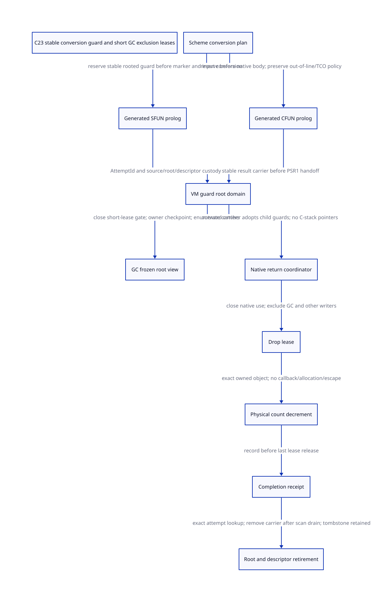

#+TITLE: Stable size-family guards and GC exclusion in modern generated C
#+SETUPFILE: ../../modeling/org/setup.org
#+LANGUAGE: en
#+CATEGORY: modern-c
#+PROPERTY: header-args :eval never
#+OPTIONS: toc:3 num:nil

* RESEARCH Decision and evidence boundaries :c23:ffi:gc:
:PROPERTIES:
:CUSTOM_ID: size-family-guard-gc
:AUTHORITY: GambitSizeFamilyGuardGc
:STATUS: ABSTRACT-PROTOCOL-CHECKED; NATIVE-ISSUERS-OPEN
:BASELINE: C23
:END:
The size-family defect needs stable ownership issued by a generated entry
prolog and a VM root-domain service, not by a local END macro or a stack marker.
Current source contains useful execution contexts, frozen-root tasks, rooted
startup marker entry and sweep escrow. None is already a generic per-conversion
guard or a proof that its root is enumerated. Reuse their responsibilities;
adding a second opaque wrapper over the existing paths would not close the gap.

This study extends [[file:size-family-hold-balance-design.org][the size-family hold-balance study]] without altering its historical
model or receipt. [[file:models/sysml/size-family-guard-gc.sysml][Native SysML]] owns component contracts, issuer/caller anchors,
C23 obligations, composition boundaries, gains and graph edges. Its evaluator
feeds [[file:../../modeling/ascent/size-family-guard-gc.rules.scm][actual ASCENT rules]], [[file:models/quint/size_family_guard_gc.qnt][QNT]] action/proof correspondence and
[[file:models/lean/SizeGuard.lean][Lean reachable safety]]. [[file:models/lean/SizeGuardBridge.lean][The parent bridge]] checks actual imported parent AST
predicates at the normal drop boundary. [[file:size-family-guard-gc-matrix.org][The evaluated matrix]] and
 distinguish conditional formal results from native obligations.
[[file:../../../evidence/research/size-family-guard-gc/checks.json][The receipt]] records achieved checks; a synthetic complete ASCENT fixture is not
native qualification. No runtime implementation, native compiler or test runs.

* RESEARCH Actual issuer and caller ledger :source:
:PROPERTIES:
:CUSTOM_ID: size-guard-real-issuers
:END:
| Boundary | Current producer / consumer | Candidate issuer and necessary change |
|----------+-----------------------------+---------------------------------------|
| SFUN entry | _ptree2 c-make-function wraps c-convert-argument around SFUN body; BEGIN_SFUN creates marker first | Generated entry prolog requests stable VM guard before marker/converter allocation, on a qualified owner context |
| SFUN argument | CTOS writes local s; SFUN_ARG writes PSSTK; ___call loads stack arguments | Output first belongs to registered carrier; stack publication acknowledges the same object; native hold lasts until final native use |
| CFUN entry | _t-c-2 emits spill, out-of-line C function, return maps and reload | Reserve result guard before native body/reentry; retain out-of-line policy that avoids setjmp/TCO interference |
| CFUN result | c-set-result chooses C-to-Scheme; CFUN_RESULT is PSR1 | Guard owns stable result slot; normal return transfers to live PSR1 under short root-update authorization |
| Exception landing | BEGIN_TRY installs automatic catcher; ___call rethrows marker mismatch; ___run catches its own activation | Surviving outer NativeReturnDomain coordinator adopts all escaping child guard records, using stable identities rather than discarded C addresses |
| GC consumer | mark_execution_roots scans context registers/saved/type-cache/startup roots/RC | Enumerate every registered live conversion carrier in that same frozen root domain; preserve descriptor/code pinning |
| Release | release_scmobj checks still storage then plain refcount decrement | Exact attempt owner claims a short drop lease, performs effect, records receipt, then releases lease |

The SFUN argument conversions precede ___call's local catcher installation.
Therefore a guard issued only inside ___call is too late for argument conversion
failure or outward escape. ___call also rethrows an unmatched marker after
restoring its catcher chain: a local END in a skipped wrapper is not a landing
receipt. ___run's volatile marker and dedicated startup roots do not cover
arbitrary nested size arguments or CFUN result ownership.

A conditional rejection loop is also visible: while participant phase remains
non-RUNNING, ___call returns UNKNOWN_ERR before installing a catcher. The
SFUN_ERROR loop retries every status except NO_ERR and UNWIND_C_STACK through
another ___call, which encounters the same rejection. A synchronous callback
that cannot change the phase between retries can therefore fail to leave the
loop. This is a source-derived persistent-phase counterexample, not a native
observation or proof that a particular registered foreign destructor reaches it.
The proposed pre-marker issuer must refuse admission separately from converter
error recovery. The existing reserve guards reject a closed domain, but the
model does not prove the native UNKNOWN_ERR/error-handler correspondence.

The newer ___make_sfun_stack_marker_from_root reloads *proc_root after allocating
the marker. Its legacy wrapper explicitly says it is not a registered-root
interface. This is reusable rooted-entry mechanics, not evidence that a generic
C closure procedure or an arbitrary local is already rooted before allocation.

CFUN's cleanup TRY depends on parameter cleanup flags. All three size-family
flags are false; a result requiring ownership cannot be inferred from those
flags. Neither an empty END nor default-empty AT_END owns a result release.
A handwritten AT_END or Scheme raw refcount decrement must declare an ownership
transfer; enabling automatic cleanup beside it without migration can double-drop.

* RESEARCH Stable record and lifecycle :ownership:
:PROPERTIES:
:CUSTOM_ID: size-guard-record
:ISSUER: proposed generated prolog plus VM root-domain allocator
:END:
The conceptual record contains VM incarnation, context incarnation, attempt
serial, slot generation, direction, stage, registered root slot, created native
hold, physical-effect state, parent return domain, descriptor lease and outcome.
These are design fields, not an implemented C ABI. Receipt keys identify an
attempt; marker identity identifies native return permission. They cannot be
substituted for each other.

Reserve from pre-provisioned stable storage without Scheme allocation. Before
reservation succeeds, refusal must leave no new conversion/marker/native-body
effects. A successful reservation publishes an initially FAL root slot before
calling a converter. Pool refill is outside the protected entry window and may
allocate/collect only under its own root contract. Metadata exhaustion is a
pre-entry refusal, not permission to create an unregistered hold.

| Stage | Root and ownership state | Exception / unknown outcome |
|-------+--------------------------+-----------------------------|
| Registered | Stable record and scanner descriptor visible; output FAL | Stable coordinator retains record even if reply to issuer is lost |
| Allocating converter | Guard remains live, short lease is zero | Converter may request GC; no long mutation pin may block its own collective |
| Initialized/adopted | Exact converted object is in carrier; successful still allocation owns count1 | No new safepoint/callback/abandonment before initialized output is adopted |
| Native use ended | Normal result handoff or escaped last-use acknowledgement | Ancestor landing must close the whole native subtree, not only its own marker |
| Drop claimed | Unique attempt-owned lease excludes GC and other count writers | Gate may close; already-admitted holder must finish, not reacquire admission |
| Effect applied | Count decremented, receipt not yet recorded | No callback, allocation, cancellation or nonlocal jump in this interval; replay forbidden |
| Receipt recorded | Exact attempt settled; lease still held | Publish receipt before final decrement of lease count |
| Lease released | GC may freeze; lost reply can query existing receipt | Never repeat physical drop to recover an acknowledgement |
| Carrier removed | Under root-update lease after scanner drain | Receipt/tombstone storage and descriptor/code lifetime still have independent retirement obligations |

C23 does not supply an uninterruptible cleanup primitive. The planned return
coordinator must own records outside frames removed by longjmp. Do not reconstruct
settlement from nonvolatile automatic flags modified after setjmp. A stable
record reached by a pre-established identity avoids that recovery dependency;
it does not itself prove native cancellation or signal policy.

** Constructor-to-carrier cut remains open
For size-family S64/U64 converters, alloc_scmobj can run GC before successful
allocation. A successful still allocation initializes count1, then the converter
initializes bignum digits and writes its output pointer. The allocator requires
body initialization before the next allocation. The proposed generator can
supply the registered guard slot as that output pointer rather than a transient
local, then perform PSSTK/PSR1 transfer separately.

However, completeBoxed in QNT abstracts initialized output adoption. It does
not prove that allocator instrumentation, native cancellation, an overridden
store macro or a nested foreign escape cannot interrupt the return/init/store
window. Merely acquiring a lease after receiving an unregistered pointer is
too late; acquiring one across the allocating converter can deadlock GC.
The native implementation must qualify the no-abandon window or integrate the
existing allocation-ticket/initialization-debt design. This obligation remains
unresolved; a record that still contains FAL cannot settle an unknown new object.

* RESEARCH Two root-delivery directions :roots:
** SFUN parameter
Keep each successful converted input in its guard carrier before later argument
conversion, marker use or Scheme execution can collect. SFUN_ARG publishes the
value to a stack slot; ___call installs its return frame and loads arguments.
Captured arguments remain Scheme roots after the native count is dropped.
An ignored input needs no fabricated Scheme root once its last native use ends,
but the guard carrier must remain until the drop has been recorded.

Normal/error-return paths discharge each successful prior argument. A later
conversion failure creates no hold for its failing slot; earlier holds still
belong to their individual guards. Outward rethrow transfers these obligations
to the stable ancestor coordinator. Aggregate argument and nested-return subtree
composition is not proved by this one-attempt model.

** CFUN return
CFUN_RESULT writes context->r[1]. The actual frozen root consumer enumerates
context->r, and CFUN context exchange reloads GVM locals afterward. A correct
handoff must prevent a stale local R1 writeback from overwriting the published
result, and must bind the generated frame/register map and header cohort.
Neither C-stack local ___result nor processor temp fields can be assumed to
be generic roots merely because a nearby register array is scanned.

Normal successful CFUN return requires the real Scheme destination root before
release. An aborted CFUN does not deliver a Scheme return value: its carrier can
retain the object for cleanup without manufacturing PSR1. The previous model's
normal-return condition is intentionally insufficient for this error case.
The actual parent-guard bridge is therefore normal-only; the aborted-path witness
shows that the new claim is admitted while the old normal guard rejects it.
This is explicit outcome refinement, not a claim that the new model simulates
every old state or exception handler.

* RESEARCH GC mutual exclusion and C23 refinement :smp:
:PROPERTIES:
:CUSTOM_ID: size-guard-gc-exclusion
:ASSUME: sole admitted context owner; all native count writers participate
:PROVE: frozen snapshot stability; no scan/drop overlap in the abstract protocol
:END:
Stable guard lifetime and mutation-lease lifetime are different. The record
may survive calls, blocking and repeated GC; a short lease may not allocate,
invoke Scheme, block or enter an arbitrary callback. This avoids the circular
wait in which GC waits for a lease held by a converter waiting for GC.

Use one atomic root-domain control value containing generation, admission-closed
and outstanding short leases, or an independently proved equivalent protocol.
A load of the existing ordinary participant phase is not such a reservation.
The current ___call/___run rejection checks are useful cooperative admission
checks, not a new cross-thread pin protecting the interval after the check.

1. Open generation: acquire lease by CAS that validates the open generation.
   Publish/update slots only after ownership is acquired.
2. Coordinator closes admission with acq_rel CAS. No new writer can slip between
   a detached phase check and its count increment. Already-admitted writers
   complete even when the gate is closed.
3. Root transfer or drop runs under that authorization. For drop, write the
   effect receipt before release-decrementing the lease count. There is no
   second admission wait between physical decrement and its record.
4. Coordinator acquire-observes zero leases; the actual owner reaches a safe
   checkpoint and spills registers. Frozen manifest includes every live carrier.
5. Workers scan the frozen root view; no carrier removal or root overwrite is
   authorized. Descriptor/code storage remains pinned across all readers.
6. All relevant root/worker tasks drain and restored owner authority is established
   before reopening the generation. Physical stack restoration during
   GC_OWNER_CLEANUP does not permit managed entry or generic guard mutation.

CAS failure can use relaxed order only when its observed value is used solely
to retry/refuse; consuming a published descriptor requires acquire separately.
Counter/generation exhaustion refuses new admission rather than wrapping. These
are proposed C23 obligations: the QNT model is sequentially consistent and does
not prove the weak-memory refinement or the platform cancellation mechanism.

The current collective already sets ROOTS_FROZEN and crosses a barrier before
worker setup; cleanup uses a distinct owner phase and a final stopped-view drain.
Reuse those cuts. Add guard census and short-lease drain to their prerequisites,
not a second independent GC lock that can wait on an owner inside the collective.
No arbitrary foreign thread is admitted by the current phase enum or by
__run's startup root path.

* RESEARCH Conditional proofs and preserved counterexamples :formal:
The QNT model separates root-update leases and drop leases, physical effect,
receipt record and last release. Frozen views retain guard/carrier/attempt/root
identity flags so premature retirement during scanning violates a real invariant.
Attempt serial and GC epoch are mathematical unbounded integers; machine-width
exhaustion and address-reuse protection remain native refinement obligations. A physical-drop action assumes the admitted sole owner; the model does not
represent every retained native claimant or prove that a stale C pointer cannot
impersonate the current owner after storage reuse. The native helper must check
its supplied VM/context/attempt/generation/lease token against the record, rather
than reading current record fields as if they were the caller's credential.
The stale-receipt countercontrol proves receipt isolation, not all stale-native-
writer exclusion; that remains in all-writers-cohort and retirement.

Lean projects actual QNT typed expressions through the existing restricted
emitter and checks each action, initial state and reachable-state induction.
The normal parent guard and physical-effect bridge import the exact hash-bound
SizeHoldAst; no parent native qualification is inherited. CFUN fused handoff is
proved equal to separate root transfer, final use and drop claim, including the
sequential guards. No full parent simulation or native C equivalence is claimed.

Seven deliberate effect/guard mutants retain executable-prefix witnesses:
double effect; lease released before receipt; freeze with a live drop lease;
stale receipt settling a fresh attempt; retirement during scanner access;
missing constructor adoption; and unrooted normal CFUN return. Each witness
matches the actual projected prefix before proving the mutated poststate unsafe.
Four typed-IR controls and ASCENT semantic/source/issuer/composition negatives
remain independent checks. Positive histories include close during transfer,
close during drop, collection while converter/guard is live, aborted CFUN,
continuation-root retention and lost/repeated receipt lookup.

A live guard does not imply a short lease is held. Safety induction does not
prove progress under arbitrary unfair scheduling, bounded GC latency, allocator
failure recovery, whole-VM cleanup or full nested/multi-shot equivalence.

* RESEARCH Research basis and Gambit-specific reflection
[[https://www.schemeworkshop.org/2000/feeley.ps][Feeley (2000), unrestricted Scheme/C interoperability]], sections 1–5, motivates
separating continuation reachability from native activation return permission.
The preserved official paper files are checked against their prior hashes.
The guard design preserves Scheme's multi-shot values while settling native use
once; it does not copy the paper's historical native-thread proposal as a present
implementation claim. Local source, rather than this paper, establishes the six
missing END effects and actual catcher order.

[[https://anil.recoil.org/papers/2021-pldi-retroeff.pdf][Retrofitting Effect Handlers onto OCaml (PLDI 2021)]], sections 2.3 and 3.2,
separates stack-root metadata and cleanup/control boundaries. That paper uses
one-shot continuations and prevents effect propagation across C frames. Learning
from its explicit boundaries does not justify imposing those restrictions on
Gambit. Our additional obligation is stable per-native-use completion despite
Scheme continuation capture and repeated restoration.

[[https://www.open-std.org/jtc1/sc22/wg14/www/docs/n3096.pdf][WG14 N3096 (C23 working draft)]], sections 5.1.2.4, 6.2.4 and 7.13.2.1,
grounds publication, storage lifetime and changed automatic variables after
longjmp. It does not establish an interruption-free release interval or make
volatile a synchronization protocol. The configured local Darwin/GCC artifacts
remain a disabled-SMP historical profile; current generated-header/runtime
cohort and arbitrary per-invocation overrides remain unqualified.

* RESEARCH Net return and retirement :benefits:
For B successful boxed, exclusively owned conversions, correct cleanup can
remove B accidental native holds. It cannot remove required bignum allocations
or roots retained by Scheme continuations. Long-lived guard records add scans
for their live carriers; compare avoided stale-hold residency with those scans,
not with an invented percentage speedup.

For M eligible normal CFUN handoffs, separate root-transfer and drop leases
need two acquire/release pairs; a fused handoff needs one. In the chosen
single-CAS/fetch-sub design this saves 2M successful atomic RMWs, excluding retries.
Fusion is conditional on no callout, allocation or abandonment between root
publication and drop claim. SFUN Scheme execution cannot use that fusion across
___call, because it can collect or reenter.

A simultaneous active attempts require O(A) stable records/root descriptors;
T retained receipts require O(T) metadata until an admitted retirement policy
can reclaim them. Pool provisioning, generation checks, catcher coordination,
manual-writer migration and descriptor retention are required costs in modern
C and Zig alike. Zig has no demonstrated extra net return for these obligations.

Retire the six independent size-family END ownership responsibilities only when
they are generated from one direction-aware plan and every consumer uses its
contract. Existing generated macro-form C may be reusable when only macro
semantics change, but dependent native objects must be recompiled; adding new
plan fields changes generator/ABI inputs and invalidates the relevant earlier
stage too. Keep arithmetic converters, release_scmobj, marker return checks,
GC root consumers and RC/sweep machinery for their distinct purposes. This
research retires zero native paths.
