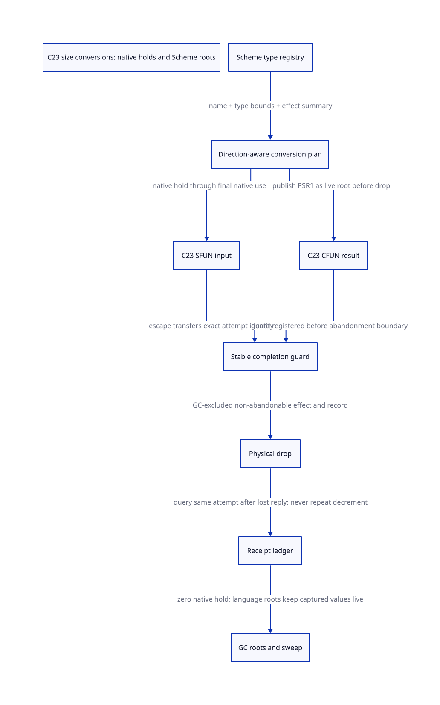

#+TITLE: Size-family conversions: numeric domains and native-hold balance
#+SETUPFILE: ../../modeling/org/setup.org
#+LANGUAGE: en
#+CATEGORY: modern-c
#+PROPERTY: header-args :eval never
#+OPTIONS: toc:3 num:nil

* RESEARCH Decision and scope :ffi:gc:c23:
:PROPERTIES:
:CUSTOM_ID: size-family-hold-balance
:AUTHORITY: GambitSizeFamilyHoldBalance
:STATUS: CONDITIONAL-SOURCE-DEFECT; NATIVE-RELEASE-CONTRACT-OPEN
:BASELINE: C23
:END:
The modern-C mainline needs a direction-aware conversion ownership contract.
The local size_t, ssize_t and ptrdiff_t wrappers delegate to allocating U64/S64
converters, while their three SFUN input ENDs and three CFUN result ENDs omit
release_scmobj. A successful out-of-fixnum conversion with nonnull processor
creates one native still hold. In the closed generated path with no explicit
manual release, its lexical end does not discharge that hold. This is a source
argument, not a measured leak or a claim that every invocation boxes.

This continues [[file:sfun-converter-use-closure-design.org][converter-use closure]] without modifying its historical receipts.
[[file:models/sysml/size-family-hold-balance.sysml][Native SysML]] owns profiles, source witnesses, component/action/proof routes,
release candidates, obligations and benefits. Python evaluates native SysML,
checks current source bindings, runs the [[file:../../modeling/ascent/size-family-hold-balance.rules.scm][actual ASCENT rules]], checks the
[[file:models/quint/size_family_hold_balance.qnt][QNT actions]] and projects their typed expression graph into
[[file:models/lean/SizeHoldAst.lean][Lean AST]]. [[file:models/lean/SizeHold.lean][Lean]] proves initial safety, each step and finite reachable-state safety.
The [[file:size-family-hold-balance-matrix.org][evaluated matrix]] and  are projections of that authority.
The [[file:../../../evidence/research/size-family-hold-balance/checks.json][formal receipt]] states the achieved scope explicitly.

* RESEARCH Configured type chain and numeric domain :configuration:
:PROPERTIES:
:CUSTOM_ID: size-family-profile
:ISSUER: proposed source-cohort qualifier; not an existing native issuer
:END:
The local config.status records aarch64 Darwin, GCC 16.2.0, single-host,
inline jumps, trusted C TCO, and disabled SMP/multiple VMs. config.log records
sizeof(long)=8 and sizeof(void*)=8. The recorded compiler uses the macOS 26 SDK;
gambuild-C records the GCC command/default flags. These are configured artifacts,
not an observation of every environment override or a loaded binary.

The modular value_types.h.in includes stddef.h for size_t/ptrdiff_t and
sys/types.h for ssize_t, unless explicitly suppressed/overridden. GCC's installed
stddef.h typedefs __SIZE_TYPE__ and __PTRDIFF_TYPE__; its fallback spellings are
unsigned long and signed long. SDK machine/_types.h routes arm64 to arm/_types.h;
that header uses compiler builtins or the LP64 long fallback, and defines
__darwin_ssize_t as long. sys/_types/_ssize_t.h exports ssize_t. These SDK/compiler
headers are hash-bound local external inputs, not replacements downloaded from
unrelated upstream revisions.

Under the named LP64/8-bit-byte/no-type-override profile:

| Type | Domain | Bridge | Out-of-fixnum successful cases |
|------+--------+--------+-------------------------------|
| size_t | 0 .. 18446744073709551615 | U64 | 1152921504606846976 .. 18446744073709551615 |
| ssize_t | -9223372036854775808 .. 9223372036854775807 | S64 | below -1152921504606846976 or above 1152921504606846975 |
| ptrdiff_t | -9223372036854775808 .. 9223372036854775807 | S64 | same signed intervals |

64-bit SCMOBJ defaults to three tag bits. Without NAN boxing or tag overrides,
FIX_WIDTH=64-3=61; the inclusive fixnum range is -2^60 .. 2^60-1. Signed S64
checks FIX_WIDTH including sign; unsigned U64 checks FIX_WIDTH-1. The explicit
two-tag fixnum alternative gives 62 bits; NAN boxing or the default 32-bit word
profile gives 30 fixnum bits. Neither alternative inherits the 61-bit receipt.
Native type range and fixnum width are separate profile dimensions.

A ptrdiff_t value in this range can be supplied directly by native C; the
argument does not require constructing an impossibly large Scheme array or
performing undefined subtraction of unrelated pointers. No probability measure
over these domains is assumed. Most small sizes remain immediate.

** Admission and refusal
- The source wrappers cast through ULONGLONG/LONGLONG and then U64/S64. Native
  size-family types wider than the bridge must be rejected or given a wider
  exact converter; silently truncating and then signing a receipt is invalid.
- Compiler predefined type macros, CHAR_BIT, command-line/preincluded overrides,
  emulated-64 selection, loaded code and generated-module/header cohort must be
  bound before a native range receipt is accepted. No preprocessing/probe was run.
- The generated monolithic gambit.h and current modular runtime differ in other
  GVM context details. Matching six relevant macro bodies is subset evidence,
  not whole-ABI identity. This configured disabled-SMP profile does not certify SMP.
- C23 is the refactor design baseline. The recorded old build is not retrospectively
  certified as C23. GCC documents sign extension for negative signed right shifts;
  that grounds the builtin S64 test for the named GCC implementation. Portable
  C23 consumers still need their implementation/representation qualification.

* RESEARCH Full producer to consumer chain :generator:
1. _parms.scm registers size_t/ssize_t/ptrdiff_t c-type vectors. Slots 2/3
   select C-to-Scheme/Scheme-to-C names; slot 4 is false for all three.
2. _ptree2.scm resolves aliases and chooses c-type-converter according to the
   direction. c-convert-representation emits BEGIN, nested body, END.
3. SFUN c-convert-argument passes sfun? for both wrapper and direction: native
   input becomes a Scheme value. c-make-function nests conversion scopes around
   body and first result conversion; SFUN argument publication writes PSSTK.
4. CFUN c-set-result selects the opposite direction: native result becomes
   Scheme output. CFUN_RESULT is PSR1, written through the converter's output
   pointer. END belongs to the result conversion scope.
5. SIZE_T_to_SCMOBJ delegates U64; SSIZE_T/PTRDIFF_T delegate S64. In-range values
   become immediate fixnums. Out-of-range values allocate a bignum. Allocation
   initializes still count 1 for nonnull processor; null processor gives permanent
   storage. Allocation failure returns an error and FAL, with no successful result hold.
6. SFUN size-family END closes a brace; CFUN size-family END is empty. Neighboring
   S64/U64 ENDs call release_scmobj. There is no equivalent size-family drop here.
7. CFUN_OOL performs context/register exchange and error dispatch. _t-c-2.scm
   emits return labels, stack adjustment and live GC maps. Register/root publication
   and return-frame restoration do not decrement a still-object count.
8. GC setup makes each nonzero-count still object a root. Sweep frees unmarked
   objects; it does not consume this native hold. A bignum has no foreign destructor.

Changing cleanup? alone does not implement the missing success-path effect:
that flag selects CFUN parameter/error cleanup machinery, while the missing
SFUN input and CFUN result drops are separate emitted END responsibilities.
The complete textual release/writer census is retained in the evidence directory;
its indirect/manual alias closure remains open. CFUN AT_END is generated through
c-preproc-define-default-empty: the body may supply it; otherwise it is empty.
A body-defined cleanup hook is an explicit owner to audit, not an automatic
size-family release in the default path.

** Closed-path counterexamples, not executed tests
An exported Scheme procedure accepts a size-family parameter, returns void,
and ignores its argument. A native caller supplies a representable value just
outside the fixnum interval. Its successful conversion creates count1, body
and normal lexical end perform no drop, and subsequent GC still roots it.
This path needs no custom converter, debug hook or Scheme reflection.

Conversely a c-lambda returns a native size-family value above MAX_FIX (or below
MIN_FIX for signed types). The result converter writes PSR1 and creates count1;
its empty CFUN END leaves the native hold outstanding. If the Scheme consumer
later discards the result, GC still sees the count. This second direction is
not justified merely by finding the SFUN defect; its generator and PSR1 path
are separately included in the source inventory.

* RESEARCH Correct release contract :ownership:continuation:
:PROPERTIES:
:CUSTOM_ID: size-family-release-contract
:ASSUME: stable attempt identity; truthful roots; exclusive physical counter owner
:PROVE: hold conservation and no repeated physical drop in the abstract protocol
:END:
A conversion plan must declare direction, exact type/representation profile,
may-allocate, result storage/root, success-created hold, and release owner.
Native hold is not Scheme reachability, marker ownership, RC payload ownership
or permission to unload code. Keep those responsibilities distinct. The public
Scheme ##still-obj-refcount-dec! can explicitly consume the same object's hold;
##still-copy instead allocates and decrements its new copy. Its result decrement
is not a release of the original argument. The kernel source is included in
the release-writer census.

| Cut | Required responsibility | Failure / unknown result |
|-----+-------------------------+--------------------------|
| Before conversion | Reserve stable attempt/carrier outside discardable C activation | Failure creates no conversion hold; retain earlier successful arguments |
| Successful immediate/permanent | Record no native still hold | Generic release is a no-op; never raw-decrement tagged fixnum |
| Successful boxed conversion | Attach exactly one count1 object to the attempt and a scan-visible carrier | Unknown registration must retain/query the same owner, never create a second decrement owner |
| SFUN last use | End the native use of this input; preserve captured Scheme roots | Error retry, outward escape and later callbacks require stable guard handoff |
| CFUN result handoff | Publish the exact converted object to the live PSR1/root map before drop | Failure/escape retains carrier until an admitted receiver or guard owns it |
| Physical drop and record | Exclude GC/counter writers; no cancellation, longjmp, callback or allocation between effect and durable settlement | A plain decrement is not retryable; unresolved custody blocks retirement |
| Lost completion reply | Query by the same attempt identity | Return the existing receipt without a second decrement |
| Captured continuation resumes | Keep captured object rooted with independent dynamic activation tickets | Resuming Scheme does not resurrect a closed native hold or authorize replay of an old completion |

The model's critical region is an explicit premise to refine, not a new C23
language feature. Current still_refcount.inc uses ordinary ++/--; making these
atomic alone would not coordinate lifetime, GC and retirement. The owner-thread
or paused-root-domain protocol must exclude competing updates and scanning.
A stable guard is published with release semantics and observed with acquire
before ownership transfer; the old carrier remains rooted until receiver ACK.
The guard must already exist before any abandonment point. GC stop/freeze and
counter mutation must share a proven exclusion protocol; neither a release
store nor a generic atomic decrement proves collector participation.

Handwritten wrappers that already decrement must transfer or surrender that
specific ownership before the generated drop can be enabled. Public FFI and
raw header mutation prevent an unconditional all-writers claim. A newly added
automatic drop plus an old manual drop is an underflow counterexample, not an
optimization. This study changes no wrapper ABI or runtime.

* RESEARCH Model, refinement and negative controls :formal:
- QNT models one stable conversion attempt, selected legal boundary inputs,
  both directions, successful boxing/immediates, conversion failure, capture,
  result-root handoff, GC exclusion, split physical effect/commit, lost reply
  and idempotent receipt lookup. Step includes stuttering. The finishNative cut
  abstracts already-approved stable-guard completion; it does not simulate an
  actual longjmp/catcher landing. Failure is conservatively overapproximated;
  an immediate legacy numeric conversion does not allocate or fail in that way.
- Lean consumes the checked QNT typed AST and proves every action preserves
  hold+effects=created, bounds, root coverage for CFUN handoff and captures,
  and GC exclusion of the critical window. Reachability induction is unbounded
  for this abstract state machine; sampled QNT histories are bounded checks. The default Rust evaluator rejected
  SIZE_MAX as outside i64. That failed invocation is retained; TypeScript-backend
  checks keep the full unsigned64 boundary rather than shrinking the domain.
- Separate Lean predicates prove the signed partition, extrema, exact default
  endpoints and alternative-profile endpoints. This is integer mathematics,
  not a proof of compiler preprocessing, C shift code or ABI extraction.
- Four effect/guard mutants must expose safe-state counterexamples: omitted
  drop, double effect, unrooted CFUN handoff, and GC inside the effect/record gap.
  Four typed-IR controls reject wrong bindings, field types, step roster or
  unsupported expressions. ASCENT independently rejects stale source, missing
  action/proof, wrong component/range/direction and forged native evidence.
- One-attempt ownership does not prove nested guard composition, multi-shot
  continuation equivalence, fairness/eventual GC, all C writers or safe module
  retirement. The actual native guard issuer and root-carrier integration remain
  unresolved. No native implementation, compiler invocation or performance test.

* RESEARCH Papers inform the design, not substitute for source evidence
[[https://www.schemeworkshop.org/2000/feeley.ps][Feeley, A Portable Implementation of First-Class Continuations for Unrestricted Interoperability with C in a Multithreaded Scheme (2000)]],
sections 1–5, separates Scheme continuation lifetime from native C stack lifetime.
The prior study's local official PS/text hashes are checked again and retained. Its historical
native-thread proposal is not evidence of this implementation's completion.
The design inference here is to attach cleanup to stable native use, while
allowing a captured Scheme value to remain live independently. The paper does
not establish the size-family defect; local generator and allocator code do.

[[https://www.open-std.org/jtc1/sc22/wg14/www/docs/n3096.pdf][WG14 N3096 (C23 working draft)]], sections 5.1.2.4, 6.2.4, 6.5.8 and the
integer/standard-definition headers, supplies the language framework for data
races, object lifetime, pointer comparison and implementation-specific ranges.
ssize_t is a platform/POSIX type, not an ISO C23 guarantee. An integer holding
an address is not an object-lifetime proof.
[[https://gcc.gnu.org/onlinedocs/gcc/Integers-implementation.html][GCC integer implementation behavior]] documents the sign-extending right shift
used in the named builtin S64 range test. Current online documentation is
supporting implementation evidence; it is not a captured GCC16 predefine dump.

* RESEARCH Net return and retirement conditions :benefits:
Let N be successful admitted conversions and B the boxed, native-held subset.
Correct balance removes B unnecessary native holds; it does not eliminate B
required bignum allocations. If those objects are otherwise unreachable and
survive k collections solely because of the leaked holds, at most B*k such
root visits are avoidable. Root visitation is not elapsed time or total retained
bytes. Immediate-only B=0 gives no hold-removal benefit. Captured values still
require all semantically necessary scanning.

A generic release adds up to N tag/storage checks and B physical decrements.
A trustworthy success/ownership plan can specialize immediate paths, but its
metadata, guards, rooting and code-lifetime costs must be counted. Let H be
avoidable retained-memory/scan cost and C be release/guard/metadata cost: the
performance condition is H>C under an explicit workload, not an invented speedup.
Correctness of native hold balance is required regardless of that inequality.

The six inconsistent END responsibilities may retire only after generator,
header, all generated consumers and explicit/manual owners migrate together.
Keep release_scmobj, bignum allocation, proper Scheme root scanning, marker
handling, RC cleanup, sweep and VM teardown: they serve different contracts.
No old runtime path is retired by this research. Zig provides no additional
proven return for this defect; it would need the same Scheme GC/ownership
contract and does not remove the mandatory modern-C work.
