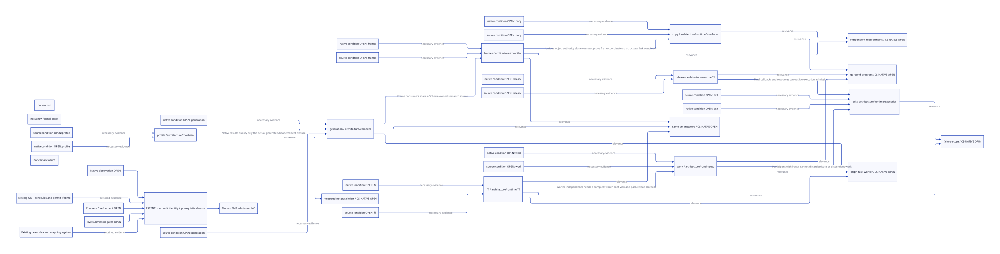

#+TITLE: SMP Maturity — Factors, Conditions and Refutation
#+SETUPFILE: ../../modeling/org/setup.org
#+LANGUAGE: en
#+CATEGORY: modern-c
#+PROPERTY: header-args :eval never :tangle no
#+STARTUP: overview

* The architectural question
:PROPERTIES:
:CUSTOM_ID: smp-factor-conditions
:AUTHORITY: GambitSmpFactorConditions
:STATUS: SOURCE-GROUNDED-FACTORS; CONDITIONAL-EXCLUSION; RUNTIME-CLOSURE-OPEN
:COMMIT_ADMITTED: false
:END:

The modernization question is why present ownership, work and control protocols
fail to compose reliably, and which replacement rules remove those mechanisms.
Gambit already executes SMP code. Thread count alone does not answer whether a
configuration has dependable same-VM parallel mutation, correct parallel GC,
progress under its stated failure assumptions and useful scaling.

[[file:models/sysml/smp-factor-conditions.sysml][SysML]] references all eight existing [[file:causal-architecture.org][causal pressure arguments]], their canonical
module owners and six dependency edges. It does not create a second pain list
or runtime layout. The current [[file:../../architecture/runtime/control/frame-alias-contract.org][alias/restore adapter]] is connected as one
necessary part of the frame, root and worker problem. The other factors remain
explicit prerequisites, not issues solved by giving frames revision numbers.

For every factor retain: observed source or historical failure; a conditional
mechanism; the source coverage required to exclude it; the native observation
needed to validate composition/progress; removed work, added work and physical
retention; and a counterexample that invalidates the argument. An issue, patch
or crash supports only the scope it actually observed. The existing twelve-gate
ledger has twelve acceptance obligations; the eight pressures are a different
classification. Their many-to-many associations are not universal causal proof.

The mechanism column identifies histories the architecture must exclude. Some
were already partly replaced by the scoped modern-C work; it does not assert
that every historical defect remains reachable in today's candidate. The linked
canonical argument retains that distinction. Two directly observed remaining
couplings are carrier-indexed participant completion and synchronous worker/
context binding in =lib/mem.c:7462–7475,7570–7598=. Current reflective frame stores
and GC relocation also have separate access paths; their new joint adapter is
not implemented. The [[file:../../architecture/runtime/control/frame-alias-contract.org][source witness table]] pins these intervals and their roles.

* Factor and necessary-condition matrix
#+NAME: smp-factor-conditions
#+BEGIN: sysml-view :kind smp-factor-conditions :source refactoring/modern-c/models/sysml/smp-factor-conditions.sysml
| Factor | Canonical-owner | Mechanism-to-exclude | Required-source-condition | Required-native-observation | Work-and-wait-metric | Physical-memory-metric |
|---+---+---+---+---+---+---|
| exit | architecture/runtime/execution | Admission, heap participation and native lifetime are conflated; unknown result can cause unsafe reuse or unnecessarily broad GC veto | Accepted callback/result and final native user have explicit custodian and disposition; withdrawal proves frozen/no-write root boundary separately from handle closure | Inject known/unknown create/join and late callback outcomes; distinguish healthy other VM from progress inside affected VM; no heap access after certified withdrawal | GC veto/wait time; accepted, retained and disposed outcomes; progress under fault | Retained handles, roots and physical arenas per unresolved outcome; bound issuance on exhaustion |
| work | architecture/runtime/gc | Carrier processor still selects participant roots/completion; idle counts cannot represent private frontier, Tail and future descendants | Root origin, participant epoch and claimed work are separate; every producer/private cursor/publication descendant accounted for; completion is task-scoped | Different worker/origin counts and worker handoff; late work and withdrawal never lose a root or complete a live phase | Queued/private/in-flight/descendant work, steals, idle waits and useful scans per worker | Task/cursor metadata and transfer-pending work retention at peak |
| copy | architecture/runtime/interfaces | Duplicate scan delivery can become duplicate field writers; forwarding/readiness/Tail are confused, and per-copy reserve is mistaken for a whole-round physical plan | One initializer and ordinary repair owner per destination; explicit Tail/link duties; injective contiguous intervals and resume reserve before flip; independent domains avoid global copy serialization | Repeat delivery and CAS loss under pair/frame sharing; no duplicate repair; reserve failure preserves source; same-profile whole-round peak fits actual intervals | Deliveries versus granted writers, copied/restored words, refunds and frame-domain contention | Scan metadata, reserved/published intervals, private Tail debt and whole-round physical high-water |
| ffi | architecture/runtime/ffi | Incoming values or resize payload can survive only in stale C locals; callback/marker allocation can precede real root registration | Root before collecting conversion/marker, frozen borrow view, post-GC reload, native origin and every exceptional exit covered; destination registration precedes source ACK | Both run origins, generated SFUN/CFUN, nested callbacks and nonzero processor roots under GC; late/unknown exits retain custody | Root register/reload, park/reentry, scan visits and native participation waits | Fixed control storage separately from retained Scheme graph/native payload; frozen borrowers at peak |
| release | architecture/runtime/ffi | Foreign destructor can require an owner callback while that owner waits for collector completion, producing a wait cycle | Effects, affinity, rooted payload and pre-GC budget declared; eligible release work accepted and drained with descendants after required owner execution is permitted | Real release producers, reentrant callbacks, cancellation and shutdown partial failures; neither GC completion nor owner callback is permanently blocked | External blocking time on GC critical path, queue/drain work and unresolved release debt | Deferred rooted payload, budget reserve and pending descendants |
| frames | architecture/compiler | Independent frame coordinates, untracked aliases and address caches make root repair/restoration disagree; a whole-invocation snapshot would alter lazy tail observations | One FrameSpec, canonical shared domains, logical revision versus relocation epoch, authentic per-fragment consume and unchanged Scheme winding; all actual writers/consumers migrate | Multi-shot map, later tail mutation, shared alias writes, GC relocation and concurrent admitted contexts with proper tail space and native-origin behavior | Actual reached restore words, certificate validation, barriers, root reload and independent-domain overlap | Shared captures counted once plus private active frames, live domain/certificate and metadata roots |
| profile | architecture/toolchain | Generated headers/objects may have incompatible ancestry; build jobs and processor population are confused with simultaneous same-VM work | Complete effective options and dynamic inputs bind generated/header/object/link closure; dependency invalidation and action scheduling have explicit ownership | Exact-profile bootstrap and clean/no-op/leaf/macro controls; separate build concurrency from runtime mutation/GC acceptance | Generation/preprocessing/compile/link actions and elapsed work; validation cost versus avoided work | Build concurrency RSS and artifact retention separately from runtime heap peak |
| generation | architecture/compiler | Scheme semantic decisions are reconstructed in C macros, layouts and consumers; a new wrapper/backend can leave both old owners authoritative | Scheme completes frame/module/effect/allocation semantics once; modern C consumes one generated ABI; migrate emitters, FFI, root scanners, restorer and module lifetime together | All admitted frame kinds and target widths, module lifetime and generated/native observations match; no old semantic owner remains authoritative | Independent interpretations retired, regenerated closure, descriptor access and semantic lowering work | Descriptor/module lifetime and generated/native code footprint |
#+END:

* Evidence and counterevidence boundaries
#+NAME: smp-factor-evidence
#+BEGIN: sysml-view :kind smp-factor-evidence :source refactoring/modern-c/models/sysml/smp-factor-conditions.sysml
| Factor | Existing-evidence | Evidence-class | Existing-bad-history | Counterexample-and-boundary | Gates |
|---+---+---+---+---+---|
| exit | docs/smp-repair9-accepted-hard-failure.md; docs/shutdown-error-handoff.md | source/lifecycle argument; no reconstruction of every crash | Accepted callback or error survives its receiver; unknown join is used as either safe reuse or a VM-wide GC veto | A published actor still writes the heap, or a retained handler has no disposition; empty-startup isolation does not cover either; Alias certificates cannot stop an unknown writer; published native callers need stronger evidence than empty startup actors | 3;5;6;7;8;9;10 |
| work | vendor/gambit/include/gambit.h.in; vendor/gambit/lib/mem.c; dev/refactoring/modern-c/models/sysml/copy-custody.sysml | current separated storage and conditional work-closure design | A participant leaves while private frontier, Tail, weak-phase or release work can still create descendants | finish reopens work after close, or an exiting worker has the only unrecorded cursor; an empty queue is insufficient; Role structs alone do not remove synchronous binding; complete producer inventory, source root freeze and fairness remain required | 6;7;9;10;12 |
| copy | dev/refactoring/modern-c/copy-custody-results.org; vendor/gambit/lib/mem.c | native duplicate ordinary-scan request witnessed; universal producer/crash explanation open | Two delivered traversal requests repair the same destination fields, while forwarding visibility is mistaken for completed payload and Tail ownership | Any bypass performs field repair without the claim; per-copy refunds are used as a whole-round capacity proof; raw-ready frame exposes an unfinished semantic link; Recorded duplicate ordinary scan is a real conflict, not an explanation of every historical crash; current global frame gate and pre-flip planner remain open costs | 4;6;7;10;11;12 |
| ffi | vendor/gambit/lib/c_intf.c; vendor/gambit/lib/setup.c; dev/refactoring/modern-c/resize-source-custody.org | actual request transport replaced; full raw FFI writer coverage open | Movable thunk lives only in a copied sync operation across another request's GC; nested entry allocates before incoming root registration | A new conversion allocates before the root plan or an exceptional ACK removes a still-readable source; fixed slot count does not bound retained graph bytes; A complete alias adapter cannot supply absent raw native access bounds or initialize marker roots retroactively | 2;3;4;5;9;10;11 |
| release | vendor/gambit/lib/mem.c; dev/architecture/runtime/gc/release-producer-admission-design.org | source-effect inventory and target design; complete deferred-release service not implemented | Collector waits for a foreign destructor's owner callback while that owner is parked waiting for collector completion | Deferred task still borrows reclaimed PSTATE or requires a callback prohibited by its wait; moving work into a queue alone removes no cycle; Queueing a destructor alone removes no cycle; unsupported effects remain explicit and no reclaimed PSTATE may be borrowed | 2;3;5;6;7;9;10;12 |
| frames | vendor/gambit/gsc/_t-c-1.scm; vendor/gambit/include/gambit.h.in; vendor/gambit/tests/frame-continuation-roots.scm | generated frame contracts and native multi-shot witness; universal generated-consumer refinement open | Scanner and continuation restore interpret the same frame/link slot under different coordinates or treat raw copy completion as legal resumption | One-shot is substituted for multi-shot, or a restored dynamic-wind extent is reused as a current native resource permit; CS-BRIDGE/CS-WRITERS remain open; their local premises do not close source frame/wind/native obligations or prove full SMP | 1;2;4;7;10;11;12 |
| profile | evidence/fixtures/gerbil-bazel-build-profile/profile.json; dev/architecture/toolchain/models/sysml/architecture.sysml | effective-profile and exact completed-bootstrap reuse observations | Compiler or runtime ABI changes but a stale header/archive is reused; make parallelism is mistaken for same-VM SMP population | A real compiler/header/environment input is absent from the key, or hash validation costs exceed eligible avoided work; This is not itself a runtime race cause; cached bootstrap or parallel make is no evidence of SMP scaling | 1;2;3;4;5;6;7;11;12 |
| generation | vendor/gambit/gsc/_t-c-1.scm; dev/architecture/runtime/models/sysml/composition.sysml | source ownership and target semantic/native contract | C macro emission and runtime layout independently reconstruct semantic decisions; unchanged output unnecessarily invalidates downstream native work | A second policy remains in C or MLIR, or a Zig/LLVM wrapper is added while all old emitters and interpretation paths remain authoritative; Language/backend adoption supplies no automatic correctness or speed; preserves Gambit multi-shot, tail calls and portable C foundation | 1;4;5;7;10;11;12 |
#+END:

The cited native failures and scoped successes remain attached to their old
source/profile/producer. Newer [[file:../../architecture/runtime/control/continuation-segments.org][pinned continuation research]] improves the Chez/Guile
source and paper basis; older statements about unavailable source retrieval
remain historical, not current limits. Neither retrieval nor model validation
reconstructs every old crash. A known duplicate scan does not establish the
cause of all p11 startup, arithmetic, generated-code or native callback failures.

* Dependency cuts, rather than independent patches
#+NAME: smp-factor-dependencies
#+BEGIN: sysml-view :kind smp-factor-dependencies :source refactoring/modern-c/models/sysml/smp-factor-conditions.sysml
| Dependent | Prerequisite | Necessary-handoff |
|---+---+---|
| work | ffi | Worker independence needs a complete frozen root view and park/reload protocol |
| copy | frames | Unique object authority alone does not prove frame coordinates or structural link completion |
| exit | work | Participant withdrawal cannot discard private or descendant work |
| exit | release | Final callbacks and resources can outlive execution admission |
| frames | generation | Frame consumers share a Scheme-owned semantic source |
| generation | profile | Native results qualify only the actual generated/header/object closure |
#+END:

These dependencies are concrete architectural constraints. Independent workers
need a frozen, complete root origin and park/reload protocol. Unique copying
needs the correct frame/structural-link meaning and physical intervals. Safe
withdrawal needs closed private/descendant work and deferred foreign outcomes.
Frame meaning needs one Scheme semantic producer, whose generated artifacts
need exact effective configuration and dependency identity.

They are closure prerequisites, not a runtime blocking/wait graph. In particular,
the profile-to-generation edge qualifies artifact identity and observations;
the generation-to-frames edge supplies one semantic interpretation. Neither
licenses a collector to wait for a build process. ASCENT propagates research
gaps conservatively; runtime ordering, lock order and eventual progress still
require the existing concrete source and scheduling obligations.

Consequently, fixing alias invalidation alone cannot prove participant exit,
collector termination or foreign cleanup. A local native pass does not close a
missing predecessor. A protocol that prevents a crash by discarding accepted
work, blocking forever or disabling useful parallel execution fails the intended
architecture condition.

* Distinct observations for a modern shared VM
#+NAME: smp-factor-criteria
#+BEGIN: sysml-view :kind smp-factor-criteria :source refactoring/modern-c/models/sysml/smp-factor-conditions.sysml
| Criterion | Relevant-factors | Necessary-contract | Observation | Still-open |
|---+---+---+---+---|
| same-vm-mutators | ffi; frames; generation | Multiple mutators execute in the same VM without a VM-wide lock across Scheme work or hooks | Actual simultaneous active contexts with correct shared heap/control observations; processor population alone is insufficient | Frame aliases cover only part of the shared heap memory model; existing Quint is a bounded single aggregate control model |
| independent-read-domains | copy; frames | Read sharing and disjoint frame domains proceed independently; only overlapping writes/copiers serialize locally | Concurrent distinct-domain restoration and collection with contention/work counts; no global frame gate on the hot path | A per-domain lock design alone proves neither fairness nor speedup |
| origin-task-worker | work; ffi; generation | Context owns roots, participant owns epoch authorization and worker owns claimed copying tasks independently of carrier ID | Worker count and root-origin count need not match; each claimed task updates the correct frozen roots and phase | Current source still indexes participants/completion by carrier and checks synchronous binding |
| failure-scope | exit; ffi | Unknown outcomes retain exact roots/resources; isolation requires known writable intervals and physical stop or exclusion | Distinguish healthy other-VM GC from progress inside the affected VM; test known quarantine bounds and unresolved writes | Current moving arena may remain blocked by unknown writes; alias records do not magically enable selective collection |
| gc-round-progress | work; copy; release | Frozen roots, publishing/private/Tail work, weak cleanup, termination and contiguous reserve form one admitted round | No unfinished task is hidden by carrier-idle counts; capacity failure retains source before flip under unchanged limits | These GC/capacity obligations are dependencies, not proved by CS-BRIDGE/CS-WRITERS or the existing Lean law |
| measured-net-parallelism | profile | Parallel useful work exceeds access, root, barrier, dispatch and retention overhead for a stated workload | Same-source/profile single-versus-multicore work, latency, throughput and physical peak; include ordinary fast paths and failure histories | No measured scaling result in this research; Scheme map ordering is preserved |
#+END:

Same-VM simultaneous mutators, independent-domain execution, task/participant
mapping, bounded failure isolation, GC-round completion and measured net
parallelism are distinct observations. Separate VMs and build parallel jobs
can be useful, but do not substitute for those runtime observations. Short
coordinated safe points are compatible with genuine parallelism. Pause-free GC
is not an unstated requirement or an achieved result.

The intended scientific argument is conditional exclusion: the real producers,
writers, consumers and exceptional exits refine the replacement rules; those
rules contradict the old bad history; Scheme observations remain preserved;
progress has explicit scheduling/external-operation assumptions; and measured
saved work exceeds additional synchronization/metadata/root/retention work.
Source completeness and concrete C memory order remain obligations. No amount
of diagramming supplies them automatically.

Learning from OCaml means co-designing GC, C boundaries, safe points and control,
then checking the assumptions against Gambit. Learning from Chez and Guile helps
retain general multi-shot control, lazy reached-frame restoration, shared heap
effects and explicit foreign boundaries. The target amplifies Gambit's Scheme
semantic knowledge across execution, collection and generation; it does not
trade away that knowledge to imitate another runtime's restrictions.

* What gets quantified

The matrix deliberately separates work counts, contention/wait, latency,
throughput and physical memory. A valid benefit report needs the same useful
work and exact source/profile on both sides. Runtime heap peak and build RSS
are different quantities. Fixed control bytes do not bound retained graphs.
Post-round refunds do not automatically lower the round maximum. Metadata,
barriers, root visits and failure custody remain included in the cost.

The current frame adapter's symbolic quantities—reached words, dependent domains,
live certificate metadata and serial work fraction—refine the frames/copy/work
rows. Their values and speedup have not been measured. Known earlier static
metadata and scoped native counts stay in the linked historical evidence; they
are not transplanted as performance measurements of this unimplemented design.

** Cost relations derived from the factor metrics
:PROPERTIES:
:CUSTOM_ID: smp-cost-relations
:STATUS: SYMBOLIC-ACCOUNTING; PARAMETERS-UNMEASURED
:END:

For the same useful Scheme work, decompose an observed runtime as
=T(P) = S + W/P + H(P) + I(P) + E(P)=. Here =S= is unavoidable serial
work, =W= parallelizable work, =H= protocol/root/barrier/dispatch work on the
critical path, =I= imbalance and contention, and =E= external or unresolved
wait. The =workMetric= fields determine what must be counted; this is an
accounting decomposition, not a claim that =S= and =W= stay constant across
architectures. An indefinitely unresolved external operation may make =E=
unbounded; a safety theorem cannot replace its progress assumption.

For baseline =b= and successor =n= at the same =P=, positive elapsed benefit
requires
=S_b-S_n + (W_b-W_n)/P > (H_n-H_b)+(I_n-I_b)+(E_n-E_b)=.
Useful scaling also requires =T_n(P) < T_n(1)=. Passing only the first comparison
does not prove the second. Removing a VM-wide frame gate changes the potential
serial component; it helps only when independent domains actually exist and
additional domain/certificate traffic does not consume that gain. The linked
frame SysML records the ideal Amdahl bound, with measured parameters still open.

For one ordinary scan body of =w= eligible fields delivered =k= times, granting
one repair owner bounds ordinary field-repair work by =w= instead of =k*w=.
The conditional avoided work is =(k-1)*w=; claim lookup, failed claims, delivery,
Tail, structural links and copying remain separately counted. When =k= is one,
this term saves zero work. The historical zero-duplicate graph control is a real
counterexample to any claim that every workload receives this benefit.

Physical peak is a maximum over overlapping lifetimes:
=M_peak = max_t(payload(t)+active_copies(t)+reserve(t)+metadata(t)+native(t)+retained_unknown(t))=.
The =memoryMetric= fields supply these categories. Shared payload is counted
once; embedded subrecords cannot be summed twice. A refund after the maximum
does not reduce this peak. For a bounded pending-record capacity =K= and per-root
reachable size =G_i=, fixed record storage bounds only the record bytes, not
=sum_i G_i= or retained native arenas. Admission limits and exhaustion behavior
are required before claiming a physical bound.

** Quantitative evidence already available, with its original scope

| Observation | Retained quantity | What it does not establish |
|---+---+---|
| [[file:copy-custody-results.org][Packed ordinary-scan authority]] | 16,384 metadata bytes per 1,048,576 payload bytes: 1.5625%; historical 26-section trailer total 425,984 bytes | Current peak RSS, a new speedup, or pre-flip capacity closure |
| Same historical scan study | One observed duplicate ordinary scan; separate 20,000-closure integrity control reports zero duplicates in its last three GCs | Frequency or universal crash cause |
| Existing [[file:models/sysml/causal-architecture.sysml][root-request causal argument]] | 1,536 additional VM bytes against its immediate predecessor; at most 64 request-cell visits per GC | Whole retained graph size or total current ABI delta |
| Historical unpublished-startup isolation | Three healthy participants complete three GCs while an empty native actor is retained | Arbitrary published actor, unknown heap writer or general same-VM recovery |
| This factor study | Eight factors, sixteen source/native evidence conditions, six prerequisite edges and fourteen SMP-relevance edges | Sixteen new formal theorems, executed native acceptance or a performance result |

These are evidence and structural counts, not invented benchmark parameters.
The current source/profile audit must remain distinct from the old native
producer identities linked by the causal argument. The matrix does not add ABI
differences from different predecessors or convert scoped successes into the
complete twelve-gate result.

* ASCENT closure and submission

[[file:../../modeling/ascent/smp-factor-conditions.rules.scm][ASCENT]] checks each source/native condition separately and propagates missing
conditions through the canonical dependency graph. Hypothetical input controls
check that alias-only progress, native-only records or a missing root prerequisite
cannot close the other factors. They do not issue actual refinement or native
evidence. Existing QNT/Lean duties remain unchanged and are not rerun.

#+NAME: smp-factor-closure
#+BEGIN: ascent-view :kind smp-factor-closure :source refactoring/modern-c/models/sysml/smp-factor-conditions.sysml
| Control | Synthetic | Supplied-conditions | Blocked-factors | Locally-covered-factors | Original-verification | Full-SMP-admission |
|---+---+---+---+---+---+---|
| current | false | 0/16 | copy; exit; ffi; frames; generation; profile; release; work |  | 2/8 existing obligations; five submission gates open | NO |
| alias-only | true | 1/16 | copy; exit; ffi; frames; generation; profile; release; work |  | 2/8 existing obligations; five submission gates open | NO |
| native-only | true | 8/16 | copy; exit; ffi; frames; generation; profile; release; work |  | 2/8 existing obligations; five submission gates open | NO |
| missing-root-prerequisite | true | 15/16 | exit; ffi; work | copy; frames; generation; profile; release | 2/8 existing obligations; five submission gates open | NO |
| local-complete | true | 16/16 |  | copy; exit; ffi; frames; generation; profile; release; work | 2/8 existing obligations; five submission gates open | NO |
#+END:

[[file:../../../evidence/research/smp-factor-conditions/validation.json][The retained factor receipt]] preserves native SysML evaluation and ASCENT
requests/results, including synthetic labels and the source/profile identity.
The five submission gates remain open. No runtime edits, native tests or commits
are performed by this study.

[[file:diagrams/smp-factor-conditions.d2][The derived D2 graph]] and  show the same dependencies;
neither is an independent architecture source.
