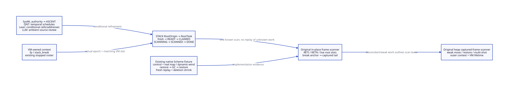

#+TITLE: Stack root entry as an explicit source and task
#+SETUPFILE: ../../modeling/org/setup.org
#+LANGUAGE: en
#+TODO: VERIFYING READY | PUBLISHED
#+PROPERTY: header-args :eval never :exports code
#+COLUMNS: %40ITEM(Responsibility) %STATE(State) %GAP(Boundary)

* READY Complete stack-root entry responsibility :rev:gc:continuation:
:PROPERTIES:
:CUSTOM_ID: REV-STACK-ROOT-TASK
:AUTHORITY: GambitStackRootTask
:SOURCE: models/sysml/stack-root-task.sysml
:BASE_REVISION: 39656ad6dae9fcf3b49db7bb73a419c2d92ee6a2
:SOURCE_TREE: 043f36e03593a5badb45325f4a8e920dc0fd3e0d
:STATUS: Scoped native/source/model review complete; actual admission/publication recorded separately
:END:

[[file:models/sysml/stack-root-task.sysml][SysML]] owns the responsibility, dependencies and five needs; [[file:stack-root-task.d2][D2]] projects
those contracts. [[file:bank-root-task-result.org][The bank REV]] is the frozen predecessor. This is one root-entry
protocol, not a replacement of the continuation implementation or all SMP.

** Source and writer refinement :source:contract:

| Source / real path | Responsibility and retained semantics | Exclusion |
|--------------------+---------------------------------------+-----------|
| =collection-round.inc:garbage_collect_mark_strong_phase= | Replace one direct =mark_continuation= entry by publish/claim/scan/finish after globals and before bank | No stage reordering or whole-round completion claim |
| =root-tasks.inc:root_context_executor= | Check current executor, active VM slot and exact bound context before payload access; shared bank/stack predicate | Caller must already hold stopped source and storage; no migration |
| =continuation-roots.inc:mark_continuation= | Original active-frame traversal and break-frame next anchor | No flattening into a generic word array |
| =mark_frame= and frame root cursor | RETI/RETN, live-slot descriptor, exact live root runs | Dead slots/code/padding remain excluded |
| =mark_captured_continuation= | Original forwarding, contiguous copy, link repair and anchor update | Not a retryable pure scanner |
| Heap-object scanner / weak =move_continuation= | Captured descendants and later address restoration retain their existing entrypoints | Not made subordinate to a stack task's local lifetime |
| Generated call/return/stack extension and _kernel capture/copy/return | Existing frame writers and multi-shot control path | Uncontrolled FFI/cross-VM writes remain outside admission |
| Reflection / serialization reconstruction | Existing logical slot/descriptor obligations remain | This REV does not certify arbitrary raw frame mutation |

All original continuation scanner bytes before the new wrapper remain exact,
including the original logical line3667. The only strong-phase root-entry
replacement uses a fresh confined stack task with the current admitted RC
epoch. Bank and stack share the private source-slot admission predicate;
there is no old bank-specific alias or parallel namespace. Existing source
writers are stopped by the actual setup collective, not by a synthetic tag.

** Ownership, memory order and failure :conditional:proof:

1. Hold the existing context/VM/round lifetime and real stopped-writer view
   before publication or raw pointer lookup. Bind =(VM slot, STACK, epoch)=.
2. Fresh unexposed record starts EMPTY. Publish acquires one scan obligation;
   repeated known publication returns the same epoch. Claim is unique.
3. Enter SCANNING before the original in-place scanner; only normal return
   establishes SCANNED. Finish consumes the scan lease once; known duplicate
   finish is idempotent. Source cells receive actual moving-GC updates.
4. DONE releases only this root-entry borrow. Descendant/weak/cleanup/restore
   and captured-frame ownership remain protected by the outer round hold.

Task record writes are sequenced within one nonreentrant C invocation. No
extra atomic/mutex or GC-time task allocation is added. Existing frame locks,
forwarding/CAS/chunk synchronization are unchanged, not re-proved here.
An unknown scan outcome retains responsibility: do not reset, reconstruct or
requeue a partially mutating scanner. Owner death, unknown join and healthy-VM
isolation need a separate worker/source lifetime design.

#+begin_quote
Counterexample: restarting after forwarding is visible can replay a Tail or
lose partially initialized copy responsibility. Treating local DONE as context
reclamation loses heap descendants. Deduplicating two cells by their common
continuation referent drops one relocation update. Applying a one-shot limit
would violate Gambit's existing repeated continuation-return semantics.
#+end_quote

** Conditional source equivalence :refinement:

Assume the original strong-phase caller has a live matching VM-slot context,
a nonzero admitted RC epoch and the stopped-writer/storage premises. All new
operations before the scanner are allocation-free, do not invoke GC and do
not write Scheme frame/root payload. The wrapper calls the exact old scanner
with the same =fp= and =stack_break= at the same ordering cut. On normal return,
new SCANNED/finish operations touch only the confined record. Projection onto
heap/frame/control observations therefore preserves the old scan behavior.

This argument is conditional on the real caller, not a second formal model.
If those old context/epoch premises fail, new rejection differs from unchecked
old entry and exposes a broken caller contract. It does not repair that caller
or prove arbitrary foreign frame aliases safe. Existing actual bootstrap,
nonzero-participant GC and multi-shot consumers exercise the admitted path.

** Formal division and model relation :sysml:ascent:

| Authority | Exclusive duty in this cut | Remaining premise |
|-----------+----------------------------+-------------------|
| Existing QNT =root_dispatch= | Temporal claim/scan/finish, stale/unknown result and drain schedules | Native SCANNED is an internal cut; projection only |
| Existing Lean =RuntimeRoles= | Conditional cell census, partition and current-address laws | Frame coordinates/live slots and concrete C adapter faithfulness |
| C source refinement | Exact original scanner, real stopped caller, epoch and slot checks | Not a universal C memory-model/writer-closure proof |
| Native Scheme PBT | Real implementation observations, replay and deletion shrinking | Finite histories, no exhaustive concurrent scheduler |

At p2 RC2+BANK2+STACK2+VM1 means seven actual tasks. The unchanged two-origin
QNT is a selected projection; it cannot issue the whole-round census seal.
Root cells use origin/frame-coordinate/live-slot identity, not a moving
address or referent identity. No stable runtime frame-ID table is added. A logical live-frame coordinate and
its current physical stack/heap address are distinct; full reconstruction of
that relation for arbitrary reflective writers remains an open adapter duty.
This REV preserves the exact existing scanner rather than claiming that
unproved relation has become a universal theorem. No new QNT/Lean file,
duplicate protocol or Lean rerun is introduced. LLM source review is ambient, not a formal receipt.
SysML projects the five needs into the shared ASCENT gate; the final source,
profile, artifacts, checklist and nine-field audit must match before commit.

** Existing fixture: real replay and multi-shot histories :pbt:

The existing =tests/root-task.scm= and official Make target remain the only
driver. RC/VM/bank/stack share one typed action vector, observation oracle,
fresh-child replay and deletion shrinker. Stack control trials use an empty
break anchor after snapshotting C inputs, then never allocate/callback/return
to Scheme before _Exit. This is control-path evidence, not fabricated active
frame coverage or production recovery.

Separate semantic histories use actual =map=, =continuation-capture=,
=continuation-return=, =dynamic-wind= and ordinary GC. A captured map keeps two
aliases of one payload; each restore must preserve graph identity, generation,
value and before/after counts. The same continuation is retained for repeated
restores. The latest dispatcher exit returns to the current action, avoiding
accidental restart of an old driver loop. Frame introspection uses the actual
captured continuation. Existing frame/roots tests additionally cover real
wide descriptors and live-slot traversal.

The labeled stale-finish adapter mutation must shrink to publish→claim→scan→
finish. A labeled wrong-value-on-second-restore-after-GC adapter mutation must
shrink to capture→restore→GC→restore. Both must replay the same signature and
be deletion1-minimal, not globally minimal or claimed runtime defects.
Portable inputs live under [[file:../../../tests/fixtures/stack-root-task/][repository fixture assets]], not transient workspaces.

** Benefit and added-work matrix :matrix:

| Mechanism | Measurable responsibility/work change | Added cost / limitation |
|-----------+--------------------------------------+-------------------------|
| Stack RootOrigin→RootTask | One formerly unclaimed entry becomes one source/epoch/lease obligation | No carrier decoupling or W!=R yet |
| Shared context admission | One predicate reused by bank and stack; no parallel alias | Concrete identity checks/calls unbenchmarked |
| Original frame scanner | Zero changes to frame/captured-copy body and live root semantics | Same scan/copy work, no pause/speedup claim |
| In-place root updates | Preserve multi-shot aliases across moving GC | No graph dedup or generation shortcut |
| Confined task | Zero persistent registry/queue/extra mutex/allocation | Source-level task+epoch locals; machine peak pending |
| Shared native PBT | Existing driver gains stack controls and actual semantic histories | Additional child launches/actions measured separately |
| Explicit successors | Globals/symbol census, independent arenas/restoration remain visible | No inherited patch8/12 or9/12 numerator |

** Native closure and measured boundary :evidence:matrix:

[[file:../../../evidence/research/retained/modern-c/stack-root-task/receipt.json][Repository source/native receipt]] binds the exact tree, unchanged profile,
producer/artifacts, original inventory, actual failure boundary and replay
inputs.  is generated from the maintained architecture view.

| Required observation | Actual result | Scope / added cost |
|----------------------+---------------+--------------------|
| Producer tree | =043f36e03593a5badb45325f4a8e920dc0fd3e0d= | Five files,+222/-15; no unrelated prototype selected |
| Full bootstrap | Two complete phase1--4 passes138.435s; stock core30.598s | Same workspace/profile; outer600/internal575 unchanged |
| Existing roles / frame / exit | PASS0.602 /5.942 /0.800s |290 layout assertions,2387 descriptor checks/306 fixtures retained |
| Real frame/root consumers | Multi-shot map and18 frames/36 wide live slots PASS | Original captured-copy, descriptors and weak move unchanged |
| Existing RC p2 | PASS2.529s;1440 draws/720 legal actions, owners0/1 | Six origin/seed cases; no broader FFI credit |
| Four control PBT families |96 cases/3456 actions PASS | RC/VM/BANK/STACK, one existing replay/oracle/shrinker |
| Actual continuation histories |24 cases/864 actions PASS | Real map capture/restore/GC/restore, graph identity and dynamic-wind |
| Five calibrated shrink/replays | Each24→4; deletion1-minimal, same signature replayed |280 fresh children total; invocation mutations, not production defects |
| Root-task target | PASS37.996s; one compile/two parent executions |+1728 generated actions/+112 child trials versus bank predecessor; no runtime speedup inference |
| Moving root control | VM payload and p2 bank owners0/1 PASS | Additional actual GC through the new stack entry on every participant |
| Original scanner body | Exact prefix retained, logical line3667 | No copied-frame rewrite, scan/copy work unchanged |
| Persistent layouts | Origin16/task48/domain192/header48/carrier896/VM78504 | Persistent structural delta0 |
| Source-level locals | Stack task48+epoch8 bytes | Optimized machine stack/process peak unmeasured |
| Synchronization | Zero extra mutex or GC-time task allocation | Added confined control/binding checks unbenchmarked |
| Existing temporal model |10 explicit QNT runs +10000 samples/64 steps PASS | No new QNT/Lean files; Lean unchanged/not rerun |
| Native model/view | Final SysML and D2 PASS | Initial D2 quoting error retained; passed exact earlier checks reused |
| Original GSI |408/408 PASS61.156s, first full sample | Full inventory retained; no retry or whole-SMP fraction |
| Official whole check | FAIL at test8 startup17.245s | setup_mem_pstate6/6 sections,1/12 members,max_heap0; same predecessor boundary |
| Later official consumers |9/10/12/entry/inline PASS6.427s | Independent result, not a green whole check |

Known test8 setup/resize capacity logic is byte-identical to the predecessor.
The failure is preserved, not treated as new stack-task success or repaired by
raising heap/waits. Full GSC, stress, Gerbil, independent workers and unknown
join/healthy-VM isolation remain open. No push/remote CI observation is claimed.

Portable calibrated inputs are [[file:../../../tests/fixtures/stack-root-task/stack-minimal.scm][stack]],
[[file:../../../tests/fixtures/stack-root-task/continuation-minimal.scm][multi-shot continuation]], and unchanged protocol families
[[file:../../../tests/fixtures/stack-root-task/rc-minimal.scm][RC]], [[file:../../../tests/fixtures/stack-root-task/vm-minimal.scm][VM]], [[file:../../../tests/fixtures/stack-root-task/bank-minimal.scm][bank]]. Each is a Scheme datum consumed by the existing
=--replay= option. Negative calibrated replay expects exit71 and the recorded
mismatch signature. On a build configured with the recorded profile, the
existing =make test-root-task= target compiles/runs the complete fixture and
recreates the minimal traces; no extra harness is needed.

** Submission checklist :ascent:

- [X] Exact producer and required frame/map/roles/exit/RC consumers pass.
- [X] Four native control families and real multi-shot histories replay/shrink.
- [X] Source invariance, layouts and native original-test disposition recorded.
- [X] Native SysML/D2 and existing temporal model checks complete; distinct Lean duty recorded.
- [X] Benefits/costs/process/questions reviewed; exact nine-field audit and five gates/21 controls required before commit.

The public evidence/result record will report actual qualification. No full
SMP, compiled inventory, Gerbil, unknown-join isolation or performance claim
is implied by these scoped gates.
