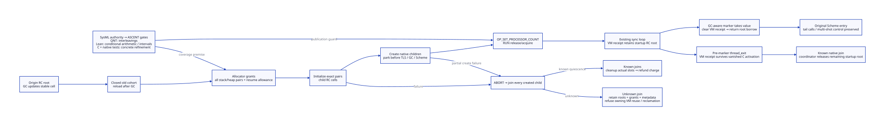

#+TITLE: Startup transaction REV: actual publication and scoped benefit
#+SETUPFILE: ../../modeling/org/setup.org
#+LANGUAGE: en
#+PROPERTY: header-args :eval never :tangle no

* PUBLISHED Startup roots, physical grants and membership :rev:audit:
:PROPERTIES:
:CUSTOM_ID: STARTUP-PUBLICATION-RESULT
:REVISION: ff44e8f82352c4196e4874714c6f329e1611595a
:PARENT: 9bb0e364b4e494254d74ce36186faa29576b7568
:SOURCE_TREE: 5a0480877090bdbd0afaa59bf8aca5b5103a7cc0
:AUTHORITY: GambitStartupPublication
:STATUS: five scoped gates closed; whole SMP open; not pushed
:END:

[[file:../../../evidence/research/retained/modern-c/startup-publication/publication.json][The publication packet]] preserves the actual Git body, selected source manifest,
native/profile identities, frozen SysML/Org/audit artifacts and admission output.
[[file:startup-publication.org][The qualified design]] is a frozen pre-commit review; its pending-submit label is
historical. This result supplies the actual post-commit state without rewriting
that audit. Shared ASCENT admits tests, learning, process, models and questions;
all21 rejection controls pass. No remote CI or push result is inferred.

The [[file:diagrams/startup-publication.d2][D2 source]] and  include the pre-marker
exit/known-join path; the VM receipt remains the owner across the vanished C
activation. The whole-programme dependency diagram is derived from native
SysML dependency queries, rather than maintained as a second layout manifest.

** Actual replacement and cost matrix

| Cut | Old authority retired | Qualified benefit | New cost / boundary |
|-----+-----------------------+-------------------+---------------------|
| Request roots | Copied raw Scheme values in pending sync records | RC cells survive moving GC; actual nonzero-origin request/entry controls | One cell per origin request and one per new child; complete writer census remains later |
| Physical startup | Per-child optimistic stack/heap acquisition | All exact pairs plus derived resume headroom granted before initialization; unchanged official test8/test9 pass | Retains old double-section layout; target12 plan26 MiB section payload; no peak reduction |
| Native publication | Count committed before OS create | Initialize all, create parked actors, one existing member/RUN commit | VM pointer8 bytes, lazy2712-byte ledger and native gate/condition |
| Failure rollback | Wrong-slot cleanup and guessed refund | Actual allocation/metadata/partial-create PBT and exact charge/root conservation | Free sections may remain cached; unknown join retains resources and refuses own-VM reuse/GC |
| Pre-marker exit | Startup root owned only by a C stack that can thread_exit | Actual predecessor nodes2/borrows2 becomes0/0 after known joins; VM receipt persists until marker or join | Uses existing fixed slot receipt; arbitrary foreign unwind/shared-still retirement excluded |
| Whole architecture | Local test success treated as overall progress | Same-source scoped review and preserved failures; [[file:architecture-closure.org][full programme premises/falsifiers]] | Root census, W/R workers, request service, composed exit and remaining9--12 acceptance remain open |

At11 added actors with one request origin, metadata is3296 bytes excluding
malloc overhead: VM pointer8 + ledger2712 +12 RC headers*48. Existing slot
capacity64 is reused; no new magic gate count is introduced. Necessary physical
backing is not a performance or RSS saving. A known successful publication
does not assert that every scheduler thunk is initialized or has returned.

** Actual tests and preserved negatives

| Evidence | Observed result | Scope |
|----------+-----------------+-------|
| Complete producer | Two phase1--4 passes155.263s; stock core71.171s | Same cache and Bazel Darwin/GCC16/C23 profile |
| Original GSI |408/408 in78.979s | Same final producer; original300s child cap |
| Remaining original Make | All prerequisites114.936s | Original120s cap; test8/test9, map/frames/RC and6144-action root/control families included |
| Component Make target |7.876s;72 actual positive actions | Nonzero origin, failures, marker-front GC, early retirement, unknown join |
| PBT calibration | Input6→1; replay and deletion-one-minimal pass | Deliberate real-ledger refund mutation in test adapter; not a production fault |
| Early-retire negative | Earlier full-original-green candidate still retained2 roots/borrows | Same semantic control now drains both to zero; failure preserved |
| Existing QNT | Four trajectory tests;10000 sampled64-step histories; five negatives rejected | Finite schedules; no new Lean machine/proof or fairness claim |
| Architecture projection | SysML native validation; ASCENT four negatives rejected | Missing premise, empty mechanism, unknown stage and planning promoted to solved |
| Test-only artifact reuse | No bootstrap or runtime C compilation rerun for the fixture-only correction | All non-test bytes/modes, configuration, headers and native/generated products bound |

The earlier fixed-carrier assertion failure remains recorded. Requested
migration is not a processor pin; the corrected test obtains an actual nonzero
origin. Later runtime custody changes correctly invalidated native qualification
and produced a new complete producer. No heap option or timeout was increased.

** Source and submission custody

- [X] Only14 selected handwritten files enter this REV; one new Scheme fixture.
- [X] All133 pre-existing pending working paths and prior staged entries preserved.
- [X] The exact committed tree/SDK is qualified; the complete dirty working/index prototype cohort is not.
- [X] First submission blocked on raw index stat refresh; semantic index, working diff and HEAD matched. Fresh freeze passed with the same unchanged guard.
- [X] Commit body contains responsibility, retirement, tests, benefits, costs, process, models, checklist and remaining boundaries.
- [ ] Full GSC/PR/stress/Gerbil/release/remote CI and whole-family acceptance.

The next implementation selection is the common root-population snapshot and
its controlled writers, following [[file:delivery-plan.org][the SysML-derived dependency plan]]. Repair9
is subsequent coupled work; its original workloads remain falsifiers of the
composed architecture. No8/12,9/12 or universal9--12 solution is published here.
