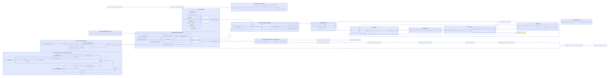

#+TITLE: Family 6 generated rest construction specification
#+OPTIONS: toc:2
#+PROPERTY: TASK modern-c-frame-contract

* Construction release
:PROPERTIES:
:CUSTOM_ID: f6-rest-construction-release
:STATUS: DESIGN-READY
:END:

Build a shared refusal and retry path for generated handlers 7 and 9.
Keep normal parameter semantics at the existing processed-argument ABI.
Use the existing full collector, RC scan, frame descriptors and context
resume publication. The change replaces the direct-GC call from a
transient argument window with an explicit transfer into a mapped
retry frame. =DESIGN-READY= authorizes this implementation plan. Native
qualification depends on the receipts below.

Current source already writes back the live =hp= and =fp= for the
grant comparison. That addresses the earlier stale-mirror lead at the
initial guard. It still calls GC with the transient window at =fp=
and the RC helper supplies only the pending suffix, resolved keys and
a placeholder label. The VM directory also publishes FREE before
finishing old metadata writes. These source cuts motivate separate
storage, root and interval obligations.
[[file:stress-gsi-implementation.org::#stress-gsi-generated-cut-oracle][Source audit and TFIB controls]]

* Package A. Stable native record
:PROPERTIES:
:CUSTOM_ID: f6-stable-record
:END:

Use the existing VM lifecycle admission and the bounded directory
owned by that VM. Use the existing lifecycle gate for directory
metadata on the refused path. First obtain a live VM entry, then
resolve the supplied token in the directory and pin the activation.
The frame carries scalar =VM incarnation / slot / generation= fields
with an explicit attempt identity if it differs from generation.
The frame carries only representable tagged scalar fields. The
native directory owns the address of the activation. A saved native
pointer cannot serve as a token across GC, exit or reuse.

| Transition | Under the owning gate | After leaving the gate |
|-
| =FREE → PUBLISHING= | Reserve an available slot and issue a generation that fits its actual representation. | Prepare native storage and complete the root payload with caller custody still held. |
| =PUBLISHING → OPEN= | Publish the complete record and install receipt for that generation. | Allow authorized lookup and commit the frame once the roots are confirmed. |
| =OPEN → CLOSED= | Prevent new pins. Distinguish settled, abandoned and unknown outcomes. | Let existing pins return. Retain root and result obligations that still have an authorized consumer. |
| =CLOSED → FREE= | Only after zero pins, final old metadata writes and settlement, make the slot reusable. | A later claimant must receive a different generation. A terminal receipt can outlive the record in bounded VM-owned storage. |

Protect directory fields under one synchronization discipline. If
using the current packed word, bound the generation by the number of
representable bits before shifting. Advancing a full signed =___WORD=
and shifting it by eight is not a valid bound. Prefer a separate
field under the gate for the first implementation. On generation or
slot exhaustion, retain caller custody and take the admitted fallback.
Keep bounded unknown receipts and distinguish an absent receipt from
confirmed abandonment. Acquire no directory lock while holding an RC
domain lock, running GC, making a callback or waiting on owner exit.
Dropping the last pin can retire the record, so copy return status
before releasing it and perform no later load.

Expected edits belong in =lib/lifecycle.h=,
=lib/_setup/vm-registry.inc= and =lib/_mem/rc-allocation.inc=.
Audit all query, reload, claim, cancellation and cleanup callers.
Exercise close before pin, pin before close, second record freed while
the idle cache is occupied, generation exhaustion, and two processors
competing for the same returned directory slot.
[[file:models/quint/smp_resume_closure_extent.qnt][Existing temporal storage and wait model]]

* Package B. Generated frame and RC root transfer
:PROPERTIES:
:CUSTOM_ID: f6-mapped-root-transfer
:END:

Use the generator's configured ABI, with no new hard-coded frame size
or root bitmap. =gsc/_t-c-2.scm= selects =GET_REST=, =GET_KEY_REST=
or =GET_REST_KEY=. The two keyword opcodes target handler 9 and
differ in =temp4=. Handler 7 and handler 9 share one generated
internal retry continuation. Keep the initial arity checks, default
selection, duplicate-key precedence and rest order in the existing
handler dispatch.

At the point after argument-register spill, =fp[u]= equals
=STK(-u)=. Define =I= remaining pairs, =J= consumed-by-keyword
window words retained until commit, =P= required/optional prefix
words, =K= resolved key values, =N= live argument window size and
=NP= formal result arity. At full refusal with no pairs built,
the partial list starts empty. If the site also accepts a partial
list, it must preserve the actual list and the remaining coordinates.

| Form | Counts | Physical source window at refusal |
|-
| Ordinary | =P=NP-1=, =J=K=0=, =N=I+P= | First =I= words are pending rest elements in stack order, followed by the positional prefix. |
| Keyword-rest | =P=temp2=, =K=NP-1-P=, =J=k-I=, =N=I+J+P= | First =I= words feed rest, next =J= belong to keyword parsing, final =P= are positional. Preserve the already resolved key values. |
| Rest-keyword | Same handler with its DSSSL =temp4= mode | Keep the handler's computed =I,J= and its inclusion of keyword pairs in rest. Do not reconstruct it with the keyword-rest stripping rule. |

| Destination | Value |
|-
| RC header =data= | Real processed-argument procedure label from =temp1=. |
| RC array cell 0 | Partial rest list. |
| RC array cells 1 through =N= | Complete physical window in =fp[u]= order. |
| RC array cells =N+1= through =N+K= | Resolved key values in formal keyword order. |
| RC array cell =N+K+1= | Tagged =FAL= until result initialization commits. |
| Native record | Owner and context, token, phase, original mode and checked counts. |

Reserve stack space for the mapped retry and safe failure landing
before the argument window becomes the sole root owner. On refusal,
prepare and publish the RC view while the caller view is still valid.
When installation is confirmed, drop the transient window and install
the generated continuation's live slots, descriptor and saved RA.
Publish the new =fp= before entering the existing complete-frame
GC route. Validate the exact generated host, return label, frame
descriptor, saved RETI coordinate when applicable, root slots and
caller boundary. Native =W_ALL= only saves the current values. It
does not construct the frame.

A preparation failure or lost install reply leaves the complete
source view in custody. Retry or query the same token. If the
candidate lacks a complete mapped error landing, stop that entry
before destructive work. The first refused group must execute zero
managed writes and zero argument pops. The GC walk may read the
published retry frame only after this transfer.

Expected edits start in =lib/_kernel.scm= and propagate through
the existing generator to =lib/_kernel.c=. Touch an emitter or ABI
template only if the configured frame cannot be generated using the
existing return mechanism. Provide the generated diff and an
independent decode, including =I,J,P,K,N,NP= reconstruction at
each entry. Compare =lib/_mem/copy-planning.inc= and
=lib/_mem/rc-roots.inc= consumers against the installed slots.
[[file:models/lean/FrameContract.lean][Existing frame encoding proof route]]

* Package C. Restore, write and deliver
:PROPERTIES:
:CUSTOM_ID: f6-repaired-resume
:END:

The retry continuation resumes only after the real collective has
published the restored context. Acquire the current GC round and
write interval, resolve the activation again and reload label, list,
arguments and keys from repaired slots. Rebuild the list from the
physical suffix in pop order. Rebuild formal parameters as positional
prefix in original logical order, then keyword values in formal order,
then rest. Keep the selected existing =SET_NARGS(-1)= tail ABI.
For the slow path use the established processed-argument vector
consumer so the final parameter order has one implementation.

Check the whole slow write group before its first write, including
all =I= pair extents, header, alignment if required by the configured
writers, and the final =NP= vector field. Check stack staging separately.
The successful fast path reserves only its emitted pair group and
stack writes. For the selected no-handle layout, 4000 pending pairs
and a one-slot vector need 12002 heap words. Treat a one-word-short
boundary as a refusal of that entire group, even when the first pair fits.
No global fudge increase supplies authorization for a specific interval.

Use separate observed footprints =B_fast= and =B_retry=. In the
selected no-handle example the fast pair group needs 12000 heap
words. The mapped retry needs 12002 when it adds a one-slot vector.
A fast refusal at 11999 and a retry grant at 12002 are both valid
observations for the same operation. A retry grant of 12001 is still
short. Derive each footprint independently from the actual emitted
writes. The Scheme observer now requires =write-plan= between
=roots-reloaded= and =grant=. Its five fields carry pair count,
words per pair, vector payload words, vector header words and padding.
The observer checks the resulting sum against the retry grant.
Keep the fast-group observation and the retry plan independent.
Preserve the previous observer receipt on its own fixture digest.
[[file:../../../vendor/gambit/tests/smp/gc/rest-parameter-cuts.scm][Gambit Scheme observer]]

The validation role ran the updated observer on the historical
diagnostic GSI. It accepted the unequal-footprint history, refused
both the one-word-short retry and the underreported retry requirement,
and completed all three Scheme driver forms. The recorded scope is
two synthetic positives and seven negatives. The candidate must
still supply actual generated-handler traces.
[[file:../../../evidence/research/retained/modern-c/stress-gsi/dev-vendor-changes-audit.json][Retained restWritePlanControl receipt]]

The lifecycle token remains stable across collection and the grant
changes with the round. Publish a fully initialized result before
READY, then claim READY once. Place the final roots in their receiving
frame before releasing the span. Close the claim-to-tail window to GC
and callbacks. If an earlier phase loses its reply, retain it under
the same attempt until settled. A matching receipt may answer a
query but cannot replay a delivered call. Preserve arbitrary user
continuation reuse independently of internal retry consumption.

Expected edits belong in the existing RC helpers and the generated
retry/resume path. Reuse =___root_round_freeze=,
=___root_round_publish=, =plan_copy_round= and
=___gc_arena_handoff= as the producer/collector boundary.
Any collector edit must identify the failed existing premise it
replaces. Retain the original census and heap budget.
[[file:diagrams/stress-gsi-rest-construction.d2][D2 ownership and construction flow]]

* Site release for Cursor and independent audit
:PROPERTIES:
:CUSTOM_ID: f6-site-release
:END:

| Release | Cursor evidence packet | Auditor disposition |
|-
| A before B | Candidate source, actual metadata readers and writers, slot lifetime and exhaustion controls. | Admit the mapped-root work only after a first load has a live token and pin and FREE follows old final use. |
| B before collection | Scheme and generated C for all three forms, real frame geometry and exact RC/source slot sets, zero writes/pops on one-short refusal. | Stop before forced GC if the frame is raw or the prefix, label or keys lack an independently observed owner. |
| C before original stress | Same-image exact and one-short at both handlers, moved-root reload, current grant, one accepted claim, rejected replay, actual tail jump and one Scheme entry. Include unwind, abandoned attempt and user multi-shot controls. | Require independent slot evidence with a missed-but-still-reachable referent. Record first failure at the relevant cut. |
| Family 6 | Current formal producer with the unchanged original p2-to-p1 manifest and full 295/300-second receipt. | Classify first invalid event, proven wait cycle or completed work at censor. Only natural completion of all original cases admits family 6. |

This is one release for the production path. Cursor may implement A,
B and C as separate reviewable changes. The runtime handoff needs the
whole chain on one product. The supervisor reads candidate source,
generated frames and the runtime receipt before updating the ledger.
[[file:stress-gsi-implementation.org::#stress-gsi-construction-gates][Full audit gates and TFIB attribution]]
[[file:stress-gsi-implementation.org::#stress-gsi-downstream-construction][Dependencies through Family 12]]
