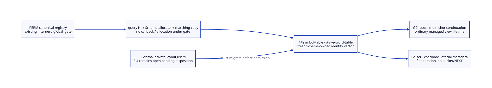

#+TITLE: Published owned getters, direct callers and pending Modern C cuts
#+SETUPFILE: ../../modeling/org/setup.org
#+LANGUAGE: en
#+PROPERTY: header-args :eval never :exports code

* PUBLISHED 3.4.2 Owned Scheme registry getters :rev:roots:audit:
:PROPERTIES:
:CUSTOM_ID: ROOT-VIEWS-GETTERS-RESULT
:AUDIT_NUMBER: 3.4.2
:PARENT_ITEM: 3.4 / ROOT-VIEWS
:REVISION: ae19f98624ad19820040e5afbe08219206bfd0a1
:PARENT: da5651af241ff30632c2f2009f09f22240fa3752
:SOURCE_TREE: b3e0b9fb04afc3c6ee27409ac4bf027a8660f807
:AUTHORITY: GambitSymkeyGetters
:END:

Six existing source files,+69/-52. Five actual ASCENT gates and21 rejection controls closed before this local commit. The commit body records responsibility/retirement, tests, learning/benefit/cost, process, Checklist, models and remaining boundary. No push or remote CI is claimed.

[[file:symkey-getters.org::#ROOT-VIEWS-GETTERS][Frozen reviewed argument]], [[file:models/sysml/symkey-getters.sysml][component]], [[file:symkey-getters.d2][D2]], [[file:../../../evidence/research/retained/modern-c/symkey-getters/receipt.json][source/native receipt]] and [[file:../../../evidence/research/retained/modern-c/symkey-getters/publication.json][publication packet]] bind the exact tree/profile, actual native artifacts and frozen Org/model/DSL snapshots. The selected SDK tree is qualified; the mixed prototype working/index files are not. Lossless three-way source staging applied only the six tested deltas and preserved all other pending working/index entries.135 unique pending paths (133 net changes and2 index/working-only) remain owned by the [[file:pending-cuts.org][dependency-ordered queue]], not admitted in this REV.

** Complete ownership replacement and actual counterexamples

Both official private getter names now return owned flat vectors of canonical identities, not GSTATE bucket aliases. Four actual direct readers (Geiser, checkdoc, official test10 and unit metadata adapters) migrate together. Their bucket/count/NEXT authority and the getter noninterrupting classification retire. C keeps native interning/capture; Scheme frames keep traversal, GC and multi-shot lifetime. The actual raw getter survives only in a negative fixture. No new SCM/framework, public namespace, C field, mutex, native buffer or manual root record.

The old raw getter aliases the same mutable registry storage; its13-action history shrinks to1 in7 trials, old replay fails/current replay passes. The source-equivalent old fold captures6301 identities but visits2016 after callback rehash; its13 actions shrink to1/current replay. One action is a domain operation with calls/growth/GC, not one C instruction or an exhaustive minimal OS schedule. The production getter/view cannot be reached by native rehash after delivery; ordinary GC and captured continuations retain it. This removes escaping native-topology ownership rather than adding a particular symptom check.

** Exact-source tests and preserved failures

| Validation | Actual result / seconds | Boundary |
|------------+-------------------------+----------|
| Full source producer | Two phase1--4 passes126.205s; stock core28.195s | Same persistent SDK/profile, j11/p1;600s unchanged |
| Test-only reuse | Both corrected fixture trees reuse four runtime artifacts and all15 generated products | No new clone/config/executor; runtime stages not rerun |
| Getter/view PBT | Seed997;322 actions; mandatory10 GCs/two resumes;13.952s | Actual implementation and two predecessor replay/shrink controls |
| Source/caller refinement | Native reader executes exact consumer bodies and compares old-fold AST;0.098s | Not a whole Geiser module/Gerbil build |
| Original GSI |408/408;65.915s | Full original unit manifest, unchanged300s limit |
| Remaining original Make | Complete;102.638s under120s | Includes original test8/test9,290 assertions, map/frame roots/multi-shot and root/lock PBT; not whole compiled unit inventory |
| Native interner |405 actions/growth controls;16.820s | Same final tree, old0--8 generator restored |
| Globals / startup |14.009s /4.404s; early roots/debts0/0 | Refusal, unknown-result and early-root-drain controls |
| SysML / ASCENT | Five commit gates/21 controls; pending queue6 controls; plan12 controls; closure4 controls | Planning/source/native remain distinct; QNT/Lean unchanged and not rerun |

Initial view fault2 schema refusal, overbroad interner-generator edit, audit reader syntax/argument/script-header errors, and prior-tree120.008s Make timeout/118.714s recheck are retained. Final-tree results above are not relabeled earlier results. The first commit preparation refused a raw index metadata change; HEAD, every semantic staged entry and the full working diff were independently unchanged. A fresh strict admission passed without weakening the guard. No heap/wait increase or source-census reduction.

** Benefit and added-cost matrix

| Change | Verified benefit | Added cost / limitation |
|--------+------------------+-------------------------|
| Two getters | No delivered mutable alias to registry topology | O(1) borrow becomes O(bucket+N) capture and N-word managed vector/header |
| Four direct readers | No count skip/bucket/NEXT logic in admitted callers | Flat O(N) traversal remains; private downstream layout migration still required |
| GC/control lifetime | Managed vectors survive growth, escape and two multi-shot resumes | Independent views retain sum(N_i) references and add normal GC scanning; a captured fold shares its view across resumes |
| Canonical identities | PERM objects/names remain shared |6301 references/64bit =50408 payload bytes; two separate vectors100816, excluding headers/retries; not measured RSS |
| Shared native support | Zero new C records/fields, locks, native buffers or manual root APIs | Gate-held capture delays polling; continuous growth can starve retry |
| Overall SMP | Removes one hidden root/lifetime authority prerequisite | No whole-GC saving, throughput/physical-peak/worker or Repair9 closure claimed |

** Primary programme audit:13 responsibilities

These indices describe responsibilities, not thirteen commits, effort percentages or SMP12. Current item3 closes leaf3.4.2 only.

| No. | Lane | Responsibility | State |
|-----+------+----------------+-------|
| 1 | runtime | Bind pending changes and responsibility owners | REVIEWED_PLAN_ONLY |
| 2 | runtime | Startup preparation and member publication | PUBLISHED_SCOPED |
| 3 | runtime | Close the complete frozen root population | NEXT_SOURCE_CLOSURE |
| 4 | runtime | Worker arenas, unique copy work and context restoration | PLANNED |
| 5 | runtime | Request ownership, wait state and service activation | DEFERRED_FOR_FOUNDATION |
| 6 | runtime | Generated entry and acquired-effect exit custody | PLANNED_BOUNDED_CALLERS |
| 7 | runtime | Participant removal and resource-specific retirement | PLANNED |
| 8 | runtime | Generational allocation and remembered roots | RESEARCH_AFTER_FOUNDATION |
| 9 | runtime | Same-source whole-runtime acceptance | BLOCKED |
| 10 | engineering | Public headers and explicit layout contracts | PARTIAL_EVIDENCE |
| 11 | engineering | C23 and Darwin toolchain/configuration refinement | PARTIAL_EVIDENCE |
| 12 | engineering | Incremental build and generated-artifact ownership | PARTIAL_EVIDENCE |
| 13 | engineering | CI, model/evidence and per-REV audit chain | PARTIAL_EVIDENCE |

** ROOTS coverage and independent SMP acceptance

Three scoped closed / three remaining ROOTS groups.3.4 remains open for external private-layout disposition (known Gerbil TODO walkers require active-profile proof/migration);3.5 complete writers and3.6 source/lifetime union remain before independent workers. The original test8/test9 executions are not acceptance families8/9.

| No. | SMP family | Current-profile state |
|-----+------------+-----------------------|
| 1 | bootstrap | CURRENT_PROFILE_PASS |
| 2 | gsi | CURRENT_PROFILE_PASS |
| 3 | gsc | OPEN |
| 4 | pr-gsi | OPEN |
| 5 | pr-gsc | OPEN |
| 6 | stress-gsi | OPEN |
| 7 | stress-gsc | OPEN |
| 8 | registry | OPEN |
| 9 | lifecycle | OPEN |
| 10 | gc-ffi | OPEN |
| 11 | gerbil | OPEN |
| 12 | release | OPEN |

Two current-profile prerequisite families passed / ten open. The actual closing criteria are the [[file:delivery-plan.org][SysML-derived ledger]]. No repair-line8/12 or9/12 credit transfers, and no whole-runtime acceptance is inferred.

** Next code cuts

Resolve the external private-reader boundary, then complete actual writer/borrow admission and the source/lifetime union. Physical capacity, independent worker/restoration and resource retirement follow that foundation; scheduler/CFFI consumers join through their admitted interfaces. Header/build support can publish independently after their own tests. The [[file:pending-cuts.org][135-path queue]] has ten review owners and exact paths/tests/blockers; generated C is a producer-bound disposition, never an independent handwritten commit. No unqualified directory-wide staging.

#+CAPTION: Native registry capture transfers values, never bucket traversal authority.

