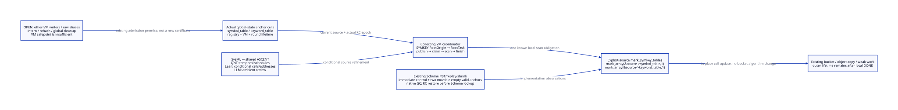

#+TITLE: Symbol and keyword anchors as an explicit source and task
#+SETUPFILE: ../../modeling/org/setup.org
#+LANGUAGE: en
#+TODO: VERIFYING READY | PUBLISHED
#+PROPERTY: header-args :eval never :exports code
#+COLUMNS: %44ITEM(Responsibility) %STATE(State) %GAP(Boundary)

* READY Complete symbol/keyword root-entry responsibility :rev:gc:ownership:
:PROPERTIES:
:CUSTOM_ID: REV-SYMKEY-ROOT-TASK
:AUTHORITY: GambitSymkeyRootTask
:SOURCE: models/sysml/symkey-root-task.sysml
:BASE_REVISION: 5bb500aeb8a98ac7ea82e09fee91eca9db7149a9
:SOURCE_TREE: 35cb7fee2dd8b23a2e0cee0e3a01108a92c7357a
:STATUS: Scoped source/native/model review complete; actual admission/publication recorded separately
:END:

[[file:models/sysml/symkey-root-task.sysml][SysML]] owns the responsibility, dependencies and five needs; [[file:symkey-root-task.d2][D2]] projects
the contracts. [[file:stack-root-task-result.org][The stack REV]] is the predecessor. This is one local root-entry
responsibility, not global registry synchronization or a whole SMP rewrite.

** Source, producer, writer and consumer closure :source:

| Actual source path | Producer / writer / consumer | Contract here |
|--------------------+------------------------------+---------------|
| =memory-lifecycle.inc:setup_mem= | Creates initial symbol and keyword tables | Existing global-state storage and setup lifetime |
| =symbols.inc:alloc_symkey_table= | __make_vector(NULL) produces production table storage | Allocation policy unchanged; fixture admits small MOVABLE0 valid empty tables in a native-only window |
| =symbols.inc:symkey_table_set= | Replaces selected anchor after successful rehash | Other-VM replacement/unknown writers not closed by a VM stop |
| =symbols.inc:___intern_symkey= | Inserts next link/bucket, increments count, grows/rehashes | Existing bucket topology and interned identity unchanged |
| =symbols.inc:___new_symkey= | Creates permanent symbol/keyword/name and interns it | No generation/allocation-policy rewrite |
| =_kernel.scm:##symbol-table,##keyword-table= | Returns table aliases | Raw mutable aliases remain outside claimed writer closure |
| =root-origins.inc:mark_symkey_tables= | Explicit global-state parameter; two original in-place mark_array calls | Anchors are distinct root cells; bucket contents are descendants |
| =collection-round.inc:garbage_collect_mark_strong_phase= | Collecting VM coordinator after VM task, before RC/globals/stack/bank | Same caller, epoch and order; direct unclaimed entry retired |
| =object-scanning.inc= and weak phases | Existing copied descendants / later weak work | Entry task DONE does not finish or reclaim them |

The new SYMKEY origin stores the actual typed global-state pointer. Source
admission checks the current coordinator and that exact pointer before payload
access; it does not dereference an alien source to find out whether it is valid.
The old private scanner name remains. Its implicit global-state derivation is
replaced by the explicit parameter; only the two cell expressions change from
GSTATE fields to source fields. No names, build entrypoints or aliases are added.

** Local ownership and global limits :contract:memory_order:

1. Existing global registry/VM/round storage and admitted-writer exclusion must
   preexist lookup/publication. A stopped collecting VM does not close writers
   in another VM. This unresolved requirement remains explicit.
2. Initialize one fresh confined record with the actual nonzero RC epoch minus1.
   Publish the SYMKEY origin and lease1; known repeated publication returns the
   same receipt. Claim validates source/executor/key and is unique locally.
3. SCANNING precedes the original two in-place mark_array calls. Only normal
   return establishes SCANNED. Finish releases once; known duplicate finish is
   idempotent. Never reset/requeue a scan whose outcome is unknown.
4. DONE ends this entry-scan borrow. Global anchors, descendants, VM/round and
   cleanup lifetimes remain held outside the task. It grants no global free.

Task-record writes are C-sequenced in the same nonreentrant invocation. There
is no new mutex/atomic/queue/identity table or GC-time task allocation. Existing
copy/forwarding/weak synchronization is unchanged. This statement is about the
confined record, not unsynchronized cross-VM anchor mutation.

Two VM rounds may refer to the same global anchor cells. The source/task
identity therefore includes the collecting VM and epoch; local unique claim
is not a proof of globally unique scanning. Unknown joins, lock-holder death,
raw writes, rehash exclusion and global cleanup admission remain separate.

** Conditional equivalence and counterexamples :refinement:

Under the original current-coordinator/epoch, admitted-writer and source
lifetime premises, shared task operations do not allocate/GC or mutate Scheme
payload. The explicit source is the old GSTATE, so the two mark_array addresses
and order are identical. The caller cut and bucket/frame/copy/weak algorithms
are unchanged. The projected heap/control observations therefore preserve the
old root scan. Broken caller premises can now cause rejection; this is not a
universal C memory-model or cross-VM writer-closure proof.

#+begin_quote
Copying only table values loses updates to actual anchor cells. Treating a
referent address as root identity merges two aliased cells incorrectly.
Treating VM safepoints as a registry freeze admits another VM's rehash.
Treating task DONE as table reclamation discards descendants or other VM users.
Replaying an unknown scan can duplicate copying/Tail effects. None is admitted.
#+end_quote

** Formal responsibilities :sysml:ascent:

| Authority | Exclusive duty | Limit |
|-----------+----------------+-------|
| Existing QNT root_dispatch | Temporal publication/claim/scan/finish/stale/unknown/drain | Finite selected projection, not global registry closure |
| Existing Lean RuntimeRoles | Conditional logical-cell census/partition/current-address laws | Cell=(collecting VM,global state,SYMKEY,anchor index), not table referent |
| Actual C source refinement | Explicit parameter/two addresses/order/current coordinator/epoch | Existing stop/lifetime premises and arbitrary raw writers not universally proved |
| Native Scheme PBT | Implementation observations, real replay and deletion shrink | Finite generated histories, not a duplicate model or exhaustive scheduler |

At p2 RC2+BANK2+STACK2+VM1+SYMKEY1 is eight local tasks. The unchanged two-origin
QNT is a selected projection, not the full census or a whole-round seal. No new
QNT/Lean files or duplicate protocol proof; Lean is unchanged and not rerun.
LLM source review remains ambient. SysML drives five needs through the shared
ASCENT rules, binding exact source/profile/native artifacts/checklist/audit.

** Real implementation controls :pbt:

The existing =tests/root-task.scm= and official Make target remain the driver.
SYMKEY joins the shared typed-action generator, oracle, child replay and deletion
shrinker. Immediate-only replay snapshots C arguments then sets just the two
anchors to FAL; there is no later Scheme allocation, lookup, callback or return
before child _Exit. Alien-source/executor/stale/duplicate requests are observed
through the real C protocol, never a copied implementation simulator.

A separate positive test runs exclusively in one VM/p1. It interns one symbol
and keyword, protects both original tables using registered RC roots, and
admits two small MOVABLE0 vectors representing valid empty tables =(0 ())=.
Only explicit native GC executes while these temporary anchors are installed.
Both actual anchor cells must relocate; originals are reloaded from RC roots,
restored, and RC handles released before Scheme lookup/allocation/callback or
return. Then ordinary GC and lookup must retain original interned identity.
The fixture installs no user foreign cleanup callback. Metadata admission
failure changes no anchor and releases any created handles; unknown native
non-return is not offered as a recoverable production protocol.

An earlier full-table-copy test failed because it assumed all vectors move.
The actual allocation probe found symbol length2049/STILL(type5), keyword
length129/MOVABLE0(type0), and small length2/MOVABLE0(type0). The negative result
is retained; allocation policy, heap and wait limits are unchanged. The final
fixture-only correction reuses exact production/bootstrap inputs and artifacts;
its new executable must pass fresh native tests. This positive control does
not claim lookup while temporary empty tables are installed, concurrent rehash
coverage or a production table-allocation change.

A labeled stale-finish invocation mutation must shrink24→4 and replay the same
failure with SCANNED/lease1. The continuation invocation control must still
shrink to capture→restore→GC→restore. Certificates are deletion1-minimal, not
global minima or discovered production defects. Portable replay inputs belong
under repository =tests/fixtures/symkey-root-task/=, never an execution directory.

** Benefit and new-overhead matrix :matrix:

| Mechanism | Concrete replacement / benefit | Added work / remaining boundary |
|-----------+--------------------------------+---------------------------------|
| Explicit SYMKEY origin | Two real cells with named global-state source | Cross-VM registry lifetime/writers remain OPEN |
| RootTask entry authority | One direct unclaimed call replaced by actual source/epoch/claim/completion | Current coordinator binding, not independent workers |
| Explicit scanner source | Retires hidden GSTATE derivation at consumer | One typed parameter; original cell visit count/order retained |
| Shared support | Reuses existing publication/claim/finish and replay/shrinker | Source-specific wrappers/checks remain necessary |
| In-place anchors | Preserve relocation and interned identity | No bucket/rehash optimization or throughput claim |
| Structural memory | Pointer union member, no intended persistent growth | Source-level task48+epoch8 local; machine peak to be measured |
| Native fixture | Real two-anchor relocation plus sixth replay/shrink family | Extra generated histories/process launches quantified after run |

** Native qualification and measured boundary :evidence:matrix:

[[file:../../../evidence/research/retained/modern-c/symkey-root-task/receipt.json][Repository receipt]] binds actual source/profile/artifact identities, original
inventory, initial fixture failure, allocation probe and current native outputs.
 is a projection of the maintained architecture view.

| Required observation | Actual result | Scope / added cost |
|----------------------+---------------+--------------------|
| Final source tree | =35cb7fee2dd8b23a2e0cee0e3a01108a92c7357a= | Five files,+155/-16; no unrelated prototype selected |
| Production bootstrap | Two complete phase1--4 passes135.020s; core38.624s, source=e6f101ba | Final fixture-only correction reuses exact unchanged production/generated/artifact identities |
| Existing unchanged roles/frame/exit | PASS0.596/4.905/0.563s; receipts reused after fixture-only change |290 layout assertions,2387 descriptor checks/306 fixtures,18 frames/36 wide slots retained |
| Existing unchanged RC p2 | PASS2.518s,1440 draws/720 legal actions, owners0/1 | Same runtime and consumer sources; six origin/seed cases |
| Initial fixture | FAIL4.206s, movement assertion | Retained source/stdout/stderr/binary identity; not hidden or relabeled runtime success |
| Allocation-class probe | Symbol2049/STILL5; keyword129/MOVABLE0; small2/MOVABLE0 | Diagnostic source/output retained; early quoting and SDK-binding setup failures separate |
| Corrected real anchor test | Both small anchors move under actual native GC; originals restored from RC before Scheme; identity survives ordinary GC/lookup | One VM/p1; two transient RC records; no production allocation policy change |
| Native histories | Six families144 cases/5184 actions PASS | Existing five-control-domain/one-semantic driver; no new framework |
| Calibrated shrink/replay | Each24→4, same signature, deletion1-minimal;336 fresh children | Invocation mutations, not discovered runtime defects or schedule exhaustion |
| Root-task target | Fresh compile +p1 histories +p2 bank run PASS43.754s |+864 actions/+56 trials over predecessor; verification cost, not runtime speedup |
| Adapter equivalence | Reverse source-parameter/cell substitutions reconstruct original visitor file exactly | Same two cells/order; intern/rehash/bucket/frame/copy/weak source unchanged |
| Persistent metadata | Origin16/task48/domain192/header48/carrier896/VM78504 | Structural delta0; source-level coordinator local task48+epoch8, machine stack/peak unmeasured |
| Runtime synchronization | No extra mutex/atomic/queue or GC-time task allocation | Extra source/epoch/control checks unbenchmarked; cross-VM writer closure OPEN |
| Native model/tools | SysML/D2 PASS; existing QNT10 runs+10000 samples/64 steps PASS | Lean unchanged/not rerun; no duplicated QNT/Lean files |
| Original GSI |408/408 first sample PASS60.900s | No retry or whole-SMP numerator |
| Official whole check | Known test8 startup FAIL17.932s | setup_mem_pstate6/6 sections,1/12 members,max_heap0; capacity source unchanged |
| Later official consumers |9/10/12/entry/inline PASS7.049s | Independent completion, not full check/GSC/Gerbil credit |

Portable new calibrated input: [[file:../../../tests/fixtures/symkey-root-task/symkey-minimal.scm][SYMKEY]]. Existing identical inputs are reused:
[[file:../../../tests/fixtures/stack-root-task/rc-minimal.scm][RC]], [[file:../../../tests/fixtures/stack-root-task/vm-minimal.scm][VM]], [[file:../../../tests/fixtures/stack-root-task/bank-minimal.scm][BANK]], [[file:../../../tests/fixtures/stack-root-task/stack-minimal.scm][STACK]],
[[file:../../../tests/fixtures/stack-root-task/continuation-minimal.scm][continuation]]. They are Scheme data read by the existing =--replay= option;
negative calibration expects exit71 and its recorded mismatch. The existing
=make test-root-task= target, in a build configured with the recorded profile,
recreates all histories and minimal inputs. No additional executor is needed.

All execution uses the same workspace/profile and unchanged limits. No source
copy, increased heap or extended wait is introduced. Full check/test8 remains
failed. Global task/census, registry writers, independent workers, unknown-join
isolation and full GSC/Gerbil/performance remain open. No push/CI observed.

The initial submission projection refused a missing =stage= attribute in the
new SysML component. No commit was created. An editor path error left the first
correction unapplied; the repeated refusal is retained too. The attribute now
records the bounded current process. Complete source/model/ASCENT admission
must be rerun; these are projection/setup outcomes, not runtime failures.

** Submission checklist :ascent:

- [X] Exact producer and existing roles/frame/map/exit/RC consumers pass.
- [X] Six real implementation replay/shrink families and two actual anchor relocations with RC restore pass.
- [X] Explicit adapter equivalence, unchanged bucket/frame algorithms, layouts and original-test disposition retained.
- [X] Native SysML/D2 and existing QNT checks complete; distinct unchanged Lean duties recorded.
- [X] Benefits/costs/process/questions reviewed; exact nine-field audit and five gates/21 rejection controls required before commit.

Public result/evidence will report actual qualification. Global variable task,
full census, W!=R, unknown-join isolation, GC capacity, CFFI, generations, full
GSC/Gerbil and release performance remain outside this REV. No patch-line SMP
numerator or unobserved push/CI result is inherited.
