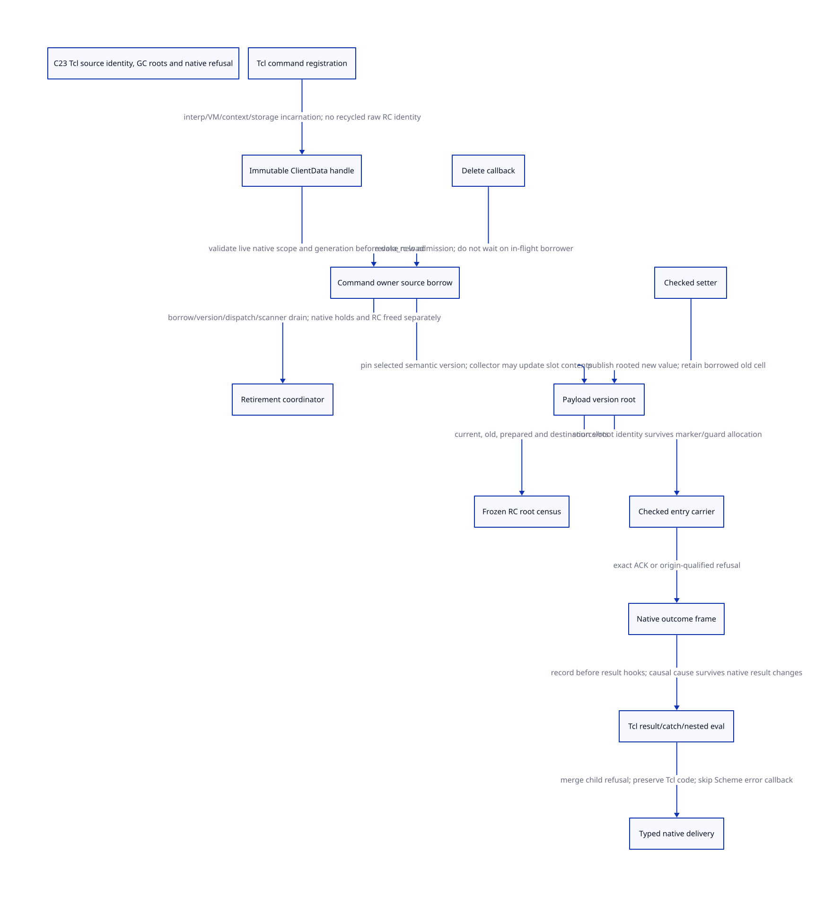

#+TITLE: Tcl source borrowing, payload roots and checked native refusal
#+SETUPFILE: ../../modeling/org/setup.org
#+LANGUAGE: en
#+CATEGORY: modern-c
#+PROPERTY: header-args :eval never
#+OPTIONS: toc:3 num:nil

* RESEARCH Decision and scope :c23:ffi:gc:compiler:
:PROPERTIES:
:CUSTOM_ID: tcl-source-borrow
:AUTHORITY: GambitTclSourceBorrow
:BASELINE: C23
:STATUS: ABSTRACT-SAFETY-CHECKED; NATIVE-ISSUERS-OPEN
:END:
Replace the raw ClientData-to-Scheme-value entry contract with an authenticated
source borrow, a collector-visible handoff and an origin-qualified native
outcome. Modern C is the mainline. This is a runtime/FFI contract redesign,
not a compiler-flag adjustment or a claim that selecting C23 fixes races.

[[file:models/sysml/tcl-source-borrow.sysml][Native SysML]] owns the component, caller, issuer, profile, action, memory,
obligation and return rows. Python invokes the native evaluator and projects
its output into [[file:../../modeling/ascent/tcl-source-borrow.rules.scm][actual ASCENT relations]], [[file:tcl-source-borrow-matrix.org][the closure/net-return matrix]] and
[[file:diagrams/tcl-source-borrow.d2][D2]] / . It does not parse SysML independently. QNT and Lean
are explicit semantic models linked by evaluated action/proof rows, not generated
from a diagram or equated with source execution. [[file:../../../evidence/research/tcl-source-borrow/checks.json][The check receipt]] records
formal scope and native gaps. No runtime implementation or native test occurs.

The [[file:sfun-admission-refusal-design.org][parent admission/refusal study]] assumes an entry source pin. This study
models its acquisition, old-version retention, GC freeze and release, then
imports the actual parent AST to discharge that one predicate premise. It does
not prove the parent guard's complete lifetime, native root-value fidelity or
full two-model simulation.

* RESEARCH Source authority and Gambit's design foundation :evidence:
:PROPERTIES:
:CUSTOM_ID: tcl-borrow-authority
:EVIDENCE_KIND: LOCAL-SOURCE-AND-ABSTRACT-PROOF
:END:
Feeley's /A Portable Implementation of First-Class Continuations for Unrestricted
Interoperability with C in a Multithreaded Scheme/ is available in the local
[[file:../../../evidence/research/sfun-converter-use-closure/primary-paper.json][primary-paper ledger]] and [[file:../../../evidence/research/sfun-converter-use-closure/feeley-sfp-paper.txt][extracted text]]. Its separation of Scheme continuation
state from active native stacks motivates preserving callback interoperability
without treating a resumed Scheme continuation as authority over a dead C
invocation. The paper's native-thread proposal and historical implementation
are not evidence for the proposed storage/version protocol. The new protocol
is a design with explicit proof premises; no paper is claimed to establish it.

Gambit anchors come from this checkout's modularized vendor files. Tcl ordering
comes from three *existing local captures*, verified against both SHA-256 and
Git blob SHA-1 at commit =cbf86d62348d6b052e1961b4df995960fb21545f=.
[[file:../../../evidence/research/tcl-source-borrow/pinned-tcl-sources.json][The pinned ledger]] identifies these bytes. No fetch was needed. This does
not identify the Tcl library actually loaded by an example on Darwin, nor prove
its ABI. Source snapshots and anchor line lists accompany the receipt.

| Source boundary | Observed behavior | Consequence |
|-----------------+-------------------+-------------|
| [[file:../../../vendor/gambit/examples/tcltk/tcltk.scm::scheme_call_cmd][scheme_call_cmd]] | Loads =data_rc(client_data)= before calling generated =tcltk_call= | Source identity is already lost if entry accepts only the scalar Scheme value |
| Same callback | No ClientData read after Scheme returns | Early source-version release need not invent a post-return read |
| [[file:../../../vendor/gambit/examples/tcltk/tcltk.scm::scheme_delete_cmd][scheme_delete_cmd]] | Releases Scheme object then RC header immediately | No native source-borrow drain or version accounting exists |
| [[file:../../../vendor/gambit/lib/_mem/rc-allocation.inc][RC allocation/accessors]] | Plain refcount, linked-list operations and =h->data= getter/setter | Header refcount alone does not root a replaced payload |
| [[file:../../../vendor/gambit/lib/_mem/rc-roots.inc][mark_rc]] / [[file:../../../vendor/gambit/lib/_mem/root-origins.inc][root origins]] | Enumerates each context RC list and updates =h->data= through =mark_array= | Reuse actual context-owned enumeration; do not assert processor-zero-only scanning |
| Tcl =TclInvokeStringCommand= | Calls proc/clientData; frees argv afterward | Callback arguments belong to the active native invocation; deferred use requires a separate transfer |
| Tcl =Tcl_DeleteCommandFromToken= | Calls application deleteProc before final Command cleanup | Tcl command refcount is not a ClientData borrow |
| Tcl =Tcl_SetCommandInfoFromToken= / get-info | Can replace/export raw clientData and deleteData; setter does not invoke the prior delete hook here | Managed registration must mediate both mutation and escaping aliases |
| Tcl =Tcl_SetResult= | Installs result and invokes old custom freeProc | Record refusal provenance before result publication may call out |
| [[file:../../../vendor/gambit/lib/c_intf.c::___EXP_FUNC(void,___release_string)][release_string]] | The adapter's ordinary result free hook releases RC storage | Scheme reentry from that selected hook is not established |
| [[file:../../../vendor/gambit/lib/_mem/rc-allocation.inc::cleanup_rc][cleanup_rc]] | Force-frees the RC list | VM shutdown must prove drain before entering this legacy cleanup |

** RESEARCH Reachability classification, rather than assumed races
:PROPERTIES:
:CUSTOM_ID: tcl-borrow-reachability
:END:
| Interleaving | Source support | Admission limit |
|--------------+----------------+-----------------|
| Constructor -> Tcl dispatch -> raw payload -> generated callback | Complete explicit producer/consumer chain | No native source-borrow issuer at that boundary |
| Scheme callback -> nested Tcl evaluation -> deletion | Adapter exposes both callback and eval; arbitrary user callback can request deletion | Not a recorded execution; the original ClientData load precedes that Scheme body |
| Public RC setter replaces payload during an older borrow | Setter and root-slot update semantics are explicit | The audited constructors do not perform such a postpublication write |
| Root-list mutation versus collector slot update | Concrete list writer and scanner are identified | Legal simultaneous execution depends on VM/processor admission; no observed data race is claimed |
| A different result free hook reenters | Pinned Tcl invokes an application callback | The adapter's selected release_string hook is RC-only; Scheme reentry remains hypothetical |
| Cross-thread Tcl delete or command mutation | No managed native interpreter-thread authority established | Do not make unsupported concurrent interpreter access legal by adding an RC pin |

The checked protocol must establish native interpreter ownership separately from
VM admission. The existing Scheme mutex/event-loop structure is not proof of a
Tcl OS-thread affinity guarantee. Logical admission records in the model neither
license cross-thread Tcl API use nor identify the active native binary.

** RESEARCH Writer closure and what has not been observed
:PROPERTIES:
:CUSTOM_ID: tcl-borrow-writer-census
:END:
The audited explicit =set_data_rc= clients are the Tcl constructor and
[[file:../../../vendor/gambit/lib/os_dyn.c::___set_data_rc (c_closure, proc);][C-closure initialization]]. Header setup initializes FAL; GC updates root slot
contents. [[file:../../../vendor/gambit/include/_gambit/runtime_protocols.h.in][Public declarations]] and [[file:../../../vendor/gambit/lib/setup.c::___GSTATE->___set_data_rc][the exported function table]] also expose indirect
writers. The explicit constructors do not demonstrate a postpublication setter
race. Public/indirect access means all-writer closure is still open.

=release_scmobj=, RC header ownership and GC reachability are distinct. A root
flag cannot establish a native still-object hold count or authorize a matching
release. The constructor's own explicit publication/failure paths must remain
accounted for. Command creation failure after RC/vector initialization needs an
explicit owned/unpublished disposal contract; this model does not close that
constructor branch. GC relocation changes a slot's contents, not its semantic
payload version.

* RESEARCH Identity-preserving checked entry :ownership:
:PROPERTIES:
:CUSTOM_ID: tcl-borrow-identity
:END:
The proposed registration service publishes an immutable =ClientData= handle:
#+name: tcl-registration-contract
#+begin_src text
RegistrationHandle = {
  interpreterIdentity, interpreterGeneration, nativeOwnerDomain,
  vmIdentity, contextRootDomain,
  storageAllocationIdentity, storageGeneration, normalizedSlotKey,
  registrationGeneration, sourceControlRecord
}
SourceBorrow = { handleIdentity, payloadVersion, invocationTicket, rootCell }
CheckedOutcome = { actualTclCode, bridgeOrigin, refusalReason, resultOwnership }
#+end_src
These are specification records, not implementation declarations. The stable
control record outlives RC payload/header reclamation and authenticates the
handle before any raw =data_rc= read. Reading generation from an already freed
RC pointer is not validation. Tcl's command epoch is not this storage generation.
Generation exhaustion requires non-reuse or explicit rejection; wrap is not
silently accepted.

| Operation | Existing producer | Proposed authority / mandatory precondition |
|-----------+-------------------+---------------------------------------------|
| Register | Tcl constructor allocates cd and vector | Command owner binds interpreter, VM/context and storage incarnation before native publication |
| Borrow | Callback receives ClientData | Joint native-owner/scope and Gambit root-domain authority validates handle, generation, admission and selected rooted payload |
| Revoke | Tcl delete hook | Owner closes admission; accepted borrows finish or transfer; hook returns without waiting for its own callback |
| Publish setter | Raw public setter | Checked fixed-slot rejection or synchronous rooted version commit; preparation cannot hold an unrooted new Scheme value |
| Scan | Context RC root walker | Collector freeze authority includes all retained root cells and excludes concurrent root-list mutation |
| Deliver refusal | Native callback / eval adapter | Stable native invocation frame records causal origin before Tcl result hooks and bypasses Scheme translation |

A native-library scope must begin before lookup/dispatch can select old
ClientData. Registering an in-flight count only in callback prologue leaves a
selection-to-prologue gap. Deletion can revoke immediately, but physical storage
retirement waits for old native scopes, borrowers, root mutators and scanners.
External raw retainers are excluded or explicitly registered. No current
native signer for this complete grace/census is claimed.

** RESEARCH Fixed payload and mutable payload are separate profiles
:PROPERTIES:
:CUSTOM_ID: tcl-borrow-profiles
:END:
The fixed-payload profile seals semantic setter access after constructor
publication. It still permits GC to update slots. It is not a deep freeze of
the vector; Scheme's =vector-ref= of the procedure retains its original timing.
Do not copy out vector[0] early and call that equivalent without a separate
mutation proof. This profile can avoid a payload version chain only when raw
setters and native command-info aliases cannot bypass it.

A mutable profile prepares a registered, rooted new value and commits its
version synchronously. Existing borrowers retain a separately scanned old
version cell. A setter must not wait for its own callback's borrow to end.
Old semantic version root retirement and the associated native hold disposition
are separately receipted. The current void setter ABI cannot transparently
return rejection, unknown commit or an exact retry receipt; preserving raw
unrestricted callers requires an explicit compatibility boundary.

* RESEARCH Root handoff, GC and retirement :gc:
:PROPERTIES:
:CUSTOM_ID: tcl-borrow-root-handoff
:END:
1. Acquire a source borrow before reading the selected root slot. A stable
   source owner retains the old version if a setter publishes another version.
2. Publish a destination root/carrier under the collector's short root-mutation
   protocol. The source value is still rooted while marker/guard allocation is
   possible. A source lease must not be held in a way that waits for the GC
   whose freeze is waiting for that same lease.
3. Accept an exact destination ACK only after destination visibility is
   established. A lost reply leaves both roots retained; query the exact ticket,
   not a new invocation or blind free.
4. Release the source version once after matching ACK, provided no later source
   read occurs. The destination guard remains independently responsible until
   its own last-use completion. The model's =dropDestination= action assumes
   that completion premise; it does not prove the Scheme guard's completion.
5. Physically reclaim source storage only after revoke, dispatch grace, all
   source borrows, registered version roots and relevant scans are drained.
   Cleanup and processor exit cannot bypass this order.

Reuse =mark_rc(work, context)= rather than introduce an unrelated second scanner.
Current, old-borrowed, prepared-new and destination cells must all be enumerated
and updated in every relevant round. The design needs a root-write lease with
no allocation/callout/nonlocal exit inside its small critical section, a frozen
slot manifest, and explicit ownership of rollback if preparation fails. The
abstract model proves root-presence/frozen-view facts, not address relocation
or actual registry insertion into every GC path.

** RESEARCH C23 ordering obligations
:PROPERTIES:
:CUSTOM_ID: tcl-borrow-c23
:END:
| Handoff | Required ordering | Still to refine |
|---------+-------------------+-----------------|
| Registration -> borrow | Initialized identity/root state before release publication; authenticated readers acquire | Dispatch gap and native-thread owner binding |
| Setter prepare -> commit | Root registration visible before current-version publication | RC-list mutation and native Scheme-hold accounting |
| Admission close -> final drain | Closed generation prevents new reservations; accepted counts remain visible | Atomic gate/count transaction and count overflow |
| Root writer -> GC freeze | Close writer admission; drain all accepted writers; freeze exact slot set | Actual sync-op roster and no-abandon mutation section |
| Destination -> ACK | Root visibility precedes receipt; ACK matches allocation/slot/version/ticket | Native root update and receipt publication |
| Last borrow/scope -> free | Final release/acquire synchronization and no retained scanner access | Reclamation algorithm and weak-memory proof |
| Refusal -> SetResult/catch | Publish sticky invocation cause before any result callout; merge children before pop | Native stable-frame lifetime across every legal exit |

These are C23 refinement obligations, not a proof that arbitrary relaxed atomics
or a plain count are sufficient. A weak-memory execution model, real control
record allocation and cancellation/exception closure remain unresolved.

* RESEARCH Refusal must survive native result handling :exceptions:continuation:
:PROPERTIES:
:CUSTOM_ID: tcl-borrow-refusal
:END:
The checked callback must return without calling =tcltk_call= on source or VM
admission refusal. =NULL= is already a valid empty callback result. =TCL_ERROR=
can be caught/reset, so neither is a unique refusal receipt.

Install a native invocation/eval frame before entering Tcl. On refusal, record
origin/reason with exact invocation and interpreter generation *before*
=Tcl_SetResult=. A different extension's old result free hook can reenter; the
current Gambit result free hook is RC-only and does not establish that trace.
Nested frames merge sticky causal refusal before child retirement. Catch,
result reset and an ordinary Tcl error do not erase this sideband.

After =Tcl_Eval= returns, deliver both actual Tcl code and bridge origin.
For example, a script can catch the error and return TCL_OK while the native
outcome still reports a refused Gambit callback. The design does not roll back
Tcl effects or force uncatchable script abortion. The old =tcltk_eval_error=
Scheme translator is bypassed for refused origin, including the branch where
a mutable global interpreter disappears during reentry. Retain the admitted
interpreter generation in the native frame rather than reread an unrelated new
global instance. Ordinary Tcl errors may use existing Scheme recovery only
under a fresh approved entry.

=dynamic-wind=, exception handlers and multishot continuation restoration do not
create a new native invocation or revive a closed source generation. Stable
native frames/guard completion must cover nonlocal exits and nested events;
that native refinement remains open. Unknown delivery retains the original
receipt owner and rooted payload until exact settlement. It does not trigger a
new Scheme error callback to discover what happened.

* RESEARCH Executable models, counterexamples and composition :qnt:lean:ascent:
:PROPERTIES:
:CUSTOM_ID: tcl-borrow-formal
:END:
[[file:models/quint/tcl_source_borrow.qnt][Source QNT]] has 29 actions: admission, additional borrowers, rooted setter
preparation/commit, exact ACK, revoke, delayed free, generation reuse and GC
freeze/scan. [[file:models/quint/tcl_checked_refusal.qnt][Outcome QNT]] has 17 actions: nested frames, refusal recording,
diagnostic publication, Tcl catch/reset, child merge and native delivery.
The state includes arbitrary nonnegative additional old/new borrower counts;
only one distinguished transfer, two payload versions and generations 1/2 are
modeled. A single tracked native dispatch scope is a projection, not a complete
proof for arbitrary nested library scopes or a full registry of handles.

[[file:models/lean/TclBorrow.lean][Source Lean]] and [[file:models/lean/TclRefusal.lean][outcome Lean]] prove each actual typed-IR action preserves
its invariant and establish reachable-state induction over that action roster.
They prove model safety for all finite executions, not liveness, source-level
C behavior or arbitrary native stack restoration. [[file:models/lean/TclBorrowBridge.lean][The bridge]] imports the real
parent admission AST: an active abstract borrow supplies its source-pin premise;
a source rejection can record refusal; catch preserves the recorded cause.
A matching native invocation association remains a premise of composition.

Python obtains typed Quint IR and uses the existing restricted projector to
emit the Lean AST. Reference identity, field type, action roster and expression
negative controls bound that trusted extraction path. There is no claim of a
verified Quint parser or source-to-C23 compiler.

Nine deliberate semantic mutants check loss of an old root, freeing before
dispatch grace, freezing across a writer, freeing on unknown ACK, accepting a
stale token, dropping an additional borrower's root, clearing causal refusal in
catch, popping an unmerged child, and Scheme translation of a refused entry.
Each starts at a separately checked safe prefix; its expected Lean failure is
retained. Formal guard-prefix fidelity is distinct from native reachability.
The earlier aborted model/proof attempts are retained rather than discarded.

ASCENT joins exact component contracts, source hashes, actual QNT action names,
compiled Lean theorem names, issuer rows and composition boundaries. Mutation
scenarios must fail those joins. Only the clearly synthetic fixture supplying
all unresolved requirements may become a candidate; current native admission
must remain blocked. This validates the evidence plumbing and prevents selected
misstatements; it does not mechanically prove natural-language native premises.

* RESEARCH Net return and retirements :benefits:
:PROPERTIES:
:CUSTOM_ID: tcl-borrow-return
:END:
| Quantity | Conditional reduction | New necessary work / countercondition |
|----------+-----------------------+---------------------------------------|
| A acknowledged callbacks | A source-version borrows can end at handoff rather than full Scheme return | Destination roots remain; ACK/query and no later source read required |
| N fixed registrations | N root versions instead of historical versions | Enforced fixed-slot writer closure required; no global timing claim |
| V simultaneously retained payload versions | Reentrant setters avoid waiting for own borrower | O(V) scanned roots and hold disposition; unbounded retention if borrowers never drain |
| R refused callbacks | R old Scheme error translations avoided at this boundary | Native eval-frame ledger, nested merge and typed caller handling |
| D old native scopes | Logical deletion returns without self-wait | Metadata survives until all D drain; no promised finite bound |
| Existing RC root walkers | Reuse context enumeration rather than a second scanner | Extend its real slot census/phase integration and prove every root is visible |

For A acknowledged transfers, =sum(max(0, returnTime - ackTime))= measures
removed *per-borrow authorization residence*. It is not physical root memory
saved: borrowers can share one root, and the current version remains rooted.
For each retired version v, let K_v be the earliest time its current-version,
scanner and non-borrow ownership obligations permit root retirement. Then:
#+name: tcl-version-retirement-bound
#+begin_src text
baselineRetire(v) = max(K_v, max(returnTime(i) for borrowers of v))
checkedRetire(v)  = max(K_v, max(ackTime(i) for borrowers of v))
savedRootResidence(v) = max(0, baselineRetire(v) - checkedRetire(v))
#+end_src
This assumes every source borrow transfers successfully, no post-ACK source use,
and unchanged other obligations. Pending/failed transfers remain in K_v or the
borrower set. A version that is still current or retained by another owner can
save zero physical root residence despite many early ACKs. Native metadata
reclamation additionally waits for dispatch grace. Without measured latencies,
root sizes and these release cutpoints, no byte/time or speedup claim follows.

Retire the unmanaged callback =data_rc= read only after source issuance and
root handoff are qualified; immediate delete frees only after grace/version
and native-count disposition; unconditional Scheme error translation only
after all native eval/event entries carry origin frames. Raw setters remain a
rejected managed-profile boundary or an explicit compatibility path until all
clients migrate. =cleanup_rc= may retire its unsafe whole-list bypass only after
shutdown drain is authoritative. No native path is retired by this study.

Zig would still need the same ownership, root, alias, cancellation and provenance
contracts. This component establishes no language-specific elimination of those
supports; it supplies no positive net-return argument for adding Zig. The C23
mainline earns its architectural value by making previously implicit source
and native-result obligations explicit and potentially reusable by Tcl, C
closures and other FFI adapters. Cross-adapter reuse still needs qualification.

* RESEARCH Closure ledger and next obligations :gaps:
:PROPERTIES:
:CUSTOM_ID: tcl-borrow-open
:END:
- [X] Local Gambit RC/constructor/callback/delete/scanner chain classified.
- [X] Pinned local Tcl callback/delete/set-info/result ordering verified.
- [X] Actual QNT/Lean safety and parent predicate bridge connected to ASCENT.
- [ ] Joint native owner/root-domain source-borrow issuer implemented/qualified.
- [ ] Every raw setter/ClientData escape either mediated or excluded.
- [ ] Native dispatch grace, generation exhaustion and nonlocal-exit census closed.
- [ ] Version root cells wired to every GC round and destination completion.
- [ ] Scheme still counts, constructor failure, RC disposal and shutdown drain closed.
- [ ] C23 weak-memory and all-slot value relocation refinement established.
- [ ] Native invocation/result ABI, installed Tcl identity and all caller handling qualified.

The evaluated [[file:tcl-source-borrow-matrix.org][matrix]] remains the detailed authority projection. Checked abstract
safety, source-path evidence, runtime qualification and performance benefit are
separate dimensions; none substitutes for another.
