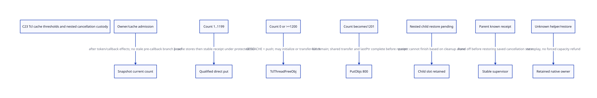

#+TITLE: C23 Tcl thread-cache return: thresholds, stable receipts and nested custody
#+SETUPFILE: ../../modeling/org/setup.org
#+LANGUAGE: en
#+PROPERTY: header-args :eval never
#+STARTUP: overview

* RESEARCH Decision and authority
:PROPERTIES:
:AUTHORITY: GambitThreadCacheTail
:STATUS: source-bound thresholds; conditional scalar safety; native admission unresolved
:CUSTOM_ID: thread-cache-tail
:END:

Refine [[file:escrow-critical-tail-design.org][pre-pop escrow and cleanup tails]] at one concrete allocator branch.
A stable guard does not transfer thread-cache operations to an arbitrary worker.
Retain Scheme continuation semantics and the original allocator owner; introduce
explicit admission, independently retained completion records and exact outcomes.
This is a C23 runtime architecture proposal, not an installed Tcl API or Zig benefit.

[[file:models/sysml/thread-cache-tail.sysml][SysML]] owns sources, issuers, consumers, obligations, action/lemma routes,
benefit rows and graph edges. [[file:thread-cache-tail-matrix.org][Matrix]] and  are generated from native SysML
queries. [[file:models/quint/thread_cache_tail.qnt][QNT]] models bounded branch/custody states; its typed IR is projected to
[[file:models/lean/ThreadCacheTailAst.lean][Lean AST]], checked by [[file:models/lean/ThreadCacheTail.lean][Lean preservation proofs]]. [[file:../../modeling/ascent/thread-cache-tail.rules.scm][ASCENT DSL]] compares
source hashes, actual action/lemma routes and issuer/consumer contracts. A linked
file alone is insufficient. [[file:../../../evidence/research/future-frame-commit/thread-cache-tail/][Evidence]] retains receipts, counterexamples and failures.
No runtime implementation, native compilation/preprocessing, test or measurement.

* Fixed-source branch and its exact cost boundary
:PROPERTIES:
:SOURCE_COMMIT: cbf86d62348d6b052e1961b4df995960fb21545f
:BINARY_QUALIFIED: no
:END:

Select the NRE small-object path with TCL_THREADS and USE_THREAD_ALLOC, excluding
TCL_MEM_DEBUG/PURIFY variants. NRE_USE_SMALL_ALLOC's source default does not prove
the loaded configuration. TclFreeObjStorageEx requires a nonnull live interpreter
for the direct branch. Tcl_CreateInterp records its thread cache via
TclpGetAllocCache. The free macro does not dynamically check native thread identity.

The captured tclInt.h macro and matching tclThreadAlloc.c helper jointly establish:

| Entry count n | Selected route | Local count after normal return | Shared addition | Source work |
|---------------+----------------+---------------------------------+-----------------+-------------|
| 0 | helper | 1 | 0 | GETCACHE, head/link, lastPtr, count |
| 1..1199 | direct | n+1 | 0 | three logical node/cache stores |
| 1200 | helper | 401 | 800 | push to 1201, walk 401 links, split, shared lock/splice/account, unlock, lastPtr |

These are source arithmetic and conditional operation counts, not timings. For a
valid larger helper entry n, the same normal helper yields n+1-800 after transfer;
the bounded model chooses the boundary n=1200 and does not assert arbitrary larger
states are quiescent/legal. An interp==NULL helper route requires its own TLS/cache
identity evidence and is outside this selected nonnull-interpreter model.

TclThreadFreeObj:627-652 obtains GETCACHE, pushes the object, sets lastPtr if
empty, increments count, then calls PutObjs when the new count exceeds 1200.
PutObjs:773-807 sets the keep count first, traverses that many links, cuts the
local list, locks the shared cache, splices/accounts, unlocks, and finally writes
local lastPtr. At 1200, the returned object remains in the retained head prefix
and is read again by the traversal. First head publication is neither the last
node access nor whole-helper completion. Unknown interruption can leave local
count/list, a split batch or shared-lock ownership unresolved. NodeId alone cannot
represent that responsibility; retain cache/batch/lock custody and do not replay.

GETCACHE can enter GetCache, which creates mutexes and allocates Cache through
TclpSysAlloc. Therefore the helper is not uniformly nonallocating. With a genuinely
live same-thread interpreter its cache should already exist; lazy initialization
must be excluded by evidence rather than charged to every empty-cache return.
The AllocCache/Cache common prefix needs effective layout and C23 alias/access
qualification. A matching prefix comment is not a general strict-aliasing proof.
The immutable helper capture matches the fixed Git tree's blob and size, recorded
in thread-alloc-source.json; it does not qualify a loaded Tcl binary.

* Non-abandonable direct tail and receipt issuer
After the callback/token cleanup returns, resample cache state. A branch choice
made before arbitrary callback execution may be stale. Require the same admitted
native thread, stable cache identity, valid list/count, no duplicate return and
no remaining token/root/descriptor use of the returned storage.

For 1<=n<1200 the source sequence is node.link, cache.head, cache.count. The head
write precedes a consistent count. Exclude reentrant allocation from the branch
read through the final stable receipt store. Receipt storage must be pre-reserved
and independent of the freed/reusable node. Keep it live across continuation
replay; the record identifies the exact invocation/incarnation, not an address.

The dispatcher/allocator owner can observe normal completion of the complete
selected free expansion and sign the node-return receipt. The helper owner can
sign only after PutObjs/lastPtr and all applicable macro effects finish. Optional
TclIncrObjsFreed statistics add effects after storage return; debug, instrumentation,
hooks and alternate allocation profiles require separate qualification. Three
stores describe only the direct storage operation, not the whole dispatcher.

Proposed cross-thread receipt publication uses release on a preexisting stable
record; its consumer needs matching acquire plus lifetime authority. Ordinary
cache fields remain native-owner-exclusive. Release/acquire on the receipt does
not legalize concurrent unsynchronized cache access, confer node lifetime or
exclude nonlocal exit. A failed operation/ACK cannot be turned into a native
reads-from witness. No compiled-tail or C23 refinement proof is claimed.

POSIX cancellation disable excludes only the qualified cancellation mechanism.
It does not block Scheme LONGJMP, arbitrary foreign unwinding, signals that jump,
formatter/debug callouts or nested callbacks. The tail must exclude every such
escape or use an independently qualified recovery mechanism. If that cannot be
shown, refuse the fused-tail optimization and retain the unresolved outcome.

* Pre-reserved slots, nesting and restoration
A stable service owns slots before dispatch; no malloc, GC or lazy resolver
creation is hidden inside registration. P concrete slots of descriptor size S
cost P*S bytes before alignment/service overhead. Require P>=A+R+U for disjoint
active, preparing and retained-unknown owners. There is no source-derived finite
bound on arbitrary callback nesting or unknown outcomes.

The bounded two-slot witness starts with one parent slot and one free slot. A
nested child consumes the second; an unrelated retained reservation consumes the
same capacity. Child cleanup alone does not refund the child slot. Its exact
saved cancellation state must also be restored and its remaining source/observer
debts settled. The parent cannot await capacity held by its own ancestry. If no
slot is ready, keep the callback queued and use an explicit admitted service
refusal/defer result before pop. Raw Tcl dispatch cannot silently return early
under an invented success code. Preflight/growth or a managed adapter is required.

Before restoring the parent's saved cancel state, hand completion debt to a
stable supervisor and settle required locks/pins. A nested saved state may itself
be DISABLE; restoration must not unconditionally enable cancellation. Restoration
can fail or not return. No code after that call can be the first custodian.
Unknown child restoration retains its child slot; unknown parent restoration
retains its parent slot and supervisor. Known restoration is an authoritative
normal-landing premise, not a currently installed recovery/query API. Metadata
survival does not authorize a jump into an abandoned C activation.

* Conditional proof and source refinement limits
The scalar invariant conserves two independent budgets:

#+begin_example
free + parentSlot + childSlot + extra = 2
localCount + newlyTransferred = entryCount + returnedObjectCredit
#+end_example

The second equation is relative accounting for this operation, not the total
shared cache or object identity graph. Intermediate phases distinguish link write,
head publication, count completion, receipt publication, helper return and restore.
Fast-tail attestation is an explicit native-evidence premise; setting the model
bit does not manufacture that evidence. Nested callbacks occur before branch
sampling; arbitrary in-helper reentry is excluded, not demonstrated harmless.

helperPush and helperFlush800 abstract source effects at coarse cuts. PutObjs is
not one physical atomic instruction: an actual trace needs finer local-split,
mutex/splice and lastPtr states to refine arbitrary interruption. Unknown helper
states retain responsibility without offering a recovery transition or progress
proof. List identity, duplicate-node exclusion, thread/cache equality, token/root
coverage and loaded ABI are premises outside the scalar count invariant.

Each actual QNT action is extracted from typed IR with binding, field, action
roster and expression negative controls. Lean proves initial safety, per-action
preservation and reachable-state induction. Counterexamples use reachable prefixes
and separately reject forbidden guards: empty/high direct return, missing native
tail attestation, head-as-completion, premature helper receipt, unknown replay,
slot exhaustion, wrong owner and repeated handoff during pending restoration.
These checks prove the bounded protocol, not all native executions.

The join to the actual EscrowCriticalTailAst retireSlot action is scoped: a mirror
relates the stable parent record, while known restoration and independent lock/pin
closure are explicit premises. This yields the prior model's real guard/Step;
it is not a two-way/full-product simulation or proof that those premises are
implemented. ASCENT accepts only a synthetic all-qualified case; current unresolved
native obligations must continue blocking admission.

* Learning from Gambit without inventing paper claims
The retained Feeley SFP paper distinguishes portable C execution machinery from
Scheme control/continuation state. That motivates preserving the continuation
boundary while making native activation lifetime explicit. It does not specify
this Tcl allocator, slot service, non-abandonable C23 tail or restoration receipts.
The exact threshold/batch mechanisms come from pinned Tcl source; the stable
service, memory-order obligations and scoped models are our conditional design.
See the paper/source hashes in the study input receipt for their distinct authority.

* Benefits, extra work and retirement gate
The [[file:thread-cache-tail-matrix.org][SysML-projected matrix]] is the maintained detailed ledger. Direct put avoids
helper shared-list work only on its existing eligible branch; it is already in
Tcl and is not a new speedup supplied by our refactoring. A qualified independent
receipt could eliminate generic unknown-node reconciliation for that eligible
normal path. It adds at least one logical publication store, slot/lifetime
accounting and cancellation handoff. No elapsed-time ratio follows.

At the high boundary, 800 objects are transferred while 401 links are traversed;
that source cost remains. Thread-affine cache pooling remains. Unknown batch or
restore debt can retain memory indefinitely. Modern C23 and Zig both need these
same semantic contracts; changing language does not supply callback affinity,
complete callout closure or exactly-once release evidence.

Old paths retired now: zero. Retire only a qualified direct-put reconciliation
branch after whole-expansion no-abandon evidence, exact receipt issuer, slot/root
and descriptor lifetime, correct native owner, cancellation landing and full
native refinement are supplied. Do not retire high/empty/debug/helper routes or
claim faster GC, incremental compilation or multi-core scaling from these proofs.
