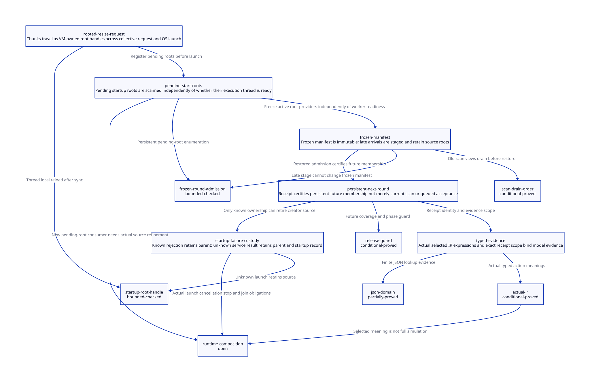

#+TITLE: Thread Thunk Handles, Frozen Root Manifests and Future GC Coverage
#+SETUPFILE: ../../modeling/org/setup.org
#+LANGUAGE: en
#+PROPERTY: header-args :eval never
#+OPTIONS: toc:3 num:t

* RESEARCH Authority and scope
:PROPERTIES:
:CUSTOM_ID: thread-thunk-frozen-roots
:ARCHITECTURE_SOURCE: models/sysml/thread-thunk-frozen-roots.sysml
:EVIDENCE: ../../../evidence/research/thread-thunk-frozen-roots/checks.json
:STATUS: conditional-models; implementation-and-C11-source-bridge-open
:END:

Modern generated C remains the mainline. The [[file:ingress-carrier-transfer-design.org][incoming carrier study]] supplies
source/target ownership premises. This study identifies the real startup/sync path
and specifies a persistent root-provider protocol across frozen GC rounds. It
adds research and formal artifacts only. SysML owns component accountability,
source anchors, obligations, dependencies and benefit rows; native SysML queries
produce the [[file:thread-thunk-frozen-roots-matrix.org][Org matrix]] and . Python drives actual ASCENT/QNT/Lean
checks. The predecessor receipt stays frozen; source drift is reported separately.

* Actual thunk path and collection cuts
:PROPERTIES:
:CUSTOM_ID: thread-thunk-source-path
:END:

| Source edge | Observed code | Qualification consequence |
|-------------+---------------+---------------------------|
| current_vm_resize to collective | sop.arg[0] = thunk; on_all_processors | an opaque native word copy is not an updateable Scheme root |
| collective dispatch to vm_resize_pstate | passes sop_ptr->arg[0] by value | original source reachability does not update every copied argument |
| resize capacity preparation | may invoke garbage_collect_pstate before publishing child data | initiator carrier must survive and reload before payload construction |
| payload publication | t->data_scmobj = thunk before thread_create | startup record must already have source/target scan coverage |
| child entry | local thunk = self->data_scmobj before sync loop | C local can become stale if a GC occurs during that loop |
| execute_sync_op_loop | dispatches winning operations, including OP_GARBAGE_COLLECT | this is not a guaranteed no-GC wait |
| final child call | run_and_throw_error_on_processor_0 forwards thunk to ___run | modern entry must receive a root handle or a qualified protected read |

These are real source paths in setup.c, not a reproduced corruption report. Full
compiler-generated caller roots and particular sync schedules remain to qualify.
Even if the original Scheme thunk remains reachable in a caller frame, copied sop
words and native locals do not automatically receive its relocated address.

barrier_sync_op special-cases OP_SET_PROCESSOR_COUNT because the barrier itself
uses that count. Resize sets up PSTATEs, publishes the count, then creates threads;
new threads enter the initiating collective. Root provider membership, OS thread
existence, execution readiness and GC worker membership must therefore be distinct
contracts in the modern design. A registered data root does not invent an active
barrier participant or a collector worker.

os_thread.c calls pthread_create, stores thread_id after successful creation and
then calls thread_init_common, which currently returns NO_ERR. The observed POSIX
error branch is a known rejection, not evidence of an ambiguous post-creation
helper failure. Unknown service acknowledgement is a proposed service/transport
case modeled separately from the platform return. Startup code must not depend
on fields initialized only after the child could have started.

* Root provider architecture
:PROPERTIES:
:CUSTOM_ID: thread-thunk-root-provider
:END:

The proposed VM-owned StartupRootRecord contains a typed thunk slot, VM/context
incarnation, startup ID, registration generation, source/target ownership,
RootSpec identity and launch/completion custody. The thread payload and sync-op
request carry its stable handle, not the movable SCMOBJ value. Prepare its native
storage before root-publication synchronization; if that fails, source stays owned
by the creator. Rooted record lifetime begins before any operation that can collect
or expose an execution thread.

The chosen complete refactor adds pending-start root providers to the VM's scan
manifest. Existing frozen execution contexts remain providers too. Pending records
are data, assigned to existing authorized scanners; they do not increase worker or
execution participant counts. This allows a valid root to exist while OS creation
is pending and makes its GC lifetime independent of child startup progress.
A conservative alternative keeps creator roots until the new context joins the
qualified roster, but does not establish independent pending-root coverage. It
remains valid only with that retained source and fresh reads; it is not the
architecture selected for decoupling runtime roles.

The frozen manifest is the disjoint union of admitted context providers and
pending-start providers for a root epoch. Context adoption of a pending record is
an ownership handoff, not a second uncontrolled scan of the same slot. Either
source/target use distinct physical slots during overlap, or canonical RootSlotId
has one scanning assignment. Retain all root maps, context storage and descriptor
leases until the round's last worker releases its view.

Current mem.c already publishes participant->context, requires GC_ROOTS_FROZEN
and scans context roots including RC. At the tail it prepares mutator memory,
returns the phase to GC_RUNNING and executes the barrier annotated that no worker
may retain a stopped root view beyond that cut. These are existing source seams.
There is no established StartupRootRecord directory/consumer in this study's
source inventory; integrating the proposed provider union requires real changes.
No runtime implementation or native qualification is inferred from those seams.

* Frozen admission and receipt semantics
:PROPERTIES:
:CUSTOM_ID: thread-thunk-admission
:END:

| State | Allowed action | Source root responsibility |
|-------+----------------+----------------------------|
| RUNNING before manifest freeze | initialize from a current source, activate in persistent provider registry | release only after exact active registration receipt |
| freeze wins admission race | queue identity/metadata; do not mutate the frozen manifest | keep source in existing admitted root domain |
| FROZEN/SCANNING | collector updates source and all captured target slots; old scan leases stay live | no source unregister under the reference baseline |
| workers drained and mutator phase restored | refresh a staged target from the updated source, then activate | still retained until activation receipt is observed |
| next freeze | persistent target is included even if its execution thread is not ready | redundant source registration can already be retired |
| outcome unknown | query same registration/startup identity without re-executing effects | source and stable custodian retain responsibility |

An acceptance-to-queue response is not ActiveRootRegistrationReceipt. The latter
binds VM/root registry generation, StartupId, RootSlotId/RootSpec, scan owner and
persistent future membership. It is issued by the root-domain coordinator after
activation publication. Source release additionally requires RUNNING phase and
old scan-view drain. Seeing that a current GC happened to scan the object is not
proof of coverage in the next round.

Freeze/admission has one linearization cut. If activation wins, the next manifest
contains it. If freeze wins, source remains; the staged record contains a source
handle rather than an unrooted raw copy. After restore, reload before activation.
The persistent entry may not be withdrawn or changed while an outstanding receipt
can authorize source retirement. Receipt revocation must close its users and
satisfy the previous scanner/custody drain obligations first. GC validity stamps,
root registration generations and VM incarnation are separate identities.

A staged root cannot rescue a raw object that was never in an admitted source root
domain. Such admission is rejected. If publication acknowledgement is lost after
commit, both root views may remain; resolve the same registration rather than
registering an unrelated copy or dropping the creator prematurely.

* Startup and failure protocol
:PROPERTIES:
:CUSTOM_ID: thread-thunk-startup
:END:

1. Creator acquires a qualified input carrier before issuing resize. A typed
   ResizeRequest carries its stable startup/root handle across sync operations.
2. Register a pending-start RootBundle with future-round coverage before launch.
   Release the creator's redundant source registration only with the exact receipt;
   native request/storage/code ownership is retained independently.
3. Publish the initialized startup handle to the OS entry. Child binds its execution
   context, joins required control operations, and accesses current thunk slots
   after sync. It never trusts a pre-sync raw SCMOBJ local.
4. Deliver the root handle to the modern ___run entry. Marker allocation resolves
   and reloads through the retained RootBundle, preserving the earlier EntryRootSpec
   contract. Reloading once before calling the old raw ___run is insufficient if
   marker allocation can collect again.
5. Adopt roots into the ready execution context through the same root-provider
   ownership protocol. Root manifest coverage continues through the handoff; it
   does not follow automatically from OS thread success or processor_count.

| Failure | Required custody | Prohibited inference |
|---------+------------------+----------------------|
| private record preparation fails | creator source and caller own cleanup | no target coverage exists |
| frozen/staged admission | creator source remains scanned; defer outside exclusion lock | queue acceptance is not source-release permission |
| platform create definitely rejected | creator/launch coordinator retains source and registered record until safe rollback | no assumed child completion required for an uncreated thread |
| service reply lost after successful create | retain both creator and pending root; query exact StartupId | no duplicate OS launch and no timeout-derived stop |
| child fails during sync/entry | stable startup/entry custodian retains root, VM and pending effects | normal-return-only cleanup is insufficient |
| context exits or is resized away | root adoption/transfer or consumer completion plus scan-view drain | PSTATE cleanup alone cannot retire a live provider |

Rollback of an already admitted record must respect concurrent GC scan leases.
The startup model abstracts definite-create rejection before any child start; it
does not justify immediate native record free during an actual frozen scan. The
frozen model and predecessor transfer protocol supply that additional obligation.
A batch may already have created some children when a later creation fails; a
known rejection for that one child does not authorize freeing earlier live
children or resetting a published roster. The one-child startup model does not
prove batch rollback or cohort readiness.

Their full composition, launch cancellation/join and multi-shot continuation
closure remain open.

* C11 and platform obligations
:PROPERTIES:
:CUSTOM_ID: thread-thunk-c11
:END:

[[https://www9.open-std.org/JTC1/SC22/WG14/www/docs/n1570.pdf][N1570]] 5.1.2.4 and 7.17.3 provides the release/acquire and data-race
framework. A proposed C11 lowering must establish:

| Shared publication | Required relation | Boundary |
|--------------------+-------------------+----------|
| startup metadata to child | initialize before release-published handle; acquire before field access; retain native record | plain pointer publication alone is not root registration |
| provider registry activation vs freeze | one serialized membership/admission decision, with immutable captured manifest | unrelated atomic stores do not establish one cut |
| slot relocation to resumed child | collector finishes slot writes, drains old views and publishes restored phase; child acquires before reload | memory visibility cannot replace moving-root discovery |
| receipt to source retirement | exact generation acquire plus persistent target and scanner drain under root-domain protocol | an old boolean success or current-round mark is insufficient |
| record/descriptor retirement | all child, scanner, receipt and continuation/code borrows finish before free/reuse | final decrement cannot be followed by unleased accesses |

The reference short admission lock must not be held during OS create, callbacks,
allocation, GC participation or waiting for worker drain. A lifetime lease allows
collector updates; it is not an exclusion lock that prevents the GC needed for
progress. ROOTS_FROZEN views are immutable as membership, while their owned Scheme
slots remain writable by assigned collector workers.

[[https://pubs.opengroup.org/onlinepubs/9799919799/basedefs/V1_chap04.html][POSIX memory synchronization]] and
[[https://pubs.opengroup.org/onlinepubs/000095399/functions/pthread_create.html][pthread_create]]
are platform references; direct current Issue 8 page retrieval returned 403 in this
research session, although search supplied indexed primary-source text. The study
therefore does not attest effective Darwin synchronization from platform prose.
The portable reference design makes the startup publication relation explicit;
actual pthread, Windows and Gambit barrier backends require separate qualification.
Current thread_init_common cannot be used to invent an unobserved failure mode.

* Formal chain and limits
:PROPERTIES:
:CUSTOM_ID: thread-thunk-formal
:END:

frozen_bundle_admission.qnt models one source/target provider and two GC rounds.
Activation before freeze, stage after freeze, lost acknowledgement, scan borrowing,
restore and persistent membership are separate steps. thread_thunk_root.qnt models
one creator/child startup, root-handle delivery, sync collection and platform reject
versus unknown service reply. The second model's registered/future certificate is
an explicit assumption supplied by the first protocol, not a proved cross-model
simulation. Its scope ends at qualified entry-handle delivery; it does not prove
all marker/continuation execution or context retirement.

Maintained Lean proves frozen/unknown/missing-future guard exclusions, source-release
coverage, scanner exclusion at restore and conditional event-order lemmas.
Generated Lean checks the actual activate/restore/releaseSource guard and updates
from Quint typed IR. The separate 91-row map JSON witness retains exact finite-domain
lookup, strict row projection and independent witness checks. Parser/emitter,
all-action induction and actual compiler/runtime root-map extraction remain open.

SysML binds the control, roots, execution, collector, release and assurance owners
to concrete obligations. ASCENT checks exact path/digest/scope and real action,
lemma/certificate names; source-bound endorsements cover execution-source identity,
thread lifecycle custody and scan manifest retirement. Targeted negative controls
must report their own missing prerequisite. Synthetic-all is an admission fixture,
never current runtime evidence; source, platform and predecessor gates stay blocked.

* Benefit and retirement conditions
:PROPERTIES:
:CUSTOM_ID: thread-thunk-benefit
:END:

| Mechanism | Work/retention removable | Added cost | Positive boundary |
|-----------+-------------------------+------------+-------------------|
| typed startup handle | separate raw-copy freshness repairs in sync request, thread payload and run entry | handle resolution, generation checks and one persistent root record | every managed raw thunk route migrates |
| pending roots independent of worker readiness | coupling object survival to OS startup/participant admission | VM pending directory and A slots per pending record | root provider scan remains independent of worker roster |
| persistent target receipt | redundant source registration after successful transfer | short overlap and scan-view drain; unknown replies retain both | next-round coverage is guaranteed, not merely queued |
| defer frozen arrivals | reopening finished scan or repeatedly rebuilding manifests for each late record | queue metadata and source retention until restored admission | source remains valid; no universal bounded delay claim |
| modern C shared service | per-call ad hoc root/lifetime policy | generated RootSpec, typed sync ABI and collector/control proofs | old callers and direct unsafe paths become unreachable |

For P pending records with A root slots each, pending-root scan adds O(P*A) slot
visits plus reachable-object work. One transferred root may briefly have two
registered views. Successful release can remove one redundant view; independent
source ownership may require it to remain. Unknown startup/receipt outcomes can
retain storage indefinitely; no bounded-memory or speedup percentage is claimed.
Moving root coverage out of execution-thread readiness is a system-role refactor,
not evidence that GC or OS scheduling is faster.

Retire raw sop.arg[0]/data_scmobj thunk transport only after all managed producers
and consumers use typed owned handles. Retire pre-sync thunk locals only after
post-sync root-handle resolution and marker protection qualify. Replace existing
processor_count-driven resize as a readiness mechanism only with a complete new
cohort-admission protocol; this study does not authorize removing current barriers.
The native C portability layer and Scheme tail-call/continuation semantics remain
requirements. Zig adds no demonstrated net benefit to these required protocols.

* TODO Closure matrix
:PROPERTIES:
:CUSTOM_ID: thread-thunk-open
:END:

- [X] Trace raw sync thunk, resize GC, thread publication and pre-sync child copy.
- [X] Specify active vs staged admission, persistent future coverage and old-view drain.
- [X] Separate root providers, execution readiness and collector workers.
- [X] Retain negative histories for false receipt, frozen release, lost future coverage and stale raw use.
- [ ] Establish actual creator carrier coverage before resize/sync operations.
- [ ] Implement nothing here; first refine pending-root union and context adoption against real consumers.
- [ ] Prove cross-model composition and full GC-round preservation/liveness.
- [ ] Close platform/backend C11, cancellation/join and continuation restoration evidence.
- [ ] Verify parser/projector and source-to-model extraction.

No runtime implementation, native test, compiler/preprocessor or performance run
is part of this study. Local receipts qualify only their exact formal scope.

* CHECKED Local formal receipt
:PROPERTIES:
:CUSTOM_ID: thread-thunk-local-receipt
:STATUS: conditional-local-models-only
:END:

The receipt records 15 QNT histories including eight negative controls, 500 sampled
runs of at most 200 steps per model, 14 maintained Lean theorems and eight generated
certificate theorems, 14 ASCENT scenarios, three strict row projection refusals
and one altered-guard Lean rejection. Native SysML validates the whole current
DEV scope. These are conditional local checks; neither unbounded future-round
coverage nor actual pending-root/collector integration is proved by their counts.
The two-model registered/future correspondence remains an explicit composition
obligation. Source/C11/full-extraction and native qualification remain blocked.
