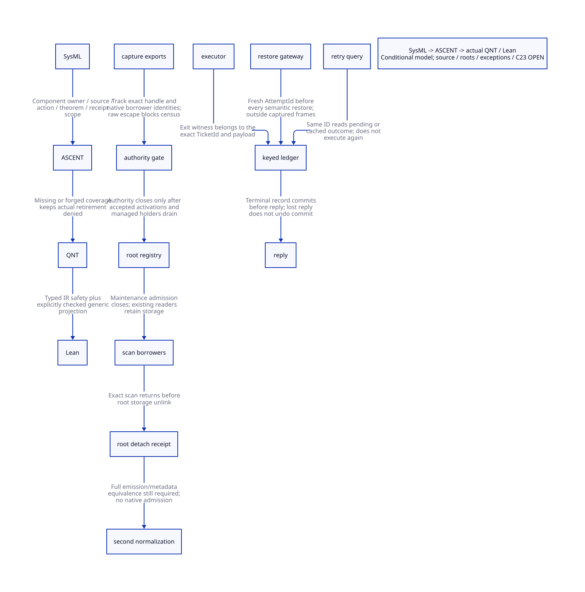

#+TITLE: Exact Ticket Settlement and Continuation Capability Retirement
#+SETUPFILE: ../../modeling/org/setup.org
#+LANGUAGE: en
#+PROPERTY: header-args :eval never
#+OPTIONS: toc:3 num:t
#+STARTUP: overview

* Decision and scope
:PROPERTIES:
:CUSTOM_ID: ticket-capability-retirement
:BASELINE: C23 / ISO IEC 9899:2024
:AUTHORITY: GambitTicketCapabilityRetirement
:MODEL_SCOPE: two explicit TicketIds; one CaptureId; distinct handle/borrow/scan IDs
:STATUS: conditional-formal; current-source-signers-and-native-retirement-open
:END:

This extends [[file:will-action-drain-design.org][will/action drain]] from aggregate conservation to identity-aware
settlement and two distinct retirement cuts. A completed TicketId keeps its
first outcome; reply loss does not authorize replay. A genuine new invocation
of the same continuation obtains a new AttemptId. Closing managed restoration
authority does not itself permit root storage removal.

#+begin_note
The proofs concern the stated protocol and explicit mathematical projection.
They do not establish an existing Gambit exactly-once service, last-Scheme-alias
notification, eventual completion, durable crash recovery or native C23 safety.
No runtime/compiler implementation or native/performance tests are supplied.
#+end_note

[[file:models/sysml/ticket-capability-retirement.sysml][Native SysML]] owns settlement, capture-domain and root-retirement components,
source anchors, identities, issuer responsibilities, obligations and costs.
Python queries the native tool to derive [[file:ticket-capability-retirement-matrix.org][Org matrix]] and . [[file:../../modeling/ascent/ticket-capability-retirement.rules.scm][ASCENT]] checks
component/obligation ownership together with source, action and theorem identities.
[[file:models/quint/ticket_capability_retirement.qnt][The actual QNT product]] is typechecked and projected into [[file:models/lean/TicketCapabilityAst.lean][typed Lean AST]];
[[file:models/lean/TicketCapability.lean][Lean]] proves all-step preservation and terminal-record immutability.
[[file:models/lean/TicketIdentityAlgebra.lean][The keyed algebra]] proves arbitrary-key properties and explicit commit/query
projection for the first concrete slot. JSON parsing and projection remain
trusted; their negative controls are evidence about the restricted boundary.

* Identity is not a payload, frame address or scalar counter
:PROPERTIES:
:CUSTOM_ID: exact-ticket-identities
:END:

#+name: identity-contracts
#+begin_example
TicketId   = (SessionNonce, DomainId, Generation, AttemptId)
CaptureId  = (CaptureDomainId, CaptureSerial, Generation)
HandleId   = (CaptureId, HolderSerial, Generation)
BorrowId   = (CaptureId, ParticipantId, BorrowSerial, Generation)
ScanId     = (RootDomainId, WorkerId, ScanSerial, Generation)
Request    = (OperationId, TicketId, ImmutablePayloadIdentity)
ExitProof  = (TicketId, ExecutorGuardId, ExitKind, CustodyHandoff)
#+end_example

These are design schemas, not new runtime records. A Scheme object address can
move, a physical slot can be reused, and identical payloads can represent two
legitimate executions. Matching payload hashes alone must not coalesce them.
A mutable Scheme payload also needs the previous frozen-view/encoding contract;
the abstract payload 42 in the concrete projection is not such a source receipt.

The ledger indexes the full key. Same key and payload with a recorded terminal
outcome returns that outcome; a conflicting payload/outcome is rejected without
changing it. Different keys may execute even when they refer to the same CaptureId
and equal arguments. Full-key equality includes generation; integer wrap, nonce
reuse, hash collision handling and parser fidelity remain C23 refinement duties.
The generic Lean ledger uses mathematical key equality and a functional map;
it makes no assumption about the cost or correctness of a concrete hash table.

* Source: where identity and restoration currently live
:PROPERTIES:
:CUSTOM_ID: exact-ticket-source-boundary
:END:

** Existing will execution supplies no keyed settlement record

_kernel.scm ##will-execute! loads testator/action, clears both will fields,
invokes action with interrupts enabled, then returns void. There is no stable
TicketId-bearing completion owner in that inspected body. Clearing the action
slot does not sign a result, absence of execution or last-reference retirement.
##execute-final-wills! also detaches its registry list before invoking actions;
a continuation can retain that caller/drain context. The previous checked-in
_kernel.c poll/root-map and current-header correspondence gaps remain open.

A proposed stable completion guard must be registered before the first possible
allocation/escape, retain the scanned operands and native/session ownership,
and survive exceptional exit. Only the executor owning that guard may classify
its exact activation's exit. The ledger then atomically records the terminal
outcome and responsibility handoff before answering. A timeout observer cannot
produce an ExitProof or AbsenceProof. No such complete signer has been located
in the inspected executor/capture/RC paths; it is a required refactoring.

** IDs must be minted outside the restored frame

_thread.scm ##call-with-current-continuation defines reify-continuation as a
closure holding cont; calling it invokes ##continuation-return-aux with the same
cont. ##continuation-return-aux compares source/destination dynamic-wind state.
For the same context it directly continues into the no-winding restore path.
For other contexts ##continuation-unwind-wind calls after and before thunks.
Both native/SMP source branches contain these mechanisms.

A TicketId allocated only in a Scheme let binding or dynamic-wind before thunk
can therefore be restored as an OLD ID or bypassed entirely. A fresh AttemptId
must be minted by a stable runtime restore gateway before every true semantic
restoration, outside the captured frame. The generated/native contract must
cover no-winding, graft, thread restore, exception and FFI re-entry paths.
The current study locates the source seams; it does not close that caller census.

A transport retry is query(existing TicketId), never invoke(CaptureId) again.
An actual new semantic invocation is invoke(CaptureId) -> fresh TicketId.
A late after thunk carrying an old TicketId may query/idempotently settle that
old record, but cannot settle the new activation. The new activation's outer
runtime guard owns its own exit. Sender-supplied labels or matching source
locations are not sufficient evidence to distinguish the two cases.

** Copy, introspection and serialization keep alias closure open

##procedure->continuation uses ##closure-ref proc 1 to expose the raw continuation.
##continuation-copy constructs a new continuation shell from the same frame and
denv. _io.scm explode-continuation and implode-continuation expose/reconstruct
those fields; closure serialization can expose captured data as well. Internal
frame/denv/slot setters add representation writers. Pointer inequality does not
prove independent capability authority or an empty alias set.

A managed exporter/importer must register a derived HandleId or CaptureId lineage
BEFORE publication and retain the actual scanned root carrier. One wrapper's
explicit close/drop is not a global Scheme alias count. Unknown raw escape
keeps optimization admission unavailable; it does not silently revoke a legal
Scheme continuation or change it to single-shot. Such sessions retain the
unrestricted path and existing normalization behavior.

* Exact settlement, lost replies and retained outcomes
:PROPERTIES:
:CUSTOM_ID: exact-settlement-protocol
:PROOF_BOUNDARY: trusted executor exit observation; atomic owner record; surviving ledger
:END:

** One TicketId has one immutable terminal record

The concrete state sequence is absent -> reserved -> active -> terminal ->
retained tombstone. enter occurs once from reserved. A trusted executor observes
a success/failure for that exact ticket; commit requires that observation and
stores the same outcome once. After terminal, query/duplicate/conflict handling
cannot change the outcome or settle count, and cannot enter the body again.
The two explicit IDs demonstrate that settling ticket 0 twice does not settle
an active ticket 1. The generic keyed theorem lifts other-key noninterference,
idempotence and outcome retention to arbitrary keys under its stated map model.

This is at-most-once admission/settlement and uniqueness of an existing terminal
outcome. It is not a proof that every accepted operation eventually completes,
or that arbitrary external effects execute exactly once across process failure.
Multi-shot semantics are preserved by assigning a fresh ticket to each real
invocation, not by suppressing subsequent invocations of the CaptureId.

** Commit before reply; query after observation loss

When the reply is lost, the ledger owner retains the terminal record and root
responsibility. The caller owns an unresolved observation, not permission to
execute again. A query returns the original terminal result, or pending for a
reserved/active record. Pending does not mean failed or absent. An unknown
execution stays active/owned until a trusted exact-ticket exit witness resolves
it; the model does not turn timeout into a success/failure observation.

A missing lookup is not an AbsenceProof: a producer may have reserved but not
published, the reply/commit may be in flight, or the wrong generation may have
been queried. Only the creation/commit owner can resolve accepted versus absent
after the actual publication/producer cut. That negative-outcome protocol is
still a source/refinement obligation. No blind retry is authorized by an empty
queue, zapped will field or unavailable VM.

Retained tombstones prevent old keys from being reused and allow late queries.
The model keeps the outcome; it does not prove physical tombstone deletion or
bound storage growth. Any compacted Gone response must guarantee that the old
operation cannot be re-executed. Read leases, result payload roots, retry-window
closure and session-generation retirement are separate obligations.
C23 release/acquire visibility does not provide durable storage. After VM/process
loss, this design alone cannot recover the outcome or guarantee exactly-once
external side effects; such claims require an independently justified durable
transaction/reconciliation design.

* Two retirement cuts and real signing responsibility
:PROPERTIES:
:CUSTOM_ID: capture-retirement-cuts
:END:

** AuthorityClosedReceipt

The capture-domain owner closes new managed export/resume/borrow admission.
Already reserved activations can still enter and must settle normally. Each
managed handle and native borrow has a distinct ID; dropping/returning one is
idempotent and cannot reduce another's obligation. Existing queued/active work
and unresolved exits still block the cut. Alias census is issued only after
tracked producers, holders, borrowers and accepted activations have drained,
and only with a complete no-raw-escape source contract.

The certificate closes that admitted managed authority. It is not evidence that
all Scheme continuation objects have become unreachable, nor authority to reject
arbitrary legal raw Scheme restoration. The compiler must instead withhold its
optimization certificate when the managed boundary is incomplete.

** RootRetirementReceipt

After authority closure, the RootRegistry owner closes MAINTENANCE scan admission
and drains all previously admitted ScanIds. Only then can it unlink the particular
registered root carrier and sign its physical retirement. The concrete product
allows authority closed while an old scan still holds storage, and proves that
rootRetired requires both scan IDs closed. Returning a duplicate native/scan
borrow must not release another borrow; keys and generation remain authoritative.

memory/rc-roots.inc really scans h->data through context RC lists. rc-allocation.inc
really increments/decrements explicit C refcounts. These operations do not count
all Scheme closure/copy/serialization aliases and do not supply this new scan
admission protocol. Captured frames are also scanned through their real maps.
The actual registered carrier, concurrent moving-slot update, context/generation
handoff and scan-lease signer remain open source obligations.

No GC will notification is a generic retirement signer. Wills can resurrect
testators, an action may capture its arguments/owner, and callback return does
not revoke its captures. No general last-Scheme-alias observer is established.
A root detachment receipt covers that carrier only, not all result/tombstone
roots, old module descriptors, native resources or the whole VM.

** Proposed versus existing issuers

The SysML issuer rows identify eight different responsibilities: executor exit,
ledger settlement, query, fresh attempt, alias census, authority close, root
detach and absence. Their actual-source column names the current seams and
explicitly marks missing signers. Neither ASCENT's evidence hash matching nor
an application-supplied record is runtime proof provenance. Exact-ticket witness
identity/issuer validation must be implemented and refined before native admission.

* C23 publication and progress obligations
:PROPERTIES:
:CUSTOM_ID: ticket-capability-c23
:END:

One owner critical section may serialize a ticket's terminal record together
with root-custody handoff, so there is no decrement-before-record window.
The critical section publishes with C23 synchronization; queries acquire and
pin the immutable record/result view before releasing it. An equivalent atomic
protocol must prove the same combined cut. No lock spans Scheme execution,
GC participation, continuation restoration, FFI or user before/after thunks.
Candidate allocation and root registration must precede any operation that can
collect; an atomic C pointer is not a GC root.

The restore gateway registers the new activation/root carrier before restoration;
current execution context refers to that stable guard rather than a token from
restored Scheme memory. Authority and maintenance gates close separately and
must linearize with their respective admissions. Bounds/overflow, non-reused
keys, stable participant generations, current Darwin/generated ABI and slot
update visibility require additional C23/native refinement. The mathematical
Nat/Int and total functions do not establish those platform properties.

A relevant callback must not wait for its own ticket/capture to retire. Reentrant
normalization must fall back or defer the cut to an outer owner. The audit index
must not strongly retain the external captures whose collection it expects.
Root safety can require indefinite retention; no finite drain time, lock-free
progress or memory-saving claim is derived from these safety proofs.

* What the formal chain proves and leaves open
:PROPERTIES:
:CUSTOM_ID: ticket-capability-proof-status
:END:

- QNT tracks two fixed TicketIds, one CaptureId, exact managed/native/scan IDs,
  no key reuse, terminal outcomes and generation rejection. Directed histories
  cover lost reply, pending retry, duplicate/conflicting settlement, a wrong-ID
  settlement attempt, true repeated invocation and both retirement cuts.
- Lean proves all projected steps preserve the product invariant, each slot
  enters/settles at most once, terminal outcomes remain stable, and retirement
  excludes live scanner borrows/raw escape under the model premises.
- The separate arbitrary-key algebra proves functional keyed update properties.
  Concrete commit/query projection is explicitly proved for slot 0, including
  preservation of slot 1. This is not an unbounded full-product, full-alias-graph
  or whole-runtime refinement theorem.
- Negative controls must reject corrupt typed IR, dropping another handle,
  updating another TicketId and retiring a root with a live scanner. They are
  mathematical/projection controls, not native counterexample executions.
- Trusted exit observation, alias/map qualification and real issuer provenance
  remain external premises. The source contains no already-qualified universal
  signer for them. Full effect/creator closure, prior will/carry/exception gates
  and observable emission equivalence remain required for second-helper retirement.

* Net benefit and migration
:PROPERTIES:
:CUSTOM_ID: ticket-capability-net-benefit
:END:

The theoretical net work for N qualified bindings is saved second-helper work
minus plan construction, validation and marginal ticket/root/capture support.
Necessary shared support is charged once in the whole-system ledger; it is
neither free nor independently charged in full to every removed helper.
Current native-qualified N is zero. No timing or memory reduction is measured.

The new benefit is avoiding repeated execution on observation loss while
preserving true multi-shot invocation, and scoping retirement to admitted
metadata authority rather than all VM continuations. Added cost includes
per-key records, terminal payload roots/tombstones, exact holder/borrow records,
restore-gateway calls and scan drainage. Unbounded capture/retry lifetime can
consume unbounded storage. None of these contracts is eliminated by switching
from modern C23 to Zig; no incremental Zig-specific return is established here.

Migration order: canonical identity and immutable request -> stable executor
and keyed owner record -> complete restore gateway/derived capability census
-> actual scanned carriers and separate maintenance cut -> full source/C23
refinement -> observable-emission equivalence -> remove the second helper for
the admitted profile. First demand remains. Legacy or raw-escape sessions keep
their semantics and do not acquire optimization permission.

* Reproduce source and formal evidence
:PROPERTIES:
:CUSTOM_ID: ticket-capability-reproduce
:END:

#+begin_src python :eval never
import subprocess
subprocess.run([".venv/bin/python", "dev/modeling/tools/ticket-capability-retirement-study.py"], check=True)
#+end_src

See [[file:../../../evidence/research/ticket-capability-retirement/checks.json][checks]], [[file:../../../evidence/research/ticket-capability-retirement/input.json][input identities]] and [[file:../../../evidence/research/ticket-capability-retirement/source-witnesses.json][source anchors]]. Native SysML and formal checkpoints
may be reused only under exact source/log hashes. Historical receipts and failed
attempts are retained. Org validation never executes Babel.
