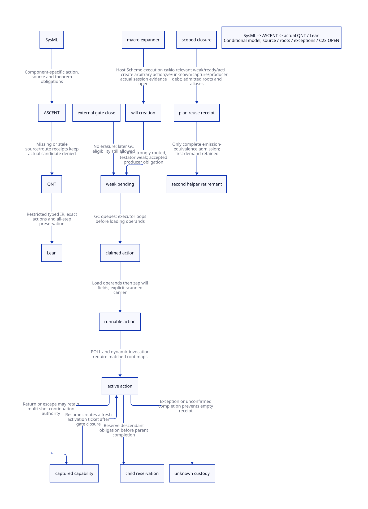

#+TITLE: Will Creation, Captured Authority and Compiler-session Drain
#+SETUPFILE: ../../modeling/org/setup.org
#+LANGUAGE: en
#+PROPERTY: header-args :eval never
#+OPTIONS: toc:3 num:t
#+STARTUP: overview

* Decision and evidence boundary
:PROPERTIES:
:CUSTOM_ID: will-action-drain
:BASELINE: C23 / ISO IEC 9899:2024
:AUTHORITY: GambitWillActionDrain
:STATUS: conditional-formal; actual-second-normalization-retirement-denied
:END:

This extends the [[file:callback-carry-closure-design.org][callback/carry study]] without rewriting its evidence. Modern C
is the mandatory runtime/ABI mainline. The work defines an owner-controlled
compiler session and immutable NativeBindingPlan, not a build configuration.
Neither C23 nor Zig by itself restricts a Scheme procedure's reachable global
bindings, raw aliases or native effects. No runtime/compiler implementation,
preprocessing, native test or performance validation is supplied.

[[file:models/sysml/will-action-drain.sysml][SysML]] owns construction, execution, restoration and admission components;
source anchors; creator/write-footprint classifications; C23 obligations;
action/theorem/source routes; and gains. The native tool produces the query
projection for [[file:will-action-drain-matrix.org][Org matrix]] and . [[file:../../modeling/ascent/will-action-drain.rules.scm][ASCENT]] checks actual component routes
against obligation ownership, source digests, action identities and theorem names.
It does not replace the unproved source-simulation premises with file links.
[[file:models/quint/will_action_drain.qnt][QNT actions]] are projected through restricted typed IR into [[file:models/lean/WillDrainAst.lean][Lean AST]] and
[[file:models/lean/WillDrain.lean][all-step proofs]]. JSON parsing and projection remain trusted code.

* Actual creation paths and default-session reachability
:PROPERTIES:
:CUSTOM_ID: will-creators
:END:

** What the core source does and does not establish

The immediate GSC source contains the primitive specifications, specialization
recipe and C emitter for make-will/##make-will. In _t-c-2.scm,
targ-apply-make-will constructs an allocation emitter; targ-op installs it in
the target operation table. Emitting MAKEWILL into the compiled program is not
executing that program's constructor inside the compiler. The bounded inventory
finds no direct core compiler application of the will constructor. Literal-token
absence is not a verified closed-world call graph: aliases, generated macros,
foreign allocation and loaded host procedures remain outside that inference.

_nonstd.scm defines the checked public make-will wrapper. _kernel.scm's
##make-final-will body creates a will and inserts a FIFO registry node when
called. Its generated C body also exists, including MAKEWILL, CONS and a heap
check. A definition or generated body is not a startup invocation. No default
core caller of ##make-final-will has been established in the inspected scope.
Geiser API signatures, primitive name tables, universal-backend stubs and
explicit gsc/tests/35-will fixtures must not be counted as default-session creators.

The actual library creator in lib/srfi/124/124.scm is make-ephemeron:
construct ephemeron(#f,datum), create make-will(key,finalizer(ephemeron)), then
store the will in the ephemeron. The finalizer captures ephemeron and clears
its will and datum fields. Its key argument is unused by that body.
This establishes a real reusable creator, not that the selected ordinary GSC
invocation loaded SRFI-124 or called make-ephemeron. No particular compiled
session's complete will population has been observed or reconstructed here.

** The compiler really executes extensible Scheme

_ptree1.scm add-macro/make-descr calls scheme-global-eval on the transformer
expression. In the Gambit branch _host.scm implements that through eval.
macro-expand obtains the registered expander and invokes it directly or applies
it to the source expression. Such code can call the public constructor, invoke
an alias, retain a target resource or register future work. The call chain is
located, but a metadata-writing action in the selected default interval is not
thereby demonstrated. A source program's target-time make-will call alone is not
a compile-time witness; a macro/host evaluation path must actually execute it.
Gerbil/plugin/native producer closure remains a separate prerequisite; it is
not inferred from the vendored Gambit census.

A managed session therefore needs producer provenance: host module identity,
macro/eval event identity, construction operands and their rooted transfer,
owner/context, generation and completion status. Legacy unclassified creation
continues to preserve Scheme semantics but denies the optimization receipt.
The design must not globally reject legitimate make-will calls after an
optimization-specific gate closes.

* Captured roots and mutation authority
:PROPERTIES:
:CUSTOM_ID: will-roots-and-authority
:END:

** Strong action versus weak testator

The real object scanner marks the action strongly before traversing weak
references; process_wills later decides executability and moves list entries.
The manual explicitly permits resurrection and creating another will for the
same testator. Registering no new wills does not prevent a previously registered
will from becoming executable after a later reachability change.

For SRFI-124, will -> action -> ephemeron -> datum is a strong reachable path.
If datum itself reaches key, that path must be included in strong-reachability
analysis; one cannot assume the key becomes weakly unreachable or the action
will eventually fire. This is a conditional root graph, not a claim about the
selected GSC input or a complete SRFI semantics diagnosis.
Holding a target resource as datum keeps it alive; clearing the datum field does
not write that resource's demanders field. The stock finalizer's direct write
footprint is two ephemeron slots under the expected type/primitive identities.
There is no direct resource setter in that body. This is weaker than a complete
transitive noninterference proof: native aliasing, substituted primitives,
asynchronous GC consequences and arbitrary user actions remain qualifications.

** Executable-list removal to poll and invocation

##gc-finalize! removes a will from executable_wills_ and calls ##will-execute!.
The latter loads testator and action, zaps both will fields, enables interrupts,
invokes action(testator), then returns void. The will/list no longer owning the
operands does not end their lifetime. The carrier must be independently scanned
before a root edge is removed or any safepoint can observe the intermediate state.
The source function has no stable exactly-once completion guard around action.

The checked-in _kernel.c gives a concrete candidate slice for this procedure:

1. Load testator into R2 and action into R3; clear the two will fields.
2. Save the caller return in STK(1); move testator into R1 and adjust FP by 4.
3. POLL(1) occurs BEFORE the dynamic action call using R3.
4. Label 1 has a RETI descriptor literal (4,0,0x3f1); label 2 uses RETN(1,0,0x1).
5. Label 2 restores the caller return from STK(-3) and adjusts FP back.

These are lexical facts of this generated artifact. They identify R1/testator,
R3/action and caller state as candidates requiring coverage at the poll and on
restoration. They do not establish that current Darwin/SMP configuration,
Scheme generator or runtime descriptor interpretation produced that artifact.
No dead-root mask or physical early-release receipt is signed from this slice.
Frame scanning through continuation-roots.inc and gambit.h remains the real
consumer that the generated producer must refine.

** A current source-correspondence discrepancy

The pinned header MAKEWILL macro links through ___ps->mem.nonexecutable_wills_.
The pinned Scheme finalization inline C pops ___ps->context->mem.executable_wills_,
and the memory fragment aliases lists through ___CONTEXT_MEM. The checked-in
generated _kernel.c is a further independently versioned input. This textual
divergence prevents a single matched producer/consumer/configuration receipt.
It is not a native compilation failure claim: no preprocessing/build was run,
and ongoing refactoring/generated outputs may account for it. Resolving it
requires a coherent source and generated-profile identity, not changing a
receipt or silently assuming the representations are interchangeable.

** Continuations and detached drain lists

##execute-final-wills! removes all registry nodes into lst and loops through x.
Clearing the registry does not retire the detached remaining list. If an action
escapes by exception/continuation, the ordinary successor is not a universal
completion boundary. A captured frame may preserve x, the action's dynamic
environment, return continuation and external roots. A normal return also does
not revoke an externally retained multi-shot continuation: it can re-enter the
action body or caller drain loop after the creation gate has closed.
The new design must either account for each such restoration capability and its
new activation, or deny admission for that closure. Converting it to single-shot,
forcing finalization or forbidding legal restoration changes Scheme semantics
and is not accepted as a silent optimization.

* Scoped admission and explicit drain protocol
:PROPERTIES:
:CUSTOM_ID: will-drain-protocol
:END:

** Separate the authorities

- External creation admission: no new independent producer reservation after close.
- Accepted production: an existing reservation may still commit, fail or become unknown.
- Weak eligibility: an existing weak will may later enter the executable queue.
- Invocation: already queued/claimed/loaded work may continue after close.
- Restoration: each retained continuation capability may cause further activations.
- Metadata authority: only the effects relevant to the frozen plan and observable
  legacy resource state belong to this optimization's retirement domain.

A complete effect-disjointness certificate can exclude unrelated wills from
this domain. Their testators need not die and their callbacks need not finish
before compiler output can proceed. In the absence of such a certificate they
remain blockers; an empty executable list cannot substitute for the certificate.
Pending weak wills can remain nonexecutable forever. Accordingly the model proves
safety under its premises, not eventual drain or a finite shutdown latency.

** Ticket conservation and handoff

For relevant work the ledger tracks weak, ready, claimed, loaded, runnable,
active and unknown obligations. created-retired equals their sum. These are
logical responsibility tickets, not a census of distinct physical will objects:
resuming a capture creates a fresh activation ticket. Producer pins and capture
capabilities are additional obligations and never disappear merely by closing.

The sequence dequeue -> loadOperands -> zapWillFields -> enterAction preserves
one responsibility ticket while changing the carrier/root obligation. On normal
return exactly one activation ticket retires; captured capabilities remain.
On escape or uncertain completion, the ticket transfers to unknown custody.
The detached remaining-list obligation must likewise remain with a stable owner;
the aggregate model covers custody but does not yet refine each list node or
continuation-induced repeated scan of that list.

An accepted action reserves its child's producer pin BEFORE retiring its own
activation. This is allowed after external closure so legitimate derived work
is accounted for instead of rejected. A commit transfers the pin to weak work;
a proven absence aborts it. A lost acknowledgement transfers to unknown custody,
not an automatic retry. Reconciliation returns it to ready work or retires it
only with an independent accepted/absent/completed outcome receipt.
retireOneCapture likewise requires an externally justified last-reference/drop
receipt for that particular capability. No source observer providing a complete
capture-retirement census has been established. The abstract actions model these
inputs explicitly; they are not invented runtime receipts.

** Identity and self-wait gaps

Aggregate conservation does not encode TicketId, capability graph identity or
OutcomeReceipt provenance. It cannot detect settling the wrong ticket twice
while another remains. Per-ID exactly-once settlement and faithful source
association remain refinement obligations; the current Lean proof does not
close them. Last-capture receipts are likewise inputs, not a GC census theorem.

A relevant active action must not synchronously wait for its own active count
to become zero in a reentrant normalization request. Refuse that optimization
or defer the cut to an outer owner. An audit registry must not accidentally
strongly retain the very external captures whose collection it awaits: root
custody for active work and non-owning audit identity are distinct contracts.
Unbounded retention may be correct safety behavior but gives no drain-latency
or memory-saving guarantee. Scheduler/GC progress still requires a separate proof.

** C23 refinement conditions

A possible normal-thread protocol uses one owner mutex for the short ledger,
reservation/close, child handoff and validate-and-borrow critical sections.
Mutex release/acquire supplies visibility; an equivalent atomic implementation
must prove the same linearization and release/acquire obligations. Independent
relaxed counters and a later empty read do not establish the composite cut.
No lock is held across Scheme execution, GC participation, FFI or a callback.
This mutex protocol is not a signal-handler protocol and does not claim lock-free
progress. Per-context accounting or batching needs its own refinement proof.

Before removing a source root, publish and admit the destination scanned carrier
through the real moving-GC facility. A C atomic pointer is not a registered root.
For plan reuse, validation must pin the immutable plan before releasing the
admission critical section; retirement waits for all such borrowers. Epoch
changes invalidate the receipt, but epoch checking alone cannot stop a raw alias
from writing between validation and use. Private copied ownership or proven alias
revocation is necessary. C23 platform/ABI qualification remains open. QNT/Lean use mathematical Int;
bounded counter overflow, generation wrap/ABA and fallback custody need a
separate refinement. Refuse optimization admission before wrapping; do not
publish an unaccounted obligation or silently reset a generation.

* Second normalization retirement gate
:PROPERTIES:
:CUSTOM_ID: will-second-normalization-gate
:END:

The first targ-use-glo demand stays: it creates/canonicalizes the actual entry.
The second call can retire only for an admitted full emission profile:

1. Complete actual-session creation, macro/eval, native and alias inventory.
2. Transfer roots through the real producer/consumer configuration and generated
   poll/continuation maps; retain old module descriptors while any reader survives.
3. Close external admission and account for accepted producers, weak eligibility,
   descendants, loaded/runnable actions, exception outcomes and restoration capabilities.
4. Either settle every relevant obligation, or prove excluded effects completely
   disjoint from the plan AND later observable legacy metadata.
5. Preserve output bytes, error prefixes, side effects, restoration and identity.
   A fresh immutable plan alone does not prove equivalence if a later legacy
   observer sees a demanders value that the removed second helper would reset.
6. Apply the previous carry-over/failure, formatter and I/O qualifications and
   validate generation while borrowing the plan, not once before unbounded callbacks.

The path is producer/owner census -> scanned operand carrier -> stable completion
and restoration custody -> scoped effect closure -> immutable plan admission ->
end-to-end equivalence -> retirement of the second helper for that profile.
The new design can preserve unrestricted Scheme operation by refusing only the
optimization receipt. It does not need to stop all GC or all future will creation.

* Net benefit and open evidence
:PROPERTIES:
:CUSTOM_ID: will-drain-net-benefit
:END:

For N admitted bindings, eliminated helper work is at most sum(h_i), i=1..N.
Net work saved is sum(h_i)-P-V-A-K, where P constructs the plan, V qualifies
closure/generation, A accounts for relevant activations and K tracks roots,
captures and plan borrowers. Positive net work requires the expression to be
positive. Current admitted N is zero; there is no measured speedup or memory gain.

The architectural improvement is replacing whole-VM finalizer quiescence with
precise metadata-effect ownership. It avoids a potentially unbounded global
wait and supports independent compiler sessions, provided effect exclusion is
actually proved. New overhead includes root slots, reserve/settle transitions,
unknown-outcome records, capture lifetime and possible owner-lock contention.
Shared support can be reused across services but cannot remove these obligations.
Zig has no separately established benefit for the same contract in this study.

The native-projected matrix lists each cost and qualification. Current ASCENT
retains producer, roots, restoration, effect, platform and full emission gaps.
Only a synthetic all-receipts scenario is allowed to pass; it is not evidence.
The weakened weak-pending issue guard must fail the modular induction check;
this negative control is not itself a proved reachable source execution.
The QNT/Lean proof is unbounded-count safety of this model, not source simulation,
GC root completeness, arbitrary-code noninterference or eventual termination.

* Reproduction
:PROPERTIES:
:CUSTOM_ID: will-drain-reproduction
:END:

#+begin_src python :eval never
import subprocess
subprocess.run([".venv/bin/python", "dev/modeling/tools/will-action-drain-study.py"], check=True)
#+end_src

See [[file:../../../evidence/research/will-action-drain/checks.json][checks]], [[file:../../../evidence/research/will-action-drain/input.json][input identities]] and [[file:../../../evidence/research/will-action-drain/source-witnesses.json][source anchors]]. Parent receipts and
prior failures are retained. Org parsing never executes Babel.
