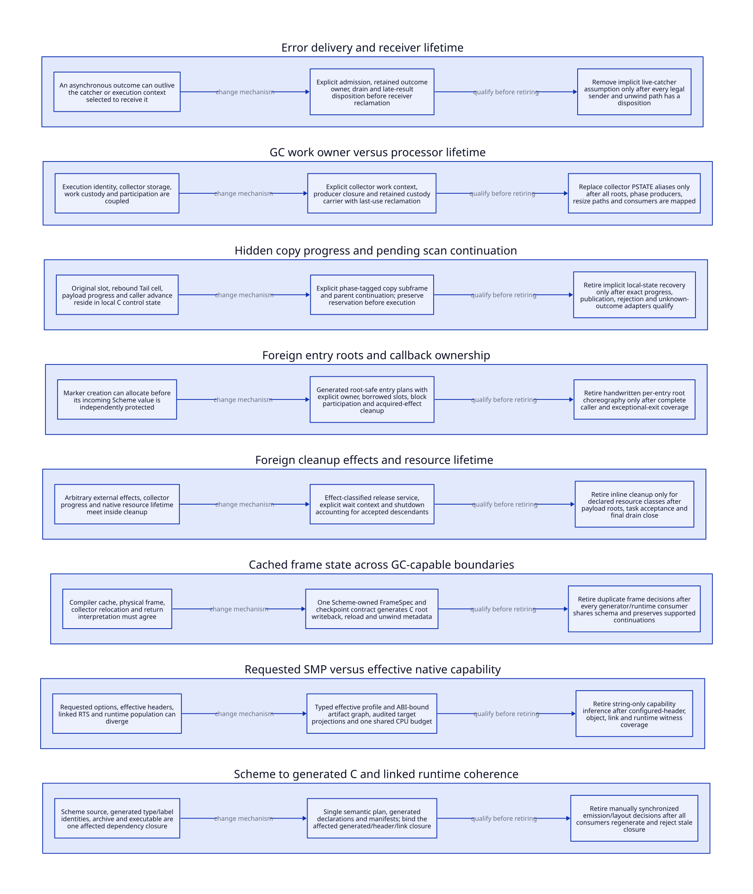

#+TITLE: Why Gambit Needs Structural Refactoring in Modern C
#+SETUPFILE: ../modeling/org/setup.org
#+CATEGORY: modern-c
#+OPTIONS: toc:3 num:t
#+PROPERTY: header-args :eval never

* RESEARCH Preserve Gambit's strengths while changing runtime ownership :modern_c:runtime:
:PROPERTIES:
:ID: 72166dac-d318-41c6-9855-0fa468016a11
:CUSTOM_ID: why-refactor
:OWNER: Gambit refactoring research
:AUTHORITY: GambitRefactoring
:STATUS: design-only
:EVIDENCE_CLASS: source-report-and-architecture-argument
:DEPENDS_ON: GambitDevelopmentOrganization; GambitToolchain; GC-WORK-CLOSURE
:END:

Modern C is the required implementation foundation. C++ is outside this
research. Scheme semantics, generated C, the C ABI, proper tail calls,
continuations, FFI and embedding are capabilities to preserve. Zig remains a
conditional evolution of a named C implementation responsibility. Rewriting a
mechanism in another language does not establish multicore correctness.

The reason to refactor is specific: some important runtime obligations are
distributed across processor-owned storage, local C control state, generated
frames, callbacks and build configuration. A local repair can restore one
execution path without making the complete ownership, participation or
reclamation rule explicit. Structural refactoring is justified where one
coherent replacement can cover the legal paths, retire these duplicated or
implicit decisions, and qualify its added runtime costs.

This extends the existing [[file:../../docs/repair-and-redesign.md][repair and architectural redesign argument]]. It does
not declare every source gap a current defect, discard successful repairs, or
attribute SMP problems to the C language. A local fix that already closes the
complete contract is counterevidence to a larger rewrite at that boundary.

** Four responsibilities; one semantic owner
:PROPERTIES:
:CUSTOM_ID: responsibilities
:END:

The next step is [[file:modern-c/runtime-blueprint.org][the composed runtime and build blueprint]], with a [[file:modern-c/blueprint-matrix.org][single derived benefit/migration matrix]]. This rationale remains the source-pressure argument; the blueprint owns the detailed composition argument.

[[file:../research-lanes.org][The lane matrix]] derives from [[file:../organization.sysml][the organization model]]. Common runtime
research defines the rules that every implementation must satisfy. Modern C
realizes them. Toolchain architecture binds the effective configuration and
native artifacts. Zig must demonstrate an additional benefit after these common
improvements, with an actual old owner retired. Permanent duplicate runtimes
are not the default. These lanes classify responsibilities, not independent
copies of the same semantics.

The ongoing PAIR/forwarding study belongs to common GC/control contracts, with
modern C as its primary realization. It is not a Zig feature or a claim that
today's collector supports worker migration. The [[file:../architecture/runtime/interfaces/pair-resume-design.org][PAIR resume design]] is a concrete
stress case for whether the proposed collector context contains all pending
work. It must feed a whole-runtime architecture rather than replace it.

** Source pressures and replacement obligations
:PROPERTIES:
:CUSTOM_ID: pressure-matrix
:END:

[[file:pressure-map.org][Eight source-bound rows]] connect each pressure to its local repair limit,
structural replacement, owner, retirement condition, benefit measures and added
cost. Their canonical metadata and necessary admission predicate live in
[[file:models/sysml/adoption.sysml][GambitRefactoring]]. [[file:diagrams/pressure.d2][The D2 source]] and  derive from those rows.
They are an initial selected census, not an exhaustive SMP defect inventory.

The architecture should make these independent roles explicit:

#+NAME: runtime-role-separation
| Role | Meaning | Required lifetime boundary |
|---+---+---|
| VM | Scheme environment, managed heap and supported host entries | Remains until roots, callbacks, outcomes and resources have legal successors or have drained |
| Execution context | Running Scheme state and supported continuation | Its retirement does not silently destroy a work descriptor or an admitted result |
| GC participant | Member of the current collection rendezvous | Join, leave, blocking and resize transitions have an explicit handshake |
| Collector worker | Executes scan/copy work for an admitted phase | Can finish only with no unaccounted private or descendant responsibility |
| Work custodian | Owns queued, claimed, preparing or transferred work | Survives unknown transfer outcomes until exclusive ownership is resolved |
| Foreign resource owner | Owns external payload and legal release effects | Thread affinity, callback admission and shutdown drain remain explicit |

These are proposed contract roles; they need not imply six allocations or six
OS threads. Source-specific adapters may combine storage when the lifetimes
provably coincide. Separating logical roles enables comparison without forcing
a costly one-object-per-role implementation.

** Why the forwarding example matters
:PROPERTIES:
:CUSTOM_ID: forwarding-example
:END:

In [[file:../../vendor/gambit/lib/mem.c::3572][the current copying branch]], the winning forwarding CAS precedes redirecting
the incoming slot, rebinding cell to the first destination field, copying the
payload, closing a full chunk and following goto again. The uninterrupted C
path carries this ordering. A proposed resumable or independently owned worker
cannot reconstruct it from the forwarding pointer alone.

At the completed assignment ~*alloc++ = *body++~, the two pointers have advanced
while ~words--~ is still pending. Replaying the store or applying the decrement
twice is not equivalent. After chunk closure, the allocation cursor can include
a marker; it is not necessarily the payload end. Reentering the parent
~MarkCurrent~ state can lose the winning initializer's responsibility. These
are counterexamples to an incomplete proposed adapter, not reproduced defects
of the current uninterrupted path. Native instruction cuts and a complete
copy-subframe/refinement design remain open.

This case explains the modernization goal: represent required progress and
custody once, then generate or implement the native operations in modern C.
Adding a language or a counter does not supply the missing state.

* RESEARCH Stability evidence and architectural closure answer different questions
:PROPERTIES:
:CUSTOM_ID: repair-and-redesign
:STATUS: evidence-boundary
:END:

The newer [[file:../../docs/smp-threaded-vm-milestone.md][October 19 milestone checkpoint]] records 8/12 within its declared
source-bound scope, with four gates open. It retains 374/374 interpreted files,
373/374 compiled files with the numerical timeout, official test7/test8/test9
success, and a Gerbil stdlib native failure. Those scopes and failures remain.
An earlier [[file:../../docs/current-smp-qualification-audit.md][qualification audit]] records 5/12 and a different compiled successor
with 380/380 files, 12/12 test groups and zero timeouts. The denominator is
different: twelve test groups are not twelve whole-runtime milestones. These
are retained source-bound observations, not new executions here or a reason to
reset newer progress to 5/12. The [[file:../../docs/darwin-dynamic-modulo-candidate.md][candidate record]] preserves that campaign's
preceding 379/380 denial and exact receipts. The older repair/redesign document
also records an owner's 9/12 at its own observation point; this page does not
merge different inventories or timepoints into a new current native count.

Even a complete future 12/12 native campaign would establish its declared
acceptance scope. It would not by itself prove a new worker migration protocol,
generational collector, frame ABI or compiler service boundary. Conversely,
an open redesign obligation does not revoke an already completed repair gate.
The implementation owner's exact-candidate inventory remains authoritative.

[[https://github.com/gambit/gambit/issues/792][Issue 792]] reports error delivery to processor zero after its catcher was
removed. Its useful question is the lifetime of admitted outcomes. It does not
prove this exact failure survives every current patch. [[https://github.com/gambit/gambit/pull/988][PR 988]] is closed,
unmerged and explicitly retracted; its narratives cannot establish a successful
repair. The [[file:../../docs/pr988-complete-source-audit.md][local source audit]] separates its generated-file inventory and
mechanism questions from its reported success. The [[file:../../docs/smp-upstream-report-audit.md][broader upstream audit]] is
dated historical report evidence, not a fresh status census of every PR.

It would therefore be inaccurate to claim nobody worked on the mechanisms.
The defensible research question is which contracts remain distributed after
those fixes and whether a composed replacement can eliminate the defect class
without changing Gambit's supported semantics or hiding failures.

* RESEARCH Learn from OCaml, then choose for Gambit
:PROPERTIES:
:CUSTOM_ID: learn-and-reflect
:STATUS: architecture-selection-open
:END:

[[https://arxiv.org/abs/2004.11663][Retrofitting Parallelism onto OCaml]] treats collector design, shared-memory
parallelism and sequential compatibility/performance together. This suggests
evaluating a composed Gambit runtime rather than counting isolated fixes. The
paper describes a historical collector design; it is not a specification of
every collector algorithm shipped in OCaml 5 or proof of a Gambit design.

[[https://arxiv.org/abs/2104.00250][Retrofitting Effect Handlers onto OCaml]] studies nonlocal control and stack
tooling while preserving existing programs' performance. Gambit already has
continuations and proper tail calls. Its frame, root and foreign-boundary
contracts must preserve those capabilities; adopting an effects interface does
not justify weakening existing continuation behavior. OCaml's reported
performance numbers cannot be transferred to Gambit.

For Gambit, the research decisions are therefore explicit: collector ownership
versus execution ownership; stopped-mutator versus concurrent phases;
generational write barriers versus repeated mature-graph scans; continuation
mutation and restoration; blocked-host participation; and shutdown/resource
effects. Each choice needs actual Gambit writers and consumers, negative
controls, memory-order refinement and independent native qualification.
Choosing modern C does not settle any of these algorithms automatically.

* OPEN Benefit qualification uses work and runtime costs, not person-days
:PROPERTIES:
:CUSTOM_ID: benefit-qualification
:STATUS: theoretical-conditions-open
:END:

The [[file:pressure-map.org][derived matrix]] names measures for every selected pressure. No speedup
percentage is established by this design. The theoretical criterion is
eliminated required work and stronger supported behavior after added costs.
For a fixed workload and effective profile, use separately observable terms:

#+BEGIN_EXAMPLE
delta_work = removed repeated work - new mandatory support work
delta_time = removed scan/copy/wait/build time
             - new barrier/metadata/transfer/validation time
delta_memory = removed retained/duplicate storage
               - new descriptors/logs/deferred resources
#+END_EXAMPLE

Time and memory are separate constraints, not one invented scalar. A proposed
generation barrier is beneficial only when avoided mature-graph visits exceed
its write/log/revisit/promotion costs for the declared workload. A worker split
needs reduced rendezvous or imbalance cost to exceed handoff and descriptor
cost. A build change must remove generation/compilation work or reuse valid
artifacts; changing the driver alone cannot remove the C compiler's work.

#+NAME: modernization-acceptance-matrix
| Dimension | Acceptance question | Refutation or cost boundary |
|---+---+---|
| Semantic capability | Supported Scheme, continuations, tail calls, FFI and C embedding preserved? | A narrower language or silently lost cleanup result is not equivalent success |
| Multicore progress | Legal blocked/retiring participants release collective dependencies without losing roots/work? | A global lock, single processor or unbounded retained carrier hides the problem |
| Structural simplification | One generated/native owner per semantic decision; old owner actually removed? | A second wrapper or two manually synchronized protocols increases responsibility |
| Collector work | Fewer repeated visits/copies/waits under equal live graphs and supported mutations? | Mandatory barriers, logs, promotions and descriptor traffic can outweigh saved scans |
| Resource lifecycle | Exactly owned root, callback, release and shutdown obligations? | Unknown outcomes, rejected transfers and derived tasks cannot disappear from accounting |
| Build work | Correct dependency projection avoids unnecessary generation/compilation? | A cache hit from mismatched profile/header/archive bytes is invalid reuse |
| Zig increment | Additional net benefit after the same modern-C architecture improvements? | Common benefits counted twice or old C support retained indefinitely rejects selection |

No new runtime path is retired and no Zig increment is proved by these
documents. Modern C remains the foundation even if Zig is never selected.
AI coding assistance changes production economics; it does not remove
executed barriers, retained memory, synchronization or proof obligations.

* OPEN Migration order and build closure
:PROPERTIES:
:CUSTOM_ID: migration-order
:STATUS: refinement-and-native-qualification-open
:END:

1. Bind the current repair inventories, source/configuration identities and
   independent failure evidence; keep unsuccessful receipts.
2. Enumerate complete root/control/FFI/work producers and consumers. Define
   common roles and necessary contracts before selecting a new collector or
   native implementation language.
3. Complete the Scheme semantic plan, FrameSpec, PointId and safepoint metadata;
   generate one modern-C representation and remove duplicate semantic decisions
   after all consumers migrate.
4. Compose GC work custody, participant transitions, resource effects and
   teardown with explicit allocation/cancellation/unknown-outcome behavior.
   Refine the existing QNT/Lean owners rather than create parallel models.
5. Bind the effective multicore profile and rebuild the affected native closure.
   Qualify correctness and benefits separately; only then retire old paths.
6. Reconsider a named C-to-Zig replacement or MLIR service after it has an
   independent contract, retirement plan and additional benefit. LLVM does not
   supply Gambit's moving roots, tail calls or continuation ABI automatically.

[[file:../architecture/toolchain/models/sysml/architecture.sysml][GambitToolchain]] owns two necessary requirements for effective multicore and
native artifact reuse. Independent VMs, several OS threads in one VM, the
Scheme SMP scheduler and a build job budget are different dimensions.
[[file:../../vendor/gambit/configure.ac::1252][Configure]] selects separate capabilities and can fall back to single-threaded
settings when no thread backend is available. [[file:../../src/gambit_smp/build_profile.py::41][The profile reader]] distinguishes
literal source flags and an explicit threaded-VM goal overlay;
[[file:../../src/gambit_smp/gambit_build_primitives.py::18][the build budget]] distinguishes make jobs from compiler processors. None of
these alone witnesses an active shared-VM population.

Semantic plans may reuse across compiler changes only when their audited input
projection excludes compiler-dependent choices. Generated C/layout depends on
the generator/schema and relevant target ABI. Objects depend on those inputs,
configured headers, compiler and flags. Linked artifacts depend on the exact
objects, runtime ABI and link mode. Runtime acceptance remains a separate gate.
No native profile, compiler flag or build implementation is changed here.

** Checks and remaining proof frontier
[[file:../modeling/proof-obligations.org][The existing closure ledger]] retains its own dispositions. The new rationale
adds necessary structural predicates and source-bound research rows, not new
checked QNT/Lean theorems. Its admission booleans do not prove their premises.
[[file:../research/validation.org][Validation]] records structural, document and drift checks separately from
runtime implementation, formal execution and measured benefit.
