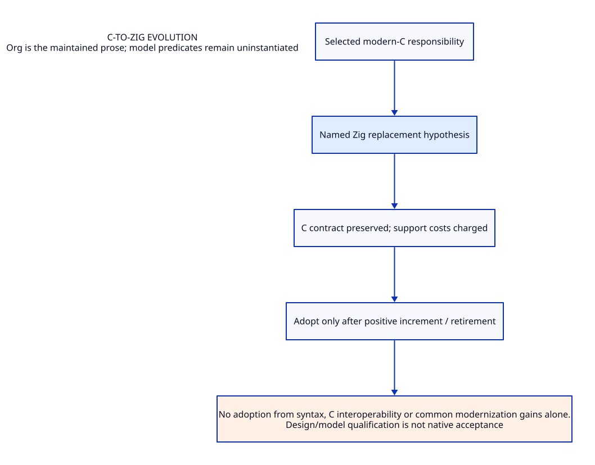

#+TITLE: C-to-Zig evolution
#+SETUPFILE: ../../modeling/org/setup.org
#+CATEGORY: zig

* RESEARCH C-to-Zig evolution :zig:
:PROPERTIES:
:ID: 6c36b5a9-ed29-55f2-8a99-21cfeb2b280b
:CUSTOM_ID: zig-contract
:OWNER: Gambit architecture research
:STATUS: design-only
:EVIDENCE_CLASS: source-and-model-design
:END:

Named implementation replacements and their incremental support/toolchain/resource benefit.

No adoption from syntax, C interoperability or common modernization gains alone.

** Contract and ownership
:PROPERTIES:
:CUSTOM_ID: ownership
:END:
One Scheme semantic contract; one selected implementation owner for each mechanism. C-facing capability remains mandatory. Imported alternatives are comparisons, not simultaneous deployment decisions.

** Models and views
:PROPERTIES:
:CUSTOM_ID: models
:END:
- [[file:models/sysml/architecture.sysml][SysML architecture and necessary requirements]]
- [[file:diagrams/overview.d2][Maintained D2 view source]]
- 

#+NAME: zig-sysml-source
#+INCLUDE: "models/sysml/architecture.sysml" src sysml

#+NAME: zig-d2-source
#+INCLUDE: "diagrams/overview.d2" src d2

** OPEN Evidence and admission gaps
:PROPERTIES:
:ID: c5acae73-4b99-5a84-8bee-089261995f59
:CUSTOM_ID: gaps
:STATUS: unresolved
:END:
Source reading, model validation, checked proof, native semantic acceptance and measured benefit are distinct. No validation result satisfies the runtime gates automatically.

** Study catalogue
:PROPERTIES:
:CUSTOM_ID: studies
:END:
#+NAME: zig-studies
| Study | Evidence lineage |
|---+---|
| [[file:studies/native-job-service-benefit-matrix.org][native-job-service-benefit-matrix]] | ~7953716221b1~ |
| [[file:studies/native-job-service-design.org][native-job-service-design]] | ~9e2a75267eb8~ |
| [[file:studies/native-job-service-evidence.org][native-job-service-evidence]] | ~b666d01f96d8~ |
| [[file:studies/native-service-support-costs.org][native-service-support-costs]] | ~3ff03513c1a3~ |
| [[file:studies/native-service-support-design.org][native-service-support-design]] | ~d910bd3e6fce~ |
| [[file:studies/native-support-change-certificate.org][native-support-change-certificate]] | ~36eebf8f9f88~ |
| [[file:studies/native-support-reuse-and-handoff.org][native-support-reuse-and-handoff]] | ~7789de618e05~ |
| [[file:studies/native-support-reuse-evidence.org][native-support-reuse-evidence]] | ~8c679c0adfb7~ |
| [[file:studies/njs-executor-evidence.org][njs-executor-evidence]] | ~1eb4411ea54c~ |
| [[file:studies/njs-executor-storage-cleanup.org][njs-executor-storage-cleanup]] | ~71455364deb2~ |
| [[file:studies/njs-support-cost-modernization-matrix.org][njs-support-cost-modernization-matrix]] | ~9be216080d6a~ |
| [[file:studies/planner-facade-support-cost.org][planner-facade-support-cost]] | ~680bdf6ddf41~ |
| [[file:studies/planner-facade-support-evidence.org][planner-facade-support-evidence]] | ~3eaf82ed7827~ |
| [[file:studies/zig-adoption-decision.org][zig-adoption-decision]] | ~6c0b8270fd8b~ |
| [[file:studies/zig-adoption-value-evidence.org][zig-adoption-value-evidence]] | ~6a8de1fdb20a~ |
| [[file:studies/zig-adoption-value-questions.org][zig-adoption-value-questions]] | ~8ebed72e2a14~ |
| [[file:studies/zig-modernization-benefit-ledger.org][zig-modernization-benefit-ledger]] | ~fc05a7b86e9c~ |
| [[file:studies/zig-native-contract-design.org][zig-native-contract-design]] | ~d5a8af697752~ |
| [[file:studies/zig-native-layer-reconstruction.org][zig-native-layer-reconstruction]] | ~ba0bb1c077c0~ |
| [[file:studies/zig-system-engineering-architecture.org][zig-system-engineering-architecture]] | ~d2c32c46aa08~ |
| [[file:studies/zig-system-engineering-sources.org][zig-system-engineering-sources]] | ~eb8b792c0afa~ |
| [[file:studies/zig-system-layer-evidence.org][zig-system-layer-evidence]] | ~6f6f70483195~ |
| [[file:studies/zig-system-layer-value.org][zig-system-layer-value]] | ~2758b354f955~ |
| [[file:studies/zig-vs-modern-c-evidence.org][zig-vs-modern-c-evidence]] | ~96d23336ce8f~ |
| [[file:studies/zig-vs-modern-c-net-benefit.org][zig-vs-modern-c-net-benefit]] | ~a24f446ed9e3~ |

** Cross-cutting references
- [[file:../../index.org][Development architecture]]
- [[file:../../catalog.org][Complete source-to-Org and diagram migration map]]
- [[file:../../research/validation.org][Validation boundary and retained receipts]]

** Column view for local research obligations
#+BEGIN: columnview :id local :format "%ITEM %STATUS %EVIDENCE_CLASS"
#+END:
