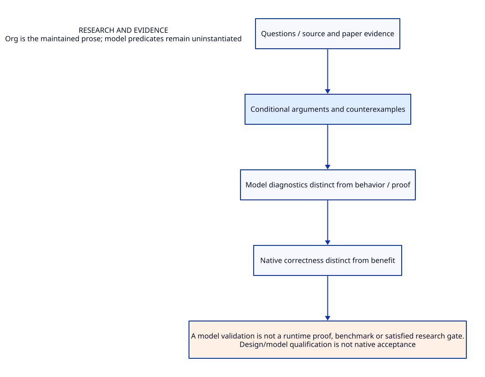

#+TITLE: Research and evidence
#+SETUPFILE: ../modeling/org/setup.org
#+CATEGORY: research

* RESEARCH Research and evidence :research:
:PROPERTIES:
:ID: cb5d8352-8430-5b5b-87b7-a132cab11b41
:CUSTOM_ID: research-contract
:OWNER: Gambit architecture research
:STATUS: design-only
:EVIDENCE_CLASS: source-and-model-design
:END:

Questions, arguments, source/paper bindings, counterexamples, gates and evidence-class distinctions.

A model validation is not a runtime proof, benchmark or satisfied research gate.

** Contract and ownership
:PROPERTIES:
:CUSTOM_ID: ownership
:END:
One Scheme semantic contract; one selected implementation owner for each mechanism. C-facing capability remains mandatory. Imported alternatives are comparisons, not simultaneous deployment decisions.

** Models and views
:PROPERTIES:
:CUSTOM_ID: models
:END:
- [[file:models/sysml/architecture.sysml][SysML architecture and necessary requirements]]
- [[file:diagrams/overview.d2][Maintained D2 view source]]
- 

#+NAME: research-sysml-source
#+INCLUDE: "models/sysml/architecture.sysml" src sysml

#+NAME: research-d2-source
#+INCLUDE: "diagrams/overview.d2" src d2

** OPEN Evidence and admission gaps
:PROPERTIES:
:ID: 504e5dc7-ca61-53c9-b5cd-b3bfbc448fc0
:CUSTOM_ID: gaps
:STATUS: unresolved
:END:
Source reading, model validation, checked proof, native semantic acceptance and measured benefit are distinct. No validation result satisfies the runtime gates automatically.

** Study catalogue
:PROPERTIES:
:CUSTOM_ID: studies
:END:
#+NAME: research-studies
| Study | Evidence lineage |
|---+---|
| [[file:studies/experimental-catalog.org][experimental-catalog]] | ~25408a083fc3~ |
| [[file:studies/opensysml-architecture-modeling.org][opensysml-architecture-modeling]] | ~c82fafcaac0a~ |
| [[file:studies/opensysml-modeling-evidence.org][opensysml-modeling-evidence]] | ~b693524c9b45~ |
| [[file:studies/theoretical-net-benefit.org][theoretical-net-benefit]] | ~7d958da221c5~ |
| [[file:studies/zig-mlir-feasibility.org][zig-mlir-feasibility]] | ~d4e0f94536d9~ |
| [[file:studies/zig-research-chains.org][zig-research-chains]] | ~ae245a2176b5~ |

** Cross-cutting references
- [[file:../index.org][Development architecture]]
- [[file:../catalog.org][Complete source-to-Org and diagram migration map]]
- [[file:validation.org][Validation boundary and retained receipts]]

** Column view for local research obligations
#+BEGIN: columnview :id local :format "%ITEM %STATUS %EVIDENCE_CLASS"
#+END:

** Current organization and modeling evidence
- [[file:../organization.sysml][Canonical organization model]]
- [[file:../modeling/correspondence.org][Cross-model relation ledger]]
- [[file:validation.org][Document/model validation and boundaries]]

** Modeling method and current repair ownership
:PROPERTIES:
:CUSTOM_ID: repair-investigation
:STATUS: generic-method-only
:END:

Research observations separate competing predictions, authenticated identities,
source refinement and native acceptance. The reusable vocabulary lives in the
research SysML and the existing ResearchFunnel QNT/Lean library. Concrete repair
cases, experiment plans and results belong to repository models/ and evidence/,
not this development organization. No current 9–12 case is owned here.

#+BEGIN: sysml-view :kind repair-investigations :source research/models/sysml/architecture.sysml
| Investigation | Source / failure | Mechanism question | Formal correspondence | Disposition |
|---+---+---+---+---|
#+END:
