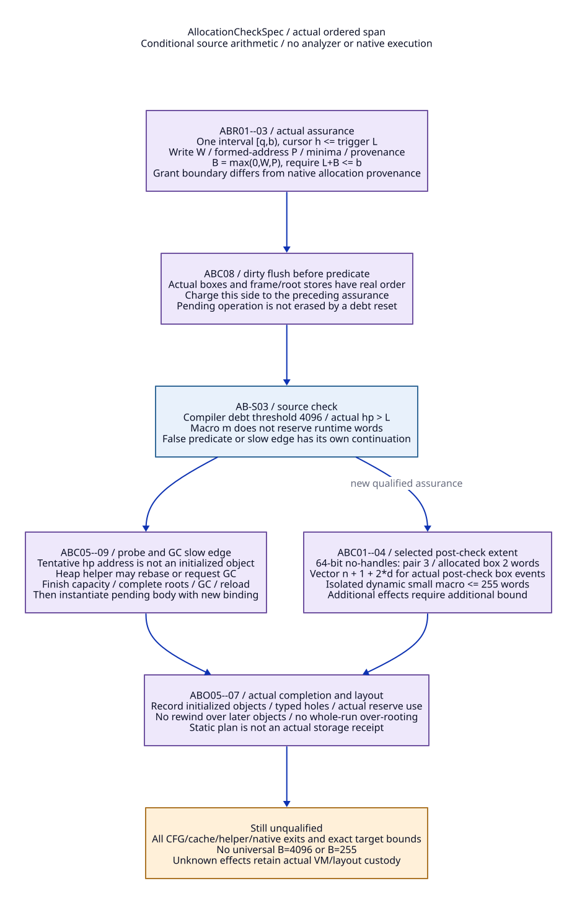

# AllocationCheckSpec: Write Bounds, Sparse Layout and Completion Metadata

Reviewed: 2026-10-20. SharedRuntimeContract research only. No implementation,
native test, model/solver/engine/compiler execution, checked proof or accepted
net-benefit bound. Refines ACH01--07, IOP03--08 and SLM03--07 in the
[InitSpec/layout study](init-spec-segment-layout-design.md). Read the
[Scheme-to-Zig position](scheme-to-zig-architecture.md),
[evidence ledger](allocation-check-bound-evidence.md),
[matched matrix](allocation-check-bound-cost-matrix.md),
[selected bound cases](allocation-check-bound-cases.json) and
[trace map](allocation-check-bound-traceability.json).

## 1. Define the Actual Bound Rather Than Copy a Threshold

Use checked word offsets in one actual writable interval [q,b), with a current
trigger L. An assurance records an actual cursor h<=L and its exact code/profile/
layout identity. A span ends at a new qualified assurance or before an effect
that can rebase/collect/enter managed code; its two successors have separate
postconditions. Root/stack/native-memory effects have their own footprints.

| ID | Proposed AllocationCheckSpec content | Meaning |
| --- | --- | --- |
| ABR01 | SpanId, semantic/constructor/check PointIds, ordered lowering identity, profile/representation/target and helper closure | Bound applies to the realized event order, including materialization, not just a source primitive's advertised size. Bind emitted product/metadata before admission. A profile change invalidates the affected certificate. |
| ABR02 | EntryAssurance: interval/epoch, h, L, upper/lower allocation bounds and pending operation | A successful check establishes only its stated current facts. Resetting a compiler debt counter does not erase allocations that will occur afterward or create contiguous capacity. |
| ABR03 | B_write and B_address, plus lower-bound checks | B_write bounds furthest exclusive written heap word beyond the assurance cursor. B_address bounds the largest formed cursor/pointer offset, including temporary probes and one-past bounds. Pointer formation outside an allocation can be invalid even before a write [AB-P06]. Integer-only candidate offsets are distinguished from formed native pointers. |
| ABR04 | LayoutRecipe, completion endpoints and coverage | Ordered object/header/body/padding/gap writes and actual successful completion; tentative reservation and unused bytes are not objects. Describe no-fill content separately from scan safety. A grammar may compact complete spans; incomplete/sparse exceptions remain explicit. |
| ABR05 | Edge outcomes and reload/remaining-work obligations | Fast false-check, new-grant return, collection request, completed GC, overflow, constructor abort and unknown are distinct. Body stores after a slow return use the new actual binding, never a pre-GC address. |
| ABR06 | Validity and provenance | Exact source/configuration, body/handle widths, boxing case, instruction schedule, helpers/indirect effects, code identity and layout/root descriptor lifetime. Source-derived examples are not issued runtime certificates or proof results. |

If W and P bound all writes and formed addresses **relative to h**, a conservative
single reserve is B=max(0,W,P). With h<=L, L+B<=b suffices for upper containment;
lower bounds, alignment and exact allocation provenance must also hold. Retaining
runtime F as a generic reserve additionally requires B<=F and L<=b-F. B_write
and B_address can differ on a pre-body capacity probe. This refines, rather than
discards, the preceding write-bound requirement.

Do not confuse these relative-to-h span bounds with a tighter guard-sensitive
**excess above L**: E_write=max(0,h+W-L), E_address=max(0,h+P-L).
For example, a false dynamic capacity predicate can prove E_write=E_address=0
even though the constructor still advances by w words. The triggering probe
has a different guard and address-excess bound. Certificates state which
quantity and predecessor assurance they use; a zero excess is not zero work.

Underlying native allocation bounds and granted subinterval bounds are distinct.
Crossing a grant boundary while still within a valid native array is not by
itself C pointer-arithmetic undefined behavior. This profile conservatively keeps
formed cursors inside the grant too; an alternative can use checked integer
candidate offsets with a separately proved native provenance rule. Crossing the
actual native allocation's permitted range is the language-level concern. Exact
C object/extension and Zig pointer models need target qualification in either case.

For a rebase-free ordered segment use summaries (delta,W,P): delta is net cursor
change, W is exclusive write high-water, P is formed-address high-water, all
relative to the segment entry cursor. Sequential summaries compose as:

```
delta(A;B) = delta(A) + delta(B)
W(A;B)     = max(W(A), delta(A) + W(B))
P(A;B)     = max(P(A), delta(A) + P(B))
```

Track minima as well; backward header stores must not underflow the owned
extent. Branches retain guarded alternatives, or a conservative join with
componentwise maxima and validated correlations. A negative net delta after a
probe/abort does not cancel its earlier high-water. A positive-cost unbounded
cycle without a new assurance has no finite B: split it, provide a proved loop
bound or reject. GC/rebase splits summaries and requires a new binding; do not
add offsets from unrelated sections. These are specification equations, not an
executed analyzer or a proof about all existing paths.


[D2 source](allocation-span-bounds.d2).

## 2. Concrete Source-Derived Cases

Numeric examples below use an explicitly conditional ordinary 64-bit-word,
no-handles, non-NAN representation unless otherwise stated. They are source
arithmetic, not installed Darwin observations. Each bound excludes additional
unclosed helpers/boxing and requires valid nonnegative sizes, arithmetic and
root/control preconditions. Changing representation requires recomputation.

| ID | Selected actual path | Bound and unresolved qualification |
| --- | --- | --- |
| ABC01 | Pair macro: header, CAR, CDR, END [AB-S06]. | One isolated pair advances/writes 3 words under the stated profile; k sequential pairs without intervening hidden effects need 3k words. Endpoint follows both fields. Root/evaluation/materialization work must be added from the actual schedule. |
| ABC02 | F64BOX materialization [AB-S05/S06]. | Allocated box advances/writes 2 words in the stated profile. On 32-bit no-handles, three object words plus at most one alignment word give a conservative four-word advance; an alignment gap is not necessarily initialized. NAN boxing has no heap allocation; self-tagging is data-dependent, with the allocated fallback as upper case. |
| ABC03 | Inline fixed vector with n elements and d actual post-check allocated-box events [AB-S04/S05/S06]. | For the stated profile and no other effects, cursor/write upper bound is n+1+2d. n=10,d=3 gives 17 words. Count actual dirty versions/events, not equal floating values or all cache entries. Pre-check boxes belong to the preceding span, not a second d charge here. |
| ABC04 | ALLOC_SCMOBJ_INLINE small branch [AB-S07]. | Calculated words<=255. If h<=L at the no-slow-path entry, actual alignment+allocation advance is <=255, including the macro's extra 32-bit alignment allowance. Therefore B_write/B_address<=255 for this isolated allocation/fill extent. This is not a 255-word bound for an entire caller containing other operations. |
| ABC05 | Weak-table/bignum small fast branch with tentative hp+=words [AB-S08]. | A false capacity predicate proves old h+words<=L; body writes fit that tested extent. Write excess above L is zero on this edge, but the tentative pointer formation still needs actual allocation provenance/capacity. On the triggering edge it can reach up to 255 words beyond an h<=L assurance before body stores. Use B_address<=255 there or rewrite the probe as checked integer offsets. |
| ABC06 | Same dynamic constructors after heap_limit or GC succeeds [AB-S08/S09]. | Pending placement is rebased; with new h'<=L' and an actual qualified grant, its <=255-word small body fits an isolated 255-word post-resume allowance. A source return value alone does not establish that new interval/root outcome; unknown/failed preparation stays held. |
| ABC07 | Large dynamic constructor dispatches to still allocation [AB-S07/S08/S10]. | Its n-word payload is not a movable context-tail allocation. Use still demand/storage/InitSpec custody, possible GC and rooted reload. Neither n nor native malloc bytes belong in a fake local 255-word movable bound; pre-call/root materialization still needs its own span. |
| ABC08 | Dirty materialization before and after a check [AB-S03--05]. | update-fr can emit boxes before CHECK; operand fetching can box afterward; write-if-dirty adds debt without immediately checking. In general B_post includes pending constructor + post-check boxes + qualified helper writes. Counter reset and 4096 do not bound that sum by themselves. Full CFG/cache-version closure remains open. |
| ABC09 | Rest/key helper finishes remaining list and vector before collecting [AB-S11]. | Remaining heap work is n_left*(PAIR_SIZE+PAIR_BODY)+np+VECTOR_BODY+extra materialization/alignment. Under the stated profile, valid complete-frame preconditions and separately assumed 0<=n_left<=8192,1<=np<=1024, a loose bound is 25601 words before extras. Maxima co-occurrence/local headroom are unproved: this is not an observed overflow. VM overflow reserve does not itself supply a contiguous local grant. |
| ABC10 | Full branch/loop/module domain [AB-S01--05/S11]. | No universal finite native B is established. Every allocating loop/backedge, implicit box, exceptional helper, custom primitive and C snippet must be covered or excluded. A span-local bound, compiled profile and metadata closure is the replacement design; a global 4096/255 declaration is rejected. |

The compiler uses conservative portable object costs: header allowance 2 words,
pair cost 4 and flonum-space 4 under its minimum-word-size arithmetic [AB-S04].
Those planned costs are not the actual 64-bit pair/box sizes above. In
heap-reserve-and-check the current operation is counted before testing; a check
can then reset the counter before that operation is emitted. The actual
post-check pending work remains. This is why the proposed analysis uses ordered
events and explicit assurances rather than treating a compiler scalar as runtime
permission. No native bug is inferred from that source ordering.

## 3. Sparse Layout and Completion Are Two Related Metadata Products


[D2 source](sparse-completion-metadata.d2).

| ID | Proposed metadata operation / product | Authority and lifetime |
| --- | --- | --- |
| ABO01 | Build immutable AllocationPlan from completed Scheme graph and negotiated native costs. | Contains span summaries, target residues, InitSpecs, body/abort/check edges, root maps and LayoutRecipes. Producer-owned, non-executable design here. Native emitter cannot insert a collecting helper without amendment/reanalysis. |
| ABO02 | Bind plan to emitted code and module/frame profile. | Static PlanId/SpanId is not an allocation receipt. Code/profile/metadata identity and actual admitted effect mapping precede runtime use; later native optimization must preserve the established footprint and safepoints. |
| ABO03 | Admit actual interval/constructor using prepared native records. | Runtime heap authority H owns allocation rights/charge, C owns root custody and G owns epoch/resume publication. No gate nesting or allocation/callback/wait while held; one qualified opaque native ABI orders reports [AB-P06]. |
| ABO04 | Record ActualSpanBinding and an in-flight writer lease before body effects. | Binds PlanId, section/reuse/half/interval, source epoch, actual cursor/residue, pending placement and construction profile. A copied static plan or local Zig scope cannot confer actual storage ownership. |
| ABO05 | Execute qualified no-GC span; issue actual completion after its stores. | Batch a fully known run's grammar/frontier when valid. Preserve actual object/padding/nonobject coverage and constructor outcomes. Writer remains responsible for incomplete/escaped state; no final GC acknowledgement while an unsafe writer remains. |
| ABO06 | Stage runtime completion/publication outside gates, then commit the prevalidated report. | Known actual storage/layout report under H, actual root membership under C, epoch visibility/resume under G remain separate ordered cuts. Held transaction/user pins span gaps. No O(object-count) traversal inside H/G; no timeout can guess absence. |
| ABO07 | Freeze coherent layout/root snapshot at next GC. | Settle pending placement/constructor and every writer first. Include real objects that used trigger reserve; exclude integer-only probes, unused rights and typed gaps as objects. Root-driven trace follows actual objects in both prefix and suffix, not entire region roots. |
| ABO08 | Retire code/plan/layout/report only after actual users and dispositions settle. | Code/metadata consumers, scanner/diagnostic/native users, resolvers and actual roots pin their own storage. Failure after public writes keeps actual custody; a replay returns the same disposition instead of reexecuting/freely rewinding. |

| ID | Metadata component | Concrete contract and overhead boundary |
| --- | --- | --- |
| ABM01 | LayoutRecipe | Static objects/fields, dynamic checked-size expression, alignment residue, gap/filler rule, completion point and exceptional alternatives. Bound expression overflow or unknown subtype rejects the new profile before raw writes. |
| ABM02 | Runtime object coverage | Actual initialized object ranges and scan-safe/content state, separate from highest cursor/address. Completion must not make intervening gaps or pending objects look initialized. A no-fill pointer-free object has a valid header/extent and explicit content policy, not invented Scheme pointer fields. |
| ABM03 | DenseRun | Admitted valid header/filler grammar and completed frontier; commits can fold many constructors without perobject synchronization/journaling. In a rooted core trace, valid producer bases suffice; arbitrary-pointer validation is a different capability. |
| ABM04 | SparseRun | Explicit aligned gap/object recipes or sorted nonoverlapping actual extent descriptors, with known actual dynamic parameters. A max frontier alone cannot encode holes. No diagnostic/linear scanner may parse gap bytes as headers. Root-directed copying need not enumerate every old gap/object. |
| ABM05 | Exception record | Partial/aborted/escaped/unknown allocation and publication state with one custodian. Reclaim only a proved private top suffix with no later allocation/users; otherwise retain typed abandoned space until admitted GC/reclamation. An observer timeout never licenses rewind. |
| ABM06 | Floating materialization identity | Actual (location,dirty-version/box event), box representation and endpoint/root use. Do not root native FP cache bytes as Scheme values or deduplicate independently writable roots by payload equality. Planned potential boxes and actually allocated boxes are distinct. |
| ABM07 | Publication identity and pin | Plan/profile/code, actual section/epoch/run revision, completed writer disposition and root/consumer identity. Validate under a held cut before adopting the prepared snapshot; immutable static metadata can be shared, mutable actual ownership cannot. |
| ABM08 | Consumers and reclamation | Next-GC source locator, new destination scanner, occupancy/policy/percontext allocation and diagnostic walker each consume their stated interface. Compact only after no actual reader needs old exceptions/frontiers. An indefinitely unknown writer can prevent finite retention/progress bounds. |

Fixed templates may represent repeated known layouts; sparse perobject detail is
necessary only where a compact grammar cannot establish the promised capability.
If a design claims validation of arbitrary native object starts, it must pay for
a real object-start mechanism. No claim is made that every sparse legacy path
can become O(one-record-per-region) without changing its producer.

## 4. GC Slow Edges Need Their Own Remaining-Work Contract

| ID | Slow-edge operation | Required disposition |
| --- | --- | --- |
| ABS01 | Materialize live dirty values and publish actual roots/continuation state before a collecting boundary. | Its boxes/writes are charged to the current pre-boundary grant. Source helper may alter stack frames even without moving heap objects; stack and heap allowances stay separate. |
| ABS02 | Invoke heap_limit with admitted saved state; acquire actual rebase/result. | Source may select/share a section and prepare new limits; return true requests GC, not completed collection. Discard stale heap/stack-derived addresses on rebase. Complete helper/config/indirect-effect closure remains required. |
| ABS03 | If the caller must finish packaging before GC, obtain actual contiguous finish capacity or a qualified alternative rooted staging protocol first. | The rest/key handler cannot call GC on incomplete frames. Either prove the full remaining finish fits, or redesign its frame/root staging to collect safely before completing it. A global reserve scalar or immediate Zig try is insufficient. |
| ABS04 | Enter GC with complete root/participant descriptors and pending allocation represented as a request. | A tentative hp is not a ready object. All actual old prefix/context objects and root cells remain protected; previous common GC outcome and layout protocols apply. |
| ABS05 | On KnownGranted/qualified new binding, reload moved roots and instantiate the pending placement using its post-return B. | Pre-GC base/cursor and frame addresses do not survive by default. Consuming still credit and obtaining native storage remain separate from this movable path. |
| ABS06 | On overflow, preserve safe Scheme error/retry semantics and actual post-GC state. | Known denial needs error-delivery capacity. Exception/dynamic/foreign paths cannot jump across Zig cleanup frames or fabricate normal return. Unknown actual preparation/GC does not map to a guessed Boolean. |
| ABS07 | On helper/native failure or missing report, retain the enrolled real writer/VM/layout custody. | No rerun/refund/rewind while an effect may already have happened. Required descendant/owner servicing stays available to avoid a GC/shutdown wait cycle. Finite recovery is unresolved. |

## 5. Conditional Arguments and Counterexamples

These are handwritten conditional arguments, not machine-checked proofs,
executed analyses, native receipts or observed failures.

| ID | Claim | Premises and reasoning |
| --- | --- | --- |
| ABP01 | Rebase-free summary composition bounds all selected heap writes/formed addresses. | Each atomic event's complete footprint/minimum/net change is correct and event order is exact. Induction over concatenation yields the max formulas; guard joins are conservative and positive cycles are bounded or rejected. Hidden helpers/boxing invalidate the premise. |
| ABP02 | A qualified assurance plus B fits its actual interval. | ABR02/03 establish h<=L, lower bounds/provenance/alignment; ABP01 bounds W/P and L+max(0,W,P)<=b. Therefore no selected write or pointer formation crosses that grant. Actual public metadata/lifetime still requires its independent protocol. |
| ABP03 | The selected macro's small-path extent is at most 255 words. | Valid size arithmetic, admitted subtype/representation, calculated words<=255 and no extra effects; alignment advance plus decremented planned word count does not exceed the macro's allowance. ABC05/06 show why speculative and post-return edges need different assurances. Not a bound for all primitive/helper work. |
| ABP04 | Dirty materialization cannot disappear through a counter reset. | ABO01/ABM06 record actual events/versions on the real side of the predicate; pre/post spans and pending constructor carry separate obligations. Each realized box contributes its actual representation cost once even when compiler debt resets. Complete cache/CFG domain is still required. |
| ABP05 | Sparse completion does not make gaps or partial objects scanner-visible. | ABM01--05 describe actual coverage and ABO04--07 retain writers until safe completion/root cut. Valid object references point to completed extents; scanners/walkers use their admitted grammar. A frontier alone or raw allocator endpoint does not meet these premises. |
| ABP06 | Collection request and subsequent construction preserve roots and placement. | ABS01--07 and known actual outcome/binding hold. Inputs/intermediates remain rooted, unsafe frames are not collected, old addresses are discarded, post-return body uses new bound. Generic unknown/reentry/all-exit domains remain unqualified; no bounded progress theorem. |
| ABP07 | A Scheme-to-Zig backend is constructively plausible without making Zig own Scheme semantics. | ZBD01--08 and full lowering/module/runtime contracts hold. Selected dispatch realization uses explicit Scheme frames and bounded native dispatcher activations; tail-host realization separately requires qualified tail edges. Neither relies on a Zig GC or automatic native-stack continuation capture. Whole-language/native admission is still open. |
| ABP08 | Zig selection needs a separate economic increment. | Same Scheme semantic/bound/root/layout obligations apply to generated C controls. Only residual avoided support and actual retired paths after reuse count against Zig-specific tool/ABI/migration/retention costs. Architectural plausibility does not prove a positive aggregate or language-specific bound. |

| ID | Counterexample under a violated premise | Consequence |
| --- | --- | --- |
| ABX01 | Copy compiler 4096 into every runtime span certificate. | Pending constructors, dynamic helpers and materialization lack coverage. |
| ABX02 | Reset compiler debt and declare no post-check pending allocation. | The already planned constructor can still write afterward. |
| ABX03 | Count only operand objects, ignoring dirty F64BOX events. | Real heap writes/advances exceed the certificate. |
| ABX04 | Count every cache entry again after pre-check flush. | Double charge; overconservative denial or wrong maintenance claims. |
| ABX05 | Treat all F64BOX as either zero or one fixed allocated layout across targets. | NAN/self-tagging/32-bit alignment branches invalidate the bound/layout. |
| ABX06 | Body has not been written, so a tentative pointer crosses the actual native allocation end (also b in this example). | Pointer formation can already violate native allocation bounds; logical subinterval crossing alone is a separate permission question. |
| ABX07 | Universal B=255 because large dynamic arrays use still storage. | Literal vectors, closure batches, helper finish work and other hidden effects are omitted. |
| ABX08 | Heap-limit returns false; caller reuses its old base pointer. | Helper may have rebased the heap/stack without GC. |
| ABX09 | Heap-limit returns true; caller assumes GC has completed. | Roots/capacity/resume publication has not occurred. |
| ABX10 | Rest/key handler calls GC before making its partial frame traceable. | Collector sees incomplete continuation state. |
| ABX11 | Normal VM reserve is claimed as a local contiguous finish interval. | Accounting capacity is mistaken for writable placement. |
| ABX12 | Conditional 25601 finish arithmetic is called an observed overflow. | Simultaneous runtime state/headroom/native evidence was never established. |
| ABX13 | Net cursor after rollback is used as the only write bound. | Earlier writes and formed pointers disappear from accounting. |
| ABX14 | Allocation loop has no new assurance or proved bound. | Positive cumulative writes have no finite B. |
| ABX15 | Static LayoutRecipe or copied PlanId is treated as actual object completion. | Partial/unallocated storage becomes readable without a real writer report. |
| ABX16 | Sparse run is summarized only by its maximum frontier. | A walker can parse holes or expose partial objects. |
| ABX17 | Late constructor abort rewinds hp over a later object. | Live later allocations are overwritten. |
| ABX18 | Layout/scanner metadata is freed on module or observer return. | Actual GC/diagnostic/resolver/native users retain dangling references. |
| ABX19 | Directly translate generated Gambit C with goto/macros and declare a new Zig backend. | Unsupported constructs/retained C semantics leave old responsibilities unretired. |
| ABX20 | Ordinary recursive Zig calls represent all Scheme tail calls. | Native stack can grow and proper-tail semantics are unproved. |
| ABX21 | Dispatch-profile return is silently mixed with D1-H nonreturning hosts. | Caller/module/frame control contracts disagree. |
| ABX22 | C longjmp crosses a live Zig frame/cleanup. | Required native ownership/cleanup semantics are bypassed. |
| ABX23 | A low-level generated Zig module is assumed to retain all high-order MLIR semantics. | Lexical/effect/closure information may already be erased. |
| ABX24 | Shared descriptors, LLVM tooling and eliminated C macros are all credited exclusively to Zig. | Generated modern C capabilities and actual added compiler/runtime costs are excluded from the comparison. |

## 6. Replacement Order and Remaining Gates

First bind complete helper/constructor/boxing events and checked-size expressions
to semantic points, retaining the selected conditional cases separately from
native evidence. Next extract allocation summaries, pending work and root/frame
requirements into Scheme completion; render equivalent modern C and proposed
Zig/native products from the same immutable plan. Introduce one actual runtime
layout/completion authority with compact known runs and explicit exceptions.
Replace whole-section slow paths, local finish capacity, scanner/diagnostic and
statistic readers together before retiring old PSTATE/macro authority. Qualify
the complete chosen host/module/FFI/control cohort before selecting Zig output.

Whole-program finite B, arithmetic/representation/CFG effects, sparse metadata
coverage, native ordering/provenance, raw C/FFI/all-exit closure, exact public
counter refinement, finite failure recovery and positive economics remain open.
The clear architectural recommendation in the companion document does not
convert these source/design conditions into admitted native behavior.

## Worked Real-Function Continuation

The [public reverse path](scheme-function-zig-design.md),
[conditional arguments](scheme-function-zig-arguments.md) and
[report matrix](scheme-function-zig-cost-matrix.md) instantiate an isolated
no-handles pair B=3 with the stored post-cons check schedule, explicit roots,
resume binding and module ownership. This is a hand-designed graph, not emitted
GVM, a full-function bound certificate or an executed native backend.
