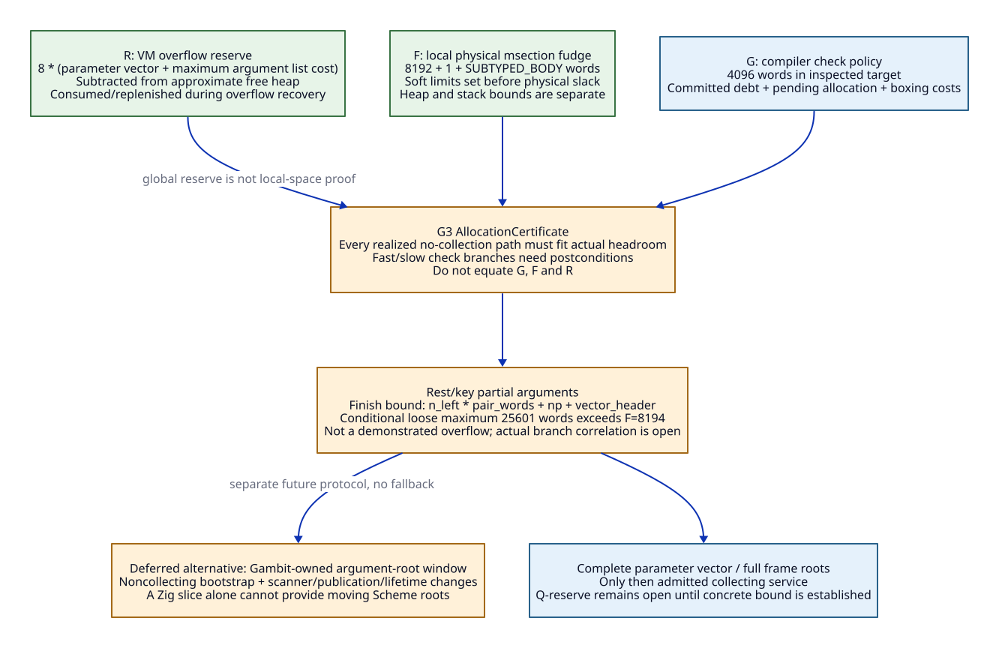

# Allocation Reserves and Runtime Helper Effect Contracts

Date: 2026-10-20. Static/source architecture research; no backend implementation,
native execution, performance measurement or allocation experiment. Refines
[OP03-OP17](semantic-completion-operations.md) and Q-reserve/Q-helper.
[Source ledger](completion-admission-evidence.md),
[anchor design](gvm-anchor-preservation.md),
[ASCENT research chain](zig-research-chains.md).

## 1. Three Different Reserves

Compiler allocation debt, local msection slack and VM heap-overflow reserve
have different units/scopes/consumers. They cannot be added into one implicit
budget available to arbitrary Zig-generated operations (AR05-AR08).

| Quantity | Inspected source definition | Scope and use |
| --- | --- | --- |
| G: compiler check policy | `_t-c-1.scm`:117: 4096 words | Bound/trigger for generated constant-size allocation plus potential cached-flonum materialization; not a heap size or universal runtime guarantee |
| F: runtime msection fudge | `mem.h`:63-68: MAX_FRAME_SLOTS + 1 + SUBTYPED_BODY, MAX_FRAME_SLOTS=8192 | Physical slack in each stack/heap assignment; prepare_mem_pstate sets soft limits before this area |
| R: normal overflow reserve | `mem.h`:76-78: 8 × ((MAX_PARMS + SUBTYPED_BODY) + MAX_ARGS × (PAIR_SIZE + PAIR_BODY)) | VM-level reserve subtracted from approximate free heap; collector releases portions on recoverable overflow and later replenishes it |

For the **conditional no-handles representation** in the inspected header,
PAIR_BODY=SUBTYPED_BODY=VECTOR_BODY=1 and PAIR_SIZE=2. With MAX_PARMS=1024 and
MAX_ARGS=8192, source arithmetic gives F=8194 words and R=204808 words.
If a word is eight bytes, G=32 KiB, F=65552 bytes and R=1638464 bytes. These
are derived constants, not installed Darwin binary observations, allocated
capacity measurements or speedup estimates. The handle representation changes
the body sizes; do not silently reuse these numbers across profiles.


[D2 source](allocation-reserve-boundary.d2).

`compute_free_heap_space_approximately` subtracts overflow_reserve. The collector
can halve that reserve on overflow and eventually call fatal_heap_overflow;
successful recovery can reset it. Consequently R is neither a permanent
per-operation allocation allowance nor proof that a caller has contiguous
local msection space. No new backend may consume it without an explicit runtime
protocol. G and F are also separate source definitions, not one configured
constant that Zig should copy twice.

## 2. Explicit Allocation Certificate

```text
AllocationCertificate {
  semantic_anchor_interval, profile_and_representation_id,
  initial_soft_limit_or_headroom_assurance,
  concrete_allocation_costs_in_words,
  pending_operation_cost, committed_debt,
  worst_case_live_value_materialization, alignment_cost,
  path_bound, heap_slack_requirement, stack_slack_requirement,
  helpers_allowed_without_collection, invalidating_events,
  collection_entry_frame_and_roots, post_resume_assurance
}
```

For every path from an admitted headroom assurance to the next check/runtime
publication, the **realized allocation cost**, including boxing and padding,
must fit the applicable physical slack/headroom contract. A separate bound
covers stack growth and internal-frame extension. No inference equates a heap
word budget with a stack word budget.

The current scanner adds requested allocation to its counter before checking,
and dirty materialization can add more allocations before a private resume
point is emitted. G3 must distinguish pending work from already committed debt:
resetting a check counter cannot erase an operation that still allocates after
the check. Model fast and slow successors explicitly; each needs a valid
post-check assurance. `Some(0)` remains a requested check, and the existing heap
macro's `m` argument is not an enforced reservation contract (AR05/AR07).

Zig supplies concrete representation/materialization costs before freeze;
Scheme chooses legal checkpoint placement, roots and operation order. A provider
that needs additional collecting materialization asks for an amended revision.
No C/LLVM emitter may silently substitute a general allocating helper into a
no-collection interval. Self-tagged/NAN-boxed flonum cases need their own cost
class; a generic F64BOX name does not guarantee allocation or zero allocation.

### Finishing rest/key processing is a distinct obligation

If `n_left` arguments remain to be consed and `np` processed formal parameters
must be packaged, a conservative heap-only finish expression is:

```text
B_finish = n_left * (PAIR_SIZE + PAIR_BODY)
           + np + VECTOR_BODY
           + additional_materialization_and_alignment
```

Under the conditional no-handles constants and zero additional cost, the
maxima n_left<=8192, np<=1024 give a loose B_finish<=25601 words. This exceeds
F=8194. **This is not a demonstrated overflow or counterexample:** those maxima
may not coexist at the relevant slow edge, and physical space remaining may
exceed F. It does establish that "one fudge area is enough because these are
small objects" is not a valid proof. R's larger global value does not fill the
missing local/contiguous-space argument either.

Required evidence must bind the actual `heap_limit` failure branch, remaining
arguments, physical cursor/section state, reserve availability and all helper
effects. The old finish loop performs no further GC check while packaging.
The vector macros directly allocate n+VECTOR_BODY words; the usual 255-word
msection-object threshold cannot be used to bound that exceptional vector
construction (AR06/AR07). Q-reserve remains open.

The research DSL checks the conditional source equations and compares the
candidate finish bound with local fudge. Incorrect arithmetic suppresses that
derived result and marks its owning research claim unbound. This is a finite
integer correspondence check over declared source constants, not evidence
that the simultaneous runtime state exists or that any allocation is unsafe.
It never supplies a native-semantic witness for Q-reserve.

## 3. Helper Effects Are a Product, Not a Boolean

```text
RuntimeHelperContract {
  helper_id, source_overlay_and_profile_id,
  allowed_entry_state, argument_and_root_carriers,
  may_collect, may_move_heap, may_rebase_stack,
  may_enter_scheme, may_join_collective, may_block,
  may_allocate_native_resources, may_nonlocally_exit,
  cursor_and_limit_writes, return_status_meaning,
  ordinary_return_reload_plan, nonlocal_successors,
  callback_contracts, transitive_source_closure,
  evidence_status: direct_body_observed | closure_reviewed | native_qualified
}
```

Unclosed effects are unknown, not false. A `direct_body_observed` no-GC finding
does not justify a `native_qualified` leaf annotation. Include macro expansion,
selected locking/OS/debug branches, indirect callbacks and invoked helpers in
the closure. Scope absence claims to that reviewed closure, not arbitrary user
extensions or future toolchains.

| Helper / source | Source-observed boundary | Required entry, reload and unresolved closure |
| --- | --- | --- |
| HE01: heap_limit, mem.c:7428-7503 | No direct collector call; can lock, reuse/obtain section, rebase hp/limits and return a GC request | ARGPART only with an admitted no-collection/reentry closure and published cursors; reload changed state. Locks/debug/native allocation branches still require profile closure |
| HE02: stack_limit, mem.c:7104-7360 | Moves/copies continuation frames and section/break state; caller may then explicitly collect | Complete IFULL/PUBLISHED required; discard stale stack addresses and reload fp/RA even if no heap object moved |
| HE03: stack_overflow_undo_if_possible, mem.c:7364-7411 | Can restore prior stack section/cursor and refresh limits; no direct collector call in inspected body | BREAK contract; raw saved stack pointer is not preserved merely by no-GC; bind all section helpers |
| HE04: garbage_collect, setup.c:1182-1201 | Enters on_all_processors/collective loop, which dispatches collector work | PUBLISHED roots/state, owning cohort and metadata lifetime; moving references require reload. Collective may surface nonlocal error path |
| HE05: service_sync_op, setup.c:1014-1150 | Starts with OP_NOOP but collective winner can select GC/resize; processor 0 can throw stored error | OP_NOOP input is not a no-GC guarantee. Require complete state and explicit collective/nonlocal edges |
| HE06: service_interrupts_pstate, setup.c:170-244 | Can invoke dynamically registered execute_fn callbacks and manipulate pending interrupt state | Callback effects remain unknown without their own contracts; do not mark entire service a leaf from its return-code interface |
| HE07: refresh_interrupts_pstate, setup.c:247-255 | Updates stack-trip state from interrupt flags | Preserve pstate ownership/masking effect; no assumption that changed soft limits preserve an old allocation certificate |
| HE08: make_sfun_stack_marker, c_intf.c:6511-6570 | Allocates marker, contains explicit proc_or_false potential-GC rooting TODO | Full foreign-entry/root/error audit; preserving source code is not proof the TODO is safe in a new host protocol |
| HE09: throw_error, setup.c:839-851 and callers | Uses runtime nonlocal THROW/catcher mechanism | Explicit foreign/collective destination and resource/lifetime tails; no ordinary-return ABI or universal rollback assumption |

This is nine selected helper boundaries, not the full helper/OS/callback census.
No all-branches transitive closure or native-qualification flag was established.
`Q-helper` remains open. In particular may_block, may_rebase_stack and may_collect
are independent; "Zig has no GC" does not make any of them disappear.


[D2 source](runtime-helper-effect-boundary.d2).

## 4. MLIR/LLVM Admission and Refactor Choices

MLIR distinguishes memory effects, speculation/undefined behavior, termination
and nonlocal control; its published rationale says nonlocal control is not yet
fully modeled. Memory effects alone therefore do not discharge Gambit unwind/
continuation laws. Unknown helper/control operations remain barriers to generic
motion/elimination; use explicit successors and Gambit-specific legality.
[MLIR rationale](https://mlir.llvm.org/docs/Rationale/SideEffectsAndSpeculation/).

LLVM's statepoint model requires post-safepoint uses of managed pointers to use
potentially relocated values. That supports an explicit reload obligation,
not automatic compatibility with Gambit frames. This design retains Gambit's
root/decoder authority; it does not select LLVM statepoints as a second root
format or assume the general verifier proves the relocation invariant.
[LLVM statepoints](https://llvm.org/docs/Statepoints.html).

For the first shared-runtime contract, no-collection argument adaptation may
be admitted only for a demonstrated reserve/headroom domain. Reject an unproved
case; neither enlarge fudge constants by guesswork nor hide emergency allocation
inside a Zig wrapper.

A deeper runtime refactor could replace this transaction with a **Gambit-owned
transient argument-root window**: publish all arguments, SELF/RA and adapter
state before allowing collection, then package/process incrementally. Its
bootstrap must be noncollecting and handle native allocation failure before
publication; it needs scanner integration, moving-root updates, stack-rebase
handling, VM/epoch ownership and unregister/unwind lifetime. It is not provided
by allocating a Zig slice, and it changes the runtime root-input protocol even
if the tracing/copying algorithm is reused. This is an explicit future design
alternative with new gates, not an available fallback or part of the admitted
initial profile.

The architectural benefit is making these historical implicit obligations
replaceable and testable by one contract. Net compilation/runtime benefit,
reserve sufficiency and cheaper parameter adaptation are still unmeasured.
