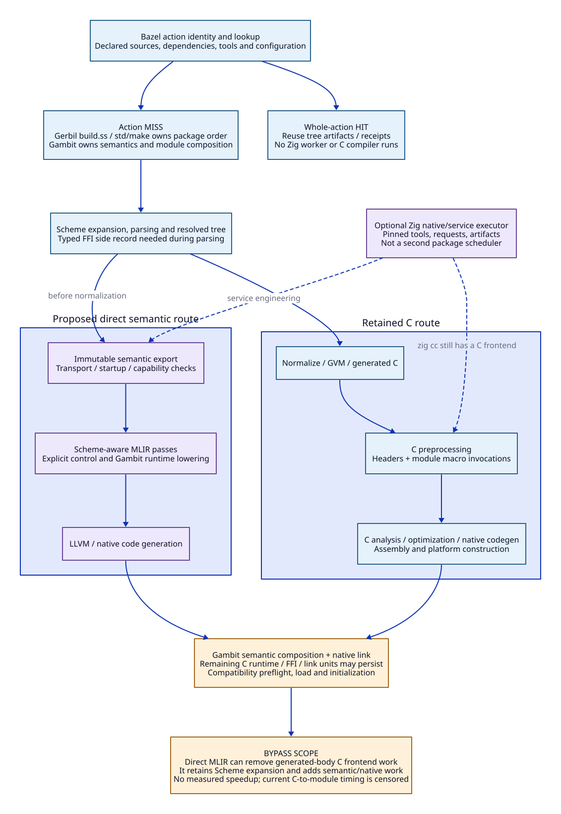

# Compilation Cost, Bazel/Zig Reuse and the Direct MLIR Path

Date: 2026-10-19. Status: architecture research only. No compiler, performance
campaign, native test or cache experiment is run by this update.

This study extends the [native contract](zig-native-contract-design.md),
[semantic path](zig-high-level-semantics-design.md) and
[pass admission policy](mlir-pass-admission.md). Its central decision is to reduce
the work required on a cache miss as well as the frequency of misses. Adding a
second build coordinator does not establish either benefit.

## 1. Selected Architecture and Fundamental Questions

Keep Bazel as the outer action/dependency/cache authority where it already owns
the build. Keep Gerbil `build.ss` / `std/make` responsible for package compilation
membership/order. Zig is a possible native construction/service executor beneath
an explicit boundary, not a competing package graph or a mandatory second cache.
Standalone users can have a Zig-owned graph under the same contracts.

Four different changes must be evaluated independently:

1. **Change C compiler**: GNU GCC versus a qualified Clang/`zig cc` toolchain.
   The macro-heavy generated C remains; cold cost may improve or regress.
2. **Avoid repeating identical work**: reuse a complete Bazel action, generated
   C, a native object or a published AOT artifact, with precise invalidation.
3. **Reduce required work**: avoid compiling a pure loader as a native module,
   eliminate unobservable allocations, or reduce unnecessary generated structure.
4. **Change representation path**: lower preserved Scheme semantics to MLIR and
   native objects without materializing C for that part. This requires substantial
   semantic/runtime work, and can still have expensive optimization/code generation.

The architectural questions are: what is the smallest **correct** compilation
unit; which assumptions make it reusable; which changes invalidate it; and what
cost remains when it must actually be rebuilt? Zig is useful if it helps realize
these boundaries with less duplicated engineering. It is not necessary for Bazel
to cache an action, and replacing Make/Bazel is not this study's objective.



## 2. Evidence Scope and Source Identity

Research repository HEAD: `b67da6262a973a0ae898002d5c7f5be2d8b5a90d`.
Parent gerbil-bazel HEAD: `1fbe651e0e7c28a460b09ccd974c3798b9408c48`.
Vendor Gambit: `7c490c3ab5b5a4238b26f4a59d8cd9fd4b085882`, tracked tree clean
at inspection. Both repositories have other concurrent work; it is not changed.
Parent receipts below refer to their recorded historical candidates, not today's
SMP candidate. Do not transplant their runtime/profile admission.

| ID | Source/document read | What it establishes |
| --- | --- | --- |
| G1 | `vendor/gambit/gsc/_gsclib.scm:308-390,498-593` | Scheme/target generation precedes configured native construction; input/output/module/linker/options influence the request |
| G2 | `_gsclib.scm:659-675,725-731` | Incremental/flat Scheme module linking uses `c#link-modules`, distinct from the platform linker |
| G3 | `gsc/_t-c-1.scm:1178-1205,1426-1448` | Generated module counts/descriptor/version/module/linker macros precede or parameterize `gambit.h` use |
| G4 | `include/gambit.h.in:1-37`; existing native-contract source table | Version/config/compiler-sensitive header and generated execution macros form a private compiler/runtime protocol |
| G5 | `bin/gambuild-C.unix.in:1-38,241-280,330-410` | Configured flags, environment overrides and metadata/pkg-config affect construction; explicit compiler override clears the corresponding mode flags |
| G6 | `src/gambit_smp/compiler_phase_primitives.py:1-31`; `compiler_cost.py:54-90` | Existing probe times Scheme-to-C, C-to-dynamic-module and execution as coarse separate stages; it does not time preprocessing alone |
| B1 | Parent [`gerbil/project.bzl:180-208`](../../../../../gerbil/project.bzl) | One `GerbilProjectCompile` action declares source/dependency/toolchain inputs and tree/receipt/log outputs |
| B2 | Parent [`README.md:169-222`](../../../../../README.md) | Test matrix shares compile action; installed driver remains immutable; mode flags and Darwin final-link selection are explicit; `std/make` remains scheduling owner |
| B3 | Parent [RFC 0006](../../../../../docs/rfc/0006-build-scenario-receipt-v1.org), normative scenarios | Separate cold action, identical rerun, dependency delta and configuration delta before attribution |

Source anchors are baseline observations; existing candidate patches are separate
inputs governed by the native contract. Neither a source mechanism nor a proposed
scenario is a new successful measurement.

## 3. Macro Expansion Is Only One Cost Boundary

Do not conflate Scheme macro expansion with C preprocessor expansion. The coarse
Scheme-to-C stage includes parsing/expansion, normalization, generation and compiler
startup. The C-to-module stage may include driver/process overhead, header search,
preprocessing, C parsing/semantic analysis, optimization, code generation, assembly
and native linking. Integrated compilers can interleave these internally.

The retained [compiler-cost report](../../compiler-cost-boundaries.md) records:

| Observation | Retained result | Permitted inference |
| --- | --- | --- |
| runtime021 numeric Scheme-to-C | Completed, 30.818 s; 152,462 C lines | Significant generation-stage work and emitted volume |
| Same probe C-to-module | Killed after 59.250 s; whole attempt 90.384 s, DENY | Unfinished downstream construction; not a completed baseline time |
| Compiled execution | Not started | No runtime comparison |
| runtime020 full campaign | DENY at 300.316 s | Retained incomplete campaign, not a new retry target |
| Driver-bound fxmul calibration | Interpreted 0.346 s; compiled mode 8.183 s | Adapter/driver calibration under that report's scope, not Zig benefit |

The numeric probe used GCC16, `-O1` and `-ftrack-macro-expansion=0`; it predates
the later configured-driver hash guard. These are report-derived historical
values. No raw receipt is re-admitted here. There is no preprocessing-only timing,
expanded-token census, optimization-stage attribution or matched macOS/Linux
comparison. The 152,462 lines are generated C, not post-preprocessing volume.

[GCC's preprocessor documentation](https://gcc.gnu.org/onlinedocs/gcc/Preprocessor-Options.html)
states that `-ftrack-macro-expansion` controls token-location tracking and consumes
additional memory. Setting zero disables tracking, not expansion. The existing
option therefore cannot be presented as a cure that has not yet been tried.

`zig cc` in [Zig 0.16.0](https://ziglang.org/download/0.16.0/release-notes.html#zig-cc)
uses Clang 21.1.8. This is distinct from C-to-Zig translation and Zig's own native
backend work. Feeding it the same generated C still requires C frontend work.
Neither this version fact nor macOS target support establishes a GCC speedup.
The service/toolchain version remains unselected; release notes are evidence,
not an installation or upgrade decision.

### 3.1 PCH and Preprocessed C Have Narrower Benefits

[Clang PCH internals](https://clang.llvm.org/docs/PCHInternals.html) describe saved
frontend state, target/language/predefine validation and serialized macro
definitions. That can reuse header processing, but macro invocations in newly
generated module bodies and their expanded C still require processing. A PCH
does not cache the completed translation unit's optimization/code generation.

[GCC PCH requirements](https://gcc.gnu.org/onlinedocs/gcc/Precompiled-Headers.html)
include compiler and compatible macro/target options. Gambit's module-specific
counts/descriptors/configuration before `#include "gambit.h"` (G3) make a single
universal PCH an unproved proposal. Reusable header partitions might be possible,
but require a generator/header dependency audit; freezing the wrong macro context
would change emitted semantics. No PCH is introduced here.

Caching `.i` output can skip preprocessing **only if** its full input/dependency
closure is already authenticated without rerunning preprocessing. A cache keyed
by freshly computed preprocessed bytes pays that frontend cost on every lookup.
Caching object files can skip more stages; it still needs valid source/header/
tool/options identity. These are different reuse algorithms, not interchangeable
uses of the word cache.

## 4. Existing Bazel and Native Evidence Changes the Zig Case

### 4.1 What Bazel Already Owns

The actual project rule (B1) invokes a whole-project compilation action and
publishes tree artifacts. An identical valid action hit skips the project build
entirely, so Zig/native workers must not be credited with a speedup on that path.
The RFC requires zero `GerbilProjectCompile` executions on an identical rerun and
preservation of the independent branch on a dependency delta. Those are specified
structural expectations; `.ci/receipts/build-scenarios.json` was unavailable at
inspection, so this document does not claim a fresh measured pass.

An action miss is different: Bazel does not automatically understand every
Scheme/C submodule inside `build.ss`. Inner reuse can matter when the package
action reruns, but cannot assume mutable files persist from a previous sandbox.
Use declared immutable upstream artifacts or an explicitly designed cache input/
output contract. Do not declare a hidden user-home cache hermetic merely because
the caller is Bazel.

[Bazel caching](https://bazel.build/remote/caching) distinguishes action-result
metadata and content-addressed outputs; declared inputs, command and environment
define the action. Its [hermeticity guidance](https://bazel.build/basics/hermeticity)
supports closing tool/environment inputs. A successful cached build is distinct
from a currently compatible Scheme runtime artifact and from release admission.

### 4.2 Retained Experiments: Positive Components and Negative Integrations

All following values are read from parent repository receipts. Raw `.data`
campaigns are not rerun or required for this source review; the v4 MCP raw report
was unavailable. Keep their original candidate/runtime hashes and limits.

| Evidence | Retained observation | Consequence |
| --- | --- | --- |
| [Static-object v4 checkpoint](../../../../../patches/gerbil-v19-darwin/receipts/d1510-static-object-reuse-v4-checkpoint.json) | Default-off; `productionAdmitted=false`, `performanceGainAttributed=false`, cold hits 0. ASCENT component: control 43.08 s, populate 47.25 s, hit 38.42 s with 71 hits/1 miss | Warm reuse is plausible, but cold results cannot be attributed to a cache with zero hits; no general admission |
| [Configured request-cost DENY](../../../../../patches/gerbil-v19-darwin/receipts/d1510-object-request-cost.md) | Matched A/B/B/A all-HIT waves: ordinary 0.83/0.93 s; preparation+coordinator 1.52/1.66 s | Means 0.88 versus 1.59 s, about 81% extra component cost; adding coordination can lose |
| [Closed generation boundary](../../../../../patches/gerbil-v19-darwin/receipts/d1510-compiled-closed-generation-boundary.md) | v5: 55 real modules, ordinary 3.615736/3.575524 s; population 3.597891 s; closed HIT 0.077661 s, with C-byte and whole-link parity controls | Avoiding Scheme-to-C regeneration has a demonstrated warm component opportunity; population has no established gain; package integration unadmitted |
| [Generated-C cold DENY](../../../../../patches/gerbil-v19-darwin/receipts/d1510-generated-c-mcp-cold-denial.md) | First compile absent at 5.041113 s; build interrupted; empty log; no proof found | No complete-build benefit and no attribution to C generation or adapter execution |
| [Source-loader cold extension](../../../../../patches/gerbil-v19-darwin/receipts/d1510-source-loader-cold-build-extension.md) | Historical original single-VM profile: ABBA complete-build means 51.335220 versus 44.486980 s; 187 pure loader sources, original 186 native loaders versus candidate 0 | Approximately 13.34% less build elapsed time for that candidate/workload; avoiding native work can matter. This does not qualify SMP, full tests or Zig |

The loader candidate changes artifact classification: it retains the same loader
source and uses an existing runtime source-loader fallback instead of compiling
that guarded pure-loader shape. It is not universal native-artifact parity, and
it can move work to loading. Startup, runtime behavior and deployment requirements
therefore remain separate tradeoffs. It does not imply that every module should
be interpreted or that arbitrary runtime code can skip native compilation.

The static-object patch [0019](../../../../../patches/gerbil-v19-darwin/0019-gambit-darwin-static-object-reuse-candidate.patch)
and hardening [0020](../../../../../patches/gerbil-v19-darwin/0020-gambit-darwin-static-object-reuse-hardening.patch)
show a full `-E` result being computed before proof comparison; a hit does not
eliminate that preprocessing. [0021](../../../../../patches/gerbil-v19-darwin/0021-gambit-darwin-native-static-reuse-digests.patch)
replaces repeated external hash processes with a native digest helper while
binding its identity. This is evidence of existing engineering work, not a new
opportunity created by Zig.

The request-cost receipt also reports that `schedule-darwin-objects-and-link`
already submits static object jobs before the link barrier. A new Zig scheduler
must not claim to introduce absent parallelism. The
[host-distance review](../../../../../patches/gerbil-v19-darwin/receipts/d1510-stdlib-rebuild-and-host-distance.md)
finds same-image host code within 22.83 MiB; it rejects transfer of V8's >4 GiB
Apple M1 call-distance explanation to those hosts. No generic Apple/macOS cause
of slow macro expansion follows from these records.

## 5. Reuse Layers, AOT Products and Invalidation


Gambit's existing Scheme-to-C-to-native path is already AOT. The new proposal is
layered publication/reuse and optional different code generation, not the first
introduction of ahead-of-time compilation. A cache entry is disposable; a released
AOT bundle has a governed provenance/compatibility/distribution contract.

| Layer | Reusable product and work avoided | Required identity / invalidation frontier | Owner / selected policy |
| --- | --- | --- | --- |
| L0 toolchain/runtime | Configured tools, runtime library, headers, manifests; avoids rebuilding stable dependencies | Source/patches, compiler/tools, architecture/ABI, VM/SMP/GC configuration, SDK/minimum OS and linked dependencies | Bazel provider or release producer; Zig consumes it, does not invent another runtime identity |
| L1 semantic/generation | Immutable generated C or resolved semantic export plus FFI side records/summaries; avoids repeated generation | Source/import/include/macro-expander closure, compiler and options, module/linker names, declaration/semantic/target schema and assumed summaries | Gambit producer; arbitrary macro/foreign compiler-time effects prevent automatic cacheability |
| L2 module native | C-route object or service-produced native object plus required metadata; avoids relevant frontend/backend work | L1 digest, full header/config closure, codegen tool/options/target, runtime protocol and FFI dependencies; MLIR path also pass/service versions | One explicit native action; Zig can execute it; runtime-compatible object is distinct from a C-ABI companion |
| L3 composition/link | Gambit semantic link unit, native executable/dynamic module and descriptors | Ordered members, aliases, link modes, runtime libraries, generated link C, linker/SDK/options and initialization actions | Gambit semantic composition followed by native platform linker; member change usually invalidates link output |
| L4 published AOT bundle | Matched module/dependency closure and manifest; avoids target-side compilation | Exact artifact role, content/provenance, runtime generation, target/deployment requirements and dependency assumptions | Distribution producer; Gambit preflight/load/fixup/init stays authoritative |

These are logical products, not an instruction to expose every private stage as
a Bazel target today. The current project action remains coarse-grained. Refining
it requires preserving upstream package membership/order and cross-module semantic
assumptions. Cross-module optimization and broad macros can enlarge the correct
invalidation frontier; smaller files alone do not guarantee independent reuse.

Invalidate only dependent products, but never suppress required invalidation:

- A nonsemantic documentation edit should not enter compilation input closure.
- A changed Scheme body invalidates its generation/native products and dependent
  specialization summaries, plus affected composition/link products.
- A macro/include/import or effective declaration change can invalidate consumers
  even when their own text is unchanged. Compile-time effects must be closed or
  the generation action remains noncacheable.
- A private runtime-layout, root/frame/calling convention or VM profile change
  invalidates every dependent native artifact; source-level API stability is
  insufficient. Matching can require regenerating C as well as rebuilding it.
- MLIR pass/service changes invalidate its outputs; independent C outputs can
  survive if their own semantic/runtime inputs have not changed.
- A link option or deployment-target change invalidates affected link/admission
  products; some options also affect object construction, so do not classify
  them by name alone.

Preserve module names and ordered semantic linking (G1/G2); output paths can be
semantic inputs in existing generation. Path normalization needs an equivalence
argument, not blind stripping to improve hit rate. Avoid timestamp/random/path
variation in proposed products where possible, while preserving defined source
location behavior and diagnostics.

## 6. What Zig Caching Can and Cannot Add Under Bazel

The [Zig build guide](https://ziglang.org/learn/build-system/) describes a dependency
graph with concurrency, generated outputs and caching. That is a reusable mechanism,
not automatic dependency discovery for every external Scheme command. The online
guide is rolling; exact integration APIs must be pinned before implementation.

For concrete versioned evidence, [Zig 0.15.1 `Step/Run.zig`](https://raw.githubusercontent.com/ziglang/zig/0.15.1/lib/std/Build/Step/Run.zig)
documents rerun behavior for side-effecting commands, tracked file/output arguments
and discovered dependency files (`stdio`, `file_inputs`, `addFileArg`,
`addOutputFileArg`, `addDepFileOutputArg`). It also exposes environment handling.
This supports designing explicit external-tool actions; it does not certify a
0.16 API, a persistent service cache or arbitrary environment hermeticity.

Select these ownership rules:

1. Bazel performs its lookup first. On a whole-action hit, do not launch Zig.
2. On a miss, use declared dependencies/artifacts. Zig may execute native actions
   or a finite compiler-service request without taking ownership of Gerbil package
   identity or semantic linking.
3. An inner cache is optional. Admit it only if its avoided work exceeds lookup,
   dependency discovery, validation, copying, process, locking and publication
   costs, while its dependencies remain complete in the sandbox.
4. Reuse the authoritative input closure instead of repeatedly reconstructing
   proof through shell/environment/tool probes at each layer. Preserve mutation
   checks and provenance; removing checks without an equivalent contract is not
   an optimization.
5. Do not move live Scheme execution, tests or effectful initialization into a
   cacheable generation step. Cache data/code artifacts; execute runtime obligations
   under their actual admission policy.

Build Systems à la Carte's [author paper](https://simon.peytonjones.org/assets/pdfs/build-systems-original.pdf)
separates scheduling and rebuilding as architectural dimensions. That distinction
supports assigning each graph frontier one owner, rather than assuming a new
language for the scheduler fixes dependency identity or the work of a miss.

The [unit and artifact refinement](compilation-unit-artifact-contract.md) now
specifies those boundaries: semantic units, shared-snapshot requests and Bazel
actions are distinct; default dependency propagation is conservative; every
product separates request/content identity, compatibility and admission.
It also states the analysis-time graph constraint and required source changes.

## 7. MLIR Bypass: What Disappears and What Remains

Select the already designed pre-normalization semantic export with a separate
parse-time typed FFI record. Higher-order/effect/escape work precedes runtime
representation and native lowering. It can bypass **generated Scheme-body C**,
its macro expansion and C parsing for accepted code. It does not bypass Scheme
macro expansion or other parsing already performed before export.

| Route | Costs retained or added | Bypass scope |
| --- | --- | --- |
| Gambit C -> `zig cc` | Existing C frontend plus Clang/native toolchain costs | No structural removal of C |
| Generated C -> C-to-MLIR frontend | C preprocessing/parsing plus MLIR conversion/passes/native backend | Does not address the C frontend bottleneck by bypassing it |
| High Scheme export -> MLIR -> protocol-aware C | Export/service/passes plus C emission and C compilation | May reduce generated volume; C frontend still present |
| High Scheme export -> MLIR -> LLVM/native | Export/transport/passes, runtime lowering and native backend | Removes C-body emission/frontend for covered code; still requires tail calls, roots, frames, labels and module protocol |
| Specialized C-ABI kernel companion | Extraction/checks/conversions plus kernel compilation and boundary calls | Bypasses C only for the kernel; does not implement general Scheme code objects |

Runtime C, foreign converter/wrapper islands, embedded `##c-code`, generated
semantic-link C and platform dependencies can remain. Rewriting one stage to
MLIR does not make the whole build C-free. To bypass link C too would require
implementing equivalent Gambit metadata/composition generation, separately
qualified. Existing [FFI coverage](primitive-ffi-coverage.md) and pass restrictions
apply; unsupported semantics must not be dropped for a smaller compilation unit.

Inlining/vectorization/LTO can shift work to expensive optimization or linking.
[ThinLTO documentation](https://clang.llvm.org/docs/ThinLTO.html) describes a
separate incremental backend cache requiring linker configuration. It does not
remove C preprocessing and is not synonymous with Zig's build cache. The design
does not select LTO; any later use must account for changed cross-module
dependencies, link RSS and target support.

## 8. Quantitative Boundaries Without New Measurements

### 8.1 Historical Ratios Have Narrow Meaning

The v5 closed-generation midpoint is `(3.615736+3.575524)/2 = 3.595630 s`.
Subtracting its 0.077661 s HIT gives **3.517969 s** avoided component elapsed
time, about **46.30x** for that measured component. This is not a package-speedup
factor and cannot be divided by the unrelated numeric fixture's 30.818 s.

The v4 ASCENT component compares 43.08 s control with 38.42 s HIT, a descriptive
**4.66 s / 10.82%** lower elapsed time, while population is **4.17 s / 9.68%**
higher. The checkpoint explicitly withholds general attribution/admission.
The all-HIT coordinator regression has means 0.88 versus 1.59 s: **0.71 s /
80.68%** extra request cost. A 71-hit count therefore cannot stand in for a
benefit model that includes acquisition and validation costs.

The pure-loader ABBA's 13.34% cold reduction is stronger evidence for reducing
required native work in that historical profile than a hypothetical new cache.
It supplies no numerical prediction for a new SMP runtime or direct MLIR path.
Do not combine these candidates' times into one synthetic successful build.

### 8.2 Cache Break-Even and Scope

For a complete action with cold execution cost `C`, hit probability `p`,
validation/materialization cost `H`, and miss-only population cost `W`, a simple
sequential expected cost is:

```text
E[T] = H + (1-p)*(C+W)
net saving against always executing = p*C - H - (1-p)*W
```

All quantities refer to one consistent action boundary. For an inner cache
reached only on an outer Bazel miss probability `q`, its additional expected
saving is `q * (p*C-H-(1-p)*W)` for the inner avoided component. With `q=0`
there is no inner compilation saving. This prevents double counting a Bazel
hit and an object hit for work that was already skipped.

Illustrative assumption only: with inner `C=4 s`, `H=0.2 s`, `W=0.1 s`,
break-even is `p > 0.3/4.1`, approximately **7.32%**. At `p=0.5`, expected
inner saving is 1.75 s; if `q=0.1`, total expected saving is only **0.175 s**.
These invented values are not estimates of Gambit/Zig behavior. An untracked
dependency invalidates the model's correctness before any saving is counted.

For a preprocessed-content object cache, split `C=P+R`: preprocessing `P` still
occurs, while a hit avoids only downstream work `R`. Net benefit becomes
`p*R - H - (1-p)*W`, with `P` paid on every lookup. A metadata/source-closure
cache can avoid `P` only with a separately sound dependency validation scheme.

### 8.3 Cold Path, Critical Path and Bypass

Let a covered C route cost generation `F`, preprocessing `P`, C analysis `A`,
optimization/codegen `O` and remaining link/admission `L`. A direct MLIR route
has `F' + export + transport/startup + semantic passes + runtime lowering + O' + L'`.
The bypass wins only when the removed costs exceed all added/changed terms.
Existing evidence supplies none of `P`, `A`, `O`, `F'` or `O'` separately, so
there is no justified direct-path speedup or macro-expansion percentage.

If a hypothetical fraction `f` of critical-path wall time is removable and that
part becomes `s` times faster, the ideal bound is `1/((1-f)+f/s)`, before added
overhead. Example assumptions `f=0.2,s=4` give **1.176x**; `f=0.5,s=4` give
**1.6x**. Both are sensitivity examples. Parallel object CPU-time savings cannot
be summed as wall-time savings: only critical-path reduction or relieved shared
resource contention shortens completion. Already-parallel scheduling, memory
pressure and link barriers matter.

AOT publication moves production cost to a producer; it does not destroy that
cost. Across `N` compatible consumers, compare `N*C` with
`producer_build + publication + N*(fetch+verification+remaining_link/load)`.
An architecture/profile matrix or frequent invalidation reduces amortization;
first build, warm repeat, dependency delta, release materialization and runtime
startup are separate outcomes. No cache state may turn a timeout into a completed
measurement.

## 9. Decision and Remaining Design Work

The fundamental selected direction is **explicit stable products with correct
invalidation, less mandatory native work, and an optional direct semantic backend**.
First reuse existing Bazel/project/native evidence and ownership. Add Zig where
its service/construction implementation removes duplicated engineering; keep its
cache subordinate or unnecessary on the Bazel path. An architectural benefit
must survive misses and validation overhead, not only a favorable HIT microcase.

Before implementation planning, specify the exact product schemas/dependency
closures, persistent-artifact delivery under Bazel, allowable module partitioning,
compile-time effect policy, runtime protocol generation, and the direct backend's
remaining C/link obligations. The record supports these decisions and bounded
opportunities; it does not select a compiler replacement or admit acceleration.

## 10. Read-Snapshot Hashes and Verification Boundary

| Input | SHA-256 |
| --- | --- |
| `docs/compiler-cost-boundaries.md` | `a5f25e6d357182883d50453f09b4e6302d883a192848f28474e3900a80e630f9` |
| `src/gambit_smp/compiler_cost.py` | `9ea1e2d952f406875d2f299ce9552201b2c2f14ea02b7b6027213a6600202aa9` |
| `src/gambit_smp/compiler_phase_primitives.py` | `d1c54213e7b7326ac8b06bc68bb84e87339d78580d5466d87110ea95eb3e77e7` |
| `vendor/gambit/bin/gambuild-C.unix.in` | `bdd99a03bb24206e348bdc6ae760a02c04573694090e21cc0a9b748dc8522b4c` |
| `vendor/gambit/gsc/_gsclib.scm` | `c4068e8d8c34135354d26c8a6e79adcac73bf34f432b857961bdb4932da94dd0` |

Parent report identities and the checks performed for this documentation update
are retained in the [companion evidence snapshot](compilation-cost-evidence.md).
Historical observation, current source reading, arithmetic and native qualification
remain separate. No benchmark or rejected campaign was rerun.
